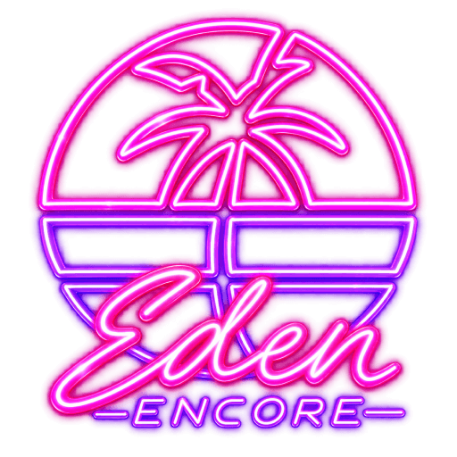
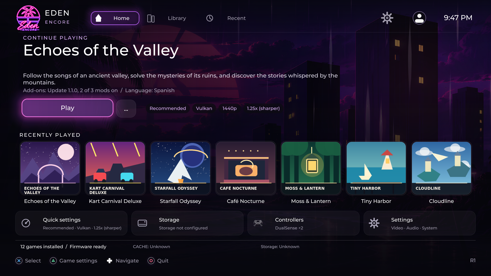

  

  <h1>Prospero.Eden Encore</h1>

  <h3>Emulación nativa en consola, pensada para jugar desde el sofá.</h3>

  
<strong>Un proyecto comunitario de emulación nativa para PS5, centrado en el firmware 13.60: carga de NSP, XCI, NSZ, XCZ, NRO, NSO, NCA, NAX y KIP, descompresión LZ4 y ZBIC/zstd, interfaz para TV y compilaciones reproducibles.</strong>

  
<a href="README.md">English</a> · <a href="README.fr.md">Français</a> · <strong>Español</strong>

  
<kbd>Firmware 13.60 · probado en hardware</kbd> <kbd>Vulkan + OpenGL</kbd> <kbd>Interfaz para TV</kbd> <kbd>Dynarmic</kbd>

  

    <a href="#por-que-encore"><strong>Ventajas</strong></a> ·
    <a href="#instalación"><strong>Instalación</strong></a> ·
    <a href="#compatibilidad-y-limitaciones"><strong>Compatibilidad</strong></a> ·
    <a href="https://github.com/niakw/ProsperoEden-Encore/blob/feat/graphics-network-achievements/docs/ROADMAP_ENCORE_COLLAB_2026-10-25.md"><strong>Roadmap</strong></a> ·
    <a href="https://github.com/niakw/ProsperoEden-Encore/tree/research/ns2-ps5-compatibility"><strong>Switch 2</strong></a> ·
    <a href="#faq"><strong>FAQ</strong></a> ·
    <a href="README.md#credits"><strong>Créditos</strong></a>
  

  
  
  

Vista previa: las portadas, los juegos y las descripciones mostrados son **ficticios** y solo ilustran el diseño. La captura procede del lanzador real de Encore y **no** representa una lista de compatibilidad.

> [!IMPORTANT]
> **Firmware recomendado/probado para Encore: 13.60, la única versión realmente ensayada en PS5.** Las versiones **anteriores podrían funcionar** con un entorno homebrew compatible, pero **no están verificadas con Encore** y no se ha establecido un firmware mínimo. Los firmwares posteriores tampoco se han certificado. Incluso en 13.60 persisten problemas de fluidez y bloqueos. «Recomendado» **no** es una indicación de actualizar tu consola.
>
> **FC27 sigue teniendo problemas conocidos:** tirones, algunas imágenes y textos HUD retrasados, controles personalizados en partido y bloqueos durante la pausa, el descanso o el final. [Seguimiento técnico FC27/F07](docs/FC27_F07_MASTER_TRACKER.md). Los tests del código y una compilación correcta **no equivalen a una prueba de jugabilidad**.
>
> **Antes de probar un paquete:** verifica el commit SHA exacto, el archivo compilado y los símbolos correspondientes. [Lista de comprobaciones](docs/PRETEST_AUDIT_2026-10-14.md).

---

## ✨ ¿Por qué Encore?

La emulación en una consola no consiste únicamente en ejecutar un juego: la navegación desde el mando, los ajustes, el almacenamiento, la recuperación y la estabilidad también importan.

| Área | Qué ofrece Encore |
| --- | --- |
| **Experiencia de salón** | Inicio, biblioteca, juegos recientes, ilustraciones, navegación con mando y opciones rápidas. |
| **Carga de contenido** | NSP, XCI, NRO, NSO, NCA, NAX y KIP; NSZ/XCZ experimentales; descompresión interna LZ4 y ZBIC/zstd. |
| **Seguridad de los ajustes** | Inicio seguro temporal (Safe Launch), restablecimientos confirmados y migración de datos protegida. |
| **Perfiles por juego** | Mínimo, Recomendado, Alto, Ultra y Personalizado al modificar un perfil. |
| **Gráficos** | Vulkan/RADV y OpenGL, resolución, filtrado, escalado, nitidez, antialiasing y cachés. |
| **Análisis de rendimiento** | Intervalos entre fotogramas, CPU/JIT, sincronización Vulkan, presión de memoria, bloqueos y servicios del juego. |
| **Compilación reproducible** | Fuentes fijadas, submódulo vendor, pruebas automatizadas y comprobación del paquete nativo. |

El objetivo es **conservar una base nativa funcional, incorporar cambios upstream de forma selectiva y comprobar cada etapa por separado: código → paquete nativo → consola real**. Para empezar: [instalación](INSTALL.md), [limitaciones](#compatibilidad-y-limitaciones) y [preguntas frecuentes](#faq).

<strong>¿Es Encore solo un cambio de nombre?</strong>

No. Desde el **4 de octubre de 2026** se han incorporado cambios en el JIT y la memoria, GPU/Vulkan, cachés, carga de contenido, interfaz, mandos, seguridad, infraestructura y pruebas. El traslado al repositorio independiente se realizó el **30 de octubre de 2026**. La [primera pregunta de la FAQ](#faq) incluye el inventario técnico ampliado; las [notas del proyecto](MEMORY.md) y el [historial de commits](https://github.com/niakw/ProsperoEden-Encore/commits/main/) conservan el detalle por revisión.

---

## 🗺️ Roadmaps, ramas de investigación y actualizaciones

- **[Roadmap completa de funcionalidades R00–R25](https://github.com/niakw/ProsperoEden-Encore/blob/feat/graphics-network-achievements/docs/ROADMAP_ENCORE_COLLAB_2026-10-25.md)** de la [rama de desarrollo independiente](https://github.com/niakw/ProsperoEden-Encore/tree/feat/graphics-network-achievements): FSR, generación de frames, AA, temas, biblioteca, red, trofeos y **actualizador de la aplicación R21**. **Una especificación o prototipo no equivale a una función publicada.**
- **[Rama de investigación Nintendo Switch 2](https://github.com/niakw/ProsperoEden-Encore/tree/research/ns2-ps5-compatibility)** y su [informe técnico](https://github.com/niakw/ProsperoEden-Encore/blob/research/ns2-ps5-compatibility/docs/NS2_PS5_FEASIBILITY_2026-10-30.md): experimentos con carga, CPU/IR y shaders NSW2; **no incluidos en la release PS5 actual**.
- **[Seguimiento de estabilidad y optimización PS5/F07](docs/FC27_F07_MASTER_TRACKER.md)**: la rama main es la referencia de desarrollo del motor PS5.
- **Las actualizaciones del ProsperoEden nativo se revisan individualmente, sin sincronización automática.** Encore parte de **ProsperoEden v1.000.040** ([base técnica](docs/FORK_NOTES.md)) y selecciona correcciones compatibles mediante [auditorías upstream](docs/UPSTREAM_GAP_REGISTER_2026-10-14.md). **El actualizador integrado R21 está previsto, no disponible.**

---

## 📦 Formatos y compresión

| Categoría | Formatos | Estado |
| --- | --- | --- |
| Contenedores de juegos | **NSP, XCI** (<code>.nsp</code>, <code>.xci</code>) | Descubrimiento y lanzamiento disponibles según el juego. |
| Contenedores comprimidos | **NSZ, XCZ** (<code>.nsz</code>, <code>.xcz</code>) | Lector NCZ experimental: aún requiere certificación nativa y en consola. |
| Ejecutables y contenido directo | **NRO, NSO, NCA, NAX, KIP** | Selección disponible; pueden necesitar otros archivos compatibles. |
| Compresión interna | **LZ4, ZBIC/zstd** | Descompresión de segmentos NSO; **no son extensiones de juegos**. |
| Directorios extraídos | **ExeFS** | Carpetas con los archivos reales <code>main</code> y <code>main.npdm</code>, sin enlaces simbólicos. |

NCZ admite bloques con acceso aleatorio. Un archivo con compresión «solid» puede necesitar descomprimir temporalmente el contenido en <code>/data/prosperoeden/user/cache/nsz/</code>, por lo que se requiere espacio suficiente. Un lector experimental integrado en el código no implica compatibilidad certificada con cada juego.

[Guía de instalación y almacenamiento](INSTALL.md) · [Matriz detallada de formatos](docs/CONTENT_FORMAT_MATRIX_2026-10-23.md).

---

## 🚀 Instalación

Para versiones publicadas, utiliza las [Releases de GitHub](https://github.com/niakw/ProsperoEden-Encore/releases) y lee las notas de la versión concreta. Los artefactos de **GitHub Actions son compilaciones de desarrollo**, salvo que exista una validación adicional.

- **Identificador de la aplicación PS5:** <code>PPSA99008</code>.
- **Carpeta de instalación:** <code>/data/homebrew/PPSA99008/</code>.
- **Datos persistentes:** <code>/data/prosperoeden/</code>, con carpetas <code>keys/</code>, <code>firmware/</code>, <code>roms/</code>, <code>updates/</code>, <code>mods/</code>, <code>save-import/</code> y <code>save-export/</code>.
- **Paquetes:** ZIP con la carpeta nativa; FFPFSC opcional cuando se publique.

El almacenamiento externo modifica la **raíz** de los datos, no la estructura de subcarpetas. **No borres tus partidas ni los datos anteriores al actualizar.** Encore no incluye juegos comerciales, firmware, claves propietarias ni DLC.

**Para sustituir la carpeta original de ProsperoEden nativo:** ambos utilizan el ID `PPSA99008` y `/data/homebrew/PPSA99008/`. **Haz una copia de seguridad de la aplicación completa (incluyendo `assets/` antiguo), `/data/prosperoeden/` y cualquier raíz de almacenamiento externa**; sustituye los archivos de la aplicación por la carpeta completa de Encore **sin borrar los datos antiguos**, inicia Encore y comprueba la migración. Es **una sustitución de la misma aplicación**, no una instalación paralela. Consulta la [guía para actualizar desde el ProsperoEden nativo](INSTALL.md#upgrade-from-native). Un ZIP original upstream no es una actualización de Encore.

[Instrucciones completas](INSTALL.md) · [Compilar desde el código fuente](docs/BUILDING.md) · [Soporte](SUPPORT.md).

---

## 🎮 Experiencia con mando

| Función | Descripción |
| --- | --- |
| **Inicio / Biblioteca / Recientes** | Interfaz pensada para la TV, navegación con mando y metadatos multimedia con alternativa sin conexión. |
| **Carátulas 3D animadas** | Caras delantera y trasera cuando existen escaneos, con reconstrucción nativa a partir de ilustraciones disponibles si falta alguna. [Detalles](docs/LAUNCH_CASE_ARTWORK.md) |
| **Ajustes rápidos** | Preferencias de vídeo y perfiles por título sin salir del flujo del launcher. |
| **Perfiles gráficos** | **Mínimo → Recomendado → Alto → Ultra → Personalizado**. |
| **Safe Launch** | Durante **una sola sesión**: OpenGL, escala 1×, 1080p, filtrado bilineal, modo portátil, 60 Hz y mods desactivados. |
| **DualSense** | Navegación, asignaciones físicas, vibración y zonas muertas; la configuración interna de cada juego es un mecanismo separado. |
| **Idiomas** | Catálogos de la interfaz para **29 idiomas**, incluidos sistemas de escritura complejos. |
| **Accesibilidad** | Opciones y limitaciones documentadas de contraste, tamaño del texto y reducción del movimiento. |

Safe Launch **no borra las partidas guardadas ni sobrescribe permanentemente los ajustes**. Los iconos de botones que dibuja un juego Switch no se convierten automáticamente en iconos de PlayStation.

[Accesibilidad](ACCESSIBILITY.md) · [Investigación sobre iconos PlayStation](docs/PS5_INGAME_GLYPHS.md).

---

## ⚙️ CPU, GPU y memoria

- **Dynarmic sigue siendo el JIT de producción.** Un JIT compartido entre núcleos o una traducción anticipada no se activan sin validaciones de concurrencia.
- **Vulkan/RADV y OpenGL** son rutas de renderizado distintas. Se comprueba que las adaptaciones figuren en las fuentes **y** en el binario seleccionado.
- **JIT sparse:** el perfil nativo incluye alias RX/RW con compromiso físico de memoria según demanda y recuperación tras invalidación completa y segura; las mejoras de memoria real sobre PS5 aún requieren mediciones comparables.
- **Cachés y shaders:** más memoria para la caché no asegura aciertos ni elimina el coste de compilación de un shader por primera vez.
- **Diagnóstico de congelaciones:** un contador de 30 FPS puede indicar que el compositor sigue presentando, incluso si el juego se ha quedado bloqueado. Se investigan la progresión de la CPU invitada, IPC, GPU, buffers y frescura de imagen por separado.

[Arquitectura](docs/PS5_NATIVE_ARCHITECTURE.md) · [Roadmap de rendimiento](docs/PERFORMANCE_ROADMAP.md) · [Auditoría de CPU/GPU/JIT](docs/INTEGRATION_AUDIT_CPU_GPU_JIT_2026-10-14.md).

---

## 🧪 Compatibilidad y limitaciones actuales

| Caso | Situación comprobada |
| --- | --- |
| **Firmware 13.60** | Principal objetivo probado en hardware; algunos juegos y el launcher han sido ejecutados. |
| Firmwares **anteriores** (mínimo desconocido) | **Posiblemente compatibles** con loader y entorno homebrew adecuados; no probados con Encore. |
| Firmwares **posteriores** | **No certificados.** |
| NSO ZBIC/zstd y LZ4 | Código integrado; ejecución dependiente del contenido. |
| **FC27** | Accede a partidos, pero hay tirones y bloqueos sin resolver. |
| **The Legend of Zelda: Breath of the Wild** | Sesiones relativamente fluidas observadas; no garantía para todos los juegos. |
| Mapeo dentro del juego | Algunos controles personalizados durante el partido aún requieren validación. |
| HUD y texturas | Puede aparecer contenido atrasado o negro; investigación abierta. |
| **Switch 2** | Investigación en rama independiente; **no compatible como función estable de la release PS5**. |

En la última captura integral de FC27 documentada (<code>2efd8b3c</code>) se observaron **858 intervalos de fotograma superiores a 50 ms**, diez superiores a 500 ms y una interrupción prolongada de la progresión del juego, aunque continuara la presentación gráfica. Los cambios posteriores sometidos a pruebas de código **todavía no equivalen a una captura más reciente que demuestre una mejora de FPS o la desaparición de ese bloqueo**.

[Análisis de la sesión](docs/FC27_STRESS_REPLAY_2026-10-14.md) · [Prioridades F07](docs/FC27_F07_MASTER_TRACKER.md).

---

## 🧪 Compilaciones y validaciones

El trabajo PS5 final se consolida en **<code>main</code>**. La investigación NSW2 se mantiene separada.

1. **Código y pruebas host:** coherencia de JIT/memoria, GPU/Vulkan, mapeos, formatos y tests de regresión.
2. **Paquete nativo:** compilación, enlaces, estructura PS5, artefactos y símbolos correspondientes al SHA.
3. **Consola real:** arranque, control, progresión del juego, cadencia, HUD y retorno seguro al lanzador.

[Prevalidación](https://github.com/niakw/ProsperoEden-Encore/actions/workflows/encore-core-preflight.yml?query=branch%3Amain) · [Paquetes nativos](https://github.com/niakw/ProsperoEden-Encore/actions/workflows/build-040-zbic.yml?query=branch%3Amain).

**Una CI verde nunca debe presentarse como prueba de estabilidad en juegos reales.**

---

## ❓ Preguntas frecuentes — X y la comunidad

Pulsa una pregunta para desplegar la respuesta. El inventario extenso de la primera respuesta incluye el trabajo realizado **desde el 4 de octubre de 2026**, no solo el cambio de nombre del repositorio.

<strong>• ¿En qué se diferencia Encore del ProsperoEden original? ¿Qué cambios y optimizaciones se han realizado desde el principio?</strong>

El desarrollo de Encore comenzó el **4 de octubre de 2026** sobre el [fork histórico](https://github.com/niakw/Prospero.Eden-Encore) y continuó en este repositorio independiente desde el **30 de octubre de 2026**. **Es mucho más que un rebranding**, aunque se apoya en las tecnologías y autores originales, a quienes se mantiene el crédito.

Esta lista agrupa las áreas de trabajo, los cambios implementados, los experimentos y las comprobaciones. **Revisar código no es lo mismo que optimizarlo; pasar un test host no significa obtener más FPS en PS5; y una función experimental no debe presentarse como publicada.** Hay componentes que ya existían en la base original y que se han conservado o mejorado. Los cambios por archivo/commit y los intentos descartados están documentados en [MEMORY.md](MEMORY.md), [inventario de fuentes](docs/EDEN_ACTIVE_SOURCE_CATALOG.md), [auditoría del motor](docs/EDEN_CORE_AUDIT_DEPENDENCIES.md), [registro de 38 funciones F07](docs/F07_FUNCTION_SCOPE_2026-10-28.md) y [commits](https://github.com/niakw/ProsperoEden-Encore/commits/main/).

**1. Plataforma PS5, estructura y distribución**
- Pruebas reales focalizadas en **firmware PS5 13.60**; otras versiones no están certificadas.
- Conservación y adaptación del puerto nativo PS5, núcleo Eden, CPU Dynarmic, Vulkan/RADV, OpenGL y launcher.
- Identidad de aplicación **PPSA99008**, instalación y rutas de datos unificadas.
- **Un único perfil RELEASE** para el paquete final; configuraciones DEV o experimentales no se distribuyen como productos separados.
- Inicio/recuperación protegidos, límites de logs, tratamiento de errores y cierre de recursos.
- Paquete ZIP correcto sin ZIP anidado, <code>eboot.bin</code>, <code>param.json</code>, opción FFPFSC, checksums y símbolos correspondientes.
- Selección e integración verificadas de cambios upstream, SDK, dependencias y fuentes Mesa/Vulkan.
- Comparación de fuentes activas, manifiestos y comprobación de su presencia en los binarios compilados.
- **Vendor** separado como submódulo Git fijado a un commit, con licencias, control de versiones y fuentes reproducibles.
- Limpieza/compactación de la historia de Git, copia de recuperación y migración a repositorio público independiente conservando la procedencia.
- Gates de CI rápidos/completos, compilación nativa, CodeQL y pruebas separadas en consola.
- Pruebas O0/O2, ASan/UBSan, modelos GPU/JIT/HLE, regresiones automáticas y auditorías de código fuente.
- Guías de compilación, auditoría de seguridad, registros históricos y atribución a autores de proyectos anteriores.
- Documentación: [compilación](docs/BUILDING.md), [migración](docs/STANDALONE_REPOSITORY_MIGRATION_2026-10-30.md), [vendor](docs/VENDOR_SUBMODULE_MIGRATION.md).

**2. Archivos de juegos y almacenamiento**
- Añadido/adaptado **ZBIC/zstd para segmentos NSO**, además de LZ4 y controles de validez.
- Detección y selección de **NSP/XCI/NRO/NSO/NCA/NAX/KIP** sin prometer arranque de cada archivo aislado.
- Lectura experimental **NSZ/XCZ/NCZ**, datos de juegos, actualizaciones y DLC, con bloques aleatorios, extracciones «solid» limitadas y gestión de caché.
- Soporte de carpetas **ExeFS** extraídas con <code>main</code> y <code>main.npdm</code> auténticos, evitando enlaces simbólicos peligrosos.
- Mejoras en validación de tamaños, descompresión, rutas, cancelación, archivos dañados y espacio temporal.
- Rutas coherentes para ROM, firmware, claves, actualizaciones, mods, partidas y cachés en discos internos/externos.
- Migración de ajustes sin sobrescritura silenciosa, reinicios confirmados y Safe Launch de una sesión.
- Revisión de metadatos, contenido adicional y servicios HLE relacionados. [Matriz de formatos](docs/CONTENT_FORMAT_MATRIX_2026-10-23.md).

**3. CPU Dynarmic, JIT y memoria**
- Investigación de traducción **AArch64/AArch32**, exclusiones atómicas, esperas, invalidaciones, hilos invitados y núcleos CPU disponibles.
- Implementación del **JIT sparse RX/RW** con dos alias y asignación de memoria física **bajo demanda en bloques de 2 MiB**.
- Comprobación de alias antes de ejecutar un título, sin reactivación silenciosa del JIT denso anterior.
- Recuperación de memoria tras invalidación completa y segura, preservando permisos y vida útil del código.
- Optimización de tablas sparse, límites de búsqueda, épocas de reserva, cachés de resultados positivos/negativos y búsquedas RX→RW.
- Rutas rápidas **fastmem Map/Unmap/Protect**, eliminando actualizaciones de permisos idénticas y reconstrucciones de alias innecesarias.
- Correcciones y auditorías de acceso a memoria invitada, alineación, límites de páginas, operaciones vacías y datos GPU marcados como modificados.
- Disminución de costes comprobados de pilas de hilos/fibras y algunas asignaciones repetidas.
- Control de memoria JIT, RAM invitada, cachés GPU, presión OOM y configuración de altas resoluciones.
- JIT compartido entre núcleos, traducción especulativa y otras estrategias arriesgadas **excluidas de RELEASE** por falta de prueba.
- Documentación: [arquitectura](docs/PS5_NATIVE_ARCHITECTURE.md), [sparse/JIT](docs/DEFERRED_JIT_QUIESCENCE_ARCHITECTURE_2026-10-17.md), [CPU/JIT](docs/EDEN_CPU_JIT_G11_G12_MIGRATION_MAP.md).

**4. GPU Maxwell, DMA, colas y sincronización**
- Ajustes de Maxwell DMA, Host1x, colas GPU/FIFO, fences, sincronización y vida útil de los recursos.
- Copias DMA y invalidaciones agrupadas con respeto al orden de comandos.
- Seguimiento de intervalos «dirty», coherencia entre escrituras CPU/GPU y comprobación de límites.
- Revisión de draw indirecto, bindings nulos, vértices/índices y rangos de recursos gráficos.
- Optimizaciones para registrar buffers/texturas pequeños y detectar páginas con un coste menor.
- Menos despertares y asignaciones en algunos caminos de worker/scheduler, con pruebas de concurrencia.
- Diagnóstico de un GPU que sigue presentando mientras el juego deja de avanzar.
- Documentación: [DMA](docs/EDEN_MAXWELL_DMA_CONTIGUOUS_BATCH_2026-10-21.md), [auditoría GPU](docs/FC27_GPU_SOURCE_TARGETS_2026-10-21.md).

**5. Vulkan/RADV, shaders, pipelines, texturas y presentación**
- Adaptación y fijación de fuentes **Mesa/RADV** y rutas de presentación nativas.
- Memoización de identidades de shaders de vértices, pequeñas cachés de claves compute y aceleración de búsquedas frecuentes.
- Publicación acquire/release de pipelines listos, prevalidación de descriptores y control de fallos en compilaciones opcionales.
- Revisión de traducción IR/SPIR-V y de esperas obligatorias del worker Vulkan sin romper dependencias de dibujo.
- Correcciones y optimizaciones en **TIC/TSC**, samplers, vistas de textura, alias, recursos vacíos y coherencia.
- Decodificación y unswizzle asíncronos, lotes BCn/3D, uploads/downloads, staging y recuperación de fallos.
- Conservación del estado de imágenes GPU modificadas cuando fallan las copias, lecturas o el almacenamiento provisional.
- Ajustes **DrawTexture → scheduler**, copias blit/resolve, framebuffer, raw pitch/stride y frescura de la imagen del HUD.
- Mejoras en swapchain, acquire/present, pérdida de superficie, recreación de capas y reciclaje por ticks GPU.
- Coalescencia de notificaciones, reducción de sincronización innecesaria y asignaciones fuera de locks.
- Evitación de reconstrucciones AA desactivadas, relojes HUD ocultos y diagnósticos innecesarios por fotograma.
- Auditoría de **38 funciones en ocho archivos**, con correcciones de seguridad de rangos, errores y rendimiento.
- **Problemas abiertos:** primera compilación de shaders, espera de pipelines, bloqueo de cachés y HUD atrasado/negro. [Detalle F07](docs/F07_FUNCTION_SCOPE_2026-10-28.md) · [Prioridades](docs/FC27_F07_STUTTER_HUD_PRIORITY_2026-10-26.md).

**6. HLE, IPC, sonido, red y DualSense**
- Investigación de threads, scheduler HLE, IPC, despertadores, servicios, sincronización y recursos.
- Estudio de **NVNflinger/SurfaceFlinger/BufferQueue/NvDisp** y de los congelamientos con presentación gráfica activa.
- Auditado PCM, mezclado, upmix, buffers de audio y salida nativa; reducción de algunas copias/asignaciones.
- Análisis de DNS, **NanoDNS**, sockets, políticas de red del invitado y errores de conexión.
- Modo de registro silencioso para evitar coste diagnóstico en el camino crítico de renderizado.
- Mapeo físico **DualSense**, curvas de sticks y gatillos precalculadas, tablas de consulta, zona muerta y vibración.
- Menos copias de muestras, reseteos de buffers cada pocos milisegundos y consultas de mandos desconectados.
- Diferenciación entre controles físicos del launcher y asignaciones guardadas dentro de cada juego.
- Documentación: [IPC](docs/PS5_R393_2026-10-12_GUEST_IPC_THREAD_DIAGNOSTICS.md), [red](docs/PS5_R296_2026-10-10_NETWORK_AUDIT_NANODNS.md), [motor](docs/EDEN_CORE_AUDIT_DEPENDENCIES.md).

**7. Interfaz, portadas 3D, idiomas y accesibilidad**
- Mejoras en **Inicio / Biblioteca / Recientes**, navegación con mando y opciones rápidas.
- Medios y metadatos de juegos, banners, capturas, fallback sin conexión y carátulas 3D animadas.
- Reconstrucción nativa de portadas si faltan escaneos de las caras delanteras o traseras.
- Perfiles **Mínimo, Recomendado, Alto, Ultra, Personalizado**, ajustes por juego y Safe Launch reversible.
- Selector Vulkan/OpenGL, resolución interna, filtrado, escalado, nitidez y antialiasing.
- Catálogos para **29 idiomas**, fuentes, Unicode, texto bidireccional y caracteres complejos.
- Optimización de ajuste de tipografía, scratch SDF, ring de audio del launcher y medios asíncronos.
- Investigación del **avatar PS5** por lectura asíncrona/protegida, sin garantía para todas las consolas.
- Investigación de **iconos de botones PlayStation dentro de los juegos**: no es una conversión universal publicada.
- Accesibilidad, alto contraste, menos movimiento, confirmaciones al restablecer y protección de ajustes.
- Capturas con juegos ficticios para ilustrar el launcher sin afirmar compatibilidad. [Auditoría UI](docs/EDEN_RELEASE_LAUNCHER_SOURCE_OPTIMIZATION_AUDIT_2026-10-26.md) · [carátulas](docs/LAUNCH_CASE_ARTWORK.md).

**8. Rendimiento real, pruebas FC27 y calidad**
- Diagnóstico de tiempos entre fotogramas, esperas de GPU, shaders, bloqueos, memoria JIT, IPC y progreso del juego.
- Pruebas en **FC27** con tirones, HUD y texturas atrasados, configuraciones de mando y bloqueos de pausa/descanso/fin.
- Sesiones de **Zelda: Breath of the Wild** más fluidas que no implican compatibilidad general.
- Comparaciones de logs encendidos/apagados, cachés antiguos/limpios, perfiles de vídeo, FSR y resolución.
- Estudios de memoria OOM con antialiasing y escalas elevadas.
- Prioridades P0: **shaders de primer uso**, **esperas de pipelines Vulkan**, **contención de cachés**, **frescura del HUD**.
- Pruebas host F01–F06, revisión de 38 funciones F07, validación del paquete y pruebas de consola separadas.
- Informes de incidentes y regresiones, sin presentar un 30 FPS de compositor como prueba de que el juego progresa. [Seguimiento](docs/FC27_F07_MASTER_TRACKER.md) · [análisis](docs/FC27_STRESS_REPLAY_2026-10-14.md).

**9. Investigaciones, no funciones disponibles en RELEASE**
- **Generación de frames:** una solución futura más cuidada después de estabilizar el rendimiento base.
- **FSR temporal, interpolación, 60/120 Hz, AA x2/x4:** ideas y desarrollos pendientes de verificación.
- **Nintendo Switch 2 (NSW2):** rama separada para explorar formato de carga, NSO homebrew, CPU/IR/Dynarmic y shaders/GPU. **No integrado** en el paquete PS5.
- **JIT compartido, compilación anticipada y GPU diferida:** experimentos desactivados mientras no exista evidencia suficiente de corrección.
- **Iconos de botones PS en juegos, avatar, acciones personalizadas persistentes y 60 FPS por juego:** investigaciones no universales. [Roadmap](docs/PERFORMANCE_ROADMAP.md).

Esta es la relación de **todos los grandes campos de cambios y optimizaciones desde el comienzo de Encore**. Para cada ajuste menor, commit de pruebas, revisión sin cambio y prototipo descartado se conservan los [registros técnicos completos](MEMORY.md) y el [historial de Git](https://github.com/niakw/ProsperoEden-Encore/commits/main/).

<strong>• « Han quitado la generación de frames… » ¿Por qué se quitó?</strong>

- La prioridad es terminar las **optimizaciones técnicas y estabilizar el rendimiento real** antes de ofrecer nuevas imágenes interpoladas.
- Queremos una **función de generación de frames mejor gestionada que la del proyecto original**, sin ocultar congelamientos del juego.
- Es uno de los siguientes objetivos, pero **todavía no hay fecha de lanzamiento garantizada**. [Roadmap](docs/PERFORMANCE_ROADMAP.md).

<strong>• « ¿Permite jugar a la Switch 2? »</strong>

- **No en la release PS5 actual.** La [rama de investigación NSW2](https://github.com/niakw/ProsperoEden-Encore/tree/research/ns2-ps5-compatibility) y su [informe de viabilidad](https://github.com/niakw/ProsperoEden-Encore/blob/research/ns2-ps5-compatibility/docs/NS2_PS5_FEASIBILITY_2026-10-30.md) documentan el trabajo separado.
- Trabajar con NSO homebrew, CPU Dynarmic y shaders nuevos **no equivale a ejecutar juegos comerciales de Switch 2**.
- No prometemos Mario Kart World a 30 FPS ni una matriz de juegos Switch 2 estable. La prioridad sigue siendo optimizar Switch 1 en PS5.

<strong>• « ¿Y qué tal es su funcionamiento en PS5? »</strong>

- Se ha probado sobre todo en **firmware 13.60**.
- FC27 llega al partido, pero se siguen investigando tirones, problemas del HUD y bloqueos.
- Zelda: Breath of the Wild ha funcionado de forma comparativamente fluida en algunas sesiones.
- No se garantizan **30 FPS constantes, 60 FPS, 120 Hz ni compatibilidad total**. [Pruebas](docs/FC27_F07_MASTER_TRACKER.md).

<strong>• ¿Solo es un rebranding o hay mejoras de rendimiento?</strong>

- Hay cambios en JIT/fastmem, GPU/Vulkan, memoria, shaders, texturas, HLE, mandos, carga de contenido, interfaz y validaciones.
- Una mejora medida en pruebas host **no demuestra automáticamente una mejora de FPS en una PS5**.
- Primero buscamos progresión estable del juego y calidad de imagen, no un contador artificialmente alto.

<strong>• ¿Admite 60/120 FPS, FSR avanzado o antialiasing 2×/4×?</strong>

- Se ofrecen ajustes de resolución, filtros, escalado y AA, con límites distintos por juego y memoria gráfica.
- FSR temporal, generación de frames, modos 60/120 Hz y AA superior son objetivos de investigación; **no se garantizan como función final hoy**.
- Escalados muy altos pueden provocar falta de memoria. [Roadmap](docs/PERFORMANCE_ROADMAP.md).

<strong>• ¿Qué versión del firmware PS5 es compatible?</strong>

- **Recomendado/probado: 13.60** para Encore. **No es una recomendación de actualizar la consola.**
- Los firmwares **anteriores podrían funcionar** si el exploit/homebrew, las API nativas, el controlador gráfico y el acceso al sistema de archivos son compatibles. **Firmware mínimo: desconocido; no existe prueba completa de Encore en otras versiones.**
- El proyecto ProsperoEden original documenta ensayos de su **componente Lapy** en **6.02** y **12.70** ([notas upstream](https://github.com/Swordpdf/ProsperoEden/blob/main/README.md)), pero **Encore usa otro procedimiento de acceso a archivos** heredado de la base v1.000.040 ([notas técnicas](docs/FORK_NOTES.md)). Esas pruebas **no certifican Encore** en estos firmwares.
- Los firmwares posteriores tampoco están validados. Consulta las notas y el SHA de cada release.

<strong>• ¿Qué archivos de juegos soporta? ¿NSP, XCI, NSZ, XCZ?</strong>

- **NSP/XCI:** contenedores estándar detectados en la biblioteca.
- **NSZ/XCZ:** lectura experimental con límites y pruebas de consola pendientes.
- **NRO/NSO/NCA/NAX/KIP:** selección directa y directorios ExeFS, pero algunos necesitan contenido adicional para ejecutarse.
- **LZ4 y ZBIC/zstd** son métodos de compresión de los ejecutables NSO, no extensiones de juego. [Matriz](docs/CONTENT_FORMAT_MATRIX_2026-10-23.md).

<strong>• ¿Se puede usar DualSense y ver los botones de PlayStation dentro de los juegos?</strong>

- El **lanzador** dispone de mapeos físicos DualSense, zonas muertas y vibración.
- Los controles guardados **por cada juego** y sus propios iconos de Switch son otra cosa.
- La sustitución universal por símbolos PlayStation **aún no está implementada**. [Detalles](docs/PS5_INGAME_GLYPHS.md).

<strong>• ¿Un check verde en GitHub significa que los juegos funcionan?</strong>

- **No.** Pruebas de código/host, compilación del paquete PS5 y pruebas reales de gameplay son fases diferentes.
- Utiliza las [Releases](https://github.com/niakw/ProsperoEden-Encore/releases) con notas específicas, SHA y checksums; un artefacto de Actions no es necesariamente estable.

<strong>• ¿Encore es oficial? ¿Proporciona juegos, claves o firmware?</strong>

- Es un proyecto comunitario **no oficial**, basado en ProsperoEden y Eden, con atribución a sus autores.
- No incluye contenido comercial, claves privadas, firmware ni juegos. Utiliza solo archivos para los que tengas autorización.
- [Créditos originales](README.md#credits) · [Licencias](THIRD_PARTY_NOTICES.md).

<strong>• ¿Encore recibe las actualizaciones del ProsperoEden nativo? ¿Se puede actualizar Encore desde la PS5?</strong>

- **No existe sincronización automática con el proyecto original.** La base documentada es **ProsperoEden v1.000.040**. Los cambios posteriores del port nativo y de Eden se comparan y se adaptan **selectivamente** tras comprobar dependencias, Vulkan, JIT/memoria y regresiones. Una característica de una versión nueva de ProsperoEden **no está necesariamente presente en Encore**.
- **Aún no hay actualizador integrado de Encore.** El hito **R21** plantea búsqueda manual, comprobación opcional al iniciar, información de versiones, descarga verificada, instalación confirmada y posibilidad de recuperación. Es **una especificación, no una función ya publicada**. [Roadmap R21](https://github.com/niakw/ProsperoEden-Encore/blob/feat/graphics-network-achievements/docs/ROADMAP_ENCORE_COLLAB_2026-10-25.md).
- Por ahora utiliza las **[Releases oficiales de Encore](https://github.com/niakw/ProsperoEden-Encore/releases)** y la [guía de actualización](INSTALL.md). **No sobrescribas Encore con el ZIP original de ProsperoEden** únicamente porque su versión sea más reciente: pueden compartir ID de aplicación **PPSA99008** y rutas de datos, pero no el código ni los procesos de migración.
- [ProsperoEden original](https://github.com/blackbearreloaded/ProsperoEden) · [diferencias upstream](docs/UPSTREAM_GAP_REGISTER_2026-10-14.md) · [auditoría de versión nativa](docs/UPSTREAM_PROSPEROEDEN_1001000_R428.md).

<strong>• ¿Qué queda por hacer? ¿Cuándo llega la próxima versión?</strong>

- Faltan comprobaciones reales de shaders de primer uso, esperas de pipelines, bloqueos, cachés, HUD y acciones del mando.
- Muchos commits son de regresiones/CI; **no todos representan una nueva función**.
- El desarrollo es intenso, pero **no existe fecha de release confirmada**. [Commits](https://github.com/niakw/ProsperoEden-Encore/commits/main/) · [Releases](https://github.com/niakw/ProsperoEden-Encore/releases).

---

## 🛡️ Seguridad, independencia y créditos

**Historia del proyecto:** el desarrollo comenzó el **4 de octubre de 2026** en [el fork histórico](https://github.com/niakw/Prospero.Eden-Encore). Desde el **30 de octubre de 2026** se mantiene en [este repositorio independiente](https://github.com/niakw/ProsperoEden-Encore). La migración no borra la historia anterior ni la autoría del proyecto original.

Encore es un fork comunitario **no oficial**, publicado bajo **GPL-3.0-or-later**. No ofrece un entorno de seguridad infalible después de elevar privilegios y no distribuye juegos comerciales, firmware ni claves.

**Créditos completos y atribuciones de cada proyecto:** [README en inglés](README.md#credits) · [componentes de terceros](THIRD_PARTY_NOTICES.md) · [licencia](LICENSE) · [fuentes y licencias](LICENSES/).

[Seguridad](SECURITY.md) · [Contribuir](CONTRIBUTING.md) · [Soporte](SUPPORT.md) · [Código de conducta](CODE_OF_CONDUCT.md).
