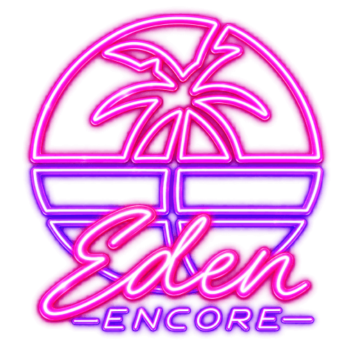
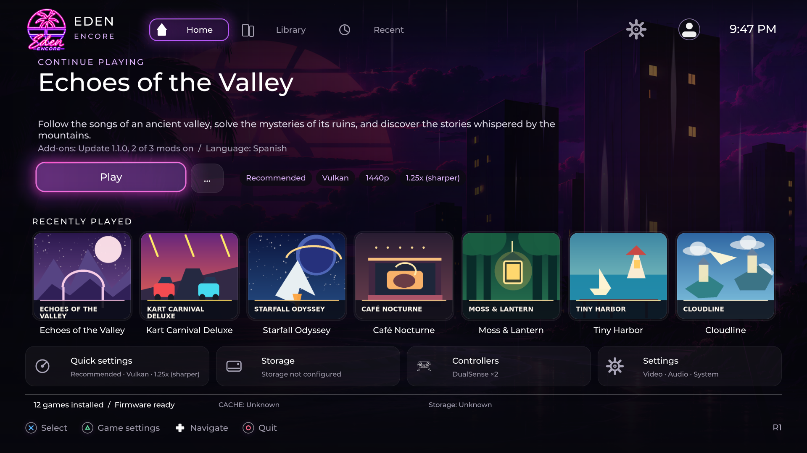

> **12 Nov 2026 — development integration, not a stable download:** the previous native CI compiled 1,588 objects but package staging failed. Updated PS5 source includes NS1 CPU6 ABI alignment, NS2 sparse guest memory, R09 source policies, launcher GL/Vulkan handoff and eight **opt-in-only** daily WebP backgrounds (no artwork bundled). **NS1 and NS2 boot remain unverified on a new PS5 candidate.** [33-case upstream integration register](docs/audits/ENCORE_NS1_GLOBAL_R23_33_GAPS_PR_BRANCH_HANDOFF_2026-11-12.md) · [unpublished R457 addendum](docs/audits/ENCORE_DRAFT_RELEASE_CHANGELOG_2026-11-12.md).

> **Exactly the 31 official PS5 system language/region choices; 31 launcher translation catalogs (including en-US and en-GB):** [Language directory](LANGUAGES.md). No extra launcher languages are exposed. This strict policy follows [Sony's official console-language list](https://www.playstation.com/fr-fr/legal/language-support/); translation/font quality still requires validation.

<table width="100%">
  <tr><td align="center">
    <strong>🌐 LANGUAGES</strong> &nbsp; · &nbsp; <a href="README.md"><strong>English US</strong></a> &nbsp; · &nbsp; <a href="docs/i18n/README.en-GB.md"><strong>English UK</strong></a> &nbsp; · &nbsp; <a href="docs/i18n/README.zh-Hans.md">简体中文</a> &nbsp; · &nbsp; <a href="docs/i18n/README.zh-Hant.md">繁體中文</a> &nbsp; · &nbsp; <a href="docs/i18n/README.es-419.md">Español LatAm</a> &nbsp; · &nbsp; <a href="docs/i18n/README.es.md">Español ES</a> &nbsp; · &nbsp; <a href="docs/i18n/README.fr.md">Français</a> &nbsp; · &nbsp; <a href="docs/i18n/README.fr-CA.md">Français CA</a> &nbsp; · &nbsp; <a href="docs/i18n/README.pt-BR.md">Português BR</a> &nbsp; · &nbsp; <a href="docs/i18n/README.pt-PT.md">Português PT</a> &nbsp; · &nbsp; <a href="docs/i18n/README.ru.md">Русский</a> &nbsp; · &nbsp; <a href="docs/i18n/README.de.md">Deutsch</a> &nbsp; · &nbsp; <a href="docs/i18n/README.ja.md">日本語</a> &nbsp; · &nbsp; <a href="docs/i18n/README.ko.md">한국어</a> &nbsp; · &nbsp; <a href="docs/i18n/README.it.md">Italiano</a> &nbsp; · &nbsp; <a href="docs/i18n/README.th.md">ไทย</a> &nbsp; · &nbsp; <a href="docs/i18n/README.pl.md">Polski</a> &nbsp; · &nbsp; <a href="docs/i18n/README.nl.md">Nederlands</a> &nbsp; · &nbsp; <a href="LANGUAGES.md"><strong>All languages</strong></a>
  </td></tr>
</table>

<table width="100%">
  <tr>
    <td width="21%" align="center" valign="middle"></td>
    <td width="79%" align="left" valign="middle">
      <h1>Prospero.Eden Encore</h1>
      
<strong>Console-native emulation, made for the living room.</strong>

      
A controller-first PS5 emulator fork for firmware 13.60: NSP, XCI, NSZ, XCZ, NRO, NSO, NCA, NAX and KIP loaders, LZ4 + ZBIC/zstd decoding, TV navigation and reproducible builds.

      
<kbd>Firmware 13.60 · hardware-tested target</kbd> &nbsp; <kbd>Vulkan + OpenGL</kbd> &nbsp; <kbd>TV-first UI</kbd> &nbsp; <kbd>Dynarmic</kbd>

    </td>
  </tr>
</table>

<table width="100%">
  <tr>
    <td align="center"><a href="https://github.com/niakw/ProsperoEden-Encore/releases"><strong>Download</strong></a></td>
    <td align="center"><a href="INSTALL.md"><strong>Install</strong></a></td>
    <td align="center"><a href="#getting-started"><strong>Get started</strong></a></td>
    <td align="center"><a href="#compatibility"><strong>Compatibility</strong></a></td>
    <td align="center"><a href="#faq"><strong>FAQ</strong></a></td>
    <td align="center"><a href="TROUBLESHOOTING.md"><strong>Help</strong></a></td>
    <td align="center"><a href="https://github.com/niakw/ProsperoEden-Encore/issues/15"><strong>Roadmap / progress</strong></a></td>
  </tr>
</table>

  
  
  

Preview: the games, illustrated covers and descriptions are **fictional demonstration content**, not a compatibility list. The screenshot is rendered by Encore’s actual launcher.

> [!IMPORTANT]
> **Unified NS1/NS2 engine roadmap:** [live milestone checklist (#15)](https://github.com/niakw/ProsperoEden-Encore/issues/15) · [acceptance criteria](docs/ROADMAP_NS1_NS2_UNIFIED.md). **NS2 games have not produced a confirmed first guest-rendered PS5 frame**; source/host tests and native builds are not console compatibility proof. Native PS5 builds are currently blocked by the maintainer until host and source gates are complete.
>
> **FC27 performance — live master tracker:** [F07 P0/P1/P2 priorities and sparse-JIT qualification](docs/FC27_F07_MASTER_TRACKER.md). [F01–F06 host exit gates](docs/FC27_EXIT_GATES_2026-10-22.md) are separate from on-console playability. Source-review totals are not remaining optimization counts.
>
> **Recommended/tested firmware: 13.60, the only firmware actually tested with Encore on a console.** Earlier firmware versions **may work** when the homebrew loader, PS5 native APIs, Vulkan and filesystem access are compatible; this remains **unverified**, and no minimum firmware has been established. Newer versions are also untested. Even on 13.60, frame pacing and gameplay freezes remain under investigation. This is **not** advice to update your console.
>
> **Before a console test:** [source, logs, upstream and package checklist](docs/PRETEST_AUDIT_2026-10-14.md) — verify that the artifact and symbols match the exact tested SHA.

---

## Start here — install in four steps

1. Choose a **complete Encore release package** from [Releases](https://github.com/niakw/ProsperoEden-Encore/releases). A green development CI job does not automatically mean it was tested on PS5.
2. **Back up** your old `/data/homebrew/PPSA99008/` app, `/data/prosperoeden/` and any external storage root. The original native port uses the **same title ID**.
3. Follow [the complete installation guide](INSTALL.md) for **ZIP/FTP or FFPFSC/ShadowMountPlus**. Copy the full `PPSA99008/` app tree, including `ui/lang/`, not only `eboot.bin`.
4. Open Encore and check **Settings → Storage / Language**, game Library and existing saves. If anything fails, use [Troubleshooting](TROUBLESHOOTING.md).

**Language policy:** [exactly 31 Sony PS5 system choices, no extra languages](docs/PS5_SYSTEM_LANGUAGE_POLICY.md). The [language portal](LANGUAGES.md) now lists 31 separate variants and guide paths, including distinct US/UK English.

**Firmware 13.60 is the only console-tested target.** No earlier firmware minimum is verified, and this is not advice to update your PS5. [Choose any launcher language](LANGUAGES.md).

---

## ✨ Why Encore?

Emulation on a console is more than booting a game. It should be navigable from the couch, recoverable when settings go wrong and honest about what the hardware actually does.

| | What Encore brings |
| --- | --- |
| **🎮 TV-first experience** | TV-oriented launcher, game artwork, recent titles, controller navigation, quick settings and multilingual support. |
| **🧩 Game files and compression** | NSP, XCI, NSZ, XCZ, NRO, NSO, NCA, NAX and KIP selection; LZ4 and ZBIC/zstd decoding. Some files require extra program content to boot. |
| **🛟 Recovery without surprises** | One-session Safe Launch, confirmed resets and guarded migration without silently overwriting saved preferences. |
| **⚙️ Per-title profiles** | Minimum, Recommended, High and Ultra, plus Custom when you edit a preset. |
| **🎨 Graphics choices** | Vulkan/RADV and OpenGL, shader cache management, upscaling and anti-aliasing controls. |
| **🔍 Explainable performance** | Frame-time windows, guest/JIT activity, memory pressure, cache locks and IPC—not FPS alone. |
| **🔐 Safer native operation** | One-shot filesystem access, fail-closed recovery paths, bounded logs and package provenance checks. |

**Accessibility:** [Larger text, High contrast, Reduce motion and controller navigation](ACCESSIBILITY.md) are documented with known limitations.

**Our approach:** preserve a working native foundation, select and adapt upstream improvements, then validate **source → native package → real hardware** independently. **New here?** Start with [installation](INSTALL.md), [known limitations](#-compatibility--current-limits) and the [community FAQ](#faq).

<strong>Encore vs the original port</strong>

| Dimension | Original foundation | Encore's emphasis |
| --- | --- | --- |
| Hardware target | Broad upstream development | Firmware **13.60-focused** qualification |
| Launcher | Native frontend | TV-first hero, library, recents and quick settings |
| Content loading | Earlier formats | **NSP, XCI, NSZ, XCZ, NRO, NSO, NCA, NAX, KIP; LZ4 + ZBIC/zstd** |
| Recovery | Base defaults | Temporary Safe Launch and confirmed resets |
| Storage | Original path behavior | One internal/external root structure and guarded migration |
| Controller settings | Base mappings | Controller-first launcher profiles; game-owned actions still under investigation |
| Graphics | Upstream rendering | Pinned native adaptations and compiled-source evidence |
| Verification | Upstream test coverage | Host regressions, native packaging and device tests kept separate |

Encore is **not** an official upstream release or a promise that every newer upstream commit has been included.

---

## 🗺️ Roadmaps and upstream updates

- **[Full R00–R25 feature roadmap](https://github.com/niakw/ProsperoEden-Encore/blob/main/docs/ROADMAP_ENCORE_COLLAB_2026-10-25.md)** in the [historical R00–R25 planning document](https://github.com/niakw/ProsperoEden-Encore/blob/main/docs/ROADMAP_ENCORE_COLLAB_2026-10-25.md): graphics, FSR, frame generation, advanced AA, themes, network, trophies, library and the R21 application updater. **Planned or experimental does not mean shipped.**
- **[Unified NS1/NS2 roadmap](docs/ROADMAP_NS1_NS2_UNIFIED.md)**: common engine owners are now present on `main` and subject to finite P1/P2 host-exit contracts. The [historical second-generation research](https://github.com/niakw/ProsperoEden-Encore/blob/main/docs/ROADMAP_NS1_NS2_UNIFIED.md) is historical context; **the last published R1 native PS5 binary contains none of these later mainline changes**.
- **[PS5 stability and F07 tracker](docs/FC27_F07_MASTER_TRACKER.md)**: the main branch remains the source of truth for current PS5 engine work.
- **Upstream native updates are selective, not automatic.** The traceable Encore baseline is **ProsperoEden v1.000.040** ([fork notes](docs/FORK_NOTES.md)). New ProsperoEden/Eden changes are evaluated and adapted individually, with [upstream audits](docs/UPSTREAM_GAP_REGISTER_2026-10-14.md). The **R21 Encore in-app updater is planned, not currently shipped**.

---

## 📦 Game formats and executable compression

| Category | Formats | Current scope |
| --- | --- | --- |
| Library game containers | **NSP** (`.nsp`), **XCI** (`.xci`) | Existing game discovery and launch |
| Compressed game containers | **NSZ** (`.nsz`), **XCZ** (`.xcz`) | Experimental NCZ reader, games, updates and DLC; native and hardware qualification pending |
| Internal executable compression | **LZ4**, **ZBIC / zstd** | Existing NSO segment decoding; **not** game-file extensions |
| Direct-loader files | **NRO, NSO, NCA, NAX, KIP** | Selectable; successful execution depends on complete compatible contents. |

**Extracted ExeFS directories** are also discovered when `roms/<title>/` contains real, non-symlinked `main` and `main.npdm` files. They appear as `EXEFS` in the Library; this is a directory layout, not another ROM extension.

NCZ block compression permits random reads directly from the compressed file. Solid compression may unpack one running title to `/data/prosperoeden/user/cache/nsz/`; this can require approximately the full uncompressed game size. Outside a running game, bounded, validated pieces are reused for metadata reads. A developer build that contains the feature is not a console-tested release.

[Compressed games, space requirements and cancellation](INSTALL.md#compressed-nsz-and-xcz-games) · [Source and tests](headless/ncz.h) · [Complete format matrix](docs/CONTENT_FORMAT_MATRIX_2026-10-23.md)

---

## 🚀 Install Encore

> [!TIP]
> For a tested release, use [GitHub Releases](https://github.com/niakw/ProsperoEden-Encore/releases), read the release's **specific firmware/gameplay validation notes**, and verify checksums. GitHub Actions artifacts are experimental unless separately qualified.

**Available packaging paths when published:** full ZIP with the application folder; optional FFPFSC image. The native title ID is `PPSA99008`.

**Application folder:** `/data/homebrew/PPSA99008/`.

**Persistent data root:** `/data/prosperoeden/`, containing `keys/`, `firmware/`, `roms/`, `updates/`, `mods/`, `save-import/` and `save-export/`.

Changing to external storage changes the **root**, not the subdirectory layout. Do **not** delete your persistent data root when upgrading an installation. Encore does not provide commercial software, keys, games or firmware.

**Replacing the original native ProsperoEden folder?** Both apps use title ID `PPSA99008` and the application directory `/data/homebrew/PPSA99008/`. **Back up that entire folder (including any old `assets/`), `/data/prosperoeden/` and any external data root first**; copy the complete Encore application tree over the native app without deleting legacy data, then launch and verify migration. This is an **in-place replacement**, not a second installation. Read the [native ProsperoEden → Encore upgrade guide](INSTALL.md#upgrade-from-native) before copying files. An original-upstream ZIP is **not** an Encore update.

**Full setup and upgrades:** [INSTALL.md](INSTALL.md) · [Build from source](docs/BUILDING.md) · [Support](SUPPORT.md).

---

## 🎛️ Built for the couch

| Feature | What to expect |
| --- | --- |
| **Home, Library, Recents** | Controller-friendly navigation, game metadata, cover/banner enrichment and offline fallback |
| **Animated game launch** | Real 3D rotating case with authentic scans per face when available. Missing front/back are reconstructed from cached game art, distinct screenshots, title and description by the native OpenGL renderer, without image generation. [Artwork details](docs/LAUNCH_CASE_ARTWORK.md) |
| **Quick Settings** | Per-title video changes without digging through debugging menus |
| **Video profiles** | **Minimum → Recommended → High → Ultra**; Custom after manual adjustment |
| **Safe Launch** | Conservative OpenGL, 1× internal resolution, 1080p, bilinear, handheld, 60 Hz and mods off for that run only |
| **Controls** | Native launcher mapping profiles, vibration and deadzones |
| **Languages** | Exactly **31 PS5 system language/region choices**, backed by 31 locale catalogs, including US and UK English; no extra language options beyond Sony's official list |
| **Visual tuning** | Resolution, filters, upscaling, sharpening and anti-aliasing options |

Safe Launch does **not** erase saves or permanently overwrite preferences. **Game-specific action binding** is distinct from the launcher's physical controller mapping, and is not yet fully proven for the main match test.

<strong>Under the hood: CPU, graphics, JIT and memory</strong>

- **Dynarmic remains the production JIT.** Experimental cross-core shared JIT and anticipatory compilation remain disabled in stable profiles due to unqualified concurrency/lifetime behavior.
- **Vulkan/RADV and OpenGL** are independent graphics routes. The native graphics build uses pinned source adaptations, tests, source fingerprints and archive checks rather than treating source presence as proof of compiled integration.
- **Shader cache** allocation and file size do not prove hit rate. Cold pipeline creation, long CPU waits and shader-cache reuse must be measured separately.
- **Memory** package declarations, sparse page tables, committed guest backing and JIT code-cache policies are not interchangeable. Current `main` source selects demand-backed sparse RX/RW JIT aliases, with physical backing reclaimed only after quiescent full-cache invalidation. This **post-R1 source configuration is not proof of what ran in the October 2026 released PS5 binary**; host checks exist, but memory savings and firmware-13.60 runtime stability on a newly compiled package remain unqualified.
- **Diagnostics** can distinguish a running compositor from actual guest progression; detailed capture has costs and is not automatically enabled in quiet gameplay.

See [Architecture](docs/PS5_NATIVE_ARCHITECTURE.md), [Performance roadmap](docs/PERFORMANCE_ROADMAP.md) and [Integration audit](docs/INTEGRATION_AUDIT_CPU_GPU_JIT_2026-10-14.md).

---

## 🧪 Compatibility & current limits

| Target | Evidence | Status |
| --- | --- | --- |
| **Firmware 13.60** | Device boot, launcher and selected title sessions | **Primary tested target** |
| Earlier firmware (minimum not established) | May work with compatible homebrew/runtime; no Encore device tests | **Unverified** |
| Later firmware | No Encore console qualification | **Unverified** |
| Newer NSO content | ZBIC/zstd and LZ4 source/native paths | **Implemented; title-dependent** |
| Main match test | Gameplay captured across full sessions | **Stutters and end-match freeze unresolved** |
| Adventure title sessions | Previously reported broadly playable | **Not a universal compatibility claim** |
| Custom game actions | Launcher mapping ≠ guest's saved control actions | **In-match persistence unresolved** |
| In-game HUD freshness | Graphics activity can outlive guest progress | **Under investigation** |

**Performance, stated accurately:** the last available full-match capture (`2efd8b3c`) recorded **858 frame intervals above 50 ms**, ten above 500 ms and a prolonged guest-progress stall while presentation remained active. Later changes have passed various source/native checks; **no matching later device capture proves these changes improved FPS or removed the freeze**.

[Read the measured stress analysis](docs/FC27_STRESS_REPLAY_2026-10-14.md) · [Gameplay recovery plan](docs/GAMEPLAY_FREEZE_RECOVERY_PLAN.md)

> [!WARNING]
> A 30 FPS compositor counter is not proof that a game is advancing. Encore does **not** promise universal title compatibility, 60 FPS, glitch-free HUD updates or automatic conversion of custom gameplay bindings.

---

## 📦 Builds & validation

<kbd>main — official branch</kbd> · <kbd>Source & host checks</kbd> · <kbd>Native package checks</kbd> · <kbd>On-device qualification</kbd>

1. **Source and host gates:** lock in memory/JIT lifetime, launcher contracts, source-provenance assertions and trace-derived regressions.
2. **Native build:** compile, link, assemble, inspect the installable title and upload both application archives and debug symbols.
3. **Real hardware:** independently verify startup, controls, frame pacing, content freshness, gameplay progression and safe return to the launcher.

[Source preflight](https://github.com/niakw/ProsperoEden-Encore/actions/workflows/encore-core-preflight.yml?query=branch%3Amain) · [Native build artifacts](https://github.com/niakw/ProsperoEden-Encore/actions/workflows/build-040-zbic.yml?query=branch%3Amain) · [Build guide](docs/BUILDING.md)

Download an artifact from a **successful run matching the commit you want to test**, not a previous green build. Passing CI alone does not make a release.

### Native release baseline and post-R1 source development (9 November 2026)

The **last verified published native PS5 FTP binary** is [Encore R1 in the historical repository](https://github.com/niakw/Prospero.Eden-Encore/releases/tag/encore-R1-56293953), **published 15 October 2026** from an already successful [native build run #38752177232](https://github.com/niakw/Prospero.Eden-Encore/actions/runs/38752177232). Its release notes identify source **`5629395324ff65c98b50c44f35f2142a4a92654a`**; its historical Git tag points to **`f037a78f88c0097d2031996390d7816b11e45479`**. Those two references must not be conflated. The independent repository **mirrored the unchanged R1 assets on 30 October 2026**; that was **not** a fresh native compile. The FTP archive is `Eden-Encore-56293953-FTP-PPSA99008.zip`.

Current `main` has since evolved: common NS1/NS2 loader and firmware/key discovery, compressed-content and NUP work, HLE/IPC/memory and Ampere-to-Vulkan research, GPU synchronization, launcher/controller-overlay changes, spatial upscaling options (including preserved FSR 1), and optional R09 neural processing. These are **source/integration or host-validation states**, not features guaranteed in that October binary. In particular, a model manifest, host-linked executable, synthetic frame, software Vulkan image or passed SPIR-V check is **not** a complete authentic neural inference or a PS5-rendered result.

**Workflow semantics:** ordinary `main` pushes skip the native build; deliberate `workflow_dispatch` or an explicit `[full-build]` marker is required. Source preflight, Core fast gate, NS2 research guards, the 17-contract P1/P2 exit check, the P0–P4 host matrix and R09 host tests have **different scopes**. A `skipped` build, green host shard or uploaded public test kit cannot be presented as a new PS5 build. [Read the step-by-step workflow and post-R1 inventory](docs/RELEASE_BASELINE_WORKFLOW_AUDIT_2026-11-09.md).

## Changes in Encore R1

- A firmware-13.60-focused native port with a redesigned launcher, controller-first UX and one-session Safe Launch.
- ZBIC/zstd loading alongside the existing LZ4 path.
- Title-aware video presets, multilingual UI and guarded data migration.
- A pinned native graphics/toolchain integration with explicit provenance and regression checks.
- Reworked observability and crash-recovery paths, with open tracking of gameplay stutter, content freshness and saved in-game controls.

---

## 🛡️ Safety, independence and responsible use

Encore hardens one-shot filesystem operations and rejects unsafe migrations, but **filesystem access is not a post-elevation sandbox**. Bounded logs, pinned sources and automated checks reduce specific risks without making the environment infallible.

See [SECURITY.md](SECURITY.md), [CONTRIBUTING.md](CONTRIBUTING.md), [SUPPORT.md](SUPPORT.md) and [CODE_OF_CONDUCT.md](CODE_OF_CONDUCT.md).

This is an unofficial community fork. It does not ship copyrighted commercial games, firmware, keys or DLC, and it does not grant third-party distribution rights.

---

## ❓ FAQ — answers to the questions on X

Select a question to expand the answer. The detailed original-vs-Encore history is intentionally long: it covers the work **since 4 October 2026**, not only the 30 October public-repository rebrand.

<strong>• What is the difference between Encore and the original ProsperoEden? What has actually changed since the project began?</strong>

**Encore began on 4 October 2026**, first in the historical [Prospero.Eden-Encore fork](https://github.com/niakw/Prospero.Eden-Encore), then in this standalone repository from **30 October 2026**. It is an extensive continuation of the original PS5 port and Eden engine work, **not just a logo/name change**. Original upstream authors retain full attribution.

The following is a detailed **technical change inventory**: delivered source changes, test infrastructure, hardware observations and experimental investigations are explicitly distinguished. Some foundations already existed in ProsperoEden and were *retained or extended*, not invented from scratch. For individually tracked source files, revisions, commits and decisions—including no-change audits and reverted experiments—see [project history](MEMORY.md), [active-source catalog](docs/EDEN_ACTIVE_SOURCE_CATALOG.md), [engineering audit](docs/EDEN_CORE_AUDIT_DEPENDENCIES.md), [F07 functions](docs/F07_FUNCTION_SCOPE_2026-10-28.md) and the [complete commit history](https://github.com/niakw/ProsperoEden-Encore/commits/main/). **Auditing a function does not imply optimizing it; passing CI does not imply faster games.**

**1. Native PS5 platform, release process and project structure**
- Concentrated real-console testing on **PS5 firmware 13.60**; deliberately did not certify unsupported firmware.
- Preserved and adapted the native PS5 application, Eden emulator core, Dynarmic, native OpenGL and PS5 Vulkan/Mesa/RADV integrations.
- Standardized the launcher/application identity **PPSA99008** and native installation, package layout, shared storage and user-data paths.
- Consolidated around **one release profile** and one final installable package rather than multiple DEV/experimental variants.
- Added guarded startup, failure cleanup, bounded log/crash paths, recovery and checks of the actually selected native code paths.
- Refined packaging and reproducibility, exact-SHA executable and symbols matching, optional FFPFSC, and the prohibition of nested ZIPs.
- Selected/pinned upstream engine fixes, compiler/runtime adaptations, SDK/Mesa/Vulkan/OpenGL dependencies and reproducible source manifests.
- Audited transitive source integration and proved which upstream/backport overrides are selected in the compiled archive; rejected incomplete or unverified integrations.
- Migrated the large **vendor** tree to an immutable, pinned Git submodule; preserved matching dependency sources and licenses. MihawkGen, FSR3 Optical Flow and libwebp 1.6.0 are pinned unmodified third-party source snapshots under `vendor/sources/` (not additional submodules). `vendor/encore-active/` is reserved exclusively for Encore-maintained runtime overrides and ports; original upstream dependency trees must never be stored there.
- Compacted Git history while retaining recovery archives and provenance; migrated to an independent public repository with restored branches/tags/releases where applicable.
- Established fast/full host gates, native build/package gates, static security analysis (including CodeQL), checksum/source checks and firmware-specific console-test checklists.
- Kept code review, build results and on-device qualification **separate**, including a distinct record for source-only and experimental patches.
- Expanded source-level regression harnesses, sanitizers, O0/O2 fixtures, GPU/HLE emulation models, exact compiled-source checks and historical audit registers.
- References: [native build](docs/BUILDING.md), [release policy](docs/EDEN_ONE_SHIPPING_PROFILE_2026-10-26.md), [standalone migration](docs/STANDALONE_REPOSITORY_MIGRATION_2026-10-30.md), [vendor migration](docs/VENDOR_SUBMODULE_MIGRATION.md), [repository history](docs/REPO_HISTORY_COMPACTION_2026-10-30.md).

**2. Game formats, executable loading, library and storage**
- Extended newer **NSO** handling with **ZBIC/zstd**, alongside existing **LZ4** segment decompression, with validation of compressed executable boundaries.
- Retained and extended discovery/selection of **NSP, XCI, NRO, NSO, NCA, NAX and KIP**. Being selectable is not a promise of successful execution without complete supporting content.
- Added experimental **NSZ/XCZ** (NCZ) game/update/DLC reading, block-compressed random access, bounded metadata reads and controlled solid-file extraction/cache behavior.
- Added extracted **ExeFS directory** discovery when genuine <code>main</code> and <code>main.npdm</code> are present; rejected unsafe symlinks.
- Improved invalid-file rejection, compression and decompression error recovery, size limits, path validation, cancellation and temporary storage accounting.
- Consolidated the internal/external data-root layout for keys, firmware, ROMs, updates, mods, user settings, game caches and save import/export.
- Added safer migration/reset paths that do not silently erase stored preferences, saves or content.
- Reviewed title metadata, game updates, runtime file access, firmware-dependent behavior and assorted Eden HLE/loader backports.
- References: [content-format matrix](docs/CONTENT_FORMAT_MATRIX_2026-10-23.md), [installation](INSTALL.md), [upstream gaps](docs/UPSTREAM_GAP_REGISTER_2026-10-14.md).

**3. CPU, Dynarmic, JIT, memory and fastmem**
- Investigated **AArch64/AArch32 Dynarmic**, guest thread progression, exclusive/atomic operations, JIT compile/invalidation waits, scheduling and PS5 logical processor allocation.
- Introduced the one selected **sparse JIT RX/RW allocator** with paired virtual aliases and physical memory committed in **2 MiB** units on demand.
- Added alias/probe preflight at title launch and fail-closed behavior rather than silently falling back to the old dense native JIT.
- Implemented physical backing reclamation after **complete quiescent JIT invalidation**, preserving RX/RW permissions and guest code lifetime.
- Optimized sparse table capacity, scan bounds, reservation epochs, positive/negative hit memoization, cross-arena reuse, alternative lookup slots and RX→RW alias lookup.
- Improved page-map ownership, guest memory access bounds, empty-span handling, range/alignment checks, physical-backed-page accounting and invalidation granularity.
- Reduced repeated **fastmem Map/Unmap/Protect** updates for unchanged pages and permissions, one-page and cross-granule cases; preserved error/failure retries and alias coherency.
- Audited JIT pressure, cache sizing, guest RAM vs PS5 physical allocations, temporary memory, GPU memory and high-resolution/OOM interactions.
- Evaluated—but **did not enable in the shipping profile**—shared cross-core JIT, speculative/background translation, unsafe DMA reordering and other concurrency-sensitive experiments.
- Reduced some proved thread/fiber stack and short-span allocation costs; these optimizations do **not** imply extra console RAM or guaranteed FPS.
- References: [PS5 architecture](docs/PS5_NATIVE_ARCHITECTURE.md), [JIT lifecycle](docs/DEFERRED_JIT_QUIESCENCE_ARCHITECTURE_2026-10-17.md), [CPU/JIT migration](docs/EDEN_CPU_JIT_G11_G12_MIGRATION_MAP.md), [F07 tracker](docs/FC27_F07_MASTER_TRACKER.md).

**4. Maxwell, GPU queues, synchronization and native memory**
- Reviewed/fixed portions of **Maxwell DMA**, host1x, GPU scheduler, command FIFOs, transfer extents, fence publication, queue-slot lifetimes and safe stop/restart behavior.
- Applied bounded batching of selected DMA work, buffer invalidations and GPU copy operations without bypassing dependencies or replaying guest commands.
- Improved dirty-span tracking, guest-write coherency, texture/buffer registration, fast small-page ownership probes and safe range checks.
- Audited/guarded indirect draw bindings, null descriptors, vertex/index buffers, compute graphics-resource slot limits and shader-local bounds.
- Reduced GPU-queue wakeups, unnecessary synchronization and certain allocations where source-extracted tests establish equivalent execution.
- Added checks separating actual guest progress from a compositor/GPU worker that continues presenting stale frames.
- References: [DMA work](docs/EDEN_MAXWELL_DMA_CONTIGUOUS_BATCH_2026-10-21.md), [GPU source audit](docs/FC27_GPU_SOURCE_TARGETS_2026-10-21.md), [engine regression register](docs/EDEN_CORE_AUDIT_DEPENDENCIES.md).

**5. Vulkan/RADV shaders, pipelines, rasterization and textures**
- Integrated and source-pinned native **Mesa/RADV** and Vulkan adaptations, shader/compiler compatibility work and independent OpenGL fallback.
- Optimized verified shader/pipeline lookup hot paths, vertex-shader identities, small multi-key compute-pipeline memo tables and invalidation-aware hit/miss caches.
- Improved release/acquire publication of ready pipelines, safe failure of optional pipeline optimizations and descriptor preflight/reuse while preserving ordered draws.
- Reduced repeated work and some lock contention in shader caches, pipeline creation, descriptor rings, rasterizer and sampler state.
- Addressed **TIC/TSC** sampler/texture mappings, invalid/empty texture views, image aliases, framebuffer-view selection and cache invalidation.
- Refined image upload/download staging, asynchronous decode and unswizzle, BCn/3D texture batches, failure rollback, GPU-dirty state and texture eviction safeguards.
- Fixed or safeguarded **DrawTexture** state invalidation, blit/copy/resolve boundaries, render-target changes, raw framebuffer stride/pitch, missing guest framebuffer and presentation freshness.
- Improved Vulkan swapchain acquire/present recreation, surface-loss bounded retries, synchronization of in-flight layers and resource retirement by real GPU timeline ticks.
- Coalesced Vulkan presenter/worker wakeups and drain notifications, reduced unnecessary lock hold during GPU recycler allocation and avoided redundant AA rebuilds.
- Optimized frequent one-page guest-buffer/texture registration and ownership checks, repeated vertex classification and framebuffer pixel-size lookup.
- Reviewed **38 specific F07 functions across eight source files** covering cold shaders, pipeline waits, rasterizer/buffer contention and HUD/texture freshness.
- **Still open:** first-use guest IR→SPIR-V translation can block; a Vulkan worker may wait for a required pipeline; the black/delayed HUD and full-match frame pacing need console evidence.
- References: [F07 function-by-function log](docs/F07_FUNCTION_SCOPE_2026-10-28.md), [remaining optimization register](docs/F07_REMAINING_OPTIMIZATION_CHECKLIST.md), [F07 cross-system audit](docs/FC27_F07_CROSS_SYSTEM_OPTIMIZATION_AUDIT_2026-10-26.md), [HUD priorities](docs/FC27_F07_STUTTER_HUD_PRIORITY_2026-10-26.md), [Mesa/Vulkan review](docs/EDEN_OPTIMIZATION_REVIEW_MESA_VULKAN_2026-10-20.md).

**6. HLE, IPC, display, audio, input and networking**
- Reviewed guest **HLE kernel/service scheduling**, IPC waits, event handoffs, slab bounds, thread stop/restart and service-owner lifetime.
- Investigated **NVNflinger / BufferQueue / SurfaceFlinger / NvDisp / display layers**, distinguishing a true game freeze from an image/present problem.
- Audited audio initialization, PCM overflow, ring buffers, mixer/upmix paths and native output threading; reduced selected redundant audio copies/allocations.
- Improved native **DualSense** polling and mappings: batched immutable inverse mapping, precomputed stick curves/trigger LUTs, deadzones, button-edge semantics and vibration lock boundaries.
- Removed repeated controller scratch clearing, unnecessary sample copies and quiet-poll diagnostic work; retained guest action mapping isolation.
- Reviewed guest networking and DNS/socket behavior (including **NanoDNS**), access policies, bootstrap and runtime errors without promising Nintendo online support.
- Improved quiet/crash-only logging so diagnostics are available without continuously doing high-cost per-frame work.
- References: [input/glyph pipeline](docs/PS5_INGAME_GLYPHS.md), [guest IPC findings](docs/PS5_R393_2026-10-12_GUEST_IPC_THREAD_DIAGNOSTICS.md), [network audit](docs/PS5_R296_2026-10-10_NETWORK_AUDIT_NANODNS.md), [audio/engine inventory](docs/EDEN_CORE_AUDIT_DEPENDENCIES.md).

**7. Launcher, controller-first UX, media and translations**
- Expanded the TV-first **Home, Library and Recents** presentation, game metadata, artworks, banners, screenshots, quick settings and offline fallback.
- Added/extended animated **3D game-case** launch artwork with authentic front/back scans where present, and native reconstruction from available art for missing sides.
- Introduced/refined **Minimum / Recommended / High / Ultra / Custom** per-title video presets, override rules, manual graphics options and recovery-oriented **Safe Launch** for a single session.
- Added launch-time settings for internal resolution, Vulkan/OpenGL, filtering, sharpening and AA, with conservative memory constraints rather than unqualified 4× promises.
- Aligned the native launcher with the **31 official PS5 system language/region selections** and 31 maintained translation catalogs and improved complex/bidirectional text layout, fallback fonts, wrapping and glyph drawing.
- Tuned font fitting, font scratch reuse, audio ring copy behavior, controller navigation, scene transitions and costly UI/media work.
- Added/reviewed PS5-profile-avatar **read-only, async** retrieval paths; availability on every real console remains unverified.
- Investigated PlayStation in-game glyph assets, per-game mods and physical button mapping; **universal PlayStation glyph replacement is not implemented**.
- Improved accessibility guidance, high-contrast/reduced-motion support, safe settings reset, and user-data migration confirmation.
- Updated screenshots and preview disclaimers: the Home screenshot uses real renderer output but **fictional sample games**.
- References: [launcher audit](docs/EDEN_RELEASE_LAUNCHER_SOURCE_OPTIMIZATION_AUDIT_2026-10-26.md), [game-case media](docs/LAUNCH_CASE_ARTWORK.md), [accessibility](ACCESSIBILITY.md), [glyph research](docs/PS5_INGAME_GLYPHS.md).

**8. Stability work, profiling and tested games**
- Built frame-time/window diagnostics for FPS drops, long presentation stalls, GPU queue pressure, shader cold misses, JIT waits, mutex contention and guest IPC progression.
- Investigated **FC27** match play, half-time/pause/end-of-match crashes or freezes, intermittent black/late HUD overlays, cold shader spikes and user control profiles.
- Used **The Legend of Zelda: Breath of the Wild** as a separate gameplay/memory comparator; this is not universal game compatibility proof.
- Recorded quiet-vs-detailed-logging and old-vs-cleared-shader-cache runs; showed that detailed logging itself can materially affect pacing.
- Investigated anti-aliasing/upscaling memory pressure and OOM at aggressive resolution settings; retained conservative device safeguards.
- Defined P0 blockers: **(1)** first-use shader translation, **(2)** ordered Vulkan pipeline wait, **(3)** buffer/texture cache contention, **(4)** HUD image/texture freshness.
- Tracked JIT, HLE, presentation, textures, glyphs and input as related—but distinct—owners rather than claiming a single FPS knob solves all.
- Retained regression checks and incident reports for frame pacing, guest-progress stalls and GPU presentation despite no game progress.
- References: [FC27 master tracker](docs/FC27_F07_MASTER_TRACKER.md), [real-console analysis](docs/FC27_STRESS_REPLAY_2026-10-14.md), [freeze recovery](docs/GAMEPLAY_FREEZE_RECOVERY_PLAN.md), [closure criteria](docs/PS5_CLOSURE_CRITERIA.md).

**9. Planned or experimental work — not part of a verified PS5 release**
- **Frame generation:** native frame pacing/stability first; future exploration of temporal upscaling, frame interpolation and optional frame generation. Do not treat these as available now.
- **FSR/AA/120 Hz:** deeper spatial/temporal upscaling, image quality, x2/x4 AA and higher refresh are design/research targets, subject to title and memory limits.
- **Switch 2 / NSW2:** shared NS1/NS2 loader, HLE, CPU and GPU code is under active development on **`main`**, using host-gated owners and the P0–P4 roadmap. These changes **postdate the last published PS5 R1 package**; no first guest-rendered NS2 PS5 frame or stable game compatibility has been demonstrated.
- **Cross-core JIT, speculative compilation, deferred GPU paths:** preserved as research/disabled experiments where concurrency or correctness proof is missing.
- **In-game PS button glyph replacement, avatar reliability, per-game input persistence and game-specific 60 FPS unlocks:** active investigation, not universal shipping promises.
- References: [performance roadmap](docs/PERFORMANCE_ROADMAP.md), [branch policy](docs/DEVELOPMENT_BRANCH_POLICY.md), [glyph research](docs/PS_GLYPH_INPUT_PIPELINE.md).

**A complete change history is not a single FPS claim:** source reviews, reverted prototypes, CI-only fixes and documentation changes are recorded in [MEMORY.md](MEMORY.md) and [commits](https://github.com/niakw/ProsperoEden-Encore/commits/main/). The list above summarizes the entire *scope* of Encore's work since its inception; the linked technical registers provide the individual-file detail. Real device qualification is deliberately narrower than the implementation inventory.

<strong>• Was frame generation removed? When is it coming back?</strong>

- Stability, frame pacing, input latency and image freshness come first. Shipping frame interpolation on top of freezes would make the counter look better, not fix the game.
- Encore intends to offer a better-managed frame-generation solution than the earlier implementation, but **it is not currently a verified shipping feature**. Research includes temporal/spatial upscaling and optional interpolation once the underlying rendering path is reliable.
- This is a **short-term priority following core optimizations**, not a fixed release date. See [performance roadmap](docs/PERFORMANCE_ROADMAP.md).

<strong>• Can Encore play Nintendo Switch 2 games?</strong>

- **Not in the current PS5 release.** The [second-generation research roadmap](https://github.com/niakw/ProsperoEden-Encore/blob/main/docs/ROADMAP_NS1_NS2_UNIFIED.md) and its [feasibility report](https://github.com/niakw/ProsperoEden-Encore/blob/main/docs/NS2_PS5_FEASIBILITY_2026-10-30.md) cover loading, shader/CPU compatibility and homebrew execution paths.
- A successful source test or homebrew harness is **not** proof that a commercial Switch 2 title runs. No stable compatibility, 30 FPS Mario Kart World performance or supported Switch 2 game-file matrix is claimed.
- The existing Switch 1 path remains the main development focus on PS5. Research: [branch policy](docs/DEVELOPMENT_BRANCH_POLICY.md).

<strong>• How well does Encore run on PS5 right now?</strong>

- **Firmware 13.60** is the primary version with device testing, not universal compatibility.
- FC27 has reached match gameplay but still exhibits shader/frametime spikes, HUD errors and pause/half-time/end-match freezes in documented tests.
- Zelda: Breath of the Wild has shown comparatively good sessions, but individual games, settings and builds vary.
- There is no general guarantee of a steady 30 FPS, 60 FPS, 120 Hz or flawless controls. See [console findings](docs/FC27_F07_MASTER_TRACKER.md).

<strong>• Does the project improve FPS, or just redesign the launcher?</strong>

- Both engine and frontend have meaningful code changes: JIT memory and fastmem, Vulkan caching/synchronization, textures, game loading, HLE, controller input and launcher.
- **Host regression passes and fewer operations do not prove PS5 FPS gains**. The exact console gain is still pending comparable real-device tests.
- The current priority is stable frame times and correct game progression, not an inflated FPS counter.

<strong>• Is 60/120 FPS, better FSR or 2×/4× anti-aliasing supported?</strong>

- Existing graphics settings include resolution, filters/upscaling and AA choices, but a title's native rate, the emulator's frame pacing and the PS5 memory budget impose separate limits.
- Better FSR, temporal techniques, 60/120 Hz handling and higher AA quality are planned/researched. **They are not promises of universally working or unlocked frame rates**.
- Aggressive internal scaling can exhaust graphics memory. See [roadmap](docs/PERFORMANCE_ROADMAP.md).

<strong>• Which PS5 firmware is supported?</strong>

- **Recommended/tested for Encore: 13.60.** This identifies our evidence base, not a recommendation to update your console.
- **Earlier firmware may work**, depending on the PS5 exploit/homebrew setup, filesystem access, graphics driver and native APIs. **Minimum firmware: unknown; no older Encore version has been hardware-qualified.**
- Original ProsperoEden reports **6.02 and 12.70** tests of its Lapy filesystem helper ([upstream notes](https://github.com/Swordpdf/ProsperoEden/blob/main/README.md)), but **Encore uses a different v1.000.040-derived filesystem-access mechanism** ([fork notes](docs/FORK_NOTES.md)). Those component tests **do not prove Encore compatibility**.
- Newer firmware remains unverified. Check the release notes and exact tested SHA.

<strong>• Which game file formats can I use? Are NSP and XCI enough?</strong>

- Library containers: **NSP, XCI**.
- Compressed containers: experimental **NSZ, XCZ**, with format and hardware-qualification limitations.
- Direct selections: **NRO, NSO, NCA, NAX, KIP**, plus correctly structured extracted ExeFS directories.
- **LZ4 and ZBIC/zstd are executable-segment compression methods**, not games or installable file extensions. Some selected files cannot run without companion content. [Full matrix](docs/CONTENT_FORMAT_MATRIX_2026-10-23.md).

<strong>• Can I use my DualSense and see PlayStation button symbols inside games?</strong>

- The **launcher** supports controller-first navigation, DualSense mapping, deadzones and vibration options.
- The **game's own saved action mapping** and **in-game Switch button artwork** are separate. PlayStation glyph replacement is not universal; some in-match custom mapping still needs validation.
- See [glyph and input research](docs/PS5_INGAME_GLYPHS.md).

<strong>• Is the download an actual PS5 release? Does green CI mean it works?</strong>

- GitHub Actions verifies source/host tests, security and native packaging as separate gates. An artifact is **not necessarily a tested stable release**.
- Prefer a published [Release](https://github.com/niakw/ProsperoEden-Encore/releases) with explicit device-test notes and the matching SHA/checksum.
- A console session is required to confirm real gameplay, frame pacing, HUD, controls and safe return to the launcher.

<strong>• Is Encore official? Can you provide Switch/PS5 games, keys or firmware?</strong>

- Encore is an **unofficial community continuation**, with independent changes based on the credited original ProsperoEden and Eden work.
- No commercial games, firmware, proprietary keys or unauthorized downloads are distributed. Use content and system files you have the legal right to use.
- See [credits](#credits), [licenses](THIRD_PARTY_NOTICES.md) and [installation](INSTALL.md).

<strong>• Does Encore automatically follow updates from the original native ProsperoEden? Is there a built-in updater?</strong>

- **No automatic upstream merges.** The original **ProsperoEden v1.000.040** is Encore’s documented baseline; subsequent native-port and Eden updates are reviewed and integrated selectively, preserving PS5 Vulkan/JIT compatibility and testing. A newer upstream release is **not necessarily part of Encore**.
- **No built-in updater is available in the current shipping release.** Feature milestone **R21** describes manual checking, an optional startup check, verified Encore-release downloads, user confirmation and safe rollback; it is **a specification, not a released feature**. [Full roadmap](https://github.com/niakw/ProsperoEden-Encore/blob/main/docs/ROADMAP_ENCORE_COLLAB_2026-10-25.md).
- For now, use **[Encore Releases](https://github.com/niakw/ProsperoEden-Encore/releases)** and the [upgrade guide](INSTALL.md). **Do not overwrite Encore with an original ProsperoEden ZIP** merely because it has a higher version: application ID **PPSA99008** and storage paths can overlap, although code and migration behavior differ.
- References: [original native ProsperoEden](https://github.com/blackbearreloaded/ProsperoEden), [upstream gap audit](docs/UPSTREAM_GAP_REGISTER_2026-10-14.md), [native-version review](docs/UPSTREAM_PROSPEROEDEN_1001000_R428.md).

<strong>• Why so many commits, what remains, and when will the next update arrive?</strong>

- Many commits are deliberately small source changes, regression fixtures or CI corrections. They are **not** one new feature per commit.
- Remaining high-priority work concerns first-use shaders, Vulkan pipeline waits, texture/buffer cache contention, HUD freshness, guest freezes and real-console confirmation.
- Work is progressing quickly, but **there is no verified release date**. Updates appear in [commits](https://github.com/niakw/ProsperoEden-Encore/commits/main/), [Actions](https://github.com/niakw/ProsperoEden-Encore/actions), and [Releases](https://github.com/niakw/ProsperoEden-Encore/releases).

---

## Credits

**Encore project history — development since 4 October 2026.** Our work began on **4 October 2026** in the [original `niakw/Prospero.Eden-Encore` fork](https://github.com/niakw/Prospero.Eden-Encore). On **30 October 2026**, we moved that work to this [independent repository](https://github.com/niakw/ProsperoEden-Encore) to make Encore easier to discover. The former fork remains linked as part of the project's history; this repository move does **not** reset Encore's development start date or replace the upstream credits below.

Encore is built from and depends on the work of many upstream projects. The list below covers the
**direct repositories and pinned build/runtime inputs used by Encore**. Each entry identifies
its upstream author, known contributor or project-maintainer account; a project account is not
presented as the sole person who wrote its code. This list is not exhaustive; transitive dependencies of
Eden and the individual licence details are documented in [THIRD_PARTY_NOTICES.md](THIRD_PARTY_NOTICES.md).

### Emulator and launcher foundations

- [ProsperoEden](https://github.com/blackbearreloaded/ProsperoEden) — **Authors / maintainers: BlackBearReloaded (`@blackbearreloaded`)** — original PS5 emulator port/fork Encore is based on.
- [Eden](https://github.com/eden-emulator/mirror) — **Authors / maintainers: Eden Emulator Project team (`@eden-emulator`) and contributors** — emulator core used by Encore.
- [Citron Neo emulator](https://github.com/citron-neo/emulator) — **Authors / maintainers: Citron Neo team (`@citron-neo`); SM/audio fixes by `@HopeSuffers`** — upstream HLE ServiceManager/audio initialization fixes referenced by Encore's **disabled-by-default experimental** backport (not part of the current shipping binary).
- [ProsperoPuzzles](https://github.com/blackbearreloaded/ProsperoPuzzles) — **Authors / maintainers: BlackBearReloaded (`@blackbearreloaded`)** — origin of the launcher drawing/text/animation/sound framework used by Encore.

### PS5 platform, graphics and packaging

- [PS5 Native App Boilerplate](https://github.com/blackbearreloaded/ps5-native-app-boilerplate) — **Authors / maintainers: BlackBearReloaded (`@blackbearreloaded`)** — native runtime, packaging and base platform integration.
- [PS5 OpenGL](https://github.com/blackbearreloaded/ps5-opengl) — **Authors / maintainers: BlackBearReloaded (`@blackbearreloaded`)** — OpenGL 4.6 runtime used by Encore.
- [Mihawk's PS5 Mesa](https://github.com/mihawk-99/PS5_Mesa) — **Authors / maintainers: Mihawk (`@mihawk-99`) and Mesa contributors** — Mesa/RADV source used by the Vulkan path.
- [Mihawk's PS5 Vulkan](https://github.com/mihawk-99/PS5_Vulkan) — **Authors / maintainers: Mihawk (`@mihawk-99`)** — PS5 Vulkan/RADV build and link recipes.
- [PS5 MihawkGen](https://github.com/mihawk-99/PS5_MihawkGen) — **Authors / maintainers: Mihawk (`@mihawk-99`) and upstream model contributors** — native neural frame-generation source and SHA-256-pinned model, retaining its GPL/MIT and model-distillation notices.
- [PS5 FSR3 Optical Flow](https://github.com/Swordpdf/ps5-framegen) — **Authors / maintainers: Swordpdf (`@Swordpdf`) and credited AMD FidelityFX contributors** — native optical-flow interpolation sources with their original GPL and shader licenses.
- [Mihawk's PS5 PayloadSDK](https://github.com/mihawk-99/PS5_PayloadSDK) — **Authors / maintainers: Mihawk (`@mihawk-99`) and upstream SDK authors** — PayloadSDK fork used by the RADV toolchain.
- [PS5 Payload SDK](https://github.com/ps5-payload-dev/sdk) — **Authors / maintainers: John Törnblom (`@john-tornblom`) and contributors `@ps5-payload-dev`** — PS5 homebrew SDK used by the native toolchain.
- [ps5-vulkan](https://github.com/mpereiraesaa/ps5-vulkan) — **Authors / maintainers: `@mpereiraesaa` and contributors** — earlier PS5 Vulkan platform work used by the graphics stack.
- [PSBrew/MkPFS](https://github.com/PSBrew/MkPFS) — **Authors / maintainers: PSBrew team (`@PSBrew`)** — optional reproducible `.ffpfsc` image packaging.
- [SharpProspero](https://github.com/SvenGDK/SharpProspero) — **Authors / maintainers: SvenGDK (`@SvenGDK`)** — source/reference used by the native packaging toolchain.

### Compatibility, media, text and build inputs

- [Encore overrides](https://github.com/niakw/encore-overrides) — **Authors / maintainers: `@niakw`** — companion database/source of the four general video tiers, title-specific overrides and the generated PlayStation Auto control profile.
- [ghost-land/Nlib-API](https://github.com/ghost-land/Nlib-API) — **Authors / maintainers: ghost-land team (`@ghost-land`) and contributors** — runtime title metadata and rich launcher media source (icons, 1080p banners, screenshots and local-player metadata).
- [kinnay/zbic](https://github.com/kinnay/zbic) — **Authors / maintainers: `@kinnay`; zstd source files from Atmosphère** — ZBIC/zstd NSO decompression support.
- [NUP v1 format specification](https://github.com/a55uka/nup) — **Authors / maintainers: `@a55uka` and contributors** — NUP format reference used to review Encore's separately implemented read-only archive reader; upstream NUP software is not bundled.
- [FFmpeg](https://github.com/FFmpeg/FFmpeg) — **Authors / maintainers: Fabrice Bellard (original creator), FFmpeg team and contributors** — H.264/VP8/VP9 decoding in the PS5 build.
- [HarfBuzz](https://github.com/harfbuzz/harfbuzz) — **Authors / maintainers: Behdad Esfahbod, David Corbett, Khaled Hosny and HarfBuzz contributors** — shaping for Arabic, Thai and other complex scripts in the launcher.
- [fmt](https://github.com/fmtlib/fmt) — **Authors / maintainers: Victor Zverovich (`@vitaut`) and contributors** — formatting headers used by build/runtime validation paths.
- [LLVM](https://github.com/llvm/llvm-project) — **Authors / maintainers: LLVM community (`@llvm`) and contributors** — compiler-rt pieces used by the PS5 cross build.
- [pacbrew](https://github.com/ps5-payload-dev/pacbrew-repo) — **Authors / maintainers: ps5-payload-dev team and contributors** — pinned PS5 OpenSSL/zlib packages.
- [zlib](https://github.com/madler/zlib) — **Authors / maintainers: Jean-loup Gailly and Mark Adler (`@madler`)** — pinned native dependency used by the PS5 toolchain setup.
- [Boost.Context](https://github.com/boostorg/context) — **Authors / maintainers: Boost.Context team and Boost contributors** — pinned context runtime source used by Eden's PS5 build.
- [Xbyak](https://github.com/herumi/xbyak) — **Authors / maintainers: Mitsunari Shigeo (`@herumi`)** — x86/x64 JIT assembler used by Dynarmic/Eden and adapted by Encore's JIT allocator path.
- [SPIRV-LLVM-Translator](https://github.com/KhronosGroup/SPIRV-LLVM-Translator) — **Authors / maintainers: Khronos Group and SPIRV-LLVM-Translator contributors** — macOS host-toolchain support for the graphics build.
- [stb](https://github.com/nothings/stb) — **Authors / maintainers: Sean T. Barrett (`@nothings`) and authors of stb components** — launcher font baking/system-font loading support.

### External artwork and upstream research acknowledgements

- [LaunchBox](https://www.launchbox-app.com/) — public game metadata/retail-case index used for optional build-time lookup and remote cover art. Neither the complete catalogue nor proprietary cover images are included in Encore's distribution; artwork rights remain with their owners. [Technical provenance](docs/LAUNCH_CASE_ARTWORK.md).
- [Eglantine `nx2` research](https://github.com/zortos293/Eglantine) — reviewed selectively in [the NS2/NUP audit](docs/NS2_EGLANTINE_NX2_NUP_REVIEW_2026-11-03.md). This acknowledgment is not a claim that its entire engine, binaries or experimental game-specific work is included or endorsed.

### PS5 input/audio research reused directly

- [ps5-native-gamepad-input-research](https://github.com/blackbearreloaded/ps5-native-gamepad-input-research) — **Authors / maintainers: BlackBearReloaded (`@blackbearreloaded`)** — native DualSense/gamepad integration reference/code.
- [ps5-audio-decoding-research](https://github.com/blackbearreloaded/ps5-audio-decoding-research) — **Authors / maintainers: BlackBearReloaded (`@blackbearreloaded`)** — native audio integration reference/code.

All credit for the original projects belongs to their respective authors and contributors. Encore's
changes do not imply endorsement by those projects or their maintainers.

## Community

- [Contributing](CONTRIBUTING.md)
- [Support](SUPPORT.md)
- [Code of Conduct](CODE_OF_CONDUCT.md)
- [Security Policy](SECURITY.md)

## License and legal

Prospero.Eden Encore is an **unofficial community fork** distributed under
**GPL-3.0-or-later**. See [LICENSE](LICENSE). Third-party components keep their
own licenses and attribution; the component map is in
[THIRD_PARTY_NOTICES.md](THIRD_PARTY_NOTICES.md) and the collected full texts
are in [LICENSES](LICENSES/). Release ZIPs and the installable PS5 title carry
those notices; the standalone `.ffpfsc` therefore keeps a `legal/` directory
inside the installed title.

Encore is not affiliated with, sponsored by, endorsed by, or supported by Sony
Interactive Entertainment, Nintendo, the Eden Emulator Project, or other
upstream projects unless they expressly state otherwise. Product, project and
company names and logos are used only for attribution, compatibility
identification or description of upstream lineage. Copyright licensing does
not itself grant trademark rights.

No encryption keys, Nintendo firmware, commercial games, DLC, updates or other
proprietary console content are included. Use only software and console data
you are lawfully entitled to use.

Nlib is queried at runtime; Encore does not ship a pre-seeded Nlib media
library. Copyright/trademark rights in remote icons, banners, screenshots and
metadata remain with their respective rightsholders. Encore does not claim
that such remote media is public-domain, royalty-free or independently
redistributable.

The launcher SFX are generated locally and deterministically by
`tools/launcher/generate-sfx.py`; no third-party audio samples or external
generative-audio service output is included.

This project is provided **without warranty**, subject to the complete terms in
the applicable licenses.
