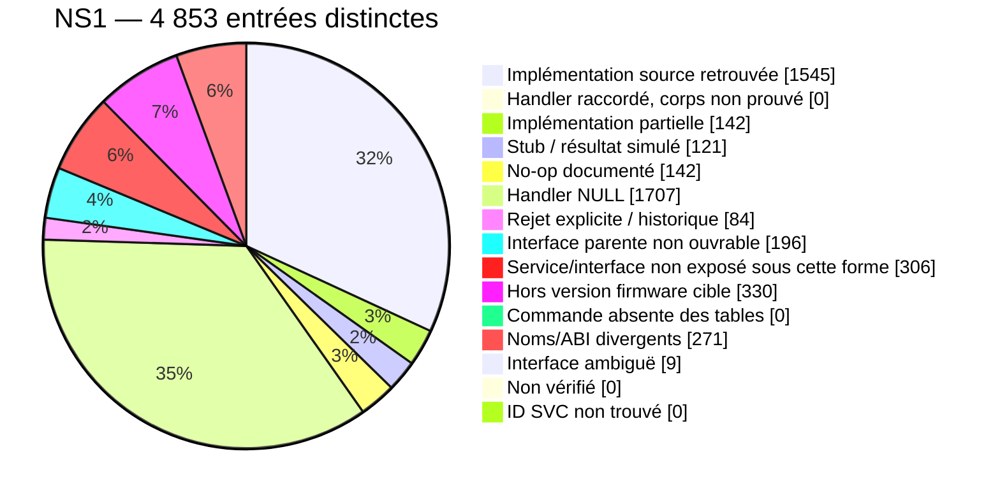

# NS1 — Catalogue des fonctions Horizon / SwitchBrew et couverture Eden Encore

> **ANNEXE D'INDEXATION, NON CANONIQUE.** Le [registre fonctionnel NS1 SwitchBrew](./EDEN_ENCORE_NS1_SWITCHBREW_FUNCTION_COVERAGE_REGISTER_2026-11-21.md) reste **l'unique source de vérité** pour les statuts validés, le propriétaire CMake réel, les preuves hôte/PS5 et l'état des tâches. Ce fichier annexe conserve les lignes du miroir SwitchBrew pour faciliter la recherche par numéro/nom. Ses codes D/P/Q sont des **présomptions statiques sur les sources Eden de base**, jamais des preuves que le runtime actif est correct ou manquant.

**Recalcul d'index : 22 novembre 2026 (Europe/Paris).** Branche `audit/ns1-switchbrew-main-coverage-20261122`, créée directement depuis le `main` moteur `452fd7fe999757377175ab1eae1bb431877d1ccf` → vendor/gitlink `224b05e6f8b1a266b0d55d1ded5332f7a2eaed7c`. **Le contenu des corps de fonctions n'a pas été qualifié exhaustivement au nouveau couple ; ne pas interpréter les codes hérités comme une certification de runtime.**

**Provenance des constats de code par ligne : 21 novembre 2026**, branche `opt/ns1-fc27-runtime-20261121`, moteur `5bef0df2b23f650b470659e928e3682cf2db3916` → vendor/gitlink `b8883667410054db189d00b3a5144088f47d3af9`. Les liens vers ce vendor restent volontairement attachés à cette preuve historique. Le recalcul du 22/11 corrige le dénominateur, distingue les stubs et vérifie le gitlink actuel ; il **ne prétend pas réauditer 4 853 corps/ABI/versions et chemins CMake**.

> **Portée et unité :** 117 lignes SVC + 4 786 lignes extraites des tableaux SwitchBrew de 54 pages, soit 4 903 lignes brutes. Elles contiennent **23 codes d'erreur** et **27 répétitions exactes de triplet (interface, ID, fonction)**. Le catalogue compte donc **4 853 entrées distinctes candidates** : 117 SVC + 4 736 IPC. Ce n'est **pas** une liste certifiée de 4 853 appels applicables à un seul firmware NS1, ni 4 853 implémentations.

## Sources et version du référentiel

- [SwitchBrew SVC](https://switchbrew.org/wiki/SVC), [miroir technique](https://github.com/backupbrew/switchbrew/blob/master/SVC.md) (blob `74ea4faf68e8a59bf4c2243a110f3a695e794bd8`).
- [SwitchBrew Services API](https://switchbrew.org/wiki/Services_API), [miroir technique](https://github.com/backupbrew/switchbrew/blob/master/Services%20API.md) (blob `cd6490d27b0e383a6fac90273611d791f6926320`).
- [Énumération SVC Eden `svc.h`](https://github.com/niakw/Prospero.Eden-Encore-vendor/blob/b8883667410054db189d00b3a5144088f47d3af9/sources/eden/src/core/hle/kernel/svc.h) (blob `d1e02ec0bc83b538a7f372624958f7ed63bf1c37`).
- Répertoire `sources/eden/src/core/hle/kernel/svc` : **37 unités C++ de base examinées** ; chaque corps SVC correspondant à une ligne SwitchBrew a reçu un lien source lorsque localisé. La sélection des TU natives reste à confirmer par CMake/ELF.

Le miroir SwitchBrew n'est pas nécessairement à jour pour toutes les versions HOS ; les évolutions récentes de la page live, notamment **S1/S2**, devront être rapprochées séparément. **Aucune commande exclusive Switch 2 ne doit être comptée NS1.**

## Compteur NS1 réévalué sur les sources C++ (22/11/2026)

**Base historique du relevé :** moteur `452fd7fe999757377175ab1eae1bb431877d1ccf` → vendor/gitlink `224b05e6f8b1a266b0d55d1ded5332f7a2eaed7c`. **Lot runtime secondaire appliqué le 22/11 :** moteur `89d7b406a6ee5429f985c1277eeb9653043e7c80` → vendor/gitlink `fe5a389ac04fa3c26c1756fc18e73a962e196da4` (GPIO, SVC GetThreadList, NCM, FSP fail-closed). Aucun build/essai PS5 validé pour ce couple. [Relevé IPC initial #45021056931](https://github.com/niakw/ProsperoEden-Encore/actions/runs/45021056931) (SUCCESS), puis rapprochement ciblé des héritages C++ dans les familles **Account** et **NFP/NFC**. Cette étape initiale était documentaire ; le lot runtime additionnel est décrit ci-dessous, sans build/installation PS5 validé.

**Réconciliation de l'index physique (23/11/2026) :** le catalogue Markdown contient actuellement **117 lignes SVC + 4 777 lignes IPC**, dont **23 META** et **27 DUP** ; le total déduplicable physiquement est donc **4 844 références**, alors que le dénominateur historique documenté reste **4 853**. Les **9 références d'écart** se répartissent, par soustraction des statuts, en **3 IMPL-SRC, 1 PARTIEL et 5 NOOP**, sans identification ligne par ligne. Sur les lignes physiquement présentes, le pool de revue est **2 738** (2 182 NULL + 149 STUB + 109 PARTIEL, dont 3 SVC, + 285 ABI-DIFF + 12 AMBIGU + 1 E). Le pool historique conservé est **2 739** en incluant la ligne PARTIEL non matérialisée. **Ne pas annoncer le catalogue exhaustif ni supprimer neuf références arbitrairement** ; réconcilier ces identités avec les sources de l'import avant tout changement du dénominateur.

### Total des fonctions avec implémentation source identifiée

**1 819 / 4 853** entrées distinctes du catalogue ont un **handler et un corps C++ non trivial retrouvés et applicables à HOS 23.x**. Le service historique `ns:am` reste exclu du pool HOS23 ; BSD `Read` est désormais raccordé au vrai chemin `RecvWork`. **Ces 1 809 entrées sont uniquement des implémentations C++ repérées : aucune certification globale du contrat Horizon ou validation PS5 n'en découle.**

| Statut | IPC | SVC | Total |
|---|---:|---:|---:|
| **IMPL-SRC — Implémentation source retrouvée** | 1 739 | 80 | **1 819** |
| **RACCORDÉ — Handler raccordé, corps non prouvé** | 0 | 0 | **0** |
| **PARTIEL — Implémentation partielle** | 163 | 3 | **166** |
| **STUB — Stub / résultat simulé** | 2 | 0 | **2** |
| **NOOP — No-op documenté** | 222 | 0 | **222** |
| **NULL — Handler NULL** | 1 178 | 0 | **1 178** |
| **D — Rejet explicite / historique** | 235 | 33 | **268** |
| **INACCESSIBLE — Interface parente non ouvrable** | 199 | 0 | **199** |
| **SERVICE-NON-EXPOSÉ — Service/interface non exposé sous cette forme** | 325 | 0 | **325** |
| **HORS-VERSION — Commande non applicable au firmware cible** | 474 | 1 | **475** |
| **ABSENT — Commande absente des tables** | 0 | 0 | **0** |
| **ABI-DIFF — Noms/ABI divergents** | 187 | 0 | **187** |
| **AMBIGU — Interface ambiguë** | 9 | 0 | **9** |
| **Q — Non vérifié** | 0 | 0 | **0** |
| **E — ID SVC non trouvé** | 0 | 0 | **0** |
| **TOTAL DISTINCT** | **4 736** | **117** | **4 853** |

### Réconciliation ciblée des 26 STUB historiques — 24/11/2026

Le lot de 26 lignes encore marquées **STUB** dans cette annexe a été recroisé avec les owners réellement actifs au vendor `b57ce2770c82aef425bc34e2fed2492f63adfe4d` et les correctifs déjà intégrés sur cette branche. **24 lignes étaient devenues obsolètes** : 4 IMPL-SRC, 7 PARTIEL, 4 NOOP, 1 NULL et 8 rejets explicites D. **Deux stubs réels restent ouverts : `CanUseApplicationCore` et `GetOperationModeSystemInfo`.**

Pour `CanUseApplicationCore`, Encore possède bien le `KProcess::GetCoreMask()` dérivé des capacités NPDM, mais la règle firmware transformant ce mask en booléen « ApplicationCore » n'est publiée ni par SwitchBrew/libnx ni par les upstreams examinés ; Yuzu/Lichii/Eglantine et Ryujinx restent eux aussi sur une constante. Pour `GetOperationModeSystemInfo`, SwitchBrew établit qu'AM cmd200 relaie OMM cmd26, mais ne documente pas la signification du `u32` ; OMM cmd26 reste absent dans les upstreams Yuzu-family. Aucun bit ni constante n'est donc inventé.

Cette réconciliation **ne constitue pas un nouvel audit des 4 853 entrées** : l'annexe conserve ses écarts physiques historiques et d'autres lignes NULL/PARTIEL peuvent encore être obsolètes. Le registre fonctionnel reste canonique. Aucun build natif PS5 ni résultat console n'est revendiqué.

### Lot d'exécution NS1 du 22/11 — GPIO et NCM

- **10 commandes racine GPIO** : enregistrées et rejetées explicitement par `Kernel::ResultNotImplemented` ; elles passent de **ABSENT → D**, et ne sont **pas** comptées comme implémentations matérielles. Aucun contrôleur GPIO Switch fictif, aucune session ou événement factice.
- **18 commandes `nn::gpio::IPadSession`** : **ABSENT → INACCESSIBLE**, car la racine rejette toute ouverture de session matérielle ; pas de méthode C++ de session artificiellement déclarée.
- **6 commandes NCM `IContentStorage`** : **ABSENT → IMPL-SRC** : `HasPlaceHolder` (3), `CleanupAllPlaceHolder` (10), `ListPlaceHolder` (11), `SetPlaceHolderSize` (17), `GetRightsIdFromPlaceHolderId` (19), `GetSizeFromPlaceHolderId` (25), toutes adossées au `PlaceholderCache` sélectionné ; la liste est bornée par la taille réelle du buffer IPC.
- **SVC `GetThreadList` (0x66)** : reste **PARTIEL** ; un handle de débogage non pris en charge renvoie maintenant une erreur au lieu de fournir incorrectement la liste des threads de l'appelant.
- **FSP P0 :** `OpenFileSystemWithPatch` reste PARTIEL, mais les trois assertions hôte sur le type et le RomFS ont été remplacées par des résultats d'erreur FS, sans crash volontaire du processus PS5. **Provenance :** [vendor `fe5a389a`](https://github.com/niakw/Prospero.Eden-Encore-vendor/commit/fe5a389ac04fa3c26c1756fc18e73a962e196da4), gitlink moteur `89d7b406`. Vérifications statiques du CMake et des overlays uniquement : **aucun test hôte, build natif, installation ni test PS5** pour ce lot.

Ces classements réduisent les **absences non qualifiées**, pas le nombre de fonctions requises pour FC27. Les 2 278 `NULL` préexistants restent `NULL` et ne sont pas déclarés implémentés par politique.

### Lot secondaire suivant — vidéo CAPS non prise en charge et NCM Rights ID

**Vendor `ff082269`, gitlink épinglé sur cette branche.** Les **34 commandes de flux vidéo album CAPS** documentées mais absentes des tables (`caps:a` : 8, `caps:u` : 5, `caps:c` : 21) ont maintenant un slot `nullptr` explicite. Elles passent de **ABSENT à NULL**, sans enregistrement de session vidéo, sans faux succès, et sans prétention de capture vidéo PS5. Dans `ncm`, `InvalidateRightsIdCache` (ID 13) passe de **NULL à NOOP**, car `PlaceholderCache::GetRightsID` relit actuellement le fichier NCA à chaque demande sans cache mémoire de droits à vider.

**Compteur source après ce lot :** 1 213 IMPL-SRC, 76 PARTIEL, 347 STUB, **7 NOOP**, **2 311 NULL**, 65 D, 191 INACCESSIBLE, 289 SERVICE-NON-EXPOSÉ, **58 ABSENT**, 283 ABI-DIFF, 12 AMBIGU et 1 E, toujours **4 853 entrées**. Il s'agit de qualification source, pas de nouveaux handlers de capture ni de gains de gameplay vérifiés.

### Lot NCM contenu — owner PS5 actif

**Vendor `c3dc80c8`.** Le propriétaire PS5 réel `encore-active/eden-core/src/core/file_sys/registered_cache.cpp` et son header prioritaire exposent désormais les requêtes NCA par Content ID. `IContentStorage` raccorde **Has (7), GetContentCount (12), ListContentId (13), GetSizeFromContentId (14) et GetRightsIdFromContentId (20)** aux données réellement présentes. La liste est triée/dédupliquée et bornée par le buffer IPC ; les Rights IDs incluent la génération de clé. `GetRightsIdFromPlaceHolderId` renvoie également la structure HOS moderne complète.

`FlushPlaceHolder` (24) et `RepairInvalidFileAttribute` (26) sont **NOOP documentés** : le VFS écrit de façon synchrone et ne représente pas l'attribut Horizon à réparer. Aucun faux stockage, aucune taille libre inventée et aucun chemin NCA fictif n'ont été ajoutés.

**Compteur après ce lot : 1 218 IMPL-SRC, 76 PARTIEL, 347 STUB, 9 NOOP, 2 311 NULL, 65 D, 191 INACCESSIBLE, 289 SERVICE-NON-EXPOSÉ, 51 ABSENT, 283 ABI-DIFF, 12 AMBIGU, 1 E = 4 853.**

### Lot NCM capacité / lifecycle

**Vendor `60bd03e6`.** `GetFreeSpaceSize` (22) et `GetTotalSpaceSize` (23) utilisent maintenant les fonctions déjà actives de `FileSystemController` pour SD/NAND/Host. `DisableForcibly` (15) est un NOOP explicite, puisque cet objet ne possède pas de backing séparément activable. `GetRightsIdFromPlaceHolderIdWithCache` (27) utilise le vrai Rights ID + key generation mais reste **PARTIEL** car le hint `cache_content_id` n'est pas reproduit.

**Compteur : 1 220 IMPL-SRC, 77 PARTIEL, 347 STUB, 10 NOOP, 2 311 NULL, 65 D, 191 INACCESSIBLE, 289 SERVICE-NON-EXPOSÉ, 47 ABSENT, 283 ABI-DIFF, 12 AMBIGU, 1 E = 4 853.**

### Requalification des faux ABSENT firmware/services

Les **17 entrées `mig:usr`** restantes sont `SERVICE-NON-EXPOSÉ` : Eden construit une table `MIG_USR` mais enregistre le nom `mig:user`, et ne fournit pas le service de migration système Horizon sous le nom attendu. L'ID audio 13 est `ABI-DIFF` : l'ABI Eden actuelle l'emploie pour `GetActiveAudioOutputDeviceName`, tandis que l'ancien `GetAudioSystemMasterVolumeSetting` appartient à une révision antérieure. Enfin, les **6 lignes Time 30/31** sont `HORS-VERSION` pour HOS 23 (SwitchBrew : 6.0.0–8.1.0).

**Il reste donc 23 `ABSENT` réels : 22 NCM et 1 `Attach` NS.** Nouveau total : 1 220 IMPL-SRC, 77 PARTIEL, 347 STUB, 10 NOOP, 2 311 NULL, 65 D, 191 INACCESSIBLE, 306 SERVICE-NON-EXPOSÉ, 6 HORS-VERSION, 23 ABSENT, 284 ABI-DIFF, 12 AMBIGU, 1 E = 4 853.

### Lot NCM lecture / revert / debug

**Vendor `488475c8`.** `RevertToPlaceHolder` (16) effectue maintenant une vraie copie du contenu enregistré vers le placeholder, supprime l'ancien contenu seulement après copie réussie et rafraîchit le cache. `ReadContentIdFile` (18) lit le NCA réel avec validation de l'offset et bornage exact sur le buffer IPC. `WriteContentForDebug` (21) est un **rejet explicite**, pas une implémentation : Atmosphère réserve ce chemin au matériel de développement.

**Compteur : 1 222 IMPL-SRC, 77 PARTIEL, 347 STUB, 10 NOOP, 2 311 NULL, 66 D, 191 INACCESSIBLE, 306 SERVICE-NON-EXPOSÉ, 6 HORS-VERSION, 20 ABSENT, 284 ABI-DIFF, 12 AMBIGU, 1 E = 4 853.** Les 20 ABSENT restants sont 19 NCM (dont 17 ContentMetaDatabase et 2 chemins ContentStorage) + 1 NS Attach.

### Lot ContentMetaDatabase — requêtes CNMT

**Vendor `8d1d9eac`.** Neuf commandes supplémentaires sont raccordées. Huit lisent les CNMT réellement chargés : `GetContentIdByType`, `ListContentInfo`, `HasAll`, `LookupOrphanContent`, `HasContent`, `ListContentMetaInfo`, `GetAttributes`, `GetContentIdByTypeAndIdOffset`. `DisableForcibly` est un NOOP documenté. `Has` a aussi été resserré : version/type/install-type doivent désormais correspondre au CNMT enregistré, au lieu de tester seulement l'existence d'un Meta NCA pour le Title ID.

Les conversions `ContentInfo` reprennent les champs du `PackagedContentInfo` déjà parsé par Eden (ID, taille basse/haute, attribut, type, id_offset). La recherche d'orphelins parcourt les références de contenu de l'ensemble des CNMT enregistrés.

**Compteur : 1 230 IMPL-SRC, 77 PARTIEL, 347 STUB, 11 NOOP, 2 311 NULL, 66 D, 191 INACCESSIBLE, 306 SERVICE-NON-EXPOSÉ, 6 HORS-VERSION, 11 ABSENT, 284 ABI-DIFF, 12 AMBIGU, 1 E = 4 853.**

### Lot ContentMetaDatabase complet — conversion CNMT réelle

**Vendor `22e47d3b`.** Les huit dernières commandes méta absentes sont raccordées : `Get`, `List`, `GetLatestContentMetaKey`, `ListApplication`, `GetSize`, `GetRequiredSystemVersion`, `GetPatchId` et `GetRequiredApplicationVersion`. Les valeurs enregistrées par `Set` sont désormais conservées intégralement ; pour les contenus installés, Encore reconstruit le `ContentMeta` normal depuis le CNMT packagé selon le schéma Atmosphère, avec le Meta NCA réel ajouté en tête.

Le parseur CNMT conserve maintenant la totalité de l'en-tête étendu (`table_offset`) au lieu des seuls 16 premiers octets. Cela rend disponibles les vrais `required_system_version`, `required_application_version`, Patch ID et DataPatch ID. **Correction connexe importante : les `MetaRecord` sont maintenant lus après tous les `ContentRecord` ; l'ancien offset relisait le début de la table de contenus.**

**Compteur : 1 238 IMPL-SRC, 77 PARTIEL, 347 STUB, 11 NOOP, 2 311 NULL, 66 D, 191 INACCESSIBLE, 306 SERVICE-NON-EXPOSÉ, 6 HORS-VERSION, 3 ABSENT, 284 ABI-DIFF, 12 AMBIGU, 1 E = 4 853.** Les trois ABSENT restants sont `GetPath`, `GetPlaceHolderPath` et NS `Attach`.

### Clôture des commandes ABSENT

**Vendor `b9e23460`.** `IContentStorage::GetPath` (8) et `GetPlaceHolderPath` (9) sont maintenant enregistrées mais échouent explicitement : Horizon exige un `fs-common path` fixe de 0x300 octets, et Encore ne possède pas cette couche de montage. Renvoyer un chemin hôte PS5 serait incorrect et potentiellement fuyant.

La ligne `IServiceGetterInterface::Attach` (NS cmd 0) n'est pas une commande de l'interface actuelle : la table SwitchBrew `ns:am2/ns:ec/ns:rid/ns:rt/ns:web` expose 7988–7999, exactement comme Eden. Elle passe donc `ABSENT → ABI-DIFF` plutôt que de créer un faux handler.

**ABSENT = 0.** Le compteur reste **1 238 IMPL-SRC** ; seuls les statuts changent : 77 PARTIEL, 347 STUB, 11 NOOP, 2 311 NULL, **68 D**, 191 INACCESSIBLE, 306 SERVICE-NON-EXPOSÉ, 6 HORS-VERSION, **0 ABSENT**, **285 ABI-DIFF**, 12 AMBIGU, 1 E = 4 853.

Zéro `ABSENT` signifie uniquement qu'aucune ligne du catalogue n'est désormais sans qualification/table correspondante. Cela ne signifie pas 4 853 fonctions fonctionnelles : les NULL, stubs, partiels et écarts ABI restent explicitement ouverts.

### Lot STUB périphériques — IRS / prepo / news

**Vendor final `229ebbc5` (IRS `569c8e2a`).** Cinq commandes IRS purement matérielles deviennent des **NOOP** explicites ; les processeurs IRS réellement émulés restent PARTIELS et ne sont pas maquillés en implémentations. `SaveSystemReportOld` écrit désormais réellement via `Core::Reporter`. Les trois commandes de transmission prepo sont des NOOP local-only. Côté news, `ClearStorage` agit réellement sur `NewsStorage`, tandis que huit opérations de backend Nintendo/abonnement/passphrase/colonnes texte sont des NOOP documentés.

**Compteur : 1 240 IMPL-SRC, 77 PARTIEL, 329 STUB, 27 NOOP, 2 311 NULL, 68 D, 191 INACCESSIBLE, 306 SERVICE-NON-EXPOSÉ, 6 HORS-VERSION, 0 ABSENT, 285 ABI-DIFF, 12 AMBIGU, 1 E = 4 853.**

### Lot FSP P0 — patch-data courant et reader cache

**Vendor `8e387b64`.** `fsp-srv` cmd203 `OpenPatchDataStorageByCurrentProcess` n'est plus un stub : sa signature a été corrigée conformément à libnx (aucune entrée IPC), puis le service retourne le RomFS du processus courant réellement patché par `RomFSFactory::OpenCurrentProcess`. Le `TargetNotFound` systématique disparaît.

`OpenSaveDataInfoReaderOnlyCacheStorage` (62) ne pointe plus vers l'espace Temporary. Un overlay actif du reader filtre `/user/save/cache/<program_id>` et publie `SaveDataType::Cache` pour le programme courant. Le statut reste **PARTIEL** : le modèle Eden ne conserve pas encore séparément l'index des cache-storage ni la préférence SD/User de LibHac.

Le manifeste `eden-backports` contient les empreintes SHA-256 exactes des deux nouveaux fichiers reader et des propriétaires FSP modifiés ; les changements concurrents IRS/News/Prepo présents dans le vendor précédent sont conservés.

**Compteur : 1 241 IMPL-SRC, 78 PARTIEL, 327 STUB, 27 NOOP, 2 311 NULL, 68 D, 191 INACCESSIBLE, 306 SERVICE-NON-EXPOSÉ, 6 HORS-VERSION, 0 ABSENT, 285 ABI-DIFF, 12 AMBIGU, 1 E = 4 853.**

### Lot FSP save/cache — taille réelle et extension fail-closed

**Vendor `e2da4886`.** `GetCacheStorageSize` (34) vérifie maintenant l'existence du cache courant et renvoie les tailles data/journal persistées par `SaveDataController`, au lieu de `0/0`. Le support reste PARTIEL : le modèle de chemin Eden ne possède pas de composant d'index et fusionne encore certains espaces User/SD.

`ExtendSaveDataFileSystem` (32) ne renvoie plus un succès fictif. Sans index `save_data_id → SaveDataAttribute`, Encore ne peut pas appliquer l'extension au bon save ; il retourne donc `ResultTargetNotFound`, comme un identifiant non résolu, plutôt que de laisser le guest croire que le quota a changé.

**Compteur : 1 241 IMPL-SRC, 79 PARTIEL, 325 STUB, 27 NOOP, 2 311 NULL, 69 D, 191 INACCESSIBLE, 306 SERVICE-NON-EXPOSÉ, 6 HORS-VERSION, 0 ABSENT, 285 ABI-DIFF, 12 AMBIGU, 1 E = 4 853.**

### Lot STUB — friend / Palma / mm:u

**Vendor `51e5cbde`.** Les 13 commandes `friend:*` deviennent des NOOP offline explicites ; les deux sorties auparavant incomplètes respectent désormais l’ABI (`PlayHistoryRegistrationKey` 0x40 et `PlayHistoryStatistics` u128). Sur Palma, 13 faux stubs sont requalifiés IMPL-SRC car ils pilotent réellement `ResourceManager::Palma` (état, événement et validation de handle), et 15 opérations purement matérielles deviennent NOOP documentées. Les erreurs `InvalidPalmaHandle` ne sont plus avalées sur plusieurs chemins. Les 8 commandes `mm:u` sont IMPL-SRC : elles maintiennent réellement les sessions et bornes min/max ; `GetOld` réserve maintenant la taille de réponse correcte.

**Compteur : 1 262 IMPL-SRC, 79 PARTIEL, 276 STUB, 55 NOOP, 2 311 NULL, 69 D, 191 INACCESSIBLE, 306 SERVICE-NON-EXPOSÉ, 6 HORS-VERSION, 0 ABSENT, 285 ABI-DIFF, 12 AMBIGU, 1 E = 4 853.**

### Lot STUB — BLE / hidbus / erpt / pctl

**Vendor final `61e8993c`.** Les quatre acquisitions `btm:u` retournent déjà de vrais événements noyau et passent IMPL-SRC. `hidbus::SetStatusManagerType` devient un NOOP explicite. Les deux lignes ERPT comptées comme stubs deviennent des NOOP local-only. Sur le backport PCTL réellement compilé, `IsRestrictionTemporaryUnlocked` et `GetPinCodeLength` lisent désormais l'état réel ; huit commandes sans backend parental/UI/pairing renvoient un état neutre explicite (dont le faux compteur de whitelist 4 corrigé à 0 et SNS qui ne bloque plus systématiquement) ; les cinq commandes play-timer sont stateful mais restent PARTIELLES faute de décompte Horizon.

**Compteur : 1 268 IMPL-SRC, 84 PARTIEL, 254 STUB, 66 NOOP, 2 311 NULL, 69 D, 191 INACCESSIBLE, 306 SERVICE-NON-EXPOSÉ, 6 HORS-VERSION, 0 ABSENT, 285 ABI-DIFF, 12 AMBIGU, 1 E = 4 853.**

### Lot matériel — BTM / LBL / PSM / TS

**Vendor `4936c552`.** `AcquireRadioEvent` et les sauvegardes/restaurations LBL sont désormais de vraies implémentations locales. Le pairing Switch et le capteur de lumière physique sont explicitement non disponibles. Deux erreurs de fallback PSM sont corrigées : `GetBatteryVoltageState` ne renvoie plus 0 (`NeedsShutdown`) mais 3 (`Normal`), et `GetBatteryAgePercentage` renvoie 100.0 % avec une réponse IPC dimensionnée pour le `f64`. Les lectures PSM/TS restent PARTIELLES car elles synthétisent du matériel Switch au lieu d'exposer les capteurs PS5.

**Compteur : 1 271 IMPL-SRC, 88 PARTIEL, 244 STUB, 69 NOOP, 2 311 NULL, 69 D, 191 INACCESSIBLE, 306 SERVICE-NON-EXPOSÉ, 6 HORS-VERSION, 0 ABSENT, 285 ABI-DIFF, 12 AMBIGU, 1 E = 4 853.**

### Lot settings / network-time — set:sys / ntc

**Vendor `be7f995c`.** `PlatformRegion` utilise désormais le champ persistant de `PrivateSettings` au lieu d'un setter vide ; les anciens fichiers avec valeur 0 sont normalisés vers `Global`. Les valeurs `ProductModel` et HOME scheme restent PARTIELLES car synthétiques. L'absence de rebootless update est un NOOP explicite. Dans NTC, `StartTask`, `GetResult` et `IsProcessing` sont requalifiés IMPL-SRC : la tâche est volontairement synchrone et signale son véritable événement de fin. Suspend/Resume restent NOOP car aucun worker autonome n'existe.

**Compteur : 1 276 IMPL-SRC, 91 PARTIEL, 233 STUB, 72 NOOP, 2 311 NULL, 69 D, 191 INACCESSIBLE, 306 SERVICE-NON-EXPOSÉ, 6 HORS-VERSION, 0 ABSENT, 285 ABI-DIFF, 12 AMBIGU, 1 E = 4 853.**

### Lot FSP save-data — filtre réel et read-only strict

**Vendor `c3c3b6d2`.** Deux stubs `fsp-srv` deviennent des implémentations source réelles : cmd53 `OpenReadOnlySaveDataFileSystem` ouvre le save réel mais renvoie un wrapper immutable ; cmd67 `FindSaveDataWithFilter` scanne les saves existants et applique les bits de filtre `program_id/type/user_id/save_data_id/index` ainsi que la règle de rank LibHac. Les caches `/user/save/cache/<titleid>` sont maintenant visibles du scanner général.

Le read-only est appliqué au niveau `IFileSystem` **et** `IFile` : Create/Delete/Rename, ouverture Write, Write et SetSize renvoient `ResultWriteNotPermitted`. Aucun succès fictif n'est conservé pour une mutation.

**Compteur : 1 278 IMPL-SRC / 91 PARTIEL / 231 STUB / 72 NOOP / 2 311 NULL / 69 D / 191 INACCESSIBLE / 306 SERVICE-NON-EXPOSÉ / 6 HORS-VERSION / 0 ABSENT / 285 ABI-DIFF / 12 AMBIGU / 1 E = 4 853.**

### Lot FSP SaveDataExtraData — sémantique directory-save

**Vendor `61ab696e`.** Les commandes ExtraData ne renvoient plus un succès aveugle : les buffers doivent faire exactement 0x200 octets et le save doit exister dans le scan réel. Pour les saves Eden stockés comme répertoires hôte, le comportement suit LibHac : l'ExtraData physique n'existe pas, donc la lecture renvoie une structure par défaut et l'écriture validée ne mute rien.

`ReadSaveDataFileSystemExtraDataBySaveDataAttribute` (69) devient IMPL-SRC pour ce backend. `WriteSaveDataFileSystemExtraDataBySaveDataAttribute` (70, nom C++ WithMask) devient NOOP documenté. Les commandes 57/58/59 deviennent PARTIEL : elles fonctionnent pour les SaveDataId non nuls retrouvables, mais Eden ne possède pas encore l'indexer Horizon qui donne des IDs uniques aux saves Account/Device. Cmd58 suit la règle LibHac : bit 63 → System, sinon User avec repli SdUser.

**Compteur : 1 279 IMPL-SRC / 93 PARTIEL / 227 STUB / 73 NOOP / 2 311 NULL / 69 D / 191 INACCESSIBLE / 306 SERVICE-NON-EXPOSÉ / 6 HORS-VERSION / 0 ABSENT / 285 ABI-DIFF / 12 AMBIGU / 1 E = 4 853.**

### Lot FSP SD + NS application-record / lancement

**Vendor `a691b553`.** `IsSdCardAccessible` utilise désormais le vrai `OpenSDMC`; `IsExFatSupported` devient un NOOP documenté à `false`, cohérent avec le backend host-directory et le fallback LibHac.

Côté NS, `HasApplicationRecord` et `IsAnyApplicationEntityInstalled` interrogent le `ContentProviderUnion` réel ; `GetRunningApplicationProgramId` renvoie déjà le ProgramId du processus application et n'est plus faussement étiqueté stub. L'événement `GetApplicationRecordUpdateSystemEvent` n'est plus signalé lors de la simple récupération du handle : il reste passif jusqu'aux mutations de record, comme l'amont Ryujinx. `IsApplicationUpdateRequested` et `CheckApplicationLaunchVersion` sont des NOOP explicites car Encore n'émule ni requêtes NS distantes ni version-list Nintendo poussée.

**Compteur : 1 286 IMPL-SRC / 93 PARTIEL / 215 STUB / 78 NOOP / 2 311 NULL / 69 D / 191 INACCESSIBLE / 306 SERVICE-NON-EXPOSÉ / 6 HORS-VERSION / 0 ABSENT / 285 ABI-DIFF / 12 AMBIGU / 1 E = 4 853.** `HasApplicationRecord` cmd910 reste NULL : c'est une autre entrée de l'interface parentale, non raccordée par ce lot.

### Lot filesystem commit / multi-commit

Vendor `f6deaab8` : `IFileSystem::Commit` devient NOOP documenté car le VFS host-directory est synchrone. `IMultiCommitManager::Add` stocke réellement jusqu'à 10 participants et rejette null/doublons. `Commit` parcourt les participants et appelle leur contrat Commit, mais reste PARTIEL faute de provisional-commit/rollback/context LibHac.

**Compteur : 1 287 IMPL-SRC, 94 PARTIEL, 212 STUB, 79 NOOP, 2 311 NULL, 69 D, 191 INACCESSIBLE, 306 SERVICE-NON-EXPOSÉ, 6 HORS-VERSION, 0 ABSENT, 285 ABI-DIFF, 12 AMBIGU, 1 E = 4 853.**

### Lot FSP program-index + NS vulnerability

Vendor `ad27e09c` : `NeedsUpdateVulnerability` est NOOP explicite sur ses 3 surfaces, faute de base Nintendo de versions système vulnérables. `OpenSaveDataTransferProhibiter` devient NOOP explicite car aucun moteur de transfert de saves n'existe. Surtout, cmd810 `RegisterProgramIndexMapInfo` devient un vrai registre de structures 0x20, et cmd1011 abandonne l'ancienne ABI yuzu `AccessLogVersion + index` pour l'ABI SwitchBrew/LibHac HOS 7+ `u32 program_index + u32 program_count`.

**Compteur : 1 289 IMPL-SRC, 94 PARTIEL, 207 STUB, 83 NOOP, 2 310 NULL, 69 D, 191 INACCESSIBLE, 306 SERVICE-NON-EXPOSÉ, 6 HORS-VERSION, 0 ABSENT, 285 ABI-DIFF, 12 AMBIGU, 1 E = 4 853.**

### Lot NS lifecycle / GameCard + faux stubs FS

Vendor `0432fba8`, puis `4483c6a3` (arbre `7ac58de8cc59a33b21de52fae13371d4f85801fa`) : six lignes d'événements/lifecycle NS passent **STUB → NOOP** parce qu'elles retournent un handle réel mais qu'Encore ne possède aucun producteur d'événement correspondant, ou aucun état NS séparé à reprendre. Les deux surfaces `TouchApplication` passent **STUB → PARTIEL** : l'existence de l'application est désormais validée dans le `ContentProviderUnion` réel, mais la métadonnée NS « last touched » n'est pas persistée. `GetApplicationTerminateResult` passe **STUB → IMPL-SRC** et renvoie le vrai `terminate_result` de l'applet principale sous verrou.

Le lot `4483c6a3` raccorde aussi `IsGameCardApplicationRunning` à l'applet principale et au `GameCardContents` réels ; cette commande n'est pas une ligne distincte du miroir historique 4 853 et ne modifie donc pas le compteur. `OpenFileSystemWithPatch` reste **PARTIEL** : le mode Manual ouvre réellement le RomFS patché, mais les autres types ne sont pas implémentés. `FlushAccessLogOnSdCard` devient un NOOP explicite hors catalogue, faute de sink d'access-log SD bufferisé.

**Compteur courant : 1 290 IMPL-SRC, 96 PARTIEL, 198 STUB, 89 NOOP, 2 310 NULL, 69 D, 191 INACCESSIBLE, 306 SERVICE-NON-EXPOSÉ, 6 HORS-VERSION, 0 ABSENT, 285 ABI-DIFF, 12 AMBIGU, 1 E = 4 853.** Aucun build PS5 ni validation console n'est déduit de cette requalification.

### Lot AM applet — événement launchable et états réellement raccordés

Vendor `6fc24667` (arbre `28da2f872d33edf2ad11947991a0cf6c4e592475`) : `GetLibraryAppletLaunchableEvent` ne signale plus artificiellement l'événement lors de la simple récupération du handle ; les producteurs réels restent `CreateLibraryApplet` et `CreateLibraryAppletEx`. `GetPreviousProgramIndex` lit l'index réellement injecté par `AppletManager`. `BeginVrModeEx` / `EndVrModeEx` utilisent le même état que `SetVrModeEnabled` / `IsVrModeEnabled`.

Sept autres lignes ne sont plus des succès vides mais restent **PARTIELLES** : les deux surfaces media-playback partagent désormais `m_applet->media_playback_state`, l'extension d'idle est stockée/relue sous verrou et les commandes sleep-lock pilotent le vrai événement ; Encore ne possède toutefois pas encore de consommateur média/idle ni d'arbitre de sommeil hôte, et la réacquisition transitoire n'est pas reproduite.

**Compteur courant : 1 294 IMPL-SRC, 103 PARTIEL, 187 STUB, 89 NOOP, 2 310 NULL, 69 D, 191 INACCESSIBLE, 306 SERVICE-NON-EXPOSÉ, 6 HORS-VERSION, 0 ABSENT, 285 ABI-DIFF, 12 AMBIGU, 1 E = 4 853.** Le lot précédent moteur `35f52e80` → vendor `4483c6a3` a passé X8D24 et Verify pinned vendor ; ce nouveau lot reste à qualifier par ses propres checks et n'est pas validé PS5.

### Lot NS update neutre + identité/storage du main applet

Vendor `57081e12`, puis `1b5b609d` (arbre `a7c6437660846d69a4b049de5641561bd08b96cb`). Les deux commandes auto-commit du download-task, l'état background-update et l'événement content-delivery passent **4 STUB → NOOP** : Encore n'implémente aucun transport Nintendo de téléchargement/mise à jour, et aucun succès n'est présenté comme un téléchargement effectif. `OpenSystemUpdateControl` reste volontairement **STUB**, car l'objet retourné ne possède encore aucun handler enfant implémenté.

Côté AM, `GetMainAppletIdentityInfo`, `GetCurrentApplicationId`, `GetMainAppletStorageId` et `SetAutoSleepTimeAndDimmingTimeEnabled` passent **4 STUB → IMPL-SRC**. `GetMainAppletApplicationControlProperty` passe **PARTIEL → IMPL-SRC** : les trois commandes « main applet » utilisent désormais `WindowSystem::GetMainApplet()`, et le stockage est résolu par présence du Program NCA dans GameCard, SD, NAND user ou NAND system au lieu du `NandUser` fixe.

**Compteur courant : 1 299 IMPL-SRC, 102 PARTIEL, 179 STUB, 93 NOOP, 2 310 NULL, 69 D, 191 INACCESSIBLE, 306 SERVICE-NON-EXPOSÉ, 6 HORS-VERSION, 0 ABSENT, 285 ABI-DIFF, 12 AMBIGU, 1 E = 4 853.** Le couple moteur `0c11653f` → vendor `6fc24667` est vert X8D24 + provenance ; le présent lot doit passer ses propres checks avant qualification hôte.

### Lot Home Button + politiques HID non applicables

Vendor `3f8249a2`, puis `2faf00b1` (arbre `18e76d6b282831c59c343950fac922d0130d1e09`). Les blocages Home short/long utilisent déjà les flags réellement consultés par `WindowSystem` : trois commandes passent **STUB → IMPL-SRC**. Le couple set/get double-click et `BeginBlockingHomeButton` passent **STUB → PARTIEL** : leur état est réel, mais aucun consommateur double-click n'est présent et le timeout automatique de `BeginBlockingHomeButton` n'est pas reproduit.

Dans HID, **13 STUB → NOOP** sont fermés sans masquer les chemins d'entrée utiles : `Set/GetNpadCommunicationMode` sont explicitement des no-op Horizon depuis 2.0.0+, et les politiques firmware Nintendo / USB full-key / bouton console handheld ne possèdent pas de backend matériel applicable à Encore PS5. Les commandes six-axis, événements de connexion, Joy-Con rail et unique-pad restent **STUB** tant qu'un backend réel n'est pas raccordé.

**Compteur courant : 1 302 IMPL-SRC, 105 PARTIEL, 160 STUB, 106 NOOP, 2 310 NULL, 69 D, 191 INACCESSIBLE, 306 SERVICE-NON-EXPOSÉ, 6 HORS-VERSION, 0 ABSENT, 285 ABI-DIFF, 12 AMBIGU, 1 E = 4 853.** Le couple précédent moteur `b9b3e700` → vendor `1b5b609d` est vert X8D24 + provenance ; ce nouveau couple reste à qualifier par ses checks.

### Lot IApplicationAccessor actif — child applet, display request et backport Lichii

Vendor `b3afcf99`, puis `dff1bdb7` (arbre `8cc006223327f14da5664476491da0ea364fabf6`). `GetCurrentLibraryApplet` et `SetHandlesRequestToDisplay` passent **2 STUB → PARTIEL** : le premier renvoie désormais le dernier enfant réellement suivi, le second persiste le flag applet réel. Les limites restantes sont explicitement bornées.

Le backport ciblé de `zortos293/Lichii@9eab742493ba1fe33f60c0f6762dcfcbdb504e96` apporte quatre lignes catalogue **NULL → IMPL-SRC** : `TerminateAllLibraryApplets` (ID 110), `AreAnyLibraryAppletsLeft` (111), `GetApplicationId` (120) et `GetApplicationLaunchProperty` (123). `IsCompleted` est aussi implémenté sur `IApplicationAccessor`, mais la ligne dédupliquée 4 853 était déjà IMPL-SRC via `ILibraryAppletAccessor`, donc elle n'augmente pas artificiellement le compteur. Les IDs 1/2 du `ILibraryAppletCreator` restent NULL. Le backport n'inclut pas les succès minimaux upstream `GetDesirableUids`, `SetApplicationAttribute` et `HasSaveDataAccessPermission`.

**Compteur courant : 1 306 IMPL-SRC, 107 PARTIEL, 158 STUB, 106 NOOP, 2 306 NULL, 69 D, 191 INACCESSIBLE, 306 SERVICE-NON-EXPOSÉ, 6 HORS-VERSION, 0 ABSENT, 285 ABI-DIFF, 12 AMBIGU, 1 E = 4 853.** Le couple moteur `422120c8` → vendor `2faf00b1` est vert X8D24 + provenance ; ce nouveau couple reste à qualifier par ses checks.

### Lot NIFM — résolution IRequest et scan legacy

Vendor `084983e0`, puis `76de6f60` (arbre `5508124e6fbc16279e5870434b331154cb7f62b6`). La machine d'état `IRequest` ne peut plus rester indéfiniment en `OnHold` lorsqu'un jeu ne fait que poller `GetRequestState` : `Submit` publie `OnHold`, le premier poll l'observe puis résout la connexion vers `Accepted` ou `Invalid`, les transitions signalent le vrai événement et `Cancel` revient à `NotSubmitted`. Les cinq commandes IRequest passent **STUB → IMPL-SRC**.

`GetScanDataOld` passe **STUB → PARTIEL**. Le type `AccessPointDataOld` est explicitement modélisé à 0x34 octets, conformément aux définitions SwIPC de l'ABI pré-4.0/commande 11, et le service renvoie le cache de scan réel au lieu d'un count zéro constant. Le scanner hôte ne fournit pas encore canal, mode d'authentification ni cipher : ces champs restent zéro plutôt que d'être inventés.

**Compteur courant : 1 311 IMPL-SRC, 108 PARTIEL, 152 STUB, 106 NOOP, 2 306 NULL, 69 D, 191 INACCESSIBLE, 306 SERVICE-NON-EXPOSÉ, 6 HORS-VERSION, 0 ABSENT, 285 ABI-DIFF, 12 AMBIGU, 1 E = 4 853.** Le couple moteur `55e6ed38` → vendor `dff1bdb7` est vert X8D24 + provenance ; ce nouveau couple reste à qualifier par ses propres checks.

### Réouverture des NULL + NIFM ClientId + lifecycle creator

Vendor cumulé `50f08688` (arbre `4f015ccf16419403354a03463a79edb4856b501f`). Le traitement récent démontre que **NULL ne peut plus être assimilé à “fermé par politique”** : trois lignes NULL du catalogue ont été raccordées directement à de l'état déjà disponible (`GetCurrentAccessPointOld`, `ILibraryAppletCreator::TerminateAllLibraryApplets`, `AreAnyLibraryAppletsLeft`).

NIFM gagne également trois contrats réels : `GetClientId` respecte désormais l'ABI 4 octets dans le buffer de sortie, `IsAnyInternetRequestAccepted` est scindé par ClientId et `IsAnyForegroundRequestAccepted` reflète les requêtes réellement acceptées. Les transitions `IRequest` maintiennent les compteurs lors des passages vers/depuis `Accepted`.

**Nouvelle règle de backlog : les 2 303 NULL restent à requalifier.** Ils ne sont ni comptés comme implémentations ni considérés clos tant qu'une justification individuelle (hors-version, debug/hardware-only, interface inaccessible, NOOP justifié) ou un handler réel n'est pas établie.

**Compteur courant : 1 316 IMPL-SRC, 108 PARTIEL, 150 STUB, 106 NOOP, 2 303 NULL, 69 D, 191 INACCESSIBLE, 306 SERVICE-NON-EXPOSÉ, 6 HORS-VERSION, 0 ABSENT, 285 ABI-DIFF, 12 AMBIGU, 1 E = 4 853.**

**Pool restant à examiner : 2 859 = 2 303 NULL + 150 STUB + 108 PARTIEL + 285 ABI-DIFF + 12 AMBIGU + 1 SVC.** Ce chiffre est un pool de revue/code, pas 2 859 bugs démontrés.

### Lot applet NULL — terminaison et suspension hors focus

Vendor `e58cfc55`, puis `c8b1acd9` (arbre `30ada5ee51cd74e474250c3132e7a48eb82f3b1d`).

- `IAppletCommonFunctions::SetTerminateResult` ID 0 : **NULL → IMPL-SRC**, même état `terminate_result` réel que la surface application.
- `ILibraryAppletAccessor::SetOutOfFocusApplicationSuspendingEnabled` ID 50 : **NULL → IMPL-SRC**, raccord direct au `LifecycleManager` qui décide réellement de la suspension selon le focus.
- `IAppletCommonFunctions::IsHomeButtonShortPressedBlocked` est aussi désormais implémenté et lit le flag réellement consommé par `WindowSystem`, mais cette commande n'est pas une entrée distincte du miroir 4 853 et n'est donc pas ajoutée artificiellement au compteur.

**Compteur courant : 1 318 IMPL-SRC, 108 PARTIEL, 150 STUB, 106 NOOP, 2 301 NULL, 69 D, 191 INACCESSIBLE, 306 SERVICE-NON-EXPOSÉ, 6 HORS-VERSION, 0 ABSENT, 285 ABI-DIFF, 12 AMBIGU, 1 E = 4 853.**

**Pool restant à examiner : 2 857 = 2 301 NULL + 150 STUB + 108 PARTIEL + 285 ABI-DIFF + 12 AMBIGU + 1 SVC.** Les NULL restent ouverts jusqu'à justification individuelle ou implémentation.

### Lot performance applet + ApplicationRecord NS

Vendor `3bd12215` puis `b1b3d6e9`, consolidé par `6f797482` (arbre `12879f10b2d866ba5b4536e62bedfcc0c28bb34e`).

- Les IDs applet 90/91 passent **2 NULL → IMPL-SRC** : la notification de changement de performance est raccordée au `LifecycleManager`, et la configuration courante est lue dans l'APM Controller actif.
- `GenerateApplicationRecordCount` sur les deux surfaces NS passe **2 NULL → IMPL-SRC**, avec exactement le même filtrage Application/Program racine que `ListApplicationRecord`.
- `GetApplicationRecord` sur les deux surfaces passe **2 NULL → IMPL-SRC**, avec état Installed/Archived et timestamp réel.
- `HasApplicationRecord` ID 910 passe **NULL → IMPL-SRC**, par présence réelle du Program NCA.
- Le défaut de provenance du couple précédent a été corrigé : `SetOutOfFocusApplicationSuspendingEnabled` est maintenant aussi présent dans l'overlay `eden-backports` réellement compilé ; le manifeste porte les hashes upstream et active correspondants.

**Compteur courant : 1 325 IMPL-SRC, 108 PARTIEL, 150 STUB, 106 NOOP, 2 294 NULL, 69 D, 191 INACCESSIBLE, 306 SERVICE-NON-EXPOSÉ, 6 HORS-VERSION, 0 ABSENT, 285 ABI-DIFF, 12 AMBIGU, 1 E = 4 853.**

**Pool restant à examiner : 2 850 = 2 294 NULL + 150 STUB + 108 PARTIEL + 285 ABI-DIFF + 12 AMBIGU + 1 SVC.**

### Lot état firmware contrôleur + layout clavier

Vendor `0d21ded6`, consolidé par `aea99647` (arbre `b3b59fda00af67a52aa5bf5b8125df90ae312c26`).

- `SetControllerFirmwareUpdateSection` ID17 : **NULL → IMPL-SRC** ; l'état est stocké dans l'applet et `IsInControllerFirmwareUpdateSection` ID55 relit désormais ce même état au lieu d'un `false` constant.
- `SetDesirableKeyboardLayout` ID20 : **NULL → IMPL-SRC**.
- `GetDesirableKeyboardLayout` ID19 : **STUB → IMPL-SRC**, lecture du layout de l'applet principale réelle.
- La correction de provenance NS est incluse : le header `application_manager_interface.h` actif contient bien les déclarations des nouveaux handlers records, et le manifeste suit les hashes source + overlay.

**Compteur courant : 1 328 IMPL-SRC, 108 PARTIEL, 149 STUB, 106 NOOP, 2 292 NULL, 69 D, 191 INACCESSIBLE, 306 SERVICE-NON-EXPOSÉ, 6 HORS-VERSION, 0 ABSENT, 285 ABI-DIFF, 12 AMBIGU, 1 E = 4 853.**

**Pool restant à examiner : 2 847 = 2 292 NULL + 149 STUB + 108 PARTIEL + 285 ABI-DIFF + 12 AMBIGU + 1 SVC.**

### Recheck NULL — System NAND + paramètres IP NIFM

Vendor final `40596a94` (arbre `b6631a93395622feea9f86abdbb0b79dd6c4993d`). Le couple moteur précédent `d84b0ff3` → vendor `aea99647` a passé X8D24 mais échoué au contrôle de provenance sur le reçu actif `self_controller.h` ; le reçu est corrigé dans `fe0ccc13`, inclus dans ce vendor final.

- `IsSystemProgramInstalled` ID63 : **2 NULL → IMPL-SRC** sur les deux surfaces catalogue `ns:am` et `ns:am2/ns:ec/ns:rid/ns:rt/ns:web`. Le handler commun consulte `GetSystemNANDContents()->HasEntry(program_id, Program)`.
- NIFM ID27 `GetDefaultIpSetting` et ID28 `SetDefaultIpSetting` : **2 NULL → IMPL-SRC**. Le contrat SwIPC vérifié est un buffer `IpSettingData` de **0xC2 octets** ; le getter initialise l'état avec le backend réseau réel (IP, masque, passerelle, DNS), proxy désactivé et MTU 1500, puis le setter assure un round-trip exact du bloc complet.
- Aucun comportement PS5 n'est déclaré validé par ces contrôles hôte.

**Compteur courant : 1 332 IMPL-SRC, 108 PARTIEL, 149 STUB, 106 NOOP, 2 288 NULL, 69 D, 191 INACCESSIBLE, 306 SERVICE-NON-EXPOSÉ, 6 HORS-VERSION, 0 ABSENT, 285 ABI-DIFF, 12 AMBIGU, 1 E = 4 853.**

**Pool restant à examiner : 2 843 = 2 288 NULL + 149 STUB + 108 PARTIEL + 285 ABI-DIFF + 12 AMBIGU + 1 SVC.**

### Recheck NULL — terminate-result NS + contrôles réseau NIFM

Vendor final `bc3d538f` (arbre `8307e210806b858beea5f87c49434685fe93831d`). Le couple précédent moteur `5b5bcfc3` → vendor `40596a94` est **vert X8D24 + provenance**.

- NS `SetApplicationTerminateResult` / `ClearApplicationTerminateResult` IDs 56/57 : **4 NULL → IMPL-SRC** sur les deux surfaces catalogue. Les handlers valident le ProgramId du main applet et modifient son vrai `terminate_result`.
- NIFM IDs 29/30 : **2 NULL → IMPL-SRC** en réutilisant exactement les handlers actifs des IDs 16/19 ; aucun état de test séparé ou factice.
- NIFM `GetCurrentIpAddress` et `IsEthernetCommunicationEnabled` : **2 PARTIEL → IMPL-SRC**. Le premier renvoie l'IPv4 hôte/room réelle ; le second relit l'état `ethernet_enabled` réellement écrit au lieu de confondre toute connectivité IPv4 avec Ethernet.
- `IsWiredConnectionAvailable` 18.0.0+ est aussi implémenté depuis l'état réseau réel, mais **n'appartient pas aux 4 853 lignes du catalogue courant** : gain runtime, **+0 compteur**.
- Pas de validation console PS5 revendiquée.

**Compteur courant : 1 340 IMPL-SRC, 106 PARTIEL, 149 STUB, 106 NOOP, 2 282 NULL, 69 D, 191 INACCESSIBLE, 306 SERVICE-NON-EXPOSÉ, 6 HORS-VERSION, 0 ABSENT, 285 ABI-DIFF, 12 AMBIGU, 1 E = 4 853.**

**Pool restant à examiner : 2 835 = 2 282 NULL + 149 STUB + 106 PARTIEL + 285 ABI-DIFF + 12 AMBIGU + 1 SVC.**

### Recheck NULL — conversions et sélection de langue NS

Vendor `0897a295` (arbre `06e36212834c87b6d464f5349bf26851e336362f`). Le couple précédent moteur `4b9861f8` → vendor `bc3d538f` est **vert X8D24 + provenance**.

- `ConvertLanguageCodeToApplicationLanguage` : **3 NULL → IMPL-SRC**. L'interface read-only possède désormais l'implémentation canonique via `ConvertToApplicationLanguage`; les deux surfaces `IApplicationManagerInterface` délèguent à ce propriétaire.
- `SelectApplicationDesiredLanguage` ID4 : **1 NULL → IMPL-SRC**, délégation à `GetApplicationDesiredLanguage` et donc aux mêmes priorités/supported-language flags déjà utilisées.
- La conversion couvre les codes déjà présents dans `language.cpp` (notamment en-US/en-GB, FR/FR-CA, PT/PT-BR, chinois traditionnel/simplifié, polonais et thaï) et retourne l'erreur NS existante pour une valeur inconnue.
- Aucun résultat PS5 n'est revendiqué pour ce lot.

**Compteur courant : 1 344 IMPL-SRC, 106 PARTIEL, 149 STUB, 106 NOOP, 2 278 NULL, 69 D, 191 INACCESSIBLE, 306 SERVICE-NON-EXPOSÉ, 6 HORS-VERSION, 0 ABSENT, 285 ABI-DIFF, 12 AMBIGU, 1 E = 4 853.**

**Pool restant à examiner : 2 831 = 2 278 NULL + 149 STUB + 106 PARTIEL + 285 ABI-DIFF + 12 AMBIGU + 1 SVC.**

### Recheck NULL — GameCard NS + lecteurs/data-storage FSP

Vendor final `a7c2afb3` (arbre `9b7cefd10652c20bdd3c0a62599e42e35e40c568`), incluant 8f842b50 → 00a7d197 → a7c2afb3. Le couple précédent moteur `3a5e6121` → vendor `0897a295` est **vert X8D24 + provenance**.

- NS : les deux lignes `GetGameCardAttachmentInfo` et `IsGameCardInserted` passent **3 NULL → IMPL-SRC**, à partir de l'état réel du GameCard dans `FileSystemController`.
- FSP ID201 `OpenDataStorageByProgramId` : **NULL → IMPL-SRC**, délégation au chemin Data NCA déjà actif `OpenDataStorageByDataId`.
- FSP ID60 `OpenSaveDataInfoReader` : **NULL → PARTIEL**. SwitchBrew exige un lecteur de tous les save-data ; Encore agrège les trois backings réellement représentés (`System`, `User`, `Temporary`). `SdUser` reste fusionné dans `User`, tandis que `SdSystem/ProperSystem/SafeMode` n'ont pas de path backing et ne sont pas sondés pour éviter les assertions du factory.
- Les NULL GameCard storage/FS 30/31 restent ouverts : les forks trouvés ne fournissent qu'un stub TargetNotFound, pas de backend applicable.

**Compteur courant : 1 348 IMPL-SRC, 107 PARTIEL, 149 STUB, 106 NOOP, 2 273 NULL, 69 D, 191 INACCESSIBLE, 306 SERVICE-NON-EXPOSÉ, 6 HORS-VERSION, 0 ABSENT, 285 ABI-DIFF, 12 AMBIGU, 1 E = 4 853.**

**Pool restant à examiner : 2 827 = 2 273 NULL + 149 STUB + 107 PARTIEL + 285 ABI-DIFF + 12 AMBIGU + 1 SVC.**

### Recheck NULL — stubs Horizon officiels + NIFM sleep/wake

Vendor `36100c17` (arbre `c9042596bcfece3250e1574ab44061c182ff54ee`). La baseline précédente `22df8a22` → `a7c2afb3` est **verte X8D24 + provenance**.

- NIFM `PutToSleep` / `WakeUp` : **2 NULL → NOOP**. libnx confirme deux commandes sans entrée/sortie ; Encore n'a aucun daemon NIFM séparé ni état de veille réseau à synchroniser, le backend hôte étant interrogé à la demande.
- Applet Manager : **15 NULL → D** après contre-vérification SwitchBrew. Horizon documente explicitement ces commandes comme *stubbed, just returns an error* : `RequestToEnterSleep`, `EnterSleep`, `NeedsToExitProcess`, `RequestForAppletToGetForeground`, `GetThisAppletKind`, `AllowToEnterSleep`, `DisallowToEnterSleep`, `CreateWindow`, les 3 getters d'images de capture, les 3 acquisitions de buffers de capture et `NotifyMessageToHomeMenuForDebug`.
- L'essai local de raccorder `NeedsToExitProcess` au flag lifecycle a été explicitement revert avant gitlink : disposer d'un état local ne justifie pas de diverger du contrat Horizon.

**Compteur courant : 1 348 IMPL-SRC, 107 PARTIEL, 149 STUB, 108 NOOP, 2 256 NULL, 84 D, 191 INACCESSIBLE, 306 SERVICE-NON-EXPOSÉ, 6 HORS-VERSION, 0 ABSENT, 285 ABI-DIFF, 12 AMBIGU, 1 E = 4 853.**

**Pool restant à examiner : 2 810 = 2 256 NULL + 149 STUB + 107 PARTIEL + 285 ABI-DIFF + 12 AMBIGU + 1 SVC.**

### Recheck NULL — canal ExtraStorage applet réel

Vendor `ebc5a68a` (arbre `7a96cbc2af79a866e194c28fa33e438d9c897712`). La baseline moteur `ce2a1673` → vendor `36100c17` est **verte X8D24 + provenance**.

- `ILibraryAppletAccessor::PushExtraStorage` et `ILibraryAppletSelfAccessor::{PopExtraStorage,GetPopExtraStorageEvent,UnpopExtraStorage}` : **4 NULL → IMPL-SRC**.
- Le canal n'est pas simulé : `AppletDataBroker` possède désormais un `AppletStorageChannel extra_storage`, avec la même sémantique Push/Pop/Unpop/KEvent que les canaux in/out existants.
- Aucun changement de statut n'est appliqué aux commandes extra-storage voisines qui restent sans propriétaire ou ABI prouvée.

**Compteur courant : 1 352 IMPL-SRC, 107 PARTIEL, 149 STUB, 108 NOOP, 2 252 NULL, 84 D, 191 INACCESSIBLE, 306 SERVICE-NON-EXPOSÉ, 6 HORS-VERSION, 0 ABSENT, 285 ABI-DIFF, 12 AMBIGU, 1 E = 4 853.**

**Pool restant à examiner : 2 806 = 2 252 NULL + 149 STUB + 107 PARTIEL + 285 ABI-DIFF + 12 AMBIGU + 1 SVC.**

### Recheck NULL — politiques NIFM d'exclusivité et type réseau

Vendor `05784b60` (arbre `7502d3834222f5e3b35e4cb13f48d2755ab79bfe`). Baseline précédente moteur `04ebfb45` → vendor `ebc5a68a` : **X8D24 + provenance verts**.

- `SetExclusiveClient` : **NULL → PARTIEL**, ABI confirmée comme buffer d'entrée pointeur contenant un `ClientId` de 4 octets.
- `SetAcceptableNetworkTypeFlag` / `GetAcceptableNetworkTypeFlag` : **2 NULL → PARTIEL**, état u32 atomique avec round-trip réel.
- `Shutdown` : **NULL → NOOP**, faute de daemon NIFM séparé à arrêter dans Encore.
- Aucun comportement d'exclusivité ni de filtrage réseau n'est simulé : ces effets restent explicitement ouverts.

**Compteur courant : 1 352 IMPL-SRC, 110 PARTIEL, 149 STUB, 109 NOOP, 2 248 NULL, 84 D, 191 INACCESSIBLE, 306 SERVICE-NON-EXPOSÉ, 6 HORS-VERSION, 0 ABSENT, 285 ABI-DIFF, 12 AMBIGU, 1 E = 4 853.**

**Pool restant à examiner : 2 805 = 2 248 NULL + 149 STUB + 110 PARTIEL + 285 ABI-DIFF + 12 AMBIGU + 1 SVC.**

### Recheck NULL — canaux Friend Invitation / Notification

Vendor `d1e41151` (arbre `34dbfc91c0b5b086ef220eaee856627e37ac20e3`). Baseline précédente moteur `efe0693e` → vendor `05784b60` : **X8D24 + provenance verts**.

- `IApplicationAccessor::PushToFriendInvitationStorageChannel` : **NULL → IMPL-SRC** ; file existante, stockage réel et événement kernel existant.
- `IApplicationAccessor::PushToNotificationStorageChannel` + `IApplicationFunctions::TryPopFromNotificationStorageChannel` : **2 NULL → IMPL-SRC** ; file Notification ajoutée à l'état `Applet`, push/pop sous verrou et signalement de l'événement existant.
- Le propriétaire CMake a été vérifié avant modification : `application_functions.cpp` est explicitement remplacé par `encore-active/eden-core/src/core/hle/service/am/service/application_functions.cpp`; l'accessor et `applet.h` restent ceux de `sources/eden`.
- Les données sont publiées sous verrou avant le signalement de l'événement afin qu'un consommateur réveillé observe toujours un canal cohérent.

**Compteur courant : 1 355 IMPL-SRC, 110 PARTIEL, 149 STUB, 109 NOOP, 2 245 NULL, 84 D, 191 INACCESSIBLE, 306 SERVICE-NON-EXPOSÉ, 6 HORS-VERSION, 0 ABSENT, 285 ABI-DIFF, 12 AMBIGU, 1 E = 4 853.**

**Pool restant à examiner : 2 802 = 2 245 NULL + 149 STUB + 110 PARTIEL + 285 ABI-DIFF + 12 AMBIGU + 1 SVC.**

### Recheck NULL — AppletBoundChannel

Vendor `b217369d` (arbre `d788055b10aa228029f24699acd653609c972baa`). Baseline précédente moteur `e89ca072` → vendor `d1e41151` : **X8D24 + provenance verts**.

- `PushToAppletBoundChannel` / `TryPopFromAppletBoundChannel` : **2 NULL → IMPL-SRC**.
- ABI recroisée avec libnx/FewFW : échange d'un objet `IStorage`, sans événement ni backend matériel.
- État ajouté directement à `Applet`, protégé par son verrou ; pop vide retourne `ResultNoDataInChannel`.
- `ThemeStorage` reste NULL : le contrat implique un stockage offset/persistant et n'est pas remplacé par un simple buffer volatile.

**Compteur courant : 1 357 IMPL-SRC, 110 PARTIEL, 149 STUB, 109 NOOP, 2 243 NULL, 84 D, 191 INACCESSIBLE, 306 SERVICE-NON-EXPOSÉ, 6 HORS-VERSION, 0 ABSENT, 285 ABI-DIFF, 12 AMBIGU, 1 E = 4 853.**

**Pool restant à examiner : 2 800 = 2 243 NULL + 149 STUB + 110 PARTIEL + 285 ABI-DIFF + 12 AMBIGU + 1 SVC.**

### Recheck NULL — huit paires de paramètres système persistants

Vendor `694becfbf6a27cecb907d8be5b0315c269654fa7` (arbre `ba9035d2e9289d05d89a611c19477b91f3243d1f`) : **16 NULL → IMPL-SRC** sur `set:sys`. Sont désormais raccordés et persistés les canaux LDN, drapeaux RTC externe et USB full-key, compteur d'avertissement volume casque, drapeaux Bluetooth AFH/Boost, indicateur de mise à jour volume et drapeau PCTL ready. Chaque getter relit le champ exact du `SystemSettings` existant et chaque setter le modifie puis appelle `SetSaveNeeded()`.

ABI recroisée avec les signatures Get/Set SwitchBrew et les générateurs IPC historiques : booléens sur un octet ; canal LDN et compteur de volume sur quatre octets. Ces commandes implémentent le **stockage Horizon virtuel**, pas un contrôle physique des périphériques Switch/PS5. Source compilée : `sources/eden/src/core/hle/service/set/system_settings_server.cpp`, retenue par les fichiers CMake actifs, sans override de ce TU.

**Compteur courant : 1 373 IMPL-SRC, 110 PARTIEL, 149 STUB, 109 NOOP, 2 227 NULL, 84 D, 191 INACCESSIBLE, 306 SERVICE-NON-EXPOSÉ, 6 HORS-VERSION, 0 ABSENT, 285 ABI-DIFF, 12 AMBIGU, 1 E = 4 853.**

**Pool restant à examiner : 2 784 = 2 227 NULL + 149 STUB + 110 PARTIEL + 285 ABI-DIFF + 12 AMBIGU + 1 SVC.** Validation runtime PS5 non effectuée ; checks du nouveau couple encore à vérifier.

### Recheck NULL — 20 commandes de configuration persistante complémentaires

Vendor `0aa3af72`, puis `9aa3b2568b3f74bd124f3923e88116a52c1c589a` (arbre `fbd04c1ab3bc6858e873e48fb6c32c17db7a335e`) : **20 NULL → IMPL-SRC** sur `set:sys`. Dix commandes couvrent les informations PTM (lot, jauge), valeur de shutdown RTC, paramètres de suppression des données et identifiants des applets système, et dix autres couvrent calibrations de sticks, version batterie et flags USB 3.0 host/device. Chaque commande lit ou modifie directement le stockage déjà existant de `SystemSettings`, `PrivateSettings` ou `DeviceSettings` ; les écritures déclenchent `SetSaveNeeded()`. ABI croisée avec les tailles et identifiants IPC libnx / SwitchBrew. Les paramètres matériels ne prouvent pas l'émulation du matériel correspondant.

**Compteur courant : 1 393 IMPL-SRC, 110 PARTIEL, 149 STUB, 109 NOOP, 2 207 NULL, 84 D, 191 INACCESSIBLE, 306 SERVICE-NON-EXPOSÉ, 6 HORS-VERSION, 0 ABSENT, 285 ABI-DIFF, 12 AMBIGU, 1 E = 4 853.**

**Pool restant à examiner : 2 764 = 2 207 NULL + 149 STUB + 110 PARTIEL + 285 ABI-DIFF + 12 AMBIGU + 1 SVC.** Aucun build PS5 ni validation console revendiqués ; qualification CI propre à ce couple requise.

### Recheck NULL — préférences invité, diagnostic et thème

Vendor `407b42a985c1d8558a516d41d5c03a216f4da433` (arbre `d49fdafca026f9a973a84ad42cf0981a0ead8b10`). **9 NULL → IMPL-SRC** dans le miroir 4 853 : `GetWebInspectorFlag`, `SetChineseTraditionalInputMethod`, `Get/SetPtmCycleCountReliability`, `Get/SetThemeSettings`, `Get/SetZoomFlag`, `GetMemoryUsageRateFlag`. Dix méthodes C++ ont été ajoutées : `SetFieldTestingFlag` est également raccordée au champ persistant existant mais ne figure pas comme entrée distincte du miroir historique et ne compte donc pas pour +1. Toutes les écritures utilisent `SetSaveNeeded()`. Aucune fonction matérielle PS5 n'est supposée.

**Compteur courant : 1 402 IMPL-SRC, 110 PARTIEL, 149 STUB, 109 NOOP, 2 198 NULL, 84 D, 191 INACCESSIBLE, 306 SERVICE-NON-EXPOSÉ, 6 HORS-VERSION, 0 ABSENT, 285 ABI-DIFF, 12 AMBIGU, 1 E = 4 853.**

**Pool restant à examiner : 2 755 = 2 198 NULL + 149 STUB + 110 PARTIEL + 285 ABI-DIFF + 12 AMBIGU + 1 SVC.** Le couple précédent moteur `caeb314e` → vendor `9aa3b256` est vert X8D24 + provenance ; console non validée.

### Graphique — couverture source de l'inventaire NS1

### Clôture de la classification documentaire — Q = 0

Les **118 dernières entrées Q** ont été reclassées sans modifier le runtime : **7 IMPL-SRC, 8 STUB, 24 NULL, 16 INACCESSIBLE, 27 SERVICE-NON-EXPOSÉ, 15 ABSENT et 21 ABI-DIFF**. Il n'existe donc plus de statut générique « à vérifier ». Les incertitudes restantes sont nommées et justifiées ; elles ne doivent pas être converties automatiquement en succès runtime.

`IMovieMaker` reste inaccessible car `GRC::CreateMovieMaker` est `nullptr`; `DAUTH_0` et ses contextes sont nuls; les interfaces save-data chunk et `IAsyncProgressResult` ne sont pas exposées; `lp2p` et `IMultiCommitManager` sont des stubs explicites; `IAsyncValue`, le progress BCAT, `ISaveDataInfoReader` et `IAsyncResult::Cancel` fournissent les **7 nouveaux corps source**.

**Détail du changement de ce lot :** **119** entrées `RACCORDÉ` ont été qualifiées à partir des tables et des méthodes héritées : **114 IMPL-SRC** et **5 PARTIEL** (notamment `IsUserRegistrationRequestPermitted`, dont le corps mentionne une limite fonctionnelle). Sources effectivement inspectées : [Account](https://github.com/niakw/Prospero.Eden-Encore-vendor/blob/224b05e6f8b1a266b0d55d1ded5332f7a2eaed7c/encore-active/eden-backports/src/core/hle/service/acc/acc.cpp), [NFP](https://github.com/niakw/Prospero.Eden-Encore-vendor/blob/224b05e6f8b1a266b0d55d1ded5332f7a2eaed7c/encore-active/eden-backports/src/core/hle/service/nfp/nfp.cpp), [NFP Interface](https://github.com/niakw/Prospero.Eden-Encore-vendor/blob/224b05e6f8b1a266b0d55d1ded5332f7a2eaed7c/sources/eden/src/core/hle/service/nfp/nfp_interface.cpp), [NFC Interface](https://github.com/niakw/Prospero.Eden-Encore-vendor/blob/224b05e6f8b1a266b0d55d1ded5332f7a2eaed7c/sources/eden/src/core/hle/service/nfc/nfc_interface.cpp). La classification concerne la présence d'un corps et certains chemins manifestement incomplets, **pas la présence d'un lecteur NFC PS5 ni un comportement garanti**.

**Limites :** le catalogue n'est pas filtré exhaustivement par version HOS NS1 ni par usage effectif des jeux. Les noms de services utilisés dans les pages SwitchBrew ne permettent pas toujours d'identifier sans ambiguïté une sous-interface. Le graphe CMake/overlays, les retours d'erreur, les buffers/handles, les stubs indirects et la console restent à qualifier pour chaque commande. Il ne reste **aucune entrée `Q` ni `RACCORDÉ`** : toute incertitude résiduelle est désormais portée par un statut explicite (`AMBIGU`, `ABI-DIFF`, `INACCESSIBLE`, `SERVICE-NON-EXPOSÉ` ou `ABSENT`) et sa raison. Les 2 278 `NULL` sont des trous des tables rapprochées, pas la preuve qu'elles sont demandées par FC27.

**Lot FS de requalification :** 20 commandes précédemment `Q` rapprochées par service et ID dans les sources FS épinglées : **5 implémentations source**, **14 handlers `nullptr`** et **1 stub explicite** (`fsp-srv` ID 70, corps `STUBBED` avec retour succès). Pour les 10 slots `fsp-srv` aux noms différents du catalogue SwitchBrew, seul le **numéro d'ID** et l'état du slot sont confirmés ; l'équivalence des noms/ABI et des variantes firmware reste à vérifier. `IStorage` : Read/GetSize réels, Write/Flush/SetSize/OperateRange nuls. `IFile` : Write/Flush/SetSize réellement raccordés. Sources : [fsp-srv](https://github.com/niakw/Prospero.Eden-Encore-vendor/blob/224b05e6f8b1a266b0d55d1ded5332f7a2eaed7c/encore-active/eden-backports/src/core/hle/service/filesystem/fsp/fsp_srv.cpp), [IStorage](https://github.com/niakw/Prospero.Eden-Encore-vendor/blob/224b05e6f8b1a266b0d55d1ded5332f7a2eaed7c/sources/eden/src/core/hle/service/filesystem/fsp/fs_i_storage.cpp), [IFile](https://github.com/niakw/Prospero.Eden-Encore-vendor/blob/224b05e6f8b1a266b0d55d1ded5332f7a2eaed7c/sources/eden/src/core/hle/service/filesystem/fsp/fs_i_file.cpp).

**Lot VI (première frame NS1)** : les 133 lignes du catalogue sous le libellé générique `IApplicationDisplayService` ont été recroisées avec les trois tables sources distinctes `IApplicationDisplayService`, `ISystemDisplayService` et `IManagerDisplayService`. **132** lignes sont qualifiées : **21 corps source**, **12 partiels (marqués `STUBBED` ou `UNIMPLEMENTED`)**, **1 stub**, **98 `nullptr`**. Une ligne, `GetDisplayResolution` ID 1102, reste **Q** : l'interface application la raccorde tandis que l'interface manager la laisse nulle. **Ne pas conclure sans désambiguïsation de l'interface SwitchBrew.** Cela améliore l'inventaire, ne prouve ni première frame invitée ni synchronisation/pacing. Sources : [VI application](https://github.com/niakw/Prospero.Eden-Encore-vendor/blob/224b05e6f8b1a266b0d55d1ded5332f7a2eaed7c/sources/eden/src/core/hle/service/vi/application_display_service.cpp), [VI système](https://github.com/niakw/Prospero.Eden-Encore-vendor/blob/224b05e6f8b1a266b0d55d1ded5332f7a2eaed7c/sources/eden/src/core/hle/service/vi/system_display_service.cpp), [VI manager](https://github.com/niakw/Prospero.Eden-Encore-vendor/blob/224b05e6f8b1a266b0d55d1ded5332f7a2eaed7c/sources/eden/src/core/hle/service/vi/manager_display_service.cpp).

**Lot Loader/PM de lancement :** sept lignes historiquement Q (`ldr:dmnt` 0–2, `ldr:pm` 2–3, `ldr:shel` 0–1) sont classées **NULL au slot ID** après lecture des classes réelles de [Loader R23](https://github.com/niakw/Prospero.Eden-Encore-vendor/blob/224b05e6f8b1a266b0d55d1ded5332f7a2eaed7c/encore-active/eden-backports/src/core/hle/service/ldr/ldr.cpp). Les noms SwitchBrew anciens ne correspondent pas toujours aux noms de la table actuelle : cette classification atteste que **le slot ID est nul**, pas une équivalence des contrats entre firmwares. Le démarrage des jeux via Eden peut être géré ailleurs ; aucun bug de jeu n'est démontré par ces NULL.

**Lot horloges `time:*` (CMake examiné)** : 158 commandes précédemment non qualifiées étudiées par service, ID, nom et corps C++. **118 implémentations source identifiées**, **14 rejets explicites** (handler non nul mais `R_RETURN(ResultNotImplemented)`), **24 noms/IDs non appariés** et **2 ambiguïtés entre les propriétaires Glue et PSC** restent `Q`. Les unités sources figurent dans les CMake `sources/eden/src/core/CMakeLists.txt` et `encore-active/eden-backports/src/core/CMakeLists.txt`; la matérialisation finale et le binaire PS5 ne sont pas vérifiés. Un rejet explicite n'est pas un stub de succès. Les doublons de surfaces SwitchBrew restent comptés comme entrées d'interface distinctes.

**Lot TLS `ssl` :** 41 commandes autrefois « handler raccordé » analysées dans [`ssl.cpp`](https://github.com/niakw/Prospero.Eden-Encore-vendor/blob/224b05e6f8b1a266b0d55d1ded5332f7a2eaed7c/sources/eden/src/core/hle/service/ssl/ssl.cpp), en distinguant `ISslService`, `ISslServiceForSystem`, `ISslContext` et `ISslConnection`. **32 lignes reclassées** : 16 corps fonctionnels identifiés en source, 12 handlers `nullptr`, 4 stubs retournant un succès simulé sans effectuer l'opération TLS ; **9 lignes restent raccordées/non qualifiées**, car deux interfaces exportent les mêmes ID et noms avec des comportements parfois différents. Le fichier C++ seul ne valide pas la négociation TLS sur console.

**Lot réseau `nifm` :** **19 commandes** rapprochées aux tables et corps du [vendor épinglé](https://github.com/niakw/Prospero.Eden-Encore-vendor/blob/224b05e6f8b1a266b0d55d1ded5332f7a2eaed7c/encore-active/eden-backports/src/core/hle/service/nifm/nifm.cpp), avec sélection de l'unité dans `encore-active/eden-backports/src/core/CMakeLists.txt`. Sur les 15 `RACCORDÉ` : 5 deviennent `IMPL-SRC`, 10 deviennent `STUB` car le code affiche `STUBBED`. Sur 4 `Q` anciennes : `CreateGeneralServiceOld` possède un vrai constructeur d'interface, `GetScanDataOld` renvoie un tableau vide constant (stub), `GetCurrentAccessPointOld` et `PersistOld` sont `nullptr`. Aucun contrat réseau n'a été validé sur PS5.

**Lot chargement/stockage `ncm` :** 63 lignes SwitchBrew de la section « Content Manager services » rapprochées par leur **sous-interface** et ID avec [`ncm.cpp`](https://github.com/niakw/Prospero.Eden-Encore-vendor/blob/224b05e6f8b1a266b0d55d1ded5332f7a2eaed7c/sources/eden/src/core/hle/service/ncm/ncm.cpp) : **12 corps C++ présents**, **12 slots `nullptr`**, **39 commandes absentes des tables `NCM`, `IContentStorage` et `IContentMetaDatabase`**. Pour les ABSENT, il s'agit exclusivement de l'absence d'enregistrement IPC dans la table concernée, **pas de la preuve que l'opération est impossible ailleurs**. Unités de base listées dans `sources/eden/src/core/CMakeLists.txt`. Ne pas confondre ce classement avec une validation du montage NCA/RomFS ou du démarrage FC27.

**Lot services système et périphériques (22/11, vendor 224b05e6) :** 164 lignes Q rapprochées de cinq tables C++ présentes dans les CMake de base/backports : `nd:sys` **37 NULL** ; `miiimg` **12 NULL + 2 STUB** (succès minimal / compteur 0) ; `psm` **13 NULL + 8 IMPL-SRC + 2 STUB + 1 PARTIEL** (tension/âge simulés et champs électriques codés en dur) ; `gpio` **28 ABSENT** des tables de commandes publiées (`Cmd0(nullptr)` seul) ; `btdrv` **61 ABI-DIFF** : mêmes ID, noms divergents, 60 slots nuls et un handler raccordé `EnableRadio`. Les écarts ABI n'attestent pas de l'équivalence sémantique et n'entrent pas dans « implémentées ». Aucun besoin console de ces services n'est démontré.

**Lot LR / LBL / Mii / Friend** : 121 lignes reclassées à partir des définitions et tables du vendor 224b05e6 : `lr` et ses trois sous-interfaces, **38 NULL** ; `lbl`, **16 IMPL-SRC, 3 STUB, 2 PARTIEL, 6 NOOP** (les no-op commentés « intentional » sont conservés à part) ; `mii:u/e`, **24 IMPL-SRC** avec appel effectif à `MiiManager` ; `friend:*`, **6 IMPL-SRC, 13 STUB, 13 ABI-DIFF** (nom du slot source suffixé `V1`, parfois non nul). Les 13 ABI-DIFF doivent rester hors compteur tant que les versions de l'interface ne sont pas démontrées équivalentes. Pas de test en jeu de ces 121 commandes.

**Lot technique local/vidéo/GPU/news/migration :** **140 entrées Q** recroisées avec les unités référencées dans les deux CMake de base/backports (vendor 224b05e6). `ldn:u` : **20 IMPL-SRC** ; `ldn:s` : **20 NULL**. `nvdrv` : **6 IMPL-SRC** (`Open`, `Ioctl`, `Close`, `QueryEvent`, `Ioctl2`, `Ioctl3`) et **3 ABI-DIFF**. `news` : **17 IMPL-SRC**, **9 STUB**, **3 NULL**, **1 ABI-DIFF**, **1 AMBIGU** (commande `Get` 0 présente dans deux interfaces). `caps:c` : **21 ABSENT** de la table examinée, **3 ABI-DIFF**. `mig:usr` : **17 ABSENT** de la table racine, **19 ABI-DIFF** (ID présents mais noms différents). Les `ABSENT` et `ABI-DIFF` décrivent seulement les tables visées, pas un échec console démontré ni une opération à implémenter sans besoin du jeu.

**Lot handlers hérités NFC / MM / boot PM (22/11)** : 28 entrées raccordées reclassées : 13 implémentations NfcInterface héritées par MFIUser + 1 WriteMifare STUB, 2 NFC IAm NULL, 2 noms ISystem ABI-DIFF, 8 MM_U STUB loggés STUBBED (gestion de session émulateur sans commande de performance native) et 2 BootMode IMPL-SRC. Aucune preuve d'un lecteur NFC PS5, d'un mode performance matériel ou d'une validation console.

**Lot NIM/NFP/SPL/PM/LM/LDN :** 32 handlers raccordés reclassés en 21 IMPL-SRC, 5 STUB, 2 PARTIEL, 4 rejets explicites D. NIM/NFP sont des services raccordés mais leur contrat n'est pas entièrement validé ; SPL simulait des clés pour GenerateAesKek/GenerateAesKey et renvoie `ResultSecureMonitorNotImplemented` pour plusieurs commandes SMC. Aucune modification C++ ni preuve console.

**Lot audio NS1 — interfaces Opus et entrée audio :** 17 lignes reclassées par ID, nom et corps réellement présent dans le vendor 224b05e6. **5 IMPL-SRC**, **11 ABI-DIFF**, **1 AMBIGU**. Les vieux noms `StartAudioIn`/`StopAudioIn` et les ID Opus décalés selon les versions restent des conflits de contrat, **pas des implémentations certifiées**. Sources listées dans les CMake de base et backport, sans preuve de build console.

**Lot ES, NPNS, PlayReport, Fatal, FGM, ERPT, JIT, NS :** 30 handlers raccordés reclassés en 14 IMPL-SRC, 12 STUB, 3 NULL et 1 PARTIEL. Distinction des interfaces npns:s/u ; ES utilise le trousseau de tickets, le JIT construit les régions mémoire, Fatal rapporte ses erreurs. PREPO/ERPT/NS exposent plusieurs réponses simulées ; FGM::Initialize produit une interface IRequest dont les fonctions sont nulles. Aucune validation PS5.

**Lot final des handlers initialement RACCORDÉ :** 27 lignes qualifiées : 9 IMPL-SRC, 6 STUB, 5 NULL, 1 PARTIEL et 6 AMBIGU. Sur `ssl`, le propriétaire standard `ISslService` est distinct de `ssl:s` (`ISslServiceForSystem`), ce qui permet de classifier les 9 commandes de tête sans confondre leurs handlers. Sur Account, six commandes ID/nom sont partagées entre sous-interfaces aux comportements divergents ; l'interface précise étant absente du catalogue historique, leur statut est **AMBIGU** (pas IMPL-SRC). Aucun handler ne demeure simplement « raccordé » sans motif.

**Lot NS1 système :** **101 entrées précédemment Q** classées : `bsdcfg` : 13 NULL ; `erpt:r` : 12 INACCESSIBLE ; `IDeviceOperator` : 43 INACCESSIBLE ; `ntc` : 4 IMPL-SRC, 5 STUB ; `pl:u, pl:s` : 6 ABI-DIFF, 2 IMPL-SRC, 3 NULL ; `pdm:qry` : 4 ABI-DIFF, 8 NULL, 1 STUB. **INACCESSIBLE** constate un retour de sous-interface actuellement bloqué par un `nullptr` parent, pas l'absence prouvée de chaque sous-commande. Les variantes `ABI-DIFF` restent à l'écart du compteur source.

**Lot transfert sauvegardes et réparation (FSP actif)** : **56 lignes Q** des sept interfaces de transfert/Import/Export/Division reclassées `INACCESSIBLE`, car les commandes d'ouverture FSP-SRV **81/82/85/87 sont toutes `nullptr`** au vendor 224b05e6. Ce statut atteste une voie d'entrée manquante : **il ne démontre ni l'absence du traitement sous-jacent ni qu'un jeu NS1 en a besoin**. Aucun code runtime modifié.

**Lot services périphériques hors périmètre HLE nominal** : **144 lignes précédemment Q**, dont **140 SERVICE-NON-EXPOSÉ** (`dmnt:-`, `htcs`, `ndd`, `file_io`, `htc`) et 4 `htc:tenv` (1 NULL du point d'entrée ; 3 INACCESSIBLE en aval). Le registre nominal est rapproché de [l'initialisation native des services](https://github.com/niakw/Prospero.Eden-Encore-vendor/blob/224b05e6f8b1a266b0d55d1ded5332f7a2eaed7c/sources/eden/src/core/hle/service/services.cpp) et du [serveur TMA](https://github.com/niakw/Prospero.Eden-Encore-vendor/blob/224b05e6f8b1a266b0d55d1ded5332f7a2eaed7c/sources/eden/src/core/hle/service/tma/tma.cpp). **SERVICE-NON-EXPOSÉ** ne signifie ni ABI prouvée absente sur le système invité ni impossibilité d'implémenter ailleurs ; c'est l'absence de ce nom précis dans les serveurs HLE examinés. Aucun stub n'est ajouté pour fermer artificiellement ces lignes.

**Lot interfaces système NS1 :** **131 lignes Q** classées sur les tables propriétaires `AHID`, `NSD`, `CLKRST`, `BGTC`, `NOTIF`, `USB DS` et `time:m`. Les aliases et divergences d'ABI restent des `ABI-DIFF`, les sous-interfaces sans parent sont `INACCESSIBLE` et les services `NOTIF` ayant un état local incomplet sont `PARTIEL`. Résultats exacts : `ahid:cd` (4 NULL, 15 INACCESSIBLE); `ahid:hdr` (6 NULL); `bgtc:t` (14 NULL); `notif:a` (3 PARTIEL, 2 IMPL-SRC, 1 STUB); `notif:s` (3 PARTIEL, 2 IMPL-SRC, 5 ABI-DIFF, 1 NULL); `clkrst, clkrst:i` (1 IMPL-SRC, 12 NULL, 3 ABI-DIFF, 2 STUB); `nsd:u, nsd:a` (17 NULL, 2 STUB, 2 IMPL-SRC); `time:m` (14 ABI-DIFF); `usb:ds` (1 ABI-DIFF, 21 INACCESSIBLE). Aucune modification C++ runtime, aucune vérification PS5.

**Lot périphériques/réseau NS1 (vendor `224b05e6`)** : **85 commandes Q** reclassées sans ajout de code runtime. `bt` : 9 NULL, 1 STUB. `wlan:lcl` : 9 ABI-DIFF (multi-noms anciens à mêmes ID, tous handlers nuls dans la table examinée) ; `wlan:inf` : 12 SERVICE-NON-EXPOSÉ par le LoopProcess WLAN. `ethc:c/i`, `eupld:c/r`, `pdm:ntfy`, `bgtc:sc` : 34 NULL. `ovln:rcv` : 6 IMPL-SRC, avec sous-interface réellement créée. `i2c` : 3 STUB et 3 ABI-DIFF ; `usb:pd:c` : 8 ABI-DIFF. **Nomenclature divergent ≠ implémentation ou défaut console démontré.**

**Lot services NS/AM/HID/crypto/loader (source vendor 224b05e6)** : **54 entrées Q** reclassées : `hid:sys` 3 ABI-DIFF, 3 IMPL-SRC, 1 NULL; `appletAE` 1 IMPL-SRC, 1 NULL; `ns:am2, ns:ec, ns:rid, ns:rt, ns:web` 11 IMPL-SRC, 6 ABI-DIFF; `prepo:a, prepo:a2, prepo:m, prepo:u, prepo:s` 4 ABI-DIFF, 1 NULL; `es` 2 ABI-DIFF, 1 NULL, 3 AMBIGU; `ldr:ro, ro:1` 6 ABI-DIFF; `spl:, spl:mig, spl:fs, spl:ssl, spl:es, spl:manu` 11 ABI-DIFF. Les commandes de versions anciennes sous le même ID gardent `ABI-DIFF` et les trois descriptions ES/NDRM inconnues gardent `AMBIGU` ; elles ne gonflent pas le total des implémentations. Source seule, pas de tests PS5.

**Lot OMM / PCIe / USB-PD :** 18 entrées Q fermées : `idle:sys` 4 NULL ; `spsm` 11 NULL et 1 ABI-DIFF (`GetCurrentState` historique contre `GetState` au slot 0) ; `pcie:SetAspmEnable` ABI-DIFF (slot 20 actuel = `GetIrqEvent`) ; `usb:pd:GetPdSession` ABI-DIFF (slot 0 actuel = `OpenSession`). Aucun de ces écarts n'est compté comme implémentation source.

**Lot audio / VI / NFC / thermal / voisinage / HID :** 43 entrées Q classées : 3 IMPL-SRC (racines VI), 8 NULL, 2 STUB thermiques à valeurs codées en dur, 29 ABI-DIFF et 1 AMBIGU. Les six commandes racine VI ont été distinguées entre `GetDisplayService` implémenté et `GetDisplayServiceWithProxyNameExchange` nul. Les services audio applet/debug utilisent aux mêmes ID des noms génériques différents des libellés SwitchBrew : ils restent hors compteur implémenté.

**Lot services non exposés :** 110 entrées Q passent en `SERVICE-NON-EXPOSÉ` après reconstruction des `RegisterNamedService` du snapshot de base et des backports. Cela couvre notamment `codecctl`, `uart`, `rgltr`, `tc`, `fan`, `pwm`, `cec-mgr`, `manu`, `sasbus`, `auddebug`, `pinmux`, `tcap`, `banana`, `nvdrvdbg`, `pcm`, `led`, `avm` et `rtc`. Pour `rtc`, `bpc:r` existe mais le service `rtc` lui-même n'est pas enregistré ; aucune équivalence ABI n'est supposée.

**Lot services directs exposés :** 46 entrées Q classées : 10 IMPL-SRC, 21 ABI-DIFF, 6 NULL, 7 INACCESSIBLE et 2 STUB. Les créateurs AOC d'événement d'achat sont explicitement marqués `STUBBED`; les méthodes du trimmer GRC et de l'itérateur `set:fd` restent inaccessibles car leurs créateurs parents sont nuls.

**Lot Time / NFP / JIT / ERPT / APM :** 26 entrées Q classées. Time : 6 ABSENT, 2 PARTIEL (Glue implémente mais PSC retourne `ResultNotImplemented`) et 4 ABI-DIFF. NFP : 6 ABI-DIFF. JIT : 4 IMPL-SRC avec exécution réelle du plugin et gestion mémoire. ERPT : 1 ABI-DIFF. APM `ISession` : 2 IMPL-SRC et 1 STUB explicite.

**Priorité suivante :** lever les incertitudes sur le boot et le gameplay NS1 (FS, AM, HID, NVDRV/VI, Loader/PM, IPC/SVC), pas implémenter des services périphériques inutilisés ni fabriquer des succès factices.

## Archive du classement documentaire initial (21/11/2026) — ne pas confondre avec le compteur recalculé

**Classement avant rapprochement du vendor :** le tableau qui suit est conservé comme photographie du 21/11, et **n'est plus le compteur courant d'implémentations**. Le compteur recalculé figure ci-dessus. **Compteur de références distinctes : 4 853**, et non 4 903 fonctions. Le nettoyage est reproductible sur les lignes ci-dessous : exclusion de toute ligne `Errors` (23 codes d'erreur, pas des fonctions), puis conservation du premier triplet `(interface, ID, fonction)` et marquage des 27 répétitions en `DUP`. Un triplet répété dans plusieurs pages demeure consultable dans la table, mais n'entre qu'une fois dans le dénominateur. Les évolutions d'ABI/firmware et la couverture réelle ne sont pas résolues par cette déduplication.

| Statut sur entrées distinctes | SVC | IPC | Total | Ce que cela démontre |
|---|---:|---:|---:|---|
| **D — rejet/non-implémentation explicite dans la source de référence** | **33** | **68** | **101** | Source de base inspectée le 21/11 ; vérifier overlays actifs avant toute conclusion sur PS5 |
| **STUB — corps explicitement simulé ou minimal** | **0** | **19** | **19** | 14 IRS, 3 Capture `caps:u`, 2 SPL ; ne pas compter comme implémentées |
| **PARTIEL — contrat conditionnellement/incomplètement couvert** | **3** | **0** | **3** | SVC `GetProcessId`, `GetInfo`, `GetThreadList` |
| **Q — source présente ou commande documentée, fonctionnalité non qualifiée** | **80** | **4 649** | **4 729** | 80 SVC avec corps C++ identifié ; IPC non classés par handler/owner CMake |
| **E — ID non trouvé dans l'énumération de base** | **1** | **0** | **1** | `svcMapDeviceAddressSpace` ; absence runtime global non prouvée |
| **TOTAL DISTINCT** | **117** | **4 736** | **4 853** | Inventaire documentaire sans filtrage firmware complet |

### Réconciliation avec les 4 903 lignes physiques

| Type de ligne | Nombre |
|---|---:|
| SVC distinctes | **117** |
| IPC distinctes `D`, `STUB` ou `Q` | **4 736** |
| Lignes `META` (codes `Errors`, non-fonctions) | **23** |
| Lignes `DUP` (répétitions d'un triplet déjà compté) | **27** |
| **TOTAL DES LIGNES BRUTES** | **4 903** |

**Compteur d'implémentations réellement intégrées sur PS5 : non déterminable avec cet index**. Un corps C++ ou un handler non nul ne prouve pas sa sémantique, son enregistrement dans l'owner CMake actif, ni son exécution correcte. Les **4 729 Q ne signifient ni 4 729 implémentations réussies, ni 4 729 fonctions manquantes**. Ce registre ne dispose d'aucun décompte exhaustif `OK-HOST`/`OK-PS5` à ces SHAs ; les jeux nécessitent encore les validations natives et console.

**Contrôles ciblés sur le vendor/gitlink actuel `224b05e6` :** `ldr:pm` conserve les handlers `nullptr` pour 0–4 dans [l'override Loader](https://github.com/niakw/Prospero.Eden-Encore-vendor/blob/224b05e6f8b1a266b0d55d1ded5332f7a2eaed7c/encore-active/eden-backports/src/core/hle/service/ldr/ldr.cpp) ; `pm:shell` conserve des `nullptr` pour le lancement et la terminaison dans [l'override PM](https://github.com/niakw/Prospero.Eden-Encore-vendor/blob/224b05e6f8b1a266b0d55d1ded5332f7a2eaed7c/encore-active/eden-backports/src/core/hle/service/pm/pm.cpp) ; `hidbus` commande 13 `GetPollingData` reste `nullptr` dans [la source Eden](https://github.com/niakw/Prospero.Eden-Encore-vendor/blob/224b05e6f8b1a266b0d55d1ded5332f7a2eaed7c/sources/eden/src/core/hle/service/hid/hidbus.cpp). Ces cas ne démontrent pas l'absence d'une éventuelle délégation externe.

## Statuts utilisés dans l'index

| Code | Signification |
|---|---|
| **D** | Non implémenté explicitement ou rejeté dans le corps/handler inspecté du snapshot initial |
| **STUB** | Fonction déclarée avec comportement simulé/minimal, sans garantie contractuelle |
| **PARTIEL** | Contrat partiellement couvert ; flags, états, retours ou cas conditionnels manquent |
| **Q** | Fonction documentée ou corps C++ identifié, **implémentation effective non qualifiée** |
| **E** | ID absent de l'énumération examinée ; pas une preuve universelle d'absence |
| **META** | Information annexe (ici code d'erreur), **pas une commande** |
| **DUP** | Deuxième occurrence du même triplet interface/ID/fonction, exclue du compte distinct |
| **C** | Correctif source actif + tests hôtes pertinents, console non prouvée (aucune attribution générale ici) |
| **V** | ELF exact, installation et preuve PS5 représentative (aucune attribution générale ici) |

**Règle des stubs :** un `return 0` ou `ResultSuccess` n'est acceptable que pour une véritable opération sans effet et sans sortie obligatoire. Jamais pour un mapping, un handle, une sécurité, une synchro ou une opération GPU non effectuée. Aucun `STUB` n'entre dans le total « implémenté ».

## Tableau SVC — 117 entrées documentées par le snapshot

| ID | Fonction | État | Référence de base et motif | Vérifié |
|---|---|---|---|---|
| `0x01` | [`svcSetHeapSize`](https://switchbrew.org/wiki/SVC#svcSetHeapSize) | **IMPL-SRC** | [svc_physical_memory.cpp](https://github.com/niakw/Prospero.Eden-Encore-vendor/blob/224b05e6f8b1a266b0d55d1ded5332f7a2eaed7c/sources/eden/src/core/hle/kernel/svc/svc_physical_memory.cpp) : Corps C++ non trivial retrouvé au vendor épinglé ; ABI et PS5 non qualifiés | 2026-11-22 |
| `0x02` | [`svcSetMemoryPermission`](https://switchbrew.org/wiki/SVC#svcSetMemoryPermission) | **IMPL-SRC** | [svc_memory.cpp](https://github.com/niakw/Prospero.Eden-Encore-vendor/blob/224b05e6f8b1a266b0d55d1ded5332f7a2eaed7c/sources/eden/src/core/hle/kernel/svc/svc_memory.cpp) : Corps C++ non trivial retrouvé au vendor épinglé ; ABI et PS5 non qualifiés | 2026-11-22 |
| `0x03` | [`svcSetMemoryAttribute`](https://switchbrew.org/wiki/SVC#svcSetMemoryAttribute) | **IMPL-SRC** | [svc_memory.cpp](https://github.com/niakw/Prospero.Eden-Encore-vendor/blob/224b05e6f8b1a266b0d55d1ded5332f7a2eaed7c/sources/eden/src/core/hle/kernel/svc/svc_memory.cpp) : Corps C++ non trivial retrouvé au vendor épinglé ; ABI et PS5 non qualifiés | 2026-11-22 |
| `0x04` | [`svcMapMemory`](https://switchbrew.org/wiki/SVC#svcMapMemory) | **IMPL-SRC** | [svc_memory.cpp](https://github.com/niakw/Prospero.Eden-Encore-vendor/blob/224b05e6f8b1a266b0d55d1ded5332f7a2eaed7c/sources/eden/src/core/hle/kernel/svc/svc_memory.cpp) : Corps C++ non trivial retrouvé au vendor épinglé ; ABI et PS5 non qualifiés | 2026-11-22 |
| `0x05` | [`svcUnmapMemory`](https://switchbrew.org/wiki/SVC#svcUnmapMemory) | **IMPL-SRC** | [svc_memory.cpp](https://github.com/niakw/Prospero.Eden-Encore-vendor/blob/224b05e6f8b1a266b0d55d1ded5332f7a2eaed7c/sources/eden/src/core/hle/kernel/svc/svc_memory.cpp) : Corps C++ non trivial retrouvé au vendor épinglé ; ABI et PS5 non qualifiés | 2026-11-22 |
| `0x06` | [`svcQueryMemory`](https://switchbrew.org/wiki/SVC#svcQueryMemory) | **IMPL-SRC** | [svc_query_memory.cpp](https://github.com/niakw/Prospero.Eden-Encore-vendor/blob/224b05e6f8b1a266b0d55d1ded5332f7a2eaed7c/sources/eden/src/core/hle/kernel/svc/svc_query_memory.cpp) : Corps C++ non trivial retrouvé au vendor épinglé ; ABI et PS5 non qualifiés | 2026-11-22 |
| `0x07` | [`svcExitProcess`](https://switchbrew.org/wiki/SVC#svcExitProcess) | **IMPL-SRC** | [svc_process.cpp](https://github.com/niakw/Prospero.Eden-Encore-vendor/blob/224b05e6f8b1a266b0d55d1ded5332f7a2eaed7c/sources/eden/src/core/hle/kernel/svc/svc_process.cpp) : Corps C++ non trivial retrouvé au vendor épinglé ; ABI et PS5 non qualifiés | 2026-11-22 |
| `0x08` | [`svcCreateThread`](https://switchbrew.org/wiki/SVC#svcCreateThread) | **IMPL-SRC** | [svc_thread.cpp](https://github.com/niakw/Prospero.Eden-Encore-vendor/blob/224b05e6f8b1a266b0d55d1ded5332f7a2eaed7c/encore-active/eden-threading/src/core/hle/kernel/svc/svc_thread.cpp) : Corps C++ non trivial retrouvé au vendor épinglé ; ABI et PS5 non qualifiés | 2026-11-22 |
| `0x09` | [`svcStartThread`](https://switchbrew.org/wiki/SVC#svcStartThread) | **IMPL-SRC** | [svc_thread.cpp](https://github.com/niakw/Prospero.Eden-Encore-vendor/blob/224b05e6f8b1a266b0d55d1ded5332f7a2eaed7c/encore-active/eden-threading/src/core/hle/kernel/svc/svc_thread.cpp) : Corps C++ non trivial retrouvé au vendor épinglé ; ABI et PS5 non qualifiés | 2026-11-22 |
| `0x0A` | [`svcExitThread`](https://switchbrew.org/wiki/SVC#svcExitThread) | **IMPL-SRC** | [svc_thread.cpp](https://github.com/niakw/Prospero.Eden-Encore-vendor/blob/224b05e6f8b1a266b0d55d1ded5332f7a2eaed7c/encore-active/eden-threading/src/core/hle/kernel/svc/svc_thread.cpp) : Corps C++ non trivial retrouvé au vendor épinglé ; ABI et PS5 non qualifiés | 2026-11-22 |
| `0x0B` | [`svcSleepThread`](https://switchbrew.org/wiki/SVC#svcSleepThread) | **IMPL-SRC** | [svc_thread.cpp](https://github.com/niakw/Prospero.Eden-Encore-vendor/blob/224b05e6f8b1a266b0d55d1ded5332f7a2eaed7c/encore-active/eden-threading/src/core/hle/kernel/svc/svc_thread.cpp) : Corps C++ non trivial retrouvé au vendor épinglé ; ABI et PS5 non qualifiés | 2026-11-22 |
| `0x0C` | [`svcGetThreadPriority`](https://switchbrew.org/wiki/SVC#svcGetThreadPriority) | **IMPL-SRC** | [svc_thread.cpp](https://github.com/niakw/Prospero.Eden-Encore-vendor/blob/224b05e6f8b1a266b0d55d1ded5332f7a2eaed7c/encore-active/eden-threading/src/core/hle/kernel/svc/svc_thread.cpp) : Corps C++ non trivial retrouvé au vendor épinglé ; ABI et PS5 non qualifiés | 2026-11-22 |
| `0x0D` | [`svcSetThreadPriority`](https://switchbrew.org/wiki/SVC#svcSetThreadPriority) | **IMPL-SRC** | [svc_thread.cpp](https://github.com/niakw/Prospero.Eden-Encore-vendor/blob/224b05e6f8b1a266b0d55d1ded5332f7a2eaed7c/encore-active/eden-threading/src/core/hle/kernel/svc/svc_thread.cpp) : Corps C++ non trivial retrouvé au vendor épinglé ; ABI et PS5 non qualifiés | 2026-11-22 |
| `0x0E` | [`svcGetThreadCoreMask`](https://switchbrew.org/wiki/SVC#svcGetThreadCoreMask) | **IMPL-SRC** | [svc_thread.cpp](https://github.com/niakw/Prospero.Eden-Encore-vendor/blob/224b05e6f8b1a266b0d55d1ded5332f7a2eaed7c/encore-active/eden-threading/src/core/hle/kernel/svc/svc_thread.cpp) : Corps C++ non trivial retrouvé au vendor épinglé ; ABI et PS5 non qualifiés | 2026-11-22 |
| `0x0F` | [`svcSetThreadCoreMask`](https://switchbrew.org/wiki/SVC#svcSetThreadCoreMask) | **IMPL-SRC** | [svc_thread.cpp](https://github.com/niakw/Prospero.Eden-Encore-vendor/blob/224b05e6f8b1a266b0d55d1ded5332f7a2eaed7c/encore-active/eden-threading/src/core/hle/kernel/svc/svc_thread.cpp) : Corps C++ non trivial retrouvé au vendor épinglé ; ABI et PS5 non qualifiés | 2026-11-22 |
| `0x10` | [`svcGetCurrentProcessorNumber`](https://switchbrew.org/wiki/SVC#svcGetCurrentProcessorNumber) | **IMPL-SRC** | [svc_processor.cpp](https://github.com/niakw/Prospero.Eden-Encore-vendor/blob/224b05e6f8b1a266b0d55d1ded5332f7a2eaed7c/sources/eden/src/core/hle/kernel/svc/svc_processor.cpp) : Corps C++ non trivial retrouvé au vendor épinglé ; ABI et PS5 non qualifiés | 2026-11-22 |
| `0x11` | [`svcSignalEvent`](https://switchbrew.org/wiki/SVC#svcSignalEvent) | **IMPL-SRC** | [svc_event.cpp](https://github.com/niakw/Prospero.Eden-Encore-vendor/blob/224b05e6f8b1a266b0d55d1ded5332f7a2eaed7c/sources/eden/src/core/hle/kernel/svc/svc_event.cpp) : Corps C++ non trivial retrouvé au vendor épinglé ; ABI et PS5 non qualifiés | 2026-11-22 |
| `0x12` | [`svcClearEvent`](https://switchbrew.org/wiki/SVC#svcClearEvent) | **IMPL-SRC** | [svc_event.cpp](https://github.com/niakw/Prospero.Eden-Encore-vendor/blob/224b05e6f8b1a266b0d55d1ded5332f7a2eaed7c/sources/eden/src/core/hle/kernel/svc/svc_event.cpp) : Corps C++ non trivial retrouvé au vendor épinglé ; ABI et PS5 non qualifiés | 2026-11-22 |
| `0x13` | [`svcMapSharedMemory`](https://switchbrew.org/wiki/SVC#svcMapSharedMemory) | **IMPL-SRC** | [svc_shared_memory.cpp](https://github.com/niakw/Prospero.Eden-Encore-vendor/blob/224b05e6f8b1a266b0d55d1ded5332f7a2eaed7c/sources/eden/src/core/hle/kernel/svc/svc_shared_memory.cpp) : Corps C++ non trivial retrouvé au vendor épinglé ; ABI et PS5 non qualifiés | 2026-11-22 |
| `0x14` | [`svcUnmapSharedMemory`](https://switchbrew.org/wiki/SVC#svcUnmapSharedMemory) | **IMPL-SRC** | [svc_shared_memory.cpp](https://github.com/niakw/Prospero.Eden-Encore-vendor/blob/224b05e6f8b1a266b0d55d1ded5332f7a2eaed7c/sources/eden/src/core/hle/kernel/svc/svc_shared_memory.cpp) : Corps C++ non trivial retrouvé au vendor épinglé ; ABI et PS5 non qualifiés | 2026-11-22 |
| `0x15` | [`svcCreateTransferMemory`](https://switchbrew.org/wiki/SVC#svcCreateTransferMemory) | **IMPL-SRC** | [svc_transfer_memory.cpp](https://github.com/niakw/Prospero.Eden-Encore-vendor/blob/224b05e6f8b1a266b0d55d1ded5332f7a2eaed7c/sources/eden/src/core/hle/kernel/svc/svc_transfer_memory.cpp) : Corps C++ non trivial retrouvé au vendor épinglé ; ABI et PS5 non qualifiés | 2026-11-22 |
| `0x16` | [`svcCloseHandle`](https://switchbrew.org/wiki/SVC#svcCloseHandle) | **IMPL-SRC** | [svc_synchronization.cpp](https://github.com/niakw/Prospero.Eden-Encore-vendor/blob/224b05e6f8b1a266b0d55d1ded5332f7a2eaed7c/encore-active/eden-threading/src/core/hle/kernel/svc/svc_synchronization.cpp) : Corps C++ non trivial retrouvé au vendor épinglé ; ABI et PS5 non qualifiés | 2026-11-22 |
| `0x17` | [`svcResetSignal`](https://switchbrew.org/wiki/SVC#svcResetSignal) | **IMPL-SRC** | [svc_synchronization.cpp](https://github.com/niakw/Prospero.Eden-Encore-vendor/blob/224b05e6f8b1a266b0d55d1ded5332f7a2eaed7c/encore-active/eden-threading/src/core/hle/kernel/svc/svc_synchronization.cpp) : Corps C++ non trivial retrouvé au vendor épinglé ; ABI et PS5 non qualifiés | 2026-11-22 |
| `0x18` | [`svcWaitSynchronization`](https://switchbrew.org/wiki/SVC#svcWaitSynchronization) | **IMPL-SRC** | [svc_synchronization.cpp](https://github.com/niakw/Prospero.Eden-Encore-vendor/blob/224b05e6f8b1a266b0d55d1ded5332f7a2eaed7c/encore-active/eden-threading/src/core/hle/kernel/svc/svc_synchronization.cpp) : Corps C++ non trivial retrouvé au vendor épinglé ; ABI et PS5 non qualifiés | 2026-11-22 |
| `0x19` | [`svcCancelSynchronization`](https://switchbrew.org/wiki/SVC#svcCancelSynchronization) | **IMPL-SRC** | [svc_synchronization.cpp](https://github.com/niakw/Prospero.Eden-Encore-vendor/blob/224b05e6f8b1a266b0d55d1ded5332f7a2eaed7c/encore-active/eden-threading/src/core/hle/kernel/svc/svc_synchronization.cpp) : Corps C++ non trivial retrouvé au vendor épinglé ; ABI et PS5 non qualifiés | 2026-11-22 |
| `0x1A` | [`svcArbitrateLock`](https://switchbrew.org/wiki/SVC#svcArbitrateLock) | **IMPL-SRC** | [svc_lock.cpp](https://github.com/niakw/Prospero.Eden-Encore-vendor/blob/224b05e6f8b1a266b0d55d1ded5332f7a2eaed7c/sources/eden/src/core/hle/kernel/svc/svc_lock.cpp) : Corps C++ non trivial retrouvé au vendor épinglé ; ABI et PS5 non qualifiés | 2026-11-22 |
| `0x1B` | [`svcArbitrateUnlock`](https://switchbrew.org/wiki/SVC#svcArbitrateUnlock) | **IMPL-SRC** | [svc_lock.cpp](https://github.com/niakw/Prospero.Eden-Encore-vendor/blob/224b05e6f8b1a266b0d55d1ded5332f7a2eaed7c/sources/eden/src/core/hle/kernel/svc/svc_lock.cpp) : Corps C++ non trivial retrouvé au vendor épinglé ; ABI et PS5 non qualifiés | 2026-11-22 |
| `0x1C` | [`svcWaitProcessWideKeyAtomic`](https://switchbrew.org/wiki/SVC#svcWaitProcessWideKeyAtomic) | **IMPL-SRC** | [svc_condition_variable.cpp](https://github.com/niakw/Prospero.Eden-Encore-vendor/blob/224b05e6f8b1a266b0d55d1ded5332f7a2eaed7c/encore-active/eden-threading/src/core/hle/kernel/svc/svc_condition_variable.cpp) : Corps C++ non trivial retrouvé au vendor épinglé ; ABI et PS5 non qualifiés | 2026-11-22 |
| `0x1D` | [`svcSignalProcessWideKey`](https://switchbrew.org/wiki/SVC#svcSignalProcessWideKey) | **IMPL-SRC** | [svc_condition_variable.cpp](https://github.com/niakw/Prospero.Eden-Encore-vendor/blob/224b05e6f8b1a266b0d55d1ded5332f7a2eaed7c/encore-active/eden-threading/src/core/hle/kernel/svc/svc_condition_variable.cpp) : Corps C++ non trivial retrouvé au vendor épinglé ; ABI et PS5 non qualifiés | 2026-11-22 |
| `0x1E` | [`svcGetSystemTick`](https://switchbrew.org/wiki/SVC#svcGetSystemTick) | **IMPL-SRC** | [svc_tick.cpp](https://github.com/niakw/Prospero.Eden-Encore-vendor/blob/224b05e6f8b1a266b0d55d1ded5332f7a2eaed7c/sources/eden/src/core/hle/kernel/svc/svc_tick.cpp) : Corps C++ non trivial retrouvé au vendor épinglé ; ABI et PS5 non qualifiés | 2026-11-22 |
| `0x1F` | [`svcConnectToNamedPort`](https://switchbrew.org/wiki/SVC#svcConnectToNamedPort) | **IMPL-SRC** | [svc_port.cpp](https://github.com/niakw/Prospero.Eden-Encore-vendor/blob/224b05e6f8b1a266b0d55d1ded5332f7a2eaed7c/sources/eden/src/core/hle/kernel/svc/svc_port.cpp) : Corps C++ non trivial retrouvé au vendor épinglé ; ABI et PS5 non qualifiés | 2026-11-22 |
| `0x20` | [`svcSendSyncRequestLight`](https://switchbrew.org/wiki/SVC#svcSendSyncRequestLight) | **IMPL-SRC** | [svc_light_ipc.cpp](https://github.com/niakw/Prospero.Eden-Encore-vendor/blob/224b05e6f8b1a266b0d55d1ded5332f7a2eaed7c/sources/eden/src/core/hle/kernel/svc/svc_light_ipc.cpp) : Corps C++ non trivial retrouvé au vendor épinglé ; ABI et PS5 non qualifiés | 2026-11-22 |
| `0x21` | [`svcSendSyncRequest`](https://switchbrew.org/wiki/SVC#svcSendSyncRequest) | **IMPL-SRC** | [svc_ipc.cpp](https://github.com/niakw/Prospero.Eden-Encore-vendor/blob/224b05e6f8b1a266b0d55d1ded5332f7a2eaed7c/encore-active/eden-core/src/core/hle/kernel/svc/svc_ipc.cpp) : Corps C++ non trivial retrouvé au vendor épinglé ; ABI et PS5 non qualifiés | 2026-11-22 |
| `0x22` | [`svcSendSyncRequestWithUserBuffer`](https://switchbrew.org/wiki/SVC#svcSendSyncRequestWithUserBuffer) | **IMPL-SRC** | [svc_ipc.cpp](https://github.com/niakw/Prospero.Eden-Encore-vendor/blob/224b05e6f8b1a266b0d55d1ded5332f7a2eaed7c/encore-active/eden-core/src/core/hle/kernel/svc/svc_ipc.cpp) : Corps C++ non trivial retrouvé au vendor épinglé ; ABI et PS5 non qualifiés | 2026-11-22 |
| `0x23` | [`svcSendAsyncRequestWithUserBuffer`](https://switchbrew.org/wiki/SVC#svcSendAsyncRequestWithUserBuffer) | **IMPL-SRC** | [svc_ipc.cpp](https://github.com/niakw/Prospero.Eden-Encore-vendor/blob/224b05e6f8b1a266b0d55d1ded5332f7a2eaed7c/encore-active/eden-core/src/core/hle/kernel/svc/svc_ipc.cpp) : Corps C++ non trivial retrouvé au vendor épinglé ; ABI et PS5 non qualifiés | 2026-11-22 |
| `0x24` | [`svcGetProcessId`](https://switchbrew.org/wiki/SVC#svcGetProcessId) | **PARTIEL** | [svc_process.cpp](https://github.com/niakw/Prospero.Eden-Encore-vendor/blob/b8883667410054db189d00b3a5144088f47d3af9/sources/eden/src/core/hle/kernel/svc/svc_process.cpp#L25) : Chemin partiel, stub ou UNIMPLEMENTED conditionnel dans le corps | 2026-11-21 |
| `0x25` | [`svcGetThreadId`](https://switchbrew.org/wiki/SVC#svcGetThreadId) | **IMPL-SRC** | [svc_thread.cpp](https://github.com/niakw/Prospero.Eden-Encore-vendor/blob/224b05e6f8b1a266b0d55d1ded5332f7a2eaed7c/encore-active/eden-threading/src/core/hle/kernel/svc/svc_thread.cpp) : Corps C++ non trivial retrouvé au vendor épinglé ; ABI et PS5 non qualifiés | 2026-11-22 |
| `0x26` | [`svcBreak`](https://switchbrew.org/wiki/SVC#svcBreak) | **IMPL-SRC** | [svc_exception.cpp](https://github.com/niakw/Prospero.Eden-Encore-vendor/blob/224b05e6f8b1a266b0d55d1ded5332f7a2eaed7c/sources/eden/src/core/hle/kernel/svc/svc_exception.cpp) : Corps C++ non trivial retrouvé au vendor épinglé ; ABI et PS5 non qualifiés | 2026-11-22 |
| `0x27` | [`svcOutputDebugString`](https://switchbrew.org/wiki/SVC#svcOutputDebugString) | **IMPL-SRC** | [svc_debug_string.cpp](https://github.com/niakw/Prospero.Eden-Encore-vendor/blob/224b05e6f8b1a266b0d55d1ded5332f7a2eaed7c/sources/eden/src/core/hle/kernel/svc/svc_debug_string.cpp) : Corps C++ non trivial retrouvé au vendor épinglé ; ABI et PS5 non qualifiés | 2026-11-22 |
| `0x28` | [`svcReturnFromException`](https://switchbrew.org/wiki/SVC#svcReturnFromException) | **D** | [svc_exception.cpp](https://github.com/niakw/Prospero.Eden-Encore-vendor/blob/b8883667410054db189d00b3a5144088f47d3af9/sources/eden/src/core/hle/kernel/svc/svc_exception.cpp#L121) : Rejet explicite dans le corps C++ de base | 2026-11-21 |
| `0x29` | [`svcGetInfo`](https://switchbrew.org/wiki/SVC#svcGetInfo) | **PARTIEL** | [svc_info.cpp](https://github.com/niakw/Prospero.Eden-Encore-vendor/blob/b8883667410054db189d00b3a5144088f47d3af9/sources/eden/src/core/hle/kernel/svc/svc_info.cpp#L19) : Chemin partiel, stub ou UNIMPLEMENTED conditionnel dans le corps | 2026-11-21 |
| `0x2A` | [`svcFlushEntireDataCache`](https://switchbrew.org/wiki/SVC#svcFlushEntireDataCache) | **D** | [svc_cache.cpp](https://github.com/niakw/Prospero.Eden-Encore-vendor/blob/b8883667410054db189d00b3a5144088f47d3af9/sources/eden/src/core/hle/kernel/svc/svc_cache.cpp#L15) : Rejet explicite dans le corps C++ de base | 2026-11-21 |
| `0x2B` | [`svcFlushDataCache`](https://switchbrew.org/wiki/SVC#svcFlushDataCache) | **D** | [svc_cache.cpp](https://github.com/niakw/Prospero.Eden-Encore-vendor/blob/b8883667410054db189d00b3a5144088f47d3af9/sources/eden/src/core/hle/kernel/svc/svc_cache.cpp#L19) : Rejet explicite dans le corps C++ de base | 2026-11-21 |
| `0x2C` | [`svcMapPhysicalMemory`](https://switchbrew.org/wiki/SVC#svcMapPhysicalMemory) | **IMPL-SRC** | [svc_physical_memory.cpp](https://github.com/niakw/Prospero.Eden-Encore-vendor/blob/224b05e6f8b1a266b0d55d1ded5332f7a2eaed7c/sources/eden/src/core/hle/kernel/svc/svc_physical_memory.cpp) : Corps C++ non trivial retrouvé au vendor épinglé ; ABI et PS5 non qualifiés | 2026-11-22 |
| `0x2D` | [`svcUnmapPhysicalMemory`](https://switchbrew.org/wiki/SVC#svcUnmapPhysicalMemory) | **IMPL-SRC** | [svc_physical_memory.cpp](https://github.com/niakw/Prospero.Eden-Encore-vendor/blob/224b05e6f8b1a266b0d55d1ded5332f7a2eaed7c/sources/eden/src/core/hle/kernel/svc/svc_physical_memory.cpp) : Corps C++ non trivial retrouvé au vendor épinglé ; ABI et PS5 non qualifiés | 2026-11-22 |
| `0x2E` | [`svcGetDebugFutureThreadInfo`](https://switchbrew.org/wiki/SVC#svcGetDebugFutureThreadInfo) | **D** | [svc_thread_profiler.cpp](https://github.com/niakw/Prospero.Eden-Encore-vendor/blob/b8883667410054db189d00b3a5144088f47d3af9/sources/eden/src/core/hle/kernel/svc/svc_thread_profiler.cpp#L9) : Rejet explicite dans le corps C++ de base | 2026-11-21 |
| `0x2F` | [`svcGetLastThreadInfo`](https://switchbrew.org/wiki/SVC#svcGetLastThreadInfo) | **D** | [svc_thread_profiler.cpp](https://github.com/niakw/Prospero.Eden-Encore-vendor/blob/b8883667410054db189d00b3a5144088f47d3af9/sources/eden/src/core/hle/kernel/svc/svc_thread_profiler.cpp#L15) : Rejet explicite dans le corps C++ de base | 2026-11-21 |
| `0x30` | [`svcGetResourceLimitLimitValue`](https://switchbrew.org/wiki/SVC#svcGetResourceLimitLimitValue) | **IMPL-SRC** | [svc_resource_limit.cpp](https://github.com/niakw/Prospero.Eden-Encore-vendor/blob/224b05e6f8b1a266b0d55d1ded5332f7a2eaed7c/sources/eden/src/core/hle/kernel/svc/svc_resource_limit.cpp) : Corps C++ non trivial retrouvé au vendor épinglé ; ABI et PS5 non qualifiés | 2026-11-22 |
| `0x31` | [`svcGetResourceLimitCurrentValue`](https://switchbrew.org/wiki/SVC#svcGetResourceLimitCurrentValue) | **IMPL-SRC** | [svc_resource_limit.cpp](https://github.com/niakw/Prospero.Eden-Encore-vendor/blob/224b05e6f8b1a266b0d55d1ded5332f7a2eaed7c/sources/eden/src/core/hle/kernel/svc/svc_resource_limit.cpp) : Corps C++ non trivial retrouvé au vendor épinglé ; ABI et PS5 non qualifiés | 2026-11-22 |
| `0x32` | [`svcSetThreadActivity`](https://switchbrew.org/wiki/SVC#svcSetThreadActivity) | **IMPL-SRC** | [svc_activity.cpp](https://github.com/niakw/Prospero.Eden-Encore-vendor/blob/224b05e6f8b1a266b0d55d1ded5332f7a2eaed7c/sources/eden/src/core/hle/kernel/svc/svc_activity.cpp) : Corps C++ non trivial retrouvé au vendor épinglé ; ABI et PS5 non qualifiés | 2026-11-22 |
| `0x33` | [`svcGetThreadContext3`](https://switchbrew.org/wiki/SVC#svcGetThreadContext3) | **IMPL-SRC** | [svc_thread.cpp](https://github.com/niakw/Prospero.Eden-Encore-vendor/blob/224b05e6f8b1a266b0d55d1ded5332f7a2eaed7c/encore-active/eden-threading/src/core/hle/kernel/svc/svc_thread.cpp) : Corps C++ non trivial retrouvé au vendor épinglé ; ABI et PS5 non qualifiés | 2026-11-22 |
| `0x34` | [`svcWaitForAddress`](https://switchbrew.org/wiki/SVC#svcWaitForAddress) | **IMPL-SRC** | [svc_address_arbiter.cpp](https://github.com/niakw/Prospero.Eden-Encore-vendor/blob/224b05e6f8b1a266b0d55d1ded5332f7a2eaed7c/encore-active/eden-threading/src/core/hle/kernel/svc/svc_address_arbiter.cpp) : Corps C++ non trivial retrouvé au vendor épinglé ; ABI et PS5 non qualifiés | 2026-11-22 |
| `0x35` | [`svcSignalToAddress`](https://switchbrew.org/wiki/SVC#svcSignalToAddress) | **IMPL-SRC** | [svc_address_arbiter.cpp](https://github.com/niakw/Prospero.Eden-Encore-vendor/blob/224b05e6f8b1a266b0d55d1ded5332f7a2eaed7c/encore-active/eden-threading/src/core/hle/kernel/svc/svc_address_arbiter.cpp) : Corps C++ non trivial retrouvé au vendor épinglé ; ABI et PS5 non qualifiés | 2026-11-22 |
| `0x36` | [`svcSynchronizePreemptionState`](https://switchbrew.org/wiki/SVC#svcSynchronizePreemptionState) | **IMPL-SRC** | [svc_synchronization.cpp](https://github.com/niakw/Prospero.Eden-Encore-vendor/blob/224b05e6f8b1a266b0d55d1ded5332f7a2eaed7c/encore-active/eden-threading/src/core/hle/kernel/svc/svc_synchronization.cpp) : Corps C++ non trivial retrouvé au vendor épinglé ; ABI et PS5 non qualifiés | 2026-11-22 |
| `0x3C` | [`svcKernelDebug`](https://switchbrew.org/wiki/SVC#svcKernelDebug) | **IMPL-SRC** | [svc_kernel_debug.cpp](https://github.com/niakw/Prospero.Eden-Encore-vendor/blob/224b05e6f8b1a266b0d55d1ded5332f7a2eaed7c/sources/eden/src/core/hle/kernel/svc/svc_kernel_debug.cpp) : Corps C++ non trivial retrouvé au vendor épinglé ; ABI et PS5 non qualifiés | 2026-11-22 |
| `0x3D` | [`svcChangeKernelTraceState`](https://switchbrew.org/wiki/SVC#svcChangeKernelTraceState) | **IMPL-SRC** | [svc_kernel_debug.cpp](https://github.com/niakw/Prospero.Eden-Encore-vendor/blob/224b05e6f8b1a266b0d55d1ded5332f7a2eaed7c/sources/eden/src/core/hle/kernel/svc/svc_kernel_debug.cpp) : Corps C++ non trivial retrouvé au vendor épinglé ; ABI et PS5 non qualifiés | 2026-11-22 |
| `0x40` | [`svcCreateSession`](https://switchbrew.org/wiki/SVC#svcCreateSession) | **IMPL-SRC** | [svc_session.cpp](https://github.com/niakw/Prospero.Eden-Encore-vendor/blob/224b05e6f8b1a266b0d55d1ded5332f7a2eaed7c/sources/eden/src/core/hle/kernel/svc/svc_session.cpp) : Corps C++ non trivial retrouvé au vendor épinglé ; ABI et PS5 non qualifiés | 2026-11-22 |
| `0x41` | [`svcAcceptSession`](https://switchbrew.org/wiki/SVC#svcAcceptSession) | **IMPL-SRC** | [svc_session.cpp](https://github.com/niakw/Prospero.Eden-Encore-vendor/blob/224b05e6f8b1a266b0d55d1ded5332f7a2eaed7c/sources/eden/src/core/hle/kernel/svc/svc_session.cpp) : Corps C++ non trivial retrouvé au vendor épinglé ; ABI et PS5 non qualifiés | 2026-11-22 |
| `0x42` | [`svcReplyAndReceiveLight`](https://switchbrew.org/wiki/SVC#svcReplyAndReceiveLight) | **IMPL-SRC** | [svc_light_ipc.cpp](https://github.com/niakw/Prospero.Eden-Encore-vendor/blob/224b05e6f8b1a266b0d55d1ded5332f7a2eaed7c/sources/eden/src/core/hle/kernel/svc/svc_light_ipc.cpp) : Corps C++ non trivial retrouvé au vendor épinglé ; ABI et PS5 non qualifiés | 2026-11-22 |
| `0x43` | [`svcReplyAndReceive`](https://switchbrew.org/wiki/SVC#svcReplyAndReceive) | **IMPL-SRC** | [svc_ipc.cpp](https://github.com/niakw/Prospero.Eden-Encore-vendor/blob/224b05e6f8b1a266b0d55d1ded5332f7a2eaed7c/encore-active/eden-core/src/core/hle/kernel/svc/svc_ipc.cpp) : Corps C++ non trivial retrouvé au vendor épinglé ; ABI et PS5 non qualifiés | 2026-11-22 |
| `0x44` | [`svcReplyAndReceiveWithUserBuffer`](https://switchbrew.org/wiki/SVC#svcReplyAndReceiveWithUserBuffer) | **IMPL-SRC** | [svc_ipc.cpp](https://github.com/niakw/Prospero.Eden-Encore-vendor/blob/224b05e6f8b1a266b0d55d1ded5332f7a2eaed7c/encore-active/eden-core/src/core/hle/kernel/svc/svc_ipc.cpp) : Corps C++ non trivial retrouvé au vendor épinglé ; ABI et PS5 non qualifiés | 2026-11-22 |
| `0x45` | [`svcCreateEvent`](https://switchbrew.org/wiki/SVC#svcCreateEvent) | **IMPL-SRC** | [svc_event.cpp](https://github.com/niakw/Prospero.Eden-Encore-vendor/blob/224b05e6f8b1a266b0d55d1ded5332f7a2eaed7c/sources/eden/src/core/hle/kernel/svc/svc_event.cpp) : Corps C++ non trivial retrouvé au vendor épinglé ; ABI et PS5 non qualifiés | 2026-11-22 |
| `0x48` | [`svcMapPhysicalMemoryUnsafe`](https://switchbrew.org/wiki/SVC#svcMapPhysicalMemoryUnsafe) | **D** | [svc_physical_memory.cpp](https://github.com/niakw/Prospero.Eden-Encore-vendor/blob/b8883667410054db189d00b3a5144088f47d3af9/sources/eden/src/core/hle/kernel/svc/svc_physical_memory.cpp#L130) : Rejet explicite dans le corps C++ de base | 2026-11-21 |
| `0x49` | [`svcUnmapPhysicalMemoryUnsafe`](https://switchbrew.org/wiki/SVC#svcUnmapPhysicalMemoryUnsafe) | **D** | [svc_physical_memory.cpp](https://github.com/niakw/Prospero.Eden-Encore-vendor/blob/b8883667410054db189d00b3a5144088f47d3af9/sources/eden/src/core/hle/kernel/svc/svc_physical_memory.cpp#L135) : Rejet explicite dans le corps C++ de base | 2026-11-21 |
| `0x4A` | [`svcSetUnsafeLimit`](https://switchbrew.org/wiki/SVC#svcSetUnsafeLimit) | **D** | [svc_physical_memory.cpp](https://github.com/niakw/Prospero.Eden-Encore-vendor/blob/b8883667410054db189d00b3a5144088f47d3af9/sources/eden/src/core/hle/kernel/svc/svc_physical_memory.cpp#L140) : Rejet explicite dans le corps C++ de base | 2026-11-21 |
| `0x4B` | [`svcCreateCodeMemory`](https://switchbrew.org/wiki/SVC#svcCreateCodeMemory) | **IMPL-SRC** | [svc_code_memory.cpp](https://github.com/niakw/Prospero.Eden-Encore-vendor/blob/224b05e6f8b1a266b0d55d1ded5332f7a2eaed7c/sources/eden/src/core/hle/kernel/svc/svc_code_memory.cpp) : Corps C++ non trivial retrouvé au vendor épinglé ; ABI et PS5 non qualifiés | 2026-11-22 |
| `0x4C` | [`svcControlCodeMemory`](https://switchbrew.org/wiki/SVC#svcControlCodeMemory) | **IMPL-SRC** | [svc_code_memory.cpp](https://github.com/niakw/Prospero.Eden-Encore-vendor/blob/224b05e6f8b1a266b0d55d1ded5332f7a2eaed7c/sources/eden/src/core/hle/kernel/svc/svc_code_memory.cpp) : Corps C++ non trivial retrouvé au vendor épinglé ; ABI et PS5 non qualifiés | 2026-11-22 |
| `0x4D` | [`svcSleepSystem`](https://switchbrew.org/wiki/SVC#svcSleepSystem) | **D** | [svc_power_management.cpp](https://github.com/niakw/Prospero.Eden-Encore-vendor/blob/b8883667410054db189d00b3a5144088f47d3af9/sources/eden/src/core/hle/kernel/svc/svc_power_management.cpp#L9) : Rejet explicite dans le corps C++ de base | 2026-11-21 |
| `0x4E` | [`svcReadWriteRegister`](https://switchbrew.org/wiki/SVC#svcReadWriteRegister) | **D** | [svc_register.cpp](https://github.com/niakw/Prospero.Eden-Encore-vendor/blob/b8883667410054db189d00b3a5144088f47d3af9/sources/eden/src/core/hle/kernel/svc/svc_register.cpp#L9) : Rejet explicite dans le corps C++ de base | 2026-11-21 |
| `0x4F` | [`svcSetProcessActivity`](https://switchbrew.org/wiki/SVC#svcSetProcessActivity) | **D** | [svc_activity.cpp](https://github.com/niakw/Prospero.Eden-Encore-vendor/blob/b8883667410054db189d00b3a5144088f47d3af9/sources/eden/src/core/hle/kernel/svc/svc_activity.cpp#L41) : Rejet explicite dans le corps C++ de base | 2026-11-21 |
| `0x50` | [`svcCreateSharedMemory`](https://switchbrew.org/wiki/SVC#svcCreateSharedMemory) | **D** | [svc_shared_memory.cpp](https://github.com/niakw/Prospero.Eden-Encore-vendor/blob/b8883667410054db189d00b3a5144088f47d3af9/sources/eden/src/core/hle/kernel/svc/svc_shared_memory.cpp#L97) : Rejet explicite dans le corps C++ de base | 2026-11-21 |
| `0x51` | [`svcMapTransferMemory`](https://switchbrew.org/wiki/SVC#svcMapTransferMemory) | **IMPL-SRC** | [svc_transfer_memory.cpp](https://github.com/niakw/Prospero.Eden-Encore-vendor/blob/224b05e6f8b1a266b0d55d1ded5332f7a2eaed7c/sources/eden/src/core/hle/kernel/svc/svc_transfer_memory.cpp) : Corps C++ non trivial retrouvé au vendor épinglé ; ABI et PS5 non qualifiés | 2026-11-22 |
| `0x52` | [`svcUnmapTransferMemory`](https://switchbrew.org/wiki/SVC#svcUnmapTransferMemory) | **IMPL-SRC** | [svc_transfer_memory.cpp](https://github.com/niakw/Prospero.Eden-Encore-vendor/blob/224b05e6f8b1a266b0d55d1ded5332f7a2eaed7c/sources/eden/src/core/hle/kernel/svc/svc_transfer_memory.cpp) : Corps C++ non trivial retrouvé au vendor épinglé ; ABI et PS5 non qualifiés | 2026-11-22 |
| `0x53` | [`svcCreateInterruptEvent`](https://switchbrew.org/wiki/SVC#svcCreateInterruptEvent) | **D** | [svc_interrupt_event.cpp](https://github.com/niakw/Prospero.Eden-Encore-vendor/blob/b8883667410054db189d00b3a5144088f47d3af9/sources/eden/src/core/hle/kernel/svc/svc_interrupt_event.cpp#L9) : Rejet explicite dans le corps C++ de base | 2026-11-21 |
| `0x54` | [`svcQueryPhysicalAddress`](https://switchbrew.org/wiki/SVC#svcQueryPhysicalAddress) | **D** | [svc_address_translation.cpp](https://github.com/niakw/Prospero.Eden-Encore-vendor/blob/b8883667410054db189d00b3a5144088f47d3af9/sources/eden/src/core/hle/kernel/svc/svc_address_translation.cpp#L9) : Rejet explicite dans le corps C++ de base | 2026-11-21 |
| `0x55` | [`svcQueryIoMapping`](https://switchbrew.org/wiki/SVC#svcQueryIoMapping) | **D** | [svc_address_translation.cpp](https://github.com/niakw/Prospero.Eden-Encore-vendor/blob/b8883667410054db189d00b3a5144088f47d3af9/sources/eden/src/core/hle/kernel/svc/svc_address_translation.cpp#L15) : Rejet explicite dans le corps C++ de base | 2026-11-21 |
| `0x56` | [`svcCreateDeviceAddressSpace`](https://switchbrew.org/wiki/SVC#svcCreateDeviceAddressSpace) | **IMPL-SRC** | [svc_device_address_space.cpp](https://github.com/niakw/Prospero.Eden-Encore-vendor/blob/224b05e6f8b1a266b0d55d1ded5332f7a2eaed7c/sources/eden/src/core/hle/kernel/svc/svc_device_address_space.cpp) : Corps C++ non trivial retrouvé au vendor épinglé ; ABI et PS5 non qualifiés | 2026-11-22 |
| `0x57` | [`svcAttachDeviceAddressSpace`](https://switchbrew.org/wiki/SVC#svcAttachDeviceAddressSpace) | **IMPL-SRC** | [svc_device_address_space.cpp](https://github.com/niakw/Prospero.Eden-Encore-vendor/blob/224b05e6f8b1a266b0d55d1ded5332f7a2eaed7c/sources/eden/src/core/hle/kernel/svc/svc_device_address_space.cpp) : Corps C++ non trivial retrouvé au vendor épinglé ; ABI et PS5 non qualifiés | 2026-11-22 |
| `0x58` | [`svcDetachDeviceAddressSpace`](https://switchbrew.org/wiki/SVC#svcDetachDeviceAddressSpace) | **IMPL-SRC** | [svc_device_address_space.cpp](https://github.com/niakw/Prospero.Eden-Encore-vendor/blob/224b05e6f8b1a266b0d55d1ded5332f7a2eaed7c/sources/eden/src/core/hle/kernel/svc/svc_device_address_space.cpp) : Corps C++ non trivial retrouvé au vendor épinglé ; ABI et PS5 non qualifiés | 2026-11-22 |
| `0x59` | [`svcMapDeviceAddressSpaceByForce`](https://switchbrew.org/wiki/SVC#svcMapDeviceAddressSpaceByForce) | **IMPL-SRC** | [svc_device_address_space.cpp](https://github.com/niakw/Prospero.Eden-Encore-vendor/blob/224b05e6f8b1a266b0d55d1ded5332f7a2eaed7c/sources/eden/src/core/hle/kernel/svc/svc_device_address_space.cpp) : Corps C++ non trivial retrouvé au vendor épinglé ; ABI et PS5 non qualifiés | 2026-11-22 |
| `0x5A` | [`svcMapDeviceAddressSpaceAligned`](https://switchbrew.org/wiki/SVC#svcMapDeviceAddressSpaceAligned) | **IMPL-SRC** | [svc_device_address_space.cpp](https://github.com/niakw/Prospero.Eden-Encore-vendor/blob/224b05e6f8b1a266b0d55d1ded5332f7a2eaed7c/sources/eden/src/core/hle/kernel/svc/svc_device_address_space.cpp) : Corps C++ non trivial retrouvé au vendor épinglé ; ABI et PS5 non qualifiés | 2026-11-22 |
| `0x5B` | [`svcMapDeviceAddressSpace`](https://switchbrew.org/wiki/SVC#svcMapDeviceAddressSpace) | **HORS-VERSION** | libnx : SVC disponible uniquement sur HOS 1.0.0–12.1.0 ; cible Encore HOS23, cohérent avec l'absence dans libmesosphere moderne | 2026-11-23 |
| `0x5C` | [`svcUnmapDeviceAddressSpace`](https://switchbrew.org/wiki/SVC#svcUnmapDeviceAddressSpace) | **IMPL-SRC** | [svc_device_address_space.cpp](https://github.com/niakw/Prospero.Eden-Encore-vendor/blob/224b05e6f8b1a266b0d55d1ded5332f7a2eaed7c/sources/eden/src/core/hle/kernel/svc/svc_device_address_space.cpp) : Corps C++ non trivial retrouvé au vendor épinglé ; ABI et PS5 non qualifiés | 2026-11-22 |
| `0x5D` | [`svcInvalidateProcessDataCache`](https://switchbrew.org/wiki/SVC#svcInvalidateProcessDataCache) | **D** | [svc_cache.cpp](https://github.com/niakw/Prospero.Eden-Encore-vendor/blob/b8883667410054db189d00b3a5144088f47d3af9/sources/eden/src/core/hle/kernel/svc/svc_cache.cpp#L24) : Rejet explicite dans le corps C++ de base | 2026-11-21 |
| `0x5E` | [`svcStoreProcessDataCache`](https://switchbrew.org/wiki/SVC#svcStoreProcessDataCache) | **D** | [svc_cache.cpp](https://github.com/niakw/Prospero.Eden-Encore-vendor/blob/b8883667410054db189d00b3a5144088f47d3af9/sources/eden/src/core/hle/kernel/svc/svc_cache.cpp#L30) : Rejet explicite dans le corps C++ de base | 2026-11-21 |
| `0x5F` | [`svcFlushProcessDataCache`](https://switchbrew.org/wiki/SVC#svcFlushProcessDataCache) | **IMPL-SRC** | [svc_cache.cpp](https://github.com/niakw/Prospero.Eden-Encore-vendor/blob/224b05e6f8b1a266b0d55d1ded5332f7a2eaed7c/encore-active/eden-core/src/core/hle/kernel/svc/svc_cache.cpp) : Corps C++ non trivial retrouvé au vendor épinglé ; ABI et PS5 non qualifiés | 2026-11-22 |
| `0x60` | [`svcDebugActiveProcess`](https://switchbrew.org/wiki/SVC#svcDebugActiveProcess) | **D** | [svc_debug.cpp](https://github.com/niakw/Prospero.Eden-Encore-vendor/blob/b8883667410054db189d00b3a5144088f47d3af9/sources/eden/src/core/hle/kernel/svc/svc_debug.cpp#L12) : Rejet explicite dans le corps C++ de base | 2026-11-21 |
| `0x61` | [`svcBreakDebugProcess`](https://switchbrew.org/wiki/SVC#svcBreakDebugProcess) | **D** | [svc_debug.cpp](https://github.com/niakw/Prospero.Eden-Encore-vendor/blob/b8883667410054db189d00b3a5144088f47d3af9/sources/eden/src/core/hle/kernel/svc/svc_debug.cpp#L17) : Rejet explicite dans le corps C++ de base | 2026-11-21 |
| `0x62` | [`svcTerminateDebugProcess`](https://switchbrew.org/wiki/SVC#svcTerminateDebugProcess) | **D** | [svc_debug.cpp](https://github.com/niakw/Prospero.Eden-Encore-vendor/blob/b8883667410054db189d00b3a5144088f47d3af9/sources/eden/src/core/hle/kernel/svc/svc_debug.cpp#L22) : Rejet explicite dans le corps C++ de base | 2026-11-21 |
| `0x63` | [`svcGetDebugEvent`](https://switchbrew.org/wiki/SVC#svcGetDebugEvent) | **D** | [svc_debug.cpp](https://github.com/niakw/Prospero.Eden-Encore-vendor/blob/b8883667410054db189d00b3a5144088f47d3af9/sources/eden/src/core/hle/kernel/svc/svc_debug.cpp#L27) : Rejet explicite dans le corps C++ de base | 2026-11-21 |
| `0x64` | [`svcContinueDebugEvent`](https://switchbrew.org/wiki/SVC#svcContinueDebugEvent) | **D** | [svc_debug.cpp](https://github.com/niakw/Prospero.Eden-Encore-vendor/blob/b8883667410054db189d00b3a5144088f47d3af9/sources/eden/src/core/hle/kernel/svc/svc_debug.cpp#L32) : Rejet explicite dans le corps C++ de base | 2026-11-21 |
| `0x65` | [`svcGetProcessList`](https://switchbrew.org/wiki/SVC#svcGetProcessList) | **IMPL-SRC** | [svc_process.cpp](https://github.com/niakw/Prospero.Eden-Encore-vendor/blob/224b05e6f8b1a266b0d55d1ded5332f7a2eaed7c/sources/eden/src/core/hle/kernel/svc/svc_process.cpp) : Corps C++ non trivial retrouvé au vendor épinglé ; ABI et PS5 non qualifiés | 2026-11-22 |
| `0x66` | [`svcGetThreadList`](https://switchbrew.org/wiki/SVC#svcGetThreadList) | **PARTIEL** | [svc_thread.cpp](https://github.com/niakw/Prospero.Eden-Encore-vendor/blob/b8883667410054db189d00b3a5144088f47d3af9/sources/eden/src/core/hle/kernel/svc/svc_thread.cpp#L200) : Chemin partiel, stub ou UNIMPLEMENTED conditionnel dans le corps | 2026-11-21 |
| `0x67` | [`svcGetDebugThreadContext`](https://switchbrew.org/wiki/SVC#svcGetDebugThreadContext) | **D** | [svc_debug.cpp](https://github.com/niakw/Prospero.Eden-Encore-vendor/blob/b8883667410054db189d00b3a5144088f47d3af9/sources/eden/src/core/hle/kernel/svc/svc_debug.cpp#L38) : Rejet explicite dans le corps C++ de base | 2026-11-21 |
| `0x68` | [`svcSetDebugThreadContext`](https://switchbrew.org/wiki/SVC#svcSetDebugThreadContext) | **D** | [svc_debug.cpp](https://github.com/niakw/Prospero.Eden-Encore-vendor/blob/b8883667410054db189d00b3a5144088f47d3af9/sources/eden/src/core/hle/kernel/svc/svc_debug.cpp#L44) : Rejet explicite dans le corps C++ de base | 2026-11-21 |
| `0x69` | [`svcQueryDebugProcessMemory`](https://switchbrew.org/wiki/SVC#svcQueryDebugProcessMemory) | **D** | [svc_debug.cpp](https://github.com/niakw/Prospero.Eden-Encore-vendor/blob/b8883667410054db189d00b3a5144088f47d3af9/sources/eden/src/core/hle/kernel/svc/svc_debug.cpp#L50) : Rejet explicite dans le corps C++ de base | 2026-11-21 |
| `0x6A` | [`svcReadDebugProcessMemory`](https://switchbrew.org/wiki/SVC#svcReadDebugProcessMemory) | **D** | [svc_debug.cpp](https://github.com/niakw/Prospero.Eden-Encore-vendor/blob/b8883667410054db189d00b3a5144088f47d3af9/sources/eden/src/core/hle/kernel/svc/svc_debug.cpp#L56) : Rejet explicite dans le corps C++ de base | 2026-11-21 |
| `0x6B` | [`svcWriteDebugProcessMemory`](https://switchbrew.org/wiki/SVC#svcWriteDebugProcessMemory) | **D** | [svc_debug.cpp](https://github.com/niakw/Prospero.Eden-Encore-vendor/blob/b8883667410054db189d00b3a5144088f47d3af9/sources/eden/src/core/hle/kernel/svc/svc_debug.cpp#L62) : Rejet explicite dans le corps C++ de base | 2026-11-21 |
| `0x6C` | [`svcSetHardwareBreakPoint`](https://switchbrew.org/wiki/SVC#svcSetHardwareBreakPoint) | **D** | [svc_debug.cpp](https://github.com/niakw/Prospero.Eden-Encore-vendor/blob/b8883667410054db189d00b3a5144088f47d3af9/sources/eden/src/core/hle/kernel/svc/svc_debug.cpp#L68) : Rejet explicite dans le corps C++ de base | 2026-11-21 |
| `0x6D` | [`svcGetDebugThreadParam`](https://switchbrew.org/wiki/SVC#svcGetDebugThreadParam) | **D** | [svc_debug.cpp](https://github.com/niakw/Prospero.Eden-Encore-vendor/blob/b8883667410054db189d00b3a5144088f47d3af9/sources/eden/src/core/hle/kernel/svc/svc_debug.cpp#L74) : Rejet explicite dans le corps C++ de base | 2026-11-21 |
| `0x6F` | [`svcGetSystemInfo`](https://switchbrew.org/wiki/SVC#svcGetSystemInfo) | **IMPL-SRC** | [svc_info.cpp](https://github.com/niakw/Prospero.Eden-Encore-vendor/blob/224b05e6f8b1a266b0d55d1ded5332f7a2eaed7c/sources/eden/src/core/hle/kernel/svc/svc_info.cpp) : Corps C++ non trivial retrouvé au vendor épinglé ; ABI et PS5 non qualifiés | 2026-11-22 |
| `0x70` | [`svcCreatePort`](https://switchbrew.org/wiki/SVC#svcCreatePort) | **IMPL-SRC** | [svc_port.cpp](https://github.com/niakw/Prospero.Eden-Encore-vendor/blob/224b05e6f8b1a266b0d55d1ded5332f7a2eaed7c/sources/eden/src/core/hle/kernel/svc/svc_port.cpp) : Corps C++ non trivial retrouvé au vendor épinglé ; ABI et PS5 non qualifiés | 2026-11-22 |
| `0x71` | [`svcManageNamedPort`](https://switchbrew.org/wiki/SVC#svcManageNamedPort) | **IMPL-SRC** | [svc_port.cpp](https://github.com/niakw/Prospero.Eden-Encore-vendor/blob/224b05e6f8b1a266b0d55d1ded5332f7a2eaed7c/sources/eden/src/core/hle/kernel/svc/svc_port.cpp) : Corps C++ non trivial retrouvé au vendor épinglé ; ABI et PS5 non qualifiés | 2026-11-22 |
| `0x72` | [`svcConnectToPort`](https://switchbrew.org/wiki/SVC#svcConnectToPort) | **IMPL-SRC** | [svc_port.cpp](https://github.com/niakw/Prospero.Eden-Encore-vendor/blob/224b05e6f8b1a266b0d55d1ded5332f7a2eaed7c/sources/eden/src/core/hle/kernel/svc/svc_port.cpp) : Corps C++ non trivial retrouvé au vendor épinglé ; ABI et PS5 non qualifiés | 2026-11-22 |
| `0x73` | [`svcSetProcessMemoryPermission`](https://switchbrew.org/wiki/SVC#svcSetProcessMemoryPermission) | **IMPL-SRC** | [svc_process_memory.cpp](https://github.com/niakw/Prospero.Eden-Encore-vendor/blob/224b05e6f8b1a266b0d55d1ded5332f7a2eaed7c/sources/eden/src/core/hle/kernel/svc/svc_process_memory.cpp) : Corps C++ non trivial retrouvé au vendor épinglé ; ABI et PS5 non qualifiés | 2026-11-22 |
| `0x74` | [`svcMapProcessMemory`](https://switchbrew.org/wiki/SVC#svcMapProcessMemory) | **IMPL-SRC** | [svc_process_memory.cpp](https://github.com/niakw/Prospero.Eden-Encore-vendor/blob/224b05e6f8b1a266b0d55d1ded5332f7a2eaed7c/sources/eden/src/core/hle/kernel/svc/svc_process_memory.cpp) : Corps C++ non trivial retrouvé au vendor épinglé ; ABI et PS5 non qualifiés | 2026-11-22 |
| `0x75` | [`svcUnmapProcessMemory`](https://switchbrew.org/wiki/SVC#svcUnmapProcessMemory) | **IMPL-SRC** | [svc_process_memory.cpp](https://github.com/niakw/Prospero.Eden-Encore-vendor/blob/224b05e6f8b1a266b0d55d1ded5332f7a2eaed7c/sources/eden/src/core/hle/kernel/svc/svc_process_memory.cpp) : Corps C++ non trivial retrouvé au vendor épinglé ; ABI et PS5 non qualifiés | 2026-11-22 |
| `0x76` | [`svcQueryProcessMemory`](https://switchbrew.org/wiki/SVC#svcQueryProcessMemory) | **IMPL-SRC** | [svc_query_memory.cpp](https://github.com/niakw/Prospero.Eden-Encore-vendor/blob/224b05e6f8b1a266b0d55d1ded5332f7a2eaed7c/sources/eden/src/core/hle/kernel/svc/svc_query_memory.cpp) : Corps C++ non trivial retrouvé au vendor épinglé ; ABI et PS5 non qualifiés | 2026-11-22 |
| `0x77` | [`svcMapProcessCodeMemory`](https://switchbrew.org/wiki/SVC#svcMapProcessCodeMemory) | **IMPL-SRC** | [svc_process_memory.cpp](https://github.com/niakw/Prospero.Eden-Encore-vendor/blob/224b05e6f8b1a266b0d55d1ded5332f7a2eaed7c/sources/eden/src/core/hle/kernel/svc/svc_process_memory.cpp) : Corps C++ non trivial retrouvé au vendor épinglé ; ABI et PS5 non qualifiés | 2026-11-22 |
| `0x78` | [`svcUnmapProcessCodeMemory`](https://switchbrew.org/wiki/SVC#svcUnmapProcessCodeMemory) | **IMPL-SRC** | [svc_process_memory.cpp](https://github.com/niakw/Prospero.Eden-Encore-vendor/blob/224b05e6f8b1a266b0d55d1ded5332f7a2eaed7c/sources/eden/src/core/hle/kernel/svc/svc_process_memory.cpp) : Corps C++ non trivial retrouvé au vendor épinglé ; ABI et PS5 non qualifiés | 2026-11-22 |
| `0x79` | [`svcCreateProcess`](https://switchbrew.org/wiki/SVC#svcCreateProcess) | **D** | [svc_process.cpp](https://github.com/niakw/Prospero.Eden-Encore-vendor/blob/b8883667410054db189d00b3a5144088f47d3af9/sources/eden/src/core/hle/kernel/svc/svc_process.cpp#L118) : Rejet explicite dans le corps C++ de base | 2026-11-21 |
| `0x7A` | [`svcStartProcess`](https://switchbrew.org/wiki/SVC#svcStartProcess) | **D** | [svc_process.cpp](https://github.com/niakw/Prospero.Eden-Encore-vendor/blob/b8883667410054db189d00b3a5144088f47d3af9/sources/eden/src/core/hle/kernel/svc/svc_process.cpp#L124) : Rejet explicite dans le corps C++ de base | 2026-11-21 |
| `0x7B` | [`svcTerminateProcess`](https://switchbrew.org/wiki/SVC#svcTerminateProcess) | **D** | [svc_process.cpp](https://github.com/niakw/Prospero.Eden-Encore-vendor/blob/b8883667410054db189d00b3a5144088f47d3af9/sources/eden/src/core/hle/kernel/svc/svc_process.cpp#L130) : Rejet explicite dans le corps C++ de base | 2026-11-21 |
| `0x7C` | [`svcGetProcessInfo`](https://switchbrew.org/wiki/SVC#svcGetProcessInfo) | **IMPL-SRC** | [svc_process.cpp](https://github.com/niakw/Prospero.Eden-Encore-vendor/blob/224b05e6f8b1a266b0d55d1ded5332f7a2eaed7c/sources/eden/src/core/hle/kernel/svc/svc_process.cpp) : Corps C++ non trivial retrouvé au vendor épinglé ; ABI et PS5 non qualifiés | 2026-11-22 |
| `0x7D` | [`svcCreateResourceLimit`](https://switchbrew.org/wiki/SVC#svcCreateResourceLimit) | **IMPL-SRC** | [svc_resource_limit.cpp](https://github.com/niakw/Prospero.Eden-Encore-vendor/blob/224b05e6f8b1a266b0d55d1ded5332f7a2eaed7c/sources/eden/src/core/hle/kernel/svc/svc_resource_limit.cpp) : Corps C++ non trivial retrouvé au vendor épinglé ; ABI et PS5 non qualifiés | 2026-11-22 |
| `0x7E` | [`svcSetResourceLimitLimitValue`](https://switchbrew.org/wiki/SVC#svcSetResourceLimitLimitValue) | **IMPL-SRC** | [svc_resource_limit.cpp](https://github.com/niakw/Prospero.Eden-Encore-vendor/blob/224b05e6f8b1a266b0d55d1ded5332f7a2eaed7c/sources/eden/src/core/hle/kernel/svc/svc_resource_limit.cpp) : Corps C++ non trivial retrouvé au vendor épinglé ; ABI et PS5 non qualifiés | 2026-11-22 |
| `0x7F` | [`svcCallSecureMonitor`](https://switchbrew.org/wiki/SVC#svcCallSecureMonitor) | **D** | [svc_secure_monitor_call.cpp](https://github.com/niakw/Prospero.Eden-Encore-vendor/blob/b8883667410054db189d00b3a5144088f47d3af9/sources/eden/src/core/hle/kernel/svc/svc_secure_monitor_call.cpp#L10) : Rejet explicite dans le corps C++ de base | 2026-11-21 |

### IDs présents côté Eden hors de cette table SwitchBrew

Header Eden : **123 identifiants**, table wiki historique : **117 identifiants**. Cette différence est liée à l'étendue et aux versions des sources ; **elle ne représente pas des bugs confirmés**.

| ID | Nom Eden | Statut |
|---|---|---|
| `0x37` | `GetResourceLimitPeakValue` | Non présent dans le snapshot miroir : vérifier SVC live et HOS NS1 |
| `0x39` | `CreateIoPool` | Non présent dans le snapshot miroir : vérifier SVC live et HOS NS1 |
| `0x3A` | `CreateIoRegion` | Non présent dans le snapshot miroir : vérifier SVC live et HOS NS1 |
| `0x46` | `MapIoRegion` | Non présent dans le snapshot miroir : vérifier SVC live et HOS NS1 |
| `0x47` | `UnmapIoRegion` | Non présent dans le snapshot miroir : vérifier SVC live et HOS NS1 |
| `0x90` | `MapInsecureMemory` | Non présent dans le snapshot miroir : vérifier SVC live et HOS NS1 |
| `0x91` | `UnmapInsecureMemory` | Non présent dans le snapshot miroir : vérifier SVC live et HOS NS1 |

## Index des familles de services IPC

**Important** : cette section contient des familles et points d'entrée SwitchBrew, **pas encore toutes les commandes**. Une correspondance de répertoire C++ n'atteste pas que le service ou une commande fonctionne.

| Famille SwitchBrew | Services / alias connus (snapshot) | Statut | Dernière revue |
|---|---|---|---|
| [Account services](https://switchbrew.org/wiki/Account_services) | acc:u0, acc:u1, acc:aa, acc:su, [5.0.0+] dauth:0 | **Q** — parcours IPC commande par commande en cours | 2026-11-21 |
| [HID services](https://switchbrew.org/wiki/HID_services) | [1.0.0-8.1.0] ahid:cd, [1.0.0-8.1.0] ahid:hdr, hid, hid:dbg, hid:sys, irs, irs:sys, xcd:sys, [3.0.0-7.0.1] hid:tmp, [5.0.0+] hidbus | **Q** — parcours IPC commande par commande en cours | 2026-11-21 |
| [Applet Manager services](https://switchbrew.org/wiki/Applet_Manager_services) | appletAE, appletOE, idle:sys, omm, spsm, [5.0.0+] tcap, [6.0.0+] caps:su, [8.0.0+] apm | **Q** — parcours IPC commande par commande en cours | 2026-11-21 |
| [NS Services](https://switchbrew.org/wiki/NS_Services) | [1.0.0-2.3.0] aoc:u, mii:u, mii:e, ns:am, ns:su, ns:dev, pl:u, ovln:rcv, ovln:snd, pdm:ntfy, pdm:qry [3.0.0+] aoc:u, ns:am2, ns:dev, ns:ec, ns:rid, ns:rt, ns:su, ns:vm, ns:web, [1.0.0-7.0.1] ovln:rcv, [1.0.0-7.0.1] ovln:snd | **Q** — parcours IPC commande par commande en cours | 2026-11-21 |
| [PPC services](https://switchbrew.org/wiki/PPC_services) | [1.0.0-8.1.0] apm:dbg, [1.0.0-8.1.0] apm:sys, [1.0.0-8.1.0] fgm, [1.0.0-8.1.0] fgm:0, [1.0.0-8.1.0] fgm:9, [1.0.0-8.1.0] fgm:dbg, [1.0.0-7.0.1] apm, [1.0.0-7.0.1] apm:p, [8.0.0-8.1.0] apm:am | **Q** — parcours IPC commande par commande en cours | 2026-11-21 |
| [Glue services](https://switchbrew.org/wiki/Glue_services) | arp:r, arp:w, [2.0.0+] bgtc:t, [2.0.0+] bgtc:sc, [9.0.0+] time:a, [9.0.0+] time:r, [9.0.0+] time:u, [9.0.0+] notif:a, [9.0.0+] notif:s | **Q** — parcours IPC commande par commande en cours | 2026-11-21 |
| [Audio services](https://switchbrew.org/wiki/Audio_services) | audin:a, audin:d, audin:u, audout:a, audout:d, audout:u, audren:a, audren:d, audren:u, audrec:a, audrec:d, audrec:u, audctl, [1.0.0-2.3.0] codecctl, hwopus, auddebug, [6.0.0+] auddev | **Q** — parcours IPC commande par commande en cours | 2026-11-21 |
| [Profiler services](https://switchbrew.org/wiki/Profiler_services) | banana | **Q** — parcours IPC commande par commande en cours | 2026-11-21 |
| [BCAT services](https://switchbrew.org/wiki/BCAT_services) | [2.0.0+] bcat:a, [2.0.0+] bcat:u, [2.0.0+] bcat:m, [2.0.0+] bcat:s, news:a, news:c, news:m, news:p, news:v, prepo:u, prepo:s, prepo:m, [1.0.0-5.1.0] prepo:a, [1.0.0] prepo:d, [6.0.0+] prepo:a2 | **Q** — parcours IPC commande par commande en cours | 2026-11-21 |
| [PCV services](https://switchbrew.org/wiki/PCV_services) | [1.0.0] bpc:c, bpc:b, bpc:r, bpc:w, pcv, pcv:arb, pcv:imm, time:u, time:a, time:s [2.0.0+] bpc, bpc:r, pcv, [2.0.0-8.1.0] time:u, [2.0.0-8.1.0] time:a, [2.0.0-8.1.0] time:s, [1.0.0-7.0.1] pcv:arb, [1.0.0-7.0.1] pcv:imm, [8.0.0+] clkrst, [8.0.0+] clkrst:a, [8.0.0+] clkrst:i, [8.0.0+] rgltr, [8.0.0+] rtc | **Q** — parcours IPC commande par commande en cours | 2026-11-21 |
| [Sockets services](https://switchbrew.org/wiki/Sockets_services) | bsd:u, bsd:s, bsdcfg, ethc:c, ethc:i, nsd:u, nsd:a, sfdnsres | **Q** — parcours IPC commande par commande en cours | 2026-11-21 |
| [Bluetooth Driver services](https://switchbrew.org/wiki/Bluetooth_Driver_services) | btdrv, [5.0.0+] bt | **Q** — parcours IPC commande par commande en cours | 2026-11-21 |
| [BTM services](https://switchbrew.org/wiki/BTM_services) | btm, btm:dbg, btm:sys, [5.0.0+] btm:u | **Q** — parcours IPC commande par commande en cours | 2026-11-21 |
| [Capture services](https://switchbrew.org/wiki/Capture_services) | caps:a, caps:c, [1.0.0] mm:u, [5.0.0+] caps:u | **Q** — parcours IPC commande par commande en cours | 2026-11-21 |
| [Display services](https://switchbrew.org/wiki/Display_services) | [2.0.0+] caps:sc, [2.0.0+] caps:ss, vi:m, vi:s, vi:u, cec-mgr, [2.0.0+] mm:u, [3.0.0-5.1.0] caps:su | **Q** — parcours IPC commande par commande en cours | 2026-11-21 |
| [Nvnflinger services](https://switchbrew.org/wiki/Nvnflinger_services) | dispdrv | **Q** — parcours IPC commande par commande en cours | 2026-11-21 |
| [Debug Monitor services](https://switchbrew.org/wiki/Debug_Monitor_services) | dmnt:- | **Q** — parcours IPC commande par commande en cours | 2026-11-21 |
| [Error Report services](https://switchbrew.org/wiki/Error_Report_services) | erpt:c, erpt:r | **Q** — parcours IPC commande par commande en cours | 2026-11-21 |
| [Error Upload services](https://switchbrew.org/wiki/Error_Upload_services) | eupld:c, eupld:r | **Q** — parcours IPC commande par commande en cours | 2026-11-21 |
| [ETicket services](https://switchbrew.org/wiki/ETicket_services) | es | **Q** — parcours IPC commande par commande en cours | 2026-11-21 |
| [PTM services](https://switchbrew.org/wiki/PTM_services) | fan, psm, tc, ts, pcm, [9.0.0+] apm:sys, [9.0.0+] fgm, [9.0.0+] fgm:0, [9.0.0+] fgm:9, [9.0.0+] fgm:dbg, [9.0.0+] apm:am | **Q** — parcours IPC commande par commande en cours | 2026-11-21 |
| [Fatal services](https://switchbrew.org/wiki/Fatal_services) | fatal:u, fatal:p | **Q** — parcours IPC commande par commande en cours | 2026-11-21 |
| [Friend services](https://switchbrew.org/wiki/Friend_services) | friend:u, friend:v, friend:m, friend:s, friend:a, [5.0.0-6.0.0] nd:app, [5.0.0-6.0.0] nd:sys | **Q** — parcours IPC commande par commande en cours | 2026-11-21 |
| [Filesystem services](https://switchbrew.org/wiki/Filesystem_services) | fsp-srv, fsp-ldr, fsp-pr | **Q** — parcours IPC commande par commande en cours | 2026-11-21 |
| [Bus services](https://switchbrew.org/wiki/Bus_services) | gpio, i2c, i2c:pcv, pinmux, pwm, uart, [3.0.0+] sasbus, [9.0.0+] led | **Q** — parcours IPC commande par commande en cours | 2026-11-21 |
| [TMA services](https://switchbrew.org/wiki/TMA_services) | htc, htcs, htc:tenv, file_io, gds, tma_log, tmagent | **Q** — parcours IPC commande par commande en cours | 2026-11-21 |
| [JIT services](https://switchbrew.org/wiki/JIT_services) | jit:u | **Q** — parcours IPC commande par commande en cours | 2026-11-21 |
| [Backlight services](https://switchbrew.org/wiki/Backlight_services) | lbl | **Q** — parcours IPC commande par commande en cours | 2026-11-21 |
| [LDN services](https://switchbrew.org/wiki/LDN_services) | ldn:m, ldn:s, ldn:u, [5.0.0-6.0.0] ndd, [9.0.0+] lp2p:app, [9.0.0+] lp2p:sys | **Q** — parcours IPC commande par commande en cours | 2026-11-21 |
| [Loader services](https://switchbrew.org/wiki/Loader_services) | [1.0.0+] ldr:pm, ldr:ro, ldr:shel, ldr:dmnt [3.0.0+] ldr:pm, ldr:shel, ldr:dmnt | **Q** — parcours IPC commande par commande en cours | 2026-11-21 |
| [Log services](https://switchbrew.org/wiki/Log_services) | lm, lm:get | **Q** — parcours IPC commande par commande en cours | 2026-11-21 |
| [Manu Services](https://switchbrew.org/wiki/Manu_Services) | manu | **Q** — parcours IPC commande par commande en cours | 2026-11-21 |
| [NCM services](https://switchbrew.org/wiki/NCM_services) | lr, ncm, ncm:v | **Q** — parcours IPC commande par commande en cours | 2026-11-21 |
| [NFC services](https://switchbrew.org/wiki/NFC_services) | nfc:am, nfc:mf:u, nfc:user, nfc:sys, nfp:user, nfp:dbg, nfp:sys | **Q** — parcours IPC commande par commande en cours | 2026-11-21 |
| [Network Interface services](https://switchbrew.org/wiki/Network_Interface_services) | nifm:u, nifm:a, nifm:s | **Q** — parcours IPC commande par commande en cours | 2026-11-21 |
| [NIM services](https://switchbrew.org/wiki/NIM_services) | nim, nim:shp, ntc, [5.0.0+] nim:eca, [7.0.0+] nim:ecas | **Q** — parcours IPC commande par commande en cours | 2026-11-21 |
| [NPNS services](https://switchbrew.org/wiki/NPNS_services) | npns:u, npns:s | **Q** — parcours IPC commande par commande en cours | 2026-11-21 |
| [NV services](https://switchbrew.org/wiki/NV_services) | nvdrv:a, nvdrv:s, nvdrv:t, nvdrv, nvdrvdbg, nvgem:c, nvgem:cd, nvmemp | **Q** — parcours IPC commande par commande en cours | 2026-11-21 |
| [PCIe services](https://switchbrew.org/wiki/PCIe_services) | pcie, [6.0.0+] pcie:log | **Q** — parcours IPC commande par commande en cours | 2026-11-21 |
| [Parental Control services](https://switchbrew.org/wiki/Parental_Control_services) | pctl, pctl:a, pctl:s, pctl:r | **Q** — parcours IPC commande par commande en cours | 2026-11-21 |
| [Process Manager services](https://switchbrew.org/wiki/Process_Manager_services) | pm:bm, pm:info, pm:shell | **Q** — parcours IPC commande par commande en cours | 2026-11-21 |
| [PSC services](https://switchbrew.org/wiki/PSC_services) | psc:c, psc:m, [5.0.0+] srepo:u, [5.0.0+] srepo:a, [8.0.0+] ovln:rcv, [8.0.0+] ovln:snd, [9.0.0+] psc:l, [9.0.0+] time:su, [9.0.0+] time:s, [9.0.0+] time:al, [9.0.0+] time:m, [9.0.0+] time:p, [9.0.0+] ins:r, [9.0.0+] ins:s | **Q** — parcours IPC commande par commande en cours | 2026-11-21 |
| [RO services](https://switchbrew.org/wiki/RO_services) | [3.0.0+] ldr:ro, ro:dmnt, [7.0.0+] ro:1 | **Q** — parcours IPC commande par commande en cours | 2026-11-21 |
| [Settings services](https://switchbrew.org/wiki/Settings_services) | set, set:fd, set:cal, set:sys | **Q** — parcours IPC commande par commande en cours | 2026-11-21 |
| [Shared Database services](https://switchbrew.org/wiki/Shared_Database_services) | [3.0.0+] mii:u, [3.0.0+] mii:e, [3.0.0+] pdm:ntfy, [3.0.0+] pdm:qry, [3.0.0+] pl:u, [5.0.0+] miiimg, [6.0.0+] avm, [9.0.0+] pl:s | **Q** — parcours IPC commande par commande en cours | 2026-11-21 |
| [SSL services](https://switchbrew.org/wiki/SSL_services) | ssl | **Q** — parcours IPC commande par commande en cours | 2026-11-21 |
| [SPL services](https://switchbrew.org/wiki/SPL_services) | csrng, spl:, [4.0.0+] spl:mig, [4.0.0+] spl:fs, [4.0.0+] spl:ssl, [4.0.0+] spl:es, [5.0.0+] spl:manu | **Q** — parcours IPC commande par commande en cours | 2026-11-21 |
| [?](https://switchbrew.org/wiki/?) | sf-uds | **Q** — parcours IPC commande par commande en cours | 2026-11-21 |
| [?](https://switchbrew.org/wiki/?) | tspm | **Q** — parcours IPC commande par commande en cours | 2026-11-21 |
| [USB services](https://switchbrew.org/wiki/USB_services) | usb:ds, usb:hs, usb:pd, usb:pd:c, [1.0.0] usb:pd:m, usb:pm, [7.0.0+] usb:hs:a, [7.0.0+] usb:qdb, [8.0.0+] usb:obsv | **Q** — parcours IPC commande par commande en cours | 2026-11-21 |
| [WLAN services](https://switchbrew.org/wiki/WLAN_services) | wlan:inf, wlan:lcl, wlan:lg, wlan:lga, wlan:sg, wlan:soc, [6.0.0+] wlan:dtc | **Q** — parcours IPC commande par commande en cours | 2026-11-21 |
| [GRC services](https://switchbrew.org/wiki/GRC_services) | [4.0.0+] grc:c, [6.0.0+] grc:d | **Q** — parcours IPC commande par commande en cours | 2026-11-21 |
| [Migration services](https://switchbrew.org/wiki/Migration_services) | [4.0.0+] mig:usr | **Q** — parcours IPC commande par commande en cours | 2026-11-21 |
| [Jpegdec services](https://switchbrew.org/wiki/Jpegdec_services) | [4.0.0+] caps:dc | **Q** — parcours IPC commande par commande en cours | 2026-11-21 |
| [OLSC services](https://switchbrew.org/wiki/OLSC_services) | [6.0.0+] olsc:s | **Q** — parcours IPC commande par commande en cours | 2026-11-21 |
| [NGCT services](https://switchbrew.org/wiki/NGCT_services) | [9.0.0+] ngct:s, [9.0.0+] ngct:u | **Q** — parcours IPC commande par commande en cours | 2026-11-21 |

## Lacunes explicitement inventoriées (sources NS1, non exhaustif)

| Référence registre | Fonctions / interfaces | Motif | Comportement sûr tant que non implémenté |
|---|---|---|---|
| KR-01 | `FlushEntireDataCache`, `FlushDataCache`, `InvalidateProcessDataCache`, `StoreProcessDataCache` | Cohérence cache non émulée | Conserver le rejet / signalement ; jamais succès factice |
| KR-02 | `CreateIoPool`, `CreateIoRegion`, `MapIoRegion`, `UnmapIoRegion` | Mapping physique, permissions/handles manquants | `ResultNotImplemented`, pas de handle fictif |
| KR-03 | `ReadWriteRegister` | MMIO privilégié absent | Sortie sûre + erreur explicite |
| KR-04 | `CallSecureMonitor` / ABI From32 | SMC privilégié absent | Ne pas prétendre qu'un SMC a eu lieu |
| KR-05 | Services de débogage kernel | Plusieurs branches non implémentées | Rejet, pas de mémoire/état fictifs |
| SV-04 | SPL : crypto/config/boot reason | Cas non implémentés ou simulés | Ne jamais feindre une opération crypto |
| SV-05 | IRS : image/capteur IR | Matériel et commandes non intégralement disponibles | Déclarer absence/erreur selon API |
| SV-06 | CAPS : album/captures | API invitée partielle | Distinct des captures du launcher PS5 |
| SV-07/SV-08 | LDN, NPNS | Réseaux locaux/push partiels | Ne pas promettre connectivité fictive |
| SV-09 | MM : fréquence/perf | Valeurs simplifiées et politique à qualifier | Pas de fréquence fictive sans contrat |
| SV-10 | NGC : filtrage de texte | Réponses partielles | Aucun lien automatique avec glyphes HUD |
| SV-11 | NVMEMP | Mémoire GPU mappable non exhaustive | Pas de mapping fictif |
| SV-12 | NFC, I2C, capteurs | Matériel partiel | Retour d'indisponibilité documenté |
| SV-13 | NS : utilitaires système | Stubs dépendant du firmware | Vérifier versions et interfaces |

## Suivi et protocole de mise à jour

- Pour chaque ligne qualifiée, garder : **ID/nom SwitchBrew → version HOS → nom de service et commande → C++ effectivement compilé → statut/motif → commit + deux SHAs → CI → résultat PS5 → date**.
- D'abord le dispatch réel, `headless/CMakeLists.txt`, overlays et générateurs ; les fichiers originaux `sources/eden` ne prouvent pas toujours le propriétaire PS5.
- Les entrées Q ne deviennent ni D ni C sans éléments concrets. Les stubs restent D/P tant que leurs effets de bord ne sont pas implémentés.
- Avant d'exposer une fonction absente, consulter SwitchBrew et les sources système/upstream par identifiant exact, puis préserver ABI, mémoire, verrous et synchronisation.
- **P0/P1** : GPU/IPC/FC27 et démarrage/présentation ; **P2/P3** : fonctions accessoires à qualifier sans détourner le portage.

Références de suivi : [registre de complétude NS1](./EDEN_ENCORE_NS1_IMPLEMENTATION_COMPLETENESS_REGISTER_2026-11-21.md) et [issue maîtresse #298](https://github.com/niakw/ProsperoEden-Encore/issues/298).

**Limite actuelle :** les 117 entrées SVC du miroir historique et 4 786 lignes IPC extraites de 54 pages de familles sont listées. Les 37 TU SVC de base ont été passées en revue. La plupart des commandes IPC restent Q ; seul un lot ciblé a été rapproché des handlers C++ de base. Les 56 familles d'index comprennent deux entrées sans page de commandes extraite depuis cet index. Les versions HOS et noms de commande du wiki live peuvent différer. **Aucun build ni test PS5 n'a été réalisé pour ce document.**

## 7. Catalogue des commandes IPC documentées par SwitchBrew

**Statuts de cette section : D / STUB / Q / META / DUP.** Les 4 786 lignes physiques comportent 4 736 commandes distinctes candidates, 23 codes d'erreur hors fonctions et 27 occurrences répétées. Les statuts D/STUB/Q héritent de la qualification statique de base du 21/11 ; META/DUP sont reclassés par inventaire le 22/11. La date des lignes reste celle de la comparaison de source initiale, pas celle d'un test console. Les ID sont propres à l'interface et à la version HOS.

### Account services

[Wiki SwitchBrew](https://switchbrew.org/wiki/Account_services___
__u0:_System,_u1:_User,_su:_Admin,_aa:_Baas) · [miroir](https://github.com/backupbrew/switchbrew/blob/master/Account%20services.md)

**221 commandes documentées** (snapshot du miroir).

| Interface / section | ID | Fonction | Disponibilité indiquée | Encore | Vérifié |
|---|---|---|---|---|---|
| acc:su | `0` | `GetUserCount` | — | **IMPL-SRC** (méthode héritée `Module::Interface::GetUserCount`, [corps C++][ns1-src-001] ; source seulement, non validée PS5) | 2026-11-22 |
| acc:su | `1` | `GetUserExistence` | — | **IMPL-SRC** (méthode héritée `Module::Interface::GetUserExistence`, [corps C++][ns1-src-001] ; source seulement, non validée PS5) | 2026-11-22 |
| acc:su | `2` | `ListAllUsers` | — | **IMPL-SRC** (méthode héritée `Module::Interface::ListAllUsers`, [corps C++][ns1-src-001] ; source seulement, non validée PS5) | 2026-11-22 |
| acc:su | `3` | `ListOpenUsers` | — | **IMPL-SRC** (méthode héritée `Module::Interface::ListOpenUsers`, [corps C++][ns1-src-001] ; source seulement, non validée PS5) | 2026-11-22 |
| acc:su | `4` | `GetLastOpenedUser` | — | **IMPL-SRC** (méthode héritée `Module::Interface::GetLastOpenedUser`, [corps C++][ns1-src-001] ; source seulement, non validée PS5) | 2026-11-22 |
| acc:su | `5` | `GetProfile` | — | **IMPL-SRC** (méthode héritée `Module::Interface::GetProfile`, [corps C++][ns1-src-001] ; source seulement, non validée PS5) | 2026-11-22 |
| acc:su | `6` | `GetProfileDigest` | 3.0.0+ | **NULL** ([source C++][ns1-src-001]) | 2026-11-22 |
| acc:su | `50` | `IsUserRegistrationRequestPermitted` | — | **PARTIEL** (méthode héritée `Module::Interface::IsUserRegistrationRequestPermitted`, [corps C++][ns1-src-001] ; source seulement, non validée PS5) | 2026-11-22 |
| acc:su | `51` | `TrySelectUserWithoutInteraction` | — | **HORS-VERSION** (SwitchBrew Account : cmd51 deprecated limité à HOS 1.0.0–18.1.0, cmd52 utilisé depuis HOS 19 ; cible HOS 23) | 2026-11-23 |
| acc:su | `60` | `ListOpenContextStoredUsers` | 5.0.0-5.1.0 | **HORS-VERSION** (SwitchBrew Account : commande limitée à HOS 5.0.0–5.1.0 ; cible HOS 23) | 2026-11-23 |
| acc:su | `99` | `DebugActivateOpenContextRetention` | 6.0.0+ | **D** (surface compte debug non supportée sur le runtime release ; callback actif renvoie explicitement `ResultUnknown` dans l'owner ACC_SU/IAdministrator approprié ; vendor `6c138572`, moteur `2f2dcd46`) | 2026-11-23 |
| acc:su | `100` | `GetUserRegistrationNotifier` | — | **NULL** ([source C++][ns1-src-001]) | 2026-11-22 |
| acc:su | `101` | `GetUserStateChangeNotifier` | — | **NULL** ([source C++][ns1-src-001]) | 2026-11-22 |
| acc:su | `102` | `GetBaasAccountManagerForSystemService` | — | **IMPL-SRC** (méthode héritée `Module::Interface::GetBaasAccountManagerForSystemService`, [corps C++][ns1-src-001] ; source seulement, non validée PS5) | 2026-11-22 |
| acc:su | `103` | `GetBaasUserAvailabilityChangeNotifier` | — | **NULL** ([source C++][ns1-src-001]) | 2026-11-22 |
| acc:su | `104` | `GetProfileUpdateNotifier` | — | **NULL** ([source C++][ns1-src-001]) | 2026-11-22 |
| acc:su | `105` | `CheckNetworkServiceAvailabilityAsync` | 4.0.0+ | **NULL** ([source C++][ns1-src-001]) | 2026-11-22 |
| acc:su | `106` | `GetProfileSyncNotifier` | 9.0.0+ | **NULL** ([source C++][ns1-src-001]) | 2026-11-22 |
| acc:su | `110` | `StoreSaveDataThumbnail` | — | **IMPL-SRC** ([owner actif](https://github.com/niakw/Prospero.Eden-Encore-vendor/blob/2990b313b00f739b7a8863e3b3d896aede75f712/encore-active/eden-backports/src/core/hle/service/acc/acc.cpp) ; stockage réel 0x24000 par UID/ApplicationId) | 2026-11-23 |
| acc:su | `111` | `ClearSaveDataThumbnail` | — | **IMPL-SRC** ([owner actif](https://github.com/niakw/Prospero.Eden-Encore-vendor/blob/2990b313b00f739b7a8863e3b3d896aede75f712/encore-active/eden-backports/src/core/hle/service/acc/acc.cpp) ; suppression idempotente du thumbnail local) | 2026-11-23 |
| acc:su | `112` | `LoadSaveDataThumbnail` | — | **PARTIEL** ([owner actif](https://github.com/niakw/Prospero.Eden-Encore-vendor/blob/2990b313b00f739b7a8863e3b3d896aede75f712/encore-active/eden-backports/src/core/hle/service/acc/acc.cpp) ; lecture réelle, résultat exact en absence de fichier non documenté) | 2026-11-23 |
| acc:su | `113` | `GetSaveDataThumbnailExistence` | 5.0.0+ | **IMPL-SRC** ([owner actif](https://github.com/niakw/Prospero.Eden-Encore-vendor/blob/2990b313b00f739b7a8863e3b3d896aede75f712/encore-active/eden-backports/src/core/hle/service/acc/acc.cpp) ; existence issue du même stockage local) | 2026-11-23 |
| acc:su | `130` | `ActivateOpenContextRetention` | 6.0.0+ | **NULL** ([source C++][ns1-src-001]) | 2026-11-22 |
| acc:su | `140` | `ListQualifiedUsers` | 6.0.0+ | **IMPL-SRC** (méthode héritée `Module::Interface::ListQualifiedUsers`, [corps C++][ns1-src-001] ; source seulement, non validée PS5) | 2026-11-22 |
| acc:su | `190` | `GetUserLastOpenedApplication` | — | **NULL** ([source C++][ns1-src-001]) | 2026-11-22 |
| acc:su | `191` | `UpdateNotificationReceiverInfo ([5.0.0-5.1.0] ActivateOpenContextHolder)` | 7.0.0+ | **ABI-DIFF** (source `encore-active/eden-backports/src/core/hle/service/acc/acc.cpp` ; ID 191 change de nom/owner suivant la version ; slots concernés nullptr ; vendor 224b05e6, pas de validation PS5) | 2026-11-22 |
| acc:su | `200` | `BeginUserRegistration` | — | **IMPL-SRC** (méthode héritée `Module::Interface::BeginUserRegistration`, [corps C++][ns1-src-001] ; source seulement, non validée PS5) | 2026-11-22 |
| acc:su | `201` | `CompleteUserRegistration` | — | **IMPL-SRC** (méthode héritée `Module::Interface::CompleteUserRegistration`, [corps C++][ns1-src-001] ; source seulement, non validée PS5) | 2026-11-22 |
| acc:su | `202` | `CancelUserRegistration` | — | **IMPL-SRC** (ABI UUID 0x10 confirmée NS1 22.5/23.0.1 ; supprime uniquement le profil provisoire créé par `BeginUserRegistration`, suivi par état de session ; vendor `90bf5815`) | 2026-11-23 |
| acc:su | `203` | `DeleteUser` | — | **IMPL-SRC** (méthode héritée `Module::Interface::DeleteUser`, [corps C++][ns1-src-001] ; source seulement, non validée PS5) | 2026-11-22 |
| acc:su | `204` | `SetUserPosition` | — | **IMPL-SRC** (méthode héritée `Module::Interface::SetUserPosition`, [corps C++][ns1-src-001] ; source seulement, non validée PS5) | 2026-11-22 |
| acc:su | `205` | `GetProfileEditor` | — | **IMPL-SRC** (méthode héritée `Module::Interface::GetProfileEditor`, [corps C++][ns1-src-001] ; source seulement, non validée PS5) | 2026-11-22 |
| acc:su | `206` | `CompleteUserRegistrationForcibly` | — | **IMPL-SRC** (ABI UUID 0x10 confirmée NS1 22.5/23.0.1 ; partage la persistance de `CompleteUserRegistration`, les restrictions contournées par la variante forcée n'étant pas modélisées par Encore ; vendor `90bf5815`) | 2026-11-23 |
| acc:su | `210` | `CreateFloatingRegistrationRequest` | 3.0.0+ | **NULL** ([source C++][ns1-src-001]) | 2026-11-22 |
| acc:su | `211` | `CreateProcedureToRegisterUserWithNintendoAccount` | 8.0.0+ | **NULL** ([source C++][ns1-src-001]) | 2026-11-22 |
| acc:su | `212` | `ResumeProcedureToRegisterUserWithNintendoAccount` | 8.0.0+ | **NULL** ([source C++][ns1-src-001]) | 2026-11-22 |
| acc:su | `230` | `AuthenticateServiceAsync` | — | **NULL** ([source C++][ns1-src-001]) | 2026-11-22 |
| acc:su | `250` | `GetBaasAccountAdministrator` | — | **IMPL-SRC** (méthode héritée `Module::Interface::GetBaasAccountAdministrator`, [corps C++][ns1-src-001] ; source seulement, non validée PS5) | 2026-11-22 |
| acc:su | `290` | `ProxyProcedureForGuestLoginWithNintendoAccount` | — | **NULL** ([source C++][ns1-src-001]) | 2026-11-22 |
| acc:su | `291` | `ProxyProcedureForFloatingRegistrationWithNintendoAccount` | 3.0.0+ | **NULL** ([source C++][ns1-src-001]) | 2026-11-22 |
| acc:su | `299` | `SuspendBackgroundDaemon` | — | **NULL** ([source C++][ns1-src-001]) | 2026-11-22 |
| acc:su | `997` | `DebugInvalidateTokenCacheForUser` | 3.0.0+ | **D** (surface compte debug non supportée sur le runtime release ; callback actif renvoie explicitement `ResultUnknown` dans l'owner ACC_SU/IAdministrator approprié ; vendor `6c138572`, moteur `2f2dcd46`) | 2026-11-23 |
| acc:su | `998` | `DebugSetUserStateClose` | — | **D** (surface compte debug non supportée sur le runtime release ; callback actif renvoie explicitement `ResultUnknown` dans l'owner ACC_SU/IAdministrator approprié ; vendor `6c138572`, moteur `2f2dcd46`) | 2026-11-23 |
| acc:su | `999` | `DebugSetUserStateOpen` | — | **D** (surface compte debug non supportée sur le runtime release ; callback actif renvoie explicitement `ResultUnknown` dans l'owner ACC_SU/IAdministrator approprié ; vendor `6c138572`, moteur `2f2dcd46`) | 2026-11-23 |
| acc:su | `0` | `CheckAvailability` | — | **AMBIGU** ([table/corps C++](https://github.com/niakw/Prospero.Eden-Encore-vendor/blob/224b05e6f8b1a266b0d55d1ded5332f7a2eaed7c/encore-active/eden-backports/src/core/hle/service/acc/acc.cpp) ; plusieurs sous-interfaces Account au même ID/nom ; handlers divergents, interface SwitchBrew non explicite ; pas de validation PS5) | 2026-11-22 |
| acc:su | `1` | `GetAccountId` | — | **AMBIGU** ([table/corps C++](https://github.com/niakw/Prospero.Eden-Encore-vendor/blob/224b05e6f8b1a266b0d55d1ded5332f7a2eaed7c/encore-active/eden-backports/src/core/hle/service/acc/acc.cpp) ; plusieurs sous-interfaces Account au même ID/nom ; handlers divergents, interface SwitchBrew non explicite ; pas de validation PS5) | 2026-11-22 |
| acc:su | `2` | `EnsureIdTokenCacheAsync` | — | **AMBIGU** ([table/corps C++](https://github.com/niakw/Prospero.Eden-Encore-vendor/blob/224b05e6f8b1a266b0d55d1ded5332f7a2eaed7c/encore-active/eden-backports/src/core/hle/service/acc/acc.cpp) ; plusieurs sous-interfaces Account au même ID/nom ; handlers divergents, interface SwitchBrew non explicite ; pas de validation PS5) | 2026-11-22 |
| acc:su | `3` | `LoadIdTokenCache` | — | **NULL** ([source C++][ns1-src-001]) | 2026-11-22 |
| acc:su | `100` | `SetSystemProgramIdentification` | — | **NULL** ([source C++][ns1-src-001]) | 2026-11-22 |
| acc:su | `101` | `RefreshNotificationTokenAsync` | 7.0.0+ | **NULL** ([source C++][ns1-src-001]) | 2026-11-22 |
| acc:su | `110` | `GetServiceEntryRequirementCache` | 4.0.0+ | **NULL** ([source C++][ns1-src-001]) | 2026-11-22 |
| acc:su | `111` | `InvalidateServiceEntryRequirementCache` | 4.0.0+ | **NULL** ([source C++][ns1-src-001]) | 2026-11-22 |
| acc:su | `112` | `InvalidateTokenCache` | 4.0.0-6.2.0 | **HORS-VERSION** ([source C++][ns1-src-001]) | 2026-11-23 |
| acc:su | `113` | `GetServiceEntryRequirementCacheForOnlinePlay` | 6.1.0+ | **NULL** ([source C++][ns1-src-001]) | 2026-11-22 |
| acc:su | `120` | `GetNintendoAccountId` | — | **NULL** ([source C++][ns1-src-001]) | 2026-11-22 |
| acc:su | `121` | `CalculateNintendoAccountAuthenticationFingerprint` | 9.0.0+ | **NULL** ([source C++][ns1-src-001]) | 2026-11-22 |
| acc:su | `130` | `GetNintendoAccountUserResourceCache` | — | **NULL** ([source C++][ns1-src-001]) | 2026-11-22 |
| acc:su | `131` | `RefreshNintendoAccountUserResourceCacheAsync` | — | **NULL** ([source C++][ns1-src-001]) | 2026-11-22 |
| acc:su | `132` | `RefreshNintendoAccountUserResourceCacheAsyncIfSecondsElapsed` | — | **NULL** ([source C++][ns1-src-001]) | 2026-11-22 |
| acc:su | `133` | `GetNintendoAccountVerificationUrlCache` | 9.0.0+ | **NULL** ([source C++][ns1-src-001]) | 2026-11-22 |
| acc:su | `134` | `RefreshNintendoAccountVerificationUrlCacheAsync` | 9.0.0+ | **NULL** ([source C++][ns1-src-001]) | 2026-11-22 |
| acc:su | `135` | `RefreshNintendoAccountVerificationUrlCacheAsyncIfSecondsElapsed` | 9.0.0+ | **NULL** ([source C++][ns1-src-001]) | 2026-11-22 |
| acc:su | `140` | `GetNetworkServiceLicenseCache` | 5.0.0+ | **NULL** ([source C++][ns1-src-001]) | 2026-11-22 |
| acc:su | `141` | `RefreshNetworkServiceLicenseCacheAsync` | 5.0.0+ | **NULL** ([source C++][ns1-src-001]) | 2026-11-22 |
| acc:su | `142` | `RefreshNetworkServiceLicenseCacheAsyncIfSecondsElapsed` | 5.0.0+ | **NULL** ([source C++][ns1-src-001]) | 2026-11-22 |
| acc:su | `150` | `CreateAuthorizationRequest` | — | **NULL** ([source C++][ns1-src-001]) | 2026-11-22 |
| acc:su | `0` | `GetSessionId` | — | **NULL** ([source C++][ns1-src-001]) | 2026-11-22 |
| acc:su | `12` | `GetAccountId` | — | **NULL** ([source C++][ns1-src-001]) | 2026-11-22 |
| acc:su | `13` | `GetLinkedNintendoAccountId` | — | **NULL** ([source C++][ns1-src-001]) | 2026-11-22 |
| acc:su | `14` | `GetNickname` | — | **NULL** ([source C++][ns1-src-001]) | 2026-11-22 |
| acc:su | `15` | `GetProfileImage` | — | **NULL** ([source C++][ns1-src-001]) | 2026-11-22 |
| acc:su | `21` | `LoadIdTokenCache` | — | **NULL** ([source C++][ns1-src-001]) | 2026-11-22 |
| acc:su | `100` | `RegisterUser ([1.0.0-3.0.2] RegisterAsync)` | — | **NULL** (source `encore-active/eden-backports/src/core/hle/service/acc/acc.cpp` ; IFloatingRegistrationRequest::RegisterUser ID 100 est nullptr ; vendor 224b05e6, pas de validation PS5) | 2026-11-22 |
| acc:su | `101` | `RegisterUserWithUid ([1.0.0-3.0.2] RegisterWithUidAsync)` | — | **NULL** (source `encore-active/eden-backports/src/core/hle/service/acc/acc.cpp` ; IFloatingRegistrationRequest::RegisterUserWithUid ID 101 est nullptr ; vendor 224b05e6, pas de validation PS5) | 2026-11-22 |
| acc:su | `102` | `RegisterNetworkServiceAccountAsync` | 4.0.0+ | **NULL** ([source C++][ns1-src-001]) | 2026-11-22 |
| acc:su | `103` | `RegisterNetworkServiceAccountWithUidAsync` | 4.0.0+ | **NULL** ([source C++][ns1-src-001]) | 2026-11-22 |
| acc:su | `110` | `SetSystemProgramIdentification` | — | **NULL** ([source C++][ns1-src-001]) | 2026-11-22 |
| acc:su | `111` | `EnsureIdTokenCacheAsync` | — | **NULL** ([source C++][ns1-src-001]) | 2026-11-22 |
| acc:su | `200` | `IsRegistered` | — | **NULL** ([source C++][ns1-src-001]) | 2026-11-22 |
| acc:su | `201` | `RegisterAsync` | — | **NULL** ([source C++][ns1-src-001]) | 2026-11-22 |
| acc:su | `202` | `UnregisterAsync` | — | **NULL** ([source C++][ns1-src-001]) | 2026-11-22 |
| acc:su | `203` | `DeleteRegistrationInfoLocally` | — | **NULL** ([source C++][ns1-src-001]) | 2026-11-22 |
| acc:su | `220` | `SynchronizeProfileAsync` | — | **NULL** ([source C++][ns1-src-001]) | 2026-11-22 |
| acc:su | `221` | `UploadProfileAsync` | — | **NULL** ([source C++][ns1-src-001]) | 2026-11-22 |
| acc:su | `222` | `SynchronizeProfileAsyncIfSecondsElapsed` | — | **ABI-DIFF** (source `encore-active/eden-backports/src/core/hle/service/acc/acc.cpp` ; table courante = SynchronizaProfileAsyncIfSecondsElapsed, owner/orthographe différent, nullptr ; vendor 224b05e6, pas de validation PS5) | 2026-11-22 |
| acc:su | `250` | `IsLinkedWithNintendoAccount` | — | **IMPL-SRC** (capacité locale : aucun backend Nintendo Account n'est exposé par Encore ; le handler actif retourne donc `false` explicitement ; vendor `d527dc85`, PS5 non validé) | 2026-11-23 |
| acc:su | `251` | `CreateProcedureToLinkWithNintendoAccount` | — | **NULL** ([source C++][ns1-src-001]) | 2026-11-22 |
| acc:su | `252` | `ResumeProcedureToLinkWithNintendoAccount` | — | **NULL** ([source C++][ns1-src-001]) | 2026-11-22 |
| acc:su | `255` | `CreateProcedureToUpdateLinkageStateOfNintendoAccount` | — | **NULL** ([source C++][ns1-src-001]) | 2026-11-22 |
| acc:su | `256` | `ResumeProcedureToUpdateLinkageStateOfNintendoAccount` | — | **NULL** ([source C++][ns1-src-001]) | 2026-11-22 |
| acc:su | `260` | `CreateProcedureToLinkNnidWithNintendoAccount` | 3.0.0+ | **NULL** ([source C++][ns1-src-001]) | 2026-11-22 |
| acc:su | `261` | `ResumeProcedureToLinkNnidWithNintendoAccount` | 3.0.0+ | **NULL** ([source C++][ns1-src-001]) | 2026-11-22 |
| acc:su | `280` | `ProxyProcedureToAcquireApplicationAuthorizationForNintendoAccount` | — | **NULL** ([source C++][ns1-src-001]) | 2026-11-22 |
| acc:su | `290` | `GetRequestForNintendoAccountUserResourceView` | 8.0.0+ | **NULL** ([source C++][ns1-src-001]) | 2026-11-22 |
| acc:su | `300` | `TryRecoverNintendoAccountUserStateAsync` | 6.0.0+ | **NULL** ([source C++][ns1-src-001]) | 2026-11-22 |
| acc:su | `400` | `IsServiceEntryRequirementCacheRefreshRequiredForOnlinePlay` | 6.1.0+ | **NULL** ([source C++][ns1-src-001]) | 2026-11-22 |
| acc:su | `401` | `RefreshServiceEntryRequirementCacheForOnlinePlayAsync` | 6.1.0+ | **NULL** ([source C++][ns1-src-001]) | 2026-11-22 |
| acc:su | `900` | `GetAuthenticationInfoForWin` | 9.0.0+ | **NULL** ([source C++][ns1-src-001]) | 2026-11-22 |
| acc:su | `901` | `ImportAsyncForWin` | 9.0.0+ | **NULL** ([source C++][ns1-src-001]) | 2026-11-22 |
| acc:su | `997` | `DebugUnlinkNintendoAccountAsync` | — | **D** (surface compte debug non supportée sur le runtime release ; callback actif renvoie explicitement `ResultUnknown` dans l'owner ACC_SU/IAdministrator approprié ; vendor `6c138572`, moteur `2f2dcd46`) | 2026-11-23 |
| acc:su | `998` | `DebugSetAvailabilityErrorDetail` | — | **D** (surface compte debug non supportée sur le runtime release ; callback actif renvoie explicitement `ResultUnknown` dans l'owner ACC_SU/IAdministrator approprié ; vendor `6c138572`, moteur `2f2dcd46`) | 2026-11-23 |
| acc:su | `10` | `InvokeWithoutInteractionAsync` | — | **NULL** ([source C++][ns1-src-001]) | 2026-11-22 |
| acc:su | `19` | `IsAuthorized` | — | **NULL** ([source C++][ns1-src-001]) | 2026-11-22 |
| acc:su | `20` | `GetAuthorizationCode` | — | **NULL** ([source C++][ns1-src-001]) | 2026-11-22 |
| acc:su | `21` | `GetIdToken` | — | **NULL** ([source C++][ns1-src-001]) | 2026-11-22 |
| acc:su | `22` | `GetState` | — | **NULL** ([source C++][ns1-src-001]) | 2026-11-22 |
| acc:su | `0` | `PrepareAsync` | — | **NULL** ([source C++][ns1-src-001]) | 2026-11-22 |
| acc:su | `1` | `GetRequest` | — | **NULL** ([source C++][ns1-src-001]) | 2026-11-22 |
| acc:su | `2` | `ApplyResponse` | — | **NULL** ([source C++][ns1-src-001]) | 2026-11-22 |
| acc:su | `3` | `ApplyResponseAsync` | — | **NULL** ([source C++][ns1-src-001]) | 2026-11-22 |
| acc:su | `10` | `Suspend` | — | **NULL** ([source C++][ns1-src-001]) | 2026-11-22 |
| acc:su | `100` | `GetAccountId` | — | **NULL** ([source C++][ns1-src-001]) | 2026-11-22 |
| acc:su | `101` | `GetLinkedNintendoAccountId` | — | **NULL** ([source C++][ns1-src-001]) | 2026-11-22 |
| acc:su | `102` | `GetNickname` | — | **NULL** ([source C++][ns1-src-001]) | 2026-11-22 |
| acc:su | `103` | `GetProfileImage` | — | **NULL** ([source C++][ns1-src-001]) | 2026-11-22 |
| acc:su | `100` | `GetRequestWithTheme` | — | **NULL** ([source C++][ns1-src-001]) | 2026-11-22 |
| acc:su | `101` | `IsNetworkServiceAccountReplaced` | — | **NULL** ([source C++][ns1-src-001]) | 2026-11-22 |
| acc:su | `0` | `GetSystemEvent` | — | **NULL** (source `encore-active/eden-backports/src/core/hle/service/acc/acc.cpp` ; commande exacte du contexte asynchrone Account avec handler nullptr ; vendor 224b05e6, pas de validation PS5) | 2026-11-22 |
| acc:su | `0` | `Get` | — | **IMPL-SRC** ([table/corps C++](https://github.com/niakw/Prospero.Eden-Encore-vendor/blob/224b05e6f8b1a266b0d55d1ded5332f7a2eaed7c/encore-active/eden-backports/src/core/hle/service/acc/acc.cpp) ; IProfileCommon : lecture/écriture profil ou image ; pas de validation PS5) | 2026-11-22 |
| acc:su | `1` | `GetBase` | — | **IMPL-SRC** ([table/corps C++](https://github.com/niakw/Prospero.Eden-Encore-vendor/blob/224b05e6f8b1a266b0d55d1ded5332f7a2eaed7c/encore-active/eden-backports/src/core/hle/service/acc/acc.cpp) ; IProfileCommon : lecture/écriture profil ou image ; pas de validation PS5) | 2026-11-22 |
| acc:su | `10` | `GetImageSize` | — | **IMPL-SRC** ([table/corps C++](https://github.com/niakw/Prospero.Eden-Encore-vendor/blob/224b05e6f8b1a266b0d55d1ded5332f7a2eaed7c/encore-active/eden-backports/src/core/hle/service/acc/acc.cpp) ; IProfileCommon : lecture/écriture profil ou image ; pas de validation PS5) | 2026-11-22 |
| acc:su | `11` | `LoadImage` | — | **IMPL-SRC** ([table/corps C++](https://github.com/niakw/Prospero.Eden-Encore-vendor/blob/224b05e6f8b1a266b0d55d1ded5332f7a2eaed7c/encore-active/eden-backports/src/core/hle/service/acc/acc.cpp) ; IProfileCommon : lecture/écriture profil ou image ; pas de validation PS5) | 2026-11-22 |
| acc:su | `100` | `Store` | — | **IMPL-SRC** ([table/corps C++](https://github.com/niakw/Prospero.Eden-Encore-vendor/blob/224b05e6f8b1a266b0d55d1ded5332f7a2eaed7c/encore-active/eden-backports/src/core/hle/service/acc/acc.cpp) ; IProfileCommon : lecture/écriture profil ou image ; pas de validation PS5) | 2026-11-22 |
| acc:su | `101` | `StoreWithImage` | — | **IMPL-SRC** ([table/corps C++](https://github.com/niakw/Prospero.Eden-Encore-vendor/blob/224b05e6f8b1a266b0d55d1ded5332f7a2eaed7c/encore-active/eden-backports/src/core/hle/service/acc/acc.cpp) ; IProfileCommon : lecture/écriture profil ou image ; pas de validation PS5) | 2026-11-22 |
| acc:su | `1` | `Cancel` | — | **NULL** (source `encore-active/eden-backports/src/core/hle/service/acc/acc.cpp` ; commande exacte du contexte asynchrone Account avec handler nullptr ; vendor 224b05e6, pas de validation PS5) | 2026-11-22 |
| acc:su | `2` | `HasDone` | — | **NULL** (source `encore-active/eden-backports/src/core/hle/service/acc/acc.cpp` ; commande exacte du contexte asynchrone Account avec handler nullptr ; vendor 224b05e6, pas de validation PS5) | 2026-11-22 |
| acc:su | `3` | `GetResult` | — | **NULL** (source `encore-active/eden-backports/src/core/hle/service/acc/acc.cpp` ; commande exacte du contexte asynchrone Account avec handler nullptr ; vendor 224b05e6, pas de validation PS5) | 2026-11-22 |
| acc:su | `999` | `Dummy` | — | **NULL** ([source C++][ns1-src-001]) | 2026-11-22 |
| acc:u0 | `0` | `GetUserCount` | 1.0.0-12.1.0 | **HORS-VERSION** ([SwitchBrew Services API](https://switchbrew.org/wiki/Services_API) ; acc:u0/acc:u1 S1 retiré après 12.1.0, remplacé par acc:e* sur HOS 13+) | 2026-11-23 |
| acc:u0 | `1` | `GetUserExistence` | 1.0.0-12.1.0 | **HORS-VERSION** ([SwitchBrew Services API](https://switchbrew.org/wiki/Services_API) ; acc:u0/acc:u1 S1 retiré après 12.1.0, remplacé par acc:e* sur HOS 13+) | 2026-11-23 |
| acc:u0 | `2` | `ListAllUsers` | 1.0.0-12.1.0 | **HORS-VERSION** ([SwitchBrew Services API](https://switchbrew.org/wiki/Services_API) ; acc:u0/acc:u1 S1 retiré après 12.1.0, remplacé par acc:e* sur HOS 13+) | 2026-11-23 |
| acc:u0 | `3` | `ListOpenUsers` | 1.0.0-12.1.0 | **HORS-VERSION** ([SwitchBrew Services API](https://switchbrew.org/wiki/Services_API) ; acc:u0/acc:u1 S1 retiré après 12.1.0, remplacé par acc:e* sur HOS 13+) | 2026-11-23 |
| acc:u0 | `4` | `GetLastOpenedUser` | 1.0.0-12.1.0 | **HORS-VERSION** ([SwitchBrew Services API](https://switchbrew.org/wiki/Services_API) ; acc:u0/acc:u1 S1 retiré après 12.1.0, remplacé par acc:e* sur HOS 13+) | 2026-11-23 |
| acc:u0 | `5` | `GetProfile` | 1.0.0-12.1.0 | **HORS-VERSION** ([SwitchBrew Services API](https://switchbrew.org/wiki/Services_API) ; acc:u0/acc:u1 S1 retiré après 12.1.0, remplacé par acc:e* sur HOS 13+) | 2026-11-23 |
| acc:u0 | `6` | `GetProfileDigest` | 3.0.0-12.1.0 | **HORS-VERSION** ([SwitchBrew Services API](https://switchbrew.org/wiki/Services_API) ; acc:u0/acc:u1 S1 retiré après 12.1.0, remplacé par acc:e* sur HOS 13+) | 2026-11-23 |
| acc:u0 | `50` | `IsUserRegistrationRequestPermitted` | 1.0.0-12.1.0 | **HORS-VERSION** ([SwitchBrew Services API](https://switchbrew.org/wiki/Services_API) ; acc:u0/acc:u1 S1 retiré après 12.1.0, remplacé par acc:e* sur HOS 13+) | 2026-11-23 |
| acc:u0 | `51` | `TrySelectUserWithoutInteraction` | 1.0.0-12.1.0 | **HORS-VERSION** ([SwitchBrew Services API](https://switchbrew.org/wiki/Services_API) ; acc:u0/acc:u1 S1 retiré après 12.1.0, remplacé par acc:e* sur HOS 13+) | 2026-11-23 |
| acc:u0 | `60` | `ListOpenContextStoredUsers` | 5.0.0-5.1.0 | **HORS-VERSION** ([SwitchBrew Services API](https://switchbrew.org/wiki/Services_API) ; acc:u0/acc:u1 S1 retiré après 12.1.0, remplacé par acc:e* sur HOS 13+) | 2026-11-23 |
| acc:u0 | `99` | `DebugActivateOpenContextRetention` | 6.0.0-12.1.0 | **HORS-VERSION** ([SwitchBrew Services API](https://switchbrew.org/wiki/Services_API) ; acc:u0/acc:u1 S1 retiré après 12.1.0, remplacé par acc:e* sur HOS 13+) | 2026-11-23 |
| acc:u0 | `100` | `InitializeApplicationInfoV0` | 1.0.0-12.1.0 | **HORS-VERSION** ([SwitchBrew Services API](https://switchbrew.org/wiki/Services_API) ; acc:u0/acc:u1 S1 retiré après 12.1.0, remplacé par acc:e* sur HOS 13+) | 2026-11-23 |
| acc:u0 | `101` | `GetBaasAccountManagerForApplication` | 1.0.0-12.1.0 | **HORS-VERSION** ([SwitchBrew Services API](https://switchbrew.org/wiki/Services_API) ; acc:u0/acc:u1 S1 retiré après 12.1.0, remplacé par acc:e* sur HOS 13+) | 2026-11-23 |
| acc:u0 | `102` | `AuthenticateApplicationAsync` | 1.0.0-12.1.0 | **HORS-VERSION** ([SwitchBrew Services API](https://switchbrew.org/wiki/Services_API) ; acc:u0/acc:u1 S1 retiré après 12.1.0, remplacé par acc:e* sur HOS 13+) | 2026-11-23 |
| acc:u0 | `103` | `CheckNetworkServiceAvailabilityAsync` | 4.0.0-12.1.0 | **HORS-VERSION** ([SwitchBrew Services API](https://switchbrew.org/wiki/Services_API) ; acc:u0/acc:u1 S1 retiré après 12.1.0, remplacé par acc:e* sur HOS 13+) | 2026-11-23 |
| acc:u0 | `110` | `StoreSaveDataThumbnail` | 1.0.0-12.1.0 | **HORS-VERSION** ([SwitchBrew Services API](https://switchbrew.org/wiki/Services_API) ; acc:u0/acc:u1 S1 retiré après 12.1.0, remplacé par acc:e* sur HOS 13+) | 2026-11-23 |
| acc:u0 | `111` | `ClearSaveDataThumbnail` | 1.0.0-12.1.0 | **HORS-VERSION** ([SwitchBrew Services API](https://switchbrew.org/wiki/Services_API) ; acc:u0/acc:u1 S1 retiré après 12.1.0, remplacé par acc:e* sur HOS 13+) | 2026-11-23 |
| acc:u0 | `120` | `CreateGuestLoginRequest` | 1.0.0-12.1.0 | **HORS-VERSION** ([SwitchBrew Services API](https://switchbrew.org/wiki/Services_API) ; acc:u0/acc:u1 S1 retiré après 12.1.0, remplacé par acc:e* sur HOS 13+) | 2026-11-23 |
| acc:u0 | `130` | `LoadOpenContext` | 5.0.0-12.1.0 | **HORS-VERSION** ([SwitchBrew Services API](https://switchbrew.org/wiki/Services_API) ; acc:u0/acc:u1 S1 retiré après 12.1.0, remplacé par acc:e* sur HOS 13+) | 2026-11-23 |
| acc:u0 | `131` | `ListOpenContextStoredUsers` | 6.0.0-12.1.0 | **HORS-VERSION** ([SwitchBrew Services API](https://switchbrew.org/wiki/Services_API) ; acc:u0/acc:u1 S1 retiré après 12.1.0, remplacé par acc:e* sur HOS 13+) | 2026-11-23 |
| acc:u0 | `140` | `InitializeApplicationInfo` | 6.0.0-12.1.0 | **HORS-VERSION** ([SwitchBrew Services API](https://switchbrew.org/wiki/Services_API) ; acc:u0/acc:u1 S1 retiré après 12.1.0, remplacé par acc:e* sur HOS 13+) | 2026-11-23 |
| acc:u0 | `141` | `ListQualifiedUsers` | 6.0.0-12.1.0 | **HORS-VERSION** ([SwitchBrew Services API](https://switchbrew.org/wiki/Services_API) ; acc:u0/acc:u1 S1 retiré après 12.1.0, remplacé par acc:e* sur HOS 13+) | 2026-11-23 |
| acc:u0 | `150` | `IsUserAccountSwitchLocked` | 6.0.0-12.1.0 | **HORS-VERSION** ([SwitchBrew Services API](https://switchbrew.org/wiki/Services_API) ; acc:u0/acc:u1 S1 retiré après 12.1.0, remplacé par acc:e* sur HOS 13+) | 2026-11-23 |
| acc:u0 | `0` | `GetSessionId` | 1.0.0-12.1.0 | **HORS-VERSION** ([SwitchBrew Services API](https://switchbrew.org/wiki/Services_API) ; acc:u0/acc:u1 S1 retiré après 12.1.0, remplacé par acc:e* sur HOS 13+) | 2026-11-23 |
| acc:u0 | `12` | `GetAccountId` | 1.0.0-12.1.0 | **HORS-VERSION** ([SwitchBrew Services API](https://switchbrew.org/wiki/Services_API) ; acc:u0/acc:u1 S1 retiré après 12.1.0, remplacé par acc:e* sur HOS 13+) | 2026-11-23 |
| acc:u0 | `13` | `GetLinkedNintendoAccountId` | 1.0.0-12.1.0 | **HORS-VERSION** ([SwitchBrew Services API](https://switchbrew.org/wiki/Services_API) ; acc:u0/acc:u1 S1 retiré après 12.1.0, remplacé par acc:e* sur HOS 13+) | 2026-11-23 |
| acc:u0 | `14` | `GetNickname` | 1.0.0-12.1.0 | **HORS-VERSION** ([SwitchBrew Services API](https://switchbrew.org/wiki/Services_API) ; acc:u0/acc:u1 S1 retiré après 12.1.0, remplacé par acc:e* sur HOS 13+) | 2026-11-23 |
| acc:u0 | `15` | `GetProfileImage` | 1.0.0-12.1.0 | **HORS-VERSION** ([SwitchBrew Services API](https://switchbrew.org/wiki/Services_API) ; acc:u0/acc:u1 S1 retiré après 12.1.0, remplacé par acc:e* sur HOS 13+) | 2026-11-23 |
| acc:u0 | `21` | `LoadIdTokenCache` | 3.0.0-12.1.0 | **HORS-VERSION** ([SwitchBrew Services API](https://switchbrew.org/wiki/Services_API) ; acc:u0/acc:u1 S1 retiré après 12.1.0, remplacé par acc:e* sur HOS 13+) | 2026-11-23 |
| acc:u0 | `0` | `CheckAvailability` | 1.0.0-12.1.0 | **HORS-VERSION** ([SwitchBrew Services API](https://switchbrew.org/wiki/Services_API) ; acc:u0/acc:u1 S1 retiré après 12.1.0, remplacé par acc:e* sur HOS 13+) | 2026-11-23 |
| acc:u0 | `1` | `GetAccountId` | 1.0.0-12.1.0 | **HORS-VERSION** ([SwitchBrew Services API](https://switchbrew.org/wiki/Services_API) ; acc:u0/acc:u1 S1 retiré après 12.1.0, remplacé par acc:e* sur HOS 13+) | 2026-11-23 |
| acc:u0 | `2` | `EnsureIdTokenCacheAsync` | 1.0.0-12.1.0 | **HORS-VERSION** ([SwitchBrew Services API](https://switchbrew.org/wiki/Services_API) ; acc:u0/acc:u1 S1 retiré après 12.1.0, remplacé par acc:e* sur HOS 13+) | 2026-11-23 |
| acc:u0 | `3` | `LoadIdTokenCache` | 1.0.0-12.1.0 | **HORS-VERSION** ([SwitchBrew Services API](https://switchbrew.org/wiki/Services_API) ; acc:u0/acc:u1 S1 retiré après 12.1.0, remplacé par acc:e* sur HOS 13+) | 2026-11-23 |
| acc:u0 | `130` | `GetNintendoAccountUserResourceCacheForApplication` | 1.0.0-12.1.0 | **HORS-VERSION** ([SwitchBrew Services API](https://switchbrew.org/wiki/Services_API) ; acc:u0/acc:u1 S1 retiré après 12.1.0, remplacé par acc:e* sur HOS 13+) | 2026-11-23 |
| acc:u0 | `150` | `CreateAuthorizationRequest` | 1.0.0-12.1.0 | **HORS-VERSION** ([SwitchBrew Services API](https://switchbrew.org/wiki/Services_API) ; acc:u0/acc:u1 S1 retiré après 12.1.0, remplacé par acc:e* sur HOS 13+) | 2026-11-23 |
| acc:u0 | `160` | `StoreOpenContext` | 5.0.0-12.1.0 | **HORS-VERSION** ([SwitchBrew Services API](https://switchbrew.org/wiki/Services_API) ; acc:u0/acc:u1 S1 retiré après 12.1.0, remplacé par acc:e* sur HOS 13+) | 2026-11-23 |
| acc:u0 | `170` | `LoadNetworkServiceLicenseKindAsync` | 6.0.0-12.1.0 | **HORS-VERSION** ([SwitchBrew Services API](https://switchbrew.org/wiki/Services_API) ; acc:u0/acc:u1 S1 retiré après 12.1.0, remplacé par acc:e* sur HOS 13+) | 2026-11-23 |
| acc:u0 | `0` | `GetSystemEvent` | 1.0.0-12.1.0 | **HORS-VERSION** ([SwitchBrew Services API](https://switchbrew.org/wiki/Services_API) ; acc:u0/acc:u1 S1 retiré après 12.1.0, remplacé par acc:e* sur HOS 13+) | 2026-11-23 |
| acc:u0 | `1` | `Cancel` | 1.0.0-12.1.0 | **HORS-VERSION** ([SwitchBrew Services API](https://switchbrew.org/wiki/Services_API) ; acc:u0/acc:u1 S1 retiré après 12.1.0, remplacé par acc:e* sur HOS 13+) | 2026-11-23 |
| acc:u0 | `2` | `HasDone` | 1.0.0-12.1.0 | **HORS-VERSION** ([SwitchBrew Services API](https://switchbrew.org/wiki/Services_API) ; acc:u0/acc:u1 S1 retiré après 12.1.0, remplacé par acc:e* sur HOS 13+) | 2026-11-23 |
| acc:u0 | `3` | `GetResult` | 1.0.0-12.1.0 | **HORS-VERSION** ([SwitchBrew Services API](https://switchbrew.org/wiki/Services_API) ; acc:u0/acc:u1 S1 retiré après 12.1.0, remplacé par acc:e* sur HOS 13+) | 2026-11-23 |
| acc:u0 | `100` | `GetNetworkServiceLicenseKind` | 1.0.0-12.1.0 | **HORS-VERSION** ([SwitchBrew Services API](https://switchbrew.org/wiki/Services_API) ; acc:u0/acc:u1 S1 retiré après 12.1.0, remplacé par acc:e* sur HOS 13+) | 2026-11-23 |
| acc:u1 | `0` | `GetUserCount` | 1.0.0-12.1.0 | **HORS-VERSION** ([SwitchBrew Services API](https://switchbrew.org/wiki/Services_API) ; acc:u0/acc:u1 S1 retiré après 12.1.0, remplacé par acc:e* sur HOS 13+) | 2026-11-23 |
| acc:u1 | `1` | `GetUserExistence` | 1.0.0-12.1.0 | **HORS-VERSION** ([SwitchBrew Services API](https://switchbrew.org/wiki/Services_API) ; acc:u0/acc:u1 S1 retiré après 12.1.0, remplacé par acc:e* sur HOS 13+) | 2026-11-23 |
| acc:u1 | `2` | `ListAllUsers` | 1.0.0-12.1.0 | **HORS-VERSION** ([SwitchBrew Services API](https://switchbrew.org/wiki/Services_API) ; acc:u0/acc:u1 S1 retiré après 12.1.0, remplacé par acc:e* sur HOS 13+) | 2026-11-23 |
| acc:u1 | `3` | `ListOpenUsers` | 1.0.0-12.1.0 | **HORS-VERSION** ([SwitchBrew Services API](https://switchbrew.org/wiki/Services_API) ; acc:u0/acc:u1 S1 retiré après 12.1.0, remplacé par acc:e* sur HOS 13+) | 2026-11-23 |
| acc:u1 | `4` | `GetLastOpenedUser` | 1.0.0-12.1.0 | **HORS-VERSION** ([SwitchBrew Services API](https://switchbrew.org/wiki/Services_API) ; acc:u0/acc:u1 S1 retiré après 12.1.0, remplacé par acc:e* sur HOS 13+) | 2026-11-23 |
| acc:u1 | `5` | `GetProfile` | 1.0.0-12.1.0 | **HORS-VERSION** ([SwitchBrew Services API](https://switchbrew.org/wiki/Services_API) ; acc:u0/acc:u1 S1 retiré après 12.1.0, remplacé par acc:e* sur HOS 13+) | 2026-11-23 |
| acc:u1 | `6` | `GetProfileDigest` | 3.0.0-12.1.0 | **HORS-VERSION** ([SwitchBrew Services API](https://switchbrew.org/wiki/Services_API) ; acc:u0/acc:u1 S1 retiré après 12.1.0, remplacé par acc:e* sur HOS 13+) | 2026-11-23 |
| acc:u1 | `50` | `IsUserRegistrationRequestPermitted` | 1.0.0-12.1.0 | **HORS-VERSION** ([SwitchBrew Services API](https://switchbrew.org/wiki/Services_API) ; acc:u0/acc:u1 S1 retiré après 12.1.0, remplacé par acc:e* sur HOS 13+) | 2026-11-23 |
| acc:u1 | `51` | `TrySelectUserWithoutInteraction` | 1.0.0-12.1.0 | **HORS-VERSION** ([SwitchBrew Services API](https://switchbrew.org/wiki/Services_API) ; acc:u0/acc:u1 S1 retiré après 12.1.0, remplacé par acc:e* sur HOS 13+) | 2026-11-23 |
| acc:u1 | `60` | `ListOpenContextStoredUsers` | 5.0.0-5.1.0 | **HORS-VERSION** ([SwitchBrew Services API](https://switchbrew.org/wiki/Services_API) ; acc:u0/acc:u1 S1 retiré après 12.1.0, remplacé par acc:e* sur HOS 13+) | 2026-11-23 |
| acc:u1 | `99` | `DebugActivateOpenContextRetention` | 6.0.0-12.1.0 | **HORS-VERSION** ([SwitchBrew Services API](https://switchbrew.org/wiki/Services_API) ; acc:u0/acc:u1 S1 retiré après 12.1.0, remplacé par acc:e* sur HOS 13+) | 2026-11-23 |
| acc:u1 | `100` | `GetUserRegistrationNotifier` | 1.0.0-12.1.0 | **HORS-VERSION** ([SwitchBrew Services API](https://switchbrew.org/wiki/Services_API) ; acc:u0/acc:u1 S1 retiré après 12.1.0, remplacé par acc:e* sur HOS 13+) | 2026-11-23 |
| acc:u1 | `101` | `GetUserStateChangeNotifier` | 1.0.0-12.1.0 | **HORS-VERSION** ([SwitchBrew Services API](https://switchbrew.org/wiki/Services_API) ; acc:u0/acc:u1 S1 retiré après 12.1.0, remplacé par acc:e* sur HOS 13+) | 2026-11-23 |
| acc:u1 | `102` | `GetBaasAccountManagerForSystemService` | 1.0.0-12.1.0 | **HORS-VERSION** ([SwitchBrew Services API](https://switchbrew.org/wiki/Services_API) ; acc:u0/acc:u1 S1 retiré après 12.1.0, remplacé par acc:e* sur HOS 13+) | 2026-11-23 |
| acc:u1 | `103` | `GetBaasUserAvailabilityChangeNotifier` | 1.0.0-12.1.0 | **HORS-VERSION** ([SwitchBrew Services API](https://switchbrew.org/wiki/Services_API) ; acc:u0/acc:u1 S1 retiré après 12.1.0, remplacé par acc:e* sur HOS 13+) | 2026-11-23 |
| acc:u1 | `104` | `GetProfileUpdateNotifier` | 1.0.0-12.1.0 | **HORS-VERSION** ([SwitchBrew Services API](https://switchbrew.org/wiki/Services_API) ; acc:u0/acc:u1 S1 retiré après 12.1.0, remplacé par acc:e* sur HOS 13+) | 2026-11-23 |
| acc:u1 | `105` | `CheckNetworkServiceAvailabilityAsync` | 4.0.0-12.1.0 | **HORS-VERSION** ([SwitchBrew Services API](https://switchbrew.org/wiki/Services_API) ; acc:u0/acc:u1 S1 retiré après 12.1.0, remplacé par acc:e* sur HOS 13+) | 2026-11-23 |
| acc:u1 | `106` | `GetProfileSyncNotifier` | 9.0.0-12.1.0 | **HORS-VERSION** ([SwitchBrew Services API](https://switchbrew.org/wiki/Services_API) ; acc:u0/acc:u1 S1 retiré après 12.1.0, remplacé par acc:e* sur HOS 13+) | 2026-11-23 |
| acc:u1 | `110` | `StoreSaveDataThumbnail` | 1.0.0-12.1.0 | **HORS-VERSION** ([SwitchBrew Services API](https://switchbrew.org/wiki/Services_API) ; acc:u0/acc:u1 S1 retiré après 12.1.0, remplacé par acc:e* sur HOS 13+) | 2026-11-23 |
| acc:u1 | `111` | `ClearSaveDataThumbnail` | 1.0.0-12.1.0 | **HORS-VERSION** ([SwitchBrew Services API](https://switchbrew.org/wiki/Services_API) ; acc:u0/acc:u1 S1 retiré après 12.1.0, remplacé par acc:e* sur HOS 13+) | 2026-11-23 |
| acc:u1 | `112` | `LoadSaveDataThumbnail` | 1.0.0-12.1.0 | **HORS-VERSION** ([SwitchBrew Services API](https://switchbrew.org/wiki/Services_API) ; acc:u0/acc:u1 S1 retiré après 12.1.0, remplacé par acc:e* sur HOS 13+) | 2026-11-23 |
| acc:u1 | `113` | `GetSaveDataThumbnailExistence` | 5.0.0-12.1.0 | **HORS-VERSION** ([SwitchBrew Services API](https://switchbrew.org/wiki/Services_API) ; acc:u0/acc:u1 S1 retiré après 12.1.0, remplacé par acc:e* sur HOS 13+) | 2026-11-23 |
| acc:u1 | `130` | `ActivateOpenContextRetention` | 6.0.0-12.1.0 | **HORS-VERSION** ([SwitchBrew Services API](https://switchbrew.org/wiki/Services_API) ; acc:u0/acc:u1 S1 retiré après 12.1.0, remplacé par acc:e* sur HOS 13+) | 2026-11-23 |
| acc:u1 | `140` | `ListQualifiedUsers` | 6.0.0-12.1.0 | **HORS-VERSION** ([SwitchBrew Services API](https://switchbrew.org/wiki/Services_API) ; acc:u0/acc:u1 S1 retiré après 12.1.0, remplacé par acc:e* sur HOS 13+) | 2026-11-23 |
| acc:u1 | `190` | `GetUserLastOpenedApplication` | 1.0.0-12.1.0 | **HORS-VERSION** ([SwitchBrew Services API](https://switchbrew.org/wiki/Services_API) ; acc:u0/acc:u1 S1 retiré après 12.1.0, remplacé par acc:e* sur HOS 13+) | 2026-11-23 |
| acc:u1 | `191` | `UpdateNotificationReceiverInfo ([5.0.0-5.1.0] ActivateOpenContextHolder)` | 7.0.0-12.1.0 | **HORS-VERSION** ([SwitchBrew Services API](https://switchbrew.org/wiki/Services_API) ; acc:u0/acc:u1 S1 retiré après 12.1.0, remplacé par acc:e* sur HOS 13+) | 2026-11-23 |
| acc:u1 | `997` | `DebugInvalidateTokenCacheForUser` | 3.0.0-12.1.0 | **HORS-VERSION** ([SwitchBrew Services API](https://switchbrew.org/wiki/Services_API) ; acc:u0/acc:u1 S1 retiré après 12.1.0, remplacé par acc:e* sur HOS 13+) | 2026-11-23 |
| acc:u1 | `998` | `DebugSetUserStateClose` | 1.0.0-12.1.0 | **HORS-VERSION** ([SwitchBrew Services API](https://switchbrew.org/wiki/Services_API) ; acc:u0/acc:u1 S1 retiré après 12.1.0, remplacé par acc:e* sur HOS 13+) | 2026-11-23 |
| acc:u1 | `999` | `DebugSetUserStateOpen` | 1.0.0-12.1.0 | **HORS-VERSION** ([SwitchBrew Services API](https://switchbrew.org/wiki/Services_API) ; acc:u0/acc:u1 S1 retiré après 12.1.0, remplacé par acc:e* sur HOS 13+) | 2026-11-23 |
| acc:u1 | `0` | `PrepareAsync` | 1.0.0-12.1.0 | **HORS-VERSION** ([SwitchBrew Services API](https://switchbrew.org/wiki/Services_API) ; acc:u0/acc:u1 S1 retiré après 12.1.0, remplacé par acc:e* sur HOS 13+) | 2026-11-23 |
| acc:u1 | `1` | `GetRequest` | 1.0.0-12.1.0 | **HORS-VERSION** ([SwitchBrew Services API](https://switchbrew.org/wiki/Services_API) ; acc:u0/acc:u1 S1 retiré après 12.1.0, remplacé par acc:e* sur HOS 13+) | 2026-11-23 |
| acc:u1 | `2` | `ApplyResponse` | 1.0.0-12.1.0 | **HORS-VERSION** ([SwitchBrew Services API](https://switchbrew.org/wiki/Services_API) ; acc:u0/acc:u1 S1 retiré après 12.1.0, remplacé par acc:e* sur HOS 13+) | 2026-11-23 |
| acc:u1 | `3` | `ApplyResponseAsync` | 1.0.0-12.1.0 | **HORS-VERSION** ([SwitchBrew Services API](https://switchbrew.org/wiki/Services_API) ; acc:u0/acc:u1 S1 retiré après 12.1.0, remplacé par acc:e* sur HOS 13+) | 2026-11-23 |
| acc:u1 | `10` | `Suspend` | 1.0.0-12.1.0 | **HORS-VERSION** ([SwitchBrew Services API](https://switchbrew.org/wiki/Services_API) ; acc:u0/acc:u1 S1 retiré après 12.1.0, remplacé par acc:e* sur HOS 13+) | 2026-11-23 |
| acc:u1 | `100` | `GetAccountId` | 1.0.0-12.1.0 | **HORS-VERSION** ([SwitchBrew Services API](https://switchbrew.org/wiki/Services_API) ; acc:u0/acc:u1 S1 retiré après 12.1.0, remplacé par acc:e* sur HOS 13+) | 2026-11-23 |
| acc:u1 | `101` | `GetLinkedNintendoAccountId` | 1.0.0-12.1.0 | **HORS-VERSION** ([SwitchBrew Services API](https://switchbrew.org/wiki/Services_API) ; acc:u0/acc:u1 S1 retiré après 12.1.0, remplacé par acc:e* sur HOS 13+) | 2026-11-23 |
| acc:u1 | `102` | `GetNickname` | 1.0.0-12.1.0 | **HORS-VERSION** ([SwitchBrew Services API](https://switchbrew.org/wiki/Services_API) ; acc:u0/acc:u1 S1 retiré après 12.1.0, remplacé par acc:e* sur HOS 13+) | 2026-11-23 |
| acc:u1 | `103` | `GetProfileImage` | 1.0.0-12.1.0 | **HORS-VERSION** ([SwitchBrew Services API](https://switchbrew.org/wiki/Services_API) ; acc:u0/acc:u1 S1 retiré après 12.1.0, remplacé par acc:e* sur HOS 13+) | 2026-11-23 |
| acc:u1 | `110` | `RegisterUserAsync` | 1.0.0-12.1.0 | **HORS-VERSION** ([SwitchBrew Services API](https://switchbrew.org/wiki/Services_API) ; acc:u0/acc:u1 S1 retiré après 12.1.0, remplacé par acc:e* sur HOS 13+) | 2026-11-23 |
| acc:u1 | `111` | `GetUid` | 1.0.0-12.1.0 | **HORS-VERSION** ([SwitchBrew Services API](https://switchbrew.org/wiki/Services_API) ; acc:u0/acc:u1 S1 retiré après 12.1.0, remplacé par acc:e* sur HOS 13+) | 2026-11-23 |
| acc:aa | `0` | `EnsureCacheAsync` | — | **NULL** ([source C++][ns1-src-001]) | 2026-11-22 |
| acc:aa | `1` | `LoadCache` | — | **NULL** ([source C++][ns1-src-001]) | 2026-11-22 |
| acc:aa | `2` | `GetDeviceAccountId` | — | **NULL** ([source C++][ns1-src-001]) | 2026-11-22 |
| dauth:0 | `0` | `EnsureAuthenticationTokenCacheAsync ([5.0.0-5.1.0] GeneratePostData)` | — | **NULL** (source `encore-active/eden-backports/src/core/hle/service/acc/acc.cpp` ; DAUTH_0 / IAsyncResult : handler correspondant nullptr ; vendor 224b05e6, pas de validation PS5) | 2026-11-22 |
| dauth:0 | `1` | `LoadAuthenticationTokenCache` | 6.0.0+ | **NULL** (source `encore-active/eden-backports/src/core/hle/service/acc/acc.cpp` ; DAUTH_0 / IAsyncResult : handler correspondant nullptr ; vendor 224b05e6, pas de validation PS5) | 2026-11-22 |
| dauth:0 | `10` | `EnsureEdgeTokenCacheAsync` | 6.0.0+ | **NULL** (source `encore-active/eden-backports/src/core/hle/service/acc/acc.cpp` ; DAUTH_0 / IAsyncResult : handler correspondant nullptr ; vendor 224b05e6, pas de validation PS5) | 2026-11-22 |
| dauth:0 | `11` | `LoadEdgeTokenCache` | 6.0.0+ | **NULL** (source `encore-active/eden-backports/src/core/hle/service/acc/acc.cpp` ; DAUTH_0 / IAsyncResult : handler correspondant nullptr ; vendor 224b05e6, pas de validation PS5) | 2026-11-22 |
| dauth:0 | `0` | `GetResult` | — | **NULL** (source `encore-active/eden-backports/src/core/hle/service/acc/acc.cpp` ; DAUTH_0 / IAsyncResult : handler correspondant nullptr ; vendor 224b05e6, pas de validation PS5) | 2026-11-22 |
| dauth:0 | `1` | `Cancel` | — | **NULL** (source `encore-active/eden-backports/src/core/hle/service/acc/acc.cpp` ; DAUTH_0 / IAsyncResult : handler correspondant nullptr ; vendor 224b05e6, pas de validation PS5) | 2026-11-22 |
| dauth:0 | `2` | `IsAvailable` | — | **NULL** (source `encore-active/eden-backports/src/core/hle/service/acc/acc.cpp` ; DAUTH_0 / IAsyncResult : handler correspondant nullptr ; vendor 224b05e6, pas de validation PS5) | 2026-11-22 |
| dauth:0 | `3` | `GetSystemEvent` | — | **NULL** (source `encore-active/eden-backports/src/core/hle/service/acc/acc.cpp` ; DAUTH_0 / IAsyncResult : handler correspondant nullptr ; vendor 224b05e6, pas de validation PS5) | 2026-11-22 |

### HID services

[Wiki SwitchBrew](https://switchbrew.org/wiki/HID_services) · [miroir](https://github.com/backupbrew/switchbrew/blob/master/HID%20services.md)

**440 commandes documentées** (snapshot du miroir).

| Interface / section | ID | Fonction | Disponibilité indiquée | Encore | Vérifié |
|---|---|---|---|---|---|
| hid | `0` | `CreateAppletResource` | — | **IMPL-SRC** ([source C++][ns1-src-084]) | 2026-11-22 |
| hid | `1` | `ActivateDebugPad` | — | **IMPL-SRC** ([source C++][ns1-src-084]) | 2026-11-22 |
| hid | `11` | `ActivateTouchScreen` | — | **IMPL-SRC** ([source C++][ns1-src-084]) | 2026-11-22 |
| hid | `21` | `ActivateMouse` | — | **IMPL-SRC** ([source C++][ns1-src-084]) | 2026-11-22 |
| hid | `31` | `ActivateKeyboard` | — | **IMPL-SRC** ([source C++][ns1-src-084]) | 2026-11-22 |
| hid | `32` | `SendKeyboardLockKeyEvent` | 6.0.0+ | **IMPL-SRC** ([vendor be709442](https://github.com/niakw/Prospero.Eden-Encore-vendor/commit/be709442d734683ffd9725c7035a932a73bf5c87) ; événements On/Off/Toggle appliqués à l'état clavier invité synchronisé ; ABI libnx ; LED physique hôte non pilotée ; PS5 non validé) | 2026-11-24 |
| hid | `40` | `AcquireXpadIdEventHandle` | — | **HORS-VERSION** (SwitchBrew HID : commande S1 historique limitée à HOS 1.0.0–22.5.0 ; cible HOS 23) | 2026-11-23 |
| hid | `41` | `ReleaseXpadIdEventHandle` | — | **HORS-VERSION** (SwitchBrew HID : commande S1 historique limitée à HOS 1.0.0–22.5.0 ; cible HOS 23) | 2026-11-23 |
| hid | `51` | `ActivateXpad` | — | **NOOP** ([vendor ecb8ae0e](https://github.com/niakw/Prospero.Eden-Encore-vendor/commit/ecb8ae0e177cf5ac2015b26bff722f70a147f6cd) ; HOS 10.0.0+ : compatibilité intentionnelle sans mutation, cible NS1 23.x) | 2026-11-23 |
| hid | `55` | `GetXpadIds` | — | **IMPL-SRC** ([source C++][ns1-src-084]) | 2026-11-22 |
| hid | `56` | `ActivateJoyXpad` | — | **HORS-VERSION** (SwitchBrew HID : commande S1 historique limitée à HOS 1.0.0–22.5.0 ; cible HOS 23) | 2026-11-23 |
| hid | `58` | `GetJoyXpadLifoHandle` | — | **HORS-VERSION** (SwitchBrew HID : commande S1 historique limitée à HOS 1.0.0–22.5.0 ; cible HOS 23) | 2026-11-23 |
| hid | `59` | `GetJoyXpadIds` | — | **HORS-VERSION** (SwitchBrew HID : GetJoyXpadIds limité à HOS 1.0.0–22.5.0 ; cible HOS 23) | 2026-11-23 |
| hid | `60` | `ActivateSixAxisSensor` | — | **HORS-VERSION** (SwitchBrew HID : commande S1 historique limitée à HOS 1.0.0–22.5.0 ; cible HOS 23) | 2026-11-23 |
| hid | `61` | `DeactivateSixAxisSensor` | — | **HORS-VERSION** (SwitchBrew HID : commande S1 historique limitée à HOS 1.0.0–22.5.0 ; cible HOS 23) | 2026-11-23 |
| hid | `62` | `GetSixAxisSensorLifoHandle` | — | **HORS-VERSION** (SwitchBrew HID : commande S1 historique limitée à HOS 1.0.0–22.5.0 ; cible HOS 23) | 2026-11-23 |
| hid | `63` | `ActivateJoySixAxisSensor` | — | **HORS-VERSION** (SwitchBrew HID : commande S1 historique limitée à HOS 1.0.0–22.5.0 ; cible HOS 23) | 2026-11-23 |
| hid | `64` | `DeactivateJoySixAxisSensor` | — | **HORS-VERSION** (SwitchBrew HID : commande S1 historique limitée à HOS 1.0.0–22.5.0 ; cible HOS 23) | 2026-11-23 |
| hid | `65` | `GetJoySixAxisSensorLifoHandle` | — | **HORS-VERSION** (SwitchBrew HID : commande S1 historique limitée à HOS 1.0.0–22.5.0 ; cible HOS 23) | 2026-11-23 |
| hid | `66` | `StartSixAxisSensor` | — | **IMPL-SRC** ([source C++][ns1-src-084]) | 2026-11-22 |
| hid | `67` | `StopSixAxisSensor` | — | **IMPL-SRC** ([source C++][ns1-src-084]) | 2026-11-22 |
| hid | `68` | `IsSixAxisSensorFusionEnabled` | — | **IMPL-SRC** ([source C++][ns1-src-084]) | 2026-11-22 |
| hid | `69` | `EnableSixAxisSensorFusion` | — | **IMPL-SRC** ([source C++][ns1-src-084]) | 2026-11-22 |
| hid | `70` | `SetSixAxisSensorFusionParameters` | — | **IMPL-SRC** ([source C++][ns1-src-084]) | 2026-11-22 |
| hid | `71` | `GetSixAxisSensorFusionParameters` | — | **IMPL-SRC** ([source C++][ns1-src-084]) | 2026-11-22 |
| hid | `72` | `ResetSixAxisSensorFusionParameters` | — | **IMPL-SRC** ([source C++][ns1-src-084]) | 2026-11-22 |
| hid | `73` | `SetAccelerometerParameters` | — | **IMPL-SRC** (état local f32x2, ABI 0x18 confirmée ; vendor `5f548ff5`) | 2026-11-23 |
| hid | `74` | `GetAccelerometerParameters` | — | **IMPL-SRC** (retourne l'état local f32x2, ABI out 0x8 ; vendor `5f548ff5`) | 2026-11-23 |
| hid | `75` | `ResetAccelerometerParameters` | — | **IMPL-SRC** (réinitialise l'état local ; vendor `5f548ff5`) | 2026-11-23 |
| hid | `76` | `SetAccelerometerPlayMode` | — | **IMPL-SRC** (état local u32 ; vendor `5f548ff5`) | 2026-11-23 |
| hid | `77` | `GetAccelerometerPlayMode` | — | **IMPL-SRC** (retourne l'état local u32 ; vendor `5f548ff5`) | 2026-11-23 |
| hid | `78` | `ResetAccelerometerPlayMode` | — | **IMPL-SRC** (réinitialise le mode ; vendor `5f548ff5`) | 2026-11-23 |
| hid | `79` | `SetGyroscopeZeroDriftMode` | — | **IMPL-SRC** ([source C++][ns1-src-084]) | 2026-11-22 |
| hid | `80` | `GetGyroscopeZeroDriftMode` | — | **IMPL-SRC** ([source C++][ns1-src-084]) | 2026-11-22 |
| hid | `81` | `ResetGyroscopeZeroDriftMode` | — | **IMPL-SRC** ([source C++][ns1-src-084]) | 2026-11-22 |
| hid | `82` | `IsSixAxisSensorAtRest` | — | **IMPL-SRC** ([source C++][ns1-src-084]) | 2026-11-22 |
| hid | `83` | `IsFirmwareUpdateAvailableForSixAxisSensor` | 6.0.0+ | **PARTIEL** ([source C++][ns1-src-084]) | 2026-11-22 |
| hid | `91` | `ActivateGesture` | — | **IMPL-SRC** ([source C++][ns1-src-084]) | 2026-11-22 |
| hid | `100` | `SetSupportedNpadStyleSet` | — | **IMPL-SRC** ([source C++][ns1-src-084]) | 2026-11-22 |
| hid | `101` | `GetSupportedNpadStyleSet` | — | **IMPL-SRC** ([source C++][ns1-src-084]) | 2026-11-22 |
| hid | `102` | `SetSupportedNpadIdType` | — | **IMPL-SRC** ([source C++][ns1-src-084]) | 2026-11-22 |
| hid | `103` | `ActivateNpad` | — | **IMPL-SRC** ([source C++][ns1-src-084]) | 2026-11-22 |
| hid | `104` | `DeactivateNpad` | — | **IMPL-SRC** ([source C++][ns1-src-084]) | 2026-11-22 |
| hid | `106` | `AcquireNpadStyleSetUpdateEventHandle` | — | **IMPL-SRC** ([source C++][ns1-src-084]) | 2026-11-22 |
| hid | `107` | `DisconnectNpad` | — | **IMPL-SRC** ([source C++][ns1-src-084]) | 2026-11-22 |
| hid | `108` | `GetPlayerLedPattern` | — | **IMPL-SRC** ([source C++][ns1-src-084]) | 2026-11-22 |
| hid | `109` | `ActivateNpadWithRevision` | 5.0.0+ | **IMPL-SRC** ([source C++][ns1-src-084]) | 2026-11-22 |
| hid | `120` | `SetNpadJoyHoldType` | — | **IMPL-SRC** ([source C++][ns1-src-084]) | 2026-11-22 |
| hid | `121` | `GetNpadJoyHoldType` | — | **IMPL-SRC** ([source C++][ns1-src-084]) | 2026-11-22 |
| hid | `122` | `SetNpadJoyAssignmentModeSingleByDefault` | — | **IMPL-SRC** ([source C++][ns1-src-084]) | 2026-11-22 |
| hid | `123` | `SetNpadJoyAssignmentModeSingle` | — | **IMPL-SRC** ([source C++][ns1-src-084]) | 2026-11-22 |
| hid | `124` | `SetNpadJoyAssignmentModeDual` | — | **IMPL-SRC** ([source C++][ns1-src-084]) | 2026-11-22 |
| hid | `125` | `MergeSingleJoyAsDualJoy` | — | **IMPL-SRC** ([source C++][ns1-src-084]) | 2026-11-22 |
| hid | `126` | `StartLrAssignmentMode` | — | **IMPL-SRC** ([source C++][ns1-src-084]) | 2026-11-22 |
| hid | `127` | `StopLrAssignmentMode` | — | **IMPL-SRC** ([source C++][ns1-src-084]) | 2026-11-22 |
| hid | `128` | `SetNpadHandheldActivationMode` | — | **IMPL-SRC** ([source C++][ns1-src-084]) | 2026-11-22 |
| hid | `129` | `GetNpadHandheldActivationMode` | — | **IMPL-SRC** ([source C++][ns1-src-084]) | 2026-11-22 |
| hid | `130` | `SwapNpadAssignment` | — | **IMPL-SRC** ([source C++][ns1-src-084]) | 2026-11-22 |
| hid | `131` | `IsUnintendedHomeButtonInputProtectionEnabled` | — | **IMPL-SRC** ([source C++][ns1-src-084]) | 2026-11-22 |
| hid | `132` | `EnableUnintendedHomeButtonInputProtection` | — | **IMPL-SRC** ([source C++][ns1-src-084]) | 2026-11-22 |
| hid | `133` | `SetNpadJoyAssignmentModeSingleWithDestination` | 5.0.0+ | **IMPL-SRC** ([source C++][ns1-src-084]) | 2026-11-22 |
| hid | `134` | `SetNpadAnalogStickUseCenterClamp` | 6.1.0+ | **IMPL-SRC** ([source C++][ns1-src-084]) | 2026-11-22 |
| hid | `135` | `SetNpadCaptureButtonAssignment` | 8.0.0+ | **IMPL-SRC** ([source C++][ns1-src-084]) | 2026-11-22 |
| hid | `136` | `ClearNpadCaptureButtonAssignment` | 8.0.0+ | **IMPL-SRC** ([source C++][ns1-src-084]) | 2026-11-22 |
| hid | `200` | `GetVibrationDeviceInfo` | — | **IMPL-SRC** ([source C++][ns1-src-084]) | 2026-11-22 |
| hid | `201` | `SendVibrationValue` | — | **IMPL-SRC** ([source C++][ns1-src-084]) | 2026-11-22 |
| hid | `202` | `GetActualVibrationValue` | — | **IMPL-SRC** ([source C++][ns1-src-084]) | 2026-11-22 |
| hid | `203` | `CreateActiveVibrationDeviceList` | — | **IMPL-SRC** ([source C++][ns1-src-084]) | 2026-11-22 |
| hid | `204` | `PermitVibration` | — | **IMPL-SRC** ([source C++][ns1-src-084]) | 2026-11-22 |
| hid | `205` | `IsVibrationPermitted` | — | **IMPL-SRC** ([source C++][ns1-src-084]) | 2026-11-22 |
| hid | `206` | `SendVibrationValues` | — | **IMPL-SRC** ([source C++][ns1-src-084]) | 2026-11-22 |
| hid | `207` | `SendVibrationGcErmCommand` | 4.0.0+ | **IMPL-SRC** ([source C++][ns1-src-084]) | 2026-11-22 |
| hid | `208` | `GetActualVibrationGcErmCommand` | 4.0.0+ | **IMPL-SRC** ([source C++][ns1-src-084]) | 2026-11-22 |
| hid | `209` | `BeginPermitVibrationSession` | 4.0.0+ | **IMPL-SRC** ([source C++][ns1-src-084]) | 2026-11-22 |
| hid | `210` | `EndPermitVibrationSession` | 4.0.0+ | **IMPL-SRC** ([source C++][ns1-src-084]) | 2026-11-22 |
| hid | `211` | `IsVibrationDeviceMounted` | 7.0.0+ | **IMPL-SRC** ([source C++][ns1-src-084]) | 2026-11-22 |
| hid | `300` | `ActivateConsoleSixAxisSensor` | 3.0.0+ | **IMPL-SRC** ([source C++][ns1-src-084]) | 2026-11-22 |
| hid | `301` | `StartConsoleSixAxisSensor` | 3.0.0+ | **IMPL-SRC** ([vendor a68dd1eb](https://github.com/niakw/Prospero.Eden-Encore-vendor/commit/a68dd1eb50cc71bffe385baaa54da5dddb0926aa) ; commande raccordée au sampler ConsoleSixAxis réel, état d'échantillonnage lié à l'ARUID et nettoyé au départ de l'applet ; handle opaque conservé/loggé ; PS5 non validé) | 2026-11-24 |
| hid | `302` | `StopConsoleSixAxisSensor` | 3.0.0+ | **IMPL-SRC** ([vendor a68dd1eb](https://github.com/niakw/Prospero.Eden-Encore-vendor/commit/a68dd1eb50cc71bffe385baaa54da5dddb0926aa) ; commande raccordée au sampler ConsoleSixAxis réel, état d'échantillonnage lié à l'ARUID et nettoyé au départ de l'applet ; handle opaque conservé/loggé ; PS5 non validé) | 2026-11-24 |
| hid | `303` | `ActivateSevenSixAxisSensor` | 5.0.0+ | **IMPL-SRC** ([source C++][ns1-src-084]) | 2026-11-22 |
| hid | `304` | `StartSevenSixAxisSensor` | 5.0.0+ | **IMPL-SRC** ([vendor b1a597f8](https://github.com/niakw/Prospero.Eden-Encore-vendor/commit/b1a597f87c6de6f473cc533a0668f4d7d27ee092) ; contrôle aruid et état d'échantillonnage sous mutex, mémoire de transfert retenue et libérée à la finalisation ; PS5 non validé) | 2026-11-24 |
| hid | `305` | `StopSevenSixAxisSensor` | 5.0.0+ | **IMPL-SRC** ([vendor b1a597f8](https://github.com/niakw/Prospero.Eden-Encore-vendor/commit/b1a597f87c6de6f473cc533a0668f4d7d27ee092) ; contrôle aruid et état d'échantillonnage sous mutex, mémoire de transfert retenue et libérée à la finalisation ; PS5 non validé) | 2026-11-24 |
| hid | `306` | `InitializeSevenSixAxisSensor` | 5.0.0+ | **IMPL-SRC** ([source C++][ns1-src-084]) | 2026-11-22 |
| hid | `307` | `FinalizeSevenSixAxisSensor` | 5.0.0+ | **IMPL-SRC** ([vendor b1a597f8](https://github.com/niakw/Prospero.Eden-Encore-vendor/commit/b1a597f87c6de6f473cc533a0668f4d7d27ee092) ; contrôle aruid et état d'échantillonnage sous mutex, mémoire de transfert retenue et libérée à la finalisation ; PS5 non validé) | 2026-11-24 |
| hid | `308` | `SetSevenSixAxisSensorFusionStrength` | 5.0.0+ | **IMPL-SRC** (état local f32, ABI 0x10 ; vendor `5f548ff5`) | 2026-11-23 |
| hid | `309` | `GetSevenSixAxisSensorFusionStrength` | 5.0.0+ | **IMPL-SRC** (retourne la force locale f32 ; vendor `5f548ff5`) | 2026-11-23 |
| hid | `310` | `ResetSevenSixAxisSensorTimestamp` | 6.0.0+ | **IMPL-SRC** ([source C++][ns1-src-084]) | 2026-11-22 |
| hid | `400` | `IsUsbFullKeyControllerEnabled` | 3.0.0+ | **IMPL-SRC** (état enable/disable conservé par `IHidServer`; ABI corrigée sans ARUID selon libnx ; vendor `20d0c7bb`, PS5 non validé) | 2026-11-23 |
| hid | `401` | `EnableUsbFullKeyController` | 3.0.0+ | **IMPL-SRC** (met à jour l’état USB full-key lu par cmd400 ; ABI bool sans ARUID recroisée libnx ; vendor `20d0c7bb`, PS5 non validé) | 2026-11-23 |
| hid | `402` | `IsUsbFullKeyControllerConnected` | 3.0.0+ | **IMPL-SRC** (interroge le `NpadAbstractPropertiesHandler` du Npad et teste l’interface FullKey USB réelle ; ABI u32→bool recroisée libnx ; vendor `20d0c7bb`, PS5 non validé) | 2026-11-23 |
| hid | `403` | `HasBattery` | 4.0.0+ | **IMPL-SRC** (délègue au `NpadAbstractBatteryHandler::HasBattery` sur l’état contrôleur connecté ; ABI u32→bool recroisée Ryujinx/SwIPC ; vendor `20d0c7bb`, PS5 non validé) | 2026-11-23 |
| hid | `404` | `HasLeftRightBattery` | 4.0.0+ | **IMPL-SRC** (délègue au `NpadAbstractBatteryHandler::HasLeftRightBattery` ; ABI u32→bool,bool recroisée Ryujinx/SwIPC ; vendor `20d0c7bb`, PS5 non validé) | 2026-11-23 |
| hid | `405` | `GetNpadInterfaceType` | 4.0.0+ | **IMPL-SRC** (délègue au `NpadAbstractPropertiesHandler::GetNpadInterfaceType` ; ABI u32→u8 confirmée SwitchBrew/libnx ; vendor `20d0c7bb`, PS5 non validé) | 2026-11-23 |
| hid | `406` | `GetNpadLeftRightInterfaceType` | 4.0.0+ | **IMPL-SRC** (délègue au `NpadAbstractPropertiesHandler::GetNpadLeftRightInterfaceType` ; ABI u32→u8,u8 recroisée Ryujinx/SwIPC ; vendor `20d0c7bb`, PS5 non validé) | 2026-11-23 |
| hid | `407` | `GetNpadOfHighestBatteryLevelForJoyLeft` | 9.0.0+ | **ABI-DIFF** ([source propriétaire](https://github.com/niakw/Prospero.Eden-Encore-vendor/blob/224b05e6f8b1a266b0d55d1ded5332f7a2eaed7c/sources/eden/src/core/hle/service/hid/hid_server.cpp) ; slot 407 actuel = GetNpadOfHighestBatteryLevel (nullptr), pas GetNpadOfHighestBatteryLevelForJoyLeft ; statique, PS5 non validé) | 2026-11-22 |
| hid | `408` | `GetNpadOfHighestBatteryLevelForJoyRight` | 9.0.0+ | **NULL** ([source C++][ns1-src-084]) | 2026-11-22 |
| hid | `500` | `GetPalmaConnectionHandle` | 5.0.0+ | **IMPL-SRC** (handler Palma raccordé au ResourceManager : état/événement/validation de handle réels ; vendor `51e5cbde`) | 2026-11-22 |
| hid | `501` | `InitializePalma` | 5.0.0+ | **IMPL-SRC** (handler Palma raccordé au ResourceManager : état/événement/validation de handle réels ; vendor `51e5cbde`) | 2026-11-22 |
| hid | `502` | `AcquirePalmaOperationCompleteEvent` | 5.0.0+ | **IMPL-SRC** (handler Palma raccordé au ResourceManager : état/événement/validation de handle réels ; vendor `51e5cbde`) | 2026-11-22 |
| hid | `503` | `GetPalmaOperationInfo` | 5.0.0+ | **IMPL-SRC** (handler Palma raccordé au ResourceManager : état/événement/validation de handle réels ; vendor `51e5cbde`) | 2026-11-22 |
| hid | `504` | `PlayPalmaActivity` | 5.0.0+ | **IMPL-SRC** (handler Palma raccordé au ResourceManager : état/événement/validation de handle réels ; vendor `51e5cbde`) | 2026-11-22 |
| hid | `505` | `SetPalmaFrModeType` | 5.0.0+ | **IMPL-SRC** (handler Palma raccordé au ResourceManager : état/événement/validation de handle réels ; vendor `51e5cbde`) | 2026-11-22 |
| hid | `506` | `ReadPalmaStep` | 5.0.0+ | **IMPL-SRC** (handler Palma raccordé au ResourceManager : état/événement/validation de handle réels ; vendor `51e5cbde`) | 2026-11-22 |
| hid | `507` | `EnablePalmaStep` | 5.0.0+ | **NOOP** (fonction Poké Ball Plus physique non modélisée ; comportement neutre explicite et sorties initialisées quand nécessaire ; vendor `51e5cbde`) | 2026-11-22 |
| hid | `508` | `ResetPalmaStep` | 5.0.0+ | **NOOP** (fonction Poké Ball Plus physique non modélisée ; comportement neutre explicite et sorties initialisées quand nécessaire ; vendor `51e5cbde`) | 2026-11-22 |
| hid | `509` | `ReadPalmaApplicationSection` | 5.0.0+ | **NOOP** (fonction Poké Ball Plus physique non modélisée ; comportement neutre explicite et sorties initialisées quand nécessaire ; vendor `51e5cbde`) | 2026-11-22 |
| hid | `510` | `WritePalmaApplicationSection` | 5.0.0+ | **NOOP** (fonction Poké Ball Plus physique non modélisée ; comportement neutre explicite et sorties initialisées quand nécessaire ; vendor `51e5cbde`) | 2026-11-22 |
| hid | `511` | `ReadPalmaUniqueCode` | 5.0.0+ | **IMPL-SRC** (handler Palma raccordé au ResourceManager : état/événement/validation de handle réels ; vendor `51e5cbde`) | 2026-11-22 |
| hid | `512` | `SetPalmaUniqueCodeInvalid` | 5.0.0+ | **IMPL-SRC** (handler Palma raccordé au ResourceManager : état/événement/validation de handle réels ; vendor `51e5cbde`) | 2026-11-22 |
| hid | `513` | `WritePalmaActivityEntry` | 5.0.0+ | **NOOP** (fonction Poké Ball Plus physique non modélisée ; comportement neutre explicite et sorties initialisées quand nécessaire ; vendor `51e5cbde`) | 2026-11-22 |
| hid | `514` | `WritePalmaRgbLedPatternEntry` | 5.0.0+ | **IMPL-SRC** (handler Palma raccordé au ResourceManager : état/événement/validation de handle réels ; vendor `51e5cbde`) | 2026-11-22 |
| hid | `515` | `WritePalmaWaveEntry` | 5.0.0+ | **PARTIEL** ([source C++][ns1-src-084]) | 2026-11-22 |
| hid | `516` | `SetPalmaDataBaseIdentificationVersion` | 5.0.0+ | **PARTIEL** ([source C++][ns1-src-084]) | 2026-11-22 |
| hid | `517` | `GetPalmaDataBaseIdentificationVersion` | 5.0.0+ | **IMPL-SRC** (handler Palma raccordé au ResourceManager : état/événement/validation de handle réels ; vendor `51e5cbde`) | 2026-11-22 |
| hid | `518` | `SuspendPalmaFeature` | 5.0.0+ | **NOOP** (fonction Poké Ball Plus physique non modélisée ; comportement neutre explicite et sorties initialisées quand nécessaire ; vendor `51e5cbde`) | 2026-11-22 |
| hid | `519` | `GetPalmaOperationResult` | 5.1.0+ | **IMPL-SRC** (handler Palma raccordé au ResourceManager : état/événement/validation de handle réels ; vendor `51e5cbde`) | 2026-11-22 |
| hid | `520` | `ReadPalmaPlayLog` | 5.1.0+ | **NOOP** (fonction Poké Ball Plus physique non modélisée ; comportement neutre explicite et sorties initialisées quand nécessaire ; vendor `51e5cbde`) | 2026-11-22 |
| hid | `521` | `ResetPalmaPlayLog` | 5.1.0+ | **NOOP** (fonction Poké Ball Plus physique non modélisée ; comportement neutre explicite et sorties initialisées quand nécessaire ; vendor `51e5cbde`) | 2026-11-22 |
| hid | `522` | `SetIsPalmaAllConnectable` | 5.1.0+ | **IMPL-SRC** (handler Palma raccordé au ResourceManager : état/événement/validation de handle réels ; vendor `51e5cbde`) | 2026-11-22 |
| hid | `523` | `SetIsPalmaPairedConnectable` | 5.1.0+ | **NOOP** (fonction Poké Ball Plus physique non modélisée ; comportement neutre explicite et sorties initialisées quand nécessaire ; vendor `51e5cbde`) | 2026-11-22 |
| hid | `524` | `PairPalma` | 5.1.0+ | **NOOP** (fonction Poké Ball Plus physique non modélisée ; comportement neutre explicite et sorties initialisées quand nécessaire ; vendor `51e5cbde`) | 2026-11-22 |
| hid | `525` | `SetPalmaBoostMode` | 5.1.0+ | **NOOP** (fonction Poké Ball Plus physique non modélisée ; comportement neutre explicite et sorties initialisées quand nécessaire ; vendor `51e5cbde`) | 2026-11-22 |
| hid | `526` | `CancelWritePalmaWaveEntry` | 7.0.0+ | **NOOP** (fonction Poké Ball Plus physique non modélisée ; comportement neutre explicite et sorties initialisées quand nécessaire ; vendor `51e5cbde`) | 2026-11-22 |
| hid | `527` | `EnablePalmaBoostMode` | 8.0.0+ | **NOOP** (fonction Poké Ball Plus physique non modélisée ; comportement neutre explicite et sorties initialisées quand nécessaire ; vendor `51e5cbde`) | 2026-11-22 |
| hid | `528` | `GetPalmaBluetoothAddress` | 8.0.0+ | **NOOP** (fonction Poké Ball Plus physique non modélisée ; comportement neutre explicite et sorties initialisées quand nécessaire ; vendor `51e5cbde`) | 2026-11-22 |
| hid | `529` | `SetDisallowedPalmaConnection` | 8.0.0+ | **NOOP** (fonction Poké Ball Plus physique non modélisée ; comportement neutre explicite et sorties initialisées quand nécessaire ; vendor `51e5cbde`) | 2026-11-22 |
| hid | `1000` | `SetNpadCommunicationMode` | — | **NOOP** (NOOP Horizon documenté depuis 2.0.0+ ; aucun état matériel à modifier ; vendor `2faf00b1`) | 2026-11-22 |
| hid | `1001` | `GetNpadCommunicationMode` | — | **NOOP** (NOOP Horizon documenté depuis 2.0.0+ ; retourne le mode Default ; vendor `2faf00b1`) | 2026-11-22 |
| hid | `1002` | `SetTouchScreenConfiguration` | 9.0.0+ | **IMPL-SRC** ([source C++][ns1-src-084]) | 2026-11-22 |
| hid | `1003` | `IsFirmwareUpdateNeededForNotification` | 9.0.0+ | **NOOP** (aucun updater firmware contrôleur n'est exposé par Encore ; retourne false ; vendor `2faf00b1`) | 2026-11-22 |
| hid | `0` | `GetSharedMemoryHandle` | — | **IMPL-SRC** ([source C++](https://github.com/niakw/Prospero.Eden-Encore-vendor/blob/224b05e6f8b1a266b0d55d1ded5332f7a2eaed7c/sources/eden/src/core/hle/service/hid/applet_resource.cpp)) | 2026-11-22 |
| hid | `0` | `ActivateVibrationDevice` | — | **IMPL-SRC** ([source C++](https://github.com/niakw/Prospero.Eden-Encore-vendor/blob/224b05e6f8b1a266b0d55d1ded5332f7a2eaed7c/sources/eden/src/core/hle/service/hid/active_vibration_device_list.cpp)) | 2026-11-22 |
| hid:dbg | `0` | `DeactivateDebugPad` | — | **IMPL-SRC** ([vendor a243ecb0](https://github.com/niakw/Prospero.Eden-Encore-vendor/blob/a243ecb09ad7853c9be5f1d9d192c5206c1ef3cc/sources/eden/src/core/hle/service/hid/hid_debug_server.cpp) ; périphérique réel via `ResourceManager`, désactivé par `ControllerBase::DeactivateController()`) | 2026-11-23 |
| hid:dbg | `1` | `SetDebugPadAutoPilotState` | — | **D** (commande HID debug/dev explicitement rejetée par le handler fail-closed `RejectUnsupportedDebugCommand`; retourne `Kernel::ResultNotImplemented` même si `auto_stub` est activé ; aucun support matériel/debug fictif ; vendor `0c533eec`, gitlink moteur `56e9033f`) | 2026-11-23 |
| hid:dbg | `2` | `UnsetDebugPadAutoPilotState` | — | **D** (commande HID debug/dev explicitement rejetée par le handler fail-closed `RejectUnsupportedDebugCommand`; retourne `Kernel::ResultNotImplemented` même si `auto_stub` est activé ; aucun support matériel/debug fictif ; vendor `0c533eec`, gitlink moteur `56e9033f`) | 2026-11-23 |
| hid:dbg | `10` | `DeactivateTouchScreen` | — | **IMPL-SRC** ([source C++][ns1-src-083]) | 2026-11-22 |
| hid:dbg | `11` | `SetTouchScreenAutoPilotState` | — | **IMPL-SRC** ([source C++][ns1-src-083]) | 2026-11-22 |
| hid:dbg | `12` | `UnsetTouchScreenAutoPilotState` | — | **IMPL-SRC** ([source C++][ns1-src-083]) | 2026-11-22 |
| hid:dbg | `13` | `GetTouchScreenConfiguration` | 9.0.0+ | **IMPL-SRC** ([source C++][ns1-src-083]) | 2026-11-22 |
| hid:dbg | `20` | `DeactivateMouse` | — | **IMPL-SRC** ([vendor a243ecb0](https://github.com/niakw/Prospero.Eden-Encore-vendor/blob/a243ecb09ad7853c9be5f1d9d192c5206c1ef3cc/sources/eden/src/core/hle/service/hid/hid_debug_server.cpp) ; périphérique réel via `ResourceManager`, désactivé par `ControllerBase::DeactivateController()`) | 2026-11-23 |
| hid:dbg | `21` | `SetMouseAutoPilotState` | — | **D** (commande HID debug/dev explicitement rejetée par le handler fail-closed `RejectUnsupportedDebugCommand`; retourne `Kernel::ResultNotImplemented` même si `auto_stub` est activé ; aucun support matériel/debug fictif ; vendor `0c533eec`, gitlink moteur `56e9033f`) | 2026-11-23 |
| hid:dbg | `22` | `UnsetMouseAutoPilotState` | — | **D** (commande HID debug/dev explicitement rejetée par le handler fail-closed `RejectUnsupportedDebugCommand`; retourne `Kernel::ResultNotImplemented` même si `auto_stub` est activé ; aucun support matériel/debug fictif ; vendor `0c533eec`, gitlink moteur `56e9033f`) | 2026-11-23 |
| hid:dbg | `30` | `DeactivateKeyboard` | — | **IMPL-SRC** ([vendor a243ecb0](https://github.com/niakw/Prospero.Eden-Encore-vendor/blob/a243ecb09ad7853c9be5f1d9d192c5206c1ef3cc/sources/eden/src/core/hle/service/hid/hid_debug_server.cpp) ; périphérique réel via `ResourceManager`, désactivé par `ControllerBase::DeactivateController()`) | 2026-11-23 |
| hid:dbg | `31` | `SetKeyboardAutoPilotState` | — | **D** (commande HID debug/dev explicitement rejetée par le handler fail-closed `RejectUnsupportedDebugCommand`; retourne `Kernel::ResultNotImplemented` même si `auto_stub` est activé ; aucun support matériel/debug fictif ; vendor `0c533eec`, gitlink moteur `56e9033f`) | 2026-11-23 |
| hid:dbg | `32` | `UnsetKeyboardAutoPilotState` | — | **D** (commande HID debug/dev explicitement rejetée par le handler fail-closed `RejectUnsupportedDebugCommand`; retourne `Kernel::ResultNotImplemented` même si `auto_stub` est activé ; aucun support matériel/debug fictif ; vendor `0c533eec`, gitlink moteur `56e9033f`) | 2026-11-23 |
| hid:dbg | `50` | `DeactivateXpad` | — | **D** (commande HID debug/dev explicitement rejetée par le handler fail-closed `RejectUnsupportedDebugCommand`; retourne `Kernel::ResultNotImplemented` même si `auto_stub` est activé ; aucun support matériel/debug fictif ; vendor `0c533eec`, gitlink moteur `56e9033f`) | 2026-11-23 |
| hid:dbg | `51` | `SetXpadAutoPilotState` | — | **HORS-VERSION** (SwitchBrew HID : Xpad AutoPilot IDs51/52 limités à HOS 1.0.0–9.2.0 ; cible HOS 23) | 2026-11-23 |
| hid:dbg | `52` | `UnsetXpadAutoPilotState` | — | **HORS-VERSION** (SwitchBrew HID : Xpad AutoPilot IDs51/52 limités à HOS 1.0.0–9.2.0 ; cible HOS 23) | 2026-11-23 |
| hid:dbg | `60` | `ClearNpadSystemCommonPolicy` | 9.0.0+ | **IMPL-SRC** ([vendor f20f6736](https://github.com/niakw/Prospero.Eden-Encore-vendor/commit/f20f6736b79259cb325f6a44b7b994749e458bec) ; ABI NS1 23.0.1 : ARUID 0x8 + PID, raccordé à `NPad::ClearNpadSystemCommonPolicy`) | 2026-11-23 |
| hid:dbg | `91` | `DeactivateGesture` | — | **IMPL-SRC** ([source C++][ns1-src-083]) | 2026-11-22 |
| hid:dbg | `110` | `DeactivateHomeButton` | — | **IMPL-SRC** ([vendor a243ecb0](https://github.com/niakw/Prospero.Eden-Encore-vendor/blob/a243ecb09ad7853c9be5f1d9d192c5206c1ef3cc/sources/eden/src/core/hle/service/hid/hid_debug_server.cpp) ; périphérique réel via `ResourceManager`, désactivé par `ControllerBase::DeactivateController()`) | 2026-11-23 |
| hid:dbg | `111` | `SetHomeButtonAutoPilotState` | — | **D** (commande HID debug/dev explicitement rejetée par le handler fail-closed `RejectUnsupportedDebugCommand`; retourne `Kernel::ResultNotImplemented` même si `auto_stub` est activé ; aucun support matériel/debug fictif ; vendor `0c533eec`, gitlink moteur `56e9033f`) | 2026-11-23 |
| hid:dbg | `112` | `UnsetHomeButtonAutoPilotState` | — | **D** (commande HID debug/dev explicitement rejetée par le handler fail-closed `RejectUnsupportedDebugCommand`; retourne `Kernel::ResultNotImplemented` même si `auto_stub` est activé ; aucun support matériel/debug fictif ; vendor `0c533eec`, gitlink moteur `56e9033f`) | 2026-11-23 |
| hid:dbg | `120` | `DeactivateSleepButton` | — | **IMPL-SRC** ([vendor a243ecb0](https://github.com/niakw/Prospero.Eden-Encore-vendor/blob/a243ecb09ad7853c9be5f1d9d192c5206c1ef3cc/sources/eden/src/core/hle/service/hid/hid_debug_server.cpp) ; périphérique réel via `ResourceManager`, désactivé par `ControllerBase::DeactivateController()`) | 2026-11-23 |
| hid:dbg | `121` | `SetSleepButtonAutoPilotState` | — | **D** (commande HID debug/dev explicitement rejetée par le handler fail-closed `RejectUnsupportedDebugCommand`; retourne `Kernel::ResultNotImplemented` même si `auto_stub` est activé ; aucun support matériel/debug fictif ; vendor `0c533eec`, gitlink moteur `56e9033f`) | 2026-11-23 |
| hid:dbg | `122` | `UnsetSleepButtonAutoPilotState` | — | **D** (commande HID debug/dev explicitement rejetée par le handler fail-closed `RejectUnsupportedDebugCommand`; retourne `Kernel::ResultNotImplemented` même si `auto_stub` est activé ; aucun support matériel/debug fictif ; vendor `0c533eec`, gitlink moteur `56e9033f`) | 2026-11-23 |
| hid:dbg | `123` | `DeactivateInputDetector` | — | **D** (commande HID debug/dev explicitement rejetée par le handler fail-closed `RejectUnsupportedDebugCommand`; retourne `Kernel::ResultNotImplemented` même si `auto_stub` est activé ; aucun support matériel/debug fictif ; vendor `0c533eec`, gitlink moteur `56e9033f`) | 2026-11-23 |
| hid:dbg | `130` | `DeactivateCaptureButton` | — | **IMPL-SRC** ([vendor a243ecb0](https://github.com/niakw/Prospero.Eden-Encore-vendor/blob/a243ecb09ad7853c9be5f1d9d192c5206c1ef3cc/sources/eden/src/core/hle/service/hid/hid_debug_server.cpp) ; périphérique réel via `ResourceManager`, désactivé par `ControllerBase::DeactivateController()`) | 2026-11-23 |
| hid:dbg | `131` | `SetCaptureButtonAutoPilotState` | — | **D** (commande HID debug/dev explicitement rejetée par le handler fail-closed `RejectUnsupportedDebugCommand`; retourne `Kernel::ResultNotImplemented` même si `auto_stub` est activé ; aucun support matériel/debug fictif ; vendor `0c533eec`, gitlink moteur `56e9033f`) | 2026-11-23 |
| hid:dbg | `132` | `UnsetCaptureButtonAutoPilotState` | — | **D** (commande HID debug/dev explicitement rejetée par le handler fail-closed `RejectUnsupportedDebugCommand`; retourne `Kernel::ResultNotImplemented` même si `auto_stub` est activé ; aucun support matériel/debug fictif ; vendor `0c533eec`, gitlink moteur `56e9033f`) | 2026-11-23 |
| hid:dbg | `133` | `SetShiftAccelerometerCalibrationValue` | 3.0.0+ | **D** (commande HID debug/dev explicitement rejetée par le handler fail-closed `RejectUnsupportedDebugCommand`; retourne `Kernel::ResultNotImplemented` même si `auto_stub` est activé ; aucun support matériel/debug fictif ; vendor `0c533eec`, gitlink moteur `56e9033f`) | 2026-11-23 |
| hid:dbg | `134` | `GetShiftAccelerometerCalibrationValue` | 3.0.0+ | **D** (commande HID debug/dev explicitement rejetée par le handler fail-closed `RejectUnsupportedDebugCommand`; retourne `Kernel::ResultNotImplemented` même si `auto_stub` est activé ; aucun support matériel/debug fictif ; vendor `0c533eec`, gitlink moteur `56e9033f`) | 2026-11-23 |
| hid:dbg | `135` | `SetShiftGyroscopeCalibrationValue` | 3.0.0+ | **D** (commande HID debug/dev explicitement rejetée par le handler fail-closed `RejectUnsupportedDebugCommand`; retourne `Kernel::ResultNotImplemented` même si `auto_stub` est activé ; aucun support matériel/debug fictif ; vendor `0c533eec`, gitlink moteur `56e9033f`) | 2026-11-23 |
| hid:dbg | `136` | `GetShiftGyroscopeCalibrationValue` | 3.0.0+ | **D** (commande HID debug/dev explicitement rejetée par le handler fail-closed `RejectUnsupportedDebugCommand`; retourne `Kernel::ResultNotImplemented` même si `auto_stub` est activé ; aucun support matériel/debug fictif ; vendor `0c533eec`, gitlink moteur `56e9033f`) | 2026-11-23 |
| hid:dbg | `140` | `DeactivateConsoleSixAxisSensor` | 3.0.0+ | **IMPL-SRC** ([vendor a243ecb0](https://github.com/niakw/Prospero.Eden-Encore-vendor/blob/a243ecb09ad7853c9be5f1d9d192c5206c1ef3cc/sources/eden/src/core/hle/service/hid/hid_debug_server.cpp) ; périphérique réel via `ResourceManager`, désactivé par `ControllerBase::DeactivateController()`) | 2026-11-23 |
| hid:dbg | `141` | `GetConsoleSixAxisSensorSamplingFrequency` | 5.0.0+ | **D** (commande HID debug/dev explicitement rejetée par le handler fail-closed `RejectUnsupportedDebugCommand`; retourne `Kernel::ResultNotImplemented` même si `auto_stub` est activé ; aucun support matériel/debug fictif ; vendor `0c533eec`, gitlink moteur `56e9033f`) | 2026-11-23 |
| hid:dbg | `142` | `DeactivateSevenSixAxisSensor` | 5.0.0+ | **IMPL-SRC** ([vendor a243ecb0](https://github.com/niakw/Prospero.Eden-Encore-vendor/blob/a243ecb09ad7853c9be5f1d9d192c5206c1ef3cc/sources/eden/src/core/hle/service/hid/hid_debug_server.cpp) ; périphérique réel via `ResourceManager`, désactivé par `ControllerBase::DeactivateController()`) | 2026-11-23 |
| hid:dbg | `143` | `GetConsoleSixAxisSensorCountStates` | 5.0.0+ | **D** (commande HID debug/dev explicitement rejetée par le handler fail-closed `RejectUnsupportedDebugCommand`; retourne `Kernel::ResultNotImplemented` même si `auto_stub` est activé ; aucun support matériel/debug fictif ; vendor `0c533eec`, gitlink moteur `56e9033f`) | 2026-11-23 |
| hid:dbg | `144` | `GetAccelerometerFsr` | 8.0.0+ | **D** (commande HID debug/dev explicitement rejetée par le handler fail-closed `RejectUnsupportedDebugCommand`; retourne `Kernel::ResultNotImplemented` même si `auto_stub` est activé ; aucun support matériel/debug fictif ; vendor `0c533eec`, gitlink moteur `56e9033f`) | 2026-11-23 |
| hid:dbg | `145` | `SetAccelerometerFsr` | 8.0.0+ | **D** (commande HID debug/dev explicitement rejetée par le handler fail-closed `RejectUnsupportedDebugCommand`; retourne `Kernel::ResultNotImplemented` même si `auto_stub` est activé ; aucun support matériel/debug fictif ; vendor `0c533eec`, gitlink moteur `56e9033f`) | 2026-11-23 |
| hid:dbg | `146` | `GetAccelerometerOdr` | 8.0.0+ | **D** (commande HID debug/dev explicitement rejetée par le handler fail-closed `RejectUnsupportedDebugCommand`; retourne `Kernel::ResultNotImplemented` même si `auto_stub` est activé ; aucun support matériel/debug fictif ; vendor `0c533eec`, gitlink moteur `56e9033f`) | 2026-11-23 |
| hid:dbg | `147` | `SetAccelerometerOdr` | 8.0.0+ | **D** (commande HID debug/dev explicitement rejetée par le handler fail-closed `RejectUnsupportedDebugCommand`; retourne `Kernel::ResultNotImplemented` même si `auto_stub` est activé ; aucun support matériel/debug fictif ; vendor `0c533eec`, gitlink moteur `56e9033f`) | 2026-11-23 |
| hid:dbg | `148` | `GetGyroscopeFsr` | 8.0.0+ | **D** (commande HID debug/dev explicitement rejetée par le handler fail-closed `RejectUnsupportedDebugCommand`; retourne `Kernel::ResultNotImplemented` même si `auto_stub` est activé ; aucun support matériel/debug fictif ; vendor `0c533eec`, gitlink moteur `56e9033f`) | 2026-11-23 |
| hid:dbg | `149` | `SetGyroscopeFsr` | 8.0.0+ | **D** (commande HID debug/dev explicitement rejetée par le handler fail-closed `RejectUnsupportedDebugCommand`; retourne `Kernel::ResultNotImplemented` même si `auto_stub` est activé ; aucun support matériel/debug fictif ; vendor `0c533eec`, gitlink moteur `56e9033f`) | 2026-11-23 |
| hid:dbg | `150` | `GetGyroscopeOdr` | 8.0.0+ | **D** (commande HID debug/dev explicitement rejetée par le handler fail-closed `RejectUnsupportedDebugCommand`; retourne `Kernel::ResultNotImplemented` même si `auto_stub` est activé ; aucun support matériel/debug fictif ; vendor `0c533eec`, gitlink moteur `56e9033f`) | 2026-11-23 |
| hid:dbg | `151` | `SetGyroscopeOdr` | 8.0.0+ | **D** (commande HID debug/dev explicitement rejetée par le handler fail-closed `RejectUnsupportedDebugCommand`; retourne `Kernel::ResultNotImplemented` même si `auto_stub` est activé ; aucun support matériel/debug fictif ; vendor `0c533eec`, gitlink moteur `56e9033f`) | 2026-11-23 |
| hid:dbg | `201` | `ActivateFirmwareUpdate` | — | **D** (commande HID debug/dev explicitement rejetée par le handler fail-closed `RejectUnsupportedDebugCommand`; retourne `Kernel::ResultNotImplemented` même si `auto_stub` est activé ; aucun support matériel/debug fictif ; vendor `0c533eec`, gitlink moteur `56e9033f`) | 2026-11-23 |
| hid:dbg | `202` | `DeactivateFirmwareUpdate` | — | **D** (commande HID debug/dev explicitement rejetée par le handler fail-closed `RejectUnsupportedDebugCommand`; retourne `Kernel::ResultNotImplemented` même si `auto_stub` est activé ; aucun support matériel/debug fictif ; vendor `0c533eec`, gitlink moteur `56e9033f`) | 2026-11-23 |
| hid:dbg | `203` | `StartFirmwareUpdate` | — | **D** (commande HID debug/dev explicitement rejetée par le handler fail-closed `RejectUnsupportedDebugCommand`; retourne `Kernel::ResultNotImplemented` même si `auto_stub` est activé ; aucun support matériel/debug fictif ; vendor `0c533eec`, gitlink moteur `56e9033f`) | 2026-11-23 |
| hid:dbg | `204` | `GetFirmwareUpdateStage` | — | **D** (commande HID debug/dev explicitement rejetée par le handler fail-closed `RejectUnsupportedDebugCommand`; retourne `Kernel::ResultNotImplemented` même si `auto_stub` est activé ; aucun support matériel/debug fictif ; vendor `0c533eec`, gitlink moteur `56e9033f`) | 2026-11-23 |
| hid:dbg | `205` | `GetFirmwareVersion` | — | **D** (commande HID debug/dev explicitement rejetée par le handler fail-closed `RejectUnsupportedDebugCommand`; retourne `Kernel::ResultNotImplemented` même si `auto_stub` est activé ; aucun support matériel/debug fictif ; vendor `0c533eec`, gitlink moteur `56e9033f`) | 2026-11-23 |
| hid:dbg | `206` | `GetDestinationFirmwareVersion` | — | **D** (commande HID debug/dev explicitement rejetée par le handler fail-closed `RejectUnsupportedDebugCommand`; retourne `Kernel::ResultNotImplemented` même si `auto_stub` est activé ; aucun support matériel/debug fictif ; vendor `0c533eec`, gitlink moteur `56e9033f`) | 2026-11-23 |
| hid:dbg | `207` | `DiscardFirmwareInfoCacheForRevert` | — | **D** (commande HID debug/dev explicitement rejetée par le handler fail-closed `RejectUnsupportedDebugCommand`; retourne `Kernel::ResultNotImplemented` même si `auto_stub` est activé ; aucun support matériel/debug fictif ; vendor `0c533eec`, gitlink moteur `56e9033f`) | 2026-11-23 |
| hid:dbg | `208` | `StartFirmwareUpdateForRevert` | 3.0.0+ | **D** (commande HID debug/dev explicitement rejetée par le handler fail-closed `RejectUnsupportedDebugCommand`; retourne `Kernel::ResultNotImplemented` même si `auto_stub` est activé ; aucun support matériel/debug fictif ; vendor `0c533eec`, gitlink moteur `56e9033f`) | 2026-11-23 |
| hid:dbg | `209` | `GetAvailableFirmwareVersionForRevert` | 3.0.0+ | **D** (commande HID debug/dev explicitement rejetée par le handler fail-closed `RejectUnsupportedDebugCommand`; retourne `Kernel::ResultNotImplemented` même si `auto_stub` est activé ; aucun support matériel/debug fictif ; vendor `0c533eec`, gitlink moteur `56e9033f`) | 2026-11-23 |
| hid:dbg | `210` | `IsFirmwareUpdatingDevice` | 4.0.0+ | **D** (commande HID debug/dev explicitement rejetée par le handler fail-closed `RejectUnsupportedDebugCommand`; retourne `Kernel::ResultNotImplemented` même si `auto_stub` est activé ; aucun support matériel/debug fictif ; vendor `0c533eec`, gitlink moteur `56e9033f`) | 2026-11-23 |
| hid:dbg | `211` | `StartFirmwareUpdateIndividual` | 6.0.0+ | **D** (commande HID debug/dev explicitement rejetée par le handler fail-closed `RejectUnsupportedDebugCommand`; retourne `Kernel::ResultNotImplemented` même si `auto_stub` est activé ; aucun support matériel/debug fictif ; vendor `0c533eec`, gitlink moteur `56e9033f`) | 2026-11-23 |
| hid:dbg | `215` | `SetUsbFirmwareForceUpdateEnabled` | 6.0.0+ | **D** (commande HID debug/dev explicitement rejetée par le handler fail-closed `RejectUnsupportedDebugCommand`; retourne `Kernel::ResultNotImplemented` même si `auto_stub` est activé ; aucun support matériel/debug fictif ; vendor `0c533eec`, gitlink moteur `56e9033f`) | 2026-11-23 |
| hid:dbg | `216` | `SetAllKuinaDevicesToFirmwareUpdateMode` | 6.0.0+ | **D** (commande HID debug/dev explicitement rejetée par le handler fail-closed `RejectUnsupportedDebugCommand`; retourne `Kernel::ResultNotImplemented` même si `auto_stub` est activé ; aucun support matériel/debug fictif ; vendor `0c533eec`, gitlink moteur `56e9033f`) | 2026-11-23 |
| hid:dbg | `221` | `UpdateControllerColor` | 3.0.0+ | **D** (commande HID debug/dev explicitement rejetée par le handler fail-closed `RejectUnsupportedDebugCommand`; retourne `Kernel::ResultNotImplemented` même si `auto_stub` est activé ; aucun support matériel/debug fictif ; vendor `0c533eec`, gitlink moteur `56e9033f`) | 2026-11-23 |
| hid:dbg | `222` | `ConnectUsbPadsAsync` | 4.0.0+ | **D** (commande HID debug/dev explicitement rejetée par le handler fail-closed `RejectUnsupportedDebugCommand`; retourne `Kernel::ResultNotImplemented` même si `auto_stub` est activé ; aucun support matériel/debug fictif ; vendor `0c533eec`, gitlink moteur `56e9033f`) | 2026-11-23 |
| hid:dbg | `223` | `DisconnectUsbPadsAsync` | 4.0.0+ | **D** (commande HID debug/dev explicitement rejetée par le handler fail-closed `RejectUnsupportedDebugCommand`; retourne `Kernel::ResultNotImplemented` même si `auto_stub` est activé ; aucun support matériel/debug fictif ; vendor `0c533eec`, gitlink moteur `56e9033f`) | 2026-11-23 |
| hid:dbg | `224` | `UpdateDesignInfo` | 5.0.0+ | **D** (commande HID debug/dev explicitement rejetée par le handler fail-closed `RejectUnsupportedDebugCommand`; retourne `Kernel::ResultNotImplemented` même si `auto_stub` est activé ; aucun support matériel/debug fictif ; vendor `0c533eec`, gitlink moteur `56e9033f`) | 2026-11-23 |
| hid:dbg | `225` | `GetUniquePadDriverState` | 5.0.0+ | **D** (commande HID debug/dev explicitement rejetée par le handler fail-closed `RejectUnsupportedDebugCommand`; retourne `Kernel::ResultNotImplemented` même si `auto_stub` est activé ; aucun support matériel/debug fictif ; vendor `0c533eec`, gitlink moteur `56e9033f`) | 2026-11-23 |
| hid:dbg | `226` | `GetSixAxisSensorDriverStates` | 5.0.0+ | **D** (commande HID debug/dev explicitement rejetée par le handler fail-closed `RejectUnsupportedDebugCommand`; retourne `Kernel::ResultNotImplemented` même si `auto_stub` est activé ; aucun support matériel/debug fictif ; vendor `0c533eec`, gitlink moteur `56e9033f`) | 2026-11-23 |
| hid:dbg | `227` | `GetRxPacketHistory` | 5.0.0+ | **D** (commande HID debug/dev explicitement rejetée par le handler fail-closed `RejectUnsupportedDebugCommand`; retourne `Kernel::ResultNotImplemented` même si `auto_stub` est activé ; aucun support matériel/debug fictif ; vendor `0c533eec`, gitlink moteur `56e9033f`) | 2026-11-23 |
| hid:dbg | `228` | `AcquireOperationEventHandle` | 6.0.0+ | **D** (commande HID debug/dev explicitement rejetée par le handler fail-closed `RejectUnsupportedDebugCommand`; retourne `Kernel::ResultNotImplemented` même si `auto_stub` est activé ; aucun support matériel/debug fictif ; vendor `0c533eec`, gitlink moteur `56e9033f`) | 2026-11-23 |
| hid:dbg | `229` | `ReadSerialFlash` | 6.0.0+ | **D** (commande HID debug/dev explicitement rejetée par le handler fail-closed `RejectUnsupportedDebugCommand`; retourne `Kernel::ResultNotImplemented` même si `auto_stub` est activé ; aucun support matériel/debug fictif ; vendor `0c533eec`, gitlink moteur `56e9033f`) | 2026-11-23 |
| hid:dbg | `230` | `WriteSerialFlash` | 6.0.0+ | **D** (commande HID debug/dev explicitement rejetée par le handler fail-closed `RejectUnsupportedDebugCommand`; retourne `Kernel::ResultNotImplemented` même si `auto_stub` est activé ; aucun support matériel/debug fictif ; vendor `0c533eec`, gitlink moteur `56e9033f`) | 2026-11-23 |
| hid:dbg | `231` | `GetOperationResult` | 6.0.0+ | **D** (commande HID debug/dev explicitement rejetée par le handler fail-closed `RejectUnsupportedDebugCommand`; retourne `Kernel::ResultNotImplemented` même si `auto_stub` est activé ; aucun support matériel/debug fictif ; vendor `0c533eec`, gitlink moteur `56e9033f`) | 2026-11-23 |
| hid:dbg | `232` | `EnableShipmentMode` | 6.0.0+ | **D** (commande HID debug/dev explicitement rejetée par le handler fail-closed `RejectUnsupportedDebugCommand`; retourne `Kernel::ResultNotImplemented` même si `auto_stub` est activé ; aucun support matériel/debug fictif ; vendor `0c533eec`, gitlink moteur `56e9033f`) | 2026-11-23 |
| hid:dbg | `233` | `ClearPairingInfo` | 6.0.0+ | **D** (commande HID debug/dev explicitement rejetée par le handler fail-closed `RejectUnsupportedDebugCommand`; retourne `Kernel::ResultNotImplemented` même si `auto_stub` est activé ; aucun support matériel/debug fictif ; vendor `0c533eec`, gitlink moteur `56e9033f`) | 2026-11-23 |
| hid:dbg | `234` | `GetUniquePadDeviceTypeSetInternal` | 6.0.0+ | **D** (commande HID debug/dev explicitement rejetée par le handler fail-closed `RejectUnsupportedDebugCommand`; retourne `Kernel::ResultNotImplemented` même si `auto_stub` est activé ; aucun support matériel/debug fictif ; vendor `0c533eec`, gitlink moteur `56e9033f`) | 2026-11-23 |
| hid:dbg | `235` | `EnableAnalogStickPower` | 7.0.0+ | **D** (commande HID debug/dev explicitement rejetée par le handler fail-closed `RejectUnsupportedDebugCommand`; retourne `Kernel::ResultNotImplemented` même si `auto_stub` est activé ; aucun support matériel/debug fictif ; vendor `0c533eec`, gitlink moteur `56e9033f`) | 2026-11-23 |
| hid:dbg | `236` | `RequestKuinaUartClockCal` | 9.0.0+ | **D** (commande HID debug/dev explicitement rejetée par le handler fail-closed `RejectUnsupportedDebugCommand`; retourne `Kernel::ResultNotImplemented` même si `auto_stub` est activé ; aucun support matériel/debug fictif ; vendor `0c533eec`, gitlink moteur `56e9033f`) | 2026-11-23 |
| hid:dbg | `237` | `GetKuinaUartClockCal` | 9.0.0+ | **D** (commande HID debug/dev explicitement rejetée par le handler fail-closed `RejectUnsupportedDebugCommand`; retourne `Kernel::ResultNotImplemented` même si `auto_stub` est activé ; aucun support matériel/debug fictif ; vendor `0c533eec`, gitlink moteur `56e9033f`) | 2026-11-23 |
| hid:dbg | `238` | `SetKuinaUartClockTrim` | 9.0.0+ | **D** (commande HID debug/dev explicitement rejetée par le handler fail-closed `RejectUnsupportedDebugCommand`; retourne `Kernel::ResultNotImplemented` même si `auto_stub` est activé ; aucun support matériel/debug fictif ; vendor `0c533eec`, gitlink moteur `56e9033f`) | 2026-11-23 |
| hid:dbg | `239` | `KuinaLoopbackTest` | 9.0.0+ | **D** (commande HID debug/dev explicitement rejetée par le handler fail-closed `RejectUnsupportedDebugCommand`; retourne `Kernel::ResultNotImplemented` même si `auto_stub` est activé ; aucun support matériel/debug fictif ; vendor `0c533eec`, gitlink moteur `56e9033f`) | 2026-11-23 |
| hid:dbg | `240` | `RequestBatteryVoltage` | 9.0.0+ | **D** (commande HID debug/dev explicitement rejetée par le handler fail-closed `RejectUnsupportedDebugCommand`; retourne `Kernel::ResultNotImplemented` même si `auto_stub` est activé ; aucun support matériel/debug fictif ; vendor `0c533eec`, gitlink moteur `56e9033f`) | 2026-11-23 |
| hid:dbg | `241` | `GetBatteryVoltage` | 9.0.0+ | **D** (commande HID debug/dev explicitement rejetée par le handler fail-closed `RejectUnsupportedDebugCommand`; retourne `Kernel::ResultNotImplemented` même si `auto_stub` est activé ; aucun support matériel/debug fictif ; vendor `0c533eec`, gitlink moteur `56e9033f`) | 2026-11-23 |
| hid:dbg | `242` | `GetUniquePadPowerInfo` | 9.0.0+ | **D** (commande HID debug/dev explicitement rejetée par le handler fail-closed `RejectUnsupportedDebugCommand`; retourne `Kernel::ResultNotImplemented` même si `auto_stub` est activé ; aucun support matériel/debug fictif ; vendor `0c533eec`, gitlink moteur `56e9033f`) | 2026-11-23 |
| hid:dbg | `243` | `RebootUniquePad` | 9.0.0+ | **D** (commande HID debug/dev explicitement rejetée par le handler fail-closed `RejectUnsupportedDebugCommand`; retourne `Kernel::ResultNotImplemented` même si `auto_stub` est activé ; aucun support matériel/debug fictif ; vendor `0c533eec`, gitlink moteur `56e9033f`) | 2026-11-23 |
| hid:dbg | `244` | `RequestKuinaFirmwareVersion` | 9.0.0+ | **D** (commande HID debug/dev explicitement rejetée par le handler fail-closed `RejectUnsupportedDebugCommand`; retourne `Kernel::ResultNotImplemented` même si `auto_stub` est activé ; aucun support matériel/debug fictif ; vendor `0c533eec`, gitlink moteur `56e9033f`) | 2026-11-23 |
| hid:dbg | `245` | `GetKuinaFirmwareVersion` | 9.0.0+ | **D** (commande HID debug/dev explicitement rejetée par le handler fail-closed `RejectUnsupportedDebugCommand`; retourne `Kernel::ResultNotImplemented` même si `auto_stub` est activé ; aucun support matériel/debug fictif ; vendor `0c533eec`, gitlink moteur `56e9033f`) | 2026-11-23 |
| hid:dbg | `246` | `GetVidPid` | 9.0.0+ | **D** (commande HID debug/dev explicitement rejetée par le handler fail-closed `RejectUnsupportedDebugCommand`; retourne `Kernel::ResultNotImplemented` même si `auto_stub` est activé ; aucun support matériel/debug fictif ; vendor `0c533eec`, gitlink moteur `56e9033f`) | 2026-11-23 |
| hid:dbg | `301` | `GetAbstractedPadHandles` | 5.0.0-8.1.0 | **HORS-VERSION** ([source C++][ns1-src-083]) | 2026-11-23 |
| hid:dbg | `302` | `GetAbstractedPadState` | 5.0.0-8.1.0 | **HORS-VERSION** ([source C++][ns1-src-083]) | 2026-11-23 |
| hid:dbg | `303` | `GetAbstractedPadsState` | 5.0.0-8.1.0 | **HORS-VERSION** ([source C++][ns1-src-083]) | 2026-11-23 |
| hid:dbg | `321` | `SetAutoPilotVirtualPadState` | 5.0.0-8.1.0 | **HORS-VERSION** ([source C++][ns1-src-083]) | 2026-11-23 |
| hid:dbg | `322` | `UnsetAutoPilotVirtualPadState` | 5.0.0-8.1.0 | **HORS-VERSION** ([source C++][ns1-src-083]) | 2026-11-23 |
| hid:dbg | `323` | `UnsetAllAutoPilotVirtualPadState` | 5.0.0+ | **D** (commande HID debug/dev explicitement rejetée par le handler fail-closed `RejectUnsupportedDebugCommand`; retourne `Kernel::ResultNotImplemented` même si `auto_stub` est activé ; aucun support matériel/debug fictif ; vendor `0c533eec`, gitlink moteur `56e9033f`) | 2026-11-23 |
| hid:dbg | `324` | `AttachHdlsWorkBuffer` | 7.0.0+ | **D** (commande HID debug/dev explicitement rejetée par le handler fail-closed `RejectUnsupportedDebugCommand`; retourne `Kernel::ResultNotImplemented` même si `auto_stub` est activé ; aucun support matériel/debug fictif ; vendor `0c533eec`, gitlink moteur `56e9033f`) | 2026-11-23 |
| hid:dbg | `325` | `ReleaseHdlsWorkBuffer` | 7.0.0+ | **D** (commande HID debug/dev explicitement rejetée par le handler fail-closed `RejectUnsupportedDebugCommand`; retourne `Kernel::ResultNotImplemented` même si `auto_stub` est activé ; aucun support matériel/debug fictif ; vendor `0c533eec`, gitlink moteur `56e9033f`) | 2026-11-23 |
| hid:dbg | `326` | `DumpHdlsNpadAssignmentState` | 7.0.0+ | **D** (commande HID debug/dev explicitement rejetée par le handler fail-closed `RejectUnsupportedDebugCommand`; retourne `Kernel::ResultNotImplemented` même si `auto_stub` est activé ; aucun support matériel/debug fictif ; vendor `0c533eec`, gitlink moteur `56e9033f`) | 2026-11-23 |
| hid:dbg | `327` | `DumpHdlsStates` | 7.0.0+ | **D** (commande HID debug/dev explicitement rejetée par le handler fail-closed `RejectUnsupportedDebugCommand`; retourne `Kernel::ResultNotImplemented` même si `auto_stub` est activé ; aucun support matériel/debug fictif ; vendor `0c533eec`, gitlink moteur `56e9033f`) | 2026-11-23 |
| hid:dbg | `328` | `ApplyHdlsNpadAssignmentState` | 7.0.0+ | **D** (commande HID debug/dev explicitement rejetée par le handler fail-closed `RejectUnsupportedDebugCommand`; retourne `Kernel::ResultNotImplemented` même si `auto_stub` est activé ; aucun support matériel/debug fictif ; vendor `0c533eec`, gitlink moteur `56e9033f`) | 2026-11-23 |
| hid:dbg | `329` | `ApplyHdlsStateList` | 7.0.0+ | **D** (commande HID debug/dev explicitement rejetée par le handler fail-closed `RejectUnsupportedDebugCommand`; retourne `Kernel::ResultNotImplemented` même si `auto_stub` est activé ; aucun support matériel/debug fictif ; vendor `0c533eec`, gitlink moteur `56e9033f`) | 2026-11-23 |
| hid:dbg | `330` | `AttachHdlsVirtualDevice` | 7.0.0+ | **D** (commande HID debug/dev explicitement rejetée par le handler fail-closed `RejectUnsupportedDebugCommand`; retourne `Kernel::ResultNotImplemented` même si `auto_stub` est activé ; aucun support matériel/debug fictif ; vendor `0c533eec`, gitlink moteur `56e9033f`) | 2026-11-23 |
| hid:dbg | `331` | `DetachHdlsVirtualDevice` | 7.0.0+ | **D** (commande HID debug/dev explicitement rejetée par le handler fail-closed `RejectUnsupportedDebugCommand`; retourne `Kernel::ResultNotImplemented` même si `auto_stub` est activé ; aucun support matériel/debug fictif ; vendor `0c533eec`, gitlink moteur `56e9033f`) | 2026-11-23 |
| hid:dbg | `332` | `SetHdlsState` | 7.0.0+ | **D** (commande HID debug/dev explicitement rejetée par le handler fail-closed `RejectUnsupportedDebugCommand`; retourne `Kernel::ResultNotImplemented` même si `auto_stub` est activé ; aucun support matériel/debug fictif ; vendor `0c533eec`, gitlink moteur `56e9033f`) | 2026-11-23 |
| hid:dbg | `350` | `AddRegisteredDevice` | 5.0.0+ | **D** (commande HID debug/dev explicitement rejetée par le handler fail-closed `RejectUnsupportedDebugCommand`; retourne `Kernel::ResultNotImplemented` même si `auto_stub` est activé ; aucun support matériel/debug fictif ; vendor `0c533eec`, gitlink moteur `56e9033f`) | 2026-11-23 |
| hid:dbg | `400` | `DisableExternalMcuOnNxDevice` | 6.0.0+ | **D** (commande HID debug/dev explicitement rejetée par le handler fail-closed `RejectUnsupportedDebugCommand`; retourne `Kernel::ResultNotImplemented` même si `auto_stub` est activé ; aucun support matériel/debug fictif ; vendor `0c533eec`, gitlink moteur `56e9033f`) | 2026-11-23 |
| hid:dbg | `401` | `DisableRailDeviceFiltering` | 6.0.0+ | **D** (commande HID debug/dev explicitement rejetée par le handler fail-closed `RejectUnsupportedDebugCommand`; retourne `Kernel::ResultNotImplemented` même si `auto_stub` est activé ; aucun support matériel/debug fictif ; vendor `0c533eec`, gitlink moteur `56e9033f`) | 2026-11-23 |
| hid:dbg | `500` | `SetFactoryInt` | 8.0.0+ | **D** (commande HID debug/dev explicitement rejetée par le handler fail-closed `RejectUnsupportedDebugCommand`; retourne `Kernel::ResultNotImplemented` même si `auto_stub` est activé ; aucun support matériel/debug fictif ; vendor `0c533eec`, gitlink moteur `56e9033f`) | 2026-11-23 |
| hid:dbg | `501` | `IsFactoryBootEnabled` | 8.0.0+ | **D** (commande HID debug/dev explicitement rejetée par le handler fail-closed `RejectUnsupportedDebugCommand`; retourne `Kernel::ResultNotImplemented` même si `auto_stub` est activé ; aucun support matériel/debug fictif ; vendor `0c533eec`, gitlink moteur `56e9033f`) | 2026-11-23 |
| hid:dbg | `550` | `SetAnalogStickModelDataTemporarily` | 9.0.0+ | **D** (commande HID debug/dev explicitement rejetée par le handler fail-closed `RejectUnsupportedDebugCommand`; retourne `Kernel::ResultNotImplemented` même si `auto_stub` est activé ; aucun support matériel/debug fictif ; vendor `0c533eec`, gitlink moteur `56e9033f`) | 2026-11-23 |
| hid:dbg | `551` | `GetAnalogStickModelData` | 9.0.0+ | **D** (commande HID debug/dev explicitement rejetée par le handler fail-closed `RejectUnsupportedDebugCommand`; retourne `Kernel::ResultNotImplemented` même si `auto_stub` est activé ; aucun support matériel/debug fictif ; vendor `0c533eec`, gitlink moteur `56e9033f`) | 2026-11-23 |
| hid:dbg | `552` | `ResetAnalogStickModelData` | 9.0.0+ | **D** (commande HID debug/dev explicitement rejetée par le handler fail-closed `RejectUnsupportedDebugCommand`; retourne `Kernel::ResultNotImplemented` même si `auto_stub` est activé ; aucun support matériel/debug fictif ; vendor `0c533eec`, gitlink moteur `56e9033f`) | 2026-11-23 |
| hid:sys | `31` | `SendKeyboardLockKeyEvent` | — | **IMPL-SRC** ([vendor be709442](https://github.com/niakw/Prospero.Eden-Encore-vendor/commit/be709442d734683ffd9725c7035a932a73bf5c87) ; événements On/Off/Toggle appliqués à l'état clavier invité synchronisé ; ABI libnx ; LED physique hôte non pilotée ; PS5 non validé) | 2026-11-24 |
| hid:sys | `101` | `AcquireHomeButtonEventHandle` | — | **NULL** ([source C++][ns1-src-010]) | 2026-11-22 |
| hid:sys | `111` | `ActivateHomeButton` | — | **NULL** ([source C++][ns1-src-010]) | 2026-11-22 |
| hid:sys | `121` | `AcquireSleepButtonEventHandle` | — | **NULL** ([source C++][ns1-src-010]) | 2026-11-22 |
| hid:sys | `131` | `ActivateSleepButton` | — | **NULL** ([source C++][ns1-src-010]) | 2026-11-22 |
| hid:sys | `141` | `AcquireCaptureButtonEventHandle` | — | **NULL** ([source C++][ns1-src-010]) | 2026-11-22 |
| hid:sys | `151` | `ActivateCaptureButton` | — | **NULL** ([source C++][ns1-src-010]) | 2026-11-22 |
| hid:sys | `161` | `GetPlatformConfig` | 7.0.0+ | **IMPL-SRC** ([source C++][ns1-src-010]) | 2026-11-22 |
| hid:sys | `210` | `AcquireNfcDeviceUpdateEventHandle` | — | **NULL** ([source C++][ns1-src-010]) | 2026-11-22 |
| hid:sys | `211` | `GetNpadsWithNfc` | — | **NULL** ([source C++][ns1-src-010]) | 2026-11-22 |
| hid:sys | `212` | `AcquireNfcActivateEventHandle` | — | **NULL** ([source C++][ns1-src-010]) | 2026-11-22 |
| hid:sys | `213` | `ActivateNfc` | — | **NULL** ([source C++][ns1-src-010]) | 2026-11-22 |
| hid:sys | `214` | `GetXcdHandleForNpadWithNfc` | 4.0.0+ | **HORS-VERSION** (SwitchBrew HID : GetXcdHandleForNpadWithNfc limité à HOS 4.0.0–18.1.0 ; cible HOS 23) | 2026-11-23 |
| hid:sys | `215` | `IsNfcActivated` | 4.0.0+ | **NULL** ([source C++][ns1-src-010]) | 2026-11-22 |
| hid:sys | `230` | `AcquireIrSensorEventHandle` | — | **ABI-DIFF** ([source C++](https://github.com/niakw/Prospero.Eden-Encore-vendor/blob/224b05e6f8b1a266b0d55d1ded5332f7a2eaed7c/encore-active/eden-backports/src/core/hle/service/hid/hid_system_server.cpp) ; IHidSystemServer ID 230 : nom historique AcquireIrSensorEventHandle, source AcquireIrSensorEventHndle ; audit statique, pas de validation PS5) | 2026-11-22 |
| hid:sys | `231` | `ActivateIrSensor` | — | **NULL** ([source C++][ns1-src-010]) | 2026-11-22 |
| hid:sys | `301` | `ActivateNpadSystem` | — | **NULL** ([source C++][ns1-src-010]) | 2026-11-22 |
| hid:sys | `303` | `ApplyNpadSystemCommonPolicy` | — | **IMPL-SRC** ([source C++][ns1-src-010]) | 2026-11-22 |
| hid:sys | `304` | `EnableAssigningSingleOnSlSrPress` | — | **IMPL-SRC** ([source C++][ns1-src-010]) | 2026-11-22 |
| hid:sys | `305` | `DisableAssigningSingleOnSlSrPress` | — | **IMPL-SRC** ([source C++][ns1-src-010]) | 2026-11-22 |
| hid:sys | `306` | `GetLastActiveNpad` | — | **IMPL-SRC** ([source C++][ns1-src-010]) | 2026-11-22 |
| hid:sys | `307` | `GetNpadSystemExtStyle` | — | **NULL** ([source C++][ns1-src-010]) | 2026-11-22 |
| hid:sys | `308` | `ApplyNpadSystemCommonPolicyFull` | 5.0.0+ | **IMPL-SRC** ([source C++][ns1-src-010]) | 2026-11-22 |
| hid:sys | `309` | `GetNpadFullKeyGripColor` | 5.0.0+ | **PARTIEL** ([source C++][ns1-src-010]) | 2026-11-22 |
| hid:sys | `310` | `GetMaskedSupportedNpadStyleSet` | 6.0.0+ | **IMPL-SRC** ([source C++][ns1-src-010]) | 2026-11-22 |
| hid:sys | `311` | `SetNpadPlayerLedBlinkingDevice` | — | **NULL** ([source C++][ns1-src-010]) | 2026-11-22 |
| hid:sys | `312` | `SetSupportedNpadStyleSetAll` | 6.0.0+ | **IMPL-SRC** ([source C++][ns1-src-010]) | 2026-11-22 |
| hid:sys | `313` | `GetNpadCaptureButtonAssignment` | 9.0.0+ | **IMPL-SRC** ([source C++][ns1-src-010]) | 2026-11-22 |
| hid:sys | `314` | `GetAppletFooterUiType` | 9.0.0+ | **NULL** ([source C++][ns1-src-010]) | 2026-11-22 |
| hid:sys | `315` | `GetAppletDetailedUiType` | 9.0.0+ | **IMPL-SRC** ([source C++][ns1-src-010]) | 2026-11-22 |
| hid:sys | `321` | `GetUniquePadsFromNpad` | 3.0.0+ | **PARTIEL** ([source C++][ns1-src-010]) | 2026-11-22 |
| hid:sys | `322` | `GetIrSensorState` | — | **HORS-VERSION** (HOS 23.0.1 HID place `GetIrSensorState` à l'ID 232 ; l'ID 322 = `SetNpadSystemExtStateEnabled`; dump NS1 23.0.1 recroisé le 23/11/2026) | 2026-11-23 |
| hid:sys | `323` | `GetXcdHandleForNpadWithIrSensor` | — | **HORS-VERSION** (HOS 23.0.1 HID place `GetXcdHandleForNpadWithIrSensor` à l'ID 233 ; l'ID 323 = `GetLastActiveUniquePad`; dump NS1 23.0.1 recroisé le 23/11/2026) | 2026-11-23 |
| hid:sys | `500` | `SetAppletResourceUserId` | — | **NULL** ([source C++][ns1-src-086]) | 2026-11-22 |
| hid:sys | `501` | `RegisterAppletResourceUserId` | — | **IMPL-SRC** ([source C++](https://github.com/niakw/Prospero.Eden-Encore-vendor/blob/224b05e6f8b1a266b0d55d1ded5332f7a2eaed7c/encore-active/eden-backports/src/core/hle/service/hid/hid_system_server.cpp) ; IHidSystemServer::RegisterAppletResourceUserId affecte l'état de l'applet/manette ; audit statique, pas de validation PS5) | 2026-11-22 |
| hid:sys | `502` | `UnregisterAppletResourceUserId` | — | **IMPL-SRC** ([source C++](https://github.com/niakw/Prospero.Eden-Encore-vendor/blob/224b05e6f8b1a266b0d55d1ded5332f7a2eaed7c/encore-active/eden-backports/src/core/hle/service/hid/hid_system_server.cpp) ; IHidSystemServer::UnregisterAppletResourceUserId affecte l'état de l'applet/manette ; audit statique, pas de validation PS5) | 2026-11-22 |
| hid:sys | `503` | `EnableAppletToGetInput` | — | **IMPL-SRC** ([source C++](https://github.com/niakw/Prospero.Eden-Encore-vendor/blob/224b05e6f8b1a266b0d55d1ded5332f7a2eaed7c/encore-active/eden-backports/src/core/hle/service/hid/hid_system_server.cpp) ; IHidSystemServer::EnableAppletToGetInput affecte l'état de l'applet/manette ; audit statique, pas de validation PS5) | 2026-11-22 |
| hid:sys | `504` | `SetAruidValidForVibration` | — | **IMPL-SRC** ([source C++][ns1-src-010]) | 2026-11-22 |
| hid:sys | `505` | `EnableAppletToGetSixAxisSensor` | — | **IMPL-SRC** ([source C++][ns1-src-010]) | 2026-11-22 |
| hid:sys | `510` | `SetVibrationMasterVolume` | — | **IMPL-SRC** ([source C++][ns1-src-010]) | 2026-11-22 |
| hid:sys | `511` | `GetVibrationMasterVolume` | — | **IMPL-SRC** ([source C++][ns1-src-010]) | 2026-11-22 |
| hid:sys | `512` | `BeginPermitVibrationSession` | 3.0.0+ | **IMPL-SRC** ([source C++][ns1-src-010]) | 2026-11-22 |
| hid:sys | `513` | `EndPermitVibrationSession` | 3.0.0+ | **IMPL-SRC** ([source C++][ns1-src-010]) | 2026-11-22 |
| hid:sys | `520` | `EnableHandheldHids` | — | **NULL** ([source C++][ns1-src-010]) | 2026-11-22 |
| hid:sys | `521` | `DisableHandheldHids` | — | **NULL** ([source C++][ns1-src-010]) | 2026-11-22 |
| hid:sys | `522` | `SetJoyConRailEnabled` | 9.0.0+ | **NULL** ([source C++][ns1-src-010]) | 2026-11-22 |
| hid:sys | `523` | `IsJoyConRailEnabled` | 9.0.0+ | **IMPL-SRC** ([vendor ecb8ae0e](https://github.com/niakw/Prospero.Eden-Encore-vendor/commit/ecb8ae0e177cf5ac2015b26bff722f70a147f6cd) ; retourne `HidFirmwareSettings::IsRailEnabled()` au lieu de `true` constant) | 2026-11-23 |
| hid:sys | `540` | `AcquirePlayReportControllerUsageUpdateEvent` | — | **NULL** ([source C++][ns1-src-010]) | 2026-11-22 |
| hid:sys | `541` | `GetPlayReportControllerUsages` | — | **NULL** ([source C++][ns1-src-010]) | 2026-11-22 |
| hid:sys | `542` | `AcquirePlayReportRegisteredDeviceUpdateEvent` | — | **NULL** ([source C++][ns1-src-010]) | 2026-11-22 |
| hid:sys | `543` | `GetRegisteredDevicesOld ([1.0.0-4.1.0] GetRegisteredDevices)` | — | **NULL** ([source C++](https://github.com/niakw/Prospero.Eden-Encore-vendor/blob/224b05e6f8b1a266b0d55d1ded5332f7a2eaed7c/encore-active/eden-backports/src/core/hle/service/hid/hid_system_server.cpp) ; IHidSystemServer exact : nullptr ; audit statique, pas de validation PS5) | 2026-11-22 |
| hid:sys | `544` | `AcquireConnectionTriggerTimeoutEvent` | 3.0.0+ | **IMPL-SRC** ([vendor ecb8ae0e](https://github.com/niakw/Prospero.Eden-Encore-vendor/commit/ecb8ae0e177cf5ac2015b26bff722f70a147f6cd) ; retourne le `acquire_connection_trigger_timeout_event` dédié ; corrige l'ancien mauvais événement `acquire_device_registered_event`) | 2026-11-23 |
| hid:sys | `545` | `SendConnectionTrigger` | 3.0.0+ | **NULL** ([source C++][ns1-src-010]) | 2026-11-22 |
| hid:sys | `546` | `AcquireDeviceRegisteredEventForControllerSupport` | 3.0.0+ | **IMPL-SRC** ([vendor ecb8ae0e](https://github.com/niakw/Prospero.Eden-Encore-vendor/commit/ecb8ae0e177cf5ac2015b26bff722f70a147f6cd) ; retourne le vrai `KReadableEvent` créé et détenu par `IHidSystemServer`) | 2026-11-23 |
| hid:sys | `547` | `GetAllowedBluetoothLinksCount` | 3.0.0+ | **NULL** ([source C++][ns1-src-010]) | 2026-11-22 |
| hid:sys | `548` | `GetRegisteredDevices` | 5.0.0+ | **PARTIEL** ([source C++][ns1-src-010]) | 2026-11-22 |
| hid:sys | `549` | `GetConnectableRegisteredDevices` | 6.0.0+ | **NULL** ([source C++][ns1-src-010]) | 2026-11-22 |
| hid:sys | `700` | `ActivateUniquePad` | — | **NULL** ([source C++][ns1-src-010]) | 2026-11-22 |
| hid:sys | `702` | `AcquireUniquePadConnectionEventHandle` | — | **IMPL-SRC** ([vendor ecb8ae0e](https://github.com/niakw/Prospero.Eden-Encore-vendor/commit/ecb8ae0e177cf5ac2015b26bff722f70a147f6cd) ; retourne le vrai `unique_pad_connection_event` détenu par `IHidSystemServer`) | 2026-11-23 |
| hid:sys | `703` | `GetUniquePadIds` | — | **IMPL-SRC** (slots Npad réellement connectés, ABI u64 corrigée ; vendor `aa6c39c1`) | 2026-11-22 |
| hid:sys | `751` | `AcquireJoyDetachOnBluetoothOffEventHandle` | — | **IMPL-SRC** ([source C++][ns1-src-010]) | 2026-11-22 |
| hid:sys | `800` | `ListSixAxisSensorHandles` | — | **NULL** ([source C++][ns1-src-010]) | 2026-11-22 |
| hid:sys | `801` | `IsSixAxisSensorUserCalibrationSupported` | — | **NULL** ([source C++][ns1-src-010]) | 2026-11-22 |
| hid:sys | `802` | `ResetSixAxisSensorCalibrationValues` | — | **NULL** ([source C++][ns1-src-010]) | 2026-11-22 |
| hid:sys | `803` | `StartSixAxisSensorUserCalibration` | — | **NULL** ([source C++][ns1-src-010]) | 2026-11-22 |
| hid:sys | `804` | `CancelSixAxisSensorUserCalibration` | — | **NULL** ([source C++][ns1-src-010]) | 2026-11-22 |
| hid:sys | `805` | `GetUniquePadBluetoothAddress` | 3.0.0+ | **NULL** ([source C++][ns1-src-010]) | 2026-11-22 |
| hid:sys | `806` | `DisconnectUniquePad` | 3.0.0+ | **NULL** ([source C++][ns1-src-010]) | 2026-11-22 |
| hid:sys | `807` | `GetUniquePadType` | 5.0.0+ | **NULL** ([source C++][ns1-src-010]) | 2026-11-22 |
| hid:sys | `808` | `GetUniquePadInterface` | 5.0.0+ | **NULL** ([source C++][ns1-src-010]) | 2026-11-22 |
| hid:sys | `809` | `GetUniquePadSerialNumber` | 5.0.0+ | **NULL** ([source C++][ns1-src-010]) | 2026-11-22 |
| hid:sys | `810` | `GetUniquePadControllerNumber` | 5.0.0+ | **NULL** ([source C++][ns1-src-010]) | 2026-11-22 |
| hid:sys | `811` | `GetSixAxisSensorUserCalibrationStage` | 5.0.0+ | **NULL** ([source C++][ns1-src-010]) | 2026-11-22 |
| hid:sys | `812` | `GetConsoleUniqueSixAxisSensorHandle` | 8.0.0+ | **NULL** ([source C++][ns1-src-010]) | 2026-11-22 |
| hid:sys | `821` | `StartAnalogStickManualCalibration` | — | **NULL** ([source C++][ns1-src-010]) | 2026-11-22 |
| hid:sys | `822` | `RetryCurrentAnalogStickManualCalibrationStage` | — | **NULL** ([source C++][ns1-src-010]) | 2026-11-22 |
| hid:sys | `823` | `CancelAnalogStickManualCalibration` | — | **NULL** ([source C++][ns1-src-010]) | 2026-11-22 |
| hid:sys | `824` | `ResetAnalogStickManualCalibration` | — | **NULL** ([source C++][ns1-src-010]) | 2026-11-22 |
| hid:sys | `825` | `GetAnalogStickState` | 5.0.0+ | **NULL** ([source C++][ns1-src-010]) | 2026-11-22 |
| hid:sys | `826` | `GetAnalogStickManualCalibrationStage` | 5.0.0+ | **NULL** ([source C++][ns1-src-010]) | 2026-11-22 |
| hid:sys | `827` | `IsAnalogStickButtonPressed` | 5.0.0+ | **NULL** ([source C++][ns1-src-010]) | 2026-11-22 |
| hid:sys | `828` | `IsAnalogStickInReleasePosition` | 5.0.0+ | **NULL** ([source C++][ns1-src-010]) | 2026-11-22 |
| hid:sys | `829` | `IsAnalogStickInCircumference` | 5.0.0+ | **NULL** ([source C++][ns1-src-010]) | 2026-11-22 |
| hid:sys | `830` | `SetNotificationLedPattern` | 7.0.0+ | **NULL** ([source C++][ns1-src-010]) | 2026-11-22 |
| hid:sys | `831` | `SetNotificationLedPatternWithTimeout` | 9.0.0+ | **NULL** ([source C++][ns1-src-010]) | 2026-11-22 |
| hid:sys | `832` | `PrepareHidsForNotificationWake` | 9.0.0+ | **NULL** ([source C++][ns1-src-010]) | 2026-11-22 |
| hid:sys | `850` | `IsUsbFullKeyControllerEnabled` | 3.0.0+ | **NOOP** (aucun backend USB full-key Switch n'est modélisé ; retourne false ; vendor `2faf00b1`) | 2026-11-22 |
| hid:sys | `851` | `EnableUsbFullKeyController` | 3.0.0+ | **NOOP** (aucun backend USB full-key Switch n'est modélisé ; politique locale neutre ; vendor `2faf00b1`) | 2026-11-22 |
| hid:sys | `852` | `IsUsbConnected` | 3.0.0+ | **NULL** ([source C++][ns1-src-010]) | 2026-11-22 |
| hid:sys | `870` | `IsHandheldButtonPressedOnConsoleMode` | 5.1.0+ | **NOOP** (pas de bouton console handheld physique exposé sur le backend PS5 ; retourne false ; vendor `2faf00b1`) | 2026-11-22 |
| hid:sys | `900` | `ActivateInputDetector` | — | **NULL** ([source C++][ns1-src-010]) | 2026-11-22 |
| hid:sys | `901` | `NotifyInputDetector` | — | **NULL** ([source C++][ns1-src-010]) | 2026-11-22 |
| hid:sys | `1000` | `InitializeFirmwareUpdate` | 3.0.0+ | **NOOP** (aucun updater firmware contrôleur Nintendo n'est modélisé ; vendor `2faf00b1`) | 2026-11-22 |
| hid:sys | `1001` | `GetFirmwareVersion` | 3.0.0+ | **NULL** ([source C++][ns1-src-010]) | 2026-11-22 |
| hid:sys | `1002` | `GetAvailableFirmwareVersion` | 3.0.0+ | **NULL** ([source C++][ns1-src-010]) | 2026-11-22 |
| hid:sys | `1003` | `IsFirmwareUpdateAvailable` | 3.0.0+ | **NULL** ([source C++][ns1-src-010]) | 2026-11-22 |
| hid:sys | `1004` | `CheckFirmwareUpdateRequired` | 3.0.0+ | **NOOP** (aucun updater firmware contrôleur Nintendo n'est modélisé ; vendor `2faf00b1`) | 2026-11-22 |
| hid:sys | `1005` | `StartFirmwareUpdate` | 3.0.0+ | **NULL** ([source C++][ns1-src-010]) | 2026-11-22 |
| hid:sys | `1006` | `AbortFirmwareUpdate` | 3.0.0+ | **NULL** ([source C++][ns1-src-010]) | 2026-11-22 |
| hid:sys | `1007` | `GetFirmwareUpdateState` | 3.0.0+ | **NULL** ([source C++][ns1-src-010]) | 2026-11-22 |
| hid:sys | `1008` | `ActivateAudioControl` | 4.0.0+ | **NULL** ([source C++][ns1-src-010]) | 2026-11-22 |
| hid:sys | `1009` | `AcquireAudioControlEventHandle` | 4.0.0+ | **NULL** ([source C++][ns1-src-010]) | 2026-11-22 |
| hid:sys | `1010` | `GetAudioControlStates` | 4.0.0+ | **NULL** ([source C++][ns1-src-010]) | 2026-11-22 |
| hid:sys | `1011` | `DeactivateAudioControl` | 4.0.0+ | **NULL** ([source C++][ns1-src-010]) | 2026-11-22 |
| hid:sys | `1050` | `IsSixAxisSensorAccurateUserCalibrationSupported` | 5.0.0+ | **NULL** ([source C++][ns1-src-010]) | 2026-11-22 |
| hid:sys | `1051` | `StartSixAxisSensorAccurateUserCalibration` | 5.0.0+ | **NULL** ([source C++][ns1-src-010]) | 2026-11-22 |
| hid:sys | `1052` | `CancelSixAxisSensorAccurateUserCalibration` | 5.0.0+ | **NULL** ([source C++][ns1-src-010]) | 2026-11-22 |
| hid:sys | `1053` | `GetSixAxisSensorAccurateUserCalibrationState` | 5.0.0+ | **NULL** ([source C++][ns1-src-010]) | 2026-11-22 |
| hid:sys | `1100` | `GetHidbusSystemServiceObject` | 5.0.0+ | **NULL** ([source C++][ns1-src-010]) | 2026-11-22 |
| hid:sys | `1120` | `SetFirmwareHotfixUpdateSkipEnabled` | 6.0.0+ | **NOOP** (aucun updater firmware contrôleur Nintendo n'est modélisé ; vendor `2faf00b1`) | 2026-11-22 |
| hid:sys | `1130` | `InitializeUsbFirmwareUpdate` | 6.0.0+ | **NOOP** (aucun updater firmware USB Nintendo n'est modélisé ; vendor `2faf00b1`) | 2026-11-22 |
| hid:sys | `1131` | `FinalizeUsbFirmwareUpdate` | 6.0.0+ | **NOOP** (aucun updater firmware USB Nintendo n'est modélisé ; vendor `2faf00b1`) | 2026-11-22 |
| hid:sys | `1132` | `CheckUsbFirmwareUpdateRequired` | 6.0.0+ | **NOOP** (aucun updater firmware USB Nintendo n'est modélisé ; vendor `2faf00b1`) | 2026-11-22 |
| hid:sys | `1133` | `StartUsbFirmwareUpdate` | 6.0.0+ | **NULL** ([source C++][ns1-src-010]) | 2026-11-22 |
| hid:sys | `1134` | `GetUsbFirmwareUpdateState` | 6.0.0+ | **NULL** ([source C++][ns1-src-010]) | 2026-11-22 |
| hid:sys | `1150` | `SetTouchScreenMagnification` | 8.0.0+ | **IMPL-SRC** ([source C++][ns1-src-010]) | 2026-11-22 |
| hid:sys | `1151` | `GetTouchScreenFirmwareVersion` | 9.0.0+ | **IMPL-SRC** ([source C++][ns1-src-010]) | 2026-11-22 |
| hid:sys | `1152` | `SetTouchScreenDefaultConfiguration` | 9.0.0+ | **IMPL-SRC** ([source C++][ns1-src-010]) | 2026-11-22 |
| hid:sys | `1153` | `GetTouchScreenDefaultConfiguration` | 9.0.0+ | **IMPL-SRC** ([source C++][ns1-src-010]) | 2026-11-22 |
| hid:sys | `1154` | `IsFirmwareAvailableForNotification` | 9.0.0+ | **NULL** ([source C++][ns1-src-010]) | 2026-11-22 |
| hid:sys | `1155` | `SetForceHandheldStyleVibration` | 9.0.0+ | **IMPL-SRC** ([source C++][ns1-src-010]) | 2026-11-22 |
| hid:sys | `1156` | `SendConnectionTriggerWithoutTimeoutEvent` | 9.0.0+ | **NULL** ([source C++][ns1-src-010]) | 2026-11-22 |
| hid:tmp | `0` | `GetConsoleSixAxisSensorCalibrationValues` | — | **HORS-VERSION** (SwitchBrew Services API : service limité à HOS 3.0.0–7.0.1 ; non applicable à la cible HOS 23) | 2026-11-23 |
| irs | `302` | `ActivateIrsensor` | — | **NOOP** (matériel IR Joy-Con non exposé sur Encore ; ABI conservée, handle validé quand applicable ; vendor `569c8e2a`) | 2026-11-22 |
| irs | `303` | `DeactivateIrsensor` | — | **NOOP** (matériel IR Joy-Con non exposé sur Encore ; ABI conservée, handle validé quand applicable ; vendor `569c8e2a`) | 2026-11-22 |
| irs | `304` | `GetIrsensorSharedMemoryHandle` | — | **IMPL-SRC** ([source C++][ns1-src-086]) | 2026-11-22 |
| irs | `305` | `StopImageProcessor` | — | **PARTIEL** ([source C++][ns1-src-086]) | 2026-11-22 |
| irs | `306` | `RunMomentProcessor` | — | **PARTIEL** ([source C++][ns1-src-086]) | 2026-11-22 |
| irs | `307` | `RunClusteringProcessor` | — | **PARTIEL** ([source C++][ns1-src-086]) | 2026-11-22 |
| irs | `308` | `RunImageTransferProcessor` | — | **IMPL-SRC** ([source C++][ns1-src-086]) | 2026-11-22 |
| irs | `309` | `GetImageTransferProcessorState` | — | **PARTIEL** ([source C++][ns1-src-086]) | 2026-11-22 |
| irs | `310` | `RunTeraPluginProcessor` | — | **PARTIEL** ([source C++][ns1-src-086]) | 2026-11-22 |
| irs | `311` | `GetNpadIrCameraHandle` | — | **IMPL-SRC** ([source C++][ns1-src-086]) | 2026-11-22 |
| irs | `312` | `RunPointingProcessor` | — | **PARTIEL** ([source C++][ns1-src-086]) | 2026-11-22 |
| irs | `313` | `SuspendImageProcessor` | — | **NOOP** (matériel IR Joy-Con non exposé sur Encore ; ABI conservée, handle validé quand applicable ; vendor `569c8e2a`) | 2026-11-22 |
| irs | `314` | `CheckFirmwareVersion` | 3.0.0+ | **PARTIEL** ([source C++][ns1-src-086]) | 2026-11-22 |
| irs | `315` | `SetFunctionLevel` | 4.0.0+ | **NOOP** (matériel IR Joy-Con non exposé sur Encore ; ABI conservée, handle validé quand applicable ; vendor `569c8e2a`) | 2026-11-22 |
| irs | `316` | `RunImageTransferExProcessor` | 4.0.0+ | **IMPL-SRC** ([source C++][ns1-src-086]) | 2026-11-22 |
| irs | `317` | `RunIrLedProcessor` | 4.0.0+ | **PARTIEL** ([source C++][ns1-src-086]) | 2026-11-22 |
| irs | `318` | `StopImageProcessorAsync` | 4.0.0+ | **PARTIEL** ([source C++][ns1-src-086]) | 2026-11-22 |
| irs | `319` | `ActivateIrsensorWithFunctionLevel` | 4.0.0+ | **NOOP** (matériel IR Joy-Con non exposé sur Encore ; ABI conservée, handle validé quand applicable ; vendor `569c8e2a`) | 2026-11-22 |
| irs:sys | `500` | `SetAppletResourceUserId` | — | **NULL** ([source C++][ns1-src-086]) | 2026-11-22 |
| irs:sys | `501` | `RegisterAppletResourceUserId` | — | **D** ([source](https://github.com/niakw/Prospero.Eden-Encore-vendor/blob/b8883667410054db189d00b3a5144088f47d3af9/sources/eden/src/core/hle/service/hid/irs.cpp#L375) ; handler nullptr) | 2026-11-21 |
| irs:sys | `502` | `UnregisterAppletResourceUserId` | — | **D** ([source](https://github.com/niakw/Prospero.Eden-Encore-vendor/blob/b8883667410054db189d00b3a5144088f47d3af9/sources/eden/src/core/hle/service/hid/irs.cpp#L376) ; handler nullptr) | 2026-11-21 |
| irs:sys | `503` | `EnableAppletToGetInput` | — | **D** ([source](https://github.com/niakw/Prospero.Eden-Encore-vendor/blob/b8883667410054db189d00b3a5144088f47d3af9/sources/eden/src/core/hle/service/hid/irs.cpp#L377) ; handler nullptr) | 2026-11-21 |
| ahid:cd | `0` | `AcquireDevice` | 1.0.0-8.1.0 | **HORS-VERSION** ([SwitchBrew Services API](https://switchbrew.org/wiki/Services_API) ; service S1 retiré après 8.1.0, non exposé sur HOS 23) | 2026-11-23 |
| ahid:cd | `1` | `ReleaseDevice` | 1.0.0-8.1.0 | **HORS-VERSION** ([SwitchBrew Services API](https://switchbrew.org/wiki/Services_API) ; service S1 retiré après 8.1.0, non exposé sur HOS 23) | 2026-11-23 |
| ahid:cd | `2` | `GetCtrlSession` | 1.0.0-8.1.0 | **HORS-VERSION** ([SwitchBrew Services API](https://switchbrew.org/wiki/Services_API) ; service S1 retiré après 8.1.0, non exposé sur HOS 23) | 2026-11-23 |
| ahid:cd | `3` | `GetReadSession` | 1.0.0-8.1.0 | **HORS-VERSION** ([SwitchBrew Services API](https://switchbrew.org/wiki/Services_API) ; service S1 retiré après 8.1.0, non exposé sur HOS 23) | 2026-11-23 |
| ahid:cd | `0` | `GetString` | 1.0.0-8.1.0 | **HORS-VERSION** ([SwitchBrew Services API](https://switchbrew.org/wiki/Services_API) ; service S1 retiré après 8.1.0, non exposé sur HOS 23) | 2026-11-23 |
| ahid:cd | `1` | `GetCodeBook` | 1.0.0-8.1.0 | **HORS-VERSION** ([SwitchBrew Services API](https://switchbrew.org/wiki/Services_API) ; service S1 retiré après 8.1.0, non exposé sur HOS 23) | 2026-11-23 |
| ahid:cd | `2` | `GetReport` | 1.0.0-8.1.0 | **HORS-VERSION** ([SwitchBrew Services API](https://switchbrew.org/wiki/Services_API) ; service S1 retiré après 8.1.0, non exposé sur HOS 23) | 2026-11-23 |
| ahid:cd | `3` | `SetReport` | 1.0.0-8.1.0 | **HORS-VERSION** ([SwitchBrew Services API](https://switchbrew.org/wiki/Services_API) ; service S1 retiré après 8.1.0, non exposé sur HOS 23) | 2026-11-23 |
| ahid:cd | `4` | `GetIdle` | 1.0.0-8.1.0 | **HORS-VERSION** ([SwitchBrew Services API](https://switchbrew.org/wiki/Services_API) ; service S1 retiré après 8.1.0, non exposé sur HOS 23) | 2026-11-23 |
| ahid:cd | `5` | `SetIdle` | 1.0.0-8.1.0 | **HORS-VERSION** ([SwitchBrew Services API](https://switchbrew.org/wiki/Services_API) ; service S1 retiré après 8.1.0, non exposé sur HOS 23) | 2026-11-23 |
| ahid:cd | `6` | `GetProtocol` | 1.0.0-8.1.0 | **HORS-VERSION** ([SwitchBrew Services API](https://switchbrew.org/wiki/Services_API) ; service S1 retiré après 8.1.0, non exposé sur HOS 23) | 2026-11-23 |
| ahid:cd | `7` | `SetProtocol` | 1.0.0-8.1.0 | **HORS-VERSION** ([SwitchBrew Services API](https://switchbrew.org/wiki/Services_API) ; service S1 retiré après 8.1.0, non exposé sur HOS 23) | 2026-11-23 |
| ahid:cd | `8` | `GetDescriptor` | 1.0.0-8.1.0 | **HORS-VERSION** ([SwitchBrew Services API](https://switchbrew.org/wiki/Services_API) ; service S1 retiré après 8.1.0, non exposé sur HOS 23) | 2026-11-23 |
| ahid:cd | `9` | `SetDescriptor` | 1.0.0-8.1.0 | **HORS-VERSION** ([SwitchBrew Services API](https://switchbrew.org/wiki/Services_API) ; service S1 retiré après 8.1.0, non exposé sur HOS 23) | 2026-11-23 |
| ahid:cd | `10` | `GetStateChangeEvent` | 1.0.0-8.1.0 | **HORS-VERSION** ([SwitchBrew Services API](https://switchbrew.org/wiki/Services_API) ; service S1 retiré après 8.1.0, non exposé sur HOS 23) | 2026-11-23 |
| ahid:cd | `11` | `SignalStateChangeEvent` | 1.0.0-8.1.0 | **HORS-VERSION** ([SwitchBrew Services API](https://switchbrew.org/wiki/Services_API) ; service S1 retiré après 8.1.0, non exposé sur HOS 23) | 2026-11-23 |
| ahid:cd | `12` | `Write` | 3.0.0-8.1.0 | **HORS-VERSION** ([SwitchBrew Services API](https://switchbrew.org/wiki/Services_API) ; service S1 retiré après 8.1.0, non exposé sur HOS 23) | 2026-11-23 |
| ahid:cd | `0` | `Read` | 1.0.0-8.1.0 | **HORS-VERSION** ([SwitchBrew Services API](https://switchbrew.org/wiki/Services_API) ; service S1 retiré après 8.1.0, non exposé sur HOS 23) | 2026-11-23 |
| ahid:cd | `0` | `Write` | 1.0.0-8.1.0 | **HORS-VERSION** ([SwitchBrew Services API](https://switchbrew.org/wiki/Services_API) ; service S1 retiré après 8.1.0, non exposé sur HOS 23) | 2026-11-23 |
| ahid:hdr | `0` | `GetDeviceEntries` | 1.0.0-8.1.0 | **HORS-VERSION** ([SwitchBrew Services API](https://switchbrew.org/wiki/Services_API) ; service S1 retiré après 8.1.0, non exposé sur HOS 23) | 2026-11-23 |
| ahid:hdr | `1` | `GetDeviceList` | 1.0.0-8.1.0 | **HORS-VERSION** ([SwitchBrew Services API](https://switchbrew.org/wiki/Services_API) ; service S1 retiré après 8.1.0, non exposé sur HOS 23) | 2026-11-23 |
| ahid:hdr | `2` | `GetDeviceParameters` | 1.0.0-8.1.0 | **HORS-VERSION** ([SwitchBrew Services API](https://switchbrew.org/wiki/Services_API) ; service S1 retiré après 8.1.0, non exposé sur HOS 23) | 2026-11-23 |
| ahid:hdr | `3` | `AttachDevice` | 1.0.0-8.1.0 | **HORS-VERSION** ([SwitchBrew Services API](https://switchbrew.org/wiki/Services_API) ; service S1 retiré après 8.1.0, non exposé sur HOS 23) | 2026-11-23 |
| ahid:hdr | `4` | `DetachDevice` | 1.0.0-8.1.0 | **HORS-VERSION** ([SwitchBrew Services API](https://switchbrew.org/wiki/Services_API) ; service S1 retiré après 8.1.0, non exposé sur HOS 23) | 2026-11-23 |
| ahid:hdr | `5` | `SetDeviceFilter` | 6.0.0-8.1.0 | **HORS-VERSION** ([SwitchBrew Services API](https://switchbrew.org/wiki/Services_API) ; service S1 retiré après 8.1.0, non exposé sur HOS 23) | 2026-11-23 |
| xcd:sys | `0` | `GetDataFormat` | — | **HORS-VERSION** (SwitchBrew HID : xcd:sys retiré en HOS 19.0.0+ ; non applicable à la cible HOS 23) | 2026-11-23 |
| xcd:sys | `1` | `SetDataFormat` | — | **HORS-VERSION** (SwitchBrew HID : xcd:sys retiré en HOS 19.0.0+ ; non applicable à la cible HOS 23) | 2026-11-23 |
| xcd:sys | `2` | `GetMcuState` | — | **HORS-VERSION** (SwitchBrew HID : xcd:sys retiré en HOS 19.0.0+ ; non applicable à la cible HOS 23) | 2026-11-23 |
| xcd:sys | `3` | `SetMcuState` | — | **HORS-VERSION** (SwitchBrew HID : xcd:sys retiré en HOS 19.0.0+ ; non applicable à la cible HOS 23) | 2026-11-23 |
| xcd:sys | `4` | `GetMcuVersionForNfc` | — | **HORS-VERSION** (SwitchBrew HID : xcd:sys retiré en HOS 19.0.0+ ; non applicable à la cible HOS 23) | 2026-11-23 |
| xcd:sys | `5` | `CheckNfcDevicePower` | — | **HORS-VERSION** (SwitchBrew HID : xcd:sys retiré en HOS 19.0.0+ ; non applicable à la cible HOS 23) | 2026-11-23 |
| xcd:sys | `10` | `SetNfcEvent` | — | **HORS-VERSION** (SwitchBrew HID : xcd:sys retiré en HOS 19.0.0+ ; non applicable à la cible HOS 23) | 2026-11-23 |
| xcd:sys | `11` | `GetNfcInfo` | — | **HORS-VERSION** (SwitchBrew HID : xcd:sys retiré en HOS 19.0.0+ ; non applicable à la cible HOS 23) | 2026-11-23 |
| xcd:sys | `12` | `StartNfcDiscovery` | — | **HORS-VERSION** (SwitchBrew HID : xcd:sys retiré en HOS 19.0.0+ ; non applicable à la cible HOS 23) | 2026-11-23 |
| xcd:sys | `13` | `StopNfcDiscovery` | — | **HORS-VERSION** (SwitchBrew HID : xcd:sys retiré en HOS 19.0.0+ ; non applicable à la cible HOS 23) | 2026-11-23 |
| xcd:sys | `14` | `StartNtagRead` | — | **HORS-VERSION** (SwitchBrew HID : xcd:sys retiré en HOS 19.0.0+ ; non applicable à la cible HOS 23) | 2026-11-23 |
| xcd:sys | `15` | `StartNtagWrite` | — | **HORS-VERSION** (SwitchBrew HID : xcd:sys retiré en HOS 19.0.0+ ; non applicable à la cible HOS 23) | 2026-11-23 |
| xcd:sys | `16` | `SendNfcRawData` | — | **HORS-VERSION** (SwitchBrew HID : xcd:sys retiré en HOS 19.0.0+ ; non applicable à la cible HOS 23) | 2026-11-23 |
| xcd:sys | `17` | `RegisterMifareKey` | — | **HORS-VERSION** (SwitchBrew HID : xcd:sys retiré en HOS 19.0.0+ ; non applicable à la cible HOS 23) | 2026-11-23 |
| xcd:sys | `18` | `ClearMifareKey` | — | **HORS-VERSION** (SwitchBrew HID : xcd:sys retiré en HOS 19.0.0+ ; non applicable à la cible HOS 23) | 2026-11-23 |
| xcd:sys | `19` | `StartMifareRead` | — | **HORS-VERSION** (SwitchBrew HID : xcd:sys retiré en HOS 19.0.0+ ; non applicable à la cible HOS 23) | 2026-11-23 |
| xcd:sys | `20` | `StartMifareWrite` | — | **HORS-VERSION** (SwitchBrew HID : xcd:sys retiré en HOS 19.0.0+ ; non applicable à la cible HOS 23) | 2026-11-23 |
| xcd:sys | `101` | `GetAwakeTriggerReasonForLeftRail` | — | **HORS-VERSION** (SwitchBrew HID : xcd:sys retiré en HOS 19.0.0+ ; non applicable à la cible HOS 23) | 2026-11-23 |
| xcd:sys | `102` | `GetAwakeTriggerReasonForRightRail` | — | **HORS-VERSION** (SwitchBrew HID : xcd:sys retiré en HOS 19.0.0+ ; non applicable à la cible HOS 23) | 2026-11-23 |
| hidbus | `1` | `GetBusHandle` | — | **IMPL-SRC** ([source C++][ns1-src-085]) | 2026-11-22 |
| hidbus | `2` | `IsExternalDeviceConnected` | — | **IMPL-SRC** ([source C++][ns1-src-085]) | 2026-11-22 |
| hidbus | `3` | `Initialize` | — | **PARTIEL** ([source C++][ns1-src-085]) | 2026-11-22 |
| hidbus | `4` | `Finalize` | — | **IMPL-SRC** ([source C++][ns1-src-085]) | 2026-11-22 |
| hidbus | `5` | `EnableExternalDevice` | — | **IMPL-SRC** ([source C++][ns1-src-085]) | 2026-11-22 |
| hidbus | `6` | `GetExternalDeviceId` | — | **IMPL-SRC** ([source C++][ns1-src-085]) | 2026-11-22 |
| hidbus | `7` | `SendCommandAsync` | — | **IMPL-SRC** ([source C++][ns1-src-085]) | 2026-11-22 |
| hidbus | `8` | `GetSendCommandAsynceResult` | — | **IMPL-SRC** ([source C++][ns1-src-085]) | 2026-11-22 |
| hidbus | `9` | `SetEventForSendCommandAsycResult` | — | **IMPL-SRC** ([source C++][ns1-src-085]) | 2026-11-22 |
| hidbus | `10` | `GetSharedMemoryHandle` | — | **IMPL-SRC** ([source C++][ns1-src-085]) | 2026-11-22 |
| hidbus | `11` | `EnableJoyPollingReceiveMode` | — | **IMPL-SRC** ([source C++][ns1-src-085]) | 2026-11-22 |
| hidbus | `12` | `DisableJoyPollingReceiveMode` | — | **IMPL-SRC** ([source C++][ns1-src-085]) | 2026-11-22 |
| hidbus | `14` | `SetStatusManagerType` | 6.0.0+ | **NOOP** (sélecteur du gestionnaire HID-bus physique sans équivalent ; Encore utilise un unique gestionnaire local ; vendor `45ea626b`) | 2026-11-22 |

### Applet Manager services

[Wiki SwitchBrew](https://switchbrew.org/wiki/Applet_Manager_services) · [miroir](https://github.com/backupbrew/switchbrew/blob/master/Applet%20Manager%20services.md)

**410 commandes documentées** (snapshot du miroir).

| Interface / section | ID | Fonction | Disponibilité indiquée | Encore | Vérifié |
|---|---|---|---|---|---|
| appletAE | `100` | `OpenSystemAppletProxy` | — | **HORS-VERSION** (SwitchBrew AM : cmd100 est OpenSystemAppletProxyOld, limité à HOS 1.0.0–19.0.1 et remplacé par cmd110 ; cible HOS 23) | 2026-11-23 |
| appletAE | `200` | `OpenLibraryAppletProxyOld ([1.0.0-2.3.0] OpenLibraryAppletProxy)` | — | **HORS-VERSION** (SwitchBrew AM : ancien cmd200 remplacé par cmd201 depuis HOS 3.0.0 ; cible HOS 23) | 2026-11-23 |
| appletAE | `201` | `OpenLibraryAppletProxy` | 3.0.0+ | **PARTIEL** ([source C++][ns1-src-029]) | 2026-11-22 |
| appletAE | `300` | `OpenOverlayAppletProxy` | — | **PARTIEL** ([source C++][ns1-src-029]) | 2026-11-22 |
| appletAE | `350` | `OpenSystemApplicationProxy` | — | **PARTIEL** ([source C++][ns1-src-029]) | 2026-11-22 |
| appletAE | `400` | `CreateSelfLibraryAppletCreatorForDevelop` | — | **D** (interface/commande debug-develop explicitement rejetée sur runtime release ; vendor `48345153`, moteur `e271ed8e`) | 2026-11-23 |
| appletAE | `410` | `GetSystemAppletControllerForDebug` | 6.0.0+ | **D** (interface/commande debug-develop explicitement rejetée sur runtime release ; vendor `48345153`, moteur `e271ed8e`) | 2026-11-23 |
| appletAE | `1000` | `GetDebugFunctions` | 6.0.0+ | **D** (interface/commande debug-develop explicitement rejetée sur runtime release ; vendor `48345153`, moteur `e271ed8e`) | 2026-11-23 |
| appletAE | `0` | `GetCommonStateGetter` | — | **IMPL-SRC** ([source C++][ns1-src-040]) | 2026-11-22 |
| appletAE | `1` | `GetSelfController` | — | **IMPL-SRC** ([source C++][ns1-src-040]) | 2026-11-22 |
| appletAE | `2` | `GetWindowController` | — | **IMPL-SRC** ([source C++][ns1-src-040]) | 2026-11-22 |
| appletAE | `3` | `GetAudioController` | — | **IMPL-SRC** ([source C++][ns1-src-040]) | 2026-11-22 |
| appletAE | `4` | `GetDisplayController` | — | **IMPL-SRC** ([source C++][ns1-src-040]) | 2026-11-22 |
| appletAE | `10` | `GetProcessWindingController` | — | **IMPL-SRC** ([source C++][ns1-src-040]) | 2026-11-22 |
| appletAE | `11` | `GetLibraryAppletCreator` | — | **IMPL-SRC** ([source C++][ns1-src-040]) | 2026-11-22 |
| appletAE | `20` | `GetHomeMenuFunctions` | — | **IMPL-SRC** ([source C++][ns1-src-045]) | 2026-11-22 |
| appletAE | `21` | `GetGlobalStateController` | — | **IMPL-SRC** ([source C++][ns1-src-045]) | 2026-11-22 |
| appletAE | `22` | `GetApplicationCreator` | — | **IMPL-SRC** ([source C++][ns1-src-045]) | 2026-11-22 |
| appletAE | `23` | `GetAppletCommonFunctions` | 7.0.0+ | **IMPL-SRC** ([source C++][ns1-src-045]) | 2026-11-22 |
| appletAE | `10` | `RequestToGetForeground` | — | **IMPL-SRC** ([source C++][ns1-src-037]) | 2026-11-22 |
| appletAE | `11` | `LockForeground` | — | **IMPL-SRC** ([source C++][ns1-src-037]) | 2026-11-22 |
| appletAE | `12` | `UnlockForeground` | — | **IMPL-SRC** ([source C++][ns1-src-037]) | 2026-11-22 |
| appletAE | `20` | `PopFromGeneralChannel` | — | **IMPL-SRC** ([source C++][ns1-src-037]) | 2026-11-22 |
| appletAE | `21` | `GetPopFromGeneralChannelEvent` | — | **IMPL-SRC** ([source C++][ns1-src-037]) | 2026-11-22 |
| appletAE | `30` | `GetHomeButtonWriterLockAccessor` | — | **PARTIEL** (objet `ILockAccessor` réel renvoyé par l'owner HomeMenu actif ; arbitrage reader/writer global non partagé ; vendor `95089b80`) | 2026-11-24 |
| appletAE | `31` | `GetWriterLockAccessorEx` | 2.0.0+ | **PARTIEL** (type 0..3 validé et objet `ILockAccessor` réel ; arbitrage reader/writer global non partagé ; vendor `95089b80`) | 2026-11-24 |
| appletAE | `100` | `PopRequestLaunchApplicationForDebug` | 6.0.0+ | **D** (interface/commande debug-develop explicitement rejetée sur runtime release ; vendor `48345153`, moteur `e271ed8e`) | 2026-11-23 |
| appletAE | `110` | `IsForceTerminateApplicationDisabledForDebug` | 9.0.0+ | **IMPL-SRC** ([source C++][ns1-src-037]) | 2026-11-22 |
| appletAE | `200` | `LaunchDevMenu` | 8.0.0+ | **D** (interface/commande debug-develop explicitement rejetée sur runtime release ; vendor `48345153`, moteur `e271ed8e`) | 2026-11-23 |
| appletAE | `1` | `TryLock` | — | **IMPL-SRC** ([source C++][ns1-src-039]) | 2026-11-22 |
| appletAE | `2` | `Unlock` | — | **IMPL-SRC** ([source C++][ns1-src-039]) | 2026-11-22 |
| appletAE | `3` | `GetEvent` | — | **IMPL-SRC** ([source C++][ns1-src-039]) | 2026-11-22 |
| appletAE | `0` | `RequestToEnterSleep` | — | **D** (SwitchBrew documente explicitement la commande Horizon comme stubbed / retour erreur; aucun faux succès runtime ajouté) | 2026-11-22 |
| appletAE | `1` | `EnterSleep` | — | **D** (SwitchBrew documente explicitement la commande Horizon comme stubbed / retour erreur; aucun faux succès runtime ajouté) | 2026-11-22 |
| appletAE | `2` | `StartSleepSequence` | — | **PARTIEL** ([vendor bdb10101](https://github.com/niakw/Prospero.Eden-Encore-vendor/commit/bdb10101b495c52d14a4afe17a30d52fcbcf32d6) ; pas de transition veille invitée ; PS5 non validé) | 2026-11-24 |
| appletAE | `3` | `StartShutdownSequence` | — | **IMPL-SRC** ([source C++][ns1-src-036]) | 2026-11-22 |
| appletAE | `4` | `StartRebootSequence` | — | **IMPL-SRC** ([source C++][ns1-src-036]) | 2026-11-22 |
| appletAE | `9` | `IsAutoPowerDownRequested` | 7.0.0+ | **IMPL-SRC** ([vendor bdb10101](https://github.com/niakw/Prospero.Eden-Encore-vendor/commit/bdb10101b495c52d14a4afe17a30d52fcbcf32d6) ; politique hôte fixe sans extinction invitée ; PS5 non validé) | 2026-11-24 |
| appletAE | `10` | `LoadAndApplyIdlePolicySettings` | — | **NOOP** (adaptation PS5 : Encore n'expose pas le scheduler invité `idle:sys` et ne doit pas appliquer la politique de veille Horizon au système hôte ; vendor `55be5734`) | 2026-11-23 |
| appletAE | `11` | `NotifyCecSettingsChanged` | 2.0.0+ | **NOOP** ([vendor bdb10101](https://github.com/niakw/Prospero.Eden-Encore-vendor/commit/bdb10101b495c52d14a4afe17a30d52fcbcf32d6) ; CEC hôte non modifié ; PS5 non validé) | 2026-11-24 |
| appletAE | `12` | `SetDefaultHomeButtonLongPressTime` | 3.0.0+ | **NOOP** ([vendor bdb10101](https://github.com/niakw/Prospero.Eden-Encore-vendor/commit/bdb10101b495c52d14a4afe17a30d52fcbcf32d6) ; politique bouton PS hôte non modifiée ; PS5 non validé) | 2026-11-24 |
| appletAE | `13` | `UpdateDefaultDisplayResolution` | 3.0.0+ | **NOOP** ([vendor bdb10101](https://github.com/niakw/Prospero.Eden-Encore-vendor/commit/bdb10101b495c52d14a4afe17a30d52fcbcf32d6) ; résolution dérivée de la configuration hôte ; PS5 non validé) | 2026-11-24 |
| appletAE | `14` | `ShouldSleepOnBoot` | 3.0.0+ | **IMPL-SRC** ([source C++][ns1-src-036]) | 2026-11-22 |
| appletAE | `15` | `GetHdcpAuthenticationFailedEvent` | 4.0.0+ | **IMPL-SRC** ([source C++][ns1-src-036]) | 2026-11-22 |
| appletAE | `0` | `CreateApplication` | — | **IMPL-SRC** ([source C++][ns1-src-002]) | 2026-11-22 |
| appletAE | `1` | `PopLaunchRequestedApplication` | — | **NULL** ([source C++][ns1-src-002]) | 2026-11-22 |
| appletAE | `10` | `CreateSystemApplication` | — | **IMPL-SRC** ([source C++][ns1-src-002]) | 2026-11-22 |
| appletAE | `100` | `PopFloatingApplicationForDevelopment` | — | **D** (commande debug/develop explicitement rejetée sur runtime release ; vendor `d1f92eee`, moteur `e0990b2f`) | 2026-11-23 |
| appletAE | `0` | `GetAppletStateChangedEvent` | — | **IMPL-SRC** ([source C++][ns1-src-031]) | 2026-11-22 |
| appletAE | `1` | `IsCompleted` | — | **IMPL-SRC** (source `sources/eden/src/core/hle/service/am/service/library_applet_accessor.cpp` ; ILibraryAppletAccessor::IsCompleted possède un corps C++ raccordé ; vendor 224b05e6, pas de validation PS5) | 2026-11-22 |
| appletAE | `10` | `Start` | — | **IMPL-SRC** ([source C++][ns1-src-031]) | 2026-11-22 |
| appletAE | `20` | `RequestExit` | — | **IMPL-SRC** ([source C++][ns1-src-031]) | 2026-11-22 |
| appletAE | `25` | `Terminate` | — | **IMPL-SRC** ([source C++][ns1-src-031]) | 2026-11-22 |
| appletAE | `30` | `GetResult` | — | **IMPL-SRC** ([source C++][ns1-src-031]) | 2026-11-22 |
| appletAE | `101` | `RequestForApplicationToGetForeground` | — | **IMPL-SRC** ([source C++][ns1-src-031]) | 2026-11-22 |
| appletAE | `110` | `TerminateAllLibraryApplets` | — | **IMPL-SRC** (backport Lichii adapté : copie les children sous verrou parent puis termine hors verrou parent et marque `ResultLibraryAppletTerminated` ; vendor `dff1bdb7`) | 2026-11-22 |
| appletAE | `111` | `AreAnyLibraryAppletsLeft` | — | **IMPL-SRC** (lit la liste réelle `child_applets` sous verrou ; vendor `dff1bdb7`) | 2026-11-22 |
| appletAE | `112` | `GetCurrentLibraryApplet` | — | **PARTIEL** (retourne le dernier child applet suivi quand il existe ; conserve le cas vide `nullptr + Success` faute de contrat d'erreur Horizon documenté ; vendor `b3afcf99`) | 2026-11-22 |
| appletAE | `120` | `GetApplicationId` | — | **IMPL-SRC** (retourne le `program_id` réel de l'application ; vendor `dff1bdb7`) | 2026-11-22 |
| appletAE | `121` | `PushLaunchParameter` | — | **IMPL-SRC** ([source C++][ns1-src-031]) | 2026-11-22 |
| appletAE | `122` | `GetApplicationControlProperty` | — | **IMPL-SRC** ([source C++][ns1-src-031]) | 2026-11-22 |
| appletAE | `123` | `GetApplicationLaunchProperty` | 2.0.0+ | **IMPL-SRC** (lit l'ApplicationLaunchProperty réel via `ARPManager` pour le `program_id` courant ; vendor `dff1bdb7`) | 2026-11-22 |
| appletAE | `124` | `GetApplicationLaunchRequestInfo` | 6.0.0+ | **NULL** ([source C++][ns1-src-031]) | 2026-11-22 |
| appletAE | `130` | `SetUsers` | 6.0.0+ | **IMPL-SRC** ([source C++][ns1-src-031]) | 2026-11-22 |
| appletAE | `131` | `CheckRightsEnvironmentAvailable` | 6.0.0+ | **D** ([vendor 9248992c](https://github.com/niakw/Prospero.Eden-Encore-vendor/commit/9248992c51c0c446e47e6cdb03e407d20c2a69dd) ; retourne false : aucun objet rights-environment n'est exposé par le runtime Encore ; code exact Horizon d'indisponibilité non établi ; PS5 non validé) | 2026-11-24 |
| appletAE | `132` | `GetNsRightsEnvironmentHandle` | 6.0.0+ | **D** ([vendor 9248992c](https://github.com/niakw/Prospero.Eden-Encore-vendor/commit/9248992c51c0c446e47e6cdb03e407d20c2a69dd) ; supprime le faux handle 0xDEADBEEF et rejette explicitement la requête faute de backend rights-environment ; code exact Horizon d'indisponibilité non établi ; PS5 non validé) | 2026-11-24 |
| appletAE | `140` | `GetDesirableUids` | 6.0.0+ | **NULL** ([source C++][ns1-src-031]) | 2026-11-22 |
| appletAE | `150` | `ReportApplicationExitTimeout` | 6.0.0+ | **IMPL-SRC** ([source C++][ns1-src-031]) | 2026-11-22 |
| appletAE | `160` | `SetApplicationAttribute` | 8.0.0+ | **NULL** ([source C++][ns1-src-031]) | 2026-11-22 |
| appletAE | `170` | `HasSaveDataAccessPermission` | 8.0.0+ | **NULL** ([source C++][ns1-src-031]) | 2026-11-22 |
| appletAE | `180` | `PushToFriendInvitationStorageChannel` | 9.0.0+ | **IMPL-SRC** (publie les octets de `IStorage` dans la file applet réelle puis signale `friend_invitation_storage_channel_event`; owner actif `sources/eden` ; vendor `d1e41151`) | 2026-11-22 |
| appletAE | `190` | `PushToNotificationStorageChannel` | 9.0.0+ | **IMPL-SRC** (publie les octets de `IStorage` dans la nouvelle file Notification puis signale l'événement kernel déjà exposé ; owner actif `sources/eden` ; vendor `d1e41151`) | 2026-11-22 |
| appletAE | `0` | `SetTerminateResult` | 9.0.0+ | **IMPL-SRC** (écrit le vrai `terminate_result` de l'applet sous verrou, cohérent avec la surface application déjà active ; vendor `e58cfc55`) | 2026-11-22 |
| appletAE | `10` | `ReadThemeStorage` | — | **IMPL-SRC** (`IAppletCommonFunctions::ReadThemeStorage` actif : lecture bornée de `applet->theme_storage`, taille réellement retournée ; vendor `ab32ad62`, moteur `87c31c06`) | 2026-11-23 |
| appletAE | `11` | `WriteThemeStorage` | — | **IMPL-SRC** (`IAppletCommonFunctions::WriteThemeStorage` actif : écriture bornée dans `applet->theme_storage` ; vendor `ab32ad62`, moteur `87c31c06`) | 2026-11-23 |
| appletAE | `20` | `PushToAppletBoundChannel` | 9.0.0+ | **IMPL-SRC** (stocke le vrai `IStorage` dans une file applet dédiée sous verrou ; vendor `b217369d`) | 2026-11-22 |
| appletAE | `21` | `TryPopFromAppletBoundChannel` | 9.0.0+ | **IMPL-SRC** (retourne le dernier `IStorage` de la file applet ou `ResultNoDataInChannel` ; vendor `b217369d`) | 2026-11-22 |
| appletAE | `40` | `GetDisplayLogicalResolution` | 8.0.0+ | **IMPL-SRC** (ABI HOS 23.0.1 = deux sorties 32-bit ; utilise `Settings::IsDockedMode()` et `VI::DisplayResolution`, même source de vérité que `GetDefaultDisplayResolution` ; vendor `ab32ad62`, moteur `b4a3615b` ; non validé PS5) | 2026-11-23 |
| appletAE | `42` | `SetDisplayMagnification` | 8.0.0+ | **IMPL-SRC** ([vendor f20f6736](https://github.com/niakw/Prospero.Eden-Encore-vendor/commit/f20f6736b79259cb325f6a44b7b994749e458bec) ; écrit la rectangle de magnification protégée par le verrou applet) | 2026-11-23 |
| appletAE | `50` | `SetHomeButtonDoubleClickEnabled` | 8.0.0+ | **PARTIEL** (état applet réellement écrit sous verrou ; aucun consommateur double-click n'est encore modélisé ; vendor `3f8249a2`) | 2026-11-22 |
| appletAE | `51` | `GetHomeButtonDoubleClickEnabled` | 8.0.0+ | **PARTIEL** (relit l'état double-click réellement stocké ; aucun consommateur double-click n'est encore modélisé ; vendor `3f8249a2`) | 2026-11-22 |
| appletAE | `20` | `OpenLibraryAppletSelfAccessor` | — | **IMPL-SRC** ([source C++](https://github.com/niakw/Prospero.Eden-Encore-vendor/blob/224b05e6f8b1a266b0d55d1ded5332f7a2eaed7c/sources/eden/src/core/hle/service/am/service/library_applet_proxy.cpp)) | 2026-11-22 |
| appletAE | `21` | `GetAppletCommonFunctions` | 7.0.0+ | **IMPL-SRC** ([source C++][ns1-src-040]) | 2026-11-22 |
| appletAE | `0` | `PopInData` | — | **IMPL-SRC** ([source C++][ns1-src-038]) | 2026-11-22 |
| appletAE | `1` | `PushOutData` | — | **IMPL-SRC** ([source C++][ns1-src-038]) | 2026-11-22 |
| appletAE | `2` | `PopInteractiveInData` | — | **IMPL-SRC** ([source C++][ns1-src-038]) | 2026-11-22 |
| appletAE | `3` | `PushInteractiveOutData` | — | **IMPL-SRC** ([source C++][ns1-src-038]) | 2026-11-22 |
| appletAE | `5` | `GetPopInDataEvent` | — | **IMPL-SRC** ([source C++][ns1-src-038]) | 2026-11-22 |
| appletAE | `6` | `GetPopInteractiveInDataEvent` | — | **IMPL-SRC** ([source C++][ns1-src-038]) | 2026-11-22 |
| appletAE | `10` | `ExitProcessAndReturn` | — | **IMPL-SRC** ([source C++][ns1-src-038]) | 2026-11-22 |
| appletAE | `11` | `GetLibraryAppletInfo` | — | **IMPL-SRC** ([source C++][ns1-src-038]) | 2026-11-22 |
| appletAE | `12` | `GetMainAppletIdentityInfo` | — | **IMPL-SRC** (identité dérivée du main applet réel (`applet_id` + `program_id`) via `WindowSystem` ; vendor `1b5b609d`) | 2026-11-22 |
| appletAE | `13` | `CanUseApplicationCore` | — | **STUB** (résidu réel : ABI connue mais règle firmware reliant NPDM core-mask à « ApplicationCore » non documentée ; Yuzu/Ryujinx restent constants) | 2026-11-22 |
| appletAE | `14` | `GetCallerAppletIdentityInfo` | — | **IMPL-SRC** ([source C++][ns1-src-038]) | 2026-11-22 |
| appletAE | `15` | `GetMainAppletApplicationControlProperty` | 2.0.0+ | **IMPL-SRC** (NACP demandé à l'ARP pour le ProgramId du main applet réel au lieu du caller ; vendor `1b5b609d`) | 2026-11-22 |
| appletAE | `16` | `GetMainAppletStorageId` | 2.0.0+ | **IMPL-SRC** (StorageId dérivé de la présence réelle du Program NCA dans GameCard/SD/NAND ; vendor `1b5b609d`) | 2026-11-22 |
| appletAE | `17` | `GetCallerAppletIdentityInfoStack` | 3.0.0+ | **IMPL-SRC** ([source C++][ns1-src-038]) | 2026-11-22 |
| appletAE | `18` | `GetNextReturnDestinationAppletIdentityInfo` | 4.0.0+ | **NULL** ([source C++][ns1-src-038]) | 2026-11-22 |
| appletAE | `19` | `GetDesirableKeyboardLayout` | 4.0.0+ | **IMPL-SRC** (lit le layout clavier réel de l'applet principale au lieu de retourner 0 constant ; vendor `0d21ded6`) | 2026-11-22 |
| appletAE | `20` | `PopExtraStorage` | — | **IMPL-SRC** (Pop sur le canal `extra_storage` réel du broker ; vendor `ebc5a68a`) | 2026-11-22 |
| appletAE | `25` | `GetPopExtraStorageEvent` | — | **IMPL-SRC** (retourne le KEvent réel du canal `extra_storage` ; vendor `ebc5a68a`) | 2026-11-22 |
| appletAE | `30` | `UnpopInData` | — | **IMPL-SRC** ([source C++][ns1-src-038]) | 2026-11-22 |
| appletAE | `31` | `UnpopExtraStorage` | — | **IMPL-SRC** (réinjecte le stockage dans le canal `extra_storage` réel ; vendor `ebc5a68a`) | 2026-11-22 |
| appletAE | `40` | `GetIndirectLayerProducerHandle` | 2.0.0+ | **D** (sortie zéro + `ResultUnknown` tant que VI/IHOSBinderDriverIndirect n'est pas implémenté ; cohérent avec le consumer cmd160 ; vendor `3ae8cda5`) | 2026-11-24 |
| appletAE | `50` | `ReportVisibleError` | 3.0.0+ | **IMPL-SRC** ([vendor a0c5a3be](https://github.com/niakw/Prospero.Eden-Encore-vendor/commit/a0c5a3beb7ab54a67a6d463002ab94e6d838f435) ; ErrorCode validé puis converti en Result, rapport sauvegardé et frontend ErrorApplet réel invoqué ; PS5 non validé) | 2026-11-24 |
| appletAE | `51` | `ReportVisibleErrorWithErrorContext` | 4.0.0+ | **PARTIEL** ([vendor a0c5a3be](https://github.com/niakw/Prospero.Eden-Encore-vendor/commit/a0c5a3beb7ab54a67a6d463002ab94e6d838f435) ; affichage ErrorApplet et rapport réels ; type/result du ErrorContext tracés, mais champs ERPT spécifiques du contexte pas encore soumis ; PS5 non validé) | 2026-11-24 |
| appletAE | `60` | `GetMainAppletApplicationDesiredLanguage` | 4.0.0+ | **IMPL-SRC** ([source C++][ns1-src-038]) | 2026-11-22 |
| appletAE | `70` | `GetCurrentApplicationId` | 8.0.0+ | **IMPL-SRC** (ProgramId lu sur le main applet réel au lieu du caller ; vendor `1b5b609d`) | 2026-11-22 |
| appletAE | `80` | `RequestExitToSelf` | 6.0.0+ | **IMPL-SRC** ([vendor bdb10101](https://github.com/niakw/Prospero.Eden-Encore-vendor/commit/bdb10101b495c52d14a4afe17a30d52fcbcf32d6) ; demande lifecycle et frontend ; PS5 non validé) | 2026-11-24 |
| appletAE | `90` | `CreateApplicationAndPushAndRequestToLaunch` | 5.0.0+ | **NULL** ([source C++][ns1-src-038]) | 2026-11-22 |
| appletAE | `100` | `CreateGameMovieTrimmer` | 4.0.0+ | **NULL** ([source C++][ns1-src-038]) | 2026-11-22 |
| appletAE | `101` | `ReserveResourceForMovieOperation` | 5.0.0+ | **PARTIEL** ([vendor bdb10101](https://github.com/niakw/Prospero.Eden-Encore-vendor/commit/bdb10101b495c52d14a4afe17a30d52fcbcf32d6) ; état local sans allocation de ressource vidéo ; PS5 non validé) | 2026-11-24 |
| appletAE | `102` | `UnreserveResourceForMovieOperation` | 5.0.0+ | **PARTIEL** ([vendor bdb10101](https://github.com/niakw/Prospero.Eden-Encore-vendor/commit/bdb10101b495c52d14a4afe17a30d52fcbcf32d6) ; état local sans allocation de ressource vidéo ; PS5 non validé) | 2026-11-24 |
| appletAE | `110` | `GetMainAppletAvailableUsers` | 6.0.0+ | **IMPL-SRC** ([source C++][ns1-src-038]) | 2026-11-22 |
| appletAE | `120` | `GetLaunchStorageInfoForDebug` | 9.0.0+ | **D** (commande debug explicitement rejetée sur runtime release ; vendor `fd389efb`, moteur `efc5f412`) | 2026-11-23 |
| appletAE | `130` | `GetGpuErrorDetectedSystemEvent` | 9.0.0+ | **IMPL-SRC** ([vendor f20f6736](https://github.com/niakw/Prospero.Eden-Encore-vendor/commit/f20f6736b79259cb325f6a44b7b994749e458bec) ; retourne le vrai KReadableEvent de l'applet) | 2026-11-23 |
| appletAE | `20` | `GetOverlayFunctions` | — | **IMPL-SRC** ([source C++][ns1-src-040]) | 2026-11-22 |
| appletAE | `0` | `BeginToWatchShortHomeButtonMessage` | — | **IMPL-SRC** ([source C++][ns1-src-041]) | 2026-11-22 |
| appletAE | `1` | `EndToWatchShortHomeButtonMessage` | — | **IMPL-SRC** ([source C++][ns1-src-041]) | 2026-11-22 |
| appletAE | `2` | `GetApplicationIdForLogo` | — | **IMPL-SRC** ([source C++][ns1-src-041]) | 2026-11-22 |
| appletAE | `3` | `SetGpuTimeSliceBoost` | — | **NOOP** ([vendor bdb10101](https://github.com/niakw/Prospero.Eden-Encore-vendor/commit/bdb10101b495c52d14a4afe17a30d52fcbcf32d6) ; ordonnanceur hôte non modifié ; PS5 non validé) | 2026-11-24 |
| appletAE | `4` | `SetAutoSleepTimeAndDimmingTimeEnabled` | 2.0.0+ | **IMPL-SRC** (raccordé au même état `auto_sleep_disabled` que `SetAutoSleepDisabled` / `IsAutoSleepDisabled` ; vendor `1b5b609d`) | 2026-11-22 |
| appletAE | `5` | `TerminateApplicationAndSetReason` | 2.0.0+ | **IMPL-SRC** (résultat enregistré sur l'application principale, processus réellement terminé et WindowSystem réveillé ; vendor `3260a2ec`) | 2026-11-24 |
| appletAE | `6` | `SetScreenShotPermissionGlobally` | 3.0.0+ | **PARTIEL** ([vendor bdb10101](https://github.com/niakw/Prospero.Eden-Encore-vendor/commit/bdb10101b495c52d14a4afe17a30d52fcbcf32d6) ; permission enregistrée pour un applet, portée globale non démontrée ; PS5 non validé) | 2026-11-24 |
| appletAE | `10` | `StartShutdownSequenceForOverlay` | 6.0.0+ | **IMPL-SRC** (même transition `system.Exit()` que IGlobalStateController::StartShutdownSequence ; n'éteint pas l'hôte PS5 ; vendor `3260a2ec`) | 2026-11-24 |
| appletAE | `11` | `StartRebootSequenceForOverlay` | 6.0.0+ | **IMPL-SRC** (cohérent avec IGlobalStateController::StartRebootSequence, qui utilise la même transition de sortie invitée ; vendor `3260a2ec`) | 2026-11-24 |
| appletAE | `20` | `SetHandlingHomeButtonShortPressedEnabled` | 8.0.0+ | **IMPL-SRC** ([source C++][ns1-src-041]) | 2026-11-22 |
| appletAE | `30` | `SetHealthWarningShowingState` | 9.0.0+ | **PARTIEL** ([vendor bdb10101](https://github.com/niakw/Prospero.Eden-Encore-vendor/commit/bdb10101b495c52d14a4afe17a30d52fcbcf32d6) ; signal disparition seulement ; PS5 non validé) | 2026-11-24 |
| appletAE | `90` | `SetRequiresGpuResourceUse` | 7.0.0+ | **NULL** ([source C++][ns1-src-041]) | 2026-11-22 |
| appletAE | `101` | `BeginToObserveHidInputForDevelop` | 5.0.0+ | **D** (commande debug/develop explicitement rejetée sur runtime release ; vendor `d1f92eee`, moteur `e0990b2f`) | 2026-11-23 |
| appletAE | `20` | `GetApplicationFunctions` | — | **IMPL-SRC** ([source C++](https://github.com/niakw/Prospero.Eden-Encore-vendor/blob/224b05e6f8b1a266b0d55d1ded5332f7a2eaed7c/sources/eden/src/core/hle/service/am/service/application_proxy.cpp)) | 2026-11-22 |
| appletAE | `1` | `PopLaunchParameter` | — | **IMPL-SRC** ([source C++][ns1-src-021]) | 2026-11-22 |
| appletAE | `10` | `CreateApplicationAndPushAndRequestToStart` | — | **IMPL-SRC** (IStorage poussé dans le user channel puis délégation au cmd12 ; rollback du push en cas d'échec ; vendor `54f03c30`) | 2026-11-24 |
| appletAE | `11` | `CreateApplicationAndPushAndRequestToStartForQuest` | 3.0.0+ | **NULL** ([source C++][ns1-src-021]) | 2026-11-22 |
| appletAE | `12` | `CreateApplicationAndRequestToStart` | 4.0.0+ | **PARTIEL** ([source C++][ns1-src-021]) | 2026-11-22 |
| appletAE | `13` | `CreateApplicationAndRequestToStartForQuest` | 4.0.0+ | **NULL** ([source C++][ns1-src-021]) | 2026-11-22 |
| appletAE | `14` | `CreateApplicationWithAttributeAndPushAndRequestToStartForQuest` | 7.0.0+ | **NULL** ([source C++][ns1-src-021]) | 2026-11-22 |
| appletAE | `15` | `CreateApplicationWithAttributeAndRequestToStartForQuest` | 7.0.0+ | **NULL** ([source C++][ns1-src-021]) | 2026-11-22 |
| appletAE | `20` | `EnsureSaveData` | — | **IMPL-SRC** ([source C++][ns1-src-021]) | 2026-11-22 |
| appletAE | `21` | `GetDesiredLanguage` | — | **IMPL-SRC** ([source C++][ns1-src-021]) | 2026-11-22 |
| appletAE | `22` | `SetTerminateResult` | — | **PARTIEL** ([source C++][ns1-src-021]) | 2026-11-22 |
| appletAE | `23` | `GetDisplayVersion` | — | **IMPL-SRC** ([source C++][ns1-src-021]) | 2026-11-22 |
| appletAE | `24` | `GetLaunchStorageInfoForDebug` | 2.0.0+ | **D** (commande debug explicitement rejetée sur runtime release ; vendor `fd389efb`, moteur `efc5f412`) | 2026-11-23 |
| appletAE | `25` | `ExtendSaveData` | 3.0.0+ | **IMPL-SRC** ([source C++][ns1-src-021]) | 2026-11-22 |
| appletAE | `26` | `GetSaveDataSize` | 3.0.0+ | **IMPL-SRC** ([source C++][ns1-src-021]) | 2026-11-22 |
| appletAE | `27` | `CreateCacheStorage` | 5.0.0+ | **IMPL-SRC** (cache indexé réellement créé, limites NACP et doublons validés ; vendor `670673af`) | 2026-11-22 |
| appletAE | `30` | `BeginBlockingHomeButtonShortAndLongPressed` | — | **IMPL-SRC** (active les flags short/long réellement consultés par `WindowSystem` ; vendor `3f8249a2`) | 2026-11-22 |
| appletAE | `31` | `EndBlockingHomeButtonShortAndLongPressed` | — | **IMPL-SRC** (désactive les flags short/long réellement consultés par `WindowSystem` ; vendor `3f8249a2`) | 2026-11-22 |
| appletAE | `32` | `BeginBlockingHomeButton` | — | **PARTIEL** (active les flags Home réellement consommés, mais le timeout automatique n'est pas encore modélisé ; vendor `3f8249a2`) | 2026-11-22 |
| appletAE | `33` | `EndBlockingHomeButton` | — | **IMPL-SRC** (efface les flags Home réellement consommés par `WindowSystem` ; vendor `3f8249a2`) | 2026-11-22 |
| appletAE | `40` | `NotifyRunning` | — | **IMPL-SRC** (`Applet::is_process_running` est mis à jour sous verrou ; le bool indique la transition vers running ; `WindowSystem::RequestUpdate()` recalcule visibilité/focus/input ; vendor `4b8110b7`, moteur `3a72dfba`) | 2026-11-23 |
| appletAE | `50` | `GetPseudoDeviceId` | 2.0.0+ | **PARTIEL** ([source C++][ns1-src-021]) | 2026-11-22 |
| appletAE | `60` | `SetMediaPlaybackStateForApplication` | 2.0.0+ | **PARTIEL** (état `m_applet->media_playback_state` réellement écrit sous verrou, mais aucun consommateur de politique média/énergie n'est encore modélisé ; vendor `6fc24667`) | 2026-11-22 |
| appletAE | `65` | `IsGamePlayRecordingSupported` | 3.0.0+ | **IMPL-SRC** ([vendor f20f6736](https://github.com/niakw/Prospero.Eden-Encore-vendor/commit/f20f6736b79259cb325f6a44b7b994749e458bec) ; lit l'état de capacité `game_play_recording_supported` de l'applet) | 2026-11-23 |
| appletAE | `66` | `InitializeGamePlayRecording` | 3.0.0+ | **NOOP** (Encore annonce `game_play_recording_supported=false` lorsqu'aucun backend Horizon d'enregistrement n'est disponible ; cmd66 reste un succès de compatibilité sans mapper le transfer-memory vers la PS5 ; vendor `06ce1025`) | 2026-11-23 |
| appletAE | `67` | `SetGamePlayRecordingState` | 3.0.0+ | **IMPL-SRC** ([vendor f20f6736](https://github.com/niakw/Prospero.Eden-Encore-vendor/commit/f20f6736b79259cb325f6a44b7b994749e458bec) ; écrit l'état `game_play_recording_state` sous verrou) | 2026-11-23 |
| appletAE | `68` | `RequestFlushGamePlayingMovieForDebug` | 4.0.0+ | **D** (commande debug explicitement rejetée sur runtime release ; vendor `fd389efb`, moteur `efc5f412`) | 2026-11-23 |
| appletAE | `70` | `RequestToShutdown` | 3.0.0+ | **IMPL-SRC** (transition `system.Exit()` identique au contrôleur global AM ; n'agit pas sur l'alimentation/reboot de l'hôte PS5 ; vendor `1bd95def`) | 2026-11-24 |
| appletAE | `71` | `RequestToReboot` | 3.0.0+ | **IMPL-SRC** (transition `system.Exit()` identique au contrôleur global AM ; n'agit pas sur l'alimentation/reboot de l'hôte PS5 ; vendor `1bd95def`) | 2026-11-24 |
| appletAE | `80` | `ExitAndRequestToShowThanksMessage` | 4.0.0+ | **NULL** ([source C++][ns1-src-021]) | 2026-11-22 |
| appletAE | `90` | `EnableApplicationCrashReport` | 4.0.0+ | **IMPL-SRC** ([vendor f20f6736](https://github.com/niakw/Prospero.Eden-Encore-vendor/commit/f20f6736b79259cb325f6a44b7b994749e458bec) ; écrit `application_crash_report_enabled` sous verrou) | 2026-11-23 |
| appletAE | `100` | `InitializeApplicationCopyrightFrameBuffer` | 5.0.0+ | **PARTIEL** (dimensions/taille/alignment validés et état conservé ; compositing capture GPU absent ; vendor `08f3042a`) | 2026-11-22 |
| appletAE | `101` | `SetApplicationCopyrightImage` | 5.0.0+ | **PARTIEL** (rectangle/image RGBA8 validés et mémorisés ; compositing capture GPU absent ; vendor `08f3042a`) | 2026-11-22 |
| appletAE | `102` | `SetApplicationCopyrightVisibility` | 5.0.0+ | **PARTIEL** (visibilité réellement conservée ; compositing capture GPU absent ; vendor `08f3042a`) | 2026-11-22 |
| appletAE | `110` | `QueryApplicationPlayStatistics` | 5.0.0+ | **IMPL-SRC** (temps réel persistant via PlayTimeManager + launch_count via LaunchTimestampCache ; vendor d12a06af ; PS5 non validé) | 2026-11-24 |
| appletAE | `111` | `QueryApplicationPlayStatisticsByUid` | 6.0.0+ | **IMPL-SRC** (même backend réel pour le profil actif Encore ; aucune statistique utilisateur fictive ; vendor d12a06af ; PS5 non validé) | 2026-11-24 |
| appletAE | `120` | `ExecuteProgram` | 5.0.0+ | **PARTIEL** ([source C++][ns1-src-021]) | 2026-11-22 |
| appletAE | `121` | `ClearUserChannel` | 5.0.0+ | **IMPL-SRC** ([source C++][ns1-src-021]) | 2026-11-22 |
| appletAE | `122` | `UnpopToUserChannel` | 5.0.0+ | **IMPL-SRC** ([source C++][ns1-src-021]) | 2026-11-22 |
| appletAE | `123` | `GetPreviousProgramIndex` | 5.0.0+ | **IMPL-SRC** (lit `previous_program_index` réellement injecté par `AppletManager` au lancement ; vendor `6fc24667`) | 2026-11-22 |
| appletAE | `124` | `EnableApplicationAllThreadDumpOnCrash` | 6.0.0+ | **PARTIEL** ([vendor bdb10101](https://github.com/niakw/Prospero.Eden-Encore-vendor/commit/bdb10101b495c52d14a4afe17a30d52fcbcf32d6) ; politique enregistrée, dump non démontré ; PS5 non validé) | 2026-11-24 |
| appletAE | `140` | `GetFriendInvitationStorageChannelEvent` | 9.0.0+ | **IMPL-SRC** ([source C++][ns1-src-021]) | 2026-11-22 |
| appletAE | `141` | `TryPopFromFriendInvitationStorageChannel` | 9.0.0+ | **IMPL-SRC** ([source C++][ns1-src-021]) | 2026-11-22 |
| appletAE | `150` | `GetNotificationStorageChannelEvent` | 9.0.0+ | **IMPL-SRC** ([source C++][ns1-src-021]) | 2026-11-22 |
| appletAE | `151` | `TryPopFromNotificationStorageChannel` | 9.0.0+ | **IMPL-SRC** (consomme la file Notification réelle sous verrou et retourne un `IStorage`; owner CMake maintenu `encore-active/eden-core/.../application_functions.cpp` ; vendor `d1e41151`) | 2026-11-22 |
| appletAE | `160` | `GetHealthWarningDisappearedSystemEvent` | 9.0.0+ | **IMPL-SRC** ([source C++][ns1-src-021]) | 2026-11-22 |
| appletAE | `170` | `SetHdcpAuthenticationActivated` | 9.0.0+ | **PARTIEL** ([vendor bdb10101](https://github.com/niakw/Prospero.Eden-Encore-vendor/commit/bdb10101b495c52d14a4afe17a30d52fcbcf32d6) ; politique enregistrée, HDCP non démontré ; PS5 non validé) | 2026-11-24 |
| appletAE | `500` | `StartContinuousRecordingFlushForDebug` | 5.0.0+ | **D** (commande debug explicitement rejetée sur runtime release ; vendor `fd389efb`, moteur `efc5f412`) | 2026-11-23 |
| appletAE | `1000` | `CreateMovieMaker` | 5.0.0+ | **NULL** ([source C++][ns1-src-021]) | 2026-11-22 |
| appletAE | `1001` | `PrepareForJit` | 5.0.0+ | **IMPL-SRC** ([vendor f20f6736](https://github.com/niakw/Prospero.Eden-Encore-vendor/commit/f20f6736b79259cb325f6a44b7b994749e458bec) ; enregistre `jit_service_launched` sous verrou) | 2026-11-23 |
| appletAE | `0` | `GetGrcMovieMaker` | — | **INACCESSIBLE** (source `encore-active/eden-backports/src/core/hle/service/grc/grc.cpp` ; aucun getter AM actif et GRC::CreateMovieMaker est nullptr ; vendor 224b05e6, pas de validation PS5) | 2026-11-22 |
| appletAE | `1` | `GetLayerHandle` | — | **SERVICE-NON-EXPOSÉ** (source `sources/eden/src/core/hle/service/am/applet_data_broker.cpp` ; surface IPC historique non enregistrée ; les canaux de stockage présents sont internes au broker ; vendor 224b05e6, pas de validation PS5) | 2026-11-22 |
| appletAE | `0` | `CreateLibraryApplet` | — | **IMPL-SRC** ([source C++][ns1-src-004]) | 2026-11-22 |
| appletAE | `1` | `TerminateAllLibraryApplets` | — | **IMPL-SRC** (snapshot des child applets sous verrou parent, terminaison hors verrou parent, résultat `ResultLibraryAppletTerminated` ; vendor `50f08688`) | 2026-11-22 |
| appletAE | `2` | `AreAnyLibraryAppletsLeft` | — | **IMPL-SRC** (lit la liste réelle `child_applets` sous verrou sur `ILibraryAppletCreator` ; vendor `50f08688`) | 2026-11-22 |
| appletAE | `10` | `CreateStorage` | — | **IMPL-SRC** ([source C++][ns1-src-004]) | 2026-11-22 |
| appletAE | `11` | `CreateTransferMemoryStorage` | — | **IMPL-SRC** ([source C++][ns1-src-004]) | 2026-11-22 |
| appletAE | `12` | `CreateHandleStorage` | 2.0.0+ | **IMPL-SRC** ([source C++][ns1-src-004]) | 2026-11-22 |
| appletAE | `50` | `SetOutOfFocusApplicationSuspendingEnabled` | — | **IMPL-SRC** (raccordé à `LifecycleManager::SetOutOfFocusSuspendingEnabled`, directement consommé par la logique focus/suspend ; vendor `c8b1acd9`) | 2026-11-22 |
| appletAE | `100` | `PushInData` | — | **IMPL-SRC** ([source C++][ns1-src-003]) | 2026-11-22 |
| appletAE | `101` | `PopOutData` | — | **IMPL-SRC** ([source C++][ns1-src-003]) | 2026-11-22 |
| appletAE | `102` | `PushExtraStorage` | — | **IMPL-SRC** (broker `extra_storage` réel : Push sur le canal et signalement de son événement ; vendor `ebc5a68a`) | 2026-11-22 |
| appletAE | `103` | `PushInteractiveInData` | — | **IMPL-SRC** ([source C++][ns1-src-003]) | 2026-11-22 |
| appletAE | `104` | `PopInteractiveOutData` | — | **IMPL-SRC** ([source C++][ns1-src-003]) | 2026-11-22 |
| appletAE | `105` | `GetPopOutDataEvent` | — | **IMPL-SRC** ([source C++][ns1-src-003]) | 2026-11-22 |
| appletAE | `106` | `GetPopInteractiveOutDataEvent` | — | **IMPL-SRC** ([source C++][ns1-src-003]) | 2026-11-22 |
| appletAE | `110` | `NeedsToExitProcess` | — | **D** (SwitchBrew documente explicitement la commande Horizon comme stubbed / retour erreur; aucun faux succès runtime ajouté) | 2026-11-22 |
| appletAE | `120` | `GetLibraryAppletInfo` | — | **IMPL-SRC** ([source C++][ns1-src-003]) | 2026-11-22 |
| appletAE | `150` | `RequestForAppletToGetForeground` | — | **D** (SwitchBrew documente explicitement la commande Horizon comme stubbed / retour erreur; aucun faux succès runtime ajouté) | 2026-11-22 |
| appletAE | `160` | `GetIndirectLayerConsumerHandle` | 2.0.0+ | **D** (fail-closed tant que le backend VI indirect-layer n'existe pas ; vendor `301c0bda`) | 2026-11-22 |
| appletAE | `0` | `GetEventHandle` | — | **IMPL-SRC** ([source C++][ns1-src-033]) | 2026-11-22 |
| appletAE | `1` | `ReceiveMessage` | — | **IMPL-SRC** ([source C++][ns1-src-033]) | 2026-11-22 |
| appletAE | `2` | `GetThisAppletKind` | — | **D** (SwitchBrew documente explicitement la commande Horizon comme stubbed / retour erreur; aucun faux succès runtime ajouté) | 2026-11-22 |
| appletAE | `3` | `AllowToEnterSleep` | — | **D** (SwitchBrew documente explicitement la commande Horizon comme stubbed / retour erreur; aucun faux succès runtime ajouté) | 2026-11-22 |
| appletAE | `4` | `DisallowToEnterSleep` | — | **D** (SwitchBrew documente explicitement la commande Horizon comme stubbed / retour erreur; aucun faux succès runtime ajouté) | 2026-11-22 |
| appletAE | `5` | `GetOperationMode` | — | **IMPL-SRC** ([source C++][ns1-src-033]) | 2026-11-22 |
| appletAE | `6` | `GetPerformanceMode` | — | **IMPL-SRC** ([source C++][ns1-src-033]) | 2026-11-22 |
| appletAE | `7` | `GetCradleStatus` | — | **IMPL-SRC** ([vendor bdb10101](https://github.com/niakw/Prospero.Eden-Encore-vendor/commit/bdb10101b495c52d14a4afe17a30d52fcbcf32d6) ; mode docké issu de Settings ; PS5 non validé) | 2026-11-24 |
| appletAE | `8` | `GetBootMode` | — | **IMPL-SRC** ([source C++][ns1-src-033]) | 2026-11-22 |
| appletAE | `9` | `GetCurrentFocusState` | — | **IMPL-SRC** ([source C++][ns1-src-033]) | 2026-11-22 |
| appletAE | `10` | `RequestToAcquireSleepLock` | — | **PARTIEL** (signale le vrai événement de sleep-lock immédiatement ; aucun arbitre de sommeil hôte séparé n'est modélisé ; vendor `6fc24667`) | 2026-11-22 |
| appletAE | `11` | `ReleaseSleepLock` | — | **PARTIEL** (efface le vrai événement de sleep-lock ; aucun arbitre de sommeil hôte séparé n'est modélisé ; vendor `6fc24667`) | 2026-11-22 |
| appletAE | `12` | `ReleaseSleepLockTransiently` | — | **PARTIEL** (efface le vrai événement mais la réacquisition transitoire automatique n'est pas modélisée ; vendor `6fc24667`) | 2026-11-22 |
| appletAE | `13` | `GetAcquiredSleepLockEvent` | — | **IMPL-SRC** ([source C++][ns1-src-033]) | 2026-11-22 |
| appletAE | `20` | `PushToGeneralChannel` | — | **IMPL-SRC** ([source C++][ns1-src-033]) | 2026-11-22 |
| appletAE | `30` | `GetHomeButtonReaderLockAccessor` | — | **IMPL-SRC** ([source C++][ns1-src-033]) | 2026-11-22 |
| appletAE | `31` | `GetReaderLockAccessorEx` | 2.0.0+ | **IMPL-SRC** ([source C++][ns1-src-033]) | 2026-11-22 |
| appletAE | `32` | `GetWriterLockAccessorEx` | 7.0.0+ | **IMPL-SRC** ([source C++][ns1-src-033]) | 2026-11-22 |
| appletAE | `40` | `GetCradleFwVersion` | 2.0.0+ | **NOOP** (PS5 sans firmware de cradle Horizon : version neutre 0/0/0/0 explicitement implémentée ; code déjà actif depuis bdb10101 ; PS5 non validé) | 2026-11-24 |
| appletAE | `50` | `IsVrModeEnabled` | 3.0.0+ | **IMPL-SRC** ([source C++][ns1-src-033]) | 2026-11-22 |
| appletAE | `51` | `SetVrModeEnabled` | 3.0.0+ | **IMPL-SRC** ([source C++][ns1-src-033]) | 2026-11-22 |
| appletAE | `52` | `SetLcdBacklighOffEnabled` | 4.0.0+ | **NOOP** (adaptation PS5 sans LCD Switch : la requête est acceptée, `Applet::lcd_backlight_off_enabled` est conservé sous verrou, aucun écran hôte n'est éteint ; vendor `3e8effa0`, moteur `1bb6cfcb`) | 2026-11-23 |
| appletAE | `53` | `BeginVrModeEx` | 7.0.0+ | **IMPL-SRC** (active le même état `vr_mode_enabled` que `SetVrModeEnabled`, observable par `IsVrModeEnabled` ; vendor `6fc24667`) | 2026-11-22 |
| appletAE | `54` | `EndVrModeEx` | 7.0.0+ | **IMPL-SRC** (désactive le même état `vr_mode_enabled` que `SetVrModeEnabled`, observable par `IsVrModeEnabled` ; vendor `6fc24667`) | 2026-11-22 |
| appletAE | `55` | `IsInControllerFirmwareUpdateSection` | 3.0.0+ | **IMPL-SRC** ([source C++][ns1-src-033]) | 2026-11-22 |
| appletAE | `60` | `GetDefaultDisplayResolution` | 3.0.0+ | **IMPL-SRC** ([source C++][ns1-src-033]) | 2026-11-22 |
| appletAE | `61` | `GetDefaultDisplayResolutionChangeEvent` | 3.0.0+ | **IMPL-SRC** ([source C++][ns1-src-033]) | 2026-11-22 |
| appletAE | `62` | `GetHdcpAuthenticationState` | 4.0.0+ | **IMPL-SRC** ([source C++][ns1-src-033]) | 2026-11-22 |
| appletAE | `63` | `GetHdcpAuthenticationStateChangeEvent` | 4.0.0+ | **IMPL-SRC** ([source C++][ns1-src-033]) | 2026-11-22 |
| appletAE | `64` | `SetTvPowerStateMatchingMode` | 5.0.0+ | **NOOP** ([vendor bdb10101](https://github.com/niakw/Prospero.Eden-Encore-vendor/commit/bdb10101b495c52d14a4afe17a30d52fcbcf32d6) ; CEC et alimentation hôte inchangés ; PS5 non validé) | 2026-11-24 |
| appletAE | `65` | `GetApplicationIdByContentActionName` | 5.1.0+ | **NULL** ([source C++][ns1-src-033]) | 2026-11-22 |
| appletAE | `66` | `SetCpuBoostMode` | 6.0.0+ | **IMPL-SRC** ([source C++][ns1-src-033]) | 2026-11-22 |
| appletAE | `80` | `PerformSystemButtonPressingIfInFocus` | 6.0.0+ | **IMPL-SRC** ([source C++][ns1-src-033]) | 2026-11-22 |
| appletAE | `90` | `SetPerformanceConfigurationChangedNotification` | 7.0.0+ | **IMPL-SRC** (active/désactive la notification via `LifecycleManager::SetPerformanceModeChangedNotificationEnabled` ; vendor `3bd12215`) | 2026-11-22 |
| appletAE | `91` | `GetCurrentPerformanceConfiguration` | 7.0.0+ | **IMPL-SRC** (lit la configuration APM réelle pour le mode courant via `APM::Controller` ; vendor `3bd12215`) | 2026-11-22 |
| appletAE | `200` | `GetOperationModeSystemInfo` | 7.0.0+ | **STUB** (résidu réel : AM relaie OMM cmd26, dont le u32 n'a pas de sémantique publique établie ; OMM cmd26 reste absent) | 2026-11-22 |
| appletAE | `300` | `GetSettingsPlatformRegion` | 9.0.0+ | **IMPL-SRC** ([source C++][ns1-src-033]) | 2026-11-22 |
| appletAE | `0` | `Exit` | — | **IMPL-SRC** ([source C++][ns1-src-005]) | 2026-11-22 |
| appletAE | `1` | `LockExit` | — | **IMPL-SRC** ([source C++][ns1-src-005]) | 2026-11-22 |
| appletAE | `2` | `UnlockExit` | — | **IMPL-SRC** ([source C++][ns1-src-005]) | 2026-11-22 |
| appletAE | `3` | `EnterFatalSection` | 2.0.0+ | **IMPL-SRC** ([source C++][ns1-src-005]) | 2026-11-22 |
| appletAE | `4` | `LeaveFatalSection` | 2.0.0+ | **IMPL-SRC** ([source C++][ns1-src-005]) | 2026-11-22 |
| appletAE | `9` | `GetLibraryAppletLaunchableEvent` | — | **IMPL-SRC** (handle passif réel ; l'événement est signalé par `ILibraryAppletCreator` seulement après création réussie ; vendor `6fc24667`) | 2026-11-22 |
| appletAE | `10` | `SetScreenShotPermission` | — | **IMPL-SRC** ([source C++][ns1-src-005]) | 2026-11-22 |
| appletAE | `11` | `SetOperationModeChangedNotification` | — | **IMPL-SRC** ([source C++][ns1-src-005]) | 2026-11-22 |
| appletAE | `12` | `SetPerformanceModeChangedNotification` | — | **IMPL-SRC** ([source C++][ns1-src-005]) | 2026-11-22 |
| appletAE | `13` | `SetFocusHandlingMode` | — | **IMPL-SRC** ([source C++][ns1-src-005]) | 2026-11-22 |
| appletAE | `14` | `SetRestartMessageEnabled` | — | **IMPL-SRC** ([source C++][ns1-src-005]) | 2026-11-22 |
| appletAE | `15` | `SetScreenShotAppletIdentityInfo` | 2.0.0+ | **IMPL-SRC** ([vendor f20f6736](https://github.com/niakw/Prospero.Eden-Encore-vendor/commit/f20f6736b79259cb325f6a44b7b994749e458bec) ; conserve l'identité screenshot dans l'état applet) | 2026-11-23 |
| appletAE | `16` | `SetOutOfFocusSuspendingEnabled` | 2.0.0+ | **IMPL-SRC** ([source C++][ns1-src-005]) | 2026-11-22 |
| appletAE | `17` | `SetControllerFirmwareUpdateSection` | 3.0.0+ | **IMPL-SRC** (stocke l'état firmware-update dans l'applet sous verrou ; le getter ID55 relit désormais ce même état ; vendor `0d21ded6`) | 2026-11-22 |
| appletAE | `18` | `SetRequiresCaptureButtonShortPressedMessage` | 3.0.0+ | **IMPL-SRC** (setter réel vers `handling_capture_button_short_pressed_message_enabled_for_applet`; `WindowSystem::SendButtonAppletMessageLocked` filtre désormais `DetectShortPressingCaptureButton` selon ce flag ; comportement recroisé avec Strato + ABI libnx ; vendor `4ab4481d`, moteur `d30f3aaa`; non validé PS5) | 2026-11-23 |
| appletAE | `19` | `SetAlbumImageOrientation` | 3.0.0+ | **IMPL-SRC** ([vendor f20f6736](https://github.com/niakw/Prospero.Eden-Encore-vendor/commit/f20f6736b79259cb325f6a44b7b994749e458bec) ; conserve l'orientation album dans l'état applet) | 2026-11-23 |
| appletAE | `20` | `SetDesirableKeyboardLayout` | 4.0.0+ | **IMPL-SRC** (stocke le layout clavier désiré dans l'applet principale sous verrou ; vendor `0d21ded6`) | 2026-11-22 |
| appletAE | `40` | `CreateManagedDisplayLayer` | — | **IMPL-SRC** ([source C++][ns1-src-005]) | 2026-11-22 |
| appletAE | `41` | `IsSystemBufferSharingEnabled` | 4.0.0+ | **IMPL-SRC** ([source C++][ns1-src-005]) | 2026-11-22 |
| appletAE | `42` | `GetSystemSharedLayerHandle` | 4.0.0+ | **IMPL-SRC** ([source C++][ns1-src-005]) | 2026-11-22 |
| appletAE | `43` | `GetSystemSharedBufferHandle` | 5.0.0+ | **IMPL-SRC** ([source C++][ns1-src-005]) | 2026-11-22 |
| appletAE | `50` | `SetHandlesRequestToDisplay` | — | **PARTIEL** (stocke réellement `handles_request_to_display` sous verrou ; le consommateur request-to-display complet reste à raccorder ; vendor `b3afcf99`) | 2026-11-22 |
| appletAE | `51` | `ApproveToDisplay` | — | **IMPL-SRC** (publie la visibilité réelle de l'applet ; vendor `0837393b`) | 2026-11-22 |
| appletAE | `60` | `OverrideAutoSleepTimeAndDimmingTime` | — | **NOOP** (adaptation PS5 : les délais de veille/atténuation invités ne sont pas transmis au système hôte et aucun `idle:sys` invité ne les consomme ; vendor `55be5734`) | 2026-11-23 |
| appletAE | `61` | `SetMediaPlaybackState` | — | **PARTIEL** (raccordé au même état `media_playback_state` que la surface application, sans consommateur système ; vendor `6fc24667`) | 2026-11-22 |
| appletAE | `62` | `SetIdleTimeDetectionExtension` | — | **PARTIEL** (stocke l'extension dans l'état applet sous verrou ; aucun idle-timer hôte ne la consomme encore ; vendor `6fc24667`) | 2026-11-22 |
| appletAE | `63` | `GetIdleTimeDetectionExtension` | — | **PARTIEL** (relit l'extension d'idle réellement stockée, mais l'effet système reste non modélisé ; vendor `6fc24667`) | 2026-11-22 |
| appletAE | `64` | `SetInputDetectionSourceSet` | — | **IMPL-SRC** (état local conservé ; vendor `7ce1c67c`) | 2026-11-23 |
| appletAE | `65` | `ReportUserIsActive` | 2.0.0+ | **NOOP** (Horizon relaie cette notification à `idle:sys` ; Encore n'expose pas ce scheduler invité et ne modifie pas la politique d'inactivité PS5 ; vendor `55be5734`) | 2026-11-23 |
| appletAE | `66` | `GetCurrentIlluminance` | 3.0.0+ | **IMPL-SRC** (0 lux cohérent avec `IsIlluminanceAvailable=false` ; vendor `7ce1c67c`) | 2026-11-23 |
| appletAE | `67` | `IsIlluminanceAvailable` | 3.0.0+ | **IMPL-SRC** (capability query réelle : aucun capteur de lumière ambiante n'est exposé par l'intégration PS5, retourne donc `false` ; vendor `3e8effa0`, moteur `1bb6cfcb`) | 2026-11-23 |
| appletAE | `68` | `SetAutoSleepDisabled` | 5.0.0+ | **IMPL-SRC** ([source C++][ns1-src-005]) | 2026-11-22 |
| appletAE | `69` | `IsAutoSleepDisabled` | 5.0.0+ | **IMPL-SRC** ([source C++][ns1-src-005]) | 2026-11-22 |
| appletAE | `70` | `ReportMultimediaError` | 4.0.0+ | **NOOP** (notification consommée ; aucun collecteur Horizon sur PS5 ; vendor `7ce1c67c`) | 2026-11-23 |
| appletAE | `71` | `GetCurrentIlluminanceEx` | 5.0.0+ | **IMPL-SRC** (sortie neutre 0/0 lux avec capteur indisponible ; vendor `7ce1c67c`) | 2026-11-23 |
| appletAE | `72` | `SetInputDetectionPolicy` | 9.0.0+ | **IMPL-SRC** (politique conservée dans l'état du contrôleur ; vendor `7ce1c67c`) | 2026-11-23 |
| appletAE | `80` | `SetWirelessPriorityMode` | 4.0.0+ | **IMPL-SRC** (mode conservé ; pas de scheduler WLAN Horizon côté PS5 ; vendor `7ce1c67c`) | 2026-11-23 |
| appletAE | `90` | `GetAccumulatedSuspendedTickValue` | 6.0.0+ | **IMPL-SRC** ([source C++][ns1-src-005]) | 2026-11-22 |
| appletAE | `91` | `GetAccumulatedSuspendedTickChangedEvent` | 6.0.0+ | **IMPL-SRC** ([source C++][ns1-src-005]) | 2026-11-22 |
| appletAE | `100` | `SetAlbumImageTakenNotificationEnabled` | 7.0.0+ | **IMPL-SRC** ([vendor f20f6736](https://github.com/niakw/Prospero.Eden-Encore-vendor/commit/f20f6736b79259cb325f6a44b7b994749e458bec) ; conserve la préférence de notification album dans l'état applet) | 2026-11-23 |
| appletAE | `110` | `SetApplicationAlbumUserData` | 8.0.0+ | **NOOP** (blob opaque sans consommateur dans le backend capture actuel ; vendor `7ce1c67c`) | 2026-11-23 |
| appletAE | `1000` | `GetDebugStorageChannel` | 7.0.0+ | **D** (commande debug/develop explicitement rejetée sur runtime release ; vendor `d1f92eee`, moteur `e0990b2f`) | 2026-11-23 |
| appletAE | `0` | `Push` | — | **SERVICE-NON-EXPOSÉ** (source `sources/eden/src/core/hle/service/am/applet_data_broker.cpp` ; surface IPC historique non enregistrée ; les canaux de stockage présents sont internes au broker ; vendor 224b05e6, pas de validation PS5) | 2026-11-22 |
| appletAE | `1` | `Unpop` | — | **SERVICE-NON-EXPOSÉ** (source `sources/eden/src/core/hle/service/am/applet_data_broker.cpp` ; surface IPC historique non enregistrée ; les canaux de stockage présents sont internes au broker ; vendor 224b05e6, pas de validation PS5) | 2026-11-22 |
| appletAE | `2` | `Pop` | — | **SERVICE-NON-EXPOSÉ** (source `sources/eden/src/core/hle/service/am/applet_data_broker.cpp` ; surface IPC historique non enregistrée ; les canaux de stockage présents sont internes au broker ; vendor 224b05e6, pas de validation PS5) | 2026-11-22 |
| appletAE | `3` | `GetPopEventHandle` | — | **SERVICE-NON-EXPOSÉ** (source `sources/eden/src/core/hle/service/am/applet_data_broker.cpp` ; surface IPC historique non enregistrée ; les canaux de stockage présents sont internes au broker ; vendor 224b05e6, pas de validation PS5) | 2026-11-22 |
| appletAE | `4` | `Clear` | — | **SERVICE-NON-EXPOSÉ** (source `sources/eden/src/core/hle/service/am/applet_data_broker.cpp` ; surface IPC historique non enregistrée ; les canaux de stockage présents sont internes au broker ; vendor 224b05e6, pas de validation PS5) | 2026-11-22 |
| appletAE | `0` | `CreateWindow` | — | **D** (SwitchBrew documente explicitement la commande Horizon comme stubbed / retour erreur; aucun faux succès runtime ajouté) | 2026-11-22 |
| appletAE | `1` | `GetAppletResourceUserId` | — | **IMPL-SRC** ([source C++][ns1-src-046]) | 2026-11-22 |
| appletAE | `2` | `GetAppletResourceUserIdOfCallerApplet` | 6.0.0+ | **IMPL-SRC** ([source C++][ns1-src-046]) | 2026-11-22 |
| appletAE | `10` | `AcquireForegroundRights` | — | **IMPL-SRC** ([source C++][ns1-src-046]) | 2026-11-22 |
| appletAE | `11` | `ReleaseForegroundRights` | — | **IMPL-SRC** ([source C++][ns1-src-046]) | 2026-11-22 |
| appletAE | `12` | `RejectToChangeIntoBackground` | — | **IMPL-SRC** ([source C++][ns1-src-046]) | 2026-11-22 |
| appletAE | `20` | `SetAppletWindowVisibility` | 7.0.0+ | **IMPL-SRC** ([source C++][ns1-src-046]) | 2026-11-22 |
| appletAE | `21` | `SetAppletGpuTimeSlice` | 7.0.0+ | **PARTIEL** (s64 conservé dans l'état applet ; pas de retune du scheduler GPU PS5 ; vendor `d725a970`) | 2026-11-22 |
| appletAE | `0` | `SetExpectedMasterVolume` | — | **IMPL-SRC** ([source C++][ns1-src-032]) | 2026-11-22 |
| appletAE | `1` | `GetMainAppletExpectedMasterVolume` | — | **IMPL-SRC** ([source C++][ns1-src-032]) | 2026-11-22 |
| appletAE | `2` | `GetLibraryAppletExpectedMasterVolume` | — | **IMPL-SRC** ([source C++][ns1-src-032]) | 2026-11-22 |
| appletAE | `3` | `ChangeMainAppletMasterVolume` | — | **IMPL-SRC** ([source C++][ns1-src-032]) | 2026-11-22 |
| appletAE | `4` | `SetTransparentVolumeRate` | — | **IMPL-SRC** ([source C++][ns1-src-032]) | 2026-11-22 |
| appletAE | `0` | `GetLastForegroundCaptureImage` | — | **D** (SwitchBrew documente explicitement la commande Horizon comme stubbed / retour erreur; aucun faux succès runtime ajouté) | 2026-11-22 |
| appletAE | `1` | `UpdateLastForegroundCaptureImage` | — | **IMPL-SRC** ([vendor bdb10101](https://github.com/niakw/Prospero.Eden-Encore-vendor/commit/bdb10101b495c52d14a4afe17a30d52fcbcf32d6) ; écriture capture réelle via DisplayLayerManager ; PS5 non validé) | 2026-11-24 |
| appletAE | `2` | `GetLastApplicationCaptureImage` | — | **D** (SwitchBrew documente explicitement la commande Horizon comme stubbed / retour erreur; aucun faux succès runtime ajouté) | 2026-11-22 |
| appletAE | `3` | `GetCallerAppletCaptureImage` | — | **D** (SwitchBrew documente explicitement la commande Horizon comme stubbed / retour erreur; aucun faux succès runtime ajouté) | 2026-11-22 |
| appletAE | `4` | `UpdateCallerAppletCaptureImage` | — | **IMPL-SRC** ([vendor bdb10101](https://github.com/niakw/Prospero.Eden-Encore-vendor/commit/bdb10101b495c52d14a4afe17a30d52fcbcf32d6) ; écriture capture réelle via DisplayLayerManager ; PS5 non validé) | 2026-11-24 |
| appletAE | `5` | `GetLastForegroundCaptureImageEx` | — | **IMPL-SRC** ([vendor 99879eef](https://github.com/niakw/Prospero.Eden-Encore-vendor/commit/99879eef9fb743cf2757b2d76f765487db70e337) ; lecture du slot LastForeground, déswizzle block-linear vers RGBA8 1280x720 ; ABI recroisée libnx/SwitchBrew ; PS5 non validé) | 2026-11-24 |
| appletAE | `6` | `GetLastApplicationCaptureImageEx` | — | **IMPL-SRC** ([vendor 99879eef](https://github.com/niakw/Prospero.Eden-Encore-vendor/commit/99879eef9fb743cf2757b2d76f765487db70e337) ; lecture du slot LastApplication, déswizzle block-linear vers RGBA8 1280x720 ; ABI recroisée libnx/SwitchBrew ; PS5 non validé) | 2026-11-24 |
| appletAE | `7` | `GetCallerAppletCaptureImageEx` | — | **IMPL-SRC** ([vendor 99879eef](https://github.com/niakw/Prospero.Eden-Encore-vendor/commit/99879eef9fb743cf2757b2d76f765487db70e337) ; lecture du slot CallerApplet, déswizzle block-linear vers RGBA8 1280x720 ; ABI recroisée libnx/SwitchBrew ; PS5 non validé) | 2026-11-24 |
| appletAE | `8` | `TakeScreenShotOfOwnLayer` | 2.0.0+ | **IMPL-SRC** ([vendor 99879eef](https://github.com/niakw/Prospero.Eden-Encore-vendor/commit/99879eef9fb743cf2757b2d76f765487db70e337) ; permission screenshot respectée, capture GPU tuilée copiée vers le slot 0/1/2 demandé ; ABI recroisée libnx/SwitchBrew ; PS5 non validé) | 2026-11-24 |
| appletAE | `9` | `CopyBetweenCaptureBuffers` | 5.0.0+ | **IMPL-SRC** ([vendor 99879eef](https://github.com/niakw/Prospero.Eden-Encore-vendor/commit/99879eef9fb743cf2757b2d76f765487db70e337) ; copie brute du slot tuilé source vers destination avec état de validité propagé ; ABI recroisée libnx/SwitchBrew ; PS5 non validé) | 2026-11-24 |
| appletAE | `10` | `AcquireLastApplicationCaptureBuffer` | — | **D** (SwitchBrew documente explicitement la commande Horizon comme stubbed / retour erreur; aucun faux succès runtime ajouté) | 2026-11-22 |
| appletAE | `11` | `ReleaseLastApplicationCaptureBuffer` | — | **IMPL-SRC** (release explicite du chemin legacy ; le port PS5 copie le snapshot de façon synchrone et ne conserve aucun ownership après Acquire ; vendor `f48b5172`) | 2026-11-23 |
| appletAE | `12` | `AcquireLastForegroundCaptureBuffer` | — | **D** (SwitchBrew documente explicitement la commande Horizon comme stubbed / retour erreur; aucun faux succès runtime ajouté) | 2026-11-22 |
| appletAE | `13` | `ReleaseLastForegroundCaptureBuffer` | — | **IMPL-SRC** (release explicite cohérente avec le backend capture synchrone Encore, sans ownership persistant ; vendor `f48b5172`) | 2026-11-23 |
| appletAE | `14` | `AcquireCallerAppletCaptureBuffer` | — | **D** (SwitchBrew documente explicitement la commande Horizon comme stubbed / retour erreur; aucun faux succès runtime ajouté) | 2026-11-22 |
| appletAE | `15` | `ReleaseCallerAppletCaptureBuffer` | — | **IMPL-SRC** (release explicite cohérente avec le backend capture synchrone Encore, sans ownership persistant ; vendor `f48b5172`) | 2026-11-23 |
| appletAE | `16` | `AcquireLastApplicationCaptureBufferEx` | — | **NULL** ([source C++][ns1-src-035]) | 2026-11-22 |
| appletAE | `17` | `AcquireLastForegroundCaptureBufferEx` | — | **NULL** ([source C++][ns1-src-035]) | 2026-11-22 |
| appletAE | `18` | `AcquireCallerAppletCaptureBufferEx` | — | **NULL** ([source C++][ns1-src-035]) | 2026-11-22 |
| appletAE | `20` | `ClearCaptureBuffer` | 3.0.0+ | **IMPL-SRC** ([source C++][ns1-src-035]) | 2026-11-22 |
| appletAE | `21` | `ClearAppletTransitionBuffer` | 3.0.0+ | **NULL** ([source C++][ns1-src-035]) | 2026-11-22 |
| appletAE | `22` | `AcquireLastApplicationCaptureSharedBuffer` | 4.0.0+ | **IMPL-SRC** ([source C++][ns1-src-035]) | 2026-11-22 |
| appletAE | `23` | `ReleaseLastApplicationCaptureSharedBuffer` | 4.0.0+ | **NOOP** ([vendor f20f6736](https://github.com/niakw/Prospero.Eden-Encore-vendor/commit/f20f6736b79259cb325f6a44b7b994749e458bec) ; acquisition Encore synchrone sous `SharedBufferManager::m_guard`, aucun ownership persistant à libérer) | 2026-11-23 |
| appletAE | `24` | `AcquireLastForegroundCaptureSharedBuffer` | 4.0.0+ | **IMPL-SRC** ([source C++][ns1-src-035]) | 2026-11-22 |
| appletAE | `25` | `ReleaseLastForegroundCaptureSharedBuffer` | 4.0.0+ | **NOOP** ([vendor f20f6736](https://github.com/niakw/Prospero.Eden-Encore-vendor/commit/f20f6736b79259cb325f6a44b7b994749e458bec) ; acquisition Encore synchrone sous `SharedBufferManager::m_guard`, aucun ownership persistant à libérer) | 2026-11-23 |
| appletAE | `26` | `AcquireCallerAppletCaptureSharedBuffer` | 4.0.0+ | **IMPL-SRC** ([source C++][ns1-src-035]) | 2026-11-22 |
| appletAE | `27` | `ReleaseCallerAppletCaptureSharedBuffer` | 4.0.0+ | **NOOP** ([vendor f20f6736](https://github.com/niakw/Prospero.Eden-Encore-vendor/commit/f20f6736b79259cb325f6a44b7b994749e458bec) ; acquisition Encore synchrone sous `SharedBufferManager::m_guard`, aucun ownership persistant à libérer) | 2026-11-23 |
| appletAE | `28` | `TakeScreenShotOfOwnLayerEx` | 6.0.0+ | **NULL** ([source C++][ns1-src-035]) | 2026-11-22 |
| appletAE | `1` | `RequestLaunchApplicationForDebug` | — | **HORS-VERSION** (HOS 23.0.1 `IHomeMenuFunctions` expose `PopRequestLaunchApplicationForDebug` à l'ID 100 ; l'ancien ID 1 n'est plus applicable; dump NS1 23.0.1 recroisé le 23/11/2026) | 2026-11-23 |
| appletAE | `2` | `GetDebugStorageChannel` | 7.0.0+ | **ABI-DIFF** (source `encore-active/eden-backports/src/core/hle/service/am/service/self_controller.cpp` ; ISelfController expose GetDebugStorageChannel à l'ID 1000 (nullptr), pas ID 2 ; vendor 224b05e6, pas de validation PS5) | 2026-11-22 |
| appletAE | `3` | `CreateStorageForDebug` | 7.0.0+ | **SERVICE-NON-EXPOSÉ** (source `sources/eden/src/core/hle/service/am/applet_data_broker.cpp` ; surface IPC historique non enregistrée ; les canaux de stockage présents sont internes au broker ; vendor 224b05e6, pas de validation PS5) | 2026-11-22 |
| appletAE | `0` | `GetLaunchReason` | — | **IMPL-SRC** ([source C++][ns1-src-042]) | 2026-11-22 |
| appletAE | `11` | `OpenCallingLibraryApplet` | — | **IMPL-SRC** ([source C++][ns1-src-042]) | 2026-11-22 |
| appletAE | `21` | `PushContext` | — | **IMPL-SRC** ([source C++][ns1-src-042]) | 2026-11-22 |
| appletAE | `22` | `PopContext` | — | **IMPL-SRC** ([source C++][ns1-src-042]) | 2026-11-22 |
| appletAE | `23` | `CancelWindingReservation` | — | **IMPL-SRC** ([source C++][ns1-src-042]) | 2026-11-22 |
| appletAE | `30` | `WindAndDoReserved` | — | **IMPL-SRC** ([source C++][ns1-src-042]) | 2026-11-22 |
| appletAE | `40` | `ReserveToStartAndWaitAndUnwindThis` | — | **IMPL-SRC** ([source C++][ns1-src-042]) | 2026-11-22 |
| appletAE | `41` | `ReserveToStartAndWait` | 4.0.0+ | **IMPL-SRC** ([source C++][ns1-src-042]) | 2026-11-22 |
| appletAE | `0` | `NotifyMessageToHomeMenuForDebug` | — | **D** (SwitchBrew documente explicitement la commande Horizon comme stubbed / retour erreur; aucun faux succès runtime ajouté) | 2026-11-22 |
| appletAE | `1` | `OpenMainApplication` | — | **D** (interface/commande debug-develop explicitement rejetée sur runtime release ; vendor `48345153`, moteur `e271ed8e`) | 2026-11-23 |
| appletAE | `10` | `PerformSystemButtonPressing` | — | **D** (interface/commande debug-develop explicitement rejetée sur runtime release ; vendor `48345153`, moteur `e271ed8e`) | 2026-11-23 |
| appletAE | `20` | `InvalidateTransitionLayer` | — | **D** (interface/commande debug-develop explicitement rejetée sur runtime release ; vendor `48345153`, moteur `e271ed8e`) | 2026-11-23 |
| appletAE | `30` | `RequestLaunchApplicationWithUserAndArgumentForDebug` | 6.0.0+ | **D** (interface/commande debug-develop explicitement rejetée sur runtime release ; vendor `48345153`, moteur `e271ed8e`) | 2026-11-23 |
| appletAE | `40` | `GetAppletResourceUsageInfo` | 6.0.0+ | **D** (interface/commande debug-develop explicitement rejetée sur runtime release ; vendor `48345153`, moteur `e271ed8e`) | 2026-11-23 |
| appletAE | `100` | `SetCpuBoostModeForApplet` | 7.0.0+ | **D** (interface/commande debug-develop explicitement rejetée sur runtime release ; vendor `48345153`, moteur `e271ed8e`) | 2026-11-23 |
| appletAE | `110` | `PushToAppletBoundChannelForDebug` | 9.0.0+ | **D** (interface/commande debug-develop explicitement rejetée sur runtime release ; vendor `48345153`, moteur `e271ed8e`) | 2026-11-23 |
| appletAE | `111` | `TryPopFromAppletBoundChannelForDebug` | 9.0.0+ | **D** (interface/commande debug-develop explicitement rejetée sur runtime release ; vendor `48345153`, moteur `e271ed8e`) | 2026-11-23 |
| appletAE | `120` | `AlarmSettingNotificationEnableAppEventReserve` | 9.0.0+ | **D** (interface/commande debug-develop explicitement rejetée sur runtime release ; vendor `48345153`, moteur `e271ed8e`) | 2026-11-23 |
| appletAE | `121` | `AlarmSettingNotificationDisableAppEventReserve` | 9.0.0+ | **D** (interface/commande debug-develop explicitement rejetée sur runtime release ; vendor `48345153`, moteur `e271ed8e`) | 2026-11-23 |
| appletAE | `122` | `AlarmSettingNotificationPushAppEventNotify` | 9.0.0+ | **D** (interface/commande debug-develop explicitement rejetée sur runtime release ; vendor `48345153`, moteur `e271ed8e`) | 2026-11-23 |
| appletAE | `130` | `FriendInvitationSetApplicationParameter` | 9.0.0+ | **D** (interface/commande debug-develop explicitement rejetée sur runtime release ; vendor `48345153`, moteur `e271ed8e`) | 2026-11-23 |
| appletAE | `131` | `FriendInvitationClearApplicationParameter` | 9.0.0+ | **D** (interface/commande debug-develop explicitement rejetée sur runtime release ; vendor `48345153`, moteur `e271ed8e`) | 2026-11-23 |
| appletAE | `132` | `FriendInvitationPushApplicationParameter` | 9.0.0+ | **D** (interface/commande debug-develop explicitement rejetée sur runtime release ; vendor `48345153`, moteur `e271ed8e`) | 2026-11-23 |
| appletAE | `0` | `Open` | — | **IMPL-SRC** ([source C++][ns1-src-044]) | 2026-11-22 |
| appletAE | `1` | `OpenTransferStorage` | 2.0.0+ | **IMPL-SRC** ([source C++][ns1-src-044]) | 2026-11-22 |
| appletAE | `0` | `GetSize` | — | **IMPL-SRC** ([source C++][ns1-src-043]) | 2026-11-22 |
| appletAE | `10` | `Write` | — | **IMPL-SRC** ([source C++][ns1-src-043]) | 2026-11-22 |
| appletAE | `11` | `Read` | — | **IMPL-SRC** ([source C++][ns1-src-043]) | 2026-11-22 |
| appletAE | `1` | `GetHandle` | — | **IMPL-SRC** ([source C++][ns1-src-043]) | 2026-11-22 |
| appletOE | `0` | `OpenApplicationProxy` | — | **PARTIEL** ([source C++](https://github.com/niakw/Prospero.Eden-Encore-vendor/blob/224b05e6f8b1a266b0d55d1ded5332f7a2eaed7c/sources/eden/src/core/hle/service/am/service/application_proxy_service.cpp)) | 2026-11-22 |
| idle:sys | `0` | `GetAutoPowerDownEvent` | — | **HORS-VERSION** (SwitchBrew Services API : service limité à HOS 1.0.0–13.2.1 ; non applicable à la cible HOS 23) | 2026-11-23 |
| idle:sys | `3` | `SetHandlingContext` | — | **HORS-VERSION** (SwitchBrew Services API : service limité à HOS 1.0.0–13.2.1 ; non applicable à la cible HOS 23) | 2026-11-23 |
| idle:sys | `4` | `LoadAndApplySettings` | — | **HORS-VERSION** (SwitchBrew Services API : service limité à HOS 1.0.0–13.2.1 ; non applicable à la cible HOS 23) | 2026-11-23 |
| idle:sys | `5` | `ReportUserIsActive` | — | **HORS-VERSION** (SwitchBrew Services API : service limité à HOS 1.0.0–13.2.1 ; non applicable à la cible HOS 23) | 2026-11-23 |
| omm | `0` | `GetOperationMode` | — | **HORS-VERSION** (SwitchBrew Services API : service limité à HOS 1.0.0–13.2.1 ; non applicable à la cible HOS 23) | 2026-11-23 |
| omm | `1` | `GetOperationModeChangeEvent` | — | **HORS-VERSION** (SwitchBrew Services API : service limité à HOS 1.0.0–13.2.1 ; non applicable à la cible HOS 23) | 2026-11-23 |
| omm | `2` | `EnableAudioVisual` | — | **HORS-VERSION** (SwitchBrew Services API : service limité à HOS 1.0.0–13.2.1 ; non applicable à la cible HOS 23) | 2026-11-23 |
| omm | `3` | `DisableAudioVisual` | — | **HORS-VERSION** (SwitchBrew Services API : service limité à HOS 1.0.0–13.2.1 ; non applicable à la cible HOS 23) | 2026-11-23 |
| omm | `4` | `EnterSleepAndWait` | — | **HORS-VERSION** (SwitchBrew Services API : service limité à HOS 1.0.0–13.2.1 ; non applicable à la cible HOS 23) | 2026-11-23 |
| omm | `5` | `GetCradleStatus` | — | **HORS-VERSION** (SwitchBrew Services API : service limité à HOS 1.0.0–13.2.1 ; non applicable à la cible HOS 23) | 2026-11-23 |
| omm | `6` | `FadeInDisplay` | — | **HORS-VERSION** (SwitchBrew Services API : service limité à HOS 1.0.0–13.2.1 ; non applicable à la cible HOS 23) | 2026-11-23 |
| omm | `7` | `FadeOutDisplay` | — | **HORS-VERSION** (SwitchBrew Services API : service limité à HOS 1.0.0–13.2.1 ; non applicable à la cible HOS 23) | 2026-11-23 |
| omm | `8` | `GetCradleFwVersion` | 2.0.0+ | **HORS-VERSION** (SwitchBrew Services API : service limité à HOS 1.0.0–13.2.1 ; non applicable à la cible HOS 23) | 2026-11-23 |
| omm | `9` | `NotifyCecSettingsChanged` | 2.0.0+ | **HORS-VERSION** (SwitchBrew Services API : service limité à HOS 1.0.0–13.2.1 ; non applicable à la cible HOS 23) | 2026-11-23 |
| omm | `10` | `SetOperationModePolicy` | 3.0.0+ | **HORS-VERSION** (SwitchBrew Services API : service limité à HOS 1.0.0–13.2.1 ; non applicable à la cible HOS 23) | 2026-11-23 |
| omm | `11` | `GetDefaultDisplayResolution` | 3.0.0+ | **HORS-VERSION** (SwitchBrew Services API : service limité à HOS 1.0.0–13.2.1 ; non applicable à la cible HOS 23) | 2026-11-23 |
| omm | `12` | `GetDefaultDisplayResolutionChangeEvent` | 3.0.0+ | **HORS-VERSION** (SwitchBrew Services API : service limité à HOS 1.0.0–13.2.1 ; non applicable à la cible HOS 23) | 2026-11-23 |
| omm | `13` | `UpdateDefaultDisplayResolution` | 3.0.0+ | **HORS-VERSION** (SwitchBrew Services API : service limité à HOS 1.0.0–13.2.1 ; non applicable à la cible HOS 23) | 2026-11-23 |
| omm | `14` | `ShouldSleepOnBoot` | 3.0.0+ | **HORS-VERSION** (SwitchBrew Services API : service limité à HOS 1.0.0–13.2.1 ; non applicable à la cible HOS 23) | 2026-11-23 |
| omm | `15` | `NotifyHdcpApplicationExecutionStarted` | 4.0.0+ | **HORS-VERSION** (SwitchBrew Services API : service limité à HOS 1.0.0–13.2.1 ; non applicable à la cible HOS 23) | 2026-11-23 |
| omm | `16` | `NotifyHdcpApplicationExecutionFinished` | 4.0.0+ | **HORS-VERSION** (SwitchBrew Services API : service limité à HOS 1.0.0–13.2.1 ; non applicable à la cible HOS 23) | 2026-11-23 |
| omm | `17` | `NotifyHdcpApplicationDrawingStarted` | 4.0.0+ | **HORS-VERSION** (SwitchBrew Services API : service limité à HOS 1.0.0–13.2.1 ; non applicable à la cible HOS 23) | 2026-11-23 |
| omm | `18` | `NotifyHdcpApplicationDrawingFinished` | 4.0.0+ | **HORS-VERSION** (SwitchBrew Services API : service limité à HOS 1.0.0–13.2.1 ; non applicable à la cible HOS 23) | 2026-11-23 |
| omm | `19` | `GetHdcpAuthenticationFailedEvent` | 4.0.0+ | **HORS-VERSION** (SwitchBrew Services API : service limité à HOS 1.0.0–13.2.1 ; non applicable à la cible HOS 23) | 2026-11-23 |
| omm | `20` | `GetHdcpAuthenticationFailedEmulationEnabled` | 4.0.0+ | **HORS-VERSION** (SwitchBrew Services API : service limité à HOS 1.0.0–13.2.1 ; non applicable à la cible HOS 23) | 2026-11-23 |
| omm | `21` | `SetHdcpAuthenticationFailedEmulation` | 4.0.0+ | **HORS-VERSION** (SwitchBrew Services API : service limité à HOS 1.0.0–13.2.1 ; non applicable à la cible HOS 23) | 2026-11-23 |
| omm | `22` | `GetHdcpStateChangeEvent` | 4.0.0+ | **HORS-VERSION** (SwitchBrew Services API : service limité à HOS 1.0.0–13.2.1 ; non applicable à la cible HOS 23) | 2026-11-23 |
| omm | `23` | `GetHdcpState` | 4.0.0+ | **HORS-VERSION** (SwitchBrew Services API : service limité à HOS 1.0.0–13.2.1 ; non applicable à la cible HOS 23) | 2026-11-23 |
| omm | `24` | `ShowCardUpdateProcessing` | 5.0.0+ | **HORS-VERSION** (SwitchBrew Services API : service limité à HOS 1.0.0–13.2.1 ; non applicable à la cible HOS 23) | 2026-11-23 |
| omm | `25` | `SetApplicationCecSettingsAndNotifyChanged` | 5.0.0+ | **HORS-VERSION** (SwitchBrew Services API : service limité à HOS 1.0.0–13.2.1 ; non applicable à la cible HOS 23) | 2026-11-23 |
| omm | `26` | `GetOperationModeSystemInfo` | 7.0.0+ | **HORS-VERSION** (SwitchBrew Services API : service limité à HOS 1.0.0–13.2.1 ; non applicable à la cible HOS 23) | 2026-11-23 |
| omm | `27` | `GetAppletFullAwakingSystemEvent` | 9.0.0+ | **HORS-VERSION** (SwitchBrew Services API : service limité à HOS 1.0.0–13.2.1 ; non applicable à la cible HOS 23) | 2026-11-23 |
| spsm | `0` | `GetCurrentState` | — | **ABI-DIFF** ([source propriétaire](https://github.com/niakw/Prospero.Eden-Encore-vendor/blob/224b05e6f8b1a266b0d55d1ded5332f7a2eaed7c/sources/eden/src/core/hle/service/omm/power_state_interface.cpp) ; ID 0 porte `GetState` dans la table actuelle, pas `GetCurrentState` ; statique, PS5 non validé) | 2026-11-22 |
| spsm | `1` | `EnterSleep` | — | **HORS-VERSION** (SwitchBrew Services API : service limité à HOS 1.0.0–13.2.1 ; non applicable à la cible HOS 23) | 2026-11-23 |
| spsm | `2` | `GetLastWakeReason` | — | **HORS-VERSION** (SwitchBrew Services API : service limité à HOS 1.0.0–13.2.1 ; non applicable à la cible HOS 23) | 2026-11-23 |
| spsm | `3` | `Shutdown` | — | **HORS-VERSION** (SwitchBrew Services API : service limité à HOS 1.0.0–13.2.1 ; non applicable à la cible HOS 23) | 2026-11-23 |
| spsm | `4` | `GetNotificationMessageEventHandle` | — | **HORS-VERSION** (SwitchBrew Services API : service limité à HOS 1.0.0–13.2.1 ; non applicable à la cible HOS 23) | 2026-11-23 |
| spsm | `5` | `ReceiveNotificationMessage` | — | **HORS-VERSION** (SwitchBrew Services API : service limité à HOS 1.0.0–13.2.1 ; non applicable à la cible HOS 23) | 2026-11-23 |
| spsm | `6` | `AnalyzeLogForLastSleepWakeSequence` | — | **HORS-VERSION** (SwitchBrew Services API : service limité à HOS 1.0.0–13.2.1 ; non applicable à la cible HOS 23) | 2026-11-23 |
| spsm | `7` | `ResetEventLog` | — | **HORS-VERSION** (SwitchBrew Services API : service limité à HOS 1.0.0–13.2.1 ; non applicable à la cible HOS 23) | 2026-11-23 |
| spsm | `8` | `AnalyzePerformanceLogForLastSleepWakeSequence` | — | **HORS-VERSION** (SwitchBrew Services API : service limité à HOS 1.0.0–13.2.1 ; non applicable à la cible HOS 23) | 2026-11-23 |
| spsm | `9` | `ChangeHomeButtonLongPressingTime` | — | **HORS-VERSION** (SwitchBrew Services API : service limité à HOS 1.0.0–13.2.1 ; non applicable à la cible HOS 23) | 2026-11-23 |
| spsm | `10` | `PutErrorState` | — | **HORS-VERSION** (SwitchBrew Services API : service limité à HOS 1.0.0–13.2.1 ; non applicable à la cible HOS 23) | 2026-11-23 |
| spsm | `11` | `InvalidateCurrentHomeButtonPressing` | 1.0.0-3.0.2 | **HORS-VERSION** ([source propriétaire](https://github.com/niakw/Prospero.Eden-Encore-vendor/blob/224b05e6f8b1a266b0d55d1ded5332f7a2eaed7c/sources/eden/src/core/hle/service/omm/power_state_interface.cpp) ; slot exact 11/InvalidateCurrentHomeButtonPressing = nullptr ; statique, PS5 non validé) | 2026-11-23 |
| tcap | `0` | `GetContinuousHighSkinTemperatureEvent` | — | **SERVICE-NON-EXPOSÉ** ([preuve d'exposition](https://github.com/niakw/Prospero.Eden-Encore-vendor/blob/224b05e6f8b1a266b0d55d1ded5332f7a2eaed7c/sources/eden/src/core/hle/service/services.cpp) ; aucun RegisterNamedService("tcap") dans les sources de base ni les backports du snapshot ; classement du nom de service, pas preuve d'usage jeu) | 2026-11-22 |
| tcap | `1` | `SetOperationMode` | — | **SERVICE-NON-EXPOSÉ** ([preuve d'exposition](https://github.com/niakw/Prospero.Eden-Encore-vendor/blob/224b05e6f8b1a266b0d55d1ded5332f7a2eaed7c/sources/eden/src/core/hle/service/services.cpp) ; aucun RegisterNamedService("tcap") dans les sources de base ni les backports du snapshot ; classement du nom de service, pas preuve d'usage jeu) | 2026-11-22 |
| tcap | `2` | `LoadAndApplySettings` | — | **SERVICE-NON-EXPOSÉ** ([preuve d'exposition](https://github.com/niakw/Prospero.Eden-Encore-vendor/blob/224b05e6f8b1a266b0d55d1ded5332f7a2eaed7c/sources/eden/src/core/hle/service/services.cpp) ; aucun RegisterNamedService("tcap") dans les sources de base ni les backports du snapshot ; classement du nom de service, pas preuve d'usage jeu) | 2026-11-22 |
| caps:su | `32` | `SetShimLibraryVersion` | 7.0.0+ | **NOOP** ([active CAPS source](https://github.com/niakw/Prospero.Eden-Encore-vendor/blob/7dfbe3cc1409cc4b5f3bba145ba7fd4134cf271f/sources/eden/src/core/hle/service/caps/caps_su.cpp) ; shim-version consommée comme hint de compatibilité sans branche runtime Encore) | 2026-11-23 |
| caps:su | `201` | `SaveScreenShot` | — | **NULL** ([source C++][ns1-src-072]) | 2026-11-22 |
| caps:su | `203` | `SaveScreenShotEx0` | — | **IMPL-SRC** ([source C++][ns1-src-072]) | 2026-11-22 |
| caps:su | `205` | `SaveScreenShotEx1` | 8.0.0+ | **IMPL-SRC** ([source C++][ns1-src-073]) | 2026-11-22 |
| caps:su | `210` | `SaveScreenShotEx2` | — | **NULL** ([source C++][ns1-src-073]) | 2026-11-22 |

### NS Services

[Wiki SwitchBrew](https://switchbrew.org/wiki/NS_Services___
__am:_Application_Manager,_su:_System_Update) · [miroir](https://github.com/backupbrew/switchbrew/blob/master/NS%20Services.md)

**471 commandes documentées** (snapshot du miroir).

| Interface / section | ID | Fonction | Disponibilité indiquée | Encore | Vérifié |
|---|---|---|---|---|---|
| aoc:u | `0` | `CountAddOnContentByApplicationId` | 1.0.0-6.2.0 | **HORS-VERSION** ([source C++][ns1-src-022]) | 2026-11-23 |
| aoc:u | `1` | `ListAddOnContentByApplicationId` | 1.0.0-6.2.0 | **HORS-VERSION** ([source C++][ns1-src-022]) | 2026-11-23 |
| aoc:u | `2` | `CountAddOnContent` | — | **IMPL-SRC** ([source C++][ns1-src-022]) | 2026-11-22 |
| aoc:u | `3` | `ListAddOnContent` | — | **IMPL-SRC** ([source C++][ns1-src-022]) | 2026-11-22 |
| aoc:u | `4` | `GetAddOnContentBaseIdByApplicationId` | 1.0.0-6.2.0 | **HORS-VERSION** ([source C++][ns1-src-022]) | 2026-11-23 |
| aoc:u | `5` | `GetAddOnContentBaseId` | — | **IMPL-SRC** ([source C++][ns1-src-022]) | 2026-11-22 |
| aoc:u | `6` | `PrepareAddOnContentByApplicationId` | 1.0.0-6.2.0 | **HORS-VERSION** ([source C++][ns1-src-022]) | 2026-11-23 |
| aoc:u | `7` | `PrepareAddOnContent` | — | **IMPL-SRC** ([source C++][ns1-src-022]) | 2026-11-22 |
| aoc:u | `8` | `GetAddOnContentListChangedEvent` | 4.0.0+ | **IMPL-SRC** (event kernel réel ; `NotifyMountAddOnContent`/`NotifyUnmountAddOnContent` rafraîchissent l'inventaire AOC puis signalent l'événement ; vendor `ee971276`, gitlink moteur `df976b87`) | 2026-11-23 |
| aoc:u | `100` | `[CreateEcPurchasedEventManager](#IPurchaseEventManager "wikilink")` | 7.0.0+ | **IMPL-SRC** ([vendor ecb8ae0e](https://github.com/niakw/Prospero.Eden-Encore-vendor/commit/ecb8ae0e177cf5ac2015b26bff722f70a147f6cd) + [TU sélectionné moteur](https://github.com/niakw/ProsperoEden-Encore/blob/audit/ns1-switchbrew-main-coverage-20261122/headless/nup_v1_aoc_service.cpp) ; crée et retourne un vrai `IPurchaseEventManager`) | 2026-11-23 |
| aoc:u | `101` | `[CreatePermanentEcPurchasedEventManager](#IPurchaseEventManager "wikilink")` | 9.0.0+ | **IMPL-SRC** ([vendor ecb8ae0e](https://github.com/niakw/Prospero.Eden-Encore-vendor/commit/ecb8ae0e177cf5ac2015b26bff722f70a147f6cd) + [TU sélectionné moteur](https://github.com/niakw/ProsperoEden-Encore/blob/audit/ns1-switchbrew-main-coverage-20261122/headless/nup_v1_aoc_service.cpp) ; crée et retourne un vrai `IPurchaseEventManager`) | 2026-11-23 |
| aoc:u | `0` | `SetDefaultDeliveryTarget` | — | **NOOP** (aucun transport Nintendo eShop/purchase n'est exposé ; la cible n'a aucun producteur ni consommateur observable et est volontairement acceptée sans effet ; vendor `d527dc85`) | 2026-11-23 |
| aoc:u | `1` | `SetDeliveryTarget` | — | **NOOP** (aucun transport Nintendo eShop/purchase n'est exposé ; la cible de livraison est sans effet observable sur Encore ; vendor `d527dc85`) | 2026-11-23 |
| aoc:u | `2` | `GetPurchasedEventReadableHandle` | — | **IMPL-SRC** (SwitchBrew `IPurchaseEventManager` cmd2 ; handler actif `GetPurchasedEvent` renvoie le `KReadableEvent` réel du manager, écart de nom seulement ; vendor `8c6c57ec`, PS5 non validé) | 2026-11-23 |
| aoc:u | `3` | `PopPurchasedProductInfo` | — | **IMPL-SRC** (file d'achat vide faute de backend Nintendo : retourne explicitement `ResultNoPurchasedProductInfoAvailable` au lieu d'un faux succès ; vendor `d527dc85`) | 2026-11-23 |
| aoc:u | `4` | `PopPurchasedProductInfoWithUid` | 9.0.0+ | **IMPL-SRC** (file d'achat vide faute de backend Nintendo : retourne explicitement `ResultNoPurchasedProductInfoAvailable` au lieu d'un faux succès ; vendor `d527dc85`) | 2026-11-23 |
| ns:am | `0` | `ListApplicationRecord` | — | **HORS-VERSION** (service direct `ns:am` remplacé par `ns:am2` depuis HOS 3.0.0 ; cible Encore HOS 23.x ; l'interface moderne reste suivie via `ns:am2` cmd 7996 ; vendor `20d0c7bb`) | 2026-11-23 |
| ns:am | `1` | `GenerateApplicationRecordCount` | — | **HORS-VERSION** (service direct `ns:am` remplacé par `ns:am2` depuis HOS 3.0.0 ; cible Encore HOS 23.x ; l'interface moderne reste suivie via `ns:am2` cmd 7996 ; vendor `20d0c7bb`) | 2026-11-23 |
| ns:am | `2` | `GetApplicationRecordUpdateSystemEvent` | — | **HORS-VERSION** (service direct `ns:am` remplacé par `ns:am2` depuis HOS 3.0.0 ; cible Encore HOS 23.x ; l'interface moderne reste suivie via `ns:am2` cmd 7996 ; vendor `20d0c7bb`) | 2026-11-23 |
| ns:am | `3` | `GetApplicationViewDeprecated` | — | **HORS-VERSION** (service direct `ns:am` remplacé par `ns:am2` depuis HOS 3.0.0 ; cible Encore HOS 23.x ; l'interface moderne reste suivie via `ns:am2` cmd 7996 ; vendor `20d0c7bb`) | 2026-11-23 |
| ns:am | `4` | `DeleteApplicationEntity` | — | **HORS-VERSION** (service direct `ns:am` remplacé par `ns:am2` depuis HOS 3.0.0 ; cible Encore HOS 23.x ; l'interface moderne reste suivie via `ns:am2` cmd 7996 ; vendor `20d0c7bb`) | 2026-11-23 |
| ns:am | `5` | `DeleteApplicationCompletely` | — | **HORS-VERSION** (service direct `ns:am` remplacé par `ns:am2` depuis HOS 3.0.0 ; cible Encore HOS 23.x ; l'interface moderne reste suivie via `ns:am2` cmd 7996 ; vendor `20d0c7bb`) | 2026-11-23 |
| ns:am | `6` | `IsAnyApplicationEntityRedundant` | — | **HORS-VERSION** (service direct `ns:am` remplacé par `ns:am2` depuis HOS 3.0.0 ; cible Encore HOS 23.x ; l'interface moderne reste suivie via `ns:am2` cmd 7996 ; vendor `20d0c7bb`) | 2026-11-23 |
| ns:am | `7` | `DeleteRedundantApplicationEntity` | — | **HORS-VERSION** (service direct `ns:am` remplacé par `ns:am2` depuis HOS 3.0.0 ; cible Encore HOS 23.x ; l'interface moderne reste suivie via `ns:am2` cmd 7996 ; vendor `20d0c7bb`) | 2026-11-23 |
| ns:am | `8` | `IsApplicationEntityMovable` | — | **HORS-VERSION** (service direct `ns:am` remplacé par `ns:am2` depuis HOS 3.0.0 ; cible Encore HOS 23.x ; l'interface moderne reste suivie via `ns:am2` cmd 7996 ; vendor `20d0c7bb`) | 2026-11-23 |
| ns:am | `9` | `MoveApplicationEntity` | — | **HORS-VERSION** (service direct `ns:am` remplacé par `ns:am2` depuis HOS 3.0.0 ; cible Encore HOS 23.x ; l'interface moderne reste suivie via `ns:am2` cmd 7996 ; vendor `20d0c7bb`) | 2026-11-23 |
| ns:am | `11` | `CalculateApplicationOccupiedSize` | — | **HORS-VERSION** (service direct `ns:am` remplacé par `ns:am2` depuis HOS 3.0.0 ; cible Encore HOS 23.x ; l'interface moderne reste suivie via `ns:am2` cmd 7996 ; vendor `20d0c7bb`) | 2026-11-23 |
| ns:am | `16` | `PushApplicationRecord` | — | **HORS-VERSION** (service direct `ns:am` remplacé par `ns:am2` depuis HOS 3.0.0 ; cible Encore HOS 23.x ; l'interface moderne reste suivie via `ns:am2` cmd 7996 ; vendor `20d0c7bb`) | 2026-11-23 |
| ns:am | `17` | `ListApplicationRecordContentMeta` | — | **HORS-VERSION** (service direct `ns:am` remplacé par `ns:am2` depuis HOS 3.0.0 ; cible Encore HOS 23.x ; l'interface moderne reste suivie via `ns:am2` cmd 7996 ; vendor `20d0c7bb`) | 2026-11-23 |
| ns:am | `19` | `LaunchApplication` | — | **HORS-VERSION** (service direct `ns:am` remplacé par `ns:am2` depuis HOS 3.0.0 ; cible Encore HOS 23.x ; l'interface moderne reste suivie via `ns:am2` cmd 7996 ; vendor `20d0c7bb`) | 2026-11-23 |
| ns:am | `21` | `GetApplicationContentPath` | — | **HORS-VERSION** (service direct `ns:am` remplacé par `ns:am2` depuis HOS 3.0.0 ; cible Encore HOS 23.x ; l'interface moderne reste suivie via `ns:am2` cmd 7996 ; vendor `20d0c7bb`) | 2026-11-23 |
| ns:am | `22` | `TerminateApplication` | — | **HORS-VERSION** (service direct `ns:am` remplacé par `ns:am2` depuis HOS 3.0.0 ; cible Encore HOS 23.x ; l'interface moderne reste suivie via `ns:am2` cmd 7996 ; vendor `20d0c7bb`) | 2026-11-23 |
| ns:am | `23` | `ResolveApplicationContentPath` | 2.0.0+ | **HORS-VERSION** (service direct `ns:am` remplacé par `ns:am2` depuis HOS 3.0.0 ; cible Encore HOS 23.x ; l'interface moderne reste suivie via `ns:am2` cmd 7996 ; vendor `20d0c7bb`) | 2026-11-23 |
| ns:am | `26` | `BeginInstallApplication` | — | **HORS-VERSION** (service direct `ns:am` remplacé par `ns:am2` depuis HOS 3.0.0 ; cible Encore HOS 23.x ; l'interface moderne reste suivie via `ns:am2` cmd 7996 ; vendor `20d0c7bb`) | 2026-11-23 |
| ns:am | `27` | `DeleteApplicationRecord` | — | **HORS-VERSION** (service direct `ns:am` remplacé par `ns:am2` depuis HOS 3.0.0 ; cible Encore HOS 23.x ; l'interface moderne reste suivie via `ns:am2` cmd 7996 ; vendor `20d0c7bb`) | 2026-11-23 |
| ns:am | `30` | `RequestApplicationUpdateInfo` | — | **HORS-VERSION** (service direct `ns:am` remplacé par `ns:am2` depuis HOS 3.0.0 ; cible Encore HOS 23.x ; l'interface moderne reste suivie via `ns:am2` cmd 7996 ; vendor `20d0c7bb`) | 2026-11-23 |
| ns:am | `31` | `RequestUpdateApplication` | — | **HORS-VERSION** (service direct `ns:am` remplacé par `ns:am2` depuis HOS 3.0.0 ; cible Encore HOS 23.x ; l'interface moderne reste suivie via `ns:am2` cmd 7996 ; vendor `20d0c7bb`) | 2026-11-23 |
| ns:am | `32` | `CancelApplicationDownload` | — | **HORS-VERSION** (service direct `ns:am` remplacé par `ns:am2` depuis HOS 3.0.0 ; cible Encore HOS 23.x ; l'interface moderne reste suivie via `ns:am2` cmd 7996 ; vendor `20d0c7bb`) | 2026-11-23 |
| ns:am | `33` | `ResumeApplicationDownload` | — | **HORS-VERSION** (service direct `ns:am` remplacé par `ns:am2` depuis HOS 3.0.0 ; cible Encore HOS 23.x ; l'interface moderne reste suivie via `ns:am2` cmd 7996 ; vendor `20d0c7bb`) | 2026-11-23 |
| ns:am | `35` | `UpdateVersionList` | — | **HORS-VERSION** (service direct `ns:am` remplacé par `ns:am2` depuis HOS 3.0.0 ; cible Encore HOS 23.x ; l'interface moderne reste suivie via `ns:am2` cmd 7996 ; vendor `20d0c7bb`) | 2026-11-23 |
| ns:am | `36` | `PushLaunchVersion` | — | **HORS-VERSION** (service direct `ns:am` remplacé par `ns:am2` depuis HOS 3.0.0 ; cible Encore HOS 23.x ; l'interface moderne reste suivie via `ns:am2` cmd 7996 ; vendor `20d0c7bb`) | 2026-11-23 |
| ns:am | `37` | `ListRequiredVersion` | — | **HORS-VERSION** (service direct `ns:am` remplacé par `ns:am2` depuis HOS 3.0.0 ; cible Encore HOS 23.x ; l'interface moderne reste suivie via `ns:am2` cmd 7996 ; vendor `20d0c7bb`) | 2026-11-23 |
| ns:am | `38` | `CheckApplicationLaunchVersion` | — | **HORS-VERSION** (service direct `ns:am` remplacé par `ns:am2` depuis HOS 3.0.0 ; cible Encore HOS 23.x ; l'interface moderne reste suivie via `ns:am2` cmd 7996 ; vendor `20d0c7bb`) | 2026-11-23 |
| ns:am | `39` | `CheckApplicationLaunchRights` | — | **HORS-VERSION** (service direct `ns:am` remplacé par `ns:am2` depuis HOS 3.0.0 ; cible Encore HOS 23.x ; l'interface moderne reste suivie via `ns:am2` cmd 7996 ; vendor `20d0c7bb`) | 2026-11-23 |
| ns:am | `40` | `GetApplicationLogoData` | — | **HORS-VERSION** (service direct `ns:am` remplacé par `ns:am2` depuis HOS 3.0.0 ; cible Encore HOS 23.x ; l'interface moderne reste suivie via `ns:am2` cmd 7996 ; vendor `20d0c7bb`) | 2026-11-23 |
| ns:am | `41` | `CalculateApplicationDownloadRequiredSize` | — | **HORS-VERSION** (service direct `ns:am` remplacé par `ns:am2` depuis HOS 3.0.0 ; cible Encore HOS 23.x ; l'interface moderne reste suivie via `ns:am2` cmd 7996 ; vendor `20d0c7bb`) | 2026-11-23 |
| ns:am | `42` | `CleanupSdCard` | — | **HORS-VERSION** (service direct `ns:am` remplacé par `ns:am2` depuis HOS 3.0.0 ; cible Encore HOS 23.x ; l'interface moderne reste suivie via `ns:am2` cmd 7996 ; vendor `20d0c7bb`) | 2026-11-23 |
| ns:am | `43` | `CheckSdCardMountStatus` | — | **HORS-VERSION** (service direct `ns:am` remplacé par `ns:am2` depuis HOS 3.0.0 ; cible Encore HOS 23.x ; l'interface moderne reste suivie via `ns:am2` cmd 7996 ; vendor `20d0c7bb`) | 2026-11-23 |
| ns:am | `44` | `GetSdCardMountStatusChangedEvent` | — | **HORS-VERSION** (service direct `ns:am` remplacé par `ns:am2` depuis HOS 3.0.0 ; cible Encore HOS 23.x ; l'interface moderne reste suivie via `ns:am2` cmd 7996 ; vendor `20d0c7bb`) | 2026-11-23 |
| ns:am | `45` | `GetGameCardAttachmentEvent` | — | **HORS-VERSION** (service direct `ns:am` remplacé par `ns:am2` depuis HOS 3.0.0 ; cible Encore HOS 23.x ; l'interface moderne reste suivie via `ns:am2` cmd 7996 ; vendor `20d0c7bb`) | 2026-11-23 |
| ns:am | `46` | `GetGameCardAttachmentInfo` | — | **HORS-VERSION** (service direct `ns:am` remplacé par `ns:am2` depuis HOS 3.0.0 ; cible Encore HOS 23.x ; l'interface moderne reste suivie via `ns:am2` cmd 7996 ; vendor `20d0c7bb`) | 2026-11-23 |
| ns:am | `47` | `GetTotalSpaceSize` | — | **HORS-VERSION** (service direct `ns:am` remplacé par `ns:am2` depuis HOS 3.0.0 ; cible Encore HOS 23.x ; l'interface moderne reste suivie via `ns:am2` cmd 7996 ; vendor `20d0c7bb`) | 2026-11-23 |
| ns:am | `48` | `GetFreeSpaceSize` | — | **HORS-VERSION** (service direct `ns:am` remplacé par `ns:am2` depuis HOS 3.0.0 ; cible Encore HOS 23.x ; l'interface moderne reste suivie via `ns:am2` cmd 7996 ; vendor `20d0c7bb`) | 2026-11-23 |
| ns:am | `49` | `GetSdCardRemovedEvent` | — | **HORS-VERSION** (service direct `ns:am` remplacé par `ns:am2` depuis HOS 3.0.0 ; cible Encore HOS 23.x ; l'interface moderne reste suivie via `ns:am2` cmd 7996 ; vendor `20d0c7bb`) | 2026-11-23 |
| ns:am | `52` | `GetGameCardUpdateDetectionEvent` | — | **HORS-VERSION** (service direct `ns:am` remplacé par `ns:am2` depuis HOS 3.0.0 ; cible Encore HOS 23.x ; l'interface moderne reste suivie via `ns:am2` cmd 7996 ; vendor `20d0c7bb`) | 2026-11-23 |
| ns:am | `53` | `DisableApplicationAutoDelete` | — | **HORS-VERSION** (service direct `ns:am` remplacé par `ns:am2` depuis HOS 3.0.0 ; cible Encore HOS 23.x ; l'interface moderne reste suivie via `ns:am2` cmd 7996 ; vendor `20d0c7bb`) | 2026-11-23 |
| ns:am | `54` | `EnableApplicationAutoDelete` | — | **HORS-VERSION** (service direct `ns:am` remplacé par `ns:am2` depuis HOS 3.0.0 ; cible Encore HOS 23.x ; l'interface moderne reste suivie via `ns:am2` cmd 7996 ; vendor `20d0c7bb`) | 2026-11-23 |
| ns:am | `55` | `GetApplicationDesiredLanguage` | — | **HORS-VERSION** (service direct `ns:am` remplacé par `ns:am2` depuis HOS 3.0.0 ; cible Encore HOS 23.x ; l'interface moderne reste suivie via `ns:am2` cmd 7996 ; vendor `20d0c7bb`) | 2026-11-23 |
| ns:am | `56` | `SetApplicationTerminateResult` | — | **HORS-VERSION** (service direct `ns:am` remplacé par `ns:am2` depuis HOS 3.0.0 ; cible Encore HOS 23.x ; l'interface moderne reste suivie via `ns:am2` cmd 7996 ; vendor `20d0c7bb`) | 2026-11-23 |
| ns:am | `57` | `ClearApplicationTerminateResult` | — | **HORS-VERSION** (service direct `ns:am` remplacé par `ns:am2` depuis HOS 3.0.0 ; cible Encore HOS 23.x ; l'interface moderne reste suivie via `ns:am2` cmd 7996 ; vendor `20d0c7bb`) | 2026-11-23 |
| ns:am | `58` | `GetLastSdCardMountUnexpectedResult` | — | **HORS-VERSION** (service direct `ns:am` remplacé par `ns:am2` depuis HOS 3.0.0 ; cible Encore HOS 23.x ; l'interface moderne reste suivie via `ns:am2` cmd 7996 ; vendor `20d0c7bb`) | 2026-11-23 |
| ns:am | `59` | `ConvertApplicationLanguageToLanguageCode` | — | **HORS-VERSION** (service direct `ns:am` remplacé par `ns:am2` depuis HOS 3.0.0 ; cible Encore HOS 23.x ; l'interface moderne reste suivie via `ns:am2` cmd 7996 ; vendor `20d0c7bb`) | 2026-11-23 |
| ns:am | `60` | `ConvertLanguageCodeToApplicationLanguage` | — | **HORS-VERSION** (service direct `ns:am` remplacé par `ns:am2` depuis HOS 3.0.0 ; cible Encore HOS 23.x ; l'interface moderne reste suivie via `ns:am2` cmd 7996 ; vendor `20d0c7bb`) | 2026-11-23 |
| ns:am | `61` | `GetBackgroundDownloadStressTaskInfo` | — | **HORS-VERSION** (service direct `ns:am` remplacé par `ns:am2` depuis HOS 3.0.0 ; cible Encore HOS 23.x ; l'interface moderne reste suivie via `ns:am2` cmd 7996 ; vendor `20d0c7bb`) | 2026-11-23 |
| ns:am | `62` | `GetGameCardStopper` | — | **HORS-VERSION** (service direct `ns:am` remplacé par `ns:am2` depuis HOS 3.0.0 ; cible Encore HOS 23.x ; l'interface moderne reste suivie via `ns:am2` cmd 7996 ; vendor `20d0c7bb`) | 2026-11-23 |
| ns:am | `63` | `IsSystemProgramInstalled` | — | **HORS-VERSION** (service direct `ns:am` remplacé par `ns:am2` depuis HOS 3.0.0 ; cible Encore HOS 23.x ; l'interface moderne reste suivie via `ns:am2` cmd 7996 ; vendor `20d0c7bb`) | 2026-11-23 |
| ns:am | `64` | `StartApplyDeltaTask` | 2.0.0+ | **HORS-VERSION** (service direct `ns:am` remplacé par `ns:am2` depuis HOS 3.0.0 ; cible Encore HOS 23.x ; l'interface moderne reste suivie via `ns:am2` cmd 7996 ; vendor `20d0c7bb`) | 2026-11-23 |
| ns:am | `65` | `GetRequestServerStopper` | 2.0.0+ | **HORS-VERSION** (service direct `ns:am` remplacé par `ns:am2` depuis HOS 3.0.0 ; cible Encore HOS 23.x ; l'interface moderne reste suivie via `ns:am2` cmd 7996 ; vendor `20d0c7bb`) | 2026-11-23 |
| ns:am | `100` | `ResetToFactorySettings` | — | **HORS-VERSION** (service direct `ns:am` remplacé par `ns:am2` depuis HOS 3.0.0 ; cible Encore HOS 23.x ; l'interface moderne reste suivie via `ns:am2` cmd 7996 ; vendor `20d0c7bb`) | 2026-11-23 |
| ns:am | `101` | `ResetToFactorySettingsWithoutUserSaveData` | — | **HORS-VERSION** (service direct `ns:am` remplacé par `ns:am2` depuis HOS 3.0.0 ; cible Encore HOS 23.x ; l'interface moderne reste suivie via `ns:am2` cmd 7996 ; vendor `20d0c7bb`) | 2026-11-23 |
| ns:am | `102` | `ResetToFactorySettingsForRefurbishment` | 2.0.0+ | **HORS-VERSION** (service direct `ns:am` remplacé par `ns:am2` depuis HOS 3.0.0 ; cible Encore HOS 23.x ; l'interface moderne reste suivie via `ns:am2` cmd 7996 ; vendor `20d0c7bb`) | 2026-11-23 |
| ns:am | `200` | `CalculateUserSaveDataStatistics` | — | **HORS-VERSION** (service direct `ns:am` remplacé par `ns:am2` depuis HOS 3.0.0 ; cible Encore HOS 23.x ; l'interface moderne reste suivie via `ns:am2` cmd 7996 ; vendor `20d0c7bb`) | 2026-11-23 |
| ns:am | `201` | `DeleteUserSaveDataAll` | — | **HORS-VERSION** (service direct `ns:am` remplacé par `ns:am2` depuis HOS 3.0.0 ; cible Encore HOS 23.x ; l'interface moderne reste suivie via `ns:am2` cmd 7996 ; vendor `20d0c7bb`) | 2026-11-23 |
| ns:am | `210` | `DeleteUserSystemSaveData` | — | **HORS-VERSION** (service direct `ns:am` remplacé par `ns:am2` depuis HOS 3.0.0 ; cible Encore HOS 23.x ; l'interface moderne reste suivie via `ns:am2` cmd 7996 ; vendor `20d0c7bb`) | 2026-11-23 |
| ns:am | `220` | `UnregisterNetworkServiceAccount` | — | **HORS-VERSION** (service direct `ns:am` remplacé par `ns:am2` depuis HOS 3.0.0 ; cible Encore HOS 23.x ; l'interface moderne reste suivie via `ns:am2` cmd 7996 ; vendor `20d0c7bb`) | 2026-11-23 |
| ns:am | `300` | `GetApplicationShellEvent` | — | **HORS-VERSION** (service direct `ns:am` remplacé par `ns:am2` depuis HOS 3.0.0 ; cible Encore HOS 23.x ; l'interface moderne reste suivie via `ns:am2` cmd 7996 ; vendor `20d0c7bb`) | 2026-11-23 |
| ns:am | `301` | `PopApplicationShellEventInfo` | — | **HORS-VERSION** (service direct `ns:am` remplacé par `ns:am2` depuis HOS 3.0.0 ; cible Encore HOS 23.x ; l'interface moderne reste suivie via `ns:am2` cmd 7996 ; vendor `20d0c7bb`) | 2026-11-23 |
| ns:am | `302` | `LaunchLibraryApplet` | — | **HORS-VERSION** (service direct `ns:am` remplacé par `ns:am2` depuis HOS 3.0.0 ; cible Encore HOS 23.x ; l'interface moderne reste suivie via `ns:am2` cmd 7996 ; vendor `20d0c7bb`) | 2026-11-23 |
| ns:am | `303` | `TerminateLibraryApplet` | — | **HORS-VERSION** (service direct `ns:am` remplacé par `ns:am2` depuis HOS 3.0.0 ; cible Encore HOS 23.x ; l'interface moderne reste suivie via `ns:am2` cmd 7996 ; vendor `20d0c7bb`) | 2026-11-23 |
| ns:am | `304` | `LaunchSystemApplet` | — | **HORS-VERSION** (service direct `ns:am` remplacé par `ns:am2` depuis HOS 3.0.0 ; cible Encore HOS 23.x ; l'interface moderne reste suivie via `ns:am2` cmd 7996 ; vendor `20d0c7bb`) | 2026-11-23 |
| ns:am | `305` | `TerminateSystemApplet` | — | **HORS-VERSION** (service direct `ns:am` remplacé par `ns:am2` depuis HOS 3.0.0 ; cible Encore HOS 23.x ; l'interface moderne reste suivie via `ns:am2` cmd 7996 ; vendor `20d0c7bb`) | 2026-11-23 |
| ns:am | `306` | `LaunchOverlayApplet` | — | **HORS-VERSION** (service direct `ns:am` remplacé par `ns:am2` depuis HOS 3.0.0 ; cible Encore HOS 23.x ; l'interface moderne reste suivie via `ns:am2` cmd 7996 ; vendor `20d0c7bb`) | 2026-11-23 |
| ns:am | `307` | `TerminateOverlayApplet` | — | **HORS-VERSION** (service direct `ns:am` remplacé par `ns:am2` depuis HOS 3.0.0 ; cible Encore HOS 23.x ; l'interface moderne reste suivie via `ns:am2` cmd 7996 ; vendor `20d0c7bb`) | 2026-11-23 |
| ns:am | `400` | `GetApplicationControlData` | — | **HORS-VERSION** (service direct `ns:am` remplacé par `ns:am2` depuis HOS 3.0.0 ; cible Encore HOS 23.x ; l'interface moderne reste suivie via `ns:am2` cmd 7996 ; vendor `20d0c7bb`) | 2026-11-23 |
| ns:am | `401` | `InvalidateAllApplicationControlCache` | — | **HORS-VERSION** (service direct `ns:am` remplacé par `ns:am2` depuis HOS 3.0.0 ; cible Encore HOS 23.x ; l'interface moderne reste suivie via `ns:am2` cmd 7996 ; vendor `20d0c7bb`) | 2026-11-23 |
| ns:am | `402` | `RequestDownloadApplicationControlData` | — | **HORS-VERSION** (service direct `ns:am` remplacé par `ns:am2` depuis HOS 3.0.0 ; cible Encore HOS 23.x ; l'interface moderne reste suivie via `ns:am2` cmd 7996 ; vendor `20d0c7bb`) | 2026-11-23 |
| ns:am | `403` | `GetMaxApplicationControlCacheCount` | — | **HORS-VERSION** (service direct `ns:am` remplacé par `ns:am2` depuis HOS 3.0.0 ; cible Encore HOS 23.x ; l'interface moderne reste suivie via `ns:am2` cmd 7996 ; vendor `20d0c7bb`) | 2026-11-23 |
| ns:am | `404` | `InvalidateApplicationControlCache` | 2.0.0+ | **HORS-VERSION** (service direct `ns:am` remplacé par `ns:am2` depuis HOS 3.0.0 ; cible Encore HOS 23.x ; l'interface moderne reste suivie via `ns:am2` cmd 7996 ; vendor `20d0c7bb`) | 2026-11-23 |
| ns:am | `405` | `ListApplicationControlCacheEntryInfo` | 2.0.0+ | **HORS-VERSION** (service direct `ns:am` remplacé par `ns:am2` depuis HOS 3.0.0 ; cible Encore HOS 23.x ; l'interface moderne reste suivie via `ns:am2` cmd 7996 ; vendor `20d0c7bb`) | 2026-11-23 |
| ns:am | `502` | `RequestCheckGameCardRegistration` | 2.0.0+ | **HORS-VERSION** (service direct `ns:am` remplacé par `ns:am2` depuis HOS 3.0.0 ; cible Encore HOS 23.x ; l'interface moderne reste suivie via `ns:am2` cmd 7996 ; vendor `20d0c7bb`) | 2026-11-23 |
| ns:am | `503` | `RequestGameCardRegistrationGoldPoint` | 2.0.0+ | **HORS-VERSION** (service direct `ns:am` remplacé par `ns:am2` depuis HOS 3.0.0 ; cible Encore HOS 23.x ; l'interface moderne reste suivie via `ns:am2` cmd 7996 ; vendor `20d0c7bb`) | 2026-11-23 |
| ns:am | `504` | `RequestRegisterGameCard` | 2.0.0+ | **HORS-VERSION** (service direct `ns:am` remplacé par `ns:am2` depuis HOS 3.0.0 ; cible Encore HOS 23.x ; l'interface moderne reste suivie via `ns:am2` cmd 7996 ; vendor `20d0c7bb`) | 2026-11-23 |
| ns:am | `600` | `CountApplicationContentMeta` | 2.0.0+ | **HORS-VERSION** (service direct `ns:am` remplacé par `ns:am2` depuis HOS 3.0.0 ; cible Encore HOS 23.x ; l'interface moderne reste suivie via `ns:am2` cmd 7996 ; vendor `20d0c7bb`) | 2026-11-23 |
| ns:am | `601` | `ListApplicationContentMetaStatus` | 2.0.0+ | **HORS-VERSION** (service direct `ns:am` remplacé par `ns:am2` depuis HOS 3.0.0 ; cible Encore HOS 23.x ; l'interface moderne reste suivie via `ns:am2` cmd 7996 ; vendor `20d0c7bb`) | 2026-11-23 |
| ns:am | `602` | `ListAvailableAddOnContent` | 2.0.0+ | **HORS-VERSION** (service direct `ns:am` remplacé par `ns:am2` depuis HOS 3.0.0 ; cible Encore HOS 23.x ; l'interface moderne reste suivie via `ns:am2` cmd 7996 ; vendor `20d0c7bb`) | 2026-11-23 |
| ns:am | `603` | `GetOwnedApplicationContentMetaStatus` | 2.0.0+ | **HORS-VERSION** (service direct `ns:am` remplacé par `ns:am2` depuis HOS 3.0.0 ; cible Encore HOS 23.x ; l'interface moderne reste suivie via `ns:am2` cmd 7996 ; vendor `20d0c7bb`) | 2026-11-23 |
| ns:am | `604` | `RegisterContentsExternalKey` | 2.0.0+ | **HORS-VERSION** (service direct `ns:am` remplacé par `ns:am2` depuis HOS 3.0.0 ; cible Encore HOS 23.x ; l'interface moderne reste suivie via `ns:am2` cmd 7996 ; vendor `20d0c7bb`) | 2026-11-23 |
| ns:am | `605` | `ListApplicationContentMetaStatusWithRightsCheck` | 2.0.0+ | **HORS-VERSION** (service direct `ns:am` remplacé par `ns:am2` depuis HOS 3.0.0 ; cible Encore HOS 23.x ; l'interface moderne reste suivie via `ns:am2` cmd 7996 ; vendor `20d0c7bb`) | 2026-11-23 |
| ns:am | `700` | `PushDownloadTaskList` | 2.0.0+ | **HORS-VERSION** (service direct `ns:am` remplacé par `ns:am2` depuis HOS 3.0.0 ; cible Encore HOS 23.x ; l'interface moderne reste suivie via `ns:am2` cmd 7996 ; vendor `20d0c7bb`) | 2026-11-23 |
| ns:am | `701` | `ClearTaskStatusList` | 2.0.0+ | **HORS-VERSION** (service direct `ns:am` remplacé par `ns:am2` depuis HOS 3.0.0 ; cible Encore HOS 23.x ; l'interface moderne reste suivie via `ns:am2` cmd 7996 ; vendor `20d0c7bb`) | 2026-11-23 |
| ns:am | `702` | `RequestDownloadTaskList` | 2.0.0+ | **HORS-VERSION** (service direct `ns:am` remplacé par `ns:am2` depuis HOS 3.0.0 ; cible Encore HOS 23.x ; l'interface moderne reste suivie via `ns:am2` cmd 7996 ; vendor `20d0c7bb`) | 2026-11-23 |
| ns:am | `703` | `RequestEnsureDownloadTask` | 2.0.0+ | **HORS-VERSION** (service direct `ns:am` remplacé par `ns:am2` depuis HOS 3.0.0 ; cible Encore HOS 23.x ; l'interface moderne reste suivie via `ns:am2` cmd 7996 ; vendor `20d0c7bb`) | 2026-11-23 |
| ns:am | `704` | `ListDownloadTaskStatus` | 2.0.0+ | **HORS-VERSION** (service direct `ns:am` remplacé par `ns:am2` depuis HOS 3.0.0 ; cible Encore HOS 23.x ; l'interface moderne reste suivie via `ns:am2` cmd 7996 ; vendor `20d0c7bb`) | 2026-11-23 |
| ns:am | `705` | `RequestDownloadTaskListData` | 2.0.0+ | **HORS-VERSION** (service direct `ns:am` remplacé par `ns:am2` depuis HOS 3.0.0 ; cible Encore HOS 23.x ; l'interface moderne reste suivie via `ns:am2` cmd 7996 ; vendor `20d0c7bb`) | 2026-11-23 |
| ns:am | `800` | `RequestVersionList` | 2.0.0+ | **HORS-VERSION** (service direct `ns:am` remplacé par `ns:am2` depuis HOS 3.0.0 ; cible Encore HOS 23.x ; l'interface moderne reste suivie via `ns:am2` cmd 7996 ; vendor `20d0c7bb`) | 2026-11-23 |
| ns:am | `801` | `ListVersionList` | 2.0.0+ | **HORS-VERSION** (service direct `ns:am` remplacé par `ns:am2` depuis HOS 3.0.0 ; cible Encore HOS 23.x ; l'interface moderne reste suivie via `ns:am2` cmd 7996 ; vendor `20d0c7bb`) | 2026-11-23 |
| ns:am | `900` | `GetApplicationRecord` | 2.0.0+ | **HORS-VERSION** (service direct `ns:am` remplacé par `ns:am2` depuis HOS 3.0.0 ; cible Encore HOS 23.x ; l'interface moderne reste suivie via `ns:am2` cmd 7996 ; vendor `20d0c7bb`) | 2026-11-23 |
| ns:am | `901` | `GetApplicationRecordProperty` | 2.0.0+ | **HORS-VERSION** (service direct `ns:am` remplacé par `ns:am2` depuis HOS 3.0.0 ; cible Encore HOS 23.x ; l'interface moderne reste suivie via `ns:am2` cmd 7996 ; vendor `20d0c7bb`) | 2026-11-23 |
| ns:am | `902` | `EnableApplicationAutoUpdate` | 2.0.0+ | **HORS-VERSION** (service direct `ns:am` remplacé par `ns:am2` depuis HOS 3.0.0 ; cible Encore HOS 23.x ; l'interface moderne reste suivie via `ns:am2` cmd 7996 ; vendor `20d0c7bb`) | 2026-11-23 |
| ns:am | `903` | `DisableApplicationAutoUpdate` | 2.0.0+ | **HORS-VERSION** (service direct `ns:am` remplacé par `ns:am2` depuis HOS 3.0.0 ; cible Encore HOS 23.x ; l'interface moderne reste suivie via `ns:am2` cmd 7996 ; vendor `20d0c7bb`) | 2026-11-23 |
| ns:am | `904` | `TouchApplication` | 2.0.0+ | **HORS-VERSION** (service direct `ns:am` remplacé par `ns:am2` depuis HOS 3.0.0 ; cible Encore HOS 23.x ; l'interface moderne reste suivie via `ns:am2` cmd 7996 ; vendor `20d0c7bb`) | 2026-11-23 |
| ns:am | `905` | `RequestApplicationUpdate` | 2.0.0+ | **HORS-VERSION** (service direct `ns:am` remplacé par `ns:am2` depuis HOS 3.0.0 ; cible Encore HOS 23.x ; l'interface moderne reste suivie via `ns:am2` cmd 7996 ; vendor `20d0c7bb`) | 2026-11-23 |
| ns:am | `906` | `IsApplicationUpdateRequested` | 2.0.0+ | **HORS-VERSION** (service direct `ns:am` remplacé par `ns:am2` depuis HOS 3.0.0 ; cible Encore HOS 23.x ; l'interface moderne reste suivie via `ns:am2` cmd 7996 ; vendor `20d0c7bb`) | 2026-11-23 |
| ns:am | `907` | `WithdrawApplicationUpdateRequest` | 2.0.0+ | **HORS-VERSION** (service direct `ns:am` remplacé par `ns:am2` depuis HOS 3.0.0 ; cible Encore HOS 23.x ; l'interface moderne reste suivie via `ns:am2` cmd 7996 ; vendor `20d0c7bb`) | 2026-11-23 |
| ns:am | `908` | `ListApplicationRecordInstalledContentMeta` | 2.0.0+ | **HORS-VERSION** (service direct `ns:am` remplacé par `ns:am2` depuis HOS 3.0.0 ; cible Encore HOS 23.x ; l'interface moderne reste suivie via `ns:am2` cmd 7996 ; vendor `20d0c7bb`) | 2026-11-23 |
| ns:am | `1000` | `RequestVerifyApplicationDeprecated` | 2.0.0+ | **HORS-VERSION** (service direct `ns:am` remplacé par `ns:am2` depuis HOS 3.0.0 ; cible Encore HOS 23.x ; l'interface moderne reste suivie via `ns:am2` cmd 7996 ; vendor `20d0c7bb`) | 2026-11-23 |
| ns:am | `1001` | `CorruptApplicationForDebug` | 2.0.0+ | **HORS-VERSION** (service direct `ns:am` remplacé par `ns:am2` depuis HOS 3.0.0 ; cible Encore HOS 23.x ; l'interface moderne reste suivie via `ns:am2` cmd 7996 ; vendor `20d0c7bb`) | 2026-11-23 |
 | ns:am | `1200` | `NeedsUpdateVulnerability` | 2.0.0+ |  **NOOP** (aucune base safe-system-version/vulnérabilité Nintendo émulée ; false explicite ; vendor `ad27e09c`)  | 2026-11-22 | 
| ns:am | `1300` | `IsAnyApplicationEntityInstalled` | 2.0.0+ | **HORS-VERSION** (service direct `ns:am` remplacé par `ns:am2` depuis HOS 3.0.0 ; cible Encore HOS 23.x ; l'interface moderne reste suivie via `ns:am2` cmd 7996 ; vendor `20d0c7bb`) | 2026-11-23 |
| ns:am | `1301` | `DeleteApplicationContentEntities` | 2.0.0+ | **HORS-VERSION** (service direct `ns:am` remplacé par `ns:am2` depuis HOS 3.0.0 ; cible Encore HOS 23.x ; l'interface moderne reste suivie via `ns:am2` cmd 7996 ; vendor `20d0c7bb`) | 2026-11-23 |
| ns:am | `1302` | `CleanupUnrecordedApplicationEntity` | 2.0.0+ | **HORS-VERSION** (service direct `ns:am` remplacé par `ns:am2` depuis HOS 3.0.0 ; cible Encore HOS 23.x ; l'interface moderne reste suivie via `ns:am2` cmd 7996 ; vendor `20d0c7bb`) | 2026-11-23 |
| ns:am | `1400` | `PrepareShutdown` | 2.0.0+ | **HORS-VERSION** (service direct `ns:am` remplacé par `ns:am2` depuis HOS 3.0.0 ; cible Encore HOS 23.x ; l'interface moderne reste suivie via `ns:am2` cmd 7996 ; vendor `20d0c7bb`) | 2026-11-23 |
| ns:am | `1500` | `FormatSdCard` | 2.0.0+ | **HORS-VERSION** (service direct `ns:am` remplacé par `ns:am2` depuis HOS 3.0.0 ; cible Encore HOS 23.x ; l'interface moderne reste suivie via `ns:am2` cmd 7996 ; vendor `20d0c7bb`) | 2026-11-23 |
| ns:am | `1501` | `NeedsSystemUpdateToFormatSdCard` | 2.0.0+ | **HORS-VERSION** (service direct `ns:am` remplacé par `ns:am2` depuis HOS 3.0.0 ; cible Encore HOS 23.x ; l'interface moderne reste suivie via `ns:am2` cmd 7996 ; vendor `20d0c7bb`) | 2026-11-23 |
| ns:am | `1502` | `GetLastSdCardFormatUnexpectedResult` | 2.0.0+ | **HORS-VERSION** (service direct `ns:am` remplacé par `ns:am2` depuis HOS 3.0.0 ; cible Encore HOS 23.x ; l'interface moderne reste suivie via `ns:am2` cmd 7996 ; vendor `20d0c7bb`) | 2026-11-23 |
| ns:am | `1600` | `GetSystemSeedForPseudoDeviceId` | 2.0.0+ | **HORS-VERSION** (service direct `ns:am` remplacé par `ns:am2` depuis HOS 3.0.0 ; cible Encore HOS 23.x ; l'interface moderne reste suivie via `ns:am2` cmd 7996 ; vendor `20d0c7bb`) | 2026-11-23 |
| ns:am | `1700` | `ListApplicationDownloadingContentMeta` | 2.0.0+ | **HORS-VERSION** (service direct `ns:am` remplacé par `ns:am2` depuis HOS 3.0.0 ; cible Encore HOS 23.x ; l'interface moderne reste suivie via `ns:am2` cmd 7996 ; vendor `20d0c7bb`) | 2026-11-23 |
| ns:am | `1800` | `IsNotificationSetupCompleted` | 2.0.0+ | **HORS-VERSION** (service direct `ns:am` remplacé par `ns:am2` depuis HOS 3.0.0 ; cible Encore HOS 23.x ; l'interface moderne reste suivie via `ns:am2` cmd 7996 ; vendor `20d0c7bb`) | 2026-11-23 |
| ns:am | `1801` | `GetLastNotificationInfoCount` | 2.0.0+ | **HORS-VERSION** (service direct `ns:am` remplacé par `ns:am2` depuis HOS 3.0.0 ; cible Encore HOS 23.x ; l'interface moderne reste suivie via `ns:am2` cmd 7996 ; vendor `20d0c7bb`) | 2026-11-23 |
| ns:am | `1802` | `ListLastNotificationInfo` | 2.0.0+ | **HORS-VERSION** (service direct `ns:am` remplacé par `ns:am2` depuis HOS 3.0.0 ; cible Encore HOS 23.x ; l'interface moderne reste suivie via `ns:am2` cmd 7996 ; vendor `20d0c7bb`) | 2026-11-23 |
| ns:am2, ns:ec, ns:rid, ns:rt, ns:web | `7988` | `[GetDynamicRightsInterface](#IDynamicRightsInterface "wikilink").` | 6.0.0+ | **IMPL-SRC** ([source C++](https://github.com/niakw/Prospero.Eden-Encore-vendor/blob/224b05e6f8b1a266b0d55d1ded5332f7a2eaed7c/sources/eden/src/core/hle/service/ns/service_getter_interface.cpp) ; IServiceGetterInterface::GetDynamicRightsInterface instancie une interface IPC ; audit statique, pas de validation PS5) | 2026-11-22 |
| ns:am2, ns:ec, ns:rid, ns:rt, ns:web | `7989` | `[GetReadOnlyApplicationControlDataInterface](#IReadOnlyApplicationControlDataInterface "wikilink").` | 5.1.0+ | **IMPL-SRC** ([source C++](https://github.com/niakw/Prospero.Eden-Encore-vendor/blob/224b05e6f8b1a266b0d55d1ded5332f7a2eaed7c/sources/eden/src/core/hle/service/ns/service_getter_interface.cpp) ; IServiceGetterInterface::GetReadOnlyApplicationControlDataInterface instancie une interface IPC ; audit statique, pas de validation PS5) | 2026-11-22 |
| ns:am2, ns:ec, ns:rid, ns:rt, ns:web | `7991` | `[GetReadOnlyApplicationRecordInterface](#IReadOnlyApplicationRecordInterface "wikilink").` | 5.0.0+ | **IMPL-SRC** ([source C++](https://github.com/niakw/Prospero.Eden-Encore-vendor/blob/224b05e6f8b1a266b0d55d1ded5332f7a2eaed7c/sources/eden/src/core/hle/service/ns/service_getter_interface.cpp) ; IServiceGetterInterface::GetReadOnlyApplicationRecordInterface instancie une interface IPC ; audit statique, pas de validation PS5) | 2026-11-22 |
| ns:am2, ns:ec, ns:rid, ns:rt, ns:web | `7992` | `[GetECommerceInterface](#IECommerceInterface "wikilink")` | 4.0.0+ | **IMPL-SRC** ([source C++](https://github.com/niakw/Prospero.Eden-Encore-vendor/blob/224b05e6f8b1a266b0d55d1ded5332f7a2eaed7c/sources/eden/src/core/hle/service/ns/service_getter_interface.cpp) ; IServiceGetterInterface::GetECommerceInterface instancie une interface IPC ; audit statique, pas de validation PS5) | 2026-11-22 |
| ns:am2, ns:ec, ns:rid, ns:rt, ns:web | `7993` | `[GetApplicationVersionInterface](#IApplicationVersionInterface "wikilink")` | 4.0.0+ | **IMPL-SRC** ([source C++](https://github.com/niakw/Prospero.Eden-Encore-vendor/blob/224b05e6f8b1a266b0d55d1ded5332f7a2eaed7c/sources/eden/src/core/hle/service/ns/service_getter_interface.cpp) ; IServiceGetterInterface::GetApplicationVersionInterface instancie une interface IPC ; audit statique, pas de validation PS5) | 2026-11-22 |
| ns:am2, ns:ec, ns:rid, ns:rt, ns:web | `7994` | `[GetFactoryResetInterface](#IFactoryResetInterface "wikilink")` | — | **IMPL-SRC** ([source C++](https://github.com/niakw/Prospero.Eden-Encore-vendor/blob/224b05e6f8b1a266b0d55d1ded5332f7a2eaed7c/sources/eden/src/core/hle/service/ns/service_getter_interface.cpp) ; IServiceGetterInterface::GetFactoryResetInterface instancie une interface IPC ; audit statique, pas de validation PS5) | 2026-11-22 |
| ns:am2, ns:ec, ns:rid, ns:rt, ns:web | `7995` | `[GetAccountProxyInterface](#IAccountProxyInterface "wikilink")` | — | **IMPL-SRC** ([source C++](https://github.com/niakw/Prospero.Eden-Encore-vendor/blob/224b05e6f8b1a266b0d55d1ded5332f7a2eaed7c/sources/eden/src/core/hle/service/ns/service_getter_interface.cpp) ; IServiceGetterInterface::GetAccountProxyInterface instancie une interface IPC ; audit statique, pas de validation PS5) | 2026-11-22 |
| ns:am2, ns:ec, ns:rid, ns:rt, ns:web | `7996` | `[GetApplicationManagerInterface](#IApplicationManagerInterface "wikilink")` | — | **IMPL-SRC** ([source C++](https://github.com/niakw/Prospero.Eden-Encore-vendor/blob/224b05e6f8b1a266b0d55d1ded5332f7a2eaed7c/sources/eden/src/core/hle/service/ns/service_getter_interface.cpp) ; IServiceGetterInterface::GetApplicationManagerInterface instancie une interface IPC ; audit statique, pas de validation PS5) | 2026-11-22 |
| ns:am2, ns:ec, ns:rid, ns:rt, ns:web | `7997` | `[GetDownloadTaskInterface](#IDownloadTaskInterface "wikilink")` | — | **IMPL-SRC** ([source C++](https://github.com/niakw/Prospero.Eden-Encore-vendor/blob/224b05e6f8b1a266b0d55d1ded5332f7a2eaed7c/sources/eden/src/core/hle/service/ns/service_getter_interface.cpp) ; IServiceGetterInterface::GetDownloadTaskInterface instancie une interface IPC ; audit statique, pas de validation PS5) | 2026-11-22 |
| ns:am2, ns:ec, ns:rid, ns:rt, ns:web | `7998` | `[GetContentManagementInterface](#IContentManagementInterface "wikilink")` | — | **IMPL-SRC** ([source C++](https://github.com/niakw/Prospero.Eden-Encore-vendor/blob/224b05e6f8b1a266b0d55d1ded5332f7a2eaed7c/sources/eden/src/core/hle/service/ns/service_getter_interface.cpp) ; IServiceGetterInterface::GetContentManagementInterface instancie une interface IPC ; audit statique, pas de validation PS5) | 2026-11-22 |
| ns:am2, ns:ec, ns:rid, ns:rt, ns:web | `7999` | `[GetDocumentInterface](#IDocumentInterface "wikilink")` | — | **IMPL-SRC** ([source C++](https://github.com/niakw/Prospero.Eden-Encore-vendor/blob/224b05e6f8b1a266b0d55d1ded5332f7a2eaed7c/sources/eden/src/core/hle/service/ns/service_getter_interface.cpp) ; IServiceGetterInterface::GetDocumentInterface instancie une interface IPC ; audit statique, pas de validation PS5) | 2026-11-22 |
| ns:am2, ns:ec, ns:rid, ns:rt, ns:web | `0` | `CreateUserAccount` | — | **NULL** ([source C++](https://github.com/niakw/Prospero.Eden-Encore-vendor/blob/224b05e6f8b1a266b0d55d1ded5332f7a2eaed7c/sources/eden/src/core/hle/service/ns/account_proxy_interface.cpp)) | 2026-11-22 |
| ns:am2, ns:ec, ns:rid, ns:rt, ns:web | `0` | `ListApplicationRecord` | — | **IMPL-SRC** ([source C++][ns1-src-014]) | 2026-11-22 |
| ns:am2, ns:ec, ns:rid, ns:rt, ns:web | `1` | `GenerateApplicationRecordCount` | — | **IMPL-SRC** (même handler actif basé sur `ContentProviderUnion` ; vendor `b1b3d6e9`) | 2026-11-22 |
| ns:am2, ns:ec, ns:rid, ns:rt, ns:web | `2` | `GetApplicationRecordUpdateSystemEvent` | — | **IMPL-SRC** (retourne l'événement passif ; `DeleteApplicationEntity`/mutations le signalent réellement, vendor `a691b553`) | 2026-11-22 |
| ns:am2, ns:ec, ns:rid, ns:rt, ns:web | `3` | `GetApplicationViewDeprecated` | — | **NULL** ([source C++][ns1-src-014]) | 2026-11-22 |
| ns:am2, ns:ec, ns:rid, ns:rt, ns:web | `4` | `DeleteApplicationEntity` | — | **IMPL-SRC** ([source C++][ns1-src-014]) | 2026-11-22 |
| ns:am2, ns:ec, ns:rid, ns:rt, ns:web | `5` | `DeleteApplicationCompletely` | — | **IMPL-SRC** ([source C++][ns1-src-014]) | 2026-11-22 |
| ns:am2, ns:ec, ns:rid, ns:rt, ns:web | `6` | `IsAnyApplicationEntityRedundant` | — | **NULL** ([source C++][ns1-src-014]) | 2026-11-22 |
| ns:am2, ns:ec, ns:rid, ns:rt, ns:web | `7` | `DeleteRedundantApplicationEntity` | — | **NULL** ([source C++][ns1-src-014]) | 2026-11-22 |
| ns:am2, ns:ec, ns:rid, ns:rt, ns:web | `8` | `IsApplicationEntityMovable` | — | **NULL** ([source C++][ns1-src-014]) | 2026-11-22 |
| ns:am2, ns:ec, ns:rid, ns:rt, ns:web | `9` | `MoveApplicationEntity` | — | **NULL** ([source C++][ns1-src-014]) | 2026-11-22 |
| ns:am2, ns:ec, ns:rid, ns:rt, ns:web | `11` | `CalculateApplicationOccupiedSize` | — | **PARTIEL** ([source C++][ns1-src-102]) | 2026-11-22 |
| ns:am2, ns:ec, ns:rid, ns:rt, ns:web | `16` | `PushApplicationRecord` | — | **IMPL-SRC** ([source C++][ns1-src-014]) | 2026-11-22 |
| ns:am2, ns:ec, ns:rid, ns:rt, ns:web | `17` | `ListApplicationRecordContentMeta` | — | **NULL** ([source C++][ns1-src-014]) | 2026-11-22 |
| ns:am2, ns:ec, ns:rid, ns:rt, ns:web | `19` | `LaunchApplicationOld` | 1.0.0-5.1.0 | **HORS-VERSION** ([source C++][ns1-src-014]) | 2026-11-23 |
| ns:am2, ns:ec, ns:rid, ns:rt, ns:web | `21` | `GetApplicationContentPath` | — | **NULL** ([source C++][ns1-src-104]) | 2026-11-22 |
| ns:am2, ns:ec, ns:rid, ns:rt, ns:web | `22` | `TerminateApplication` | — | **NULL** ([source C++][ns1-src-014]) | 2026-11-22 |
| ns:am2, ns:ec, ns:rid, ns:rt, ns:web | `23` | `ResolveApplicationContentPath` | — | **NULL** (owner actif HOS23 : slot explicitement nullptr ; l'ancien classement STUB provenait d'un snapshot obsolète) | 2026-11-22 |
| ns:am2, ns:ec, ns:rid, ns:rt, ns:web | `26` | `BeginInstallApplication` | — | **NULL** ([source C++][ns1-src-014]) | 2026-11-22 |
| ns:am2, ns:ec, ns:rid, ns:rt, ns:web | `27` | `DeleteApplicationRecord` | — | **NULL** ([source C++][ns1-src-014]) | 2026-11-22 |
| ns:am2, ns:ec, ns:rid, ns:rt, ns:web | `30` | `RequestApplicationUpdateInfo` | — | **NULL** ([source C++][ns1-src-014]) | 2026-11-22 |
| ns:am2, ns:ec, ns:rid, ns:rt, ns:web | `32` | `CancelApplicationDownload` | — | **NULL** ([source C++][ns1-src-014]) | 2026-11-22 |
| ns:am2, ns:ec, ns:rid, ns:rt, ns:web | `33` | `ResumeApplicationDownload` | — | **NULL** ([source C++][ns1-src-014]) | 2026-11-22 |
| ns:am2, ns:ec, ns:rid, ns:rt, ns:web | `35` | `UpdateVersionList` | — | **NULL** ([source C++][ns1-src-014]) | 2026-11-22 |
| ns:am2, ns:ec, ns:rid, ns:rt, ns:web | `36` | `PushLaunchVersion` | — | **NULL** ([source C++][ns1-src-014]) | 2026-11-22 |
| ns:am2, ns:ec, ns:rid, ns:rt, ns:web | `37` | `ListRequiredVersion` | — | **NULL** ([source C++][ns1-src-014]) | 2026-11-22 |
| ns:am2, ns:ec, ns:rid, ns:rt, ns:web | `38` | `CheckApplicationLaunchVersion` | — | **NOOP** (aucune version-list Nintendo poussée n'est modélisée ; le contenu local est autorisé à lancer, politique explicite) | 2026-11-22 |
| ns:am2, ns:ec, ns:rid, ns:rt, ns:web | `39` | `CheckApplicationLaunchRights` | 1.0.0-6.2.0 | **HORS-VERSION** ([source C++][ns1-src-014]) | 2026-11-23 |
| ns:am2, ns:ec, ns:rid, ns:rt, ns:web | `40` | `GetApplicationLogoData` | — | **IMPL-SRC** ([source C++][ns1-src-014]) | 2026-11-22 |
| ns:am2, ns:ec, ns:rid, ns:rt, ns:web | `41` | `CalculateApplicationDownloadRequiredSize` | — | **NULL** ([source C++][ns1-src-014]) | 2026-11-22 |
| ns:am2, ns:ec, ns:rid, ns:rt, ns:web | `42` | `CleanupSdCard` | — | **NULL** ([source C++][ns1-src-014]) | 2026-11-22 |
| ns:am2, ns:ec, ns:rid, ns:rt, ns:web | `43` | `CheckSdCardMountStatus` | — | **IMPL-SRC** ([source C++][ns1-src-014]) | 2026-11-22 |
| ns:am2, ns:ec, ns:rid, ns:rt, ns:web | `44` | `GetSdCardMountStatusChangedEvent` | — | **NOOP** (handle d'événement réel ; aucun producteur de changement de montage SD n'est modélisé ; vendor `0432fba8`) | 2026-11-22 |
| ns:am2, ns:ec, ns:rid, ns:rt, ns:web | `45` | `GetGameCardAttachmentEvent` | — | **NULL** ([source C++][ns1-src-014]) | 2026-11-22 |
| ns:am2, ns:ec, ns:rid, ns:rt, ns:web | `46` | `GetGameCardAttachmentInfo` | — | **IMPL-SRC** (même état GameCard réel sur la seconde surface application-manager; vendor 8f842b50) | 2026-11-22 |
| ns:am2, ns:ec, ns:rid, ns:rt, ns:web | `47` | `GetTotalSpaceSize` | — | **IMPL-SRC** ([source C++][ns1-src-014]) | 2026-11-22 |
| ns:am2, ns:ec, ns:rid, ns:rt, ns:web | `48` | `GetFreeSpaceSize` | — | **IMPL-SRC** ([source C++][ns1-src-014]) | 2026-11-22 |
| ns:am2, ns:ec, ns:rid, ns:rt, ns:web | `49` | `GetSdCardRemovedEvent` | — | **NULL** ([source C++][ns1-src-014]) | 2026-11-22 |
| ns:am2, ns:ec, ns:rid, ns:rt, ns:web | `52` | `GetGameCardUpdateDetectionEvent` | — | **NOOP** (handle d'événement réel ; aucun producteur de détection de mise à jour GameCard n'est modélisé ; vendor `0432fba8`) | 2026-11-22 |
| ns:am2, ns:ec, ns:rid, ns:rt, ns:web | `53` | `DisableApplicationAutoDelete` | — | **NULL** ([source C++][ns1-src-014]) | 2026-11-22 |
| ns:am2, ns:ec, ns:rid, ns:rt, ns:web | `54` | `EnableApplicationAutoDelete` | — | **NULL** ([source C++][ns1-src-014]) | 2026-11-22 |
| ns:am2, ns:ec, ns:rid, ns:rt, ns:web | `55` | `GetApplicationDesiredLanguage` | — | **IMPL-SRC** ([source C++][ns1-src-014]) | 2026-11-22 |
| ns:am2, ns:ec, ns:rid, ns:rt, ns:web | `56` | `SetApplicationTerminateResult` | — | **IMPL-SRC** (écrit `terminate_result` sur le main applet réel après validation du ProgramId ; vendor `9424bdad`) | 2026-11-22 |
| ns:am2, ns:ec, ns:rid, ns:rt, ns:web | `57` | `ClearApplicationTerminateResult` | — | **IMPL-SRC** (réinitialise `terminate_result` du main applet réel à Success ; vendor `9424bdad`) | 2026-11-22 |
| ns:am2, ns:ec, ns:rid, ns:rt, ns:web | `58` | `GetLastSdCardMountUnexpectedResult` | — | **NULL** ([source C++][ns1-src-014]) | 2026-11-22 |
| ns:am2, ns:ec, ns:rid, ns:rt, ns:web | `59` | `ConvertApplicationLanguageToLanguageCode` | — | **IMPL-SRC** ([source C++][ns1-src-014]) | 2026-11-22 |
| ns:am2, ns:ec, ns:rid, ns:rt, ns:web | `60` | `ConvertLanguageCodeToApplicationLanguage` | — | **IMPL-SRC** (même handler `IApplicationManagerInterface`, conversion canonique des codes langue ; vendor `0897a295`) | 2026-11-22 |
| ns:am2, ns:ec, ns:rid, ns:rt, ns:web | `61` | `GetBackgroundDownloadStressTaskInfo` | — | **NULL** ([source C++][ns1-src-014]) | 2026-11-22 |
| ns:am2, ns:ec, ns:rid, ns:rt, ns:web | `62` | `GetGameCardStopper` | — | **NULL** ([source C++][ns1-src-014]) | 2026-11-22 |
| ns:am2, ns:ec, ns:rid, ns:rt, ns:web | `63` | `IsSystemProgramInstalled` | — | **IMPL-SRC** (même handler `IApplicationManagerInterface`, cache System NAND réel ; vendor `2508e1f4`) | 2026-11-22 |
| ns:am2, ns:ec, ns:rid, ns:rt, ns:web | `64` | `StartApplyDeltaTask` | — | **NULL** ([source C++][ns1-src-014]) | 2026-11-22 |
| ns:am2, ns:ec, ns:rid, ns:rt, ns:web | `65` | `GetRequestServerStopper` | — | **NULL** ([source C++][ns1-src-014]) | 2026-11-22 |
| ns:am2, ns:ec, ns:rid, ns:rt, ns:web | `66` | `GetBackgroundApplyDeltaStressTaskInfo` | 3.0.0+ | **NULL** ([source C++][ns1-src-014]) | 2026-11-22 |
| ns:am2, ns:ec, ns:rid, ns:rt, ns:web | `67` | `CancelApplicationApplyDelta` | 3.0.0+ | **NULL** ([source C++][ns1-src-014]) | 2026-11-22 |
| ns:am2, ns:ec, ns:rid, ns:rt, ns:web | `68` | `ResumeApplicationApplyDelta` | 3.0.0+ | **NULL** ([source C++][ns1-src-014]) | 2026-11-22 |
| ns:am2, ns:ec, ns:rid, ns:rt, ns:web | `69` | `CalculateApplicationApplyDeltaRequiredSize` | 3.0.0+ | **NULL** ([source C++][ns1-src-014]) | 2026-11-22 |
| ns:am2, ns:ec, ns:rid, ns:rt, ns:web | `70` | `ResumeAll` | 3.0.0+ | **NOOP** (aucun ensemble suspendu propre à NS ; le lifecycle est détenu par AM ; vendor `0432fba8`) | 2026-11-22 |
| ns:am2, ns:ec, ns:rid, ns:rt, ns:web | `71` | `GetStorageSize` | 3.0.0+ | **IMPL-SRC** ([source C++][ns1-src-014]) | 2026-11-22 |
| ns:am2, ns:ec, ns:rid, ns:rt, ns:web | `80` | `RequestDownloadApplication` | 3.0.0+ | **NULL** ([source C++][ns1-src-014]) | 2026-11-22 |
| ns:am2, ns:ec, ns:rid, ns:rt, ns:web | `81` | `RequestDownloadAddOnContent` | 3.0.0+ | **NULL** ([source C++][ns1-src-014]) | 2026-11-22 |
| ns:am2, ns:ec, ns:rid, ns:rt, ns:web | `82` | `DownloadApplication` | 3.0.0+ | **NULL** ([source C++][ns1-src-014]) | 2026-11-22 |
| ns:am2, ns:ec, ns:rid, ns:rt, ns:web | `83` | `CheckApplicationResumeRights` | 4.0.0-6.2.0 | **HORS-VERSION** ([source C++][ns1-src-014]) | 2026-11-23 |
| ns:am2, ns:ec, ns:rid, ns:rt, ns:web | `84` | `GetDynamicCommitEvent` | 4.0.0+ | **NULL** ([source C++][ns1-src-014]) | 2026-11-22 |
| ns:am2, ns:ec, ns:rid, ns:rt, ns:web | `85` | `RequestUpdateApplication2` | 4.0.0+ | **NULL** ([source C++][ns1-src-014]) | 2026-11-22 |
| ns:am2, ns:ec, ns:rid, ns:rt, ns:web | `86` | `EnableApplicationCrashReport` | 4.0.0+ | **NULL** ([source C++][ns1-src-014]) | 2026-11-22 |
| ns:am2, ns:ec, ns:rid, ns:rt, ns:web | `87` | `IsApplicationCrashReportEnabled` | 4.0.0+ | **NULL** ([source C++][ns1-src-014]) | 2026-11-22 |
| ns:am2, ns:ec, ns:rid, ns:rt, ns:web | `90` | `BoostSystemMemoryResourceLimit` | 4.0.0-8.1.0 | **HORS-VERSION** ([source C++][ns1-src-014]) | 2026-11-23 |
| ns:am2, ns:ec, ns:rid, ns:rt, ns:web | `91` | `DeprecatedLaunchApplication` | 5.0.0+ | **NULL** ([source C++][ns1-src-014]) | 2026-11-22 |
| ns:am2, ns:ec, ns:rid, ns:rt, ns:web | `92` | `GetRunningApplicationProgramId` | 5.0.0+ | **IMPL-SRC** (`system.GetApplicationProcessProgramID()` ; seul le marquage STUB historique était faux, vendor `256b2abe`) | 2026-11-22 |
| ns:am2, ns:ec, ns:rid, ns:rt, ns:web | `93` | `GetMainApplicationProgramIndex` | 5.0.0+ | **NULL** ([source C++][ns1-src-014]) | 2026-11-22 |
| ns:am2, ns:ec, ns:rid, ns:rt, ns:web | `94` | `LaunchApplication` | 6.0.0+ | **NULL** ([source C++][ns1-src-014]) | 2026-11-22 |
| ns:am2, ns:ec, ns:rid, ns:rt, ns:web | `95` | `GetApplicationLaunchInfo` | 6.0.0+ | **NULL** ([source C++][ns1-src-014]) | 2026-11-22 |
| ns:am2, ns:ec, ns:rid, ns:rt, ns:web | `96` | `AcquireApplicationLaunchInfo` | 6.0.0+ | **NULL** ([source C++][ns1-src-014]) | 2026-11-22 |
| ns:am2, ns:ec, ns:rid, ns:rt, ns:web | `97` | `GetMainApplicationProgramIndexByApplicationLaunchInfo` | 6.0.0+ | **NULL** ([source C++][ns1-src-014]) | 2026-11-22 |
| ns:am2, ns:ec, ns:rid, ns:rt, ns:web | `98` | `EnableApplicationAllThreadDumpOnCrash` | 6.0.0+ | **NULL** ([source C++][ns1-src-014]) | 2026-11-22 |
| ns:am2, ns:ec, ns:rid, ns:rt, ns:web | `99` | `LaunchDevMenu` | 8.0.0+ | **D** (surface debug/develop non supportée sur le runtime release Encore ; handler actif `RejectDebugOnlyCommand` renvoie explicitement `ResultUnknown` au lieu d'un `nullptr` ; vendor `1887ae94`, moteur `27235528`) | 2026-11-23 |
| ns:am2, ns:ec, ns:rid, ns:rt, ns:web | `100` | `ResetToFactorySettings` | — | **D** (rejet explicite fail-closed sur runtime release ; aucune réinitialisation de l'état hôte/PS5 n'est effectuée ; vendor `4d8e9da8`, moteur `7c021841`) | 2026-11-23 |
| ns:am2, ns:ec, ns:rid, ns:rt, ns:web | `101` | `ResetToFactorySettingsWithoutUserSaveData` | — | **D** (rejet explicite fail-closed sur runtime release ; aucune réinitialisation de l'état hôte/PS5 n'est effectuée ; vendor `4d8e9da8`, moteur `7c021841`) | 2026-11-23 |
| ns:am2, ns:ec, ns:rid, ns:rt, ns:web | `102` | `ResetToFactorySettingsForRefurbishment` | — | **D** (rejet explicite fail-closed sur runtime release ; aucune réinitialisation de l'état hôte/PS5 n'est effectuée ; vendor `4d8e9da8`, moteur `7c021841`) | 2026-11-23 |
| ns:am2, ns:ec, ns:rid, ns:rt, ns:web | `200` | `CalculateUserSaveDataStatistics` | — | **NULL** ([source C++][ns1-src-014]) | 2026-11-22 |
| ns:am2, ns:ec, ns:rid, ns:rt, ns:web | `201` | `DeleteUserSaveDataAll` | — | **NULL** ([source C++][ns1-src-014]) | 2026-11-22 |
| ns:am2, ns:ec, ns:rid, ns:rt, ns:web | `210` | `DeleteUserSystemSaveData` | — | **NULL** ([source C++][ns1-src-014]) | 2026-11-22 |
| ns:am2, ns:ec, ns:rid, ns:rt, ns:web | `211` | `DeleteSaveData` | 6.0.0+ | **NULL** ([source C++][ns1-src-014]) | 2026-11-22 |
| ns:am2, ns:ec, ns:rid, ns:rt, ns:web | `220` | `UnregisterNetworkServiceAccount` | — | **NULL** ([source C++][ns1-src-014]) | 2026-11-22 |
| ns:am2, ns:ec, ns:rid, ns:rt, ns:web | `221` | `UnregisterNetworkServiceAccountWithUserSaveDataDeletion` | 6.0.0+ | **IMPL-SRC** ([source C++][ns1-src-014]) | 2026-11-22 |
| ns:am2, ns:ec, ns:rid, ns:rt, ns:web | `300` | `GetApplicationShellEvent` | — | **NULL** ([source C++][ns1-src-014]) | 2026-11-22 |
| ns:am2, ns:ec, ns:rid, ns:rt, ns:web | `301` | `PopApplicationShellEventInfo` | — | **NULL** ([source C++][ns1-src-014]) | 2026-11-22 |
| ns:am2, ns:ec, ns:rid, ns:rt, ns:web | `302` | `LaunchLibraryApplet` | — | **NULL** ([source C++][ns1-src-014]) | 2026-11-22 |
| ns:am2, ns:ec, ns:rid, ns:rt, ns:web | `303` | `TerminateLibraryApplet` | — | **NULL** ([source C++][ns1-src-014]) | 2026-11-22 |
| ns:am2, ns:ec, ns:rid, ns:rt, ns:web | `304` | `LaunchSystemApplet` | — | **NULL** ([source C++][ns1-src-014]) | 2026-11-22 |
| ns:am2, ns:ec, ns:rid, ns:rt, ns:web | `305` | `TerminateSystemApplet` | — | **NULL** ([source C++][ns1-src-014]) | 2026-11-22 |
| ns:am2, ns:ec, ns:rid, ns:rt, ns:web | `306` | `LaunchOverlayApplet` | — | **NULL** ([source C++][ns1-src-014]) | 2026-11-22 |
| ns:am2, ns:ec, ns:rid, ns:rt, ns:web | `307` | `TerminateOverlayApplet` | — | **NULL** ([source C++][ns1-src-014]) | 2026-11-22 |
| ns:am2, ns:ec, ns:rid, ns:rt, ns:web | `400` | `GetApplicationControlData` | — | **IMPL-SRC** ([source C++][ns1-src-014]) | 2026-11-22 |
| ns:am2, ns:ec, ns:rid, ns:rt, ns:web | `401` | `InvalidateAllApplicationControlCache` | — | **NULL** ([source C++][ns1-src-014]) | 2026-11-22 |
| ns:am2, ns:ec, ns:rid, ns:rt, ns:web | `402` | `RequestDownloadApplicationControlData` | — | **NULL** ([source C++][ns1-src-014]) | 2026-11-22 |
| ns:am2, ns:ec, ns:rid, ns:rt, ns:web | `403` | `GetMaxApplicationControlCacheCount` | — | **NULL** ([source C++][ns1-src-014]) | 2026-11-22 |
| ns:am2, ns:ec, ns:rid, ns:rt, ns:web | `404` | `InvalidateApplicationControlCache` | — | **NULL** ([source C++][ns1-src-014]) | 2026-11-22 |
| ns:am2, ns:ec, ns:rid, ns:rt, ns:web | `405` | `ListApplicationControlCacheEntryInfo` | — | **NULL** ([source C++][ns1-src-014]) | 2026-11-22 |
| ns:am2, ns:ec, ns:rid, ns:rt, ns:web | `406` | `GetApplicationControlProperty` | 6.0.0+ | **NULL** ([source C++][ns1-src-014]) | 2026-11-22 |
| ns:am2, ns:ec, ns:rid, ns:rt, ns:web | `407` | `ListApplicationTitle` | 8.0.0+ | **IMPL-SRC** ([source C++][ns1-src-014]) | 2026-11-22 |
| ns:am2, ns:ec, ns:rid, ns:rt, ns:web | `408` | `ListApplicationIcon` | 8.0.0+ | **IMPL-SRC** ([source C++][ns1-src-014]) | 2026-11-22 |
| ns:am2, ns:ec, ns:rid, ns:rt, ns:web | `502` | `RequestCheckGameCardRegistration` | — | **NULL** ([source C++][ns1-src-014]) | 2026-11-22 |
| ns:am2, ns:ec, ns:rid, ns:rt, ns:web | `503` | `RequestGameCardRegistrationGoldPoint` | — | **NULL** ([source C++][ns1-src-014]) | 2026-11-22 |
| ns:am2, ns:ec, ns:rid, ns:rt, ns:web | `504` | `RequestRegisterGameCard` | — | **NULL** ([source C++][ns1-src-014]) | 2026-11-22 |
| ns:am2, ns:ec, ns:rid, ns:rt, ns:web | `505` | `GetGameCardMountFailureEvent` | 3.0.0+ | **NOOP** (handle d'événement réel ; aucun producteur de panne GameCard n'est modélisé ; vendor `0432fba8`) | 2026-11-22 |
| ns:am2, ns:ec, ns:rid, ns:rt, ns:web | `506` | `IsGameCardInserted` | 3.0.0+ | **IMPL-SRC** (présence GameCard lue depuis le contrôleur FS actif; vendor 8f842b50) | 2026-11-22 |
| ns:am2, ns:ec, ns:rid, ns:rt, ns:web | `507` | `EnsureGameCardAccess` | 3.0.0+ | **NULL** ([source C++][ns1-src-014]) | 2026-11-22 |
| ns:am2, ns:ec, ns:rid, ns:rt, ns:web | `508` | `GetLastGameCardMountFailureResult` | 3.0.0+ | **NULL** ([source C++][ns1-src-014]) | 2026-11-22 |
| ns:am2, ns:ec, ns:rid, ns:rt, ns:web | `509` | `ListApplicationIdOnGameCard` | 5.0.0+ | **NULL** ([source C++][ns1-src-014]) | 2026-11-22 |
| ns:am2, ns:ec, ns:rid, ns:rt, ns:web | `510` | `GetGameCardPlatformRegion` | 9.0.0+ | **NULL** ([source C++][ns1-src-014]) | 2026-11-22 |
| ns:am2, ns:ec, ns:rid, ns:rt, ns:web | `600` | `CountApplicationContentMeta` | — | **NULL** ([source C++][ns1-src-102]) | 2026-11-22 |
| ns:am2, ns:ec, ns:rid, ns:rt, ns:web | `601` | `ListApplicationContentMetaStatus` | — | **NULL** ([source C++][ns1-src-102]) | 2026-11-22 |
| ns:am2, ns:ec, ns:rid, ns:rt, ns:web | `602` | `ListAvailableAddOnContent` | 2.0.0-5.1.0 | **HORS-VERSION** ([source C++][ns1-src-014]) | 2026-11-23 |
| ns:am2, ns:ec, ns:rid, ns:rt, ns:web | `603` | `GetOwnedApplicationContentMetaStatus` | — | **NULL** ([source C++][ns1-src-014]) | 2026-11-22 |
| ns:am2, ns:ec, ns:rid, ns:rt, ns:web | `604` | `RegisterContentsExternalKey` | — | **NULL** ([source C++][ns1-src-014]) | 2026-11-22 |
| ns:am2, ns:ec, ns:rid, ns:rt, ns:web | `605` | `ListApplicationContentMetaStatusWithRightsCheck` | — | **NULL** ([source C++][ns1-src-102]) | 2026-11-22 |
| ns:am2, ns:ec, ns:rid, ns:rt, ns:web | `606` | `GetContentMetaStorage` | 3.0.0+ | **NULL** ([source C++][ns1-src-014]) | 2026-11-22 |
| ns:am2, ns:ec, ns:rid, ns:rt, ns:web | `607` | `ListAvailableAddOnContent` | 6.0.0+ | **NULL** ([source C++][ns1-src-014]) | 2026-11-22 |
| ns:am2, ns:ec, ns:rid, ns:rt, ns:web | `700` | `PushDownloadTaskList` | — | **NULL** ([source C++][ns1-src-014]) | 2026-11-22 |
| ns:am2, ns:ec, ns:rid, ns:rt, ns:web | `701` | `ClearTaskStatusList` | — | **NULL** ([source C++][ns1-src-105]) | 2026-11-22 |
| ns:am2, ns:ec, ns:rid, ns:rt, ns:web | `702` | `RequestDownloadTaskList` | — | **NULL** ([source C++][ns1-src-105]) | 2026-11-22 |
| ns:am2, ns:ec, ns:rid, ns:rt, ns:web | `703` | `RequestEnsureDownloadTask` | — | **NULL** ([source C++][ns1-src-105]) | 2026-11-22 |
| ns:am2, ns:ec, ns:rid, ns:rt, ns:web | `704` | `ListDownloadTaskStatus` | — | **NULL** ([source C++][ns1-src-105]) | 2026-11-22 |
| ns:am2, ns:ec, ns:rid, ns:rt, ns:web | `705` | `RequestDownloadTaskListData` | — | **NULL** ([source C++][ns1-src-105]) | 2026-11-22 |
| ns:am2, ns:ec, ns:rid, ns:rt, ns:web | `800` | `RequestVersionList` | — | **NULL** ([source C++][ns1-src-014]) | 2026-11-22 |
| ns:am2, ns:ec, ns:rid, ns:rt, ns:web | `801` | `ListVersionList` | — | **NULL** ([source C++][ns1-src-014]) | 2026-11-22 |
| ns:am2, ns:ec, ns:rid, ns:rt, ns:web | `802` | `RequestVersionListData` | 3.0.0+ | **NULL** ([source C++][ns1-src-014]) | 2026-11-22 |
| ns:am2, ns:ec, ns:rid, ns:rt, ns:web | `900` | `GetApplicationRecord` | — | **IMPL-SRC** (même handler actif depuis cache contenu + timestamp ; vendor `b1b3d6e9`) | 2026-11-22 |
| ns:am2, ns:ec, ns:rid, ns:rt, ns:web | `901` | `GetApplicationRecordProperty` | — | **NULL** ([source C++][ns1-src-014]) | 2026-11-22 |
| ns:am2, ns:ec, ns:rid, ns:rt, ns:web | `902` | `EnableApplicationAutoUpdate` | — | **NULL** ([source C++][ns1-src-014]) | 2026-11-22 |
| ns:am2, ns:ec, ns:rid, ns:rt, ns:web | `903` | `DisableApplicationAutoUpdate` | — | **NULL** ([source C++][ns1-src-014]) | 2026-11-22 |
| ns:am2, ns:ec, ns:rid, ns:rt, ns:web | `904` | `TouchApplication` | — | **PARTIEL** (valide l'application dans le ContentProviderUnion réel mais ne persiste pas encore le metadata « last touched » NS ; vendor `0432fba8`) | 2026-11-22 |
| ns:am2, ns:ec, ns:rid, ns:rt, ns:web | `905` | `RequestApplicationUpdate` | — | **NULL** ([source C++][ns1-src-014]) | 2026-11-22 |
| ns:am2, ns:ec, ns:rid, ns:rt, ns:web | `906` | `IsApplicationUpdateRequested` | — | **NOOP** (Encore n'a pas d'état de requête de mise à jour NS distant ; `false/0` explicite, conforme au fallback émulateur amont) | 2026-11-22 |
| ns:am2, ns:ec, ns:rid, ns:rt, ns:web | `907` | `WithdrawApplicationUpdateRequest` | — | **NULL** ([source C++][ns1-src-014]) | 2026-11-22 |
| ns:am2, ns:ec, ns:rid, ns:rt, ns:web | `908` | `ListApplicationRecordInstalledContentMeta` | — | **NULL** ([source C++][ns1-src-014]) | 2026-11-22 |
| ns:am2, ns:ec, ns:rid, ns:rt, ns:web | `909` | `WithdrawCleanupAddOnContentsWithNoRightsRecommendation` | 3.0.0+ | **NULL** ([source C++][ns1-src-014]) | 2026-11-22 |
| ns:am2, ns:ec, ns:rid, ns:rt, ns:web | `910` | `HasApplicationRecord` | 5.0.0+ | **IMPL-SRC** (présence réelle du Program NCA dans `ContentProviderUnion` ; vendor `b1b3d6e9`) | 2026-11-22 |
| ns:am2, ns:ec, ns:rid, ns:rt, ns:web | `911` | `SetPreInstalledApplication` | 5.1.0+ | **NULL** ([source C++][ns1-src-014]) | 2026-11-22 |
| ns:am2, ns:ec, ns:rid, ns:rt, ns:web | `912` | `ClearPreInstalledApplicationFlag` | 5.1.0+ | **NULL** ([source C++][ns1-src-014]) | 2026-11-22 |
| ns:am2, ns:ec, ns:rid, ns:rt, ns:web | `913` | `ListAllApplicationRecord` | 9.0.0+ | **NULL** ([source C++][ns1-src-014]) | 2026-11-22 |
| ns:am2, ns:ec, ns:rid, ns:rt, ns:web | `914` | `HideApplicationRecord` | 9.0.0+ | **NULL** ([source C++][ns1-src-014]) | 2026-11-22 |
| ns:am2, ns:ec, ns:rid, ns:rt, ns:web | `915` | `ShowApplicationRecord` | 9.0.0+ | **NULL** ([source C++][ns1-src-014]) | 2026-11-22 |
| ns:am2, ns:ec, ns:rid, ns:rt, ns:web | `1000` | `RequestVerifyApplicationDeprecated` | — | **NULL** ([source C++][ns1-src-014]) | 2026-11-22 |
| ns:am2, ns:ec, ns:rid, ns:rt, ns:web | `1001` | `CorruptApplicationForDebug` | — | **D** (surface debug/develop non supportée sur le runtime release Encore ; handler actif `RejectDebugOnlyCommand` renvoie explicitement `ResultUnknown` au lieu d'un `nullptr` ; vendor `1887ae94`, moteur `27235528`) | 2026-11-23 |
| ns:am2, ns:ec, ns:rid, ns:rt, ns:web | `1002` | `RequestVerifyAddOnContentsRights` | 3.0.0+ | **NULL** ([source C++][ns1-src-014]) | 2026-11-22 |
| ns:am2, ns:ec, ns:rid, ns:rt, ns:web | `1003` | `RequestVerifyApplication` | 5.0.0+ | **NULL** ([source C++][ns1-src-014]) | 2026-11-22 |
| ns:am2, ns:ec, ns:rid, ns:rt, ns:web | `1004` | `CorruptContentForDebug` | 5.0.0+ | **D** (surface debug/develop non supportée sur le runtime release Encore ; handler actif `RejectDebugOnlyCommand` renvoie explicitement `ResultUnknown` au lieu d'un `nullptr` ; vendor `1887ae94`, moteur `27235528`) | 2026-11-23 |
 | ns:am2, ns:ec, ns:rid, ns:rt, ns:web | `1200` | `NeedsUpdateVulnerability` | — |  **NOOP** (aucune base safe-system-version/vulnérabilité Nintendo émulée ; false explicite ; vendor `ad27e09c`)  | 2026-11-22 | 
| ns:am2, ns:ec, ns:rid, ns:rt, ns:web | `1300` | `IsAnyApplicationEntityInstalled` | — | **IMPL-SRC** (scan réel des Applications/Program installées, exclusion des sous-programmes, vendor `256b2abe`) | 2026-11-22 |
| ns:am2, ns:ec, ns:rid, ns:rt, ns:web | `1301` | `DeleteApplicationContentEntities` | — | **NULL** ([source C++][ns1-src-014]) | 2026-11-22 |
| ns:am2, ns:ec, ns:rid, ns:rt, ns:web | `1302` | `CleanupUnrecordedApplicationEntity` | — | **NULL** ([source C++][ns1-src-014]) | 2026-11-22 |
| ns:am2, ns:ec, ns:rid, ns:rt, ns:web | `1303` | `CleanupAddOnContentsWithNoRights` | 3.0.0+ | **NULL** ([source C++][ns1-src-014]) | 2026-11-22 |
| ns:am2, ns:ec, ns:rid, ns:rt, ns:web | `1304` | `DeleteApplicationContentEntity` | 3.0.0+ | **NULL** ([source C++][ns1-src-014]) | 2026-11-22 |
| ns:am2, ns:ec, ns:rid, ns:rt, ns:web | `1308` | `DeleteApplicationCompletelyForDebug` | 5.0.0+ | **D** (surface debug/develop non supportée sur le runtime release Encore ; handler actif `RejectDebugOnlyCommand` renvoie explicitement `ResultUnknown` au lieu d'un `nullptr` ; vendor `1887ae94`, moteur `27235528`) | 2026-11-23 |
| ns:am2, ns:ec, ns:rid, ns:rt, ns:web | `1309` | `CleanupUnavailableAddOnContents` | 6.0.0+ | **NULL** ([source C++][ns1-src-014]) | 2026-11-22 |
| ns:am2, ns:ec, ns:rid, ns:rt, ns:web | `1400` | `PrepareShutdown` | — | **NULL** ([source C++][ns1-src-014]) | 2026-11-22 |
| ns:am2, ns:ec, ns:rid, ns:rt, ns:web | `1500` | `FormatSdCard` | — | **NULL** ([source C++][ns1-src-014]) | 2026-11-22 |
| ns:am2, ns:ec, ns:rid, ns:rt, ns:web | `1501` | `NeedsSystemUpdateToFormatSdCard` | — | **NULL** ([source C++][ns1-src-014]) | 2026-11-22 |
| ns:am2, ns:ec, ns:rid, ns:rt, ns:web | `1502` | `GetLastSdCardFormatUnexpectedResult` | — | **NULL** ([source C++][ns1-src-014]) | 2026-11-22 |
| ns:am2, ns:ec, ns:rid, ns:rt, ns:web | `1504` | `InsertSdCard` | 3.0.0+ | **NULL** ([source C++][ns1-src-014]) | 2026-11-22 |
| ns:am2, ns:ec, ns:rid, ns:rt, ns:web | `1505` | `RemoveSdCard` | 3.0.0+ | **NULL** ([source C++][ns1-src-014]) | 2026-11-22 |
| ns:am2, ns:ec, ns:rid, ns:rt, ns:web | `1506` | `GetSdCardStartupStatus` | 9.0.0+ | **NULL** ([source C++][ns1-src-014]) | 2026-11-22 |
| ns:am2, ns:ec, ns:rid, ns:rt, ns:web | `1600` | `GetSystemSeedForPseudoDeviceId` | — | **NULL** ([source C++][ns1-src-014]) | 2026-11-22 |
| ns:am2, ns:ec, ns:rid, ns:rt, ns:web | `1601` | `ResetSystemSeedForPseudoDeviceId` | 3.0.0+ | **NULL** ([source C++][ns1-src-014]) | 2026-11-22 |
| ns:am2, ns:ec, ns:rid, ns:rt, ns:web | `1700` | `ListApplicationDownloadingContentMeta` | — | **NULL** ([source C++][ns1-src-014]) | 2026-11-22 |
| ns:am2, ns:ec, ns:rid, ns:rt, ns:web | `1701` | `GetApplicationView` | 3.0.0+ | **ABI-DIFF** ([source C++](https://github.com/niakw/Prospero.Eden-Encore-vendor/blob/224b05e6f8b1a266b0d55d1ded5332f7a2eaed7c/encore-active/eden-backports/src/core/hle/service/ns/application_manager_interface.cpp) ; ID 1701 du manager NS : catalogue GetApplicationView vs source GetApplicationViewDeprecated, signature/firmware non équivalents prouvés ; audit statique, pas de validation PS5) | 2026-11-22 |
| ns:am2, ns:ec, ns:rid, ns:rt, ns:web | `1702` | `GetApplicationDownloadTaskStatus` | 3.0.0+ | **NULL** ([source C++][ns1-src-014]) | 2026-11-22 |
| ns:am2, ns:ec, ns:rid, ns:rt, ns:web | `1703` | `GetApplicationViewDownloadErrorContext` | 4.0.0+ | **NULL** ([source C++][ns1-src-014]) | 2026-11-22 |
| ns:am2, ns:ec, ns:rid, ns:rt, ns:web | `1704` | `GetApplicationViewWithPromotionInfo` | 8.0.0+ | **IMPL-SRC** ([source C++][ns1-src-014]) | 2026-11-22 |
| ns:am2, ns:ec, ns:rid, ns:rt, ns:web | `1800` | `IsNotificationSetupCompleted` | — | **NULL** ([source C++][ns1-src-014]) | 2026-11-22 |
| ns:am2, ns:ec, ns:rid, ns:rt, ns:web | `1801` | `GetLastNotificationInfoCount` | — | **NULL** ([source C++][ns1-src-014]) | 2026-11-22 |
| ns:am2, ns:ec, ns:rid, ns:rt, ns:web | `1802` | `ListLastNotificationInfo` | — | **NULL** ([source C++][ns1-src-014]) | 2026-11-22 |
| ns:am2, ns:ec, ns:rid, ns:rt, ns:web | `1803` | `ListNotificationTask` | 3.0.0+ | **NULL** ([source C++][ns1-src-014]) | 2026-11-22 |
| ns:am2, ns:ec, ns:rid, ns:rt, ns:web | `1900` | `IsActiveAccount` | 3.0.0+ | **NULL** ([source C++][ns1-src-014]) | 2026-11-22 |
| ns:am2, ns:ec, ns:rid, ns:rt, ns:web | `1901` | `RequestDownloadApplicationPrepurchasedRights` | 4.0.0+ | **NULL** ([source C++][ns1-src-014]) | 2026-11-22 |
| ns:am2, ns:ec, ns:rid, ns:rt, ns:web | `1902` | `GetApplicationTicketInfo` | 5.0.0+ | **NULL** ([source C++][ns1-src-014]) | 2026-11-22 |
| ns:am2, ns:ec, ns:rid, ns:rt, ns:web | `2000` | `GetSystemDeliveryInfo` | 4.0.0+ | **NULL** ([source C++][ns1-src-014]) | 2026-11-22 |
| ns:am2, ns:ec, ns:rid, ns:rt, ns:web | `2001` | `SelectLatestSystemDeliveryInfo` | 4.0.0+ | **NULL** ([source C++][ns1-src-014]) | 2026-11-22 |
| ns:am2, ns:ec, ns:rid, ns:rt, ns:web | `2002` | `VerifyDeliveryProtocolVersion` | 4.0.0+ | **NULL** ([source C++][ns1-src-014]) | 2026-11-22 |
| ns:am2, ns:ec, ns:rid, ns:rt, ns:web | `2003` | `GetApplicationDeliveryInfo` | 4.0.0+ | **NULL** ([source C++][ns1-src-014]) | 2026-11-22 |
| ns:am2, ns:ec, ns:rid, ns:rt, ns:web | `2004` | `HasAllContentsToDeliver` | 4.0.0+ | **NULL** ([source C++][ns1-src-014]) | 2026-11-22 |
| ns:am2, ns:ec, ns:rid, ns:rt, ns:web | `2005` | `CompareApplicationDeliveryInfo` | 4.0.0+ | **NULL** ([source C++][ns1-src-014]) | 2026-11-22 |
| ns:am2, ns:ec, ns:rid, ns:rt, ns:web | `2006` | `CanDeliverApplication` | 4.0.0+ | **NULL** ([source C++][ns1-src-014]) | 2026-11-22 |
| ns:am2, ns:ec, ns:rid, ns:rt, ns:web | `2007` | `ListContentMetaKeyToDeliverApplication` | 4.0.0+ | **NULL** ([source C++][ns1-src-014]) | 2026-11-22 |
| ns:am2, ns:ec, ns:rid, ns:rt, ns:web | `2008` | `NeedsSystemUpdateToDeliverApplication` | 4.0.0+ | **NULL** ([source C++][ns1-src-014]) | 2026-11-22 |
| ns:am2, ns:ec, ns:rid, ns:rt, ns:web | `2009` | `EstimateRequiredSize` | 4.0.0+ | **NULL** ([source C++][ns1-src-014]) | 2026-11-22 |
| ns:am2, ns:ec, ns:rid, ns:rt, ns:web | `2010` | `RequestReceiveApplication` | 4.0.0+ | **NULL** ([source C++][ns1-src-014]) | 2026-11-22 |
| ns:am2, ns:ec, ns:rid, ns:rt, ns:web | `2011` | `CommitReceiveApplication` | 4.0.0+ | **NULL** ([source C++][ns1-src-014]) | 2026-11-22 |
| ns:am2, ns:ec, ns:rid, ns:rt, ns:web | `2012` | `GetReceiveApplicationProgress` | 4.0.0+ | **NULL** ([source C++][ns1-src-014]) | 2026-11-22 |
| ns:am2, ns:ec, ns:rid, ns:rt, ns:web | `2013` | `RequestSendApplication` | 4.0.0+ | **NULL** ([source C++][ns1-src-014]) | 2026-11-22 |
| ns:am2, ns:ec, ns:rid, ns:rt, ns:web | `2014` | `GetSendApplicationProgress` | 4.0.0+ | **NULL** ([source C++][ns1-src-014]) | 2026-11-22 |
| ns:am2, ns:ec, ns:rid, ns:rt, ns:web | `2015` | `CompareSystemDeliveryInfo` | 4.0.0+ | **NULL** ([source C++][ns1-src-014]) | 2026-11-22 |
| ns:am2, ns:ec, ns:rid, ns:rt, ns:web | `2016` | `ListNotCommittedContentMeta` | 4.0.0+ | **NULL** ([source C++][ns1-src-014]) | 2026-11-22 |
| ns:am2, ns:ec, ns:rid, ns:rt, ns:web | `2017` | `RecoverDownloadTask` | 4.0.0+ | **ABI-DIFF** ([source C++](https://github.com/niakw/Prospero.Eden-Encore-vendor/blob/224b05e6f8b1a266b0d55d1ded5332f7a2eaed7c/encore-active/eden-backports/src/core/hle/service/ns/application_manager_interface.cpp) ; ID 2017 du manager NS : catalogue RecoverDownloadTask vs source CreateDownloadTask, signature/firmware non équivalents prouvés ; audit statique, pas de validation PS5) | 2026-11-22 |
| ns:am2, ns:ec, ns:rid, ns:rt, ns:web | `2018` | `GetApplicationDeliveryInfoHash` | 5.0.0+ | **NULL** ([source C++][ns1-src-014]) | 2026-11-22 |
| ns:am2, ns:ec, ns:rid, ns:rt, ns:web | `2050` | `GetApplicationRightsOnClient` | 6.0.0+ | **PARTIEL** ([source C++][ns1-src-014]) | 2026-11-22 |
| ns:am2, ns:ec, ns:rid, ns:rt, ns:web | `2051` | `InvalidateRightsIdCache` | 9.0.0+ | **NULL** ([source C++][ns1-src-014]) | 2026-11-22 |
| ns:am2, ns:ec, ns:rid, ns:rt, ns:web | `2100` | `GetApplicationTerminateResult` | 6.0.0+ | **IMPL-SRC** (résultat de terminaison lu sous verrou depuis l'applet principale réelle après validation du ProgramId ; vendor `0432fba8`) | 2026-11-22 |
| ns:am2, ns:ec, ns:rid, ns:rt, ns:web | `2101` | `GetRawApplicationTerminateResult` | 6.0.0+ | **NULL** ([source C++][ns1-src-014]) | 2026-11-22 |
| ns:am2, ns:ec, ns:rid, ns:rt, ns:web | `2150` | `CreateRightsEnvironment` | 6.0.0+ | **NULL** ([source C++][ns1-src-014]) | 2026-11-22 |
| ns:am2, ns:ec, ns:rid, ns:rt, ns:web | `2151` | `DestroyRightsEnvironment` | 6.0.0+ | **NULL** ([source C++][ns1-src-014]) | 2026-11-22 |
| ns:am2, ns:ec, ns:rid, ns:rt, ns:web | `2152` | `ActivateRightsEnvironment` | 6.0.0+ | **NULL** ([source C++][ns1-src-014]) | 2026-11-22 |
| ns:am2, ns:ec, ns:rid, ns:rt, ns:web | `2153` | `DeactivateRightsEnvironment` | 6.0.0+ | **NULL** ([source C++][ns1-src-014]) | 2026-11-22 |
| ns:am2, ns:ec, ns:rid, ns:rt, ns:web | `2154` | `ForceActivateRightsContextForExit` | 6.0.0+ | **NULL** ([source C++][ns1-src-014]) | 2026-11-22 |
| ns:am2, ns:ec, ns:rid, ns:rt, ns:web | `2155` | `UpdateRightsEnvironmentStatus` | 7.0.0+ | **NULL** ([source C++][ns1-src-014]) | 2026-11-22 |
| ns:am2, ns:ec, ns:rid, ns:rt, ns:web | `2156` | `CreateRightsEnvironmentForPreomia` | 9.0.0+ | **ABI-DIFF** ([source C++](https://github.com/niakw/Prospero.Eden-Encore-vendor/blob/224b05e6f8b1a266b0d55d1ded5332f7a2eaed7c/encore-active/eden-backports/src/core/hle/service/ns/application_manager_interface.cpp) ; ID 2156 du manager NS : catalogue CreateRightsEnvironmentForPreomia vs source CreateRightsEnvironmentForMicroApplication, signature/firmware non équivalents prouvés ; audit statique, pas de validation PS5) | 2026-11-22 |
| ns:am2, ns:ec, ns:rid, ns:rt, ns:web | `2160` | `AddTargetApplicationToRightsEnvironment` | 6.0.0+ | **NULL** ([source C++][ns1-src-014]) | 2026-11-22 |
| ns:am2, ns:ec, ns:rid, ns:rt, ns:web | `2161` | `SetUsersToRightsEnvironment` | 6.0.0+ | **NULL** ([source C++][ns1-src-014]) | 2026-11-22 |
| ns:am2, ns:ec, ns:rid, ns:rt, ns:web | `2170` | `GetRightsEnvironmentStatus` | 6.0.0+ | **NULL** ([source C++][ns1-src-014]) | 2026-11-22 |
| ns:am2, ns:ec, ns:rid, ns:rt, ns:web | `2171` | `GetRightsEnvironmentStatusChangedEvent` | 6.0.0+ | **NULL** ([source C++][ns1-src-014]) | 2026-11-22 |
| ns:am2, ns:ec, ns:rid, ns:rt, ns:web | `2180` | `RequestExtendExpirationInRightsEnvironment` | 6.0.0+ | **ABI-DIFF** ([source C++](https://github.com/niakw/Prospero.Eden-Encore-vendor/blob/224b05e6f8b1a266b0d55d1ded5332f7a2eaed7c/encore-active/eden-backports/src/core/hle/service/ns/application_manager_interface.cpp) ; ID 2180 du manager NS : catalogue RequestExtendExpirationInRightsEnvironment vs source RequestExtendRightsInRightsEnvironment, signature/firmware non équivalents prouvés ; audit statique, pas de validation PS5) | 2026-11-22 |
| ns:am2, ns:ec, ns:rid, ns:rt, ns:web | `2181` | `GetResultOfExtendExpirationInRightsEnvironment` | 6.0.0+ | **ABI-DIFF** ([source C++](https://github.com/niakw/Prospero.Eden-Encore-vendor/blob/224b05e6f8b1a266b0d55d1ded5332f7a2eaed7c/encore-active/eden-backports/src/core/hle/service/ns/application_manager_interface.cpp) ; ID 2181 du manager NS : catalogue GetResultOfExtendExpirationInRightsEnvironment vs source GetResultOfExtendRightsInRightsEnvironment, signature/firmware non équivalents prouvés ; audit statique, pas de validation PS5) | 2026-11-22 |
| ns:am2, ns:ec, ns:rid, ns:rt, ns:web | `2182` | `SetActiveRightsContextUsingStateToRightsEnvironment` | 6.0.0+ | **NULL** ([source C++][ns1-src-014]) | 2026-11-22 |
| ns:am2, ns:ec, ns:rid, ns:rt, ns:web | `2190` | `GetRightsEnvironmentHandleForApplication` | 6.0.0+ | **NULL** ([source C++][ns1-src-014]) | 2026-11-22 |
| ns:am2, ns:ec, ns:rid, ns:rt, ns:web | `2199` | `GetRightsEnvironmentCountForDebug` | 6.0.0+ | **D** (surface debug/develop non supportée sur le runtime release Encore ; handler actif `RejectDebugOnlyCommand` renvoie explicitement `ResultUnknown` au lieu d'un `nullptr` ; vendor `1887ae94`, moteur `27235528`) | 2026-11-23 |
| ns:am2, ns:ec, ns:rid, ns:rt, ns:web | `2200` | `GetGameCardApplicationCopyIdentifier` | 6.0.0+ | **NULL** ([source C++][ns1-src-014]) | 2026-11-22 |
| ns:am2, ns:ec, ns:rid, ns:rt, ns:web | `2201` | `GetInstalledApplicationCopyIdentifier` | 6.0.0+ | **NULL** ([source C++][ns1-src-014]) | 2026-11-22 |
| ns:am2, ns:ec, ns:rid, ns:rt, ns:web | `2250` | `RequestReportActiveELicence` | 6.0.0-6.2.0 | **HORS-VERSION** ([source C++][ns1-src-014]) | 2026-11-23 |
| ns:am2, ns:ec, ns:rid, ns:rt, ns:web | `2300` | `ListEventLog` | 6.0.0-8.1.0 | **HORS-VERSION** ([source C++][ns1-src-014]) | 2026-11-23 |
| ns:am2, ns:ec, ns:rid, ns:rt, ns:web | `2350` | `PerformAutoUpdateByApplicationId` | 7.0.0+ | **NULL** ([source C++][ns1-src-014]) | 2026-11-22 |
| ns:am2, ns:ec, ns:rid, ns:rt, ns:web | `2351` | `RequestNoDownloadRightsErrorResolution` | 9.0.0+ | **NULL** ([source C++][ns1-src-014]) | 2026-11-22 |
| ns:am2, ns:ec, ns:rid, ns:rt, ns:web | `2352` | `RequestResolveNoDownloadRightsError` | 9.0.0+ | **NULL** ([source C++][ns1-src-014]) | 2026-11-22 |
| ns:am2, ns:ec, ns:rid, ns:rt, ns:web | `2400` | `GetPromotionInfo` | 8.0.0+ | **NULL** ([source C++][ns1-src-014]) | 2026-11-22 |
| ns:am2, ns:ec, ns:rid, ns:rt, ns:web | `2401` | `CountPromotionInfo` | 8.0.0+ | **NULL** ([source C++][ns1-src-014]) | 2026-11-22 |
| ns:am2, ns:ec, ns:rid, ns:rt, ns:web | `2402` | `ListPromotionInfo` | 8.0.0+ | **NULL** ([source C++][ns1-src-014]) | 2026-11-22 |
| ns:am2, ns:ec, ns:rid, ns:rt, ns:web | `2403` | `ImportPromotionJsonForDebug` | 8.0.0+ | **D** (surface debug/develop non supportée sur le runtime release Encore ; handler actif `RejectDebugOnlyCommand` renvoie explicitement `ResultUnknown` au lieu d'un `nullptr` ; vendor `1887ae94`, moteur `27235528`) | 2026-11-23 |
| ns:am2, ns:ec, ns:rid, ns:rt, ns:web | `2404` | `ClearPromotionInfoForDebug` | 8.0.0+ | **D** (surface debug/develop non supportée sur le runtime release Encore ; handler actif `RejectDebugOnlyCommand` renvoie explicitement `ResultUnknown` au lieu d'un `nullptr` ; vendor `1887ae94`, moteur `27235528`) | 2026-11-23 |
| ns:am2, ns:ec, ns:rid, ns:rt, ns:web | `2500` | `ConfirmAvailableTime` | 8.0.0+ | **NULL** ([source C++][ns1-src-014]) | 2026-11-22 |
| ns:am2, ns:ec, ns:rid, ns:rt, ns:web | `2510` | `CreateApplicationResource` | 9.0.0+ | **NULL** ([source C++][ns1-src-014]) | 2026-11-22 |
| ns:am2, ns:ec, ns:rid, ns:rt, ns:web | `2511` | `GetApplicationResource` | 9.0.0+ | **NULL** ([source C++][ns1-src-014]) | 2026-11-22 |
| ns:am2, ns:ec, ns:rid, ns:rt, ns:web | `2513` | `LaunchPreomia` | 9.0.0+ | **ABI-DIFF** ([source C++](https://github.com/niakw/Prospero.Eden-Encore-vendor/blob/224b05e6f8b1a266b0d55d1ded5332f7a2eaed7c/encore-active/eden-backports/src/core/hle/service/ns/application_manager_interface.cpp) ; ID 2513 du manager NS : catalogue LaunchPreomia vs source LaunchMicroApplication, signature/firmware non équivalents prouvés ; audit statique, pas de validation PS5) | 2026-11-22 |
| ns:am2, ns:ec, ns:rid, ns:rt, ns:web | `2514` | `ClearTaskOfAsyncTaskManager` | 9.0.0+ | **NULL** ([source C++][ns1-src-014]) | 2026-11-22 |
| ns:am2, ns:ec, ns:rid, ns:rt, ns:web | `2800` | `GetApplicationIdOfPreomia` | 9.0.0+ | **NULL** ([source C++][ns1-src-014]) | 2026-11-22 |
| ns:am2, ns:ec, ns:rid, ns:rt, ns:web | `0` | `GetLaunchRequiredVersion` | — | **NULL** ([source C++][ns1-src-101]) | 2026-11-22 |
| ns:am2, ns:ec, ns:rid, ns:rt, ns:web | `1` | `UpgradeLaunchRequiredVersion` | — | **NULL** ([source C++][ns1-src-101]) | 2026-11-22 |
| ns:am2, ns:ec, ns:rid, ns:rt, ns:web | `1000` | `PerformAutoUpdate` | — | **NULL** ([source C++][ns1-src-101]) | 2026-11-22 |
| ns:am2, ns:ec, ns:rid, ns:rt, ns:web | `607` | `IsAnyApplicationRunning` | — | **IMPL-SRC** ([vendor 9bddf300](https://github.com/niakw/Prospero.Eden-Encore-vendor/commit/9bddf300fbfe814a48f57adc5dee6197afd34ad9) ; interface réelle IContentManagementInterface ; applet principal et état process sous verrou ; PS5 non validé) | 2026-11-24 |
| ns:am2, ns:ec, ns:rid, ns:rt, ns:web | `706` | `TryCommitCurrentApplicationDownloadTask` | 4.0.0+ | **NULL** ([source C++][ns1-src-105]) | 2026-11-22 |
| ns:am2, ns:ec, ns:rid, ns:rt, ns:web | `707` | `EnableAutoCommit` | 4.0.0+ | **NOOP** (aucun backend de tâches de téléchargement NS n'existe ; le mode auto-commit n'a aucun état à modifier ; vendor `57081e12`) | 2026-11-22 |
| ns:am2, ns:ec, ns:rid, ns:rt, ns:web | `708` | `DisableAutoCommit` | 4.0.0+ | **NOOP** (aucun backend de tâches de téléchargement NS n'existe ; le mode auto-commit n'a aucun état à modifier ; vendor `57081e12`) | 2026-11-22 |
| ns:am2, ns:ec, ns:rid, ns:rt, ns:web | `709` | `TriggerDynamicCommitEvent` | 4.0.0+ | **NULL** ([source C++][ns1-src-105]) | 2026-11-22 |
| ns:am2, ns:ec, ns:rid, ns:rt, ns:web | `0` | `HasApplicationRecord` | — | **IMPL-SRC** (recherche exacte Application/Program dans `ContentProviderUnion`, vendor `256b2abe`) | 2026-11-22 |
| ns:am2, ns:ec, ns:rid, ns:rt, ns:web | `0` | `GetApplicationControlData` | — | **IMPL-SRC** ([source C++][ns1-src-016]) | 2026-11-22 |
| ns:am2, ns:ec, ns:rid, ns:rt, ns:web | `1` | `GetApplicationDesiredLanguage` | — | **IMPL-SRC** ([source C++][ns1-src-016]) | 2026-11-22 |
| ns:am2, ns:ec, ns:rid, ns:rt, ns:web | `2` | `ConvertApplicationLanguageToLanguageCode` | — | **IMPL-SRC** ([source C++][ns1-src-016]) | 2026-11-22 |
| ns:am2, ns:ec, ns:rid, ns:rt, ns:web | `3` | `ConvertLanguageCodeToApplicationLanguage` | — | **IMPL-SRC** (implémentation propriétaire `IReadOnlyApplicationControlDataInterface`, via `ConvertToApplicationLanguage` ; vendor `0897a295`) | 2026-11-22 |
| ns:am2, ns:ec, ns:rid, ns:rt, ns:web | `4` | `SelectApplicationDesiredLanguage` | 9.0.0+ | **IMPL-SRC** (délègue à `GetApplicationDesiredLanguage`, donc même sélection/priorités de langue déjà actives ; vendor `0897a295`) | 2026-11-22 |
| ns:am2, ns:ec, ns:rid, ns:rt, ns:web | `0` | `RequestApplicationRightsOnServer` | — | **NULL** ([source C++][ns1-src-106]) | 2026-11-22 |
| ns:am2, ns:ec, ns:rid, ns:rt, ns:web | `1` | `RequestAssignRights` | — | **NULL** ([source C++][ns1-src-106]) | 2026-11-22 |
| ns:am2, ns:ec, ns:rid, ns:rt, ns:web | `4` | `DeprecatedRequestAssignRightsToResume` | — | **NULL** ([source C++][ns1-src-106]) | 2026-11-22 |
| ns:am2, ns:ec, ns:rid, ns:rt, ns:web | `5` | `VerifyActivatedRightsOwners` | — | **D** (fail-closed sans environnement de droits Nintendo ; vendor `d2e93fb0`) | 2026-11-22 |
| ns:am2, ns:ec, ns:rid, ns:rt, ns:web | `6` | `DeprecatedGetApplicationRightsStatus` | — | **NULL** ([source C++][ns1-src-106]) | 2026-11-22 |
| ns:am2, ns:ec, ns:rid, ns:rt, ns:web | `7` | `RequestPrefetchForDynamicRights` | — | **NULL** ([source C++][ns1-src-106]) | 2026-11-22 |
| ns:am2, ns:ec, ns:rid, ns:rt, ns:web | `8` | `GetDynamicRightsState` | — | **NULL** ([source C++][ns1-src-106]) | 2026-11-22 |
| ns:am2, ns:ec, ns:rid, ns:rt, ns:web | `9` | `RequestApplicationRightsOnServerToResume` | 7.0.0+ | **NULL** ([source C++][ns1-src-106]) | 2026-11-22 |
| ns:am2, ns:ec, ns:rid, ns:rt, ns:web | `10` | `RequestAssignRightsToResume` | 7.0.0+ | **NULL** ([source C++][ns1-src-106]) | 2026-11-22 |
| ns:am2, ns:ec, ns:rid, ns:rt, ns:web | `11` | `GetActivatedRightsUsers` | 7.0.0+ | **NULL** ([source C++][ns1-src-106]) | 2026-11-22 |
| ns:am2, ns:ec, ns:rid, ns:rt, ns:web | `12` | `GetApplicationRightsStatus` | 8.0.0+ | **NULL** ([source C++][ns1-src-106]) | 2026-11-22 |
| ns:am2, ns:ec, ns:rid, ns:rt, ns:web | `13` | `GetRunningApplicationStatus` | 8.0.0+ | **D** (sortie initialisée puis fail-closed sans environnement de droits Nintendo ; vendor `d2e93fb0`) | 2026-11-22 |
| ns:am2, ns:ec, ns:rid, ns:rt, ns:web | `0` | `RequestLinkDevice` | — | **NULL** ([source C++][ns1-src-107]) | 2026-11-22 |
| ns:am2, ns:ec, ns:rid, ns:rt, ns:web | `1` | `RequestCleanupAllPreInstalledApplications` | 6.0.0+ | **NULL** ([source C++][ns1-src-107]) | 2026-11-22 |
| ns:am2, ns:ec, ns:rid, ns:rt, ns:web | `2` | `RequestCleanupPreInstalledApplication` | 6.0.0+ | **NULL** ([source C++][ns1-src-107]) | 2026-11-22 |
| ns:am2, ns:ec, ns:rid, ns:rt, ns:web | `3` | `RequestSyncRights` | 6.0.0+ | **NULL** ([source C++][ns1-src-107]) | 2026-11-22 |
| ns:am2, ns:ec, ns:rid, ns:rt, ns:web | `4` | `RequestUnlinkDevice` | 6.0.0+ | **NULL** ([source C++][ns1-src-107]) | 2026-11-22 |
| ns:am2, ns:ec, ns:rid, ns:rt, ns:web | `5` | `RequestRevokeAllELicense` | 6.1.0+ | **NULL** ([source C++][ns1-src-107]) | 2026-11-22 |
| ns:am2, ns:ec, ns:rid, ns:rt, ns:web | `6` | `RequestSyncRightsBasedOnAssignedELicenses` | 9.0.0+ | **NULL** ([source C++][ns1-src-107]) | 2026-11-22 |
| ns:am2, ns:ec, ns:rid, ns:rt, ns:web | `0` | `Attach` | — | **ABI-DIFF** (la table SwitchBrew actuelle IServiceGetterInterface ne contient aucun cmd 0 ; elle expose 7988–7999 comme Eden ; ligne historique mal rattachée) | 2026-11-22 |
| ns:am2, ns:ec, ns:rid, ns:rt, ns:web | `1` | `BoostSystemMemoryResourceLimit` | — | **ABI-DIFF** (source `encore-active/eden-backports/src/core/hle/service/ns/application_manager_interface.cpp` ; BoostSystemMemoryResourceLimit existe dans IApplicationManagerInterface ID 90 (nullptr), pas ID 1 ; vendor 224b05e6, pas de validation PS5) | 2026-11-22 |
 | ns:vm | `1200` | `NeedsUpdateVulnerability` | 3.0.0+ |  **NOOP** (aucune base safe-system-version/vulnérabilité Nintendo émulée ; false explicite ; vendor `ad27e09c`)  | 2026-11-22 | 
| ns:vm | `1201` | `UpdateSafeSystemVersionForDebug` | 4.0.0+ | **D** ([vendor 44160f78](https://github.com/niakw/Prospero.Eden-Encore-vendor/commit/44160f78fda728f3720cbad26bcd56fe41dd41aa) ; rejet explicite dans le propriétaire PS5 maintenu, sans prétendre implémenter la fonctionnalité debug ; PS5 non validé) | 2026-11-24 |
| ns:vm | `1202` | `GetSafeSystemVersion` | 4.0.0+ | **NULL** ([source C++][ns1-src-015]) | 2026-11-22 |
| ns:su | `0` | `GetBackgroundNetworkUpdateState` | — | **NOOP** (retourne explicitement `None` car aucun transport de mise à jour système en arrière-plan n'est modélisé ; vendor `57081e12`) | 2026-11-22 |
| ns:su | `1` | `OpenSystemUpdateControl` | — | **IMPL-SRC** ([source NS](https://github.com/niakw/Prospero.Eden-Encore-vendor/blob/2f294bbfaa54440eaf9dafe9cabd2c104ba3a439/sources/eden/src/core/hle/service/ns/system_update_interface.cpp) ; construit et retourne un vrai `ISystemUpdateControl`) | 2026-11-23 |
| ns:su | `2` | `NotifyExFatDriverRequired` | — | **NOOP** (notification exFAT hôte consommée ; vendor `1effcd14`) | 2026-11-23 |
| ns:su | `3` | `ClearExFatDriverStatusForDebug` | — | **NOOP** (état debug exFAT sans backend Horizon ; vendor `1effcd14`) | 2026-11-23 |
| ns:su | `4` | `RequestBackgroundNetworkUpdate` | — | **NOOP** (aucune mise à jour firmware hôte déclenchée ; vendor `1effcd14`) | 2026-11-23 |
| ns:su | `5` | `NotifyBackgroundNetworkUpdate` | — | **NOOP** (notification consommée ; vendor `1effcd14`) | 2026-11-23 |
| ns:su | `6` | `NotifyExFatDriverDownloadedForDebug` | — | **NOOP** (notification debug consommée ; vendor `1effcd14`) | 2026-11-23 |
| ns:su | `9` | `GetSystemUpdateNotificationEventForContentDelivery` | — | **NOOP** (retourne le handle réel mais aucun producteur content-delivery n'est modélisé ; vendor `57081e12`) | 2026-11-22 |
| ns:su | `10` | `NotifySystemUpdateForContentDelivery` | — | **IMPL-SRC** (signale `update_notification_event` ; vendor `1effcd14`) | 2026-11-23 |
| ns:su | `11` | `PrepareShutdown` | 3.0.0+ | **NOOP** (aucune tâche update hôte à préparer ; vendor `1effcd14`) | 2026-11-23 |
| ns:su | `16` | `DestroySystemUpdateTask` | 4.0.0+ | **NOOP** (aucune tâche firmware hôte persistante ; vendor `1effcd14`) | 2026-11-23 |
| ns:su | `17` | `RequestSendSystemUpdate` | 4.0.0+ | **NULL** ([source C++][ns1-src-110]) | 2026-11-22 |
| ns:su | `18` | `GetSendSystemUpdateProgress` | 4.0.0+ | **NULL** ([source C++][ns1-src-110]) | 2026-11-22 |
| ns:su | `0` | `HasDownloaded` | — | **NULL** ([source C++][ns1-src-109]) | 2026-11-22 |
| ns:su | `1` | `RequestCheckLatestUpdate` | — | **NULL** ([source C++][ns1-src-109]) | 2026-11-22 |
| ns:su | `2` | `RequestDownloadLatestUpdate` | — | **NULL** ([source C++][ns1-src-109]) | 2026-11-22 |
| ns:su | `3` | `GetDownloadProgress` | — | **NULL** ([source C++][ns1-src-109]) | 2026-11-22 |
| ns:su | `4` | `ApplyDownloadedUpdate` | — | **NULL** ([source C++][ns1-src-109]) | 2026-11-22 |
| ns:su | `5` | `RequestPrepareCardUpdate` | — | **NULL** ([source C++][ns1-src-109]) | 2026-11-22 |
| ns:su | `6` | `GetPrepareCardUpdateProgress` | — | **NULL** ([source C++][ns1-src-109]) | 2026-11-22 |
| ns:su | `7` | `HasPreparedCardUpdate` | — | **NULL** ([source C++][ns1-src-109]) | 2026-11-22 |
| ns:su | `8` | `ApplyCardUpdate` | — | **NULL** ([source C++][ns1-src-109]) | 2026-11-22 |
| ns:su | `9` | `GetDownloadedEulaDataSize` | — | **NULL** ([source C++][ns1-src-109]) | 2026-11-22 |
| ns:su | `10` | `GetDownloadedEulaData` | — | **NULL** ([source C++][ns1-src-109]) | 2026-11-22 |
| ns:su | `11` | `SetupCardUpdate` | — | **NULL** ([source C++][ns1-src-109]) | 2026-11-22 |
| ns:su | `12` | `GetPreparedCardUpdateEulaDataSize` | — | **NULL** ([source C++][ns1-src-109]) | 2026-11-22 |
| ns:su | `13` | `GetPreparedCardUpdateEulaData` | — | **NULL** ([source C++][ns1-src-109]) | 2026-11-22 |
| ns:su | `14` | `SetupCardUpdateViaSystemUpdater` | 4.0.0+ | **NULL** ([source C++][ns1-src-109]) | 2026-11-22 |
| ns:su | `15` | `HasReceived` | 4.0.0+ | **NULL** ([source C++][ns1-src-109]) | 2026-11-22 |
| ns:su | `16` | `RequestReceiveSystemUpdate` | 4.0.0+ | **NULL** ([source C++][ns1-src-109]) | 2026-11-22 |
| ns:su | `17` | `GetReceiveProgress` | 4.0.0+ | **NULL** ([source C++][ns1-src-109]) | 2026-11-22 |
| ns:su | `18` | `ApplyReceivedUpdate` | 4.0.0+ | **NULL** ([source C++][ns1-src-109]) | 2026-11-22 |
| ns:su | `19` | `GetReceivedEulaDataSize` | 4.0.0+ | **NULL** ([source C++][ns1-src-109]) | 2026-11-22 |
| ns:su | `20` | `GetReceivedEulaData` | 4.0.0+ | **NULL** ([source C++][ns1-src-109]) | 2026-11-22 |
| ns:su | `21` | `SetupToReceiveSystemUpdate` | 4.0.0+ | **NULL** ([source C++][ns1-src-109]) | 2026-11-22 |
| ns:su | `22` | `RequestCheckLatestUpdateIncludesRebootlessUpdate` | 6.0.0+ | **NULL** ([source C++][ns1-src-109]) | 2026-11-22 |
| IAsyncValue | `0` | `GetSize` | — | **IMPL-SRC** (source `sources/eden/src/core/hle/service/ns/read_only_application_control_data_interface.cpp` ; IAsyncValue::GetSize a un corps C++ et une sortie concrète ; vendor 224b05e6, pas de validation PS5) | 2026-11-22 |
| IAsyncValue | `1` | `Get` | — | **IMPL-SRC** (source `sources/eden/src/core/hle/service/ns/read_only_application_control_data_interface.cpp` ; IAsyncValue::Get a un corps C++ et une sortie concrète ; vendor 224b05e6, pas de validation PS5) | 2026-11-22 |
| IAsyncValue | `2` | `Cancel` | — | **NOOP** ([source NS](https://github.com/niakw/Prospero.Eden-Encore-vendor/blob/2f294bbfaa54440eaf9dafe9cabd2c104ba3a439/encore-active/eden-backports/src/core/hle/service/ns/read_only_application_control_data_interface.cpp) ; objet synchrone déjà complété, completion event signalé au constructeur ; ABI HOS 23 cmd2 sans sortie) | 2026-11-23 |
| IAsyncValue | `3` | `GetErrorContext` | 4.0.0+ | **IMPL-SRC** ([vendor 05646df1](https://github.com/niakw/Prospero.Eden-Encore-vendor/commit/05646df19d6ec2db27c54ebff88fa2db9775d409) ; buffer ErrorContext 0x200 intégralement initialisé à zéro, cohérent avec l'AsyncValue déjà terminé en succès ; ABI libnx cmd3 map-alias out ; PS5 non validé) | 2026-11-24 |
| IAsyncResult | `0` | `Get` | — | **NULL** (source `encore-active/eden-backports/src/core/hle/service/ns/i_async_result.cpp` ; IAsyncResult::Get est nullptr ; vendor 224b05e6, pas de validation PS5) | 2026-11-22 |
| IAsyncResult | `1` | `Cancel` | — | **IMPL-SRC** (source `encore-active/eden-backports/src/core/hle/service/ns/i_async_result.cpp` ; IAsyncResult::Cancel signale effectivement son événement ; vendor 224b05e6, pas de validation PS5) | 2026-11-22 |
| IAsyncResult | `2` | `GetErrorContext` | 4.0.0+ | **NULL** (source `encore-active/eden-backports/src/core/hle/service/ns/i_async_result.cpp` ; IAsyncResult::GetErrorContext est nullptr ; vendor 224b05e6, pas de validation PS5) | 2026-11-22 |
| ns:dev | `0` | `LaunchProgram` | — | **D** (commande NS de développement explicitement rejetée par `IDevelopInterface::RejectUnsupportedDevelopCommand`; retourne `Kernel::ResultNotImplemented` indépendamment de `auto_stub`; pas de launcher/dev-host fictif ; vendor `3d3b80ec`, moteur `4369aaba`) | 2026-11-23 |
| ns:dev | `1` | `TerminateProcess` | — | **D** (commande NS de développement explicitement rejetée par `IDevelopInterface::RejectUnsupportedDevelopCommand`; retourne `Kernel::ResultNotImplemented` indépendamment de `auto_stub`; pas de launcher/dev-host fictif ; vendor `3d3b80ec`, moteur `4369aaba`) | 2026-11-23 |
| ns:dev | `2` | `TerminateProgram` | — | **D** (commande NS de développement explicitement rejetée par `IDevelopInterface::RejectUnsupportedDevelopCommand`; retourne `Kernel::ResultNotImplemented` indépendamment de `auto_stub`; pas de launcher/dev-host fictif ; vendor `3d3b80ec`, moteur `4369aaba`) | 2026-11-23 |
| ns:dev | `4` | `GetShellEvent` | — | **D** (commande NS de développement explicitement rejetée par `IDevelopInterface::RejectUnsupportedDevelopCommand`; retourne `Kernel::ResultNotImplemented` indépendamment de `auto_stub`; pas de launcher/dev-host fictif ; vendor `3d3b80ec`, moteur `4369aaba`) | 2026-11-23 |
| ns:dev | `5` | `GetShellEventInfo` | — | **D** (commande NS de développement explicitement rejetée par `IDevelopInterface::RejectUnsupportedDevelopCommand`; retourne `Kernel::ResultNotImplemented` indépendamment de `auto_stub`; pas de launcher/dev-host fictif ; vendor `3d3b80ec`, moteur `4369aaba`) | 2026-11-23 |
| ns:dev | `6` | `TerminateApplication` | — | **D** (commande NS de développement explicitement rejetée par `IDevelopInterface::RejectUnsupportedDevelopCommand`; retourne `Kernel::ResultNotImplemented` indépendamment de `auto_stub`; pas de launcher/dev-host fictif ; vendor `3d3b80ec`, moteur `4369aaba`) | 2026-11-23 |
| ns:dev | `7` | `PrepareLaunchProgramFromHost` | — | **D** (commande NS de développement explicitement rejetée par `IDevelopInterface::RejectUnsupportedDevelopCommand`; retourne `Kernel::ResultNotImplemented` indépendamment de `auto_stub`; pas de launcher/dev-host fictif ; vendor `3d3b80ec`, moteur `4369aaba`) | 2026-11-23 |
| ns:dev | `8` | `LaunchApplicationForDevelop` | — | **ABI-DIFF** ([source](https://github.com/niakw/Prospero.Eden-Encore-vendor/blob/224b05e6f8b1a266b0d55d1ded5332f7a2eaed7c/sources/eden/src/core/hle/service/ns/develop_interface.cpp) ; slot 8 actuel = LaunchApplicationFromHost (nullptr), pas LaunchApplicationForDevelop ; statique, PS5 non validé) | 2026-11-22 |
| ns:dev | `9` | `LaunchApplicationWithStorageIdForDevelop` | — | **D** (commande NS de développement explicitement rejetée par `IDevelopInterface::RejectUnsupportedDevelopCommand`; retourne `Kernel::ResultNotImplemented` indépendamment de `auto_stub`; pas de launcher/dev-host fictif ; vendor `3d3b80ec`, moteur `4369aaba`) | 2026-11-23 |
| ns:dev | `10` | `IsSystemMemoryResourceLimitBoosted` | 6.0.0-8.1.0 | **HORS-VERSION** ([source C++][ns1-src-103]) | 2026-11-23 |
| ns:dev | `11` | `GetRunningApplicationProcessIdForDevelop` | 6.0.0+ | **D** (commande NS de développement explicitement rejetée par `IDevelopInterface::RejectUnsupportedDevelopCommand`; retourne `Kernel::ResultNotImplemented` indépendamment de `auto_stub`; pas de launcher/dev-host fictif ; vendor `3d3b80ec`, moteur `4369aaba`) | 2026-11-23 |
| ns:dev | `12` | `SetCurrentApplicationRightsEnvironmentCanBeActiveForDevelop` | 6.0.0+ | **D** (commande NS de développement explicitement rejetée par `IDevelopInterface::RejectUnsupportedDevelopCommand`; retourne `Kernel::ResultNotImplemented` indépendamment de `auto_stub`; pas de launcher/dev-host fictif ; vendor `3d3b80ec`, moteur `4369aaba`) | 2026-11-23 |
| ns:dev | `13` | `CreateApplicationResourceForDevelop` | 9.0.0+ | **D** (commande NS de développement explicitement rejetée par `IDevelopInterface::RejectUnsupportedDevelopCommand`; retourne `Kernel::ResultNotImplemented` indépendamment de `auto_stub`; pas de launcher/dev-host fictif ; vendor `3d3b80ec`, moteur `4369aaba`) | 2026-11-23 |
| ns:dev | `14` | `IsPreomiaForDevelop` | 9.0.0+ | **D** (commande NS de développement explicitement rejetée par `IDevelopInterface::RejectUnsupportedDevelopCommand`; retourne `Kernel::ResultNotImplemented` indépendamment de `auto_stub`; pas de launcher/dev-host fictif ; vendor `3d3b80ec`, moteur `4369aaba`) | 2026-11-23 |

### PPC services

[Wiki SwitchBrew](https://switchbrew.org/wiki/PPC_services___
__fgm:1,_fgm:2,_fgm:3,_fgm:4,_fgm:5,_fgm:6_and_fgm:7_used_to_exist,_but_are_now_deprecated.) · [miroir](https://github.com/backupbrew/switchbrew/blob/master/PPC%20services.md)

**22 commandes documentées** (snapshot du miroir).

| Interface / section | ID | Fonction | Disponibilité indiquée | Encore | Vérifié |
|---|---|---|---|---|---|
| apm | `0` | `OpenSession` | — | **IMPL-SRC** ([source C++][ns1-src-048]) | 2026-11-22 |
| apm | `1` | `GetPerformanceMode` | — | **IMPL-SRC** ([source C++][ns1-src-048]) | 2026-11-22 |
| apm | `6` | `IsCpuOverclockEnabled` | 7.0.0+ | **NOOP** ([active APM](https://github.com/niakw/Prospero.Eden-Encore-vendor/blob/cff675360f1985a856a91f587565c79b79567818/sources/eden/src/core/hle/service/apm/apm_interface.cpp) ; politique émulation explicite : aucun domaine d'overclock CPU invité sur PS5) | 2026-11-23 |
| apm:p | `0` | `OpenSession` | — | **IMPL-SRC** ([source C++][ns1-src-048]) | 2026-11-22 |
| apm:sys | `0` | `RequestPerformanceMode` | — | **NULL** ([source C++][ns1-src-048]) | 2026-11-22 |
| apm:sys | `1` | `GetPerformanceEvent` | — | **IMPL-SRC** ([source C++][ns1-src-048]) | 2026-11-22 |
| apm:sys | `2` | `GetThrottlingState` | — | **NULL** ([source C++][ns1-src-048]) | 2026-11-22 |
| apm:sys | `3` | `GetLastThrottlingState` | — | **NULL** ([source C++][ns1-src-048]) | 2026-11-22 |
| apm:sys | `4` | `ClearLastThrottlingState` | — | **NULL** ([source C++][ns1-src-048]) | 2026-11-22 |
| apm:sys | `5` | `LoadAndApplySettings` | 5.0.0+ | **NULL** ([source C++][ns1-src-048]) | 2026-11-22 |
| apm:sys | `6` | `SetCpuBoostMode` | 7.0.0+ | **IMPL-SRC** ([source C++][ns1-src-048]) | 2026-11-22 |
| apm:sys | `7` | `GetCurrentPerformanceConfiguration` | 7.0.0+ | **IMPL-SRC** ([source C++][ns1-src-048]) | 2026-11-22 |
| ISession | `0` | `SetPerformanceConfiguration` | — | **IMPL-SRC** ([source](https://github.com/niakw/Prospero.Eden-Encore-vendor/blob/224b05e6f8b1a266b0d55d1ded5332f7a2eaed7c/sources/eden/src/core/hle/service/apm/apm_interface.cpp) ; met réellement à jour Controller::SetPerformanceConfiguration ; qualification statique, PS5 non validé) | 2026-11-22 |
| ISession | `1` | `GetPerformanceConfiguration` | — | **IMPL-SRC** ([source](https://github.com/niakw/Prospero.Eden-Encore-vendor/blob/224b05e6f8b1a266b0d55d1ded5332f7a2eaed7c/sources/eden/src/core/hle/service/apm/apm_interface.cpp) ; lit réellement Controller::GetCurrentPerformanceConfiguration ; qualification statique, PS5 non validé) | 2026-11-22 |
| ISession | `2` | `SetCpuOverclockEnabled` | 8.0.0+ | **NOOP** ([active APM](https://github.com/niakw/Prospero.Eden-Encore-vendor/blob/cff675360f1985a856a91f587565c79b79567818/sources/eden/src/core/hle/service/apm/apm_interface.cpp) ; politique émulation explicite : aucun domaine d'overclock CPU invité sur PS5) | 2026-11-23 |
| fgm, fgm:0, fgm:9 | `0` | `Initialize` | — | **PARTIEL** ([corps propriétaire C++](https://github.com/niakw/Prospero.Eden-Encore-vendor/blob/224b05e6f8b1a266b0d55d1ded5332f7a2eaed7c/sources/eden/src/core/hle/service/fgm/fgm.cpp) ; factory crée un objet dont les opérations sont nulles ; sans preuve PS5) | 2026-11-22 |
| fgm, fgm:0, fgm:9 | `1` | `Set` | — | **NULL** ([source C++][ns1-src-078]) | 2026-11-22 |
| fgm, fgm:0, fgm:9 | `2` | `Get` | — | **NULL** ([source C++][ns1-src-078]) | 2026-11-22 |
| fgm, fgm:0, fgm:9 | `3` | `Cancel` | — | **NULL** ([source C++][ns1-src-078]) | 2026-11-22 |
| fgm:dbg | `0` | `Initialize` | — | **HORS-VERSION** (SwitchBrew Services API : service borné à HOS 1.0.0–8.1.0 ; non applicable à la cible HOS 23) | 2026-11-23 |
| fgm:dbg | `1` | `Read` | — | **HORS-VERSION** (SwitchBrew Services API : service borné à HOS 1.0.0–8.1.0 ; non applicable à la cible HOS 23) | 2026-11-23 |
| fgm:dbg | `2` | `Cancel` | — | **HORS-VERSION** (SwitchBrew Services API : service borné à HOS 1.0.0–8.1.0 ; non applicable à la cible HOS 23) | 2026-11-23 |

### Glue services

[Wiki SwitchBrew](https://switchbrew.org/wiki/Glue_services) · [miroir](https://github.com/backupbrew/switchbrew/blob/master/Glue%20services.md)

**93 commandes documentées** (snapshot du miroir).

| Interface / section | ID | Fonction | Disponibilité indiquée | Encore | Vérifié |
|---|---|---|---|---|---|
| arp:r | `0` | `GetApplicationLaunchProperty` | — | **IMPL-SRC** ([source](https://github.com/niakw/Prospero.Eden-Encore-vendor/blob/224b05e6f8b1a266b0d55d1ded5332f7a2eaed7c/sources/eden/src/core/hle/service/glue/arp.cpp) ; handler exact ARP_R avec corps C++ ; statique, PS5 non validé) | 2026-11-22 |
| arp:r | `1` | `GetApplicationLaunchPropertyWithApplicationId` | — | **IMPL-SRC** ([source](https://github.com/niakw/Prospero.Eden-Encore-vendor/blob/224b05e6f8b1a266b0d55d1ded5332f7a2eaed7c/sources/eden/src/core/hle/service/glue/arp.cpp) ; handler exact ARP_R avec corps C++ ; statique, PS5 non validé) | 2026-11-22 |
| arp:r | `2` | `GetApplicationControlProperty` | — | **IMPL-SRC** ([source](https://github.com/niakw/Prospero.Eden-Encore-vendor/blob/224b05e6f8b1a266b0d55d1ded5332f7a2eaed7c/sources/eden/src/core/hle/service/glue/arp.cpp) ; handler exact ARP_R avec corps C++ ; statique, PS5 non validé) | 2026-11-22 |
| arp:r | `3` | `GetApplicationControlPropertyWithApplicationId` | — | **IMPL-SRC** ([source](https://github.com/niakw/Prospero.Eden-Encore-vendor/blob/224b05e6f8b1a266b0d55d1ded5332f7a2eaed7c/sources/eden/src/core/hle/service/glue/arp.cpp) ; handler exact ARP_R avec corps C++ ; statique, PS5 non validé) | 2026-11-22 |
| arp:w | `0` | `AcquireRegistrar` | — | **IMPL-SRC** ([source](https://github.com/niakw/Prospero.Eden-Encore-vendor/blob/224b05e6f8b1a266b0d55d1ded5332f7a2eaed7c/sources/eden/src/core/hle/service/glue/arp.cpp) ; handler exact ARP_W/IRegistrar avec corps C++ ; statique, PS5 non validé) | 2026-11-22 |
| arp:w | `1` | `DeleteProperties` | — | **ABI-DIFF** ([source](https://github.com/niakw/Prospero.Eden-Encore-vendor/blob/224b05e6f8b1a266b0d55d1ded5332f7a2eaed7c/sources/eden/src/core/hle/service/glue/arp.cpp) ; slot 1 ARP_W actuel = UnregisterApplicationInstance ; statique, PS5 non validé) | 2026-11-22 |
| arp:w | `0` | `Issue` | — | **IMPL-SRC** ([source](https://github.com/niakw/Prospero.Eden-Encore-vendor/blob/224b05e6f8b1a266b0d55d1ded5332f7a2eaed7c/sources/eden/src/core/hle/service/glue/arp.cpp) ; handler exact ARP_W/IRegistrar avec corps C++ ; statique, PS5 non validé) | 2026-11-22 |
| arp:w | `1` | `SetApplicationLaunchProperty` | — | **IMPL-SRC** ([source](https://github.com/niakw/Prospero.Eden-Encore-vendor/blob/224b05e6f8b1a266b0d55d1ded5332f7a2eaed7c/sources/eden/src/core/hle/service/glue/arp.cpp) ; handler exact ARP_W/IRegistrar avec corps C++ ; statique, PS5 non validé) | 2026-11-22 |
| arp:w | `2` | `SetApplicationControlProperty` | — | **IMPL-SRC** ([source](https://github.com/niakw/Prospero.Eden-Encore-vendor/blob/224b05e6f8b1a266b0d55d1ded5332f7a2eaed7c/sources/eden/src/core/hle/service/glue/arp.cpp) ; handler exact ARP_W/IRegistrar avec corps C++ ; statique, PS5 non validé) | 2026-11-22 |
| bgtc:t | `1` | `NotifyTaskStarting` | — | **NULL** ([source propriétaire](https://github.com/niakw/Prospero.Eden-Encore-vendor/blob/224b05e6f8b1a266b0d55d1ded5332f7a2eaed7c/sources/eden/src/core/hle/service/glue/bgtc.cpp) ; table tâche BGTC : slot exact à nullptr ; non certifié PS5) | 2026-11-22 |
| bgtc:t | `2` | `NotifyTaskFinished` | — | **NULL** ([source propriétaire](https://github.com/niakw/Prospero.Eden-Encore-vendor/blob/224b05e6f8b1a266b0d55d1ded5332f7a2eaed7c/sources/eden/src/core/hle/service/glue/bgtc.cpp) ; table tâche BGTC : slot exact à nullptr ; non certifié PS5) | 2026-11-22 |
| bgtc:t | `3` | `GetTriggerEvent` | — | **NULL** ([source propriétaire](https://github.com/niakw/Prospero.Eden-Encore-vendor/blob/224b05e6f8b1a266b0d55d1ded5332f7a2eaed7c/sources/eden/src/core/hle/service/glue/bgtc.cpp) ; table tâche BGTC : slot exact à nullptr ; non certifié PS5) | 2026-11-22 |
| bgtc:t | `4` | `IsInHalfAwake` | — | **IMPL-SRC** ([vendor 9bddf300](https://github.com/niakw/Prospero.Eden-Encore-vendor/commit/9bddf300fbfe814a48f57adc5dee6197afd34ad9) ; état invité actif, pas de mode semi-éveillé ; PS5 non validé) | 2026-11-24 |
| bgtc:t | `5` | `NotifyClientName` | — | **NULL** ([source propriétaire](https://github.com/niakw/Prospero.Eden-Encore-vendor/blob/224b05e6f8b1a266b0d55d1ded5332f7a2eaed7c/sources/eden/src/core/hle/service/glue/bgtc.cpp) ; table tâche BGTC : slot exact à nullptr ; non certifié PS5) | 2026-11-22 |
| bgtc:t | `6` | `IsInFullAwake` | 3.0.0+ | **IMPL-SRC** ([vendor 9bddf300](https://github.com/niakw/Prospero.Eden-Encore-vendor/commit/9bddf300fbfe814a48f57adc5dee6197afd34ad9) ; état invité actif ; PS5 non validé) | 2026-11-24 |
| bgtc:t | `11` | `ScheduleTask` | — | **NULL** ([source propriétaire](https://github.com/niakw/Prospero.Eden-Encore-vendor/blob/224b05e6f8b1a266b0d55d1ded5332f7a2eaed7c/sources/eden/src/core/hle/service/glue/bgtc.cpp) ; table tâche BGTC : slot exact à nullptr ; non certifié PS5) | 2026-11-22 |
| bgtc:t | `12` | `GetScheduledTaskInterval` | — | **NULL** ([source propriétaire](https://github.com/niakw/Prospero.Eden-Encore-vendor/blob/224b05e6f8b1a266b0d55d1ded5332f7a2eaed7c/sources/eden/src/core/hle/service/glue/bgtc.cpp) ; table tâche BGTC : slot exact à nullptr ; non certifié PS5) | 2026-11-22 |
| bgtc:t | `13` | `UnscheduleTask` | — | **NULL** ([source propriétaire](https://github.com/niakw/Prospero.Eden-Encore-vendor/blob/224b05e6f8b1a266b0d55d1ded5332f7a2eaed7c/sources/eden/src/core/hle/service/glue/bgtc.cpp) ; table tâche BGTC : slot exact à nullptr ; non certifié PS5) | 2026-11-22 |
| bgtc:t | `14` | `GetScheduleEvent` | — | **NULL** ([source propriétaire](https://github.com/niakw/Prospero.Eden-Encore-vendor/blob/224b05e6f8b1a266b0d55d1ded5332f7a2eaed7c/sources/eden/src/core/hle/service/glue/bgtc.cpp) ; table tâche BGTC : slot exact à nullptr ; non certifié PS5) | 2026-11-22 |
| bgtc:t | `15` | `SchedulePeriodicTask` | — | **NULL** ([source propriétaire](https://github.com/niakw/Prospero.Eden-Encore-vendor/blob/224b05e6f8b1a266b0d55d1ded5332f7a2eaed7c/sources/eden/src/core/hle/service/glue/bgtc.cpp) ; table tâche BGTC : slot exact à nullptr ; non certifié PS5) | 2026-11-22 |
| bgtc:t | `101` | `GetOperationMode` | 3.0.0+ | **NULL** ([source propriétaire](https://github.com/niakw/Prospero.Eden-Encore-vendor/blob/224b05e6f8b1a266b0d55d1ded5332f7a2eaed7c/sources/eden/src/core/hle/service/glue/bgtc.cpp) ; table tâche BGTC : slot exact à nullptr ; non certifié PS5) | 2026-11-22 |
| bgtc:t | `102` | `WillDisconnectNetworkWhenEnteringSleep` | 3.0.0+ | **PARTIEL** ([vendor 9bddf300](https://github.com/niakw/Prospero.Eden-Encore-vendor/commit/9bddf300fbfe814a48f57adc5dee6197afd34ad9) ; politique hôte non modifiée, aucune transition veille invitée ; PS5 non validé) | 2026-11-24 |
| bgtc:t | `103` | `WillStayHalfAwakeInsteadSleep` | 3.0.0+ | **PARTIEL** ([vendor 9bddf300](https://github.com/niakw/Prospero.Eden-Encore-vendor/commit/9bddf300fbfe814a48f57adc5dee6197afd34ad9) ; pas de transition veille invitée ; PS5 non validé) | 2026-11-24 |
| bgtc:sc | `1` | `GetState` | — | **NULL** ([table/corps source](https://github.com/niakw/Prospero.Eden-Encore-vendor/blob/224b05e6f8b1a266b0d55d1ded5332f7a2eaed7c/sources/eden/src/core/hle/service/glue/bgtc.cpp) ; BGTC_Session : commande ID/nom exacte nullptr ; ABI/PS5 non validés) | 2026-11-22 |
| bgtc:sc | `2` | `GetStateChangedEvent` | — | **NULL** ([table/corps source](https://github.com/niakw/Prospero.Eden-Encore-vendor/blob/224b05e6f8b1a266b0d55d1ded5332f7a2eaed7c/sources/eden/src/core/hle/service/glue/bgtc.cpp) ; BGTC_Session : commande ID/nom exacte nullptr ; ABI/PS5 non validés) | 2026-11-22 |
| bgtc:sc | `3` | `NotifyEnteringHalfAwake` | — | **NULL** ([table/corps source](https://github.com/niakw/Prospero.Eden-Encore-vendor/blob/224b05e6f8b1a266b0d55d1ded5332f7a2eaed7c/sources/eden/src/core/hle/service/glue/bgtc.cpp) ; BGTC_Session : commande ID/nom exacte nullptr ; ABI/PS5 non validés) | 2026-11-22 |
| bgtc:sc | `4` | `NotifyLeavingHalfAwake` | — | **NULL** ([table/corps source](https://github.com/niakw/Prospero.Eden-Encore-vendor/blob/224b05e6f8b1a266b0d55d1ded5332f7a2eaed7c/sources/eden/src/core/hle/service/glue/bgtc.cpp) ; BGTC_Session : commande ID/nom exacte nullptr ; ABI/PS5 non validés) | 2026-11-22 |
| bgtc:sc | `5` | `SetIsUsingSleepUnsupportedDevices` | 3.0.0+ | **NULL** ([table/corps source](https://github.com/niakw/Prospero.Eden-Encore-vendor/blob/224b05e6f8b1a266b0d55d1ded5332f7a2eaed7c/sources/eden/src/core/hle/service/glue/bgtc.cpp) ; BGTC_Session : commande ID/nom exacte nullptr ; ABI/PS5 non validés) | 2026-11-22 |
| time:a, time:r, time:u | `0` | `GetStandardUserSystemClock` | — | **IMPL-SRC** ([glue/time/static.cpp][ns1-time-glue-time-static-cpp] ; ID/nom et corps C++ recroisés ; source, ABI/PS5 non validés) | 2026-11-22 |
| time:a, time:r, time:u | `1` | `GetStandardNetworkSystemClock` | — | **IMPL-SRC** ([glue/time/static.cpp][ns1-time-glue-time-static-cpp] ; ID/nom et corps C++ recroisés ; source, ABI/PS5 non validés) | 2026-11-22 |
| time:a, time:r, time:u | `2` | `GetStandardSteadyClock` | — | **IMPL-SRC** ([glue/time/static.cpp][ns1-time-glue-time-static-cpp] ; ID/nom et corps C++ recroisés ; source, ABI/PS5 non validés) | 2026-11-22 |
| time:a, time:r, time:u | `3` | `GetTimeZoneService` | — | **IMPL-SRC** ([glue/time/static.cpp][ns1-time-glue-time-static-cpp] ; ID/nom et corps C++ recroisés ; source, ABI/PS5 non validés) | 2026-11-22 |
| time:a, time:r, time:u | `4` | `GetStandardLocalSystemClock` | — | **IMPL-SRC** ([glue/time/static.cpp][ns1-time-glue-time-static-cpp] ; ID/nom et corps C++ recroisés ; source, ABI/PS5 non validés) | 2026-11-22 |
| time:a, time:r, time:u | `5` | `GetEphemeralNetworkSystemClock` | 4.0.0+ | **IMPL-SRC** ([glue/time/static.cpp][ns1-time-glue-time-static-cpp] ; ID/nom et corps C++ recroisés ; source, ABI/PS5 non validés) | 2026-11-22 |
| time:a, time:r, time:u | `20` | `GetSharedMemoryNativeHandle` | 6.0.0+ | **IMPL-SRC** ([glue/time/static.cpp][ns1-time-glue-time-static-cpp] ; ID/nom et corps C++ recroisés ; source, ABI/PS5 non validés) | 2026-11-22 |
| time:a, time:r, time:u | `30` | `GetStandardNetworkClockOperationEventReadableHandle` | 6.0.0-8.1.0 | **HORS-VERSION** (SwitchBrew Time/PSC/Glue : commande 6.0.0–8.1.0 ; non applicable au runtime NS1 HOS 23) | 2026-11-22 |
| time:a, time:r, time:u | `31` | `GetEphemeralNetworkClockOperationEventReadableHandle` | 6.0.0-8.1.0 | **HORS-VERSION** (SwitchBrew Time/PSC/Glue : commande 6.0.0–8.1.0 ; non applicable au runtime NS1 HOS 23) | 2026-11-22 |
| time:a, time:r, time:u | `50` | `SetStandardSteadyClockInternalOffset` | 4.0.0+ | **IMPL-SRC** ([glue/time/static.cpp][ns1-time-glue-time-static-cpp] ; ID/nom et corps C++ recroisés ; source, ABI/PS5 non validés) | 2026-11-22 |
| time:a, time:r, time:u | `51` | `GetStandardSteadyClockRtcValue` | 9.0.0+ | **IMPL-SRC** ([glue/time/static.cpp][ns1-time-glue-time-static-cpp] ; ID/nom et corps C++ recroisés ; source, ABI/PS5 non validés) | 2026-11-22 |
| time:a, time:r, time:u | `100` | `IsStandardUserSystemClockAutomaticCorrectionEnabled` | — | **IMPL-SRC** ([glue/time/static.cpp][ns1-time-glue-time-static-cpp] ; ID/nom et corps C++ recroisés ; source, ABI/PS5 non validés) | 2026-11-22 |
| time:a, time:r, time:u | `101` | `SetStandardUserSystemClockAutomaticCorrectionEnabled` | — | **IMPL-SRC** ([glue/time/static.cpp][ns1-time-glue-time-static-cpp] ; ID/nom et corps C++ recroisés ; source, ABI/PS5 non validés) | 2026-11-22 |
| time:a, time:r, time:u | `102` | `GetStandardUserSystemClockInitialYear` | 5.0.0+ | **IMPL-SRC** ([glue/time/static.cpp][ns1-time-glue-time-static-cpp] ; ID/nom et corps C++ recroisés ; source, ABI/PS5 non validés) | 2026-11-22 |
| time:a, time:r, time:u | `200` | `IsStandardNetworkSystemClockAccuracySufficient` | 3.0.0+ | **IMPL-SRC** ([glue/time/static.cpp][ns1-time-glue-time-static-cpp] ; ID/nom et corps C++ recroisés ; source, ABI/PS5 non validés) | 2026-11-22 |
| time:a, time:r, time:u | `201` | `GetStandardUserSystemClockAutomaticCorrectionUpdatedTime` | 6.0.0+ | **IMPL-SRC** ([glue/time/static.cpp][ns1-time-glue-time-static-cpp] ; ID/nom et corps C++ recroisés ; source, ABI/PS5 non validés) | 2026-11-22 |
| time:a, time:r, time:u | `300` | `CalculateMonotonicSystemClockBaseTimePoint` | 4.0.0+ | **IMPL-SRC** ([glue/time/static.cpp][ns1-time-glue-time-static-cpp] ; ID/nom et corps C++ recroisés ; source, ABI/PS5 non validés) | 2026-11-22 |
| time:a, time:r, time:u | `400` | `GetClockSnapshot` | 4.0.0+ | **IMPL-SRC** ([glue/time/static.cpp][ns1-time-glue-time-static-cpp] ; ID/nom et corps C++ recroisés ; source, ABI/PS5 non validés) | 2026-11-22 |
| time:a, time:r, time:u | `401` | `GetClockSnapshotFromSystemClockContext` | 4.0.0+ | **IMPL-SRC** ([glue/time/static.cpp][ns1-time-glue-time-static-cpp] ; ID/nom et corps C++ recroisés ; source, ABI/PS5 non validés) | 2026-11-22 |
| time:a, time:r, time:u | `500` | `CalculateStandardUserSystemClockDifferenceByUser` | 4.0.0+ | **IMPL-SRC** ([glue/time/static.cpp][ns1-time-glue-time-static-cpp] ; ID/nom et corps C++ recroisés ; source, ABI/PS5 non validés) | 2026-11-22 |
| time:a, time:r, time:u | `501` | `CalculateSpanBetween` | 4.0.0+ | **IMPL-SRC** ([glue/time/static.cpp][ns1-time-glue-time-static-cpp] ; ID/nom et corps C++ recroisés ; source, ABI/PS5 non validés) | 2026-11-22 |
| time:a, time:r, time:u | `0` | `GetCurrentTimePoint` | — | **IMPL-SRC** ([psc/time/steady_clock.cpp][ns1-time-psc-time-steady-clock-cpp] ; ID/nom et corps C++ recroisés ; source, ABI/PS5 non validés) | 2026-11-22 |
| time:a, time:r, time:u | `2` | `GetTestOffset` | — | **IMPL-SRC** ([psc/time/steady_clock.cpp][ns1-time-psc-time-steady-clock-cpp] ; ID/nom et corps C++ recroisés ; source, ABI/PS5 non validés) | 2026-11-22 |
| time:a, time:r, time:u | `3` | `SetTestOffset` | — | **IMPL-SRC** ([psc/time/steady_clock.cpp][ns1-time-psc-time-steady-clock-cpp] ; ID/nom et corps C++ recroisés ; source, ABI/PS5 non validés) | 2026-11-22 |
| time:a, time:r, time:u | `100` | `GetRtcValue` | 2.0.0+ | **IMPL-SRC** ([psc/time/steady_clock.cpp][ns1-time-psc-time-steady-clock-cpp] ; ID/nom et corps C++ recroisés ; source, ABI/PS5 non validés) | 2026-11-22 |
| time:a, time:r, time:u | `101` | `IsRtcResetDetected` | 2.0.0+ | **IMPL-SRC** ([psc/time/steady_clock.cpp][ns1-time-psc-time-steady-clock-cpp] ; ID/nom et corps C++ recroisés ; source, ABI/PS5 non validés) | 2026-11-22 |
| time:a, time:r, time:u | `102` | `GetSetupResultValue` | 2.0.0+ | **IMPL-SRC** ([psc/time/steady_clock.cpp][ns1-time-psc-time-steady-clock-cpp] ; ID/nom et corps C++ recroisés ; source, ABI/PS5 non validés) | 2026-11-22 |
| time:a, time:r, time:u | `200` | `GetInternalOffset` | 3.0.0+ | **IMPL-SRC** ([psc/time/steady_clock.cpp][ns1-time-psc-time-steady-clock-cpp] ; ID/nom et corps C++ recroisés ; source, ABI/PS5 non validés) | 2026-11-22 |
| time:a, time:r, time:u | `201` | `SetInternalOffset` | 3.0.0-3.0.2 | **HORS-VERSION** ([source](https://github.com/niakw/Prospero.Eden-Encore-vendor/blob/224b05e6f8b1a266b0d55d1ded5332f7a2eaed7c/sources/eden/src/core/hle/service/psc/time/static.cpp) ; slot 201 actuel porte d'autres commandes selon les interfaces Time ; aucune équivalence prouvée ; qualification statique, PS5 non validé) | 2026-11-23 |
| time:a, time:r, time:u | `0` | `GetCurrentTime` | — | **IMPL-SRC** ([psc/time/system_clock.cpp][ns1-time-psc-time-system-clock-cpp] ; ID/nom et corps C++ recroisés ; source, ABI/PS5 non validés) | 2026-11-22 |
| time:a, time:r, time:u | `1` | `SetCurrentTime` | — | **IMPL-SRC** ([psc/time/system_clock.cpp][ns1-time-psc-time-system-clock-cpp] ; ID/nom et corps C++ recroisés ; source, ABI/PS5 non validés) | 2026-11-22 |
| time:a, time:r, time:u | `2` | `GetSystemClockContext` | — | **IMPL-SRC** ([psc/time/system_clock.cpp][ns1-time-psc-time-system-clock-cpp] ; ID/nom et corps C++ recroisés ; source, ABI/PS5 non validés) | 2026-11-22 |
| time:a, time:r, time:u | `3` | `SetSystemClockContext` | — | **IMPL-SRC** ([psc/time/system_clock.cpp][ns1-time-psc-time-system-clock-cpp] ; ID/nom et corps C++ recroisés ; source, ABI/PS5 non validés) | 2026-11-22 |
| time:a, time:r, time:u | `4` | `GetOperationEventReadableHandle` | 9.0.0+ | **IMPL-SRC** ([psc/time/system_clock.cpp][ns1-time-psc-time-system-clock-cpp] ; ID/nom et corps C++ recroisés ; source, ABI/PS5 non validés) | 2026-11-22 |
| time:a, time:r, time:u | `0` | `GetDeviceLocationName` | — | **IMPL-SRC** ([psc/time/time_zone_service.cpp][ns1-time-psc-time-time-zone-service-cpp] ; ID/nom et corps C++ recroisés ; source, ABI/PS5 non validés) | 2026-11-22 |
| time:a, time:r, time:u | `1` | `SetDeviceLocationName` | — | **D** ([psc/time/time_zone_service.cpp][ns1-time-psc-time-time-zone-service-cpp] ; ID/nom et corps C++ recroisés ; ResultNotImplemented) | 2026-11-22 |
| time:a, time:r, time:u | `2` | `GetTotalLocationNameCount` | — | **IMPL-SRC** ([psc/time/time_zone_service.cpp][ns1-time-psc-time-time-zone-service-cpp] ; ID/nom et corps C++ recroisés ; source, ABI/PS5 non validés) | 2026-11-22 |
| time:a, time:r, time:u | `3` | `LoadLocationNameList` | — | **D** ([psc/time/time_zone_service.cpp][ns1-time-psc-time-time-zone-service-cpp] ; ID/nom et corps C++ recroisés ; ResultNotImplemented) | 2026-11-22 |
| time:a, time:r, time:u | `4` | `LoadTimeZoneRule` | — | **D** ([psc/time/time_zone_service.cpp][ns1-time-psc-time-time-zone-service-cpp] ; ID/nom et corps C++ recroisés ; ResultNotImplemented) | 2026-11-22 |
| time:a, time:r, time:u | `5` | `GetTimeZoneRuleVersion` | 2.0.0+ | **IMPL-SRC** ([psc/time/time_zone_service.cpp][ns1-time-psc-time-time-zone-service-cpp] ; ID/nom et corps C++ recroisés ; source, ABI/PS5 non validés) | 2026-11-22 |
| time:a, time:r, time:u | `6` | `GetDeviceLocationNameAndUpdatedTime` | 5.0.0+ | **IMPL-SRC** ([psc/time/time_zone_service.cpp][ns1-time-psc-time-time-zone-service-cpp] ; ID/nom et corps C++ recroisés ; source, ABI/PS5 non validés) | 2026-11-22 |
| time:a, time:r, time:u | `7` | `SetDeviceLocationNameWithTimeZoneRule` | 9.0.0+ | **IMPL-SRC** ([psc/time/time_zone_service.cpp][ns1-time-psc-time-time-zone-service-cpp] ; ID/nom et corps C++ recroisés ; source, ABI/PS5 non validés) | 2026-11-22 |
| time:a, time:r, time:u | `8` | `ParseTimeZoneBinary` | 9.0.0+ | **IMPL-SRC** ([psc/time/time_zone_service.cpp][ns1-time-psc-time-time-zone-service-cpp] ; ID/nom et corps C++ recroisés ; source, ABI/PS5 non validés) | 2026-11-22 |
| time:a, time:r, time:u | `20` | `GetDeviceLocationNameOperationEventReadableHandle` | 9.0.0+ | **D** ([psc/time/time_zone_service.cpp][ns1-time-psc-time-time-zone-service-cpp] ; ID/nom et corps C++ recroisés ; ResultNotImplemented) | 2026-11-22 |
| time:a, time:r, time:u | `100` | `ToCalendarTime` | — | **IMPL-SRC** ([psc/time/time_zone_service.cpp][ns1-time-psc-time-time-zone-service-cpp] ; ID/nom et corps C++ recroisés ; source, ABI/PS5 non validés) | 2026-11-22 |
| time:a, time:r, time:u | `101` | `ToCalendarTimeWithMyRule` | — | **IMPL-SRC** ([psc/time/time_zone_service.cpp][ns1-time-psc-time-time-zone-service-cpp] ; ID/nom et corps C++ recroisés ; source, ABI/PS5 non validés) | 2026-11-22 |
| time:a, time:r, time:u | `201` | `ToPosixTime` | — | **IMPL-SRC** ([psc/time/time_zone_service.cpp][ns1-time-psc-time-time-zone-service-cpp] ; ID/nom et corps C++ recroisés ; source, ABI/PS5 non validés) | 2026-11-22 |
| time:a, time:r, time:u | `202` | `ToPosixTimeWithMyRule` | — | **IMPL-SRC** ([psc/time/time_zone_service.cpp][ns1-time-psc-time-time-zone-service-cpp] ; ID/nom et corps C++ recroisés ; source, ABI/PS5 non validés) | 2026-11-22 |
| notif:a | `500` | `RegisterAlarmSetting` | — | **PARTIEL** ([source propriétaire](https://github.com/niakw/Prospero.Eden-Encore-vendor/blob/224b05e6f8b1a266b0d55d1ded5332f7a2eaed7c/sources/eden/src/core/hle/service/glue/notif.cpp) ; modèle local d'alarmes, mais traitements signalés incomplets (TODO/STUBBED) ; non certifié PS5) | 2026-11-22 |
| notif:a | `510` | `UpdateAlarmSetting` | — | **PARTIEL** ([source propriétaire](https://github.com/niakw/Prospero.Eden-Encore-vendor/blob/224b05e6f8b1a266b0d55d1ded5332f7a2eaed7c/sources/eden/src/core/hle/service/glue/notif.cpp) ; modèle local d'alarmes, mais traitements signalés incomplets (TODO/STUBBED) ; non certifié PS5) | 2026-11-22 |
| notif:a | `520` | `ListAlarmSettings` | — | **IMPL-SRC** ([source propriétaire](https://github.com/niakw/Prospero.Eden-Encore-vendor/blob/224b05e6f8b1a266b0d55d1ded5332f7a2eaed7c/sources/eden/src/core/hle/service/glue/notif.cpp) ; liste/suppression d'alarmes en mémoire ; non certifié PS5) | 2026-11-22 |
| notif:a | `530` | `LoadApplicationParameter` | — | **PARTIEL** ([source propriétaire](https://github.com/niakw/Prospero.Eden-Encore-vendor/blob/224b05e6f8b1a266b0d55d1ded5332f7a2eaed7c/sources/eden/src/core/hle/service/glue/notif.cpp) ; modèle local d'alarmes, mais traitements signalés incomplets (TODO/STUBBED) ; non certifié PS5) | 2026-11-22 |
| notif:a | `540` | `DeleteAlarmSetting` | — | **IMPL-SRC** ([source propriétaire](https://github.com/niakw/Prospero.Eden-Encore-vendor/blob/224b05e6f8b1a266b0d55d1ded5332f7a2eaed7c/sources/eden/src/core/hle/service/glue/notif.cpp) ; liste/suppression d'alarmes en mémoire ; non certifié PS5) | 2026-11-22 |
| notif:a | `1000` | `Initialize` | — | **NOOP** ([source notif](https://github.com/niakw/Prospero.Eden-Encore-vendor/blob/2f294bbfaa54440eaf9dafe9cabd2c104ba3a439/sources/eden/src/core/hle/service/glue/notif.cpp) ; alarmes déjà gérées en mémoire, aucune persistance Horizon externe à restaurer) | 2026-11-23 |
| notif:s | `500` | `RegisterAlarmSetting` | — | **PARTIEL** ([source propriétaire](https://github.com/niakw/Prospero.Eden-Encore-vendor/blob/224b05e6f8b1a266b0d55d1ded5332f7a2eaed7c/sources/eden/src/core/hle/service/glue/notif.cpp) ; modèle local d'alarmes, mais traitements signalés incomplets (TODO/STUBBED) ; non certifié PS5) | 2026-11-22 |
| notif:s | `510` | `UpdateAlarmSetting` | — | **PARTIEL** ([source propriétaire](https://github.com/niakw/Prospero.Eden-Encore-vendor/blob/224b05e6f8b1a266b0d55d1ded5332f7a2eaed7c/sources/eden/src/core/hle/service/glue/notif.cpp) ; modèle local d'alarmes, mais traitements signalés incomplets (TODO/STUBBED) ; non certifié PS5) | 2026-11-22 |
| notif:s | `520` | `ListAlarmSettings` | — | **IMPL-SRC** ([source propriétaire](https://github.com/niakw/Prospero.Eden-Encore-vendor/blob/224b05e6f8b1a266b0d55d1ded5332f7a2eaed7c/sources/eden/src/core/hle/service/glue/notif.cpp) ; liste/suppression d'alarmes en mémoire ; non certifié PS5) | 2026-11-22 |
| notif:s | `530` | `LoadApplicationParameter` | — | **PARTIEL** ([source propriétaire](https://github.com/niakw/Prospero.Eden-Encore-vendor/blob/224b05e6f8b1a266b0d55d1ded5332f7a2eaed7c/sources/eden/src/core/hle/service/glue/notif.cpp) ; modèle local d'alarmes, mais traitements signalés incomplets (TODO/STUBBED) ; non certifié PS5) | 2026-11-22 |
| notif:s | `540` | `DeleteAlarmSetting` | — | **IMPL-SRC** ([source propriétaire](https://github.com/niakw/Prospero.Eden-Encore-vendor/blob/224b05e6f8b1a266b0d55d1ded5332f7a2eaed7c/sources/eden/src/core/hle/service/glue/notif.cpp) ; liste/suppression d'alarmes en mémoire ; non certifié PS5) | 2026-11-22 |
| notif:s | `1010` | `GetNotification` | — | **ABI-DIFF** ([source propriétaire](https://github.com/niakw/Prospero.Eden-Encore-vendor/blob/224b05e6f8b1a266b0d55d1ded5332f7a2eaed7c/sources/eden/src/core/hle/service/glue/notif.cpp) ; nom/contrat système diffère de la table active ; non certifié PS5) | 2026-11-22 |
| notif:s | `1020` | `DeleteNotification` | — | **NULL** ([source propriétaire](https://github.com/niakw/Prospero.Eden-Encore-vendor/blob/224b05e6f8b1a266b0d55d1ded5332f7a2eaed7c/sources/eden/src/core/hle/service/glue/notif.cpp) ; slot exact à nullptr ; non certifié PS5) | 2026-11-22 |
| notif:s | `1500` | `SetPresentationSetting` | — | **ABI-DIFF** ([source propriétaire](https://github.com/niakw/Prospero.Eden-Encore-vendor/blob/224b05e6f8b1a266b0d55d1ded5332f7a2eaed7c/sources/eden/src/core/hle/service/glue/notif.cpp) ; nom/contrat système diffère de la table active ; non certifié PS5) | 2026-11-22 |
| notif:s | `1510` | `GetPresentationSetting` | — | **ABI-DIFF** ([source propriétaire](https://github.com/niakw/Prospero.Eden-Encore-vendor/blob/224b05e6f8b1a266b0d55d1ded5332f7a2eaed7c/sources/eden/src/core/hle/service/glue/notif.cpp) ; nom/contrat système diffère de la table active ; non certifié PS5) | 2026-11-22 |
| notif:s | `2010` | `MuteAlarm` | — | **ABI-DIFF** ([source propriétaire](https://github.com/niakw/Prospero.Eden-Encore-vendor/blob/224b05e6f8b1a266b0d55d1ded5332f7a2eaed7c/sources/eden/src/core/hle/service/glue/notif.cpp) ; nom/contrat système diffère de la table active ; non certifié PS5) | 2026-11-22 |
| notif:s | `2020` | `IsAlarmMuted` | — | **ABI-DIFF** ([source propriétaire](https://github.com/niakw/Prospero.Eden-Encore-vendor/blob/224b05e6f8b1a266b0d55d1ded5332f7a2eaed7c/sources/eden/src/core/hle/service/glue/notif.cpp) ; nom/contrat système diffère de la table active ; non certifié PS5) | 2026-11-22 |

### Audio services

[Wiki SwitchBrew](https://switchbrew.org/wiki/Audio_services) · [miroir](https://github.com/backupbrew/switchbrew/blob/master/Audio%20services.md)

**158 commandes documentées** (snapshot du miroir).

| Interface / section | ID | Fonction | Disponibilité indiquée | Encore | Vérifié |
|---|---|---|---|---|---|
| audout:u | `0` | `ListAudioOuts` | — | **IMPL-SRC** ([source C++][ns1-src-052]) | 2026-11-22 |
| audout:u | `1` | `OpenAudioOut` | — | **IMPL-SRC** ([source C++][ns1-src-052]) | 2026-11-22 |
| audout:u | `2` | `ListAudioOutsAuto` | 3.0.0+ | **IMPL-SRC** ([source C++][ns1-src-052]) | 2026-11-22 |
| audout:u | `3` | `OpenAudioOutAuto` | 3.0.0+ | **IMPL-SRC** ([source C++][ns1-src-052]) | 2026-11-22 |
| audout:u | `0` | `GetAudioOutState` | — | **IMPL-SRC** ([source C++][ns1-src-053]) | 2026-11-22 |
| audout:u | `1` | `StartAudioOut` | — | **IMPL-SRC** (ID/signature recroisés avec l'interface Nintendo actuelle fefw ; le nom Eden moderne est un alias du libellé historique ; handler C++ réel actif pour StartAudioOut; vendor `ee971276`, 23/11/2026) | 2026-11-23 |
| audout:u | `2` | `StopAudioOut` | — | **IMPL-SRC** (ID/signature recroisés avec l'interface Nintendo actuelle fefw ; le nom Eden moderne est un alias du libellé historique ; handler C++ réel actif pour StopAudioOut; vendor `ee971276`, 23/11/2026) | 2026-11-23 |
| audout:u | `3` | `AppendAudioOutBuffer` | — | **IMPL-SRC** ([source C++][ns1-src-053]) | 2026-11-22 |
| audout:u | `4` | `RegisterBufferEvent` | — | **IMPL-SRC** ([source](https://github.com/niakw/Prospero.Eden-Encore-vendor/blob/224b05e6f8b1a266b0d55d1ded5332f7a2eaed7c/sources/eden/src/core/hle/service/audio/audio_out.cpp) ; handler exact IAudioOut::RegisterBufferEvent ; statique, PS5 non validé) | 2026-11-22 |
| audout:u | `5` | `GetReleasedAudioOutBuffer` | — | **IMPL-SRC** (ID/signature recroisés avec l'interface Nintendo actuelle fefw ; le nom Eden moderne est un alias du libellé historique ; handler C++ réel actif pour GetReleasedAudioOutBuffer; vendor `ee971276`, 23/11/2026) | 2026-11-23 |
| audout:u | `6` | `ContainsAudioOutBuffer` | — | **IMPL-SRC** ([source C++][ns1-src-053]) | 2026-11-22 |
| audout:u | `7` | `AppendAudioOutBufferAuto` | 3.0.0+ | **IMPL-SRC** ([source C++][ns1-src-053]) | 2026-11-22 |
| audout:u | `8` | `GetReleasedAudioOutBufferAuto` | 3.0.0+ | **IMPL-SRC** (ID/signature recroisés avec l'interface Nintendo actuelle fefw ; le nom Eden moderne est un alias du libellé historique ; handler C++ réel actif pour GetReleasedAudioOutBufferAuto; vendor `ee971276`, 23/11/2026) | 2026-11-23 |
| audout:u | `9` | `GetAudioOutBufferCount` | 4.0.0+ | **IMPL-SRC** ([source C++][ns1-src-053]) | 2026-11-22 |
| audout:u | `10` | `GetAudioOutPlayedSampleCount` | 4.0.0+ | **IMPL-SRC** ([source C++][ns1-src-053]) | 2026-11-22 |
| audout:u | `11` | `FlushAudioOutBuffers` | 4.0.0+ | **IMPL-SRC** ([source C++][ns1-src-053]) | 2026-11-22 |
| audout:u | `12` | `SetAudioOutVolume` | 6.0.0+ | **IMPL-SRC** ([source C++][ns1-src-053]) | 2026-11-22 |
| audout:u | `13` | `GetAudioOutVolume` | 6.0.0+ | **IMPL-SRC** ([source C++][ns1-src-053]) | 2026-11-22 |
| audin:u | `0` | `ListAudioIns` | — | **IMPL-SRC** ([source C++][ns1-src-050]) | 2026-11-22 |
| audin:u | `1` | `OpenAudioIn` | — | **IMPL-SRC** ([source C++][ns1-src-050]) | 2026-11-22 |
| audin:u | `2` | `ListAudioInsAuto` | 3.0.0+ | **IMPL-SRC** ([source C++][ns1-src-050]) | 2026-11-22 |
| audin:u | `3` | `OpenAudioInAuto` | 3.0.0+ | **IMPL-SRC** ([source C++][ns1-src-050]) | 2026-11-22 |
| audin:u | `4` | `ListAudioInsAutoFiltered` | 3.0.0+ | **IMPL-SRC** ([source C++][ns1-src-050]) | 2026-11-22 |
| audin:u | `0` | `GetAudioInState` | — | **IMPL-SRC** ([source C++][ns1-src-051]) | 2026-11-22 |
| audin:u | `1` | `StartAudioIn` | — | **IMPL-SRC** (ID/signature recroisés avec l'interface Nintendo actuelle fefw : le nom Eden moderne diffère seulement du libellé historique ; handler C++ réel actif pour StartAudioIn; vendor `ee971276`, 23/11/2026) | 2026-11-23 |
| audin:u | `2` | `StopAudioIn` | — | **IMPL-SRC** (ID/signature recroisés avec l'interface Nintendo actuelle fefw : le nom Eden moderne diffère seulement du libellé historique ; handler C++ réel actif pour StopAudioIn; vendor `ee971276`, 23/11/2026) | 2026-11-23 |
| audin:u | `3` | `AppendAudioInBuffer` | — | **IMPL-SRC** ([source C++][ns1-src-051]) | 2026-11-22 |
| audin:u | `4` | `RegisterBufferEvent` | — | **IMPL-SRC** ([table et corps](https://github.com/niakw/Prospero.Eden-Encore-vendor/blob/224b05e6f8b1a266b0d55d1ded5332f7a2eaed7c/sources/eden/src/core/hle/service/audio/audio_in.cpp) ; IAudioIn::RegisterBufferEvent traite une opération audio ; non testé PS5) | 2026-11-22 |
| audin:u | `5` | `GetReleasedAudioInBuffer` | — | **IMPL-SRC** (ID/signature recroisés avec l'interface Nintendo actuelle fefw : le nom Eden moderne diffère seulement du libellé historique ; handler C++ réel actif pour GetReleasedAudioInBuffer; vendor `ee971276`, 23/11/2026) | 2026-11-23 |
| audin:u | `6` | `ContainsAudioInBuffer` | — | **IMPL-SRC** ([source C++][ns1-src-051]) | 2026-11-22 |
| audin:u | `7` | `AppendAudioInBufferWithUserEvent` | 3.0.0+ | **ABI-DIFF** ([table et corps](https://github.com/niakw/Prospero.Eden-Encore-vendor/blob/224b05e6f8b1a266b0d55d1ded5332f7a2eaed7c/sources/eden/src/core/hle/service/audio/audio_in.cpp) ; ID 7 : SwitchBrew AppendAudioInBufferWithUserEvent / table active AppendUacInBuffer, le handler AppendAudioInBuffer existe mais l'ABI historique n'est pas prouvée ; non testé PS5) | 2026-11-22 |
| audin:u | `8` | `AppendAudioInBufferAuto` | 3.0.0+ | **IMPL-SRC** ([source C++][ns1-src-051]) | 2026-11-22 |
| audin:u | `9` | `GetReleasedAudioInBufferAuto` | 3.0.0+ | **IMPL-SRC** (ID/signature recroisés avec l'interface Nintendo actuelle fefw : le nom Eden moderne diffère seulement du libellé historique ; handler C++ réel actif pour GetReleasedAudioInBufferAuto; vendor `ee971276`, 23/11/2026) | 2026-11-23 |
| audin:u | `10` | `AppendAudioInBufferWithUserEventAuto` | 3.0.0+ | **ABI-DIFF** ([table et corps](https://github.com/niakw/Prospero.Eden-Encore-vendor/blob/224b05e6f8b1a266b0d55d1ded5332f7a2eaed7c/sources/eden/src/core/hle/service/audio/audio_in.cpp) ; ID 10 : SwitchBrew AppendAudioInBufferWithUserEventAuto / table active AppendUacInBufferAuto, le handler AppendAudioInBufferAuto existe mais l'ABI historique n'est pas prouvée ; non testé PS5) | 2026-11-22 |
| audin:u | `11` | `GetAudioInBufferCount` | 4.0.0+ | **IMPL-SRC** ([source C++][ns1-src-051]) | 2026-11-22 |
| audin:u | `12` | `SetAudioInDeviceGain` | 4.0.0+ | **IMPL-SRC** (ID/signature recroisés avec l'interface Nintendo actuelle fefw : le nom Eden moderne diffère seulement du libellé historique ; handler C++ réel actif pour SetAudioInDeviceGain; vendor `ee971276`, 23/11/2026) | 2026-11-23 |
| audin:u | `13` | `GetAudioInDeviceGain` | 4.0.0+ | **IMPL-SRC** (ID/signature recroisés avec l'interface Nintendo actuelle fefw : le nom Eden moderne diffère seulement du libellé historique ; handler C++ réel actif pour GetAudioInDeviceGain; vendor `ee971276`, 23/11/2026) | 2026-11-23 |
| audin:u | `14` | `FlushAudioInBuffers` | 6.0.0+ | **IMPL-SRC** ([source C++][ns1-src-051]) | 2026-11-22 |
| audrec:u | `0` | `OpenFinalOutputRecorder` | — | **NULL** ([source C++][ns1-src-056]) | 2026-11-22 |
| audrec:u | `0` | `GetFinalOutputRecorderState` | — | **NULL** ([source C++][ns1-src-056]) | 2026-11-22 |
| audrec:u | `1` | `StartFinalOutputRecorder` | — | **ABI-DIFF** ([source](https://github.com/niakw/Prospero.Eden-Encore-vendor/blob/224b05e6f8b1a266b0d55d1ded5332f7a2eaed7c/sources/eden/src/core/hle/service/audio/final_output_recorder_manager.cpp) ; slot 1 existe mais sous un nom court différent et reste nullptr ; statique, PS5 non validé) | 2026-11-22 |
| audrec:u | `2` | `StopFinalOutputRecorder` | — | **ABI-DIFF** ([source](https://github.com/niakw/Prospero.Eden-Encore-vendor/blob/224b05e6f8b1a266b0d55d1ded5332f7a2eaed7c/sources/eden/src/core/hle/service/audio/final_output_recorder_manager.cpp) ; slot 2 existe mais sous un nom court différent et reste nullptr ; statique, PS5 non validé) | 2026-11-22 |
| audrec:u | `3` | `AppendFinalOutputRecorderBuffer` | — | **NULL** ([source C++][ns1-src-056]) | 2026-11-22 |
| audrec:u | `4` | `RegisterBufferEvent` | — | **NULL** ([source](https://github.com/niakw/Prospero.Eden-Encore-vendor/blob/224b05e6f8b1a266b0d55d1ded5332f7a2eaed7c/sources/eden/src/core/hle/service/audio/final_output_recorder_manager.cpp) ; slot exact RegisterBufferEvent = nullptr ; statique, PS5 non validé) | 2026-11-22 |
| audrec:u | `5` | `GetReleasedFinalOutputRecorderBuffer` | — | **ABI-DIFF** ([source](https://github.com/niakw/Prospero.Eden-Encore-vendor/blob/224b05e6f8b1a266b0d55d1ded5332f7a2eaed7c/sources/eden/src/core/hle/service/audio/final_output_recorder_manager.cpp) ; slot 5 existe mais sous un nom court différent et reste nullptr ; statique, PS5 non validé) | 2026-11-22 |
| audrec:u | `6` | `ContainsFinalOutputRecorderBuffer` | — | **NULL** ([source C++][ns1-src-056]) | 2026-11-22 |
| audrec:u | `7` | `GetFinalOutputRecorderBufferEndTime` | — | **NULL** ([source C++][ns1-src-056]) | 2026-11-22 |
| audrec:u | `8` | `AppendFinalOutputRecorderBufferAuto` | 3.0.0+ | **NULL** ([source C++][ns1-src-056]) | 2026-11-22 |
| audrec:u | `9` | `GetReleasedFinalOutputRecorderBufferAuto` | 3.0.0+ | **NULL** ([source C++][ns1-src-056]) | 2026-11-22 |
| audrec:u | `10` | `FlushFinalOutputRecorderBuffers` | 6.0.0+ | **NULL** ([source C++][ns1-src-056]) | 2026-11-22 |
| audren:u | `0` | `OpenAudioRenderer` | — | **IMPL-SRC** ([source C++][ns1-src-054]) | 2026-11-22 |
| audren:u | `1` | `GetWorkBufferSize` | — | **IMPL-SRC** ([source C++][ns1-src-054]) | 2026-11-22 |
| audren:u | `2` | `GetAudioDeviceService` | — | **IMPL-SRC** ([source C++][ns1-src-054]) | 2026-11-22 |
| audren:u | `3` | `OpenAudioRendererForManualExecution` | 3.0.0+ | **NULL** ([source C++][ns1-src-054]) | 2026-11-22 |
| audren:u | `4` | `GetAudioDeviceServiceWithRevisionInfo` | 4.0.0+ | **IMPL-SRC** ([source C++][ns1-src-054]) | 2026-11-22 |
| audren:u | `0` | `GetSampleRate` | — | **IMPL-SRC** ([source C++][ns1-src-055]) | 2026-11-22 |
| audren:u | `1` | `GetSampleCount` | — | **IMPL-SRC** ([source C++][ns1-src-055]) | 2026-11-22 |
| audren:u | `2` | `GetMixBufferCount` | — | **IMPL-SRC** ([source C++][ns1-src-055]) | 2026-11-22 |
| audren:u | `3` | `GetState` | — | **IMPL-SRC** ([source C++][ns1-src-055]) | 2026-11-22 |
| audren:u | `4` | `RequestUpdate` | — | **IMPL-SRC** ([source C++][ns1-src-055]) | 2026-11-22 |
| audren:u | `5` | `Start` | — | **IMPL-SRC** ([source C++][ns1-src-055]) | 2026-11-22 |
| audren:u | `6` | `Stop` | — | **IMPL-SRC** ([source C++][ns1-src-055]) | 2026-11-22 |
| audren:u | `7` | `QuerySystemEvent` | — | **IMPL-SRC** ([source C++][ns1-src-055]) | 2026-11-22 |
| audren:u | `8` | `SetRenderingTimeLimit` | — | **IMPL-SRC** ([source C++][ns1-src-055]) | 2026-11-22 |
| audren:u | `9` | `GetRenderingTimeLimit` | — | **IMPL-SRC** ([source C++][ns1-src-055]) | 2026-11-22 |
| audren:u | `10` | `RequestUpdateAuto` | 3.0.0+ | **IMPL-SRC** ([source C++][ns1-src-055]) | 2026-11-22 |
| audren:u | `11` | `ExecuteAudioRendererRendering` | 3.0.0+ | **NULL** ([source C++][ns1-src-055]) | 2026-11-22 |
| audren:u | `0` | `ListAudioDeviceName` | — | **IMPL-SRC** ([source C++][ns1-src-049]) | 2026-11-22 |
| audren:u | `1` | `SetAudioDeviceOutputVolume` | — | **IMPL-SRC** ([source C++][ns1-src-049]) | 2026-11-22 |
| audren:u | `2` | `GetAudioDeviceOutputVolume` | — | **IMPL-SRC** ([source C++][ns1-src-049]) | 2026-11-22 |
| audren:u | `3` | `GetActiveAudioDeviceName` | — | **IMPL-SRC** ([source C++][ns1-src-049]) | 2026-11-22 |
| audren:u | `4` | `QueryAudioDeviceSystemEvent` | — | **IMPL-SRC** ([source Audio](https://github.com/niakw/Prospero.Eden-Encore-vendor/blob/2f294bbfaa54440eaf9dafe9cabd2c104ba3a439/sources/eden/src/core/hle/service/audio/audio_device.cpp) ; retourne le vrai event AudioDevice créé par le service) | 2026-11-23 |
| audren:u | `5` | `GetActiveChannelCount` | — | **IMPL-SRC** ([source Audio](https://github.com/niakw/Prospero.Eden-Encore-vendor/blob/2f294bbfaa54440eaf9dafe9cabd2c104ba3a439/sources/eden/src/core/hle/service/audio/audio_device.cpp) ; lit `AudioCore().GetOutputSink().GetSystemChannels()`) | 2026-11-23 |
| audren:u | `6` | `ListAudioDeviceNameAuto` | 3.0.0+ | **IMPL-SRC** ([source C++][ns1-src-049]) | 2026-11-22 |
| audren:u | `7` | `SetAudioDeviceOutputVolumeAuto` | 3.0.0+ | **IMPL-SRC** ([source C++][ns1-src-049]) | 2026-11-22 |
| audren:u | `8` | `GetAudioDeviceOutputVolumeAuto` | 3.0.0+ | **IMPL-SRC** ([source C++][ns1-src-049]) | 2026-11-22 |
| audren:u | `10` | `GetActiveAudioDeviceNameAuto` | 3.0.0+ | **IMPL-SRC** ([vendor fe95e74d](https://github.com/niakw/Prospero.Eden-Encore-vendor/commit/fe95e74d1c59f5a064ee81d98d630446bddd508d) ; périphérique virtuel AudioTvOutput cohérent avec le sink AudioCore et Set/Get volume, comportement recroisé Strato ; PS5 non validé) | 2026-11-24 |
| audren:u | `11` | `QueryAudioDeviceInputEvent` | 3.0.0+ | **IMPL-SRC** ([vendor fe95e74d](https://github.com/niakw/Prospero.Eden-Encore-vendor/commit/fe95e74d1c59f5a064ee81d98d630446bddd508d) ; KReadableEvent réel détenu par ServiceContext, même événement de changement de périphérique que le chemin output, recroisé Strato ; PS5 non validé) | 2026-11-24 |
| audren:u | `12` | `QueryAudioDeviceOutputEvent` | 3.0.0+ | **IMPL-SRC** ([source C++][ns1-src-049]) | 2026-11-22 |
| audren:u | `13` | `GetAudioSystemMasterVolumeSetting` | 5.0.0+ | **HORS-VERSION** (ancienne commande retirée ; sur l'ABI audio actuelle l'ID 13 est réutilisé pour `GetActiveAudioOutputDeviceName`, donc cette ligne historique n'est pas applicable à HOS 23) | 2026-11-23 |
| audout:a | `0` | `RequestSuspendAudioOuts` | — | **ABI-DIFF** ([source propriétaire](https://github.com/niakw/Prospero.Eden-Encore-vendor/blob/224b05e6f8b1a266b0d55d1ded5332f7a2eaed7c/sources/eden/src/core/hle/service/audio/audio.cpp) ; slot 0 de audout:a est nullptr sous le nom `RequestSuspend`, pas `RequestSuspendAudioOuts` ; statique, PS5 non validé) | 2026-11-22 |
| audout:a | `1` | `RequestResumeAudioOuts` | — | **ABI-DIFF** ([source propriétaire](https://github.com/niakw/Prospero.Eden-Encore-vendor/blob/224b05e6f8b1a266b0d55d1ded5332f7a2eaed7c/sources/eden/src/core/hle/service/audio/audio.cpp) ; slot 1 de audout:a est nullptr sous le nom `RequestResume`, pas `RequestResumeAudioOuts` ; statique, PS5 non validé) | 2026-11-22 |
| audout:a | `2` | `GetAudioOutsProcessMasterVolume` | — | **ABI-DIFF** ([source propriétaire](https://github.com/niakw/Prospero.Eden-Encore-vendor/blob/224b05e6f8b1a266b0d55d1ded5332f7a2eaed7c/sources/eden/src/core/hle/service/audio/audio.cpp) ; slot 2 de audout:a est nullptr sous le nom `GetProcessMasterVolume`, pas `GetAudioOutsProcessMasterVolume` ; statique, PS5 non validé) | 2026-11-22 |
| audout:a | `3` | `SetAudioOutsProcessMasterVolume` | — | **ABI-DIFF** ([source propriétaire](https://github.com/niakw/Prospero.Eden-Encore-vendor/blob/224b05e6f8b1a266b0d55d1ded5332f7a2eaed7c/sources/eden/src/core/hle/service/audio/audio.cpp) ; slot 3 de audout:a est nullptr sous le nom `SetProcessMasterVolume`, pas `SetAudioOutsProcessMasterVolume` ; statique, PS5 non validé) | 2026-11-22 |
| audout:a | `4` | `GetAudioOutsProcessRecordVolume` | 4.0.0+ | **ABI-DIFF** ([source propriétaire](https://github.com/niakw/Prospero.Eden-Encore-vendor/blob/224b05e6f8b1a266b0d55d1ded5332f7a2eaed7c/sources/eden/src/core/hle/service/audio/audio.cpp) ; slot 4 de audout:a est nullptr sous le nom `GetProcessRecordVolume`, pas `GetAudioOutsProcessRecordVolume` ; statique, PS5 non validé) | 2026-11-22 |
| audout:a | `5` | `SetAudioOutsProcessRecordVolume` | 4.0.0+ | **ABI-DIFF** ([source propriétaire](https://github.com/niakw/Prospero.Eden-Encore-vendor/blob/224b05e6f8b1a266b0d55d1ded5332f7a2eaed7c/sources/eden/src/core/hle/service/audio/audio.cpp) ; slot 5 de audout:a est nullptr sous le nom `SetProcessRecordVolume`, pas `SetAudioOutsProcessRecordVolume` ; statique, PS5 non validé) | 2026-11-22 |
| audin:a | `0` | `RequestSuspendAudioIns` | — | **ABI-DIFF** ([source propriétaire](https://github.com/niakw/Prospero.Eden-Encore-vendor/blob/224b05e6f8b1a266b0d55d1ded5332f7a2eaed7c/sources/eden/src/core/hle/service/audio/audio.cpp) ; slot 0 de audin:a est nullptr sous le nom `RequestSuspend`, pas `RequestSuspendAudioIns` ; statique, PS5 non validé) | 2026-11-22 |
| audin:a | `1` | `RequestResumeAudioIns` | — | **ABI-DIFF** ([source propriétaire](https://github.com/niakw/Prospero.Eden-Encore-vendor/blob/224b05e6f8b1a266b0d55d1ded5332f7a2eaed7c/sources/eden/src/core/hle/service/audio/audio.cpp) ; slot 1 de audin:a est nullptr sous le nom `RequestResume`, pas `RequestResumeAudioIns` ; statique, PS5 non validé) | 2026-11-22 |
| audin:a | `2` | `GetAudioInsProcessMasterVolume` | — | **ABI-DIFF** ([source propriétaire](https://github.com/niakw/Prospero.Eden-Encore-vendor/blob/224b05e6f8b1a266b0d55d1ded5332f7a2eaed7c/sources/eden/src/core/hle/service/audio/audio.cpp) ; slot 2 de audin:a est nullptr sous le nom `GetProcessMasterVolume`, pas `GetAudioInsProcessMasterVolume` ; statique, PS5 non validé) | 2026-11-22 |
| audin:a | `3` | `SetAudioInsProcessMasterVolume` | — | **ABI-DIFF** ([source propriétaire](https://github.com/niakw/Prospero.Eden-Encore-vendor/blob/224b05e6f8b1a266b0d55d1ded5332f7a2eaed7c/sources/eden/src/core/hle/service/audio/audio.cpp) ; slot 3 de audin:a est nullptr sous le nom `SetProcessMasterVolume`, pas `SetAudioInsProcessMasterVolume` ; statique, PS5 non validé) | 2026-11-22 |
| audrec:a | `0` | `RequestSuspendFinalOutputRecorders` | — | **ABI-DIFF** ([source propriétaire](https://github.com/niakw/Prospero.Eden-Encore-vendor/blob/224b05e6f8b1a266b0d55d1ded5332f7a2eaed7c/sources/eden/src/core/hle/service/audio/audio.cpp) ; slot 0 de audrec:a est nullptr sous le nom `RequestSuspend`, pas `RequestSuspendFinalOutputRecorders` ; statique, PS5 non validé) | 2026-11-22 |
| audrec:a | `1` | `RequestResumeFinalOutputRecorders` | — | **ABI-DIFF** ([source propriétaire](https://github.com/niakw/Prospero.Eden-Encore-vendor/blob/224b05e6f8b1a266b0d55d1ded5332f7a2eaed7c/sources/eden/src/core/hle/service/audio/audio.cpp) ; slot 1 de audrec:a est nullptr sous le nom `RequestResume`, pas `RequestResumeFinalOutputRecorders` ; statique, PS5 non validé) | 2026-11-22 |
| audren:a | `0` | `RequestSuspendAudioRenderers` | — | **ABI-DIFF** ([source propriétaire](https://github.com/niakw/Prospero.Eden-Encore-vendor/blob/224b05e6f8b1a266b0d55d1ded5332f7a2eaed7c/sources/eden/src/core/hle/service/audio/audio.cpp) ; slot 0 de audren:a est nullptr sous le nom `RequestSuspend`, pas `RequestSuspendAudioRenderers` ; statique, PS5 non validé) | 2026-11-22 |
| audren:a | `1` | `RequestResumeAudioRenderers` | — | **ABI-DIFF** ([source propriétaire](https://github.com/niakw/Prospero.Eden-Encore-vendor/blob/224b05e6f8b1a266b0d55d1ded5332f7a2eaed7c/sources/eden/src/core/hle/service/audio/audio.cpp) ; slot 1 de audren:a est nullptr sous le nom `RequestResume`, pas `RequestResumeAudioRenderers` ; statique, PS5 non validé) | 2026-11-22 |
| audren:a | `2` | `GetAudioRenderersProcessMasterVolume` | — | **ABI-DIFF** ([source propriétaire](https://github.com/niakw/Prospero.Eden-Encore-vendor/blob/224b05e6f8b1a266b0d55d1ded5332f7a2eaed7c/sources/eden/src/core/hle/service/audio/audio.cpp) ; slot 2 de audren:a est nullptr sous le nom `GetProcessMasterVolume`, pas `GetAudioRenderersProcessMasterVolume` ; statique, PS5 non validé) | 2026-11-22 |
| audren:a | `3` | `SetAudioRenderersProcessMasterVolume` | — | **ABI-DIFF** ([source propriétaire](https://github.com/niakw/Prospero.Eden-Encore-vendor/blob/224b05e6f8b1a266b0d55d1ded5332f7a2eaed7c/sources/eden/src/core/hle/service/audio/audio.cpp) ; slot 3 de audren:a est nullptr sous le nom `SetProcessMasterVolume`, pas `SetAudioRenderersProcessMasterVolume` ; statique, PS5 non validé) | 2026-11-22 |
| audren:a | `4` | `RegisterAppletResourceUserId` | — | **NULL** ([source C++][ns1-src-006]) | 2026-11-22 |
| audren:a | `5` | `UnregisterAppletResourceUserId` | — | **NULL** ([source C++][ns1-src-006]) | 2026-11-22 |
| audren:a | `6` | `GetAudioRenderersProcessRecordVolume` | 4.0.0+ | **ABI-DIFF** ([source propriétaire](https://github.com/niakw/Prospero.Eden-Encore-vendor/blob/224b05e6f8b1a266b0d55d1ded5332f7a2eaed7c/sources/eden/src/core/hle/service/audio/audio.cpp) ; slot 6 de audren:a est nullptr sous le nom `GetProcessRecordVolume`, pas `GetAudioRenderersProcessRecordVolume` ; statique, PS5 non validé) | 2026-11-22 |
| audren:a | `7` | `SetAudioRenderersProcessRecordVolume` | 4.0.0+ | **ABI-DIFF** ([source propriétaire](https://github.com/niakw/Prospero.Eden-Encore-vendor/blob/224b05e6f8b1a266b0d55d1ded5332f7a2eaed7c/sources/eden/src/core/hle/service/audio/audio.cpp) ; slot 7 de audren:a est nullptr sous le nom `SetProcessRecordVolume`, pas `SetAudioRenderersProcessRecordVolume` ; statique, PS5 non validé) | 2026-11-22 |
| audout:d, audin:d, audrec:d, audren:d | `0` | `RequestSuspendForDebug` | — | **ABI-DIFF** ([source propriétaire](https://github.com/niakw/Prospero.Eden-Encore-vendor/blob/224b05e6f8b1a266b0d55d1ded5332f7a2eaed7c/sources/eden/src/core/hle/service/audio/audio.cpp) ; slot 0 de audout:d, audin:d, audrec:d, audren:d est nullptr sous le nom `RequestSuspend`, pas `RequestSuspendForDebug` ; statique, PS5 non validé) | 2026-11-22 |
| audout:d, audin:d, audrec:d, audren:d | `1` | `RequestResumeForDebug` | — | **ABI-DIFF** ([source propriétaire](https://github.com/niakw/Prospero.Eden-Encore-vendor/blob/224b05e6f8b1a266b0d55d1ded5332f7a2eaed7c/sources/eden/src/core/hle/service/audio/audio.cpp) ; slot 1 de audout:d, audin:d, audrec:d, audren:d est nullptr sous le nom `RequestResume`, pas `RequestResumeForDebug` ; statique, PS5 non validé) | 2026-11-22 |
| audctl | `0` | `GetTargetVolume` | — | **IMPL-SRC** ([source C++][ns1-src-023]) | 2026-11-22 |
| audctl | `1` | `SetTargetVolume` | — | **IMPL-SRC** ([source C++][ns1-src-023]) | 2026-11-22 |
| audctl | `2` | `GetTargetVolumeMin` | — | **IMPL-SRC** ([source C++][ns1-src-023]) | 2026-11-22 |
| audctl | `3` | `GetTargetVolumeMax` | — | **IMPL-SRC** ([source C++][ns1-src-023]) | 2026-11-22 |
| audctl | `4` | `IsTargetMute` | — | **IMPL-SRC** ([source C++][ns1-src-023]) | 2026-11-22 |
| audctl | `5` | `SetTargetMute` | — | **IMPL-SRC** ([source C++][ns1-src-023]) | 2026-11-22 |
| audctl | `6` | `IsTargetConnected` | — | **HORS-VERSION** (libnx : commande disponible uniquement avant HOS23 ; 1.0.0–17.0.1) | 2026-11-23 |
| audctl | `7` | `SetDefaultTarget` | — | **PARTIEL** ([vendor c67f77d5](https://github.com/niakw/Prospero.Eden-Encore-vendor/blob/c67f77d5b33e71ca70621ab4637f559a420d998d/encore-active/eden-core/src/core/hle/service/audio/audio_controller.cpp) ; valeur ABI conservée mais effet matériel/routage complet non reproduit) | 2026-11-23 |
| audctl | `8` | `GetDefaultTarget` | — | **IMPL-SRC** ([vendor c67f77d5](https://github.com/niakw/Prospero.Eden-Encore-vendor/blob/c67f77d5b33e71ca70621ab4637f559a420d998d/encore-active/eden-core/src/core/hle/service/audio/audio_controller.cpp) ; état audctl réel conservé/retourné et cible active appliquée pour cmd15) | 2026-11-23 |
| audctl | `9` | `GetAudioOutputMode` | — | **IMPL-SRC** ([source C++][ns1-src-023]) | 2026-11-22 |
| audctl | `10` | `SetAudioOutputMode` | — | **IMPL-SRC** ([source C++][ns1-src-023]) | 2026-11-22 |
| audctl | `11` | `SetForceMutePolicy` | — | **HORS-VERSION** (libnx : commande disponible uniquement avant HOS23 ; 3.0.0–13.2.1 / 1.0.0–13.2.1) | 2026-11-23 |
| audctl | `12` | `GetForceMutePolicy` | — | **HORS-VERSION** (libnx : commande disponible uniquement avant HOS23 ; 3.0.0–13.2.1 / 1.0.0–13.2.1) | 2026-11-23 |
| audctl | `13` | `GetOutputModeSetting` | — | **IMPL-SRC** ([vendor d23a6e5b](https://github.com/niakw/Prospero.Eden-Encore-vendor/blob/d23a6e5bbb235f4b277e523baeac668330eb5982/encore-active/eden-core/src/core/hle/service/audio/audio_controller.cpp) ; état de mode de sortie réellement conservé et relu) | 2026-11-23 |
| audctl | `14` | `SetOutputModeSetting` | — | **IMPL-SRC** ([source C++][ns1-src-023]) | 2026-11-22 |
| audctl | `15` | `SetOutputTarget` | — | **IMPL-SRC** ([vendor c67f77d5](https://github.com/niakw/Prospero.Eden-Encore-vendor/blob/c67f77d5b33e71ca70621ab4637f559a420d998d/encore-active/eden-core/src/core/hle/service/audio/audio_controller.cpp) ; état audctl réel conservé/retourné et cible active appliquée pour cmd15) | 2026-11-23 |
| audctl | `16` | `SetInputTargetForceEnabled` | — | **PARTIEL** ([vendor c67f77d5](https://github.com/niakw/Prospero.Eden-Encore-vendor/blob/c67f77d5b33e71ca70621ab4637f559a420d998d/encore-active/eden-core/src/core/hle/service/audio/audio_controller.cpp) ; valeur ABI conservée mais effet matériel/routage complet non reproduit) | 2026-11-23 |
| audctl | `17` | `SetHeadphoneOutputLevelMode` | 3.0.0+ | **IMPL-SRC** ([vendor d23a6e5b](https://github.com/niakw/Prospero.Eden-Encore-vendor/blob/d23a6e5bbb235f4b277e523baeac668330eb5982/encore-active/eden-core/src/core/hle/service/audio/audio_controller.cpp) ; mode de niveau casque réellement conservé et relu) | 2026-11-23 |
| audctl | `18` | `GetHeadphoneOutputLevelMode` | 3.0.0+ | **IMPL-SRC** ([source C++][ns1-src-023]) | 2026-11-22 |
| audctl | `19` | `AcquireAudioVolumeUpdateEventForPlayReport` | 3.0.0+ | **HORS-VERSION** (libnx : commande disponible uniquement avant HOS23 ; 3.0.0–13.2.1) | 2026-11-23 |
| audctl | `20` | `AcquireAudioOutputDeviceUpdateEventForPlayReport` | 3.0.0+ | **HORS-VERSION** (libnx : commande disponible uniquement avant HOS23 ; 3.0.0–13.2.1) | 2026-11-23 |
| audctl | `21` | `GetAudioOutputTargetForPlayReport` | 3.0.0+ | **IMPL-SRC** ([vendor c67f77d5](https://github.com/niakw/Prospero.Eden-Encore-vendor/blob/c67f77d5b33e71ca70621ab4637f559a420d998d/encore-active/eden-core/src/core/hle/service/audio/audio_controller.cpp) ; état audctl réel conservé/retourné et cible active appliquée pour cmd15) | 2026-11-23 |
| audctl | `22` | `NotifyHeadphoneVolumeWarningDisplayedEvent` | 3.0.0+ | **NOOP** ([vendor d23a6e5b](https://github.com/niakw/Prospero.Eden-Encore-vendor/blob/d23a6e5bbb235f4b277e523baeac668330eb5982/encore-active/eden-core/src/core/hle/service/audio/audio_controller.cpp) ; aucune latch d'avertissement casque persistante dans Encore) | 2026-11-23 |
| audctl | `23` | `SetSystemOutputMasterVolume` | 4.0.0+ | **PARTIEL** ([vendor c67f77d5](https://github.com/niakw/Prospero.Eden-Encore-vendor/blob/c67f77d5b33e71ca70621ab4637f559a420d998d/encore-active/eden-core/src/core/hle/service/audio/audio_controller.cpp) ; valeur ABI conservée mais effet matériel/routage complet non reproduit) | 2026-11-23 |
| audctl | `24` | `GetSystemOutputMasterVolume` | 4.0.0+ | **IMPL-SRC** ([vendor c67f77d5](https://github.com/niakw/Prospero.Eden-Encore-vendor/blob/c67f77d5b33e71ca70621ab4637f559a420d998d/encore-active/eden-core/src/core/hle/service/audio/audio_controller.cpp) ; état audctl réel conservé/retourné et cible active appliquée pour cmd15) | 2026-11-23 |
| audctl | `25` | `GetAudioVolumeDataForPlayReport` | 4.0.0+ | **NULL** ([source C++][ns1-src-023]) | 2026-11-22 |
| audctl | `26` | `UpdateHeadphoneSettings` | 4.0.0+ | **NULL** ([source C++][ns1-src-023]) | 2026-11-22 |
| codecctl | `0` | `InitializeCodecController` | — | **SERVICE-NON-EXPOSÉ** ([preuve d'exposition](https://github.com/niakw/Prospero.Eden-Encore-vendor/blob/224b05e6f8b1a266b0d55d1ded5332f7a2eaed7c/sources/eden/src/core/hle/service/services.cpp) ; aucun RegisterNamedService("codecctl") dans les sources de base ni les backports du snapshot ; classement du nom de service, pas preuve d'usage jeu) | 2026-11-22 |
| codecctl | `1` | `FinalizeCodecController` | — | **SERVICE-NON-EXPOSÉ** ([preuve d'exposition](https://github.com/niakw/Prospero.Eden-Encore-vendor/blob/224b05e6f8b1a266b0d55d1ded5332f7a2eaed7c/sources/eden/src/core/hle/service/services.cpp) ; aucun RegisterNamedService("codecctl") dans les sources de base ni les backports du snapshot ; classement du nom de service, pas preuve d'usage jeu) | 2026-11-22 |
| codecctl | `2` | `SleepCodecController` | — | **SERVICE-NON-EXPOSÉ** ([preuve d'exposition](https://github.com/niakw/Prospero.Eden-Encore-vendor/blob/224b05e6f8b1a266b0d55d1ded5332f7a2eaed7c/sources/eden/src/core/hle/service/services.cpp) ; aucun RegisterNamedService("codecctl") dans les sources de base ni les backports du snapshot ; classement du nom de service, pas preuve d'usage jeu) | 2026-11-22 |
| codecctl | `3` | `WakeCodecController` | — | **SERVICE-NON-EXPOSÉ** ([preuve d'exposition](https://github.com/niakw/Prospero.Eden-Encore-vendor/blob/224b05e6f8b1a266b0d55d1ded5332f7a2eaed7c/sources/eden/src/core/hle/service/services.cpp) ; aucun RegisterNamedService("codecctl") dans les sources de base ni les backports du snapshot ; classement du nom de service, pas preuve d'usage jeu) | 2026-11-22 |
| codecctl | `4` | `SetCodecVolume` | — | **SERVICE-NON-EXPOSÉ** ([preuve d'exposition](https://github.com/niakw/Prospero.Eden-Encore-vendor/blob/224b05e6f8b1a266b0d55d1ded5332f7a2eaed7c/sources/eden/src/core/hle/service/services.cpp) ; aucun RegisterNamedService("codecctl") dans les sources de base ni les backports du snapshot ; classement du nom de service, pas preuve d'usage jeu) | 2026-11-22 |
| codecctl | `5` | `GetCodecVolumeMax` | — | **SERVICE-NON-EXPOSÉ** ([preuve d'exposition](https://github.com/niakw/Prospero.Eden-Encore-vendor/blob/224b05e6f8b1a266b0d55d1ded5332f7a2eaed7c/sources/eden/src/core/hle/service/services.cpp) ; aucun RegisterNamedService("codecctl") dans les sources de base ni les backports du snapshot ; classement du nom de service, pas preuve d'usage jeu) | 2026-11-22 |
| codecctl | `6` | `GetCodecVolumeMin` | — | **SERVICE-NON-EXPOSÉ** ([preuve d'exposition](https://github.com/niakw/Prospero.Eden-Encore-vendor/blob/224b05e6f8b1a266b0d55d1ded5332f7a2eaed7c/sources/eden/src/core/hle/service/services.cpp) ; aucun RegisterNamedService("codecctl") dans les sources de base ni les backports du snapshot ; classement du nom de service, pas preuve d'usage jeu) | 2026-11-22 |
| codecctl | `7` | `SetCodecActiveTarget` | — | **SERVICE-NON-EXPOSÉ** ([preuve d'exposition](https://github.com/niakw/Prospero.Eden-Encore-vendor/blob/224b05e6f8b1a266b0d55d1ded5332f7a2eaed7c/sources/eden/src/core/hle/service/services.cpp) ; aucun RegisterNamedService("codecctl") dans les sources de base ni les backports du snapshot ; classement du nom de service, pas preuve d'usage jeu) | 2026-11-22 |
| codecctl | `8` | `GetCodecActiveTarget` | — | **SERVICE-NON-EXPOSÉ** ([preuve d'exposition](https://github.com/niakw/Prospero.Eden-Encore-vendor/blob/224b05e6f8b1a266b0d55d1ded5332f7a2eaed7c/sources/eden/src/core/hle/service/services.cpp) ; aucun RegisterNamedService("codecctl") dans les sources de base ni les backports du snapshot ; classement du nom de service, pas preuve d'usage jeu) | 2026-11-22 |
| codecctl | `9` | `BindCodecHeadphoneMicJackInterrupt` | — | **SERVICE-NON-EXPOSÉ** ([preuve d'exposition](https://github.com/niakw/Prospero.Eden-Encore-vendor/blob/224b05e6f8b1a266b0d55d1ded5332f7a2eaed7c/sources/eden/src/core/hle/service/services.cpp) ; aucun RegisterNamedService("codecctl") dans les sources de base ni les backports du snapshot ; classement du nom de service, pas preuve d'usage jeu) | 2026-11-22 |
| codecctl | `10` | `IsCodecHeadphoneMicJackInserted` | — | **SERVICE-NON-EXPOSÉ** ([preuve d'exposition](https://github.com/niakw/Prospero.Eden-Encore-vendor/blob/224b05e6f8b1a266b0d55d1ded5332f7a2eaed7c/sources/eden/src/core/hle/service/services.cpp) ; aucun RegisterNamedService("codecctl") dans les sources de base ni les backports du snapshot ; classement du nom de service, pas preuve d'usage jeu) | 2026-11-22 |
| codecctl | `11` | `ClearCodecHeadphoneMicJackInterrupt` | — | **SERVICE-NON-EXPOSÉ** ([preuve d'exposition](https://github.com/niakw/Prospero.Eden-Encore-vendor/blob/224b05e6f8b1a266b0d55d1ded5332f7a2eaed7c/sources/eden/src/core/hle/service/services.cpp) ; aucun RegisterNamedService("codecctl") dans les sources de base ni les backports du snapshot ; classement du nom de service, pas preuve d'usage jeu) | 2026-11-22 |
| codecctl | `12` | `IsCodecDeviceRequested` | — | **SERVICE-NON-EXPOSÉ** ([preuve d'exposition](https://github.com/niakw/Prospero.Eden-Encore-vendor/blob/224b05e6f8b1a266b0d55d1ded5332f7a2eaed7c/sources/eden/src/core/hle/service/services.cpp) ; aucun RegisterNamedService("codecctl") dans les sources de base ni les backports du snapshot ; classement du nom de service, pas preuve d'usage jeu) | 2026-11-22 |
| hwopus | `0` | `Initialize` | — | **AMBIGU** ([table et corps](https://github.com/niakw/Prospero.Eden-Encore-vendor/blob/224b05e6f8b1a266b0d55d1ded5332f7a2eaed7c/sources/eden/src/core/hle/service/audio/hardware_opus_decoder.cpp) ; ID 0 partagé entre manager et décodeur, aucune commande Initialize ainsi nommée dans leurs tables ; non testé PS5) | 2026-11-22 |
| hwopus | `1` | `GetWorkBufferSize` | — | **IMPL-SRC** ([source C++][ns1-src-054]) | 2026-11-22 |
| hwopus | `2` | `OpenHardwareOpusDecoderForMultiStream` | 3.0.0+ | **ABI-DIFF** ([table et corps](https://github.com/niakw/Prospero.Eden-Encore-vendor/blob/224b05e6f8b1a266b0d55d1ded5332f7a2eaed7c/sources/eden/src/core/hle/service/audio/hardware_opus_decoder_manager.cpp) ; ID 2 / OpenHardwareOpusDecoderForMultiStream non équivalent au nom actuellement enregistré, variantes firmware Opus à désambiguïser ; non testé PS5) | 2026-11-22 |
| hwopus | `3` | `GetWorkBufferSizeForMultiStream` | 3.0.0+ | **IMPL-SRC** ([source C++](https://github.com/niakw/Prospero.Eden-Encore-vendor/blob/224b05e6f8b1a266b0d55d1ded5332f7a2eaed7c/sources/eden/src/core/hle/service/audio/hardware_opus_decoder_manager.cpp)) | 2026-11-22 |
| hwopus | `0` | `DecodeInterleavedOld ([1.0.0-3.0.2] DecodeInterleaved)` | 4.0.0+ | **IMPL-SRC** ([table et corps](https://github.com/niakw/Prospero.Eden-Encore-vendor/blob/224b05e6f8b1a266b0d55d1ded5332f7a2eaed7c/sources/eden/src/core/hle/service/audio/hardware_opus_decoder.cpp) ; IHardwareOpusDecoder::DecodeInterleavedOld appelle le décodeur Opus ; nom/ID concordants sur l'interface ; non testé PS5) | 2026-11-22 |
| hwopus | `1` | `SetContext` | — | **IMPL-SRC** ([source C++][ns1-src-057]) | 2026-11-22 |
| hwopus | `2` | `DecodeInterleavedForMultiStreamOld ([3.0.0-3.0.2] DecodeInterleavedForMultiStream)` | 4.0.0+ | **IMPL-SRC** ([table et corps](https://github.com/niakw/Prospero.Eden-Encore-vendor/blob/224b05e6f8b1a266b0d55d1ded5332f7a2eaed7c/sources/eden/src/core/hle/service/audio/hardware_opus_decoder.cpp) ; IHardwareOpusDecoder::DecodeInterleavedForMultiStreamOld appelle le décodeur Opus ; nom/ID concordants sur l'interface ; non testé PS5) | 2026-11-22 |
| hwopus | `3` | `SetContextForMultiStream` | 3.0.0+ | **IMPL-SRC** ([source C++][ns1-src-057]) | 2026-11-22 |
| hwopus | `4` | `DecodeInterleavedWithPerfOld ([4.0.0-5.1.0] DecodeInterleavedWithPerf)` | 6.0.0+ | **IMPL-SRC** ([table et corps](https://github.com/niakw/Prospero.Eden-Encore-vendor/blob/224b05e6f8b1a266b0d55d1ded5332f7a2eaed7c/sources/eden/src/core/hle/service/audio/hardware_opus_decoder.cpp) ; IHardwareOpusDecoder::DecodeInterleavedWithPerfOld appelle le décodeur Opus ; nom/ID concordants sur l'interface ; non testé PS5) | 2026-11-22 |
| hwopus | `5` | `DecodeInterleavedForMultiStreamWithPerfOld ([4.0.0-5.1.0] DecodeInterleavedForMultiStreamWithPerf)` | 6.0.0+ | **IMPL-SRC** ([table et corps](https://github.com/niakw/Prospero.Eden-Encore-vendor/blob/224b05e6f8b1a266b0d55d1ded5332f7a2eaed7c/sources/eden/src/core/hle/service/audio/hardware_opus_decoder.cpp) ; IHardwareOpusDecoder::DecodeInterleavedForMultiStreamWithPerfOld appelle le décodeur Opus ; nom/ID concordants sur l'interface ; non testé PS5) | 2026-11-22 |
| hwopus | `6` | `DecodeInterleaved` | 6.0.0+ | **ABI-DIFF** ([table et corps](https://github.com/niakw/Prospero.Eden-Encore-vendor/blob/224b05e6f8b1a266b0d55d1ded5332f7a2eaed7c/sources/eden/src/core/hle/service/audio/hardware_opus_decoder.cpp) ; ID 6 / DecodeInterleaved non équivalent au nom actuellement enregistré, variantes firmware Opus à désambiguïser ; non testé PS5) | 2026-11-22 |
| hwopus | `7` | `DecodeInterleavedForMultiStream` | 6.0.0+ | **ABI-DIFF** ([table et corps](https://github.com/niakw/Prospero.Eden-Encore-vendor/blob/224b05e6f8b1a266b0d55d1ded5332f7a2eaed7c/sources/eden/src/core/hle/service/audio/hardware_opus_decoder.cpp) ; ID 7 / DecodeInterleavedForMultiStream non équivalent au nom actuellement enregistré, variantes firmware Opus à désambiguïser ; non testé PS5) | 2026-11-22 |
| auddebug | `0` | `StartDspProfiler` | — | **SERVICE-NON-EXPOSÉ** ([preuve d'exposition](https://github.com/niakw/Prospero.Eden-Encore-vendor/blob/224b05e6f8b1a266b0d55d1ded5332f7a2eaed7c/encore-active/eden-backports/src/core/hle/service/audio/audio.cpp) ; aucun service `auddebug`; audio expose notamment `aud:d` ; classement du nom de service, pas preuve d'usage jeu) | 2026-11-22 |
| auddebug | `1` | `StopDspProfiler` | — | **SERVICE-NON-EXPOSÉ** ([preuve d'exposition](https://github.com/niakw/Prospero.Eden-Encore-vendor/blob/224b05e6f8b1a266b0d55d1ded5332f7a2eaed7c/encore-active/eden-backports/src/core/hle/service/audio/audio.cpp) ; aucun service `auddebug`; audio expose notamment `aud:d` ; classement du nom de service, pas preuve d'usage jeu) | 2026-11-22 |
| auddebug | `2` | `StartCpuProfiler` | — | **SERVICE-NON-EXPOSÉ** ([preuve d'exposition](https://github.com/niakw/Prospero.Eden-Encore-vendor/blob/224b05e6f8b1a266b0d55d1ded5332f7a2eaed7c/encore-active/eden-backports/src/core/hle/service/audio/audio.cpp) ; aucun service `auddebug`; audio expose notamment `aud:d` ; classement du nom de service, pas preuve d'usage jeu) | 2026-11-22 |
| auddebug | `3` | `StopCpuProfiler` | — | **SERVICE-NON-EXPOSÉ** ([preuve d'exposition](https://github.com/niakw/Prospero.Eden-Encore-vendor/blob/224b05e6f8b1a266b0d55d1ded5332f7a2eaed7c/encore-active/eden-backports/src/core/hle/service/audio/audio.cpp) ; aucun service `auddebug`; audio expose notamment `aud:d` ; classement du nom de service, pas preuve d'usage jeu) | 2026-11-22 |

### Profiler services

[Wiki SwitchBrew](https://switchbrew.org/wiki/Profiler_services___
__Not_currently_available_on_retail_units.) · [miroir](https://github.com/backupbrew/switchbrew/blob/master/Profiler%20services.md)

**3 commandes documentées** (snapshot du miroir).

| Interface / section | ID | Fonction | Disponibilité indiquée | Encore | Vérifié |
|---|---|---|---|---|---|
| banana | `0` | `GetSystemEvent` | — | **SERVICE-NON-EXPOSÉ** ([preuve d'exposition](https://github.com/niakw/Prospero.Eden-Encore-vendor/blob/224b05e6f8b1a266b0d55d1ded5332f7a2eaed7c/sources/eden/src/core/hle/service/services.cpp) ; aucun RegisterNamedService("banana") dans les sources de base ni les backports du snapshot ; classement du nom de service, pas preuve d'usage jeu) | 2026-11-22 |
| banana | `1` | `StartSignalingEvent` | — | **SERVICE-NON-EXPOSÉ** ([preuve d'exposition](https://github.com/niakw/Prospero.Eden-Encore-vendor/blob/224b05e6f8b1a266b0d55d1ded5332f7a2eaed7c/sources/eden/src/core/hle/service/services.cpp) ; aucun RegisterNamedService("banana") dans les sources de base ni les backports du snapshot ; classement du nom de service, pas preuve d'usage jeu) | 2026-11-22 |
| banana | `2` | `StopSignalingEvent` | — | **SERVICE-NON-EXPOSÉ** ([preuve d'exposition](https://github.com/niakw/Prospero.Eden-Encore-vendor/blob/224b05e6f8b1a266b0d55d1ded5332f7a2eaed7c/sources/eden/src/core/hle/service/services.cpp) ; aucun RegisterNamedService("banana") dans les sources de base ni les backports du snapshot ; classement du nom de service, pas preuve d'usage jeu) | 2026-11-22 |

### BCAT services

[Wiki SwitchBrew](https://switchbrew.org/wiki/BCAT_services) · [miroir](https://github.com/backupbrew/switchbrew/blob/master/BCAT%20services.md)

**83 commandes documentées**.

| Interface / section | ID | Fonction | Disponibilité indiquée | Encore | Vérifié |
|---|---|---|---|---|---|
| bcat:a, bcat:m, bcat:u, bcat:s | `0` | `CreateBcatService` | — | **IMPL-SRC** ([source C++][ns1-src-062]) | 2026-11-22 |
| bcat:a, bcat:m, bcat:u, bcat:s | `1` | `CreateDeliveryCacheStorageService` | — | **IMPL-SRC** ([source C++][ns1-src-062]) | 2026-11-22 |
| bcat:a, bcat:m, bcat:u, bcat:s | `2` | `CreateDeliveryCacheStorageServiceWithApplicationId` | — | **IMPL-SRC** ([source C++][ns1-src-062]) | 2026-11-22 |
| bcat:a, bcat:m, bcat:u, bcat:s | `10100` | `RequestSyncDeliveryCache` | — | **IMPL-SRC** ([source C++][ns1-src-058]) | 2026-11-22 |
| bcat:a, bcat:m, bcat:u, bcat:s | `10101` | `RequestSyncDeliveryCacheWithDirectoryName` | 5.0.0+ | **IMPL-SRC** ([source C++][ns1-src-058]) | 2026-11-22 |
| bcat:a, bcat:m, bcat:u, bcat:s | `10200` | `CancelSyncDeliveryCacheRequest` | 5.0.0+ | **NULL** ([source C++][ns1-src-058]) | 2026-11-22 |
| bcat:a, bcat:m, bcat:u, bcat:s | `20100` | `RequestSyncDeliveryCacheWithApplicationId` | — | **NULL** ([source C++][ns1-src-058]) | 2026-11-22 |
| bcat:a, bcat:m, bcat:u, bcat:s | `20101` | `RequestSyncDeliveryCacheWithApplicationIdAndDirectoryName` | 5.0.0+ | **NULL** ([source C++][ns1-src-058]) | 2026-11-22 |
| bcat:a, bcat:m, bcat:u, bcat:s | `20300` | `GetDeliveryCacheStorageUpdateNotifier` | 8.0.0+ | **NULL** ([source C++][ns1-src-058]) | 2026-11-22 |
| bcat:a, bcat:m, bcat:u, bcat:s | `20301` | `RequestSuspendDeliveryTask` | 8.0.0+ | **NULL** ([source C++][ns1-src-058]) | 2026-11-22 |
| bcat:a, bcat:m, bcat:u, bcat:s | `20400` | `RegisterSystemApplicationDeliveryTask` | 9.0.0+ | **NULL** ([source C++][ns1-src-058]) | 2026-11-22 |
| bcat:a, bcat:m, bcat:u, bcat:s | `20401` | `UnregisterSystemApplicationDeliveryTask` | 9.0.0+ | **NULL** ([source C++][ns1-src-058]) | 2026-11-22 |
| bcat:a, bcat:m, bcat:u, bcat:s | `30100` | `SetPassphrase` | — | **IMPL-SRC** ([source C++][ns1-src-058]) | 2026-11-22 |
| bcat:a, bcat:m, bcat:u, bcat:s | `30200` | `RegisterDeliveryTask` | 3.0.0+ | **ABI-DIFF** (source `sources/eden/src/core/hle/service/bcat/bcat_service.cpp` ; ID 30200 renommé RegisterBackgroundDeliveryTask (nullptr) ; vendor 224b05e6, pas de validation PS5) | 2026-11-22 |
| bcat:a, bcat:m, bcat:u, bcat:s | `30201` | `UnregisterDeliveryTask` | 3.0.0+ | **ABI-DIFF** (source `sources/eden/src/core/hle/service/bcat/bcat_service.cpp` ; ID 30201 renommé UnregisterBackgroundDeliveryTask (nullptr) ; vendor 224b05e6, pas de validation PS5) | 2026-11-22 |
| bcat:a, bcat:m, bcat:u, bcat:s | `30202` | `BlockDeliveryTask` | 3.0.0+ | **NULL** ([source C++][ns1-src-058]) | 2026-11-22 |
| bcat:a, bcat:m, bcat:u, bcat:s | `30203` | `UnblockDeliveryTask` | 3.0.0+ | **NULL** ([source C++][ns1-src-058]) | 2026-11-22 |
| bcat:a, bcat:m, bcat:u, bcat:s | `30300` | `RegisterSystemApplicationDeliveryTasks` | 8.0.0+ | **NOOP** (Encore synchronise BCAT uniquement sur requête explicite et n'a pas de scheduler Horizon de livraison système ; le corps actif documente et ignore volontairement cet enregistrement ; vendor `8c6c57ec`) | 2026-11-23 |
| bcat:a, bcat:m, bcat:u, bcat:s | `90100` | `GetDeliveryTaskList` | — | **NULL** ([source C++][ns1-src-058]) | 2026-11-22 |
| bcat:a, bcat:m, bcat:u, bcat:s | `90200` | `GetDeliveryList` | — | **NULL** ([source C++][ns1-src-058]) | 2026-11-22 |
| bcat:a, bcat:m, bcat:u, bcat:s | `90201` | `ClearDeliveryCacheStorage` | 3.0.0+ | **IMPL-SRC** ([source C++][ns1-src-058]) | 2026-11-22 |
| bcat:a, bcat:m, bcat:u, bcat:s | `90202` | `ClearDeliveryTaskSubscriptionStatus` | 8.0.0+ | **NULL** ([source C++][ns1-src-058]) | 2026-11-22 |
| bcat:a, bcat:m, bcat:u, bcat:s | `90300` | `GetPushNotificationLog` | 3.0.0+ | **NULL** ([source C++][ns1-src-058]) | 2026-11-22 |
| bcat:a, bcat:m, bcat:u, bcat:s | `0` | `GetEvent` | — | **IMPL-SRC** (source `sources/eden/src/core/hle/service/bcat/delivery_cache_progress_service.cpp` ; IDeliveryCacheProgressService::GetEvent possède un corps C++ raccordé ; vendor 224b05e6, pas de validation PS5) | 2026-11-22 |
| bcat:a, bcat:m, bcat:u, bcat:s | `1` | `GetImpl` | — | **IMPL-SRC** (source `sources/eden/src/core/hle/service/bcat/delivery_cache_progress_service.cpp` ; IDeliveryCacheProgressService::GetImpl possède un corps C++ raccordé ; vendor 224b05e6, pas de validation PS5) | 2026-11-22 |
| bcat:a, bcat:m, bcat:u, bcat:s | `0` | `CreateFileService` | — | **IMPL-SRC** ([source C++][ns1-src-061]) | 2026-11-22 |
| bcat:a, bcat:m, bcat:u, bcat:s | `1` | `CreateDirectoryService` | — | **IMPL-SRC** ([source C++][ns1-src-061]) | 2026-11-22 |
| bcat:a, bcat:m, bcat:u, bcat:s | `10` | `EnumerateDeliveryCacheDirectory` | — | **IMPL-SRC** ([source C++][ns1-src-061]) | 2026-11-22 |
| bcat:a, bcat:m, bcat:u, bcat:s | `0` | `Open` | — | **IMPL-SRC** ([source C++][ns1-src-059]) | 2026-11-22 |
| bcat:a, bcat:m, bcat:u, bcat:s | `1` | `Read` | — | **IMPL-SRC** ([source C++][ns1-src-059]) | 2026-11-22 |
| bcat:a, bcat:m, bcat:u, bcat:s | `2` | `GetSize` | — | **IMPL-SRC** ([source C++][ns1-src-060]) | 2026-11-22 |
| bcat:a, bcat:m, bcat:u, bcat:s | `3` | `GetDigest` | — | **IMPL-SRC** ([source C++][ns1-src-060]) | 2026-11-22 |
| bcat:a, bcat:m, bcat:u, bcat:s | `2` | `GetCount` | — | **IMPL-SRC** ([source C++][ns1-src-059]) | 2026-11-22 |
| news:a, news:c, news:m, news:p, news:v | `0` | `CreateNewsService` | — | **IMPL-SRC** ([code source](https://github.com/niakw/Prospero.Eden-Encore-vendor/blob/224b05e6f8b1a266b0d55d1ded5332f7a2eaed7c/sources/eden/src/core/hle/service/bcat/news/service_creator.cpp) ; méthode IServiceCreator::CreateNewsService possède un corps C++ ; pas de validation PS5) | 2026-11-22 |
| news:a, news:c, news:m, news:p, news:v | `1` | `CreateNewlyArrivedEventHolder` | — | **IMPL-SRC** ([code source](https://github.com/niakw/Prospero.Eden-Encore-vendor/blob/224b05e6f8b1a266b0d55d1ded5332f7a2eaed7c/sources/eden/src/core/hle/service/bcat/news/service_creator.cpp) ; méthode IServiceCreator::CreateNewlyArrivedEventHolder possède un corps C++ ; pas de validation PS5) | 2026-11-22 |
| news:a, news:c, news:m, news:p, news:v | `2` | `CreateNewsDataService` | — | **IMPL-SRC** ([code source](https://github.com/niakw/Prospero.Eden-Encore-vendor/blob/224b05e6f8b1a266b0d55d1ded5332f7a2eaed7c/sources/eden/src/core/hle/service/bcat/news/service_creator.cpp) ; méthode IServiceCreator::CreateNewsDataService possède un corps C++ ; pas de validation PS5) | 2026-11-22 |
| news:a, news:c, news:m, news:p, news:v | `3` | `CreateNewsDatabaseService` | — | **IMPL-SRC** ([code source](https://github.com/niakw/Prospero.Eden-Encore-vendor/blob/224b05e6f8b1a266b0d55d1ded5332f7a2eaed7c/sources/eden/src/core/hle/service/bcat/news/service_creator.cpp) ; méthode IServiceCreator::CreateNewsDatabaseService possède un corps C++ ; pas de validation PS5) | 2026-11-22 |
| news:a, news:c, news:m, news:p, news:v | `4` | `CreateOverwriteEventHolder` | — | **IMPL-SRC** ([code source](https://github.com/niakw/Prospero.Eden-Encore-vendor/blob/224b05e6f8b1a266b0d55d1ded5332f7a2eaed7c/sources/eden/src/core/hle/service/bcat/news/service_creator.cpp) ; méthode IServiceCreator::CreateOverwriteEventHolder possède un corps C++ ; pas de validation PS5) | 2026-11-22 |
| news:a, news:c, news:m, news:p, news:v | `10100` | `PostLocalNews` | — | **NOOP** (backend Nintendo news/abonnements/colonnes texte non modélisé ; état local neutre documenté ; vendor `229ebbc5`) | 2026-11-22 |
| news:a, news:c, news:m, news:p, news:v | `20100` | `SetPassphrase` | — | **NOOP** (backend Nintendo news/abonnements/colonnes texte non modélisé ; état local neutre documenté ; vendor `229ebbc5`) | 2026-11-22 |
| news:a, news:c, news:m, news:p, news:v | `30100` | `GetSubscriptionStatus` | — | **NOOP** (backend Nintendo news/abonnements/colonnes texte non modélisé ; état local neutre documenté ; vendor `229ebbc5`) | 2026-11-22 |
| news:a, news:c, news:m, news:p, news:v | `30101` | `GetTopicList` | 3.0.0+ | **IMPL-SRC** ([code source](https://github.com/niakw/Prospero.Eden-Encore-vendor/blob/224b05e6f8b1a266b0d55d1ded5332f7a2eaed7c/sources/eden/src/core/hle/service/bcat/news/news_service.cpp) ; méthode INewsService::GetTopicList possède un corps C++ ; pas de validation PS5) | 2026-11-22 |
| news:a, news:c, news:m, news:p, news:v | `30200` | `IsSystemUpdateRequired` | — | **NOOP** (backend Nintendo news/abonnements/colonnes texte non modélisé ; état local neutre documenté ; vendor `229ebbc5`) | 2026-11-22 |
| news:a, news:c, news:m, news:p, news:v | `30300` | `RequestImmediateReception` | — | **NULL** ([code source](https://github.com/niakw/Prospero.Eden-Encore-vendor/blob/224b05e6f8b1a266b0d55d1ded5332f7a2eaed7c/sources/eden/src/core/hle/service/bcat/news/news_service.cpp) ; slot news explicitement nullptr ; pas de validation PS5) | 2026-11-22 |
| news:a, news:c, news:m, news:p, news:v | `30400` | `DecodeArchiveFile` | 3.0.0+ | **NULL** ([code source](https://github.com/niakw/Prospero.Eden-Encore-vendor/blob/224b05e6f8b1a266b0d55d1ded5332f7a2eaed7c/sources/eden/src/core/hle/service/bcat/news/news_service.cpp) ; slot news explicitement nullptr ; pas de validation PS5) | 2026-11-22 |
| news:a, news:c, news:m, news:p, news:v | `30500` | `? (Takes a total of 8-bytes of input, a handle, and a type-0x9 input buffer, returns an IUnknown2)` | 8.0.0+ | **ABI-DIFF** ([code source](https://github.com/niakw/Prospero.Eden-Encore-vendor/blob/224b05e6f8b1a266b0d55d1ded5332f7a2eaed7c/sources/eden/src/core/hle/service/bcat/news/news_service.cpp) ; ID 30500 renseigné comme Unknown30500, fonction historique non équivalente vérifiée ; pas de validation PS5) | 2026-11-22 |
| news:a, news:c, news:m, news:p, news:v | `40100` | `SetSubscriptionStatus` | — | **NULL** ([code source](https://github.com/niakw/Prospero.Eden-Encore-vendor/blob/224b05e6f8b1a266b0d55d1ded5332f7a2eaed7c/sources/eden/src/core/hle/service/bcat/news/news_service.cpp) ; slot news explicitement nullptr ; pas de validation PS5) | 2026-11-22 |
| news:a, news:c, news:m, news:p, news:v | `40101` | `RequestAutoSubscription` | 3.0.0+ | **NOOP** (backend Nintendo news/abonnements/colonnes texte non modélisé ; état local neutre documenté ; vendor `229ebbc5`) | 2026-11-22 |
| news:a, news:c, news:m, news:p, news:v | `40200` | `ClearStorage` | — | **IMPL-SRC** (efface réellement NewsStorage local ; vendor `229ebbc5`) | 2026-11-22 |
| news:a, news:c, news:m, news:p, news:v | `40201` | `ClearSubscriptionStatusAll` | — | **NOOP** (backend Nintendo news/abonnements/colonnes texte non modélisé ; état local neutre documenté ; vendor `229ebbc5`) | 2026-11-22 |
| news:a, news:c, news:m, news:p, news:v | `90100` | `GetNewsDatabaseDump` | — | **NOOP** (backend Nintendo news/abonnements/colonnes texte non modélisé ; état local neutre documenté ; vendor `229ebbc5`) | 2026-11-22 |
| news:a, news:c, news:m, news:p, news:v | `0` | `Get` | — | **AMBIGU** ([code source](https://github.com/niakw/Prospero.Eden-Encore-vendor/blob/224b05e6f8b1a266b0d55d1ded5332f7a2eaed7c/sources/eden/src/core/hle/service/bcat/news/newly_arrived_event_holder.cpp) ; ID 0 / Get partagé entre newly_arrived_event_holder.cpp et overwrite_event_holder.cpp ; owner non déterminé ; pas de validation PS5) | 2026-11-22 |
| news:a, news:c, news:m, news:p, news:v | `0` | `Open` | — | **IMPL-SRC** ([code source](https://github.com/niakw/Prospero.Eden-Encore-vendor/blob/224b05e6f8b1a266b0d55d1ded5332f7a2eaed7c/sources/eden/src/core/hle/service/bcat/news/news_data_service.cpp) ; méthode INewsDataService::Open possède un corps C++ ; pas de validation PS5) | 2026-11-22 |
| news:a, news:c, news:m, news:p, news:v | `1` | `OpenWithNewsRecordV1` | — | **IMPL-SRC** ([code source](https://github.com/niakw/Prospero.Eden-Encore-vendor/blob/224b05e6f8b1a266b0d55d1ded5332f7a2eaed7c/sources/eden/src/core/hle/service/bcat/news/news_data_service.cpp) ; méthode INewsDataService::OpenWithNewsRecordV1 possède un corps C++ ; pas de validation PS5) | 2026-11-22 |
| news:a, news:c, news:m, news:p, news:v | `2` | `Read` | — | **IMPL-SRC** ([code source](https://github.com/niakw/Prospero.Eden-Encore-vendor/blob/224b05e6f8b1a266b0d55d1ded5332f7a2eaed7c/sources/eden/src/core/hle/service/bcat/news/news_data_service.cpp) ; méthode INewsDataService::Read possède un corps C++ ; pas de validation PS5) | 2026-11-22 |
| news:a, news:c, news:m, news:p, news:v | `3` | `GetSize` | — | **IMPL-SRC** ([code source](https://github.com/niakw/Prospero.Eden-Encore-vendor/blob/224b05e6f8b1a266b0d55d1ded5332f7a2eaed7c/sources/eden/src/core/hle/service/bcat/news/news_data_service.cpp) ; méthode INewsDataService::GetSize possède un corps C++ ; pas de validation PS5) | 2026-11-22 |
| news:a, news:c, news:m, news:p, news:v | `1001` | `OpenWithNewsRecord` | 6.0.0+ | **IMPL-SRC** ([code source](https://github.com/niakw/Prospero.Eden-Encore-vendor/blob/224b05e6f8b1a266b0d55d1ded5332f7a2eaed7c/sources/eden/src/core/hle/service/bcat/news/news_data_service.cpp) ; méthode INewsDataService::OpenWithNewsRecord possède un corps C++ ; pas de validation PS5) | 2026-11-22 |
| news:a, news:c, news:m, news:p, news:v | `0` | `GetListV1` | — | **IMPL-SRC** ([code source](https://github.com/niakw/Prospero.Eden-Encore-vendor/blob/224b05e6f8b1a266b0d55d1ded5332f7a2eaed7c/sources/eden/src/core/hle/service/bcat/news/news_database_service.cpp) ; méthode INewsDatabaseService::GetListV1 possède un corps C++ ; pas de validation PS5) | 2026-11-22 |
| news:a, news:c, news:m, news:p, news:v | `1` | `Count` | — | **IMPL-SRC** ([code source](https://github.com/niakw/Prospero.Eden-Encore-vendor/blob/224b05e6f8b1a266b0d55d1ded5332f7a2eaed7c/sources/eden/src/core/hle/service/bcat/news/news_database_service.cpp) ; méthode INewsDatabaseService::Count possède un corps C++ ; pas de validation PS5) | 2026-11-22 |
| news:a, news:c, news:m, news:p, news:v | `2` | `CountWithKey` | — | **IMPL-SRC** ([code source](https://github.com/niakw/Prospero.Eden-Encore-vendor/blob/224b05e6f8b1a266b0d55d1ded5332f7a2eaed7c/sources/eden/src/core/hle/service/bcat/news/news_database_service.cpp) ; méthode INewsDatabaseService::CountWithKey possède un corps C++ ; pas de validation PS5) | 2026-11-22 |
| news:a, news:c, news:m, news:p, news:v | `3` | `UpdateIntegerValue` | — | **IMPL-SRC** ([code source](https://github.com/niakw/Prospero.Eden-Encore-vendor/blob/224b05e6f8b1a266b0d55d1ded5332f7a2eaed7c/sources/eden/src/core/hle/service/bcat/news/news_database_service.cpp) ; méthode INewsDatabaseService::UpdateIntegerValue possède un corps C++ ; pas de validation PS5) | 2026-11-22 |
| news:a, news:c, news:m, news:p, news:v | `4` | `UpdateIntegerValueWithAddition` | — | **IMPL-SRC** ([code source](https://github.com/niakw/Prospero.Eden-Encore-vendor/blob/224b05e6f8b1a266b0d55d1ded5332f7a2eaed7c/sources/eden/src/core/hle/service/bcat/news/news_database_service.cpp) ; méthode INewsDatabaseService::UpdateIntegerValueWithAddition possède un corps C++ ; pas de validation PS5) | 2026-11-22 |
| news:a, news:c, news:m, news:p, news:v | `5` | `UpdateStringValue` | — | **NOOP** (backend Nintendo news/abonnements/colonnes texte non modélisé ; état local neutre documenté ; vendor `229ebbc5`) | 2026-11-22 |
| news:a, news:c, news:m, news:p, news:v | `1000` | `GetList` | 6.0.0+ | **IMPL-SRC** ([code source](https://github.com/niakw/Prospero.Eden-Encore-vendor/blob/224b05e6f8b1a266b0d55d1ded5332f7a2eaed7c/sources/eden/src/core/hle/service/bcat/news/news_database_service.cpp) ; méthode INewsDatabaseService::GetList possède un corps C++ ; pas de validation PS5) | 2026-11-22 |
| prepo:a, prepo:a2, prepo:m, prepo:u, prepo:s | `10100` | `SaveReportOld ([1.0.0-5.1.0] SaveReport)` | — | **ABI-DIFF** ([source C++](https://github.com/niakw/Prospero.Eden-Encore-vendor/blob/224b05e6f8b1a266b0d55d1ded5332f7a2eaed7c/sources/eden/src/core/hle/service/prepo/prepo.cpp) ; PREPO ID 10100: historique SaveReportOld vs table SaveReportOld, variante HOS non certifiée ; audit statique, pas de validation PS5) | 2026-11-22 |
| prepo:a, prepo:a2, prepo:m, prepo:u, prepo:s | `10101` | `SaveReportWithUserOld ([1.0.0-5.1.0] SaveReportWithUser)` | — | **ABI-DIFF** ([source C++](https://github.com/niakw/Prospero.Eden-Encore-vendor/blob/224b05e6f8b1a266b0d55d1ded5332f7a2eaed7c/sources/eden/src/core/hle/service/prepo/prepo.cpp) ; PREPO ID 10101: historique SaveReportWithUserOld vs table SaveReportWithUserOld, variante HOS non certifiée ; audit statique, pas de validation PS5) | 2026-11-22 |
| prepo:a, prepo:a2, prepo:m, prepo:u, prepo:s | `10102` | `SaveReport` | 6.0.0+ | **ABI-DIFF** ([source C++](https://github.com/niakw/Prospero.Eden-Encore-vendor/blob/224b05e6f8b1a266b0d55d1ded5332f7a2eaed7c/sources/eden/src/core/hle/service/prepo/prepo.cpp) ; PREPO ID 10102: historique SaveReport vs table SaveReportOld2, variante HOS non certifiée ; audit statique, pas de validation PS5) | 2026-11-22 |
| prepo:a, prepo:a2, prepo:m, prepo:u, prepo:s | `10103` | `SaveReportWithUser` | 6.0.0+ | **ABI-DIFF** ([source C++](https://github.com/niakw/Prospero.Eden-Encore-vendor/blob/224b05e6f8b1a266b0d55d1ded5332f7a2eaed7c/sources/eden/src/core/hle/service/prepo/prepo.cpp) ; PREPO ID 10103: historique SaveReportWithUser vs table SaveReportWithUserOld2, variante HOS non certifiée ; audit statique, pas de validation PS5) | 2026-11-22 |
| prepo:a, prepo:a2, prepo:m, prepo:u, prepo:s | `10200` | `RequestImmediateTransmission` | — | **NOOP** (transport télémétrie Nintendo absent ; reporter local conservé, état neutre explicite ; vendor `229ebbc5`) | 2026-11-22 |
| prepo:a, prepo:a2, prepo:m, prepo:u, prepo:s | `10300` | `GetTransmissionStatus` | — | **NOOP** (transport télémétrie Nintendo absent ; reporter local conservé, état neutre explicite ; vendor `229ebbc5`) | 2026-11-22 |
| prepo:a, prepo:a2, prepo:m, prepo:u, prepo:s | `10400` | `GetSystemSessionId` | 9.0.0+ | **NOOP** (transport télémétrie Nintendo absent ; reporter local conservé, état neutre explicite ; vendor `229ebbc5`) | 2026-11-22 |
| prepo:a, prepo:a2, prepo:m, prepo:u, prepo:s | `20100` | `SaveSystemReport` | — | **IMPL-SRC** (ancienne variante sauvegarde maintenant le rapport système via Core::Reporter ; vendor `229ebbc5`) | 2026-11-22 |
| prepo:a, prepo:a2, prepo:m, prepo:u, prepo:s | `20101` | `SaveSystemReportWithUser` | — | **IMPL-SRC** ([corps propriétaire C++](https://github.com/niakw/Prospero.Eden-Encore-vendor/blob/224b05e6f8b1a266b0d55d1ded5332f7a2eaed7c/sources/eden/src/core/hle/service/prepo/prepo.cpp) ; corps non trivial présent ; sans preuve PS5) | 2026-11-22 |
| prepo:a, prepo:a2, prepo:m, prepo:u, prepo:s | `20200` | `SetOperationMode` | 4.0.0+ | **IMPL-SRC** (mode d'opération PREPO conservé localement; vendor `7b75ebb7`, PS5 non validé) | 2026-11-23 |
| prepo:a, prepo:a2, prepo:m, prepo:u, prepo:s | `30100` | `ClearStorage` | — | **NOOP** (stockage PREPO invité absent; les fichiers Reporter restent des diagnostics hôte distincts; vendor `7b75ebb7`, PS5 non validé) | 2026-11-23 |
| prepo:a, prepo:a2, prepo:m, prepo:u, prepo:s | `30200` | `ClearStatistics` | 6.0.0+ | **NOOP** (aucune statistique de transport Nintendo n'existe en mode local; vendor `7b75ebb7`, PS5 non validé) | 2026-11-23 |
| prepo:a, prepo:a2, prepo:m, prepo:u, prepo:s | `30300` | `GetStorageUsage` | 6.0.0+ | **IMPL-SRC** (usage PREPO invité 0x10 nul, stockage invité non représenté; vendor `7b75ebb7`, PS5 non validé) | 2026-11-23 |
| prepo:a, prepo:a2, prepo:m, prepo:u, prepo:s | `30400` | `GetStatistics` | 6.0.0+ | **IMPL-SRC** (buffer de statistiques initialisé à zéro en transport offline; vendor `7b75ebb7`, PS5 non validé) | 2026-11-23 |
| prepo:a, prepo:a2, prepo:m, prepo:u, prepo:s | `30401` | `GetThroughputHistory` | 6.0.0+ | **IMPL-SRC** (historique zéro et count=0 sans transport; vendor `7b75ebb7`, PS5 non validé) | 2026-11-23 |
| prepo:a, prepo:a2, prepo:m, prepo:u, prepo:s | `30500` | `GetLastUploadError` | 6.0.0+ | **IMPL-SRC** (aucune erreur d'upload en absence de transport; vendor `7b75ebb7`, PS5 non validé) | 2026-11-23 |
| prepo:a, prepo:a2, prepo:m, prepo:u, prepo:s | `40100` | `IsUserAgreementCheckEnabled` | 2.0.0+ | **IMPL-SRC** (état booléen local; vendor `7b75ebb7`, PS5 non validé) | 2026-11-23 |
| prepo:a, prepo:a2, prepo:m, prepo:u, prepo:s | `40101` | `SetUserAgreementCheckEnabled` | 2.0.0+ | **IMPL-SRC** (état booléen local; vendor `7b75ebb7`, PS5 non validé) | 2026-11-23 |
| prepo:a, prepo:a2, prepo:m, prepo:u, prepo:s | `90100` | `ReadAllReportFiles ([1.0.0-5.1.0] GetStorageUsage)` | 6.0.0+ | **NULL** ([source C++](https://github.com/niakw/Prospero.Eden-Encore-vendor/blob/224b05e6f8b1a266b0d55d1ded5332f7a2eaed7c/sources/eden/src/core/hle/service/prepo/prepo.cpp) ; ReadAllReportFiles ID90100 est nullptr ; audit statique, pas de validation PS5) | 2026-11-22 |

### PCV services

[Wiki SwitchBrew](https://switchbrew.org/wiki/PCV_services) · [miroir](https://github.com/backupbrew/switchbrew/blob/master/PCV%20services.md)

**101 commandes documentées**.

| Interface / section | ID | Fonction | Disponibilité indiquée | Encore | Vérifié |
|---|---|---|---|---|---|
| bpc | `0` | `ShutdownSystem` | — | **NULL** ([source C++][ns1-src-007]) | 2026-11-22 |
| bpc | `1` | `RebootSystem` | — | **NULL** ([source C++][ns1-src-007]) | 2026-11-22 |
| bpc | `2` | `GetWakeupReason` | — | **NULL** ([source C++][ns1-src-007]) | 2026-11-22 |
| bpc | `3` | `GetShutdownReason` | — | **NULL** ([source C++][ns1-src-007]) | 2026-11-22 |
| bpc | `4` | `GetAcOk` | — | **NULL** ([source C++][ns1-src-007]) | 2026-11-22 |
| bpc | `5` | `GetBoardPowerControlEvent` | — | **NULL** ([source C++][ns1-src-007]) | 2026-11-22 |
| bpc | `6` | `GetSleepButtonState` | 2.0.0+ | **HORS-VERSION** (SwitchBrew BPC : commande retirée avant HOS 23 (ID6 : 13.2.1 ; IDs8–13 : 9.2.0) ; cible HOS 23) | 2026-11-23 |
| bpc | `7` | `GetPowerEvent` | 2.0.0+ | **NULL** ([source C++][ns1-src-007]) | 2026-11-22 |
| bpc | `8` | `CreateWakeupTimer` | 2.0.0+ | **HORS-VERSION** (SwitchBrew BPC : commande retirée avant HOS 23 (ID6 : 13.2.1 ; IDs8–13 : 9.2.0) ; cible HOS 23) | 2026-11-23 |
| bpc | `9` | `CancelWakeupTimer` | 2.0.0+ | **HORS-VERSION** (SwitchBrew BPC : commande retirée avant HOS 23 (ID6 : 13.2.1 ; IDs8–13 : 9.2.0) ; cible HOS 23) | 2026-11-23 |
| bpc | `10` | `EnableWakeupTimerOnDevice` | 2.0.0+ | **HORS-VERSION** (SwitchBrew BPC : commande retirée avant HOS 23 (ID6 : 13.2.1 ; IDs8–13 : 9.2.0) ; cible HOS 23) | 2026-11-23 |
| bpc | `11` | `CreateWakeupTimerEx` | 3.0.0+ | **HORS-VERSION** (SwitchBrew BPC : commande retirée avant HOS 23 (ID6 : 13.2.1 ; IDs8–13 : 9.2.0) ; cible HOS 23) | 2026-11-23 |
| bpc | `12` | `GetLastEnabledWakeupTimerType` | 3.0.0+ | **HORS-VERSION** (SwitchBrew BPC : commande retirée avant HOS 23 (ID6 : 13.2.1 ; IDs8–13 : 9.2.0) ; cible HOS 23) | 2026-11-23 |
| bpc | `13` | `CleanAllWakeupTimers` | 3.0.0+ | **HORS-VERSION** (SwitchBrew BPC : commande retirée avant HOS 23 (ID6 : 13.2.1 ; IDs8–13 : 9.2.0) ; cible HOS 23) | 2026-11-23 |
| bpc:r | `0` | `GetRtcTime` | — | **NULL** ([source C++][ns1-src-007]) | 2026-11-22 |
| bpc:r | `1` | `SetRtcTime` | — | **NULL** ([source C++][ns1-src-007]) | 2026-11-22 |
| bpc:r | `2` | `GetRtcResetDetected` | — | **NULL** ([source C++][ns1-src-007]) | 2026-11-22 |
| bpc:r | `3` | `ClearRtcResetDetected` | 2.0.0+ | **NULL** ([source C++][ns1-src-007]) | 2026-11-22 |
| bpc:r | `4` | `SetUpRtcResetOnShutdown` | 3.0.0+ | **NULL** ([source C++][ns1-src-007]) | 2026-11-22 |
| pcv | `26` | `GetFuseInfo` | 3.0.0+ | **NULL** ([source C++][ns1-src-116]) | 2026-11-22 |
| pcv | `27` | `GetDramId` | 5.0.0+ | **NULL** ([source C++][ns1-src-116]) | 2026-11-22 |
| pcv:arb | `0` | `ReleaseControl` | — | **HORS-VERSION** (service `pcv:arb` explicitement limité à HOS 1.0.0–7.0.1 dans SwitchBrew ; cible HOS 23.x) | 2026-11-23 |
| pcv:imm | `0` | `SetClockRate` | — | **HORS-VERSION** (service `pcv:imm` explicitement limité à HOS 1.0.0–7.0.1 dans SwitchBrew ; cible HOS 23.x) | 2026-11-23 |
| clkrst, clkrst:i | `0` | `OpenSession` | — | **IMPL-SRC** ([source propriétaire](https://github.com/niakw/Prospero.Eden-Encore-vendor/blob/224b05e6f8b1a266b0d55d1ded5332f7a2eaed7c/sources/eden/src/core/hle/service/pcv/pcv.cpp) ; CLKRST::OpenSession crée IClkrstSession ; non certifié PS5) | 2026-11-22 |
| clkrst, clkrst:i | `1` | `GetTemperatureThresholds` | — | **IMPL-SRC** (ABI NS1 23.0.1 confirmée; état local CLKRST / layout ModuleState 0xC; vendor `41446c04`, PS5 non validé) | 2026-11-22 |
| clkrst, clkrst:i | `2` | `SetTemperature` | — | **IMPL-SRC** (ABI NS1 23.0.1 confirmée; état local CLKRST / layout ModuleState 0xC; vendor `41446c04`, PS5 non validé) | 2026-11-22 |
| clkrst, clkrst:i | `3` | `GetPossibleClockRates` | — | **HORS-VERSION** (HOS 23.0.1 : l'ID manager 3 = `GetClkrstStateTable`; `GetPossibleClockRates` est désormais sur `IClkrstSession` ID 10; dump NS1 23.0.1 recroisé le 23/11/2026) | 2026-11-23 |
| clkrst, clkrst:i | `4` | `GetClockInfoEvent` | — | **HORS-VERSION** (HOS 23.0.1 : l'ID manager 4 = `GetClkrstStateTableUpdateEvent`; l'ancien contrat n'est plus applicable; dump NS1 23.0.1 recroisé le 23/11/2026) | 2026-11-23 |
| clkrst, clkrst:i | `5` | `GetClockModuleNumLimit` | — | **HORS-VERSION** (HOS 23.0.1 : l'ID manager 5 = `GetClkrstStateTableCount`; l'ancien contrat n'est plus applicable; dump NS1 23.0.1 recroisé le 23/11/2026) | 2026-11-23 |
| clkrst, clkrst:i | `0` | `SetClockEnabled` | — | **IMPL-SRC** (ABI NS1 23.0.1 confirmée; état local CLKRST / layout ModuleState 0xC; vendor `41446c04`, PS5 non validé) | 2026-11-22 |
| clkrst, clkrst:i | `1` | `SetClockDisabled` | — | **IMPL-SRC** (ABI NS1 23.0.1 confirmée; état local CLKRST / layout ModuleState 0xC; vendor `41446c04`, PS5 non validé) | 2026-11-22 |
| clkrst, clkrst:i | `2` | `SetResetAsserted` | — | **IMPL-SRC** (ABI NS1 23.0.1 confirmée; état local CLKRST / layout ModuleState 0xC; vendor `41446c04`, PS5 non validé) | 2026-11-22 |
| clkrst, clkrst:i | `3` | `SetResetDeasserted` | — | **IMPL-SRC** (ABI NS1 23.0.1 confirmée; état local CLKRST / layout ModuleState 0xC; vendor `41446c04`, PS5 non validé) | 2026-11-22 |
| clkrst, clkrst:i | `4` | `SetPowerEnabled` | — | **IMPL-SRC** (ABI NS1 23.0.1 confirmée; état local CLKRST / layout ModuleState 0xC; vendor `41446c04`, PS5 non validé) | 2026-11-22 |
| clkrst, clkrst:i | `5` | `SetPowerDisabled` | — | **IMPL-SRC** (ABI NS1 23.0.1 confirmée; état local CLKRST / layout ModuleState 0xC; vendor `41446c04`, PS5 non validé) | 2026-11-22 |
| clkrst, clkrst:i | `6` | `GetState` | — | **IMPL-SRC** (ABI NS1 23.0.1 confirmée; état local CLKRST / layout ModuleState 0xC; vendor `41446c04`, PS5 non validé) | 2026-11-22 |
| clkrst, clkrst:i | `7` | `SetClockRate` | — | **IMPL-SRC** ([vendor 81cf89d5](https://github.com/niakw/Prospero.Eden-Encore-vendor/commit/81cf89d58b0b4081ea3e276668368040a6a75355) ; écrit le `clock_rate` de session relu par cmd8) | 2026-11-23 |
| clkrst, clkrst:i | `8` | `GetClockRate` | — | **IMPL-SRC** ([vendor 81cf89d5](https://github.com/niakw/Prospero.Eden-Encore-vendor/commit/81cf89d58b0b4081ea3e276668368040a6a75355) ; retourne le `clock_rate` conservé par la même session) | 2026-11-23 |
| clkrst, clkrst:i | `9` | `SetMinVClockRate` | — | **IMPL-SRC** (ABI NS1 23.0.1 confirmée; état local CLKRST / layout ModuleState 0xC; vendor `41446c04`, PS5 non validé) | 2026-11-22 |
| clkrst, clkrst:i | `10` | `GetPossibleClockRates` | — | **IMPL-SRC** (ABI NS1 23.0.1 confirmée; état local CLKRST / layout ModuleState 0xC; vendor `41446c04`, PS5 non validé) | 2026-11-22 |
| clkrst, clkrst:i | `11` | `GetDvfsTable` | — | **IMPL-SRC** (ABI NS1 23.0.1 confirmée; état local CLKRST / layout ModuleState 0xC; vendor `41446c04`, PS5 non validé) | 2026-11-22 |
| clkrst:a | `0` | `ReleaseControl` | — | **NULL** ([source propriétaire](https://github.com/niakw/Prospero.Eden-Encore-vendor/blob/224b05e6f8b1a266b0d55d1ded5332f7a2eaed7c/sources/eden/src/core/hle/service/pcv/pcv.cpp) ; slot exact 0/ReleaseControl = nullptr ; statique, PS5 non validé) | 2026-11-22 |
| rgltr | `0` | `OpenSession` | — | **SERVICE-NON-EXPOSÉ** ([preuve d'exposition](https://github.com/niakw/Prospero.Eden-Encore-vendor/blob/224b05e6f8b1a266b0d55d1ded5332f7a2eaed7c/sources/eden/src/core/hle/service/services.cpp) ; aucun RegisterNamedService("rgltr") dans les sources de base ni les backports du snapshot ; classement du nom de service, pas preuve d'usage jeu) | 2026-11-22 |
| rgltr | `1` | `GetPowerDomainStateTable` | — | **SERVICE-NON-EXPOSÉ** ([preuve d'exposition](https://github.com/niakw/Prospero.Eden-Encore-vendor/blob/224b05e6f8b1a266b0d55d1ded5332f7a2eaed7c/sources/eden/src/core/hle/service/services.cpp) ; aucun RegisterNamedService("rgltr") dans les sources de base ni les backports du snapshot ; classement du nom de service, pas preuve d'usage jeu) | 2026-11-22 |
| rgltr | `2` | `GetPowerInfoEvent` | — | **SERVICE-NON-EXPOSÉ** ([preuve d'exposition](https://github.com/niakw/Prospero.Eden-Encore-vendor/blob/224b05e6f8b1a266b0d55d1ded5332f7a2eaed7c/sources/eden/src/core/hle/service/services.cpp) ; aucun RegisterNamedService("rgltr") dans les sources de base ni les backports du snapshot ; classement du nom de service, pas preuve d'usage jeu) | 2026-11-22 |
| rgltr | `3` | `GetPowerModuleNumLimit` | — | **SERVICE-NON-EXPOSÉ** ([preuve d'exposition](https://github.com/niakw/Prospero.Eden-Encore-vendor/blob/224b05e6f8b1a266b0d55d1ded5332f7a2eaed7c/sources/eden/src/core/hle/service/services.cpp) ; aucun RegisterNamedService("rgltr") dans les sources de base ni les backports du snapshot ; classement du nom de service, pas preuve d'usage jeu) | 2026-11-22 |
| rgltr | `0` | `SetVoltageEnabled` | — | **SERVICE-NON-EXPOSÉ** ([preuve d'exposition](https://github.com/niakw/Prospero.Eden-Encore-vendor/blob/224b05e6f8b1a266b0d55d1ded5332f7a2eaed7c/sources/eden/src/core/hle/service/services.cpp) ; aucun RegisterNamedService("rgltr") dans les sources de base ni les backports du snapshot ; classement du nom de service, pas preuve d'usage jeu) | 2026-11-22 |
| rgltr | `2` | `GetVoltageEnabled` | — | **SERVICE-NON-EXPOSÉ** ([preuve d'exposition](https://github.com/niakw/Prospero.Eden-Encore-vendor/blob/224b05e6f8b1a266b0d55d1ded5332f7a2eaed7c/sources/eden/src/core/hle/service/services.cpp) ; aucun RegisterNamedService("rgltr") dans les sources de base ni les backports du snapshot ; classement du nom de service, pas preuve d'usage jeu) | 2026-11-22 |
| rgltr | `3` | `GetVoltageRange` | — | **SERVICE-NON-EXPOSÉ** ([preuve d'exposition](https://github.com/niakw/Prospero.Eden-Encore-vendor/blob/224b05e6f8b1a266b0d55d1ded5332f7a2eaed7c/sources/eden/src/core/hle/service/services.cpp) ; aucun RegisterNamedService("rgltr") dans les sources de base ni les backports du snapshot ; classement du nom de service, pas preuve d'usage jeu) | 2026-11-22 |
| rgltr | `4` | `GetVoltageValue` | — | **SERVICE-NON-EXPOSÉ** ([preuve d'exposition](https://github.com/niakw/Prospero.Eden-Encore-vendor/blob/224b05e6f8b1a266b0d55d1ded5332f7a2eaed7c/sources/eden/src/core/hle/service/services.cpp) ; aucun RegisterNamedService("rgltr") dans les sources de base ni les backports du snapshot ; classement du nom de service, pas preuve d'usage jeu) | 2026-11-22 |
| rgltr | `5` | `SetVoltageValue` | — | **SERVICE-NON-EXPOSÉ** ([preuve d'exposition](https://github.com/niakw/Prospero.Eden-Encore-vendor/blob/224b05e6f8b1a266b0d55d1ded5332f7a2eaed7c/sources/eden/src/core/hle/service/services.cpp) ; aucun RegisterNamedService("rgltr") dans les sources de base ni les backports du snapshot ; classement du nom de service, pas preuve d'usage jeu) | 2026-11-22 |
| rgltr | `6` | `ChangeVoltage` | — | **SERVICE-NON-EXPOSÉ** ([preuve d'exposition](https://github.com/niakw/Prospero.Eden-Encore-vendor/blob/224b05e6f8b1a266b0d55d1ded5332f7a2eaed7c/sources/eden/src/core/hle/service/services.cpp) ; aucun RegisterNamedService("rgltr") dans les sources de base ni les backports du snapshot ; classement du nom de service, pas preuve d'usage jeu) | 2026-11-22 |
| rtc | `0` | `GetRtcTime` | — | **SERVICE-NON-EXPOSÉ** ([preuve d'exposition](https://github.com/niakw/Prospero.Eden-Encore-vendor/blob/224b05e6f8b1a266b0d55d1ded5332f7a2eaed7c/encore-active/eden-backports/src/core/hle/service/bpc/bpc.cpp) ; aucun service `rtc`; le vendor expose `bpc:r` à la place ; classement du nom de service, pas preuve d'usage jeu) | 2026-11-22 |
| rtc | `1` | `SetRtcTime` | — | **SERVICE-NON-EXPOSÉ** ([preuve d'exposition](https://github.com/niakw/Prospero.Eden-Encore-vendor/blob/224b05e6f8b1a266b0d55d1ded5332f7a2eaed7c/encore-active/eden-backports/src/core/hle/service/bpc/bpc.cpp) ; aucun service `rtc`; le vendor expose `bpc:r` à la place ; classement du nom de service, pas preuve d'usage jeu) | 2026-11-22 |
| rtc | `2` | `SetRtcClientUnknownBool` | — | **SERVICE-NON-EXPOSÉ** ([preuve d'exposition](https://github.com/niakw/Prospero.Eden-Encore-vendor/blob/224b05e6f8b1a266b0d55d1ded5332f7a2eaed7c/encore-active/eden-backports/src/core/hle/service/bpc/bpc.cpp) ; aucun service `rtc`; le vendor expose `bpc:r` à la place ; classement du nom de service, pas preuve d'usage jeu) | 2026-11-22 |
| rtc | `3` | `GetRtcResetDetected` | — | **SERVICE-NON-EXPOSÉ** ([preuve d'exposition](https://github.com/niakw/Prospero.Eden-Encore-vendor/blob/224b05e6f8b1a266b0d55d1ded5332f7a2eaed7c/encore-active/eden-backports/src/core/hle/service/bpc/bpc.cpp) ; aucun service `rtc`; le vendor expose `bpc:r` à la place ; classement du nom de service, pas preuve d'usage jeu) | 2026-11-22 |
| rtc | `4` | `ClearRtcResetDetected` | — | **SERVICE-NON-EXPOSÉ** ([preuve d'exposition](https://github.com/niakw/Prospero.Eden-Encore-vendor/blob/224b05e6f8b1a266b0d55d1ded5332f7a2eaed7c/encore-active/eden-backports/src/core/hle/service/bpc/bpc.cpp) ; aucun service `rtc`; le vendor expose `bpc:r` à la place ; classement du nom de service, pas preuve d'usage jeu) | 2026-11-22 |
| time:u, time:a, time:s | `0` | `GetStandardUserSystemClock` | — | **IMPL-SRC** ([glue/time/static.cpp][ns1-time-glue-time-static-cpp], [psc/time/static.cpp][ns1-time-psc-time-static-cpp] ; ID/nom et corps C++ recroisés ; source, ABI/PS5 non validés) | 2026-11-22 |
| time:u, time:a, time:s | `1` | `GetStandardNetworkSystemClock` | — | **IMPL-SRC** ([glue/time/static.cpp][ns1-time-glue-time-static-cpp], [psc/time/static.cpp][ns1-time-psc-time-static-cpp] ; ID/nom et corps C++ recroisés ; source, ABI/PS5 non validés) | 2026-11-22 |
| time:u, time:a, time:s | `2` | `GetStandardSteadyClock` | — | **IMPL-SRC** ([glue/time/static.cpp][ns1-time-glue-time-static-cpp], [psc/time/static.cpp][ns1-time-psc-time-static-cpp] ; ID/nom et corps C++ recroisés ; source, ABI/PS5 non validés) | 2026-11-22 |
| time:u, time:a, time:s | `3` | `GetTimeZoneService` | — | **IMPL-SRC** ([glue/time/static.cpp][ns1-time-glue-time-static-cpp], [psc/time/static.cpp][ns1-time-psc-time-static-cpp] ; ID/nom et corps C++ recroisés ; source, ABI/PS5 non validés) | 2026-11-22 |
| time:u, time:a, time:s | `4` | `GetStandardLocalSystemClock` | — | **IMPL-SRC** ([glue/time/static.cpp][ns1-time-glue-time-static-cpp], [psc/time/static.cpp][ns1-time-psc-time-static-cpp] ; ID/nom et corps C++ recroisés ; source, ABI/PS5 non validés) | 2026-11-22 |
| time:u, time:a, time:s | `5` | `GetEphemeralNetworkSystemClock` | 4.0.0+ | **IMPL-SRC** ([glue/time/static.cpp][ns1-time-glue-time-static-cpp], [psc/time/static.cpp][ns1-time-psc-time-static-cpp] ; ID/nom et corps C++ recroisés ; source, ABI/PS5 non validés) | 2026-11-22 |
| time:u, time:a, time:s | `20` | `GetSharedMemoryNativeHandle` | 6.0.0+ | **IMPL-SRC** ([glue/time/static.cpp][ns1-time-glue-time-static-cpp], [psc/time/static.cpp][ns1-time-psc-time-static-cpp] ; ID/nom et corps C++ recroisés ; source, ABI/PS5 non validés) | 2026-11-22 |
| time:u, time:a, time:s | `30` | `GetStandardNetworkClockOperationEventReadableHandle` | 6.0.0+ | **HORS-VERSION** (SwitchBrew Time/PSC/Glue : commande 6.0.0–8.1.0 ; non applicable au runtime NS1 HOS 23) | 2026-11-22 |
| time:u, time:a, time:s | `31` | `GetEphemeralNetworkClockOperationEventReadableHandle` | 6.0.0+ | **HORS-VERSION** (SwitchBrew Time/PSC/Glue : commande 6.0.0–8.1.0 ; non applicable au runtime NS1 HOS 23) | 2026-11-22 |
| time:u, time:a, time:s | `50` | `SetStandardSteadyClockInternalOffset` | 4.0.0+ | **PARTIEL** ([source](https://github.com/niakw/Prospero.Eden-Encore-vendor/blob/224b05e6f8b1a266b0d55d1ded5332f7a2eaed7c/sources/eden/src/core/hle/service/glue/time/static.cpp) ; Glue effectue l'opération ; PSC renvoie ResultNotImplemented ; qualification statique, PS5 non validé) | 2026-11-22 |
| time:u, time:a, time:s | `100` | `IsStandardUserSystemClockAutomaticCorrectionEnabled` | — | **IMPL-SRC** ([glue/time/static.cpp][ns1-time-glue-time-static-cpp], [psc/time/static.cpp][ns1-time-psc-time-static-cpp] ; ID/nom et corps C++ recroisés ; source, ABI/PS5 non validés) | 2026-11-22 |
| time:u, time:a, time:s | `101` | `SetStandardUserSystemClockAutomaticCorrectionEnabled` | — | **IMPL-SRC** ([glue/time/static.cpp][ns1-time-glue-time-static-cpp], [psc/time/static.cpp][ns1-time-psc-time-static-cpp] ; ID/nom et corps C++ recroisés ; source, ABI/PS5 non validés) | 2026-11-22 |
| time:u, time:a, time:s | `102` | `GetStandardUserSystemClockInitialYear` | 5.0.0+ | **PARTIEL** ([source](https://github.com/niakw/Prospero.Eden-Encore-vendor/blob/224b05e6f8b1a266b0d55d1ded5332f7a2eaed7c/sources/eden/src/core/hle/service/glue/time/static.cpp) ; Glue lit le setting ; PSC renvoie ResultNotImplemented ; qualification statique, PS5 non validé) | 2026-11-22 |
| time:u, time:a, time:s | `200` | `IsStandardNetworkSystemClockAccuracySufficient` | 3.0.0+ | **IMPL-SRC** ([glue/time/static.cpp][ns1-time-glue-time-static-cpp], [psc/time/static.cpp][ns1-time-psc-time-static-cpp] ; ID/nom et corps C++ recroisés ; source, ABI/PS5 non validés) | 2026-11-22 |
| time:u, time:a, time:s | `201` | `GetStandardUserSystemClockAutomaticCorrectionUpdatedTime` | 6.0.0+ | **IMPL-SRC** ([glue/time/static.cpp][ns1-time-glue-time-static-cpp], [psc/time/static.cpp][ns1-time-psc-time-static-cpp] ; ID/nom et corps C++ recroisés ; source, ABI/PS5 non validés) | 2026-11-22 |
| time:u, time:a, time:s | `300` | `CalculateMonotonicSystemClockBaseTimePoint` | 4.0.0+ | **IMPL-SRC** ([glue/time/static.cpp][ns1-time-glue-time-static-cpp], [psc/time/static.cpp][ns1-time-psc-time-static-cpp] ; ID/nom et corps C++ recroisés ; source, ABI/PS5 non validés) | 2026-11-22 |
| time:u, time:a, time:s | `400` | `GetClockSnapshot` | 4.0.0+ | **IMPL-SRC** ([glue/time/static.cpp][ns1-time-glue-time-static-cpp], [psc/time/static.cpp][ns1-time-psc-time-static-cpp] ; ID/nom et corps C++ recroisés ; source, ABI/PS5 non validés) | 2026-11-22 |
| time:u, time:a, time:s | `401` | `GetClockSnapshotFromSystemClockContext` | 4.0.0+ | **IMPL-SRC** ([glue/time/static.cpp][ns1-time-glue-time-static-cpp], [psc/time/static.cpp][ns1-time-psc-time-static-cpp] ; ID/nom et corps C++ recroisés ; source, ABI/PS5 non validés) | 2026-11-22 |
| time:u, time:a, time:s | `500` | `CalculateStandardUserSystemClockDifferenceByUser` | 4.0.0+ | **IMPL-SRC** ([glue/time/static.cpp][ns1-time-glue-time-static-cpp], [psc/time/static.cpp][ns1-time-psc-time-static-cpp] ; ID/nom et corps C++ recroisés ; source, ABI/PS5 non validés) | 2026-11-22 |
| time:u, time:a, time:s | `501` | `CalculateSpanBetween` | 4.0.0+ | **IMPL-SRC** ([glue/time/static.cpp][ns1-time-glue-time-static-cpp], [psc/time/static.cpp][ns1-time-psc-time-static-cpp] ; ID/nom et corps C++ recroisés ; source, ABI/PS5 non validés) | 2026-11-22 |
| time:u, time:a, time:s | `0` | `GetCurrentTimePoint` | — | **IMPL-SRC** ([psc/time/steady_clock.cpp][ns1-time-psc-time-steady-clock-cpp] ; ID/nom et corps C++ recroisés ; source, ABI/PS5 non validés) | 2026-11-22 |
| time:u, time:a, time:s | `2` | `GetTestOffset` | — | **IMPL-SRC** ([psc/time/steady_clock.cpp][ns1-time-psc-time-steady-clock-cpp] ; ID/nom et corps C++ recroisés ; source, ABI/PS5 non validés) | 2026-11-22 |
| time:u, time:a, time:s | `3` | `SetTestOffset` | — | **IMPL-SRC** ([psc/time/steady_clock.cpp][ns1-time-psc-time-steady-clock-cpp] ; ID/nom et corps C++ recroisés ; source, ABI/PS5 non validés) | 2026-11-22 |
| time:u, time:a, time:s | `100` | `GetRtcValue` | 2.0.0+ | **IMPL-SRC** ([psc/time/steady_clock.cpp][ns1-time-psc-time-steady-clock-cpp] ; ID/nom et corps C++ recroisés ; source, ABI/PS5 non validés) | 2026-11-22 |
| time:u, time:a, time:s | `101` | `IsRtcResetDetected` | 2.0.0+ | **IMPL-SRC** ([psc/time/steady_clock.cpp][ns1-time-psc-time-steady-clock-cpp] ; ID/nom et corps C++ recroisés ; source, ABI/PS5 non validés) | 2026-11-22 |
| time:u, time:a, time:s | `102` | `GetSetupResultValue` | 2.0.0+ | **IMPL-SRC** ([psc/time/steady_clock.cpp][ns1-time-psc-time-steady-clock-cpp] ; ID/nom et corps C++ recroisés ; source, ABI/PS5 non validés) | 2026-11-22 |
| time:u, time:a, time:s | `200` | `GetInternalOffset` | 3.0.0+ | **IMPL-SRC** ([psc/time/steady_clock.cpp][ns1-time-psc-time-steady-clock-cpp] ; ID/nom et corps C++ recroisés ; source, ABI/PS5 non validés) | 2026-11-22 |
| time:u, time:a, time:s | `201` | `SetInternalOffset` | 3.0.0-3.0.2 | **HORS-VERSION** ([source](https://github.com/niakw/Prospero.Eden-Encore-vendor/blob/224b05e6f8b1a266b0d55d1ded5332f7a2eaed7c/sources/eden/src/core/hle/service/psc/time/static.cpp) ; slot 201 actuel porte d'autres commandes selon les interfaces Time ; aucune équivalence prouvée ; qualification statique, PS5 non validé) | 2026-11-23 |
| time:u, time:a, time:s | `0` | `GetCurrentTime` | — | **IMPL-SRC** ([psc/time/system_clock.cpp][ns1-time-psc-time-system-clock-cpp] ; ID/nom et corps C++ recroisés ; source, ABI/PS5 non validés) | 2026-11-22 |
| time:u, time:a, time:s | `1` | `SetCurrentTime` | — | **IMPL-SRC** ([psc/time/system_clock.cpp][ns1-time-psc-time-system-clock-cpp] ; ID/nom et corps C++ recroisés ; source, ABI/PS5 non validés) | 2026-11-22 |
| time:u, time:a, time:s | `2` | `GetSystemClockContext` | — | **IMPL-SRC** ([psc/time/system_clock.cpp][ns1-time-psc-time-system-clock-cpp] ; ID/nom et corps C++ recroisés ; source, ABI/PS5 non validés) | 2026-11-22 |
| time:u, time:a, time:s | `3` | `SetSystemClockContext` | — | **IMPL-SRC** ([psc/time/system_clock.cpp][ns1-time-psc-time-system-clock-cpp] ; ID/nom et corps C++ recroisés ; source, ABI/PS5 non validés) | 2026-11-22 |
| time:u, time:a, time:s | `4` | `GetOperationEventReadableHandle` | 9.0.0+ | **IMPL-SRC** ([psc/time/system_clock.cpp][ns1-time-psc-time-system-clock-cpp] ; ID/nom et corps C++ recroisés ; source, ABI/PS5 non validés) | 2026-11-22 |
| time:u, time:a, time:s | `0` | `GetDeviceLocationName` | — | **IMPL-SRC** ([psc/time/time_zone_service.cpp][ns1-time-psc-time-time-zone-service-cpp] ; ID/nom et corps C++ recroisés ; source, ABI/PS5 non validés) | 2026-11-22 |
| time:u, time:a, time:s | `1` | `SetDeviceLocationName` | — | **D** ([psc/time/time_zone_service.cpp][ns1-time-psc-time-time-zone-service-cpp] ; ID/nom et corps C++ recroisés ; ResultNotImplemented) | 2026-11-22 |
| time:u, time:a, time:s | `2` | `GetTotalLocationNameCount` | — | **IMPL-SRC** ([psc/time/time_zone_service.cpp][ns1-time-psc-time-time-zone-service-cpp] ; ID/nom et corps C++ recroisés ; source, ABI/PS5 non validés) | 2026-11-22 |
| time:u, time:a, time:s | `3` | `LoadLocationNameList` | — | **D** ([psc/time/time_zone_service.cpp][ns1-time-psc-time-time-zone-service-cpp] ; ID/nom et corps C++ recroisés ; ResultNotImplemented) | 2026-11-22 |
| time:u, time:a, time:s | `4` | `LoadTimeZoneRule` | — | **D** ([psc/time/time_zone_service.cpp][ns1-time-psc-time-time-zone-service-cpp] ; ID/nom et corps C++ recroisés ; ResultNotImplemented) | 2026-11-22 |
| time:u, time:a, time:s | `5` | `GetTimeZoneRuleVersion` | 2.0.0+ | **IMPL-SRC** ([psc/time/time_zone_service.cpp][ns1-time-psc-time-time-zone-service-cpp] ; ID/nom et corps C++ recroisés ; source, ABI/PS5 non validés) | 2026-11-22 |
| time:u, time:a, time:s | `6` | `GetDeviceLocationNameAndUpdatedTime` | 5.0.0+ | **IMPL-SRC** ([psc/time/time_zone_service.cpp][ns1-time-psc-time-time-zone-service-cpp] ; ID/nom et corps C++ recroisés ; source, ABI/PS5 non validés) | 2026-11-22 |
| time:u, time:a, time:s | `100` | `ToCalendarTime` | — | **IMPL-SRC** ([psc/time/time_zone_service.cpp][ns1-time-psc-time-time-zone-service-cpp] ; ID/nom et corps C++ recroisés ; source, ABI/PS5 non validés) | 2026-11-22 |
| time:u, time:a, time:s | `101` | `ToCalendarTimeWithMyRule` | — | **IMPL-SRC** ([psc/time/time_zone_service.cpp][ns1-time-psc-time-time-zone-service-cpp] ; ID/nom et corps C++ recroisés ; source, ABI/PS5 non validés) | 2026-11-22 |
| time:u, time:a, time:s | `201` | `ToPosixTime` | — | **IMPL-SRC** ([psc/time/time_zone_service.cpp][ns1-time-psc-time-time-zone-service-cpp] ; ID/nom et corps C++ recroisés ; source, ABI/PS5 non validés) | 2026-11-22 |
| time:u, time:a, time:s | `202` | `ToPosixTimeWithMyRule` | — | **IMPL-SRC** ([psc/time/time_zone_service.cpp][ns1-time-psc-time-time-zone-service-cpp] ; ID/nom et corps C++ recroisés ; source, ABI/PS5 non validés) | 2026-11-22 |

### Sockets services

[Wiki SwitchBrew](https://switchbrew.org/wiki/Sockets_services) · [miroir](https://github.com/backupbrew/switchbrew/blob/master/Sockets%20services.md)

**94 commandes documentées**.

| Interface / section | ID | Fonction | Disponibilité indiquée | Encore | Vérifié |
|---|---|---|---|---|---|
| bsd:u, bsd:s | `0` | `RegisterClient (Initialize)` | — | **IMPL-SRC** ([source](https://github.com/niakw/Prospero.Eden-Encore-vendor/blob/224b05e6f8b1a266b0d55d1ded5332f7a2eaed7c/sources/eden/src/core/hle/service/sockets/bsd.cpp) ; RegisterClient exact, handler BSD_USA::RegisterClient ; statique, PS5 non validé) | 2026-11-22 |
| bsd:u, bsd:s | `1` | `StartMonitoring` | — | **NOOP** (PID consommé ; backend BSD déjà lié à la session, aucun scheduler de monitoring séparé ; vendor `4ee2d58c`) | 2026-11-22 |
| bsd:u, bsd:s | `2` | `Socket` | — | **IMPL-SRC** ([source C++][ns1-src-026]) | 2026-11-22 |
| bsd:u, bsd:s | `3` | `SocketExempt` | — | **IMPL-SRC** ([source C++][ns1-src-026]) | 2026-11-22 |
| bsd:u, bsd:s | `4` | `Open` | — | **NULL** ([source C++][ns1-src-026]) | 2026-11-22 |
| bsd:u, bsd:s | `5` | `Select` | — | **IMPL-SRC** (ABI `0x20` alignée sur Lichii/FreeBSD : validation `nfds`/timeval/BADF, 3 `fd_set` read/write/except, attente via `Network::Poll`, réécriture des bits prêts et vrai `(ret, errno)` ; vendor `8cf1727e`, PS5 non validé) | 2026-11-23 |
| bsd:u, bsd:s | `6` | `Poll` | — | **IMPL-SRC** ([source C++][ns1-src-026]) | 2026-11-22 |
| bsd:u, bsd:s | `7` | `Sysctl` | — | **NULL** ([source C++][ns1-src-026]) | 2026-11-22 |
| bsd:u, bsd:s | `8` | `Recv` | — | **IMPL-SRC** ([source C++][ns1-src-026]) | 2026-11-22 |
| bsd:u, bsd:s | `9` | `RecvFrom` | — | **IMPL-SRC** ([source C++][ns1-src-026]) | 2026-11-22 |
| bsd:u, bsd:s | `10` | `Send` | — | **IMPL-SRC** ([source C++][ns1-src-026]) | 2026-11-22 |
| bsd:u, bsd:s | `11` | `SendTo` | — | **IMPL-SRC** ([source C++][ns1-src-026]) | 2026-11-22 |
| bsd:u, bsd:s | `12` | `Accept` | — | **IMPL-SRC** ([source C++][ns1-src-026]) | 2026-11-22 |
| bsd:u, bsd:s | `13` | `Bind` | — | **IMPL-SRC** ([source C++][ns1-src-026]) | 2026-11-22 |
| bsd:u, bsd:s | `14` | `Connect` | — | **IMPL-SRC** ([source C++][ns1-src-026]) | 2026-11-22 |
| bsd:u, bsd:s | `15` | `GetPeerName` | — | **IMPL-SRC** ([source C++][ns1-src-026]) | 2026-11-22 |
| bsd:u, bsd:s | `16` | `GetSockName` | — | **IMPL-SRC** ([source C++][ns1-src-026]) | 2026-11-22 |
| bsd:u, bsd:s | `17` | `GetSockOpt` | — | **IMPL-SRC** ([source C++][ns1-src-026]) | 2026-11-22 |
| bsd:u, bsd:s | `18` | `Listen` | — | **IMPL-SRC** ([source C++][ns1-src-026]) | 2026-11-22 |
| bsd:u, bsd:s | `19` | `Ioctl` | — | **IMPL-SRC** ([source C++][ns1-src-026]) | 2026-11-22 |
| bsd:u, bsd:s | `20` | `Fcntl` | — | **IMPL-SRC** ([source C++][ns1-src-026]) | 2026-11-22 |
| bsd:u, bsd:s | `21` | `SetSockOpt` | — | **IMPL-SRC** ([source C++][ns1-src-026]) | 2026-11-22 |
| bsd:u, bsd:s | `22` | `Shutdown` | — | **IMPL-SRC** ([source C++][ns1-src-026]) | 2026-11-22 |
| bsd:u, bsd:s | `23` | `ShutdownAllSockets` | — | **NULL** ([source C++][ns1-src-026]) | 2026-11-22 |
| bsd:u, bsd:s | `24` | `Write` | — | **IMPL-SRC** ([source C++][ns1-src-026]) | 2026-11-22 |
| bsd:u, bsd:s | `25` | `Read` | — | **IMPL-SRC** (régression du chemin actif réparée : socket `read()` appelle `RecvImpl(fd, 0)`, renvoie le vrai `(ret, errno)` et n'écrit que les octets lus ; vendor `77ec007d`, PS5 non validé) | 2026-11-23 |
| bsd:u, bsd:s | `26` | `Close` | — | **IMPL-SRC** ([source C++][ns1-src-026]) | 2026-11-22 |
| bsd:u, bsd:s | `27` | `DuplicateSocket` | — | **IMPL-SRC** ([source C++][ns1-src-026]) | 2026-11-22 |
| bsd:u, bsd:s | `28` | `GetResourceStatistics` | — | **NULL** ([source C++][ns1-src-026]) | 2026-11-22 |
| bsd:u, bsd:s | `29` | `RecvMMsg` | 3.0.0+ | **NULL** ([source C++][ns1-src-026]) | 2026-11-22 |
| bsd:u, bsd:s | `30` | `SendMMsg` | 3.0.0+ | **NULL** ([source C++][ns1-src-026]) | 2026-11-22 |
| bsd:u, bsd:s | `31` | `EventFd` | 7.0.0+ | **IMPL-SRC** (runtime actif : EventFdState + EventFdImpl, compteur/semaphore/nonblock, read/write et intégration Select/Poll ; ABI fd+errno sérialisée ; PS5 non validé) | 2026-11-24 |
| bsd:u, bsd:s | `32` | `RegisterResourceStatisticsName` | 7.0.0+ | **NULL** ([source C++][ns1-src-026]) | 2026-11-22 |
| bsdcfg | `0` | `SetIfUp` | — | **NOOP** (ABI NS1 23.0.1 respectée; contrôle interface/DHCP/ARP laissé à la stack réseau hôte, sans mutation de l'interface PS5; vendor `02646218`, PS5 non validé) | 2026-11-22 |
| bsdcfg | `1` | `SetIfUpWithEvent` | — | **NOOP** (ABI NS1 23.0.1 respectée; contrôle interface/DHCP/ARP laissé à la stack réseau hôte, sans mutation de l'interface PS5; vendor `02646218`, PS5 non validé) | 2026-11-22 |
| bsdcfg | `2` | `CancelIf` | — | **NOOP** (ABI NS1 23.0.1 respectée; contrôle interface/DHCP/ARP laissé à la stack réseau hôte, sans mutation de l'interface PS5; vendor `02646218`, PS5 non validé) | 2026-11-22 |
| bsdcfg | `3` | `SetIfDown` | — | **NOOP** (ABI NS1 23.0.1 respectée; contrôle interface/DHCP/ARP laissé à la stack réseau hôte, sans mutation de l'interface PS5; vendor `02646218`, PS5 non validé) | 2026-11-22 |
| bsdcfg | `4` | `GetIfState` | — | **NOOP** (ABI NS1 23.0.1 respectée; contrôle interface/DHCP/ARP laissé à la stack réseau hôte, sans mutation de l'interface PS5; vendor `02646218`, PS5 non validé) | 2026-11-22 |
| bsdcfg | `5` | `DhcpRenew` | — | **NOOP** (ABI NS1 23.0.1 respectée; contrôle interface/DHCP/ARP laissé à la stack réseau hôte, sans mutation de l'interface PS5; vendor `02646218`, PS5 non validé) | 2026-11-22 |
| bsdcfg | `6` | `AddStaticArpEntry` | — | **NOOP** (ABI NS1 23.0.1 respectée; contrôle interface/DHCP/ARP laissé à la stack réseau hôte, sans mutation de l'interface PS5; vendor `02646218`, PS5 non validé) | 2026-11-22 |
| bsdcfg | `7` | `RemoveArpEntry` | — | **NOOP** (ABI NS1 23.0.1 respectée; contrôle interface/DHCP/ARP laissé à la stack réseau hôte, sans mutation de l'interface PS5; vendor `02646218`, PS5 non validé) | 2026-11-22 |
| bsdcfg | `8` | `LookupArpEntry` | — | **NOOP** (ABI NS1 23.0.1 respectée; contrôle interface/DHCP/ARP laissé à la stack réseau hôte, sans mutation de l'interface PS5; vendor `02646218`, PS5 non validé) | 2026-11-22 |
| bsdcfg | `9` | `LookupArpEntry2` | — | **NOOP** (ABI NS1 23.0.1 respectée; contrôle interface/DHCP/ARP laissé à la stack réseau hôte, sans mutation de l'interface PS5; vendor `02646218`, PS5 non validé) | 2026-11-22 |
| bsdcfg | `10` | `ClearArpEntries` | — | **NOOP** (ABI NS1 23.0.1 respectée; contrôle interface/DHCP/ARP laissé à la stack réseau hôte, sans mutation de l'interface PS5; vendor `02646218`, PS5 non validé) | 2026-11-22 |
| bsdcfg | `11` | `ClearArpEntries2` | — | **NOOP** (ABI NS1 23.0.1 respectée; contrôle interface/DHCP/ARP laissé à la stack réseau hôte, sans mutation de l'interface PS5; vendor `02646218`, PS5 non validé) | 2026-11-22 |
| bsdcfg | `12` | `PrintArpEntries` | — | **NOOP** (ABI NS1 23.0.1 respectée; contrôle interface/DHCP/ARP laissé à la stack réseau hôte, sans mutation de l'interface PS5; vendor `02646218`, PS5 non validé) | 2026-11-22 |
| ethc:c | `0` | `Initialize` | — | **HORS-VERSION** (SwitchBrew Services API : service borné à HOS 1.0.0–14.1.2 ; non applicable à la cible HOS 23) | 2026-11-23 |
| ethc:c | `1` | `Cancel` | — | **HORS-VERSION** (SwitchBrew Services API : service borné à HOS 1.0.0–14.1.2 ; non applicable à la cible HOS 23) | 2026-11-23 |
| ethc:c | `2` | `GetResult` | — | **HORS-VERSION** (SwitchBrew Services API : service borné à HOS 1.0.0–14.1.2 ; non applicable à la cible HOS 23) | 2026-11-23 |
| ethc:c | `3` | `GetMediaList` | — | **HORS-VERSION** (SwitchBrew Services API : service borné à HOS 1.0.0–14.1.2 ; non applicable à la cible HOS 23) | 2026-11-23 |
| ethc:c | `4` | `SetMediaType` | — | **HORS-VERSION** (SwitchBrew Services API : service borné à HOS 1.0.0–14.1.2 ; non applicable à la cible HOS 23) | 2026-11-23 |
| ethc:c | `5` | `GetMediaType` | — | **HORS-VERSION** (SwitchBrew Services API : service borné à HOS 1.0.0–14.1.2 ; non applicable à la cible HOS 23) | 2026-11-23 |
| ethc:i | `0` | `GetReadableHandle` | — | **HORS-VERSION** (SwitchBrew Services API : service borné à HOS 1.0.0–14.1.2 ; non applicable à la cible HOS 23) | 2026-11-23 |
| ethc:i | `1` | `Cancel` | — | **HORS-VERSION** (SwitchBrew Services API : service borné à HOS 1.0.0–14.1.2 ; non applicable à la cible HOS 23) | 2026-11-23 |
| ethc:i | `2` | `GetResult` | — | **HORS-VERSION** (SwitchBrew Services API : service borné à HOS 1.0.0–14.1.2 ; non applicable à la cible HOS 23) | 2026-11-23 |
| ethc:i | `3` | `GetInterfaceList` | — | **HORS-VERSION** (SwitchBrew Services API : service borné à HOS 1.0.0–14.1.2 ; non applicable à la cible HOS 23) | 2026-11-23 |
| ethc:i | `4` | `GetInterfaceCount` | — | **HORS-VERSION** (SwitchBrew Services API : service borné à HOS 1.0.0–14.1.2 ; non applicable à la cible HOS 23) | 2026-11-23 |
| sfdnsres | `0` | `SetDnsAddressesPrivateRequest (stubbed, returns 0x7FE03)` | — | **NULL** ([source](https://github.com/niakw/Prospero.Eden-Encore-vendor/blob/224b05e6f8b1a266b0d55d1ded5332f7a2eaed7c/sources/eden/src/core/hle/service/sockets/sfdnsres.cpp) ; slot exact 0 = nullptr ; statique, PS5 non validé) | 2026-11-22 |
| sfdnsres | `1` | `GetDnsAddressPrivateRequest (stubbed, returns 0x7FE03)` | — | **NULL** ([source](https://github.com/niakw/Prospero.Eden-Encore-vendor/blob/224b05e6f8b1a266b0d55d1ded5332f7a2eaed7c/sources/eden/src/core/hle/service/sockets/sfdnsres.cpp) ; slot exact 1 = nullptr ; statique, PS5 non validé) | 2026-11-22 |
| sfdnsres | `2` | `GetHostByNameRequest` | — | **IMPL-SRC** ([source C++][ns1-src-027]) | 2026-11-22 |
| sfdnsres | `3` | `GetHostByAddrRequest` | — | **NULL** ([source C++][ns1-src-027]) | 2026-11-22 |
| sfdnsres | `4` | `GetHostStringErrorRequest` | — | **NULL** ([source C++][ns1-src-027]) | 2026-11-22 |
| sfdnsres | `5` | `GetGaiStringErrorRequest` | — | **IMPL-SRC** ([source C++][ns1-src-027]) | 2026-11-22 |
| sfdnsres | `6` | `GetAddrInfoRequest` | — | **IMPL-SRC** ([source C++][ns1-src-027]) | 2026-11-22 |
| sfdnsres | `7` | `GetNameInfoRequest` | — | **NULL** ([source C++][ns1-src-027]) | 2026-11-22 |
| sfdnsres | `8` | `GetCancelHandleRequest` | — | **ABI-DIFF** ([source](https://github.com/niakw/Prospero.Eden-Encore-vendor/blob/224b05e6f8b1a266b0d55d1ded5332f7a2eaed7c/sources/eden/src/core/hle/service/sockets/sfdnsres.cpp) ; slot 8 actuel = RequestCancelHandleRequest (nullptr), pas GetCancelHandleRequest ; statique, PS5 non validé) | 2026-11-22 |
| sfdnsres | `9` | `CancelRequest` | — | **NULL** ([source C++][ns1-src-027]) | 2026-11-22 |
| sfdnsres | `10` | `GetHostByNameRequestWithOptions` | 5.0.0+ | **IMPL-SRC** ([source C++][ns1-src-027]) | 2026-11-22 |
| sfdnsres | `11` | `GetHostByAddrRequestWithOptions` | 5.0.0+ | **NULL** ([source C++][ns1-src-027]) | 2026-11-22 |
| sfdnsres | `12` | `GetAddrInfoRequestWithOptions` | 5.0.0+ | **IMPL-SRC** ([source C++][ns1-src-027]) | 2026-11-22 |
| sfdnsres | `13` | `GetNameInfoRequestWithOptions` | 5.0.0+ | **NULL** ([source C++][ns1-src-027]) | 2026-11-22 |
| sfdnsres | `14` | `ResolverSetOptionRequest` | 5.0.0+ | **PARTIEL** (ABI entrée/buffer et sorties ret+errno corrigées ; options opaques non interprétées ; vendor `65cffbde`) | 2026-11-22 |
| sfdnsres | `15` | `ResolverGetOptionRequest` | 5.0.0+ | **NULL** ([source C++][ns1-src-027]) | 2026-11-22 |
| nsd:u, nsd:a | `10` | `GetSettingName` | — | **NULL** ([source propriétaire](https://github.com/niakw/Prospero.Eden-Encore-vendor/blob/224b05e6f8b1a266b0d55d1ded5332f7a2eaed7c/sources/eden/src/core/hle/service/sockets/nsd.cpp) ; commande NSD exacte enregistrée nullptr ; non certifié PS5) | 2026-11-22 |
| nsd:u, nsd:a | `11` | `GetEnvironmentIdentifier` | — | **IMPL-SRC** ([vendor 81cf89d5](https://github.com/niakw/Prospero.Eden-Encore-vendor/commit/81cf89d58b0b4081ea3e276668368040a6a75355) ; écrit l'identifiant local stable `lp1`, changement d'environnement Nintendo désactivé) | 2026-11-23 |
| nsd:u, nsd:a | `12` | `GetDeviceId` | — | **NULL** ([source propriétaire](https://github.com/niakw/Prospero.Eden-Encore-vendor/blob/224b05e6f8b1a266b0d55d1ded5332f7a2eaed7c/sources/eden/src/core/hle/service/sockets/nsd.cpp) ; commande NSD exacte enregistrée nullptr ; non certifié PS5) | 2026-11-22 |
| nsd:u, nsd:a | `13` | `DeleteSettings` | — | **NULL** ([source propriétaire](https://github.com/niakw/Prospero.Eden-Encore-vendor/blob/224b05e6f8b1a266b0d55d1ded5332f7a2eaed7c/sources/eden/src/core/hle/service/sockets/nsd.cpp) ; commande NSD exacte enregistrée nullptr ; non certifié PS5) | 2026-11-22 |
| nsd:u, nsd:a | `14` | `ImportSettings` | — | **NULL** ([source propriétaire](https://github.com/niakw/Prospero.Eden-Encore-vendor/blob/224b05e6f8b1a266b0d55d1ded5332f7a2eaed7c/sources/eden/src/core/hle/service/sockets/nsd.cpp) ; commande NSD exacte enregistrée nullptr ; non certifié PS5) | 2026-11-22 |
| nsd:u, nsd:a | `15` | `SetChangeEnvironmentIdentifierDisabled` | 4.0.0+ | **IMPL-SRC** ([source NSD](https://github.com/niakw/Prospero.Eden-Encore-vendor/blob/2f294bbfaa54440eaf9dafe9cabd2c104ba3a439/sources/eden/src/core/hle/service/sockets/nsd.cpp) ; parse et conserve le booléen `change_environment_identifier_disabled`) | 2026-11-23 |
| nsd:u, nsd:a | `20` | `Resolve` | — | **IMPL-SRC** ([source propriétaire](https://github.com/niakw/Prospero.Eden-Encore-vendor/blob/224b05e6f8b1a266b0d55d1ded5332f7a2eaed7c/sources/eden/src/core/hle/service/sockets/nsd.cpp) ; résolution de noms via ResolveCommon ; non certifié PS5) | 2026-11-22 |
| nsd:u, nsd:a | `21` | `ResolveEx` | — | **IMPL-SRC** ([source propriétaire](https://github.com/niakw/Prospero.Eden-Encore-vendor/blob/224b05e6f8b1a266b0d55d1ded5332f7a2eaed7c/sources/eden/src/core/hle/service/sockets/nsd.cpp) ; résolution de noms via ResolveCommon ; non certifié PS5) | 2026-11-22 |
| nsd:u, nsd:a | `30` | `GetNasServiceSetting` | — | **NULL** ([source propriétaire](https://github.com/niakw/Prospero.Eden-Encore-vendor/blob/224b05e6f8b1a266b0d55d1ded5332f7a2eaed7c/sources/eden/src/core/hle/service/sockets/nsd.cpp) ; commande NSD exacte enregistrée nullptr ; non certifié PS5) | 2026-11-22 |
| nsd:u, nsd:a | `31` | `GetNasServiceSettingEx` | — | **NULL** ([source propriétaire](https://github.com/niakw/Prospero.Eden-Encore-vendor/blob/224b05e6f8b1a266b0d55d1ded5332f7a2eaed7c/sources/eden/src/core/hle/service/sockets/nsd.cpp) ; commande NSD exacte enregistrée nullptr ; non certifié PS5) | 2026-11-22 |
| nsd:u, nsd:a | `40` | `GetNasRequestFqdn` | — | **NULL** ([source propriétaire](https://github.com/niakw/Prospero.Eden-Encore-vendor/blob/224b05e6f8b1a266b0d55d1ded5332f7a2eaed7c/sources/eden/src/core/hle/service/sockets/nsd.cpp) ; commande NSD exacte enregistrée nullptr ; non certifié PS5) | 2026-11-22 |
| nsd:u, nsd:a | `41` | `GetNasRequestFqdnEx` | — | **NULL** ([source propriétaire](https://github.com/niakw/Prospero.Eden-Encore-vendor/blob/224b05e6f8b1a266b0d55d1ded5332f7a2eaed7c/sources/eden/src/core/hle/service/sockets/nsd.cpp) ; commande NSD exacte enregistrée nullptr ; non certifié PS5) | 2026-11-22 |
| nsd:u, nsd:a | `42` | `GetNasApiFqdn` | — | **NULL** ([source propriétaire](https://github.com/niakw/Prospero.Eden-Encore-vendor/blob/224b05e6f8b1a266b0d55d1ded5332f7a2eaed7c/sources/eden/src/core/hle/service/sockets/nsd.cpp) ; commande NSD exacte enregistrée nullptr ; non certifié PS5) | 2026-11-22 |
| nsd:u, nsd:a | `43` | `GetNasApiFqdnEx` | — | **NULL** ([source propriétaire](https://github.com/niakw/Prospero.Eden-Encore-vendor/blob/224b05e6f8b1a266b0d55d1ded5332f7a2eaed7c/sources/eden/src/core/hle/service/sockets/nsd.cpp) ; commande NSD exacte enregistrée nullptr ; non certifié PS5) | 2026-11-22 |
| nsd:u, nsd:a | `50` | `GetCurrentSetting` | — | **NULL** ([source propriétaire](https://github.com/niakw/Prospero.Eden-Encore-vendor/blob/224b05e6f8b1a266b0d55d1ded5332f7a2eaed7c/sources/eden/src/core/hle/service/sockets/nsd.cpp) ; commande NSD exacte enregistrée nullptr ; non certifié PS5) | 2026-11-22 |
| nsd:u, nsd:a | `51` | `WriteTestParameter` | 9.0.0+ | **D** (commande test/debug explicitement rejetée par `UnsupportedTestCommand` dans le runtime actif) ; commande NSD exacte enregistrée nullptr ; non certifié PS5) | 2026-11-24 |
| nsd:u, nsd:a | `52` | `ReadTestParameter` | 9.0.0+ | **D** (commande test/debug explicitement rejetée par `UnsupportedTestCommand` dans le runtime actif) ; commande NSD exacte enregistrée nullptr ; non certifié PS5) | 2026-11-24 |
| nsd:u, nsd:a | `60` | `ReadSaveDataFromFsForTest` | — | **D** (commande test/debug explicitement rejetée par `UnsupportedTestCommand` dans le runtime actif) ; commande NSD exacte enregistrée nullptr ; non certifié PS5) | 2026-11-24 |
| nsd:u, nsd:a | `61` | `WriteSaveDataToFsForTest` | — | **D** (commande test/debug explicitement rejetée par `UnsupportedTestCommand` dans le runtime actif) ; commande NSD exacte enregistrée nullptr ; non certifié PS5) | 2026-11-24 |
| nsd:u, nsd:a | `62` | `DeleteSaveDataOfFsForTest` | — | **D** (commande test/debug explicitement rejetée par `UnsupportedTestCommand` dans le runtime actif) ; commande NSD exacte enregistrée nullptr ; non certifié PS5) | 2026-11-24 |
| nsd:u, nsd:a | `63` | `IsChangeEnvironmentIdentifierDisabled` | 4.0.0+ | **IMPL-SRC** (retourne l’état local réellement écrit par cmd15; vendor `a8927dbd`) ; commande NSD exacte enregistrée nullptr ; non certifié PS5) | 2026-11-24 |

### Bluetooth Driver services

[Wiki SwitchBrew](https://switchbrew.org/wiki/Bluetooth_Driver_services) · [miroir](https://github.com/backupbrew/switchbrew/blob/master/Bluetooth%20Driver%20services.md)

**89 commandes documentées**.

| Interface / section | ID | Fonction | Disponibilité indiquée | Encore | Vérifié |
|---|---|---|---|---|---|
| btdrv | `0` | `InitializeBluetoothDriver` | — | **NULL** ([source C++][ns1-src-063]) | 2026-11-22 |
| btdrv | `1` | `InitializeBluetooth` | — | **NULL** ([source C++][ns1-src-063]) | 2026-11-22 |
| btdrv | `2` | `EnableBluetooth` | — | **NULL** ([source C++][ns1-src-063]) | 2026-11-22 |
| btdrv | `3` | `DisableBluetooth` | — | **NULL** ([source C++][ns1-src-063]) | 2026-11-22 |
| btdrv | `4` | `CleanupBluetooth` | — | **ABI-DIFF** ([source C++](https://github.com/niakw/Prospero.Eden-Encore-vendor/blob/224b05e6f8b1a266b0d55d1ded5332f7a2eaed7c/sources/eden/src/core/hle/service/btdrv/btdrv.cpp) ; IBluetoothDriver : ID 4 = `FinalizeBluetooth` (nullptr), non `CleanupBluetooth` ; correspondance contrat à qualifier ; ABI et PS5 non validés) | 2026-11-22 |
| btdrv | `5` | `GetAdapterProperties` | — | **NULL** ([source C++][ns1-src-063]) | 2026-11-22 |
| btdrv | `6` | `GetAdapterProperty` | — | **NULL** ([source C++][ns1-src-063]) | 2026-11-22 |
| btdrv | `7` | `SetAdapterProperty` | — | **NULL** ([source C++][ns1-src-063]) | 2026-11-22 |
| btdrv | `8` | `StartDiscovery` | — | **ABI-DIFF** ([source C++](https://github.com/niakw/Prospero.Eden-Encore-vendor/blob/224b05e6f8b1a266b0d55d1ded5332f7a2eaed7c/sources/eden/src/core/hle/service/btdrv/btdrv.cpp) ; IBluetoothDriver : ID 8 = `StartInquiry` (nullptr), non `StartDiscovery` ; correspondance contrat à qualifier ; ABI et PS5 non validés) | 2026-11-22 |
| btdrv | `9` | `CancelDiscovery` | — | **ABI-DIFF** ([source C++](https://github.com/niakw/Prospero.Eden-Encore-vendor/blob/224b05e6f8b1a266b0d55d1ded5332f7a2eaed7c/sources/eden/src/core/hle/service/btdrv/btdrv.cpp) ; IBluetoothDriver : ID 9 = `StopInquiry` (nullptr), non `CancelDiscovery` ; correspondance contrat à qualifier ; ABI et PS5 non validés) | 2026-11-22 |
| btdrv | `10` | `CreateBond` | — | **NULL** ([source C++][ns1-src-063]) | 2026-11-22 |
| btdrv | `11` | `RemoveBond` | — | **NULL** ([source C++][ns1-src-063]) | 2026-11-22 |
| btdrv | `12` | `CancelBond` | — | **NULL** ([source C++][ns1-src-063]) | 2026-11-22 |
| btdrv | `13` | `PinReply` | — | **ABI-DIFF** ([source C++](https://github.com/niakw/Prospero.Eden-Encore-vendor/blob/224b05e6f8b1a266b0d55d1ded5332f7a2eaed7c/sources/eden/src/core/hle/service/btdrv/btdrv.cpp) ; IBluetoothDriver : ID 13 = `RespondToPinRequest` (nullptr), non `PinReply` ; correspondance contrat à qualifier ; ABI et PS5 non validés) | 2026-11-22 |
| btdrv | `14` | `SspReply` | — | **ABI-DIFF** ([source C++](https://github.com/niakw/Prospero.Eden-Encore-vendor/blob/224b05e6f8b1a266b0d55d1ded5332f7a2eaed7c/sources/eden/src/core/hle/service/btdrv/btdrv.cpp) ; IBluetoothDriver : ID 14 = `RespondToSspRequest` (nullptr), non `SspReply` ; correspondance contrat à qualifier ; ABI et PS5 non validés) | 2026-11-22 |
| btdrv | `15` | `GetEventInfo` | — | **NULL** ([source C++][ns1-src-063]) | 2026-11-22 |
| btdrv | `16` | `InitializeHid` | — | **NULL** ([source C++][ns1-src-063]) | 2026-11-22 |
| btdrv | `17` | `HidConnect` | — | **ABI-DIFF** ([source C++](https://github.com/niakw/Prospero.Eden-Encore-vendor/blob/224b05e6f8b1a266b0d55d1ded5332f7a2eaed7c/sources/eden/src/core/hle/service/btdrv/btdrv.cpp) ; IBluetoothDriver : ID 17 = `OpenHidConnection` (nullptr), non `HidConnect` ; correspondance contrat à qualifier ; ABI et PS5 non validés) | 2026-11-22 |
| btdrv | `18` | `HidDisconnect` | — | **ABI-DIFF** ([source C++](https://github.com/niakw/Prospero.Eden-Encore-vendor/blob/224b05e6f8b1a266b0d55d1ded5332f7a2eaed7c/sources/eden/src/core/hle/service/btdrv/btdrv.cpp) ; IBluetoothDriver : ID 18 = `CloseHidConnection` (nullptr), non `HidDisconnect` ; correspondance contrat à qualifier ; ABI et PS5 non validés) | 2026-11-22 |
| btdrv | `19` | `HidSendData` | — | **ABI-DIFF** ([source C++](https://github.com/niakw/Prospero.Eden-Encore-vendor/blob/224b05e6f8b1a266b0d55d1ded5332f7a2eaed7c/sources/eden/src/core/hle/service/btdrv/btdrv.cpp) ; IBluetoothDriver : ID 19 = `WriteHidData` (nullptr), non `HidSendData` ; correspondance contrat à qualifier ; ABI et PS5 non validés) | 2026-11-22 |
| btdrv | `20` | `HidSendData2` | — | **ABI-DIFF** ([source C++](https://github.com/niakw/Prospero.Eden-Encore-vendor/blob/224b05e6f8b1a266b0d55d1ded5332f7a2eaed7c/sources/eden/src/core/hle/service/btdrv/btdrv.cpp) ; IBluetoothDriver : ID 20 = `WriteHidData2` (nullptr), non `HidSendData2` ; correspondance contrat à qualifier ; ABI et PS5 non validés) | 2026-11-22 |
| btdrv | `21` | `HidSetReport` | — | **ABI-DIFF** ([source C++](https://github.com/niakw/Prospero.Eden-Encore-vendor/blob/224b05e6f8b1a266b0d55d1ded5332f7a2eaed7c/sources/eden/src/core/hle/service/btdrv/btdrv.cpp) ; IBluetoothDriver : ID 21 = `SetHidReport` (nullptr), non `HidSetReport` ; correspondance contrat à qualifier ; ABI et PS5 non validés) | 2026-11-22 |
| btdrv | `22` | `HidGetReport` | — | **ABI-DIFF** ([source C++](https://github.com/niakw/Prospero.Eden-Encore-vendor/blob/224b05e6f8b1a266b0d55d1ded5332f7a2eaed7c/sources/eden/src/core/hle/service/btdrv/btdrv.cpp) ; IBluetoothDriver : ID 22 = `GetHidReport` (nullptr), non `HidGetReport` ; correspondance contrat à qualifier ; ABI et PS5 non validés) | 2026-11-22 |
| btdrv | `23` | `HidWakeController` | — | **ABI-DIFF** ([source C++](https://github.com/niakw/Prospero.Eden-Encore-vendor/blob/224b05e6f8b1a266b0d55d1ded5332f7a2eaed7c/sources/eden/src/core/hle/service/btdrv/btdrv.cpp) ; IBluetoothDriver : ID 23 = `TriggerConnection` (nullptr), non `HidWakeController` ; correspondance contrat à qualifier ; ABI et PS5 non validés) | 2026-11-22 |
| btdrv | `24` | `HidAddPairedDevice` | — | **ABI-DIFF** ([source C++](https://github.com/niakw/Prospero.Eden-Encore-vendor/blob/224b05e6f8b1a266b0d55d1ded5332f7a2eaed7c/sources/eden/src/core/hle/service/btdrv/btdrv.cpp) ; IBluetoothDriver : ID 24 = `AddPairedDeviceInfo` (nullptr), non `HidAddPairedDevice` ; correspondance contrat à qualifier ; ABI et PS5 non validés) | 2026-11-22 |
| btdrv | `25` | `HidGetPairedDevice` | — | **ABI-DIFF** ([source C++](https://github.com/niakw/Prospero.Eden-Encore-vendor/blob/224b05e6f8b1a266b0d55d1ded5332f7a2eaed7c/sources/eden/src/core/hle/service/btdrv/btdrv.cpp) ; IBluetoothDriver : ID 25 = `GetPairedDeviceInfo` (nullptr), non `HidGetPairedDevice` ; correspondance contrat à qualifier ; ABI et PS5 non validés) | 2026-11-22 |
| btdrv | `26` | `CleanupHid` | — | **ABI-DIFF** ([source C++](https://github.com/niakw/Prospero.Eden-Encore-vendor/blob/224b05e6f8b1a266b0d55d1ded5332f7a2eaed7c/sources/eden/src/core/hle/service/btdrv/btdrv.cpp) ; IBluetoothDriver : ID 26 = `FinalizeHid` (nullptr), non `CleanupHid` ; correspondance contrat à qualifier ; ABI et PS5 non validés) | 2026-11-22 |
| btdrv | `27` | `HidGetEventInfo` | — | **ABI-DIFF** ([source C++](https://github.com/niakw/Prospero.Eden-Encore-vendor/blob/224b05e6f8b1a266b0d55d1ded5332f7a2eaed7c/sources/eden/src/core/hle/service/btdrv/btdrv.cpp) ; IBluetoothDriver : ID 27 = `GetHidEventInfo` (nullptr), non `HidGetEventInfo` ; correspondance contrat à qualifier ; ABI et PS5 non validés) | 2026-11-22 |
| btdrv | `28` | `ExtSetTsi` | — | **ABI-DIFF** ([source C++](https://github.com/niakw/Prospero.Eden-Encore-vendor/blob/224b05e6f8b1a266b0d55d1ded5332f7a2eaed7c/sources/eden/src/core/hle/service/btdrv/btdrv.cpp) ; IBluetoothDriver : ID 28 = `SetTsi` (nullptr), non `ExtSetTsi` ; correspondance contrat à qualifier ; ABI et PS5 non validés) | 2026-11-22 |
| btdrv | `29` | `ExtSetBurstMode` | — | **ABI-DIFF** ([source C++](https://github.com/niakw/Prospero.Eden-Encore-vendor/blob/224b05e6f8b1a266b0d55d1ded5332f7a2eaed7c/sources/eden/src/core/hle/service/btdrv/btdrv.cpp) ; IBluetoothDriver : ID 29 = `EnableBurstMode` (nullptr), non `ExtSetBurstMode` ; correspondance contrat à qualifier ; ABI et PS5 non validés) | 2026-11-22 |
| btdrv | `30` | `ExtSetZeroRetran` | — | **ABI-DIFF** ([source C++](https://github.com/niakw/Prospero.Eden-Encore-vendor/blob/224b05e6f8b1a266b0d55d1ded5332f7a2eaed7c/sources/eden/src/core/hle/service/btdrv/btdrv.cpp) ; IBluetoothDriver : ID 30 = `SetZeroRetransmission` (nullptr), non `ExtSetZeroRetran` ; correspondance contrat à qualifier ; ABI et PS5 non validés) | 2026-11-22 |
| btdrv | `31` | `ExtSetMcMode` | — | **ABI-DIFF** ([source C++](https://github.com/niakw/Prospero.Eden-Encore-vendor/blob/224b05e6f8b1a266b0d55d1ded5332f7a2eaed7c/sources/eden/src/core/hle/service/btdrv/btdrv.cpp) ; IBluetoothDriver : ID 31 = `EnableMcMode` (nullptr), non `ExtSetMcMode` ; correspondance contrat à qualifier ; ABI et PS5 non validés) | 2026-11-22 |
| btdrv | `32` | `ExtStartLlrMode` | — | **ABI-DIFF** ([source C++](https://github.com/niakw/Prospero.Eden-Encore-vendor/blob/224b05e6f8b1a266b0d55d1ded5332f7a2eaed7c/sources/eden/src/core/hle/service/btdrv/btdrv.cpp) ; IBluetoothDriver : ID 32 = `EnableLlrScan` (nullptr), non `ExtStartLlrMode` ; correspondance contrat à qualifier ; ABI et PS5 non validés) | 2026-11-22 |
| btdrv | `33` | `ExtExitLlrMode` | — | **ABI-DIFF** ([source C++](https://github.com/niakw/Prospero.Eden-Encore-vendor/blob/224b05e6f8b1a266b0d55d1ded5332f7a2eaed7c/sources/eden/src/core/hle/service/btdrv/btdrv.cpp) ; IBluetoothDriver : ID 33 = `DisableLlrScan` (nullptr), non `ExtExitLlrMode` ; correspondance contrat à qualifier ; ABI et PS5 non validés) | 2026-11-22 |
| btdrv | `34` | `ExtSetRadio` | — | **ABI-DIFF** ([source C++](https://github.com/niakw/Prospero.Eden-Encore-vendor/blob/224b05e6f8b1a266b0d55d1ded5332f7a2eaed7c/sources/eden/src/core/hle/service/btdrv/btdrv.cpp) ; IBluetoothDriver : ID 34 = `EnableRadio` (handler raccordé), non `ExtSetRadio` ; correspondance contrat à qualifier ; ABI et PS5 non validés) | 2026-11-22 |
| btdrv | `35` | `ExtSetVisibility` | — | **ABI-DIFF** ([source C++](https://github.com/niakw/Prospero.Eden-Encore-vendor/blob/224b05e6f8b1a266b0d55d1ded5332f7a2eaed7c/sources/eden/src/core/hle/service/btdrv/btdrv.cpp) ; IBluetoothDriver : ID 35 = `SetVisibility` (nullptr), non `ExtSetVisibility` ; correspondance contrat à qualifier ; ABI et PS5 non validés) | 2026-11-22 |
| btdrv | `36` | `ExtSetTbfcScan` | — | **ABI-DIFF** ([source C++](https://github.com/niakw/Prospero.Eden-Encore-vendor/blob/224b05e6f8b1a266b0d55d1ded5332f7a2eaed7c/sources/eden/src/core/hle/service/btdrv/btdrv.cpp) ; IBluetoothDriver : ID 36 = `EnableTbfcScan` (nullptr), non `ExtSetTbfcScan` ; correspondance contrat à qualifier ; ABI et PS5 non validés) | 2026-11-22 |
| btdrv | `37` | `RegisterHidReportEvent` | — | **NULL** ([source C++][ns1-src-063]) | 2026-11-22 |
| btdrv | `38` | `HidGetReportEventInfo` | — | **ABI-DIFF** ([source C++](https://github.com/niakw/Prospero.Eden-Encore-vendor/blob/224b05e6f8b1a266b0d55d1ded5332f7a2eaed7c/sources/eden/src/core/hle/service/btdrv/btdrv.cpp) ; IBluetoothDriver : ID 38 = `GetHidReportEventInfo` (nullptr), non `HidGetReportEventInfo` ; correspondance contrat à qualifier ; ABI et PS5 non validés) | 2026-11-22 |
| btdrv | `39` | `GetLatestPlr` | — | **NULL** ([source C++][ns1-src-063]) | 2026-11-22 |
| btdrv | `40` | `ExtGetPendingConnections` | 3.0.0+ | **ABI-DIFF** ([source C++](https://github.com/niakw/Prospero.Eden-Encore-vendor/blob/224b05e6f8b1a266b0d55d1ded5332f7a2eaed7c/sources/eden/src/core/hle/service/btdrv/btdrv.cpp) ; IBluetoothDriver : ID 40 = `GetPendingConnections` (nullptr), non `ExtGetPendingConnections` ; correspondance contrat à qualifier ; ABI et PS5 non validés) | 2026-11-22 |
| btdrv | `41` | `GetChannelMap` | 3.0.0+ | **NULL** ([source C++][ns1-src-063]) | 2026-11-22 |
| btdrv | `42` | `EnableBluetoothBoostSetting` | 3.0.0+ | **ABI-DIFF** ([source C++](https://github.com/niakw/Prospero.Eden-Encore-vendor/blob/224b05e6f8b1a266b0d55d1ded5332f7a2eaed7c/sources/eden/src/core/hle/service/btdrv/btdrv.cpp) ; IBluetoothDriver : ID 42 = `EnableTxPowerBoostSetting` (nullptr), non `EnableBluetoothBoostSetting` ; correspondance contrat à qualifier ; ABI et PS5 non validés) | 2026-11-22 |
| btdrv | `43` | `IsBluetoothBoostSettingEnabled` | 3.0.0+ | **ABI-DIFF** ([source C++](https://github.com/niakw/Prospero.Eden-Encore-vendor/blob/224b05e6f8b1a266b0d55d1ded5332f7a2eaed7c/sources/eden/src/core/hle/service/btdrv/btdrv.cpp) ; IBluetoothDriver : ID 43 = `IsTxPowerBoostSettingEnabled` (nullptr), non `IsBluetoothBoostSettingEnabled` ; correspondance contrat à qualifier ; ABI et PS5 non validés) | 2026-11-22 |
| btdrv | `44` | `EnableBluetoothAfhSetting` | 3.0.0+ | **ABI-DIFF** ([source C++](https://github.com/niakw/Prospero.Eden-Encore-vendor/blob/224b05e6f8b1a266b0d55d1ded5332f7a2eaed7c/sources/eden/src/core/hle/service/btdrv/btdrv.cpp) ; IBluetoothDriver : ID 44 = `EnableAfhSetting` (nullptr), non `EnableBluetoothAfhSetting` ; correspondance contrat à qualifier ; ABI et PS5 non validés) | 2026-11-22 |
| btdrv | `45` | `IsBluetoothAfhSettingEnabled` | — | **ABI-DIFF** ([source C++](https://github.com/niakw/Prospero.Eden-Encore-vendor/blob/224b05e6f8b1a266b0d55d1ded5332f7a2eaed7c/sources/eden/src/core/hle/service/btdrv/btdrv.cpp) ; IBluetoothDriver : ID 45 = `IsAfhSettingEnabled` (nullptr), non `IsBluetoothAfhSettingEnabled` ; correspondance contrat à qualifier ; ABI et PS5 non validés) | 2026-11-22 |
| btdrv | `46` | `InitializeBluetoothLe` | 5.0.0+ | **ABI-DIFF** ([source C++](https://github.com/niakw/Prospero.Eden-Encore-vendor/blob/224b05e6f8b1a266b0d55d1ded5332f7a2eaed7c/sources/eden/src/core/hle/service/btdrv/btdrv.cpp) ; IBluetoothDriver : ID 46 = `InitializeBle` (nullptr), non `InitializeBluetoothLe` ; correspondance contrat à qualifier ; ABI et PS5 non validés) | 2026-11-22 |
| btdrv | `47` | `EnableBluetoothLe` | 5.0.0+ | **ABI-DIFF** ([source C++](https://github.com/niakw/Prospero.Eden-Encore-vendor/blob/224b05e6f8b1a266b0d55d1ded5332f7a2eaed7c/sources/eden/src/core/hle/service/btdrv/btdrv.cpp) ; IBluetoothDriver : ID 47 = `EnableBle` (nullptr), non `EnableBluetoothLe` ; correspondance contrat à qualifier ; ABI et PS5 non validés) | 2026-11-22 |
| btdrv | `48` | `DisableBluetoothLe` | 5.0.0+ | **ABI-DIFF** ([source C++](https://github.com/niakw/Prospero.Eden-Encore-vendor/blob/224b05e6f8b1a266b0d55d1ded5332f7a2eaed7c/sources/eden/src/core/hle/service/btdrv/btdrv.cpp) ; IBluetoothDriver : ID 48 = `DisableBle` (nullptr), non `DisableBluetoothLe` ; correspondance contrat à qualifier ; ABI et PS5 non validés) | 2026-11-22 |
| btdrv | `49` | `CleanupBluetoothLe` | 5.0.0+ | **ABI-DIFF** ([source C++](https://github.com/niakw/Prospero.Eden-Encore-vendor/blob/224b05e6f8b1a266b0d55d1ded5332f7a2eaed7c/sources/eden/src/core/hle/service/btdrv/btdrv.cpp) ; IBluetoothDriver : ID 49 = `FinalizeBle` (nullptr), non `CleanupBluetoothLe` ; correspondance contrat à qualifier ; ABI et PS5 non validés) | 2026-11-22 |
| btdrv | `50` | `SetLeVisibility` | 5.0.0+ | **ABI-DIFF** ([source C++](https://github.com/niakw/Prospero.Eden-Encore-vendor/blob/224b05e6f8b1a266b0d55d1ded5332f7a2eaed7c/sources/eden/src/core/hle/service/btdrv/btdrv.cpp) ; IBluetoothDriver : ID 50 = `SetBleVisibility` (nullptr), non `SetLeVisibility` ; correspondance contrat à qualifier ; ABI et PS5 non validés) | 2026-11-22 |
| btdrv | `51` | `SetLeConnectionParameter` | 5.0.0+ | **ABI-DIFF** ([source C++](https://github.com/niakw/Prospero.Eden-Encore-vendor/blob/224b05e6f8b1a266b0d55d1ded5332f7a2eaed7c/sources/eden/src/core/hle/service/btdrv/btdrv.cpp) ; IBluetoothDriver : ID 51 = `SetBleConnectionParameter` (nullptr), non `SetLeConnectionParameter` ; correspondance contrat à qualifier ; ABI et PS5 non validés) | 2026-11-22 |
| btdrv | `52` | `SetLeDefaultConnectionParameter` | 5.0.0+ | **ABI-DIFF** ([source C++](https://github.com/niakw/Prospero.Eden-Encore-vendor/blob/224b05e6f8b1a266b0d55d1ded5332f7a2eaed7c/sources/eden/src/core/hle/service/btdrv/btdrv.cpp) ; IBluetoothDriver : ID 52 = `SetBleDefaultConnectionParameter` (nullptr), non `SetLeDefaultConnectionParameter` ; correspondance contrat à qualifier ; ABI et PS5 non validés) | 2026-11-22 |
| btdrv | `53` | `SetLeAdvertiseData` | 5.0.0+ | **ABI-DIFF** ([source C++](https://github.com/niakw/Prospero.Eden-Encore-vendor/blob/224b05e6f8b1a266b0d55d1ded5332f7a2eaed7c/sources/eden/src/core/hle/service/btdrv/btdrv.cpp) ; IBluetoothDriver : ID 53 = `SetBleAdvertiseData` (nullptr), non `SetLeAdvertiseData` ; correspondance contrat à qualifier ; ABI et PS5 non validés) | 2026-11-22 |
| btdrv | `54` | `SetLeAdvertiseParameter` | 5.0.0+ | **ABI-DIFF** ([source C++](https://github.com/niakw/Prospero.Eden-Encore-vendor/blob/224b05e6f8b1a266b0d55d1ded5332f7a2eaed7c/sources/eden/src/core/hle/service/btdrv/btdrv.cpp) ; IBluetoothDriver : ID 54 = `SetBleAdvertiseParameter` (nullptr), non `SetLeAdvertiseParameter` ; correspondance contrat à qualifier ; ABI et PS5 non validés) | 2026-11-22 |
| btdrv | `55` | `StartLeScan` | 5.0.0+ | **ABI-DIFF** ([source C++](https://github.com/niakw/Prospero.Eden-Encore-vendor/blob/224b05e6f8b1a266b0d55d1ded5332f7a2eaed7c/sources/eden/src/core/hle/service/btdrv/btdrv.cpp) ; IBluetoothDriver : ID 55 = `StartBleScan` (nullptr), non `StartLeScan` ; correspondance contrat à qualifier ; ABI et PS5 non validés) | 2026-11-22 |
| btdrv | `56` | `StopLeScan` | 5.0.0+ | **ABI-DIFF** ([source C++](https://github.com/niakw/Prospero.Eden-Encore-vendor/blob/224b05e6f8b1a266b0d55d1ded5332f7a2eaed7c/sources/eden/src/core/hle/service/btdrv/btdrv.cpp) ; IBluetoothDriver : ID 56 = `StopBleScan` (nullptr), non `StopLeScan` ; correspondance contrat à qualifier ; ABI et PS5 non validés) | 2026-11-22 |
| btdrv | `57` | `AddLeScanFilterCondition` | 5.0.0+ | **ABI-DIFF** ([source C++](https://github.com/niakw/Prospero.Eden-Encore-vendor/blob/224b05e6f8b1a266b0d55d1ded5332f7a2eaed7c/sources/eden/src/core/hle/service/btdrv/btdrv.cpp) ; IBluetoothDriver : ID 57 = `AddBleScanFilterCondition` (nullptr), non `AddLeScanFilterCondition` ; correspondance contrat à qualifier ; ABI et PS5 non validés) | 2026-11-22 |
| btdrv | `58` | `DeleteLeScanFilterCondition` | 5.0.0+ | **ABI-DIFF** ([source C++](https://github.com/niakw/Prospero.Eden-Encore-vendor/blob/224b05e6f8b1a266b0d55d1ded5332f7a2eaed7c/sources/eden/src/core/hle/service/btdrv/btdrv.cpp) ; IBluetoothDriver : ID 58 = `DeleteBleScanFilterCondition` (nullptr), non `DeleteLeScanFilterCondition` ; correspondance contrat à qualifier ; ABI et PS5 non validés) | 2026-11-22 |
| btdrv | `59` | `DeleteLeScanFilter` | 5.0.0+ | **ABI-DIFF** ([source C++](https://github.com/niakw/Prospero.Eden-Encore-vendor/blob/224b05e6f8b1a266b0d55d1ded5332f7a2eaed7c/sources/eden/src/core/hle/service/btdrv/btdrv.cpp) ; IBluetoothDriver : ID 59 = `DeleteBleScanFilter` (nullptr), non `DeleteLeScanFilter` ; correspondance contrat à qualifier ; ABI et PS5 non validés) | 2026-11-22 |
| btdrv | `60` | `ClearLeScanFilters` | 5.0.0+ | **ABI-DIFF** ([source C++](https://github.com/niakw/Prospero.Eden-Encore-vendor/blob/224b05e6f8b1a266b0d55d1ded5332f7a2eaed7c/sources/eden/src/core/hle/service/btdrv/btdrv.cpp) ; IBluetoothDriver : ID 60 = `ClearBleScanFilters` (nullptr), non `ClearLeScanFilters` ; correspondance contrat à qualifier ; ABI et PS5 non validés) | 2026-11-22 |
| btdrv | `61` | `EnableLeScanFilter` | 5.0.0+ | **ABI-DIFF** ([source C++](https://github.com/niakw/Prospero.Eden-Encore-vendor/blob/224b05e6f8b1a266b0d55d1ded5332f7a2eaed7c/sources/eden/src/core/hle/service/btdrv/btdrv.cpp) ; IBluetoothDriver : ID 61 = `EnableBleScanFilter` (nullptr), non `EnableLeScanFilter` ; correspondance contrat à qualifier ; ABI et PS5 non validés) | 2026-11-22 |
| btdrv | `62` | `RegisterLeClient` | 5.0.0+ | **ABI-DIFF** ([source C++](https://github.com/niakw/Prospero.Eden-Encore-vendor/blob/224b05e6f8b1a266b0d55d1ded5332f7a2eaed7c/sources/eden/src/core/hle/service/btdrv/btdrv.cpp) ; IBluetoothDriver : ID 62 = `RegisterGattClient` (nullptr), non `RegisterLeClient` ; correspondance contrat à qualifier ; ABI et PS5 non validés) | 2026-11-22 |
| btdrv | `63` | `UnregisterLeClient` | 5.0.0+ | **ABI-DIFF** ([source C++](https://github.com/niakw/Prospero.Eden-Encore-vendor/blob/224b05e6f8b1a266b0d55d1ded5332f7a2eaed7c/sources/eden/src/core/hle/service/btdrv/btdrv.cpp) ; IBluetoothDriver : ID 63 = `UnregisterGattClient` (nullptr), non `UnregisterLeClient` ; correspondance contrat à qualifier ; ABI et PS5 non validés) | 2026-11-22 |
| btdrv | `64` | `UnregisterLeClientAll` | 5.0.0+ | **ABI-DIFF** ([source C++](https://github.com/niakw/Prospero.Eden-Encore-vendor/blob/224b05e6f8b1a266b0d55d1ded5332f7a2eaed7c/sources/eden/src/core/hle/service/btdrv/btdrv.cpp) ; IBluetoothDriver : ID 64 = `UnregisterAllGattClients` (nullptr), non `UnregisterLeClientAll` ; correspondance contrat à qualifier ; ABI et PS5 non validés) | 2026-11-22 |
| btdrv | `65` | `LeClientConnect` | 5.0.0+ | **ABI-DIFF** ([source C++](https://github.com/niakw/Prospero.Eden-Encore-vendor/blob/224b05e6f8b1a266b0d55d1ded5332f7a2eaed7c/sources/eden/src/core/hle/service/btdrv/btdrv.cpp) ; IBluetoothDriver : ID 65 = `ConnectGattServer` (nullptr), non `LeClientConnect` ; correspondance contrat à qualifier ; ABI et PS5 non validés) | 2026-11-22 |
| btdrv | `75` | `CreateLeService` | 5.0.0+ | **ABI-DIFF** ([source C++](https://github.com/niakw/Prospero.Eden-Encore-vendor/blob/224b05e6f8b1a266b0d55d1ded5332f7a2eaed7c/sources/eden/src/core/hle/service/btdrv/btdrv.cpp) ; IBluetoothDriver : ID 75 = `AddGattService` (nullptr), non `CreateLeService` ; correspondance contrat à qualifier ; ABI et PS5 non validés) | 2026-11-22 |
| btdrv | `77` | `AddLeCharacteristic` | 5.0.0+ | **ABI-DIFF** ([source C++](https://github.com/niakw/Prospero.Eden-Encore-vendor/blob/224b05e6f8b1a266b0d55d1ded5332f7a2eaed7c/sources/eden/src/core/hle/service/btdrv/btdrv.cpp) ; IBluetoothDriver : ID 77 = `AddGattCharacteristic` (nullptr), non `AddLeCharacteristic` ; correspondance contrat à qualifier ; ABI et PS5 non validés) | 2026-11-22 |
| btdrv | `84` | `RegisterLeCoreDataPath` | 5.0.0+ | **ABI-DIFF** ([source C++](https://github.com/niakw/Prospero.Eden-Encore-vendor/blob/224b05e6f8b1a266b0d55d1ded5332f7a2eaed7c/sources/eden/src/core/hle/service/btdrv/btdrv.cpp) ; IBluetoothDriver : ID 84 = `RegisterGattManagedDataPath` (nullptr), non `RegisterLeCoreDataPath` ; correspondance contrat à qualifier ; ABI et PS5 non validés) | 2026-11-22 |
| btdrv | `85` | `UnregisterLeCoreDataPath` | 5.0.0+ | **ABI-DIFF** ([source C++](https://github.com/niakw/Prospero.Eden-Encore-vendor/blob/224b05e6f8b1a266b0d55d1ded5332f7a2eaed7c/sources/eden/src/core/hle/service/btdrv/btdrv.cpp) ; IBluetoothDriver : ID 85 = `UnregisterGattManagedDataPath` (nullptr), non `UnregisterLeCoreDataPath` ; correspondance contrat à qualifier ; ABI et PS5 non validés) | 2026-11-22 |
| btdrv | `86` | `RegisterLeHidDataPath` | 5.0.0+ | **ABI-DIFF** ([source C++](https://github.com/niakw/Prospero.Eden-Encore-vendor/blob/224b05e6f8b1a266b0d55d1ded5332f7a2eaed7c/sources/eden/src/core/hle/service/btdrv/btdrv.cpp) ; IBluetoothDriver : ID 86 = `RegisterGattHidDataPath` (nullptr), non `RegisterLeHidDataPath` ; correspondance contrat à qualifier ; ABI et PS5 non validés) | 2026-11-22 |
| btdrv | `87` | `UnregisterLeHidDataPath` | 5.0.0+ | **ABI-DIFF** ([source C++](https://github.com/niakw/Prospero.Eden-Encore-vendor/blob/224b05e6f8b1a266b0d55d1ded5332f7a2eaed7c/sources/eden/src/core/hle/service/btdrv/btdrv.cpp) ; IBluetoothDriver : ID 87 = `UnregisterGattHidDataPath` (nullptr), non `UnregisterLeHidDataPath` ; correspondance contrat à qualifier ; ABI et PS5 non validés) | 2026-11-22 |
| btdrv | `88` | `RegisterLeDataPath` | 5.0.0+ | **ABI-DIFF** ([source C++](https://github.com/niakw/Prospero.Eden-Encore-vendor/blob/224b05e6f8b1a266b0d55d1ded5332f7a2eaed7c/sources/eden/src/core/hle/service/btdrv/btdrv.cpp) ; IBluetoothDriver : ID 88 = `RegisterGattDataPath` (nullptr), non `RegisterLeDataPath` ; correspondance contrat à qualifier ; ABI et PS5 non validés) | 2026-11-22 |
| btdrv | `94` | `LeClientRegisterNotification` | 5.0.0+ | **ABI-DIFF** ([source C++](https://github.com/niakw/Prospero.Eden-Encore-vendor/blob/224b05e6f8b1a266b0d55d1ded5332f7a2eaed7c/sources/eden/src/core/hle/service/btdrv/btdrv.cpp) ; IBluetoothDriver : ID 94 = `RegisterGattNotification` (nullptr), non `LeClientRegisterNotification` ; correspondance contrat à qualifier ; ABI et PS5 non validés) | 2026-11-22 |
| btdrv | `97` | `RegisterBleHidEvent` | 5.0.0-5.0.2 | **HORS-VERSION** ([source C++][ns1-src-063]) | 2026-11-23 |
| btdrv | `98` | `SetLeScanParameter` | 5.1.0+ | **ABI-DIFF** ([source C++](https://github.com/niakw/Prospero.Eden-Encore-vendor/blob/224b05e6f8b1a266b0d55d1ded5332f7a2eaed7c/sources/eden/src/core/hle/service/btdrv/btdrv.cpp) ; IBluetoothDriver : ID 98 = `SetBleScanParameter` (nullptr), non `SetLeScanParameter` ; correspondance contrat à qualifier ; ABI et PS5 non validés) | 2026-11-22 |
| btdrv | `256` | `GetIsManufacturingMode` | 5.0.0+ | **ABI-DIFF** ([source C++](https://github.com/niakw/Prospero.Eden-Encore-vendor/blob/224b05e6f8b1a266b0d55d1ded5332f7a2eaed7c/sources/eden/src/core/hle/service/btdrv/btdrv.cpp) ; IBluetoothDriver : ID 256 = `IsManufacturingMode` (nullptr), non `GetIsManufacturingMode` ; correspondance contrat à qualifier ; ABI et PS5 non validés) | 2026-11-22 |
| btdrv | `257` | `EmulateBluetoothCrash` | 7.0.0+ | **NULL** ([source C++][ns1-src-063]) | 2026-11-22 |
| btdrv | `258` | `GetBleChannelMap` | 9.0.0+ | **NULL** ([source C++][ns1-src-063]) | 2026-11-22 |
| bt | `0` | `LeClientReadCharacteristic` | — | **NULL** ([table/corps source](https://github.com/niakw/Prospero.Eden-Encore-vendor/blob/224b05e6f8b1a266b0d55d1ded5332f7a2eaed7c/sources/eden/src/core/hle/service/btdrv/btdrv.cpp) ; IBluetoothUser : ID/nom exact, handler nullptr ; ABI/PS5 non validés) | 2026-11-22 |
| bt | `1` | `LeClientReadDescriptor` | — | **NULL** ([table/corps source](https://github.com/niakw/Prospero.Eden-Encore-vendor/blob/224b05e6f8b1a266b0d55d1ded5332f7a2eaed7c/sources/eden/src/core/hle/service/btdrv/btdrv.cpp) ; IBluetoothUser : ID/nom exact, handler nullptr ; ABI/PS5 non validés) | 2026-11-22 |
| bt | `2` | `LeClientWriteCharacteristic` | — | **NULL** ([table/corps source](https://github.com/niakw/Prospero.Eden-Encore-vendor/blob/224b05e6f8b1a266b0d55d1ded5332f7a2eaed7c/sources/eden/src/core/hle/service/btdrv/btdrv.cpp) ; IBluetoothUser : ID/nom exact, handler nullptr ; ABI/PS5 non validés) | 2026-11-22 |
| bt | `3` | `LeClientWriteDescriptor` | — | **NULL** ([table/corps source](https://github.com/niakw/Prospero.Eden-Encore-vendor/blob/224b05e6f8b1a266b0d55d1ded5332f7a2eaed7c/sources/eden/src/core/hle/service/btdrv/btdrv.cpp) ; IBluetoothUser : ID/nom exact, handler nullptr ; ABI/PS5 non validés) | 2026-11-22 |
| bt | `4` | `LeClientRegisterNotification` | — | **NULL** ([table/corps source](https://github.com/niakw/Prospero.Eden-Encore-vendor/blob/224b05e6f8b1a266b0d55d1ded5332f7a2eaed7c/sources/eden/src/core/hle/service/btdrv/btdrv.cpp) ; IBluetoothUser : ID/nom exact, handler nullptr ; ABI/PS5 non validés) | 2026-11-22 |
| bt | `5` | `LeClientDeregisterNotification` | — | **NULL** ([table/corps source](https://github.com/niakw/Prospero.Eden-Encore-vendor/blob/224b05e6f8b1a266b0d55d1ded5332f7a2eaed7c/sources/eden/src/core/hle/service/btdrv/btdrv.cpp) ; IBluetoothUser : ID/nom exact, handler nullptr ; ABI/PS5 non validés) | 2026-11-22 |
| bt | `6` | `SetLeResponse` | — | **NULL** ([table/corps source](https://github.com/niakw/Prospero.Eden-Encore-vendor/blob/224b05e6f8b1a266b0d55d1ded5332f7a2eaed7c/sources/eden/src/core/hle/service/btdrv/btdrv.cpp) ; IBluetoothUser : ID/nom exact, handler nullptr ; ABI/PS5 non validés) | 2026-11-22 |
| bt | `7` | `LeSendIndication` | — | **NULL** ([table/corps source](https://github.com/niakw/Prospero.Eden-Encore-vendor/blob/224b05e6f8b1a266b0d55d1ded5332f7a2eaed7c/sources/eden/src/core/hle/service/btdrv/btdrv.cpp) ; IBluetoothUser : ID/nom exact, handler nullptr ; ABI/PS5 non validés) | 2026-11-22 |
| bt | `8` | `GetLeEventInfo` | — | **NULL** ([table/corps source](https://github.com/niakw/Prospero.Eden-Encore-vendor/blob/224b05e6f8b1a266b0d55d1ded5332f7a2eaed7c/sources/eden/src/core/hle/service/btdrv/btdrv.cpp) ; IBluetoothUser : ID/nom exact, handler nullptr ; ABI/PS5 non validés) | 2026-11-22 |
| bt | `9` | `RegisterBleEvent` | — | **IMPL-SRC** ([source BT](https://github.com/niakw/Prospero.Eden-Encore-vendor/blob/2f294bbfaa54440eaf9dafe9cabd2c104ba3a439/sources/eden/src/core/hle/service/btdrv/btdrv.cpp) ; retourne le `KReadableEvent` réellement créé par `ServiceContext`) | 2026-11-23 |

### BTM services

[Wiki SwitchBrew](https://switchbrew.org/wiki/BTM_services) · [miroir](https://github.com/backupbrew/switchbrew/blob/master/BTM%20services.md)

**117 commandes documentées**.

| Interface / section | ID | Fonction | Disponibilité indiquée | Encore | Vérifié |
|---|---|---|---|---|---|
| btm | `0` | `GetState` | — | **NULL** ([source C++][ns1-src-068]) | 2026-11-22 |
| btm | `1` | `GetHostDeviceProperty` | — | **NULL** ([source C++][ns1-src-068]) | 2026-11-22 |
| btm | `2` | `AcquireDeviceConditionEvent` | — | **IMPL-SRC** ([vendor 4bf2174f](https://github.com/niakw/Prospero.Eden-Encore-vendor/commit/4bf2174fa0aa6649efad1130a8b69a127a69f83b) ; KEvent distinct créé et libéré par ServiceContext ; bool + copie KReadableEvent selon libnx, jamais signalé sans événement Bluetooth invité ; PS5 non validé) | 2026-11-24 |
| btm | `3` | `GetDeviceCondition` | — | **IMPL-SRC** ([vendor 18c93c2e](https://github.com/niakw/Prospero.Eden-Encore-vendor/commit/18c93c2e711cc8477156176f051874f8473497ef) ; état/liste Bluetooth invité vide, ABI HOS 23 recroisée libnx ; aucun périphérique hôte exposé ; PS5 non validé) | 2026-11-24 |
| btm | `4` | `SetBurstMode` | — | **NULL** ([source C++][ns1-src-068]) | 2026-11-22 |
| btm | `5` | `SetSlotMode` | — | **NULL** ([source C++][ns1-src-068]) | 2026-11-22 |
| btm | `6` | `SetBluetoothMode` | 1.0.0-8.1.0 | **HORS-VERSION** ([source C++][ns1-src-068]) | 2026-11-23 |
| btm | `7` | `SetWlanMode` | — | **NULL** ([source C++][ns1-src-068]) | 2026-11-22 |
| btm | `8` | `AcquireDeviceInfoEvent` | — | **IMPL-SRC** ([vendor 4bf2174f](https://github.com/niakw/Prospero.Eden-Encore-vendor/commit/4bf2174fa0aa6649efad1130a8b69a127a69f83b) ; KEvent distinct créé et libéré par ServiceContext ; bool + copie KReadableEvent selon libnx, jamais signalé sans événement Bluetooth invité ; PS5 non validé) | 2026-11-24 |
| btm | `9` | `GetDeviceInfo` | — | **IMPL-SRC** ([vendor 18c93c2e](https://github.com/niakw/Prospero.Eden-Encore-vendor/commit/18c93c2e711cc8477156176f051874f8473497ef) ; état/liste Bluetooth invité vide, ABI HOS 23 recroisée libnx ; aucun périphérique hôte exposé ; PS5 non validé) | 2026-11-24 |
| btm | `10` | `AddDeviceInfo` | — | **NULL** ([source C++][ns1-src-068]) | 2026-11-22 |
| btm | `11` | `RemoveDeviceInfo` | — | **NULL** ([source C++][ns1-src-068]) | 2026-11-22 |
| btm | `12` | `IncreaseDeviceInfoOrder` | — | **NULL** ([source C++][ns1-src-068]) | 2026-11-22 |
| btm | `13` | `LlrNotify` | — | **NULL** ([source C++][ns1-src-068]) | 2026-11-22 |
| btm | `14` | `EnableRadio` | — | **IMPL-SRC** ([vendor 0fcec5e7](https://github.com/niakw/Prospero.Eden-Encore-vendor/blob/0fcec5e76502b0def90d946bffdc29ff3e19000f/encore-active/eden-backports/src/core/hle/service/btm/btm.cpp) ; raccordé au flag Bluetooth persistant set:sys, partagé avec IBtmSystemCore::EnableRadio) | 2026-11-23 |
| btm | `15` | `DisableRadio` | — | **IMPL-SRC** ([vendor 0fcec5e7](https://github.com/niakw/Prospero.Eden-Encore-vendor/blob/0fcec5e76502b0def90d946bffdc29ff3e19000f/encore-active/eden-backports/src/core/hle/service/btm/btm.cpp) ; raccordé au flag Bluetooth persistant set:sys, partagé avec IBtmSystemCore::DisableRadio) | 2026-11-23 |
| btm | `16` | `HidDisconnect` | — | **NULL** ([source C++][ns1-src-068]) | 2026-11-22 |
| btm | `17` | `HidSetRetransmissionMode` | — | **NULL** ([source C++][ns1-src-068]) | 2026-11-22 |
| btm | `18` | `AcquireAwakeReqEvent` | 2.0.0+ | **IMPL-SRC** ([vendor 4bf2174f](https://github.com/niakw/Prospero.Eden-Encore-vendor/commit/4bf2174fa0aa6649efad1130a8b69a127a69f83b) ; KEvent distinct créé et libéré par ServiceContext ; bool + copie KReadableEvent selon libnx, jamais signalé sans événement Bluetooth invité ; PS5 non validé) | 2026-11-24 |
| btm | `19` | `AcquireLlrStateEvent` | 4.0.0+ | **IMPL-SRC** ([vendor 4bf2174f](https://github.com/niakw/Prospero.Eden-Encore-vendor/commit/4bf2174fa0aa6649efad1130a8b69a127a69f83b) ; KEvent distinct créé et libéré par ServiceContext ; bool + copie KReadableEvent selon libnx, jamais signalé sans événement Bluetooth invité ; PS5 non validé) | 2026-11-24 |
| btm | `20` | `IsLlrStarted` | 4.0.0+ | **IMPL-SRC** ([vendor 18c93c2e](https://github.com/niakw/Prospero.Eden-Encore-vendor/commit/18c93c2e711cc8477156176f051874f8473497ef) ; état/liste Bluetooth invité vide, ABI HOS 23 recroisée libnx ; aucun périphérique hôte exposé ; PS5 non validé) | 2026-11-24 |
| btm | `21` | `EnableSlotSaving` | 4.0.0+ | **NULL** ([source C++][ns1-src-068]) | 2026-11-22 |
| btm | `22` | `ProtectDeviceInfo` | 5.0.0+ | **NULL** ([source C++][ns1-src-068]) | 2026-11-22 |
| btm | `23` | `AcquireBleScanEvent` | 5.0.0+ | **IMPL-SRC** ([vendor 4bf2174f](https://github.com/niakw/Prospero.Eden-Encore-vendor/commit/4bf2174fa0aa6649efad1130a8b69a127a69f83b) ; KEvent distinct créé et libéré par ServiceContext ; bool + copie KReadableEvent selon libnx, jamais signalé sans événement Bluetooth invité ; PS5 non validé) | 2026-11-24 |
| btm | `24` | `GetBleScanParameterGeneral` | 5.0.0+ | **NULL** ([source C++][ns1-src-068]) | 2026-11-22 |
| btm | `25` | `GetBleScanParameterSmartDevice` | 5.0.0+ | **NULL** ([source C++][ns1-src-068]) | 2026-11-22 |
| btm | `26` | `StartBleScanForGeneral` | 5.0.0+ | **NULL** ([source C++][ns1-src-068]) | 2026-11-22 |
| btm | `27` | `StopBleScanForGeneral` | 5.0.0+ | **NOOP** ([vendor 18c93c2e](https://github.com/niakw/Prospero.Eden-Encore-vendor/commit/18c93c2e711cc8477156176f051874f8473497ef) ; arrêt idempotent du scan sans backend BLE invité ; PS5 non validé) | 2026-11-24 |
| btm | `28` | `GetBleScanResultsForGeneral` | 5.0.0+ | **IMPL-SRC** ([vendor 18c93c2e](https://github.com/niakw/Prospero.Eden-Encore-vendor/commit/18c93c2e711cc8477156176f051874f8473497ef) ; état/liste Bluetooth invité vide, ABI HOS 23 recroisée libnx ; aucun périphérique hôte exposé ; PS5 non validé) | 2026-11-24 |
| btm | `29` | `StartBleScanForPairedDevice` | 5.0.0+ | **NULL** ([source C++][ns1-src-068]) | 2026-11-22 |
| btm | `30` | `StopBleScanForPairedDevice` | 5.0.0+ | **NOOP** ([vendor 18c93c2e](https://github.com/niakw/Prospero.Eden-Encore-vendor/commit/18c93c2e711cc8477156176f051874f8473497ef) ; arrêt idempotent du scan sans backend BLE invité ; PS5 non validé) | 2026-11-24 |
| btm | `31` | `StartBleScanForSmartDevice` | 5.0.0+ | **NULL** ([source C++][ns1-src-068]) | 2026-11-22 |
| btm | `32` | `StopBleScanForSmartDevice` | 5.0.0+ | **NOOP** ([vendor 18c93c2e](https://github.com/niakw/Prospero.Eden-Encore-vendor/commit/18c93c2e711cc8477156176f051874f8473497ef) ; arrêt idempotent du scan sans backend BLE invité ; PS5 non validé) | 2026-11-24 |
| btm | `33` | `GetBleScanResultsForSmartDevice` | 5.0.0+ | **IMPL-SRC** ([vendor 18c93c2e](https://github.com/niakw/Prospero.Eden-Encore-vendor/commit/18c93c2e711cc8477156176f051874f8473497ef) ; état/liste Bluetooth invité vide, ABI HOS 23 recroisée libnx ; aucun périphérique hôte exposé ; PS5 non validé) | 2026-11-24 |
| btm | `34` | `AcquireBleConnectionEvent` | 5.0.0+ | **IMPL-SRC** ([vendor 4bf2174f](https://github.com/niakw/Prospero.Eden-Encore-vendor/commit/4bf2174fa0aa6649efad1130a8b69a127a69f83b) ; KEvent distinct créé et libéré par ServiceContext ; bool + copie KReadableEvent selon libnx, jamais signalé sans événement Bluetooth invité ; PS5 non validé) | 2026-11-24 |
| btm | `35` | `BleConnect` | 5.0.0+ | **NULL** ([source C++][ns1-src-068]) | 2026-11-22 |
| btm | `36` | `BleOverrideConnection` | 5.0.0+ | **NULL** ([source C++][ns1-src-068]) | 2026-11-22 |
| btm | `37` | `BleDisconnect` | 5.0.0+ | **NULL** ([source C++][ns1-src-068]) | 2026-11-22 |
| btm | `38` | `BleGetConnectionState` | 5.0.0+ | **IMPL-SRC** ([vendor 18c93c2e](https://github.com/niakw/Prospero.Eden-Encore-vendor/commit/18c93c2e711cc8477156176f051874f8473497ef) ; état/liste Bluetooth invité vide, ABI HOS 23 recroisée libnx ; aucun périphérique hôte exposé ; PS5 non validé) | 2026-11-24 |
| btm | `39` | `BleGetGattClientConditionList` | 5.0.0+ | **NULL** ([source C++][ns1-src-068]) | 2026-11-22 |
| btm | `40` | `AcquireBlePairingEvent` | 5.0.0+ | **IMPL-SRC** ([vendor 4bf2174f](https://github.com/niakw/Prospero.Eden-Encore-vendor/commit/4bf2174fa0aa6649efad1130a8b69a127a69f83b) ; KEvent distinct créé et libéré par ServiceContext ; bool + copie KReadableEvent selon libnx, jamais signalé sans événement Bluetooth invité ; PS5 non validé) | 2026-11-24 |
| btm | `41` | `BlePairDevice` | 5.0.0+ | **NULL** ([source C++][ns1-src-068]) | 2026-11-22 |
| btm | `42` | `BleUnpairDeviceOnBoth` | 5.0.0+ | **NULL** ([source C++][ns1-src-068]) | 2026-11-22 |
| btm | `43` | `BleUnpairDevice` | 5.1.0+ | **NULL** ([source C++][ns1-src-068]) | 2026-11-22 |
| btm | `44` | `BleGetPairedAddresses` | 5.1.0+ | **IMPL-SRC** ([vendor 18c93c2e](https://github.com/niakw/Prospero.Eden-Encore-vendor/commit/18c93c2e711cc8477156176f051874f8473497ef) ; état/liste Bluetooth invité vide, ABI HOS 23 recroisée libnx ; aucun périphérique hôte exposé ; PS5 non validé) | 2026-11-24 |
| btm | `45` | `AcquireBleServiceDiscoveryEvent` | 5.1.0+ | **IMPL-SRC** ([vendor 4bf2174f](https://github.com/niakw/Prospero.Eden-Encore-vendor/commit/4bf2174fa0aa6649efad1130a8b69a127a69f83b) ; KEvent distinct créé et libéré par ServiceContext ; bool + copie KReadableEvent selon libnx, jamais signalé sans événement Bluetooth invité ; PS5 non validé) | 2026-11-24 |
| btm | `46` | `GetGattServices` | 5.1.0+ | **NULL** ([source C++][ns1-src-068]) | 2026-11-22 |
| btm | `47` | `GetGattService` | 5.1.0+ | **NULL** ([source C++][ns1-src-068]) | 2026-11-22 |
| btm | `48` | `GetGattIncludedServices` | 5.1.0+ | **NULL** ([source C++][ns1-src-068]) | 2026-11-22 |
| btm | `49` | `GetBelongingService` | 5.1.0+ | **NULL** ([source C++][ns1-src-068]) | 2026-11-22 |
| btm | `50` | `GetGattCharacteristics` | 5.1.0+ | **NULL** ([source C++][ns1-src-068]) | 2026-11-22 |
| btm | `51` | `GetGattDescriptors` | 5.1.0+ | **NULL** ([source C++][ns1-src-068]) | 2026-11-22 |
| btm | `52` | `AcquireBleMtuConfigEvent` | 5.1.0+ | **IMPL-SRC** ([vendor 4bf2174f](https://github.com/niakw/Prospero.Eden-Encore-vendor/commit/4bf2174fa0aa6649efad1130a8b69a127a69f83b) ; KEvent distinct créé et libéré par ServiceContext ; bool + copie KReadableEvent selon libnx, jamais signalé sans événement Bluetooth invité ; PS5 non validé) | 2026-11-24 |
| btm | `53` | `ConfigureBleMtu` | 5.1.0+ | **NULL** ([source C++][ns1-src-068]) | 2026-11-22 |
| btm | `54` | `GetBleMtu` | 5.1.0+ | **NULL** ([source C++][ns1-src-068]) | 2026-11-22 |
| btm | `55` | `RegisterBleGattDataPath` | 5.1.0+ | **NULL** ([source C++][ns1-src-068]) | 2026-11-22 |
| btm | `56` | `UnregisterBleGattDataPath` | 5.1.0+ | **NULL** ([source C++][ns1-src-068]) | 2026-11-22 |
| btm | `57` | `RegisterAppletResourceUserId` | 5.1.0+ | **NULL** ([source C++][ns1-src-068]) | 2026-11-22 |
| btm | `58` | `UnregisterAppletResourceUserId` | 5.1.0+ | **NULL** ([source C++][ns1-src-068]) | 2026-11-22 |
| btm | `59` | `SetAppletResourceUserId` | 5.1.0+ | **NULL** ([source C++][ns1-src-068]) | 2026-11-22 |
| btm:dbg | `0` | `AcquireDiscoveryEvent` | — | **D** (commande Bluetooth debug explicitement rejetée par `IBtmDebug::RejectUnsupportedDebugCommand`; retourne `Kernel::ResultNotImplemented` indépendamment de `auto_stub`; aucun discovery/bond/test debug fictif ; vendor `3d3b80ec`, moteur `4369aaba`) | 2026-11-23 |
| btm:dbg | `1` | `StartDiscovery` | — | **D** (commande Bluetooth debug explicitement rejetée par `IBtmDebug::RejectUnsupportedDebugCommand`; retourne `Kernel::ResultNotImplemented` indépendamment de `auto_stub`; aucun discovery/bond/test debug fictif ; vendor `3d3b80ec`, moteur `4369aaba`) | 2026-11-23 |
| btm:dbg | `2` | `CancelDiscovery` | — | **D** (commande Bluetooth debug explicitement rejetée par `IBtmDebug::RejectUnsupportedDebugCommand`; retourne `Kernel::ResultNotImplemented` indépendamment de `auto_stub`; aucun discovery/bond/test debug fictif ; vendor `3d3b80ec`, moteur `4369aaba`) | 2026-11-23 |
| btm:dbg | `3` | `GetDeviceProperty` | — | **D** (commande Bluetooth debug explicitement rejetée par `IBtmDebug::RejectUnsupportedDebugCommand`; retourne `Kernel::ResultNotImplemented` indépendamment de `auto_stub`; aucun discovery/bond/test debug fictif ; vendor `3d3b80ec`, moteur `4369aaba`) | 2026-11-23 |
| btm:dbg | `4` | `CreateBond` | — | **D** (commande Bluetooth debug explicitement rejetée par `IBtmDebug::RejectUnsupportedDebugCommand`; retourne `Kernel::ResultNotImplemented` indépendamment de `auto_stub`; aucun discovery/bond/test debug fictif ; vendor `3d3b80ec`, moteur `4369aaba`) | 2026-11-23 |
| btm:dbg | `5` | `CancelBond` | — | **D** (commande Bluetooth debug explicitement rejetée par `IBtmDebug::RejectUnsupportedDebugCommand`; retourne `Kernel::ResultNotImplemented` indépendamment de `auto_stub`; aucun discovery/bond/test debug fictif ; vendor `3d3b80ec`, moteur `4369aaba`) | 2026-11-23 |
| btm:dbg | `6` | `SetTsiMode` | — | **D** (commande Bluetooth debug explicitement rejetée par `IBtmDebug::RejectUnsupportedDebugCommand`; retourne `Kernel::ResultNotImplemented` indépendamment de `auto_stub`; aucun discovery/bond/test debug fictif ; vendor `3d3b80ec`, moteur `4369aaba`) | 2026-11-23 |
| btm:dbg | `7` | `GeneralTest` | — | **D** (commande Bluetooth debug explicitement rejetée par `IBtmDebug::RejectUnsupportedDebugCommand`; retourne `Kernel::ResultNotImplemented` indépendamment de `auto_stub`; aucun discovery/bond/test debug fictif ; vendor `3d3b80ec`, moteur `4369aaba`) | 2026-11-23 |
| btm:dbg | `8` | `HidConnect` | — | **D** (commande Bluetooth debug explicitement rejetée par `IBtmDebug::RejectUnsupportedDebugCommand`; retourne `Kernel::ResultNotImplemented` indépendamment de `auto_stub`; aucun discovery/bond/test debug fictif ; vendor `3d3b80ec`, moteur `4369aaba`) | 2026-11-23 |
| btm:dbg | `9` | `GeneralGet` | 5.0.0+ | **D** (commande Bluetooth debug explicitement rejetée par `IBtmDebug::RejectUnsupportedDebugCommand`; retourne `Kernel::ResultNotImplemented` indépendamment de `auto_stub`; aucun discovery/bond/test debug fictif ; vendor `3d3b80ec`, moteur `4369aaba`) | 2026-11-23 |
| btm:dbg | `10` | `GetGattClientDisconnectionReason` | 5.1.0+ | **D** (commande Bluetooth debug explicitement rejetée par `IBtmDebug::RejectUnsupportedDebugCommand`; retourne `Kernel::ResultNotImplemented` indépendamment de `auto_stub`; aucun discovery/bond/test debug fictif ; vendor `3d3b80ec`, moteur `4369aaba`) | 2026-11-23 |
| btm:dbg | `11` | `GetBleConnectionParameter` | 5.1.0+ | **D** (commande Bluetooth debug explicitement rejetée par `IBtmDebug::RejectUnsupportedDebugCommand`; retourne `Kernel::ResultNotImplemented` indépendamment de `auto_stub`; aucun discovery/bond/test debug fictif ; vendor `3d3b80ec`, moteur `4369aaba`) | 2026-11-23 |
| btm:dbg | `12` | `GetBleConnectionParameterRequest` | 5.1.0+ | **D** (commande Bluetooth debug explicitement rejetée par `IBtmDebug::RejectUnsupportedDebugCommand`; retourne `Kernel::ResultNotImplemented` indépendamment de `auto_stub`; aucun discovery/bond/test debug fictif ; vendor `3d3b80ec`, moteur `4369aaba`) | 2026-11-23 |
| btm:sys | `0` | `GetCore` | — | **IMPL-SRC** ([source C++][ns1-src-066]) | 2026-11-22 |
| btm:sys | `0` | `StartGamepadPairing` | — | **IMPL-SRC** (mémorise l'état de pairing invité et signale le KEvent de changement ; aucun périphérique Switch fictif ; vendor `cd366101`, gitlink moteur `3a19889c`) | 2026-11-23 |
| btm:sys | `1` | `CancelGamepadPairing` | — | **IMPL-SRC** (efface l'état de pairing invité et signale le KEvent de changement ; vendor `cd366101`, gitlink moteur `3a19889c`) | 2026-11-23 |
| btm:sys | `2` | `ClearGamepadPairingDatabase` | — | **NOOP** (Encore ne persiste aucune base de pairing de manettes Switch ; vider cette base vide n'a aucun effet matériel à reproduire ; vendor `cd366101`) | 2026-11-23 |
| btm:sys | `3` | `GetPairedGamepadCount` | — | **PARTIEL** (retourne 0 pour la base de pairing Switch non modélisée ; ABI u8 HOS 23 respectée, mais pas de persistance/pairing physique ; vendor `cd366101`) | 2026-11-23 |
| btm:sys | `4` | `EnableRadio` | — | **IMPL-SRC** ([source C++][ns1-src-065]) | 2026-11-22 |
| btm:sys | `5` | `DisableRadio` | — | **IMPL-SRC** ([source C++][ns1-src-065]) | 2026-11-22 |
| btm:sys | `6` | `GetRadioOnOff` | — | **IMPL-SRC** (SwitchBrew IBtmSystemCore cmd6 ; handler actif `IsRadioEnabled` lit le vrai `BluetoothEnableFlag` partagé `set:sys`, même getter d’état radio ; vendor `8c6c57ec`, PS5 non validé) | 2026-11-23 |
| btm:sys | `7` | `AcquireRadioEvent` | 3.0.0+ | **IMPL-SRC** (retourne le vrai KReadableEvent radio géré par ServiceContext ; vendor `4936c552`) | 2026-11-22 |
| btm:sys | `8` | `AcquireGamepadPairingEvent` | 3.0.0+ | **IMPL-SRC** (retourne un KReadableEvent réel créé par ServiceContext et signalé sur Start/Cancel ; vendor `cd366101`) | 2026-11-23 |
| btm:sys | `9` | `IsGamepadPairingStarted` | 3.0.0+ | **IMPL-SRC** (relit l'état lifecycle réellement maintenu par Start/Cancel ; vendor `cd366101`) | 2026-11-23 |
| btm:u | `0` | `GetCore` | — | **IMPL-SRC** ([source C++][ns1-src-066]) | 2026-11-22 |
| btm:u | `0` | `AcquireBleScanEvent` | — | **IMPL-SRC** (retourne de vrais KReadableEvent créés et gérés par ServiceContext ; vendor `45ea626b`) | 2026-11-22 |
| btm:u | `1` | `GetBleScanFilterParameter` | — | **NULL** ([source C++][ns1-src-067]) | 2026-11-22 |
| btm:u | `2` | `GetBleScanFilterParameter2` | — | **NULL** ([source C++][ns1-src-067]) | 2026-11-22 |
| btm:u | `3` | `StartBleScanForGeneral` | — | **NULL** ([source C++][ns1-src-067]) | 2026-11-22 |
| btm:u | `4` | `StopBleScanForGeneral` | — | **NOOP** (arrêt idempotent du scan BLE inactif, sans radio invitée ; vendor `5c16e26b`, PS5 non validé) | 2026-11-24 |
| btm:u | `5` | `GetBleScanResultsForGeneral` | — | **IMPL-SRC** (liste de scan vide (aucun scanner BLE invité), ABI libnx ; vendor `5c16e26b`, PS5 non validé) | 2026-11-24 |
| btm:u | `6` | `StartBleScanForPaired` | — | **NULL** ([source C++][ns1-src-067]) | 2026-11-22 |
| btm:u | `7` | `StopBleScanForPaired` | — | **NOOP** (arrêt idempotent du scan BLE inactif, sans radio invitée ; vendor `5c16e26b`, PS5 non validé) | 2026-11-24 |
| btm:u | `8` | `StartBleScanForSmartDevice` | — | **NULL** ([source C++][ns1-src-067]) | 2026-11-22 |
| btm:u | `9` | `StopBleScanForSmartDevice` | — | **NOOP** (arrêt idempotent du scan BLE inactif, sans radio invitée ; vendor `5c16e26b`, PS5 non validé) | 2026-11-24 |
| btm:u | `10` | `GetBleScanResultsForSmartDevice` | — | **IMPL-SRC** (liste de scan vide (aucun scanner BLE invité), ABI libnx ; vendor `5c16e26b`, PS5 non validé) | 2026-11-24 |
| btm:u | `17` | `AcquireBleConnectionEvent` | — | **IMPL-SRC** (retourne de vrais KReadableEvent créés et gérés par ServiceContext ; vendor `45ea626b`) | 2026-11-22 |
| btm:u | `18` | `BleConnect` | — | **NULL** ([source C++][ns1-src-067]) | 2026-11-22 |
| btm:u | `19` | `BleDisconnect` | — | **NULL** ([source C++][ns1-src-067]) | 2026-11-22 |
| btm:u | `20` | `BleGetConnectionState` | — | **IMPL-SRC** (liste de connexions BLE invitées vide, ABI libnx ; vendor `5c16e26b`, PS5 non validé) | 2026-11-24 |
| btm:u | `21` | `AcquireBlePairingEvent` | — | **IMPL-SRC** (événement de pairing distinct, non signalé sans pairing réel ; vendor `5c16e26b`, PS5 non validé) | 2026-11-24 |
| btm:u | `22` | `BlePairDevice` | — | **NULL** ([source C++][ns1-src-067]) | 2026-11-22 |
| btm:u | `23` | `BleUnPairDevice` | — | **NULL** ([source C++][ns1-src-067]) | 2026-11-22 |
| btm:u | `24` | `BleUnPairDevice2` | — | **NULL** ([source C++][ns1-src-067]) | 2026-11-22 |
| btm:u | `25` | `BleGetPairedDevices` | — | **IMPL-SRC** (liste de périphériques appairés vide, filtre 8 octets, ABI libnx ; vendor `5c16e26b`, PS5 non validé) | 2026-11-24 |
| btm:u | `26` | `AcquireBleServiceDiscoveryEvent` | — | **IMPL-SRC** (retourne de vrais KReadableEvent créés et gérés par ServiceContext ; vendor `45ea626b`) | 2026-11-22 |
| btm:u | `27` | `GetGattServices` | — | **NULL** ([source C++][ns1-src-067]) | 2026-11-22 |
| btm:u | `28` | `GetGattService` | — | **NULL** ([source C++][ns1-src-067]) | 2026-11-22 |
| btm:u | `29` | `GetGattIncludedServices` | — | **NULL** ([source C++][ns1-src-067]) | 2026-11-22 |
| btm:u | `30` | `GetBelongingGattService` | — | **NULL** ([source C++][ns1-src-067]) | 2026-11-22 |
| btm:u | `31` | `GetGattCharacteristics` | — | **NULL** ([source C++][ns1-src-067]) | 2026-11-22 |
| btm:u | `32` | `GetGattDescriptors` | — | **NULL** ([source C++][ns1-src-067]) | 2026-11-22 |
| btm:u | `33` | `AcquireBleMtuConfigEvent` | — | **IMPL-SRC** (retourne de vrais KReadableEvent créés et gérés par ServiceContext ; vendor `45ea626b`) | 2026-11-22 |
| btm:u | `34` | `ConfigureBleMtu` | — | **NULL** ([source C++][ns1-src-067]) | 2026-11-22 |
| btm:u | `35` | `GetBleMtu` | — | **NULL** ([source C++][ns1-src-067]) | 2026-11-22 |
| btm:u | `36` | `RegisterBleGattDataPath` | — | **NULL** ([source C++][ns1-src-067]) | 2026-11-22 |
| btm:u | `37` | `UnregisterBleGattDataPath` | — | **NULL** ([source C++][ns1-src-067]) | 2026-11-22 |

### Capture services

[Wiki SwitchBrew](https://switchbrew.org/wiki/Capture_services) · [miroir](https://github.com/backupbrew/switchbrew/blob/master/Capture%20services.md)

**98 commandes documentées**.

| Interface / section | ID | Fonction | Disponibilité indiquée | Encore | Vérifié |
|---|---|---|---|---|---|
| caps:a | `0` | `GetAlbumFileCount` | — | **IMPL-SRC** (compte réel via AlbumManager par stockage ; vendor `7428d501`) | 2026-11-23 |
| caps:a | `1` | `GetAlbumFileList` | — | **IMPL-SRC** ([source C++][ns1-src-069]) | 2026-11-22 |
| caps:a | `2` | `LoadAlbumFile` | — | **NULL** ([source C++][ns1-src-069]) | 2026-11-22 |
| caps:a | `3` | `DeleteAlbumFile` | — | **IMPL-SRC** ([source C++][ns1-src-069]) | 2026-11-22 |
| caps:a | `4` | `StorageCopyAlbumFile` | — | **NULL** ([source C++][ns1-src-069]) | 2026-11-22 |
| caps:a | `5` | `IsAlbumMounted` | — | **IMPL-SRC** ([source C++][ns1-src-069]) | 2026-11-22 |
| caps:a | `6` | `GetAlbumUsage` | — | **NULL** ([source C++][ns1-src-069]) | 2026-11-22 |
| caps:a | `7` | `GetAlbumFileSize` | — | **IMPL-SRC** (taille réelle du fichier album indexé ; vendor `7428d501`) | 2026-11-23 |
| caps:a | `8` | `LoadAlbumFileThumbnail` | — | **NULL** ([source C++][ns1-src-069]) | 2026-11-22 |
| caps:a | `9` | `LoadAlbumScreenShotImage` | 2.0.0+ | **IMPL-SRC** (ABI libnx width/height + buffers ; décodeur AlbumManager réel ; vendor `486fd09d`) | 2026-11-23 |
| caps:a | `10` | `LoadAlbumScreenShotThumbnailImage` | 2.0.0+ | **IMPL-SRC** (thumbnail réel via AlbumManager ; vendor `486fd09d`) | 2026-11-23 |
| caps:a | `11` | `GetAlbumEntryFromApplicationAlbumEntry` | 2.0.0+ | **NULL** ([source C++][ns1-src-069]) | 2026-11-22 |
| caps:a | `12` | `LoadAlbumScreenShotImageEx` | 3.0.0+ | **IMPL-SRC** (decode options + buffers réels ; vendor `486fd09d`) | 2026-11-23 |
| caps:a | `13` | `LoadAlbumScreenShotThumbnailImageEx` | 3.0.0+ | **IMPL-SRC** (thumbnail Ex réel ; vendor `486fd09d`) | 2026-11-23 |
| caps:a | `14` | `LoadAlbumScreenShotImageEx0` | 3.0.0+ | **IMPL-SRC** (ABI 0x38→0x50 + 2 buffers confirmée libnx/dump NS1 23.0.1 ; réutilise le décodeur AlbumManager et renvoie attribut/width/height ; vendor `bdab8fc1`) | 2026-11-23 |
| caps:a | `15` | `GetAlbumUsage3` | 4.0.0+ | **NULL** ([source C++][ns1-src-069]) | 2026-11-22 |
| caps:a | `16` | `GetAlbumMountResult` | 4.0.0+ | **IMPL-SRC** (retourne l'état de montage AlbumManager sans le modifier ; vendor `7428d501`) | 2026-11-23 |
| caps:a | `17` | `GetAlbumUsage16` | 4.0.0+ | **NULL** ([source C++][ns1-src-069]) | 2026-11-22 |
| caps:a | `100` | `GetAlbumFileCountEx0` | 5.0.0+ | **IMPL-SRC** (ABI 0x10 libnx ; compte réel avec flags conservés ; vendor `7428d501`) | 2026-11-23 |
| caps:a | `101` | `GetAlbumFileListEx0` | 5.0.0+ | **IMPL-SRC** ([source C++][ns1-src-069]) | 2026-11-22 |
| caps:a | `202` | `SaveEditedScreenShot` | 1.0.0-2.3.0 | **HORS-VERSION** ([source C++][ns1-src-072]) | 2026-11-23 |
| caps:a | `301` | `GetLastOverlayScreenShotThumbnail` | — | **ABI-DIFF** (source `sources/eden/src/core/hle/service/caps/caps_a.cpp` ; ID 301 = GetLastThumbnail (nullptr), nom différent ; vendor 224b05e6, pas de validation PS5) | 2026-11-22 |
| caps:a | `302` | `GetLastOverlayMovieThumbnail` | 4.0.0+ | **NULL** ([source C++][ns1-src-069]) | 2026-11-22 |
| caps:a | `401` | `GetAutoSavingStorage` | — | **IMPL-SRC** ([vendor 81cf89d5](https://github.com/niakw/Prospero.Eden-Encore-vendor/commit/81cf89d58b0b4081ea3e276668368040a6a75355) ; délègue à `AlbumManager::GetAutoSavingStorage` et retourne la capacité actuelle) | 2026-11-23 |
| caps:a | `501` | `GetRequiredStorageSpaceSizeToCopyAll` | — | **IMPL-SRC** (somme réelle des fichiers du stockage source lorsque source≠destination ; ABI 2×u8→u64 libnx ; vendor `bdab8fc1`) | 2026-11-23 |
| caps:a | `1001` | `LoadAlbumScreenShotThumbnailImageEx0` | 3.0.0+ | **NULL** ([source C++][ns1-src-069]) | 2026-11-22 |
| caps:a | `1002` | `LoadAlbumScreenShotImageEx1` | 3.0.0+ | **IMPL-SRC** ([source C++][ns1-src-069]) | 2026-11-22 |
| caps:a | `1003` | `LoadAlbumScreenShotThumbnailImageEx1` | 4.0.0+ | **IMPL-SRC** ([source C++][ns1-src-069]) | 2026-11-22 |
| caps:a | `8001` | `ForceAlbumUnmounted` | — | **IMPL-SRC** (déclare le stockage album indisponible dans AlbumManager ; vendor `7428d501`) | 2026-11-23 |
| caps:a | `8002` | `ResetAlbumMountStatus` | — | **IMPL-SRC** (remonte le stockage disponible conformément à libnx ; vendor `7428d501`) | 2026-11-23 |
| caps:a | `8011` | `RefreshAlbumCache` | — | **IMPL-SRC** (rescan réel du cache SD ; vendor `7428d501`) | 2026-11-23 |
| caps:a | `8012` | `GetAlbumCache` | — | **NULL** ([source C++][ns1-src-069]) | 2026-11-22 |
| caps:a | `8013` | `GetAlbumCacheEx` | 4.0.0+ | **NULL** ([source C++][ns1-src-069]) | 2026-11-22 |
| caps:a | `8021` | `GetAlbumEntryFromApplicationAlbumEntryAruid` | 2.0.0+ | **NULL** ([source C++][ns1-src-069]) | 2026-11-22 |
| caps:a | `10011` | `SetInternalErrorConversionEnabled` | — | **NULL** ([source C++][ns1-src-069]) | 2026-11-22 |
| caps:a | `50000` | `LoadMakerNoteInfoForDebug` | 6.0.0+ | **NULL** ([source C++][ns1-src-069]) | 2026-11-22 |
| caps:a | `60002` | `OpenAccessorSession` | 4.0.0+ | **NULL** ([source C++][ns1-src-069]) | 2026-11-22 |
| caps:a | `2001` | `OpenAlbumMovieReadStream` | — | **NULL** (commande de flux vidéo album explicitement enregistrée avec `nullptr` dans l'owner CAPS ; rejet contrôlé, aucune capture simulée) | 2026-11-22 |
| caps:a | `2002` | `CloseAlbumMovieReadStream` | — | **NULL** (commande de flux vidéo album explicitement enregistrée avec `nullptr` dans l'owner CAPS ; rejet contrôlé, aucune capture simulée) | 2026-11-22 |
| caps:a | `2003` | `GetAlbumMovieReadStreamMovieDataSize` | — | **NULL** (commande de flux vidéo album explicitement enregistrée avec `nullptr` dans l'owner CAPS ; rejet contrôlé, aucune capture simulée) | 2026-11-22 |
| caps:a | `2004` | `ReadMovieDataFromAlbumMovieReadStream` | — | **NULL** (commande de flux vidéo album explicitement enregistrée avec `nullptr` dans l'owner CAPS ; rejet contrôlé, aucune capture simulée) | 2026-11-22 |
| caps:a | `2005` | `GetAlbumMovieReadStreamBrokenReason` | — | **NULL** (commande de flux vidéo album explicitement enregistrée avec `nullptr` dans l'owner CAPS ; rejet contrôlé, aucune capture simulée) | 2026-11-22 |
| caps:a | `2006` | `GetAlbumMovieReadStreamImageDataSize` | — | **NULL** (commande de flux vidéo album explicitement enregistrée avec `nullptr` dans l'owner CAPS ; rejet contrôlé, aucune capture simulée) | 2026-11-22 |
| caps:a | `2007` | `ReadImageDataFromAlbumMovieReadStream` | — | **NULL** (commande de flux vidéo album explicitement enregistrée avec `nullptr` dans l'owner CAPS ; rejet contrôlé, aucune capture simulée) | 2026-11-22 |
| caps:a | `2008` | `ReadFileAttributeFromAlbumMovieReadStream` | — | **NULL** (commande de flux vidéo album explicitement enregistrée avec `nullptr` dans l'owner CAPS ; rejet contrôlé, aucune capture simulée) | 2026-11-22 |
| caps:c | `2001` | `NotifyAlbumStorageIsAvailable` | — | **IMPL-SRC** (ABI u8 NS1 23.0.1 ; monte réellement l'album manager et rescane le stockage SD ; vendor `9c8dd143`) | 2026-11-23 |
| caps:c | `2002` | `NotifyAlbumStorageIsUnavailable` | — | **IMPL-SRC** (ABI u8 NS1 23.0.1 ; démonte l'état album manager sans toucher au stockage PS5 ; vendor `9c8dd143`) | 2026-11-23 |
| caps:c | `2011` | `RegisterAppletResourceUserId` | 2.0.0+ | **IMPL-SRC** (ABI 0x18 HOS19+ confirmée libnx/dump 23.0.1 ; conserve ARUID→ApplicationId[0x10] ; vendor `9c8dd143`) | 2026-11-23 |
| caps:c | `2012` | `UnregisterAppletResourceUserId` | 2.0.0+ | **IMPL-SRC** (retire le mapping ARUID correspondant sans affecter les autres registrations ; vendor `9c8dd143`) | 2026-11-23 |
| caps:c | `2013` | `GetApplicationIdFromAruid` | 2.0.0+ | **IMPL-SRC** (ABI 0x8→0x10 confirmée ; lit le registre caps:c puis fallback sur le propriétaire ARUID du core ; vendor `9c8dd143`) | 2026-11-23 |
| caps:c | `2014` | `CheckApplicationIdRegistered` | 2.0.0+ | **IMPL-SRC** (vérifie l'application dans `registered_applications` ; retourne ControlNotOpened 2206-822 sinon ; vendor `a0f2681a`) | 2026-11-23 |
| caps:c | `2101` | `GenerateCurrentAlbumFileId` | 2.0.0+ | **NULL** ([source C++][ns1-src-070]) | 2026-11-22 |
| caps:c | `2102` | `GenerateApplicationAlbumEnrty` | 2.0.0+ | **ABI-DIFF** ([code source](https://github.com/niakw/Prospero.Eden-Encore-vendor/blob/224b05e6f8b1a266b0d55d1ded5332f7a2eaed7c/sources/eden/src/core/hle/service/caps/caps_c.cpp) ; ID 2102 connu mais nom SwitchBrew GenerateApplicationAlbumEnrty différent de la table GenerateApplicationAlbumEntry (nullptr), contrat non prouvé ; pas de validation PS5) | 2026-11-22 |
| caps:c | `2202` | `SaveAlbumScreenShotFileEx` | 4.0.0+ | **NULL** ([source C++][ns1-src-070]) | 2026-11-22 |
| caps:c | `2301` | `SetOverlayScreenShotThumbnailData` | 2.0.0+ | **NULL** ([source C++][ns1-src-070]) | 2026-11-22 |
| caps:c | `2302` | `SetOverlayMovieThumbnailData` | 4.0.0+ | **NULL** ([source C++][ns1-src-070]) | 2026-11-22 |
| caps:c | `60001` | `OpenControlSession` | 4.0.0+ | **NULL** ([source C++][ns1-src-070]) | 2026-11-22 |
| caps:c | `2001` | `OpenAlbumMovieReadStream` | — | **ABI-DIFF** ([code source](https://github.com/niakw/Prospero.Eden-Encore-vendor/blob/224b05e6f8b1a266b0d55d1ded5332f7a2eaed7c/sources/eden/src/core/hle/service/caps/caps_c.cpp) ; ID 2001 connu mais nom SwitchBrew OpenAlbumMovieReadStream différent de la table NotifyAlbumStorageIsAvailable (nullptr), contrat non prouvé ; pas de validation PS5) | 2026-11-22 |
| caps:c | `2002` | `CloseAlbumMovieReadStream` | — | **ABI-DIFF** ([code source](https://github.com/niakw/Prospero.Eden-Encore-vendor/blob/224b05e6f8b1a266b0d55d1ded5332f7a2eaed7c/sources/eden/src/core/hle/service/caps/caps_c.cpp) ; ID 2002 connu mais nom SwitchBrew CloseAlbumMovieReadStream différent de la table NotifyAlbumStorageIsUnavailable (nullptr), contrat non prouvé ; pas de validation PS5) | 2026-11-22 |
| caps:c | `2003` | `GetAlbumMovieReadStreamMovieDataSize` | — | **NULL** (commande de flux vidéo album explicitement enregistrée avec `nullptr` dans l'owner CAPS ; rejet contrôlé, aucune capture simulée) | 2026-11-22 |
| caps:c | `2004` | `ReadMovieDataFromAlbumMovieReadStream` | — | **NULL** (commande de flux vidéo album explicitement enregistrée avec `nullptr` dans l'owner CAPS ; rejet contrôlé, aucune capture simulée) | 2026-11-22 |
| caps:c | `2005` | `GetAlbumMovieReadStreamBrokenReason` | — | **NULL** (commande de flux vidéo album explicitement enregistrée avec `nullptr` dans l'owner CAPS ; rejet contrôlé, aucune capture simulée) | 2026-11-22 |
| caps:c | `2006` | `GetAlbumMovieReadStreamImageDataSize` | — | **NULL** (commande de flux vidéo album explicitement enregistrée avec `nullptr` dans l'owner CAPS ; rejet contrôlé, aucune capture simulée) | 2026-11-22 |
| caps:c | `2007` | `ReadImageDataFromAlbumMovieReadStream` | — | **NULL** (commande de flux vidéo album explicitement enregistrée avec `nullptr` dans l'owner CAPS ; rejet contrôlé, aucune capture simulée) | 2026-11-22 |
| caps:c | `2008` | `ReadFileAttributeFromAlbumMovieReadStream` | — | **NULL** (commande de flux vidéo album explicitement enregistrée avec `nullptr` dans l'owner CAPS ; rejet contrôlé, aucune capture simulée) | 2026-11-22 |
| caps:c | `2401` | `OpenAlbumMovieWriteStream` | — | **NULL** (commande de flux vidéo album explicitement enregistrée avec `nullptr` dans l'owner CAPS ; rejet contrôlé, aucune capture simulée) | 2026-11-22 |
| caps:c | `2402` | `FinishAlbumMovieWriteStream` | — | **NULL** (commande de flux vidéo album explicitement enregistrée avec `nullptr` dans l'owner CAPS ; rejet contrôlé, aucune capture simulée) | 2026-11-22 |
| caps:c | `2403` | `CommitAlbumMovieWriteStream` | — | **NULL** (commande de flux vidéo album explicitement enregistrée avec `nullptr` dans l'owner CAPS ; rejet contrôlé, aucune capture simulée) | 2026-11-22 |
| caps:c | `2404` | `DiscardAlbumMovieWriteStream` | — | **NULL** (commande de flux vidéo album explicitement enregistrée avec `nullptr` dans l'owner CAPS ; rejet contrôlé, aucune capture simulée) | 2026-11-22 |
| caps:c | `2405` | `DiscardAlbumMovieWriteStreamNoDelete` | — | **NULL** (commande de flux vidéo album explicitement enregistrée avec `nullptr` dans l'owner CAPS ; rejet contrôlé, aucune capture simulée) | 2026-11-22 |
| caps:c | `2411` | `StartAlbumMovieWriteStreamDataSection` | — | **NULL** (commande de flux vidéo album explicitement enregistrée avec `nullptr` dans l'owner CAPS ; rejet contrôlé, aucune capture simulée) | 2026-11-22 |
| caps:c | `2412` | `EndAlbumMovieWriteStreamDataSection` | — | **NULL** (commande de flux vidéo album explicitement enregistrée avec `nullptr` dans l'owner CAPS ; rejet contrôlé, aucune capture simulée) | 2026-11-22 |
| caps:c | `2413` | `StartAlbumMovieWriteStreamMetaSection` | — | **NULL** (commande de flux vidéo album explicitement enregistrée avec `nullptr` dans l'owner CAPS ; rejet contrôlé, aucune capture simulée) | 2026-11-22 |
| caps:c | `2414` | `EndAlbumMovieWriteStreamMetaSection` | — | **NULL** (commande de flux vidéo album explicitement enregistrée avec `nullptr` dans l'owner CAPS ; rejet contrôlé, aucune capture simulée) | 2026-11-22 |
| caps:c | `2421` | `ReadDataFromAlbumMovieWriteStream` | — | **NULL** (commande de flux vidéo album explicitement enregistrée avec `nullptr` dans l'owner CAPS ; rejet contrôlé, aucune capture simulée) | 2026-11-22 |
| caps:c | `2422` | `WriteDataToAlbumMovieWriteStream` | — | **NULL** (commande de flux vidéo album explicitement enregistrée avec `nullptr` dans l'owner CAPS ; rejet contrôlé, aucune capture simulée) | 2026-11-22 |
| caps:c | `2424` | `WriteMetaToAlbumMovieWriteStream` | — | **NULL** (commande de flux vidéo album explicitement enregistrée avec `nullptr` dans l'owner CAPS ; rejet contrôlé, aucune capture simulée) | 2026-11-22 |
| caps:c | `2431` | `GetAlbumMovieWriteStreamBrokenReason` | — | **NULL** (commande de flux vidéo album explicitement enregistrée avec `nullptr` dans l'owner CAPS ; rejet contrôlé, aucune capture simulée) | 2026-11-22 |
| caps:c | `2433` | `GetAlbumMovieWriteStreamDataSize` | — | **NULL** (commande de flux vidéo album explicitement enregistrée avec `nullptr` dans l'owner CAPS ; rejet contrôlé, aucune capture simulée) | 2026-11-22 |
| caps:c | `2434` | `SetAlbumMovieWriteStreamDataSize` | — | **NULL** (commande de flux vidéo album explicitement enregistrée avec `nullptr` dans l'owner CAPS ; rejet contrôlé, aucune capture simulée) | 2026-11-22 |
| caps:u | `32` | `SetShimLibraryVersion` | 7.0.0+ | **NOOP** ([active CAPS source](https://github.com/niakw/Prospero.Eden-Encore-vendor/blob/7dfbe3cc1409cc4b5f3bba145ba7fd4134cf271f/sources/eden/src/core/hle/service/caps/caps_u.cpp) ; shim-version consommée comme hint de compatibilité sans branche runtime Encore) | 2026-11-23 |
| caps:u | `102` | `GetAlbumFileList0AafeAruidDeprecated` | — | **PARTIEL** ([source C++][ns1-src-074]) | 2026-11-22 |
| caps:u | `103` | `DeleteAlbumFileByAruid` | — | **IMPL-SRC** (reconstruit l'AlbumFileId depuis ARUID + entrée application et appelle `AlbumManager::DeleteAlbumFile`; vendor `71ead3c3`) | 2026-11-23 |
| caps:u | `104` | `GetAlbumFileSizeByAruid` | — | **IMPL-SRC** (`AlbumManager::GetAlbumFileSize` sur l'identifiant reconstruit ; ABI 0x38 confirmée ; vendor `71ead3c3`) | 2026-11-23 |
| caps:u | `105` | `DeleteAlbumFileByAruidForDebug` | — | **IMPL-SRC** (même suppression locale que cmd103 sans filtre ContentType séparé ; vendor `71ead3c3`) | 2026-11-23 |
| caps:u | `110` | `LoadAlbumScreenShotImageByAruid` | — | **PARTIEL** (décode réellement l'image via AlbumManager et remplit dimensions/attribut ; ApplicationData reste non reconstruit ; vendor `71ead3c3`) | 2026-11-23 |
| caps:u | `120` | `LoadAlbumScreenShotThumbnailImageByAruid` | — | **PARTIEL** (thumbnail réel via AlbumManager ; données application annexes non reconstruites ; vendor `71ead3c3`) | 2026-11-23 |
| caps:u | `130` | `PrecheckToCreateContentsByAruid` | — | **NULL** ([source C++][ns1-src-074]) | 2026-11-22 |
| caps:u | `140` | `GetAlbumFileList1AafeAruidDeprecated` | 6.0.0+ | **PARTIEL** (liste réelle depuis AlbumManager et conversion vers ApplicationAlbumFileEntry ; mêmes limites de filtrage/crypto que cmd142 ; vendor `71ead3c3`) | 2026-11-23 |
| caps:u | `141` | `GetAlbumFileList2AafeUidAruidDeprecated` | 6.0.0+ | **PARTIEL** (liste réelle ; UID accepté mais non filtré par le backend album local ; vendor `71ead3c3`) | 2026-11-23 |
| caps:u | `142` | `GetAlbumFileList3AaeAruid` | 7.0.0+ | **PARTIEL** ([source C++][ns1-src-074]) | 2026-11-22 |
| caps:u | `143` | `GetAlbumFileList4AaeUidAruid` | 7.0.0+ | **PARTIEL** (réutilise la liste date/ARUID réelle ; UID non filtré par le stockage local ; vendor `71ead3c3`) | 2026-11-23 |
| caps:u | `60002` | `OpenAccessorSessionForApplication` | — | **NULL** ([source C++][ns1-src-074]) | 2026-11-22 |
| caps:u | `2001` | `OpenAlbumMovieReadStream` | — | **NULL** (commande de flux vidéo album explicitement enregistrée avec `nullptr` dans l'owner CAPS ; rejet contrôlé, aucune capture simulée) | 2026-11-22 |
| caps:u | `2002` | `CloseAlbumMovieReadStream` | — | **NULL** (commande de flux vidéo album explicitement enregistrée avec `nullptr` dans l'owner CAPS ; rejet contrôlé, aucune capture simulée) | 2026-11-22 |
| caps:u | `2003` | `GetAlbumMovieReadStreamMovieDataSize` | — | **NULL** (commande de flux vidéo album explicitement enregistrée avec `nullptr` dans l'owner CAPS ; rejet contrôlé, aucune capture simulée) | 2026-11-22 |
| caps:u | `2004` | `ReadMovieDataFromAlbumMovieReadStream` | — | **NULL** (commande de flux vidéo album explicitement enregistrée avec `nullptr` dans l'owner CAPS ; rejet contrôlé, aucune capture simulée) | 2026-11-22 |
| caps:u | `2005` | `GetAlbumMovieReadStreamBrokenReason` | — | **NULL** (commande de flux vidéo album explicitement enregistrée avec `nullptr` dans l'owner CAPS ; rejet contrôlé, aucune capture simulée) | 2026-11-22 |

### Display services

[Wiki SwitchBrew](https://switchbrew.org/wiki/Display_services) · [miroir](https://github.com/backupbrew/switchbrew/blob/master/Display%20services.md)

**183 commandes documentées**.

| Interface / section | ID | Fonction | Disponibilité indiquée | Encore | Vérifié |
|---|---|---|---|---|---|
| caps:sc | `1` | `CaptureRawImage` | — | **NULL** ([source C++][ns1-src-071]) | 2026-11-22 |
| caps:sc | `2` | `CaptureRawImageWithTimeout` | — | **NULL** ([source C++][ns1-src-071]) | 2026-11-22 |
| caps:sc | `3` | `AttachSharedBuffer` | 5.0.0+ | **NULL** ([source C++][ns1-src-071]) | 2026-11-22 |
| caps:sc | `5` | `CaptureRawImageToAttachedSharedBuffer` | 5.0.0+ | **NULL** ([source C++][ns1-src-071]) | 2026-11-22 |
| caps:sc | `210` | `?` | 6.0.0+ | **NULL** (source `sources/eden/src/core/hle/service/caps/caps_sc.cpp` ; slot ID exact présent sous Unknown* et handler nullptr ; nom SwitchBrew inconnu ; vendor 224b05e6, pas de validation PS5) | 2026-11-22 |
| caps:sc | `1004` | `RequestTakingScreenShotEx1` | 5.0.0+ | **NULL** ([source C++][ns1-src-071]) | 2026-11-22 |
| caps:sc | `1009` | `CancelTakingScreenShot` | 5.0.0+ | **NULL** ([source C++][ns1-src-071]) | 2026-11-22 |
| caps:sc | `1010` | `SetTakingScreenShotCancelState` | 5.0.0+ | **NULL** ([source C++][ns1-src-071]) | 2026-11-22 |
| caps:sc | `1011` | `NotifyTakingScreenShotRefused` | — | **NULL** ([source C++][ns1-src-071]) | 2026-11-22 |
| caps:sc | `1012` | `NotifyTakingScreenShotFailed` | — | **NULL** ([source C++][ns1-src-071]) | 2026-11-22 |
| caps:sc | `1101` | `SetupOverlayMovieThumbnail` | 4.0.0+ | **NULL** ([source C++][ns1-src-071]) | 2026-11-22 |
| caps:sc | `1106` | `?` | 4.0.0+ | **NULL** (source `sources/eden/src/core/hle/service/caps/caps_sc.cpp` ; slot ID exact présent sous Unknown* et handler nullptr ; nom SwitchBrew inconnu ; vendor 224b05e6, pas de validation PS5) | 2026-11-22 |
| caps:sc | `1107` | `?` | 4.0.0+ | **NULL** (source `sources/eden/src/core/hle/service/caps/caps_sc.cpp` ; slot ID exact présent sous Unknown* et handler nullptr ; nom SwitchBrew inconnu ; vendor 224b05e6, pas de validation PS5) | 2026-11-22 |
| caps:sc | `1201` | `OpenRawScreenShotReadStream` | 3.0.0+ | **NULL** ([source C++][ns1-src-071]) | 2026-11-22 |
| caps:sc | `1202` | `CloseRawScreenShotReadStream` | 3.0.0+ | **NULL** ([source C++][ns1-src-071]) | 2026-11-22 |
| caps:sc | `1203` | `ReadRawScreenShotReadStream` | 3.0.0+ | **NULL** ([source C++][ns1-src-071]) | 2026-11-22 |
| caps:ss | `201` | `SaveScreenShot` | — | **NULL** ([source C++][ns1-src-072]) | 2026-11-22 |
| caps:ss | `202` | `SaveEditedScreenShot` | — | **NULL** ([source C++][ns1-src-072]) | 2026-11-22 |
| caps:ss | `203` | `SaveScreenShotEx0` | 3.0.0+ | **IMPL-SRC** ([source C++][ns1-src-072]) | 2026-11-22 |
| caps:ss | `204` | `SaveEditedScreenShotEx0` | 3.0.0+ | **NULL** ([source C++][ns1-src-072]) | 2026-11-22 |
| caps:ss | `206` | `[?+]` | — | **ABI-DIFF** (source `sources/eden/src/core/hle/service/caps/caps_ss.cpp` ; ID 206 = SaveEditedScreenShotEx1 avec handler raccordé ; nom SwitchBrew non identifié ; vendor 224b05e6, pas de validation PS5) | 2026-11-22 |
| caps:ss | `208` | `SaveScreenShotOfMovieEx1` | 5.0.0+ | **NULL** ([source C++][ns1-src-072]) | 2026-11-22 |
| caps:su | `201` | `SaveScreenShot` | — | DUP — répétition interface/ID/fonction (hors compteur unique) | 2026-11-21 |
| caps:su | `203` | `SaveScreenShotEx0` | — | DUP — répétition interface/ID/fonction (hors compteur unique) | 2026-11-21 |
| cec-mgr | `0` | `RegisterCallback` | — | **SERVICE-NON-EXPOSÉ** ([preuve d'exposition](https://github.com/niakw/Prospero.Eden-Encore-vendor/blob/224b05e6f8b1a266b0d55d1ded5332f7a2eaed7c/sources/eden/src/core/hle/service/services.cpp) ; aucun RegisterNamedService("cec-mgr") dans les sources de base ni les backports du snapshot ; classement du nom de service, pas preuve d'usage jeu) | 2026-11-22 |
| cec-mgr | `1` | `UnregisterCallback` | — | **SERVICE-NON-EXPOSÉ** ([preuve d'exposition](https://github.com/niakw/Prospero.Eden-Encore-vendor/blob/224b05e6f8b1a266b0d55d1ded5332f7a2eaed7c/sources/eden/src/core/hle/service/services.cpp) ; aucun RegisterNamedService("cec-mgr") dans les sources de base ni les backports du snapshot ; classement du nom de service, pas preuve d'usage jeu) | 2026-11-22 |
| cec-mgr | `2` | `TriggerSystemEvent` | — | **SERVICE-NON-EXPOSÉ** ([preuve d'exposition](https://github.com/niakw/Prospero.Eden-Encore-vendor/blob/224b05e6f8b1a266b0d55d1ded5332f7a2eaed7c/sources/eden/src/core/hle/service/services.cpp) ; aucun RegisterNamedService("cec-mgr") dans les sources de base ni les backports du snapshot ; classement du nom de service, pas preuve d'usage jeu) | 2026-11-22 |
| cec-mgr | `3` | `PerformAction` | — | **SERVICE-NON-EXPOSÉ** ([preuve d'exposition](https://github.com/niakw/Prospero.Eden-Encore-vendor/blob/224b05e6f8b1a266b0d55d1ded5332f7a2eaed7c/sources/eden/src/core/hle/service/services.cpp) ; aucun RegisterNamedService("cec-mgr") dans les sources de base ni les backports du snapshot ; classement du nom de service, pas preuve d'usage jeu) | 2026-11-22 |
| cec-mgr | `4` | `QueryState` | — | **SERVICE-NON-EXPOSÉ** ([preuve d'exposition](https://github.com/niakw/Prospero.Eden-Encore-vendor/blob/224b05e6f8b1a266b0d55d1ded5332f7a2eaed7c/sources/eden/src/core/hle/service/services.cpp) ; aucun RegisterNamedService("cec-mgr") dans les sources de base ni les backports du snapshot ; classement du nom de service, pas preuve d'usage jeu) | 2026-11-22 |
| cec-mgr | `5` | `OnSystemEvent` | — | **SERVICE-NON-EXPOSÉ** ([preuve d'exposition](https://github.com/niakw/Prospero.Eden-Encore-vendor/blob/224b05e6f8b1a266b0d55d1ded5332f7a2eaed7c/sources/eden/src/core/hle/service/services.cpp) ; aucun RegisterNamedService("cec-mgr") dans les sources de base ni les backports du snapshot ; classement du nom de service, pas preuve d'usage jeu) | 2026-11-22 |
| cec-mgr | `6` | `CancelCurrentCall` | 2.0.0+ | **SERVICE-NON-EXPOSÉ** ([preuve d'exposition](https://github.com/niakw/Prospero.Eden-Encore-vendor/blob/224b05e6f8b1a266b0d55d1ded5332f7a2eaed7c/sources/eden/src/core/hle/service/services.cpp) ; aucun RegisterNamedService("cec-mgr") dans les sources de base ni les backports du snapshot ; classement du nom de service, pas preuve d'usage jeu) | 2026-11-22 |
| cec-mgr | `100` | `GetHdcpServiceObject` | 4.0.0+ | **SERVICE-NON-EXPOSÉ** ([preuve d'exposition](https://github.com/niakw/Prospero.Eden-Encore-vendor/blob/224b05e6f8b1a266b0d55d1ded5332f7a2eaed7c/sources/eden/src/core/hle/service/services.cpp) ; aucun RegisterNamedService("cec-mgr") dans les sources de base ni les backports du snapshot ; classement du nom de service, pas preuve d'usage jeu) | 2026-11-22 |
| IHdcpController | `0` | `GetHdcpStateTransitionEvent` | — | **SERVICE-NON-EXPOSÉ** (source `sources/eden/src/core/hle/service/am/service/common_state_getter.cpp` ; aucune interface IHdcpController ; commandes HDCP distinctes sous ICommonStateGetter ; vendor 224b05e6, pas de validation PS5) | 2026-11-22 |
| IHdcpController | `1` | `GetHdcpAuthenticationState` | — | **SERVICE-NON-EXPOSÉ** (source `sources/eden/src/core/hle/service/am/service/common_state_getter.cpp` ; aucune interface IHdcpController ; commandes HDCP distinctes sous ICommonStateGetter ; vendor 224b05e6, pas de validation PS5) | 2026-11-22 |
| IHdcpController | `2` | `SetCurrentHdcpMode` | — | **SERVICE-NON-EXPOSÉ** (source `sources/eden/src/core/hle/service/am/service/common_state_getter.cpp` ; aucune interface IHdcpController ; commandes HDCP distinctes sous ICommonStateGetter ; vendor 224b05e6, pas de validation PS5) | 2026-11-22 |
| IHdcpController | `3` | `GetCurrentHdcpMode` | — | **SERVICE-NON-EXPOSÉ** (source `sources/eden/src/core/hle/service/am/service/common_state_getter.cpp` ; aucune interface IHdcpController ; commandes HDCP distinctes sous ICommonStateGetter ; vendor 224b05e6, pas de validation PS5) | 2026-11-22 |
| mm:u | `0` | `InitializeOld` | — | **IMPL-SRC** (sessions MM émulées avec request_id/min/max ; GetOld reply corrigée à 3 mots ; vendor `51e5cbde`) | 2026-11-22 |
| mm:u | `1` | `FinalizeOld` | — | **IMPL-SRC** (sessions MM émulées avec request_id/min/max ; GetOld reply corrigée à 3 mots ; vendor `51e5cbde`) | 2026-11-22 |
| mm:u | `2` | `SetAndWaitOld` | — | **IMPL-SRC** (sessions MM émulées avec request_id/min/max ; GetOld reply corrigée à 3 mots ; vendor `51e5cbde`) | 2026-11-22 |
| mm:u | `3` | `GetOld` | — | **IMPL-SRC** (sessions MM émulées avec request_id/min/max ; GetOld reply corrigée à 3 mots ; vendor `51e5cbde`) | 2026-11-22 |
| mm:u | `4` | `Initialize` | — | **IMPL-SRC** (sessions MM émulées avec request_id/min/max ; GetOld reply corrigée à 3 mots ; vendor `51e5cbde`) | 2026-11-22 |
| mm:u | `5` | `Finalize` | — | **IMPL-SRC** (sessions MM émulées avec request_id/min/max ; GetOld reply corrigée à 3 mots ; vendor `51e5cbde`) | 2026-11-22 |
| mm:u | `6` | `SetAndWait` | — | **IMPL-SRC** (sessions MM émulées avec request_id/min/max ; GetOld reply corrigée à 3 mots ; vendor `51e5cbde`) | 2026-11-22 |
| mm:u | `7` | `Get` | — | **IMPL-SRC** (sessions MM émulées avec request_id/min/max ; GetOld reply corrigée à 3 mots ; vendor `51e5cbde`) | 2026-11-22 |
| vi:u | `0` | `[GetDisplayService](#vi:u "wikilink")` | — | **IMPL-SRC** ([source propriétaire](https://github.com/niakw/Prospero.Eden-Encore-vendor/blob/224b05e6f8b1a266b0d55d1ded5332f7a2eaed7c/sources/eden/src/core/hle/service/vi/application_root_service.cpp) ; corps GetDisplayService appelle GetApplicationDisplayService avec la permission du service ; statique, PS5 non validé) | 2026-11-22 |
| vi:u | `1` | `[GetDisplayServiceWithProxyNameExchange](#vi:u "wikilink")` | 9.0.0+ | **IMPL-SRC** (alias `GetDisplayServiceWithProxyNameExchange` raccordé au vrai `GetDisplayService`; owner backport VI actif ; vendor `ed2f2d16`, moteur `2c51ec23`) | 2026-11-23 |
| vi:s | `1` | `[GetDisplayService](#vi:s "wikilink")` | — | **IMPL-SRC** ([source propriétaire](https://github.com/niakw/Prospero.Eden-Encore-vendor/blob/224b05e6f8b1a266b0d55d1ded5332f7a2eaed7c/sources/eden/src/core/hle/service/vi/system_root_service.cpp) ; corps GetDisplayService appelle GetApplicationDisplayService avec la permission du service ; statique, PS5 non validé) | 2026-11-22 |
| vi:s | `3` | `[GetDisplayServiceWithProxyNameExchange](#vi:s "wikilink")` | — | **IMPL-SRC** (alias `GetDisplayServiceWithProxyNameExchange` raccordé au vrai `GetDisplayService`; owner backport VI actif ; vendor `ed2f2d16`, moteur `2c51ec23`) | 2026-11-23 |
| vi:m | `2` | `[GetDisplayService](#vi:m "wikilink")` | — | **IMPL-SRC** ([source propriétaire](https://github.com/niakw/Prospero.Eden-Encore-vendor/blob/224b05e6f8b1a266b0d55d1ded5332f7a2eaed7c/sources/eden/src/core/hle/service/vi/manager_root_service.cpp) ; corps GetDisplayService appelle GetApplicationDisplayService avec la permission du service ; statique, PS5 non validé) | 2026-11-22 |
| vi:m | `3` | `[GetDisplayServiceWithProxyNameExchange](#vi:m "wikilink")` | — | **IMPL-SRC** (alias `GetDisplayServiceWithProxyNameExchange` raccordé au vrai `GetDisplayService`; owner backport VI actif ; vendor `ed2f2d16`, moteur `2c51ec23`) | 2026-11-23 |
| IApplicationDisplayService | `100` | `GetRelayService` | — | **PARTIEL** ([source VI](https://github.com/niakw/Prospero.Eden-Encore-vendor/blob/224b05e6f8b1a266b0d55d1ded5332f7a2eaed7c/sources/eden/src/core/hle/service/vi/application_display_service.cpp) ; interface réelle `IApplicationDisplayService`, ID et nom recroisés ; statique, non validé PS5) | 2026-11-22 |
| IApplicationDisplayService | `101` | `GetSystemDisplayService` | — | **PARTIEL** ([source VI](https://github.com/niakw/Prospero.Eden-Encore-vendor/blob/224b05e6f8b1a266b0d55d1ded5332f7a2eaed7c/sources/eden/src/core/hle/service/vi/application_display_service.cpp) ; interface réelle `IApplicationDisplayService`, ID et nom recroisés ; statique, non validé PS5) | 2026-11-22 |
| IApplicationDisplayService | `102` | `GetManagerDisplayService` | — | **PARTIEL** ([source VI](https://github.com/niakw/Prospero.Eden-Encore-vendor/blob/224b05e6f8b1a266b0d55d1ded5332f7a2eaed7c/sources/eden/src/core/hle/service/vi/application_display_service.cpp) ; interface réelle `IApplicationDisplayService`, ID et nom recroisés ; statique, non validé PS5) | 2026-11-22 |
| IApplicationDisplayService | `103` | `GetIndirectDisplayTransactionService` | 2.0.0+ | **PARTIEL** ([source VI](https://github.com/niakw/Prospero.Eden-Encore-vendor/blob/224b05e6f8b1a266b0d55d1ded5332f7a2eaed7c/sources/eden/src/core/hle/service/vi/application_display_service.cpp) ; interface réelle `IApplicationDisplayService`, ID et nom recroisés ; statique, non validé PS5) | 2026-11-22 |
| IApplicationDisplayService | `1000` | `ListDisplays` | — | **PARTIEL** ([source VI](https://github.com/niakw/Prospero.Eden-Encore-vendor/blob/224b05e6f8b1a266b0d55d1ded5332f7a2eaed7c/sources/eden/src/core/hle/service/vi/application_display_service.cpp) ; interface réelle `IApplicationDisplayService`, ID et nom recroisés ; statique, non validé PS5) | 2026-11-22 |
| IApplicationDisplayService | `1010` | `OpenDisplay` | — | **IMPL-SRC** ([source VI](https://github.com/niakw/Prospero.Eden-Encore-vendor/blob/224b05e6f8b1a266b0d55d1ded5332f7a2eaed7c/sources/eden/src/core/hle/service/vi/application_display_service.cpp) ; interface réelle `IApplicationDisplayService`, ID et nom recroisés ; statique, non validé PS5) | 2026-11-22 |
| IApplicationDisplayService | `1011` | `OpenDefaultDisplay` | — | **IMPL-SRC** ([source VI](https://github.com/niakw/Prospero.Eden-Encore-vendor/blob/224b05e6f8b1a266b0d55d1ded5332f7a2eaed7c/sources/eden/src/core/hle/service/vi/application_display_service.cpp) ; interface réelle `IApplicationDisplayService`, ID et nom recroisés ; statique, non validé PS5) | 2026-11-22 |
| IApplicationDisplayService | `1020` | `CloseDisplay` | — | **IMPL-SRC** ([source VI](https://github.com/niakw/Prospero.Eden-Encore-vendor/blob/224b05e6f8b1a266b0d55d1ded5332f7a2eaed7c/sources/eden/src/core/hle/service/vi/application_display_service.cpp) ; interface réelle `IApplicationDisplayService`, ID et nom recroisés ; statique, non validé PS5) | 2026-11-22 |
| IApplicationDisplayService | `1101` | `SetDisplayEnabled` | — | **NOOP** ([source VI](https://github.com/niakw/Prospero.Eden-Encore-vendor/blob/2f294bbfaa54440eaf9dafe9cabd2c104ba3a439/sources/eden/src/core/hle/service/vi/application_display_service.cpp) ; commentaire source : la commande réelle ne fait rien et retourne succès) | 2026-11-23 |
| IApplicationDisplayService | `1102` | `GetDisplayResolution` | — | **AMBIGU** ([source propriétaire](https://github.com/niakw/Prospero.Eden-Encore-vendor/blob/224b05e6f8b1a266b0d55d1ded5332f7a2eaed7c/sources/eden/src/core/hle/service/vi/application_display_service.cpp) ; ID/nom présent avec comportements différents selon IApplicationDisplayService et IManagerDisplayService ; propriétaire SwitchBrew non désambiguïsé ; statique, PS5 non validé) | 2026-11-22 |
| IApplicationDisplayService | `2020` | `OpenLayer` | — | **IMPL-SRC** ([source VI](https://github.com/niakw/Prospero.Eden-Encore-vendor/blob/224b05e6f8b1a266b0d55d1ded5332f7a2eaed7c/sources/eden/src/core/hle/service/vi/application_display_service.cpp) ; interface réelle `IApplicationDisplayService`, ID et nom recroisés ; statique, non validé PS5) | 2026-11-22 |
| IApplicationDisplayService | `2021` | `CloseLayer` | — | **IMPL-SRC** ([source VI](https://github.com/niakw/Prospero.Eden-Encore-vendor/blob/224b05e6f8b1a266b0d55d1ded5332f7a2eaed7c/sources/eden/src/core/hle/service/vi/application_display_service.cpp) ; interface réelle `IApplicationDisplayService`, ID et nom recroisés ; statique, non validé PS5) | 2026-11-22 |
| IApplicationDisplayService | `2030` | `CreateStrayLayer` | — | **IMPL-SRC** ([source VI](https://github.com/niakw/Prospero.Eden-Encore-vendor/blob/224b05e6f8b1a266b0d55d1ded5332f7a2eaed7c/sources/eden/src/core/hle/service/vi/application_display_service.cpp) ; interface réelle `IApplicationDisplayService`, ID et nom recroisés ; statique, non validé PS5) | 2026-11-22 |
| IApplicationDisplayService | `2031` | `DestroyStrayLayer` | — | **PARTIEL** ([source VI](https://github.com/niakw/Prospero.Eden-Encore-vendor/blob/224b05e6f8b1a266b0d55d1ded5332f7a2eaed7c/sources/eden/src/core/hle/service/vi/application_display_service.cpp) ; interface réelle `IApplicationDisplayService`, ID et nom recroisés ; statique, non validé PS5) | 2026-11-22 |
| IApplicationDisplayService | `2101` | `SetLayerScalingMode` | — | **IMPL-SRC** ([source VI](https://github.com/niakw/Prospero.Eden-Encore-vendor/blob/224b05e6f8b1a266b0d55d1ded5332f7a2eaed7c/sources/eden/src/core/hle/service/vi/application_display_service.cpp) ; interface réelle `IApplicationDisplayService`, ID et nom recroisés ; statique, non validé PS5) | 2026-11-22 |
| IApplicationDisplayService | `2102` | `ConvertScalingMode` | 5.0.0+ | **IMPL-SRC** ([source VI](https://github.com/niakw/Prospero.Eden-Encore-vendor/blob/224b05e6f8b1a266b0d55d1ded5332f7a2eaed7c/sources/eden/src/core/hle/service/vi/application_display_service.cpp) ; interface réelle `IApplicationDisplayService`, ID et nom recroisés ; statique, non validé PS5) | 2026-11-22 |
| IApplicationDisplayService | `2450` | `GetIndirectLayerImageMap` | — | **PARTIEL** ([source VI](https://github.com/niakw/Prospero.Eden-Encore-vendor/blob/224b05e6f8b1a266b0d55d1ded5332f7a2eaed7c/sources/eden/src/core/hle/service/vi/application_display_service.cpp) ; interface réelle `IApplicationDisplayService`, ID et nom recroisés ; statique, non validé PS5) | 2026-11-22 |
| IApplicationDisplayService | `2451` | `GetIndirectLayerImageCropMap` | — | **NULL** ([source VI](https://github.com/niakw/Prospero.Eden-Encore-vendor/blob/224b05e6f8b1a266b0d55d1ded5332f7a2eaed7c/sources/eden/src/core/hle/service/vi/application_display_service.cpp) ; interface réelle `IApplicationDisplayService`, ID et nom recroisés ; statique, non validé PS5) | 2026-11-22 |
| IApplicationDisplayService | `2460` | `GetIndirectLayerImageRequiredMemoryInfo` | — | **IMPL-SRC** ([source VI](https://github.com/niakw/Prospero.Eden-Encore-vendor/blob/224b05e6f8b1a266b0d55d1ded5332f7a2eaed7c/sources/eden/src/core/hle/service/vi/application_display_service.cpp) ; interface réelle `IApplicationDisplayService`, ID et nom recroisés ; statique, non validé PS5) | 2026-11-22 |
| IApplicationDisplayService | `5202` | `GetDisplayVsyncEvent` | — | **IMPL-SRC** ([source VI](https://github.com/niakw/Prospero.Eden-Encore-vendor/blob/224b05e6f8b1a266b0d55d1ded5332f7a2eaed7c/sources/eden/src/core/hle/service/vi/application_display_service.cpp) ; interface réelle `IApplicationDisplayService`, ID et nom recroisés ; statique, non validé PS5) | 2026-11-22 |
| IApplicationDisplayService | `5203` | `GetDisplayVsyncEventForDebug` | — | **IMPL-SRC** (`GetDisplayVsyncEventForDebug` réutilise le vrai handler `GetDisplayVsyncEvent` et son KEvent VSync ; owner backport VI actif ; vendor `ed2f2d16`, moteur `2c51ec23`) | 2026-11-23 |
| IApplicationDisplayService | `1200` | `GetZOrderCountMin` | — | **IMPL-SRC** (retourne la borne Z minimale `0` selon l'ABI HOS 23 (`display_id` -> `s64`); vendor `e347b494`, gitlink moteur `b8879fd6`) | 2026-11-23 |
| IApplicationDisplayService | `1202` | `GetZOrderCountMax` | — | **IMPL-SRC** (retourne la borne Z maximale `15` avec l'ABI HOS 23 (`display_id` -> `s64`); vendor `e347b494`, gitlink moteur `b8879fd6`) | 2026-11-23 |
| IApplicationDisplayService | `1203` | `GetDisplayLogicalResolution` | — | **IMPL-SRC** (retourne la résolution logique dockée/portable depuis `Settings::IsDockedMode()` et `VI::DisplayResolution`, même source que le chemin Applet actif; vendor `e347b494`, gitlink moteur `b8879fd6`) | 2026-11-23 |
| IApplicationDisplayService | `1204` | `SetDisplayMagnification` | 3.0.0+ | **NULL** ([source VI](https://github.com/niakw/Prospero.Eden-Encore-vendor/blob/224b05e6f8b1a266b0d55d1ded5332f7a2eaed7c/sources/eden/src/core/hle/service/vi/system_display_service.cpp) ; interface réelle `ISystemDisplayService`, ID et nom recroisés ; statique, non validé PS5) | 2026-11-22 |
| IApplicationDisplayService | `2201` | `SetLayerPosition` | — | **NULL** ([source VI](https://github.com/niakw/Prospero.Eden-Encore-vendor/blob/224b05e6f8b1a266b0d55d1ded5332f7a2eaed7c/sources/eden/src/core/hle/service/vi/system_display_service.cpp) ; interface réelle `ISystemDisplayService`, ID et nom recroisés ; statique, non validé PS5) | 2026-11-22 |
| IApplicationDisplayService | `2203` | `SetLayerSize` | — | **NULL** ([source VI](https://github.com/niakw/Prospero.Eden-Encore-vendor/blob/224b05e6f8b1a266b0d55d1ded5332f7a2eaed7c/sources/eden/src/core/hle/service/vi/system_display_service.cpp) ; interface réelle `ISystemDisplayService`, ID et nom recroisés ; statique, non validé PS5) | 2026-11-22 |
| IApplicationDisplayService | `2204` | `GetLayerZ` | — | **IMPL-SRC** ([source VI](https://github.com/niakw/Prospero.Eden-Encore-vendor/blob/224b05e6f8b1a266b0d55d1ded5332f7a2eaed7c/sources/eden/src/core/hle/service/vi/system_display_service.cpp) ; interface réelle `ISystemDisplayService`, ID et nom recroisés ; statique, non validé PS5) | 2026-11-22 |
| IApplicationDisplayService | `2205` | `SetLayerZ` | — | **IMPL-SRC** ([source VI](https://github.com/niakw/Prospero.Eden-Encore-vendor/blob/224b05e6f8b1a266b0d55d1ded5332f7a2eaed7c/sources/eden/src/core/hle/service/vi/system_display_service.cpp) ; interface réelle `ISystemDisplayService`, ID et nom recroisés ; statique, non validé PS5) | 2026-11-22 |
| IApplicationDisplayService | `2207` | `SetLayerVisibility` | — | **IMPL-SRC** ([source VI](https://github.com/niakw/Prospero.Eden-Encore-vendor/blob/224b05e6f8b1a266b0d55d1ded5332f7a2eaed7c/sources/eden/src/core/hle/service/vi/system_display_service.cpp) ; interface réelle `ISystemDisplayService`, ID et nom recroisés ; statique, non validé PS5) | 2026-11-22 |
| IApplicationDisplayService | `2209` | `SetLayerAlpha` | — | **NULL** ([source VI](https://github.com/niakw/Prospero.Eden-Encore-vendor/blob/224b05e6f8b1a266b0d55d1ded5332f7a2eaed7c/sources/eden/src/core/hle/service/vi/system_display_service.cpp) ; interface réelle `ISystemDisplayService`, ID et nom recroisés ; statique, non validé PS5) | 2026-11-22 |
| IApplicationDisplayService | `2312` | `CreateStrayLayer` | 1.0.0-6.2.0 | **HORS-VERSION** ([source VI](https://github.com/niakw/Prospero.Eden-Encore-vendor/blob/224b05e6f8b1a266b0d55d1ded5332f7a2eaed7c/sources/eden/src/core/hle/service/vi/system_display_service.cpp) ; interface réelle `ISystemDisplayService`, ID et nom recroisés ; statique, non validé PS5) | 2026-11-23 |
| IApplicationDisplayService | `2400` | `OpenIndirectLayer` | — | **NULL** ([source VI](https://github.com/niakw/Prospero.Eden-Encore-vendor/blob/224b05e6f8b1a266b0d55d1ded5332f7a2eaed7c/sources/eden/src/core/hle/service/vi/system_display_service.cpp) ; interface réelle `ISystemDisplayService`, ID et nom recroisés ; statique, non validé PS5) | 2026-11-22 |
| IApplicationDisplayService | `2401` | `CloseIndirectLayer` | — | **NULL** ([source VI](https://github.com/niakw/Prospero.Eden-Encore-vendor/blob/224b05e6f8b1a266b0d55d1ded5332f7a2eaed7c/sources/eden/src/core/hle/service/vi/system_display_service.cpp) ; interface réelle `ISystemDisplayService`, ID et nom recroisés ; statique, non validé PS5) | 2026-11-22 |
| IApplicationDisplayService | `2402` | `FlipIndirectLayer` | — | **NULL** ([source VI](https://github.com/niakw/Prospero.Eden-Encore-vendor/blob/224b05e6f8b1a266b0d55d1ded5332f7a2eaed7c/sources/eden/src/core/hle/service/vi/system_display_service.cpp) ; interface réelle `ISystemDisplayService`, ID et nom recroisés ; statique, non validé PS5) | 2026-11-22 |
| IApplicationDisplayService | `3000` | `ListDisplayModes` | — | **PARTIEL** ([source VI](https://github.com/niakw/Prospero.Eden-Encore-vendor/blob/224b05e6f8b1a266b0d55d1ded5332f7a2eaed7c/sources/eden/src/core/hle/service/vi/system_display_service.cpp) ; interface réelle `ISystemDisplayService`, ID et nom recroisés ; statique, non validé PS5) | 2026-11-22 |
| IApplicationDisplayService | `3001` | `ListDisplayRgbRanges` | — | **NULL** ([source VI](https://github.com/niakw/Prospero.Eden-Encore-vendor/blob/224b05e6f8b1a266b0d55d1ded5332f7a2eaed7c/sources/eden/src/core/hle/service/vi/system_display_service.cpp) ; interface réelle `ISystemDisplayService`, ID et nom recroisés ; statique, non validé PS5) | 2026-11-22 |
| IApplicationDisplayService | `3002` | `ListDisplayContentTypes` | — | **NULL** ([source VI](https://github.com/niakw/Prospero.Eden-Encore-vendor/blob/224b05e6f8b1a266b0d55d1ded5332f7a2eaed7c/sources/eden/src/core/hle/service/vi/system_display_service.cpp) ; interface réelle `ISystemDisplayService`, ID et nom recroisés ; statique, non validé PS5) | 2026-11-22 |
| IApplicationDisplayService | `3200` | `GetDisplayMode` | — | **PARTIEL** ([source VI](https://github.com/niakw/Prospero.Eden-Encore-vendor/blob/224b05e6f8b1a266b0d55d1ded5332f7a2eaed7c/sources/eden/src/core/hle/service/vi/system_display_service.cpp) ; interface réelle `ISystemDisplayService`, ID et nom recroisés ; statique, non validé PS5) | 2026-11-22 |
| IApplicationDisplayService | `3201` | `SetDisplayMode` | — | **NULL** ([source VI](https://github.com/niakw/Prospero.Eden-Encore-vendor/blob/224b05e6f8b1a266b0d55d1ded5332f7a2eaed7c/sources/eden/src/core/hle/service/vi/system_display_service.cpp) ; interface réelle `ISystemDisplayService`, ID et nom recroisés ; statique, non validé PS5) | 2026-11-22 |
| IApplicationDisplayService | `3202` | `GetDisplayUnderscan` | — | **NULL** ([source VI](https://github.com/niakw/Prospero.Eden-Encore-vendor/blob/224b05e6f8b1a266b0d55d1ded5332f7a2eaed7c/sources/eden/src/core/hle/service/vi/system_display_service.cpp) ; interface réelle `ISystemDisplayService`, ID et nom recroisés ; statique, non validé PS5) | 2026-11-22 |
| IApplicationDisplayService | `3203` | `SetDisplayUnderscan` | — | **NULL** ([source VI](https://github.com/niakw/Prospero.Eden-Encore-vendor/blob/224b05e6f8b1a266b0d55d1ded5332f7a2eaed7c/sources/eden/src/core/hle/service/vi/system_display_service.cpp) ; interface réelle `ISystemDisplayService`, ID et nom recroisés ; statique, non validé PS5) | 2026-11-22 |
| IApplicationDisplayService | `3204` | `GetDisplayContentType` | — | **NULL** ([source VI](https://github.com/niakw/Prospero.Eden-Encore-vendor/blob/224b05e6f8b1a266b0d55d1ded5332f7a2eaed7c/sources/eden/src/core/hle/service/vi/system_display_service.cpp) ; interface réelle `ISystemDisplayService`, ID et nom recroisés ; statique, non validé PS5) | 2026-11-22 |
| IApplicationDisplayService | `3205` | `SetDisplayContentType` | — | **NULL** ([source VI](https://github.com/niakw/Prospero.Eden-Encore-vendor/blob/224b05e6f8b1a266b0d55d1ded5332f7a2eaed7c/sources/eden/src/core/hle/service/vi/system_display_service.cpp) ; interface réelle `ISystemDisplayService`, ID et nom recroisés ; statique, non validé PS5) | 2026-11-22 |
| IApplicationDisplayService | `3206` | `GetDisplayRgbRange` | — | **NULL** ([source VI](https://github.com/niakw/Prospero.Eden-Encore-vendor/blob/224b05e6f8b1a266b0d55d1ded5332f7a2eaed7c/sources/eden/src/core/hle/service/vi/system_display_service.cpp) ; interface réelle `ISystemDisplayService`, ID et nom recroisés ; statique, non validé PS5) | 2026-11-22 |
| IApplicationDisplayService | `3207` | `SetDisplayRgbRange` | — | **NULL** ([source VI](https://github.com/niakw/Prospero.Eden-Encore-vendor/blob/224b05e6f8b1a266b0d55d1ded5332f7a2eaed7c/sources/eden/src/core/hle/service/vi/system_display_service.cpp) ; interface réelle `ISystemDisplayService`, ID et nom recroisés ; statique, non validé PS5) | 2026-11-22 |
| IApplicationDisplayService | `3208` | `GetDisplayCmuMode` | — | **NULL** ([source VI](https://github.com/niakw/Prospero.Eden-Encore-vendor/blob/224b05e6f8b1a266b0d55d1ded5332f7a2eaed7c/sources/eden/src/core/hle/service/vi/system_display_service.cpp) ; interface réelle `ISystemDisplayService`, ID et nom recroisés ; statique, non validé PS5) | 2026-11-22 |
| IApplicationDisplayService | `3209` | `SetDisplayCmuMode` | — | **NULL** ([source VI](https://github.com/niakw/Prospero.Eden-Encore-vendor/blob/224b05e6f8b1a266b0d55d1ded5332f7a2eaed7c/sources/eden/src/core/hle/service/vi/system_display_service.cpp) ; interface réelle `ISystemDisplayService`, ID et nom recroisés ; statique, non validé PS5) | 2026-11-22 |
| IApplicationDisplayService | `3210` | `GetDisplayContrastRatio` | — | **NULL** ([source VI](https://github.com/niakw/Prospero.Eden-Encore-vendor/blob/224b05e6f8b1a266b0d55d1ded5332f7a2eaed7c/sources/eden/src/core/hle/service/vi/system_display_service.cpp) ; interface réelle `ISystemDisplayService`, ID et nom recroisés ; statique, non validé PS5) | 2026-11-22 |
| IApplicationDisplayService | `3211` | `SetDisplayContrastRatio` | — | **NULL** ([source VI](https://github.com/niakw/Prospero.Eden-Encore-vendor/blob/224b05e6f8b1a266b0d55d1ded5332f7a2eaed7c/sources/eden/src/core/hle/service/vi/system_display_service.cpp) ; interface réelle `ISystemDisplayService`, ID et nom recroisés ; statique, non validé PS5) | 2026-11-22 |
| IApplicationDisplayService | `3214` | `GetDisplayGamma` | — | **NULL** ([source VI](https://github.com/niakw/Prospero.Eden-Encore-vendor/blob/224b05e6f8b1a266b0d55d1ded5332f7a2eaed7c/sources/eden/src/core/hle/service/vi/system_display_service.cpp) ; interface réelle `ISystemDisplayService`, ID et nom recroisés ; statique, non validé PS5) | 2026-11-22 |
| IApplicationDisplayService | `3215` | `SetDisplayGamma` | — | **NULL** ([source VI](https://github.com/niakw/Prospero.Eden-Encore-vendor/blob/224b05e6f8b1a266b0d55d1ded5332f7a2eaed7c/sources/eden/src/core/hle/service/vi/system_display_service.cpp) ; interface réelle `ISystemDisplayService`, ID et nom recroisés ; statique, non validé PS5) | 2026-11-22 |
| IApplicationDisplayService | `3216` | `GetDisplayCmuLuma` | — | **NULL** ([source VI](https://github.com/niakw/Prospero.Eden-Encore-vendor/blob/224b05e6f8b1a266b0d55d1ded5332f7a2eaed7c/sources/eden/src/core/hle/service/vi/system_display_service.cpp) ; interface réelle `ISystemDisplayService`, ID et nom recroisés ; statique, non validé PS5) | 2026-11-22 |
| IApplicationDisplayService | `3217` | `SetDisplayCmuLuma` | — | **NULL** ([source VI](https://github.com/niakw/Prospero.Eden-Encore-vendor/blob/224b05e6f8b1a266b0d55d1ded5332f7a2eaed7c/sources/eden/src/core/hle/service/vi/system_display_service.cpp) ; interface réelle `ISystemDisplayService`, ID et nom recroisés ; statique, non validé PS5) | 2026-11-22 |
| IApplicationDisplayService | `8225` | `GetSharedBufferMemoryHandleId` | 4.0.0+ | **IMPL-SRC** ([source VI](https://github.com/niakw/Prospero.Eden-Encore-vendor/blob/224b05e6f8b1a266b0d55d1ded5332f7a2eaed7c/sources/eden/src/core/hle/service/vi/system_display_service.cpp) ; interface réelle `ISystemDisplayService`, ID et nom recroisés ; statique, non validé PS5) | 2026-11-22 |
| IApplicationDisplayService | `8250` | `OpenSharedLayer` | 4.0.0+ | **PARTIEL** ([source VI](https://github.com/niakw/Prospero.Eden-Encore-vendor/blob/224b05e6f8b1a266b0d55d1ded5332f7a2eaed7c/sources/eden/src/core/hle/service/vi/system_display_service.cpp) ; interface réelle `ISystemDisplayService`, ID et nom recroisés ; statique, non validé PS5) | 2026-11-22 |
| IApplicationDisplayService | `8251` | `CloseSharedLayer` | 4.0.0+ | **NULL** ([source VI](https://github.com/niakw/Prospero.Eden-Encore-vendor/blob/224b05e6f8b1a266b0d55d1ded5332f7a2eaed7c/sources/eden/src/core/hle/service/vi/system_display_service.cpp) ; interface réelle `ISystemDisplayService`, ID et nom recroisés ; statique, non validé PS5) | 2026-11-22 |
| IApplicationDisplayService | `8252` | `ConnectSharedLayer` | 4.0.0+ | **PARTIEL** ([source VI](https://github.com/niakw/Prospero.Eden-Encore-vendor/blob/224b05e6f8b1a266b0d55d1ded5332f7a2eaed7c/sources/eden/src/core/hle/service/vi/system_display_service.cpp) ; interface réelle `ISystemDisplayService`, ID et nom recroisés ; statique, non validé PS5) | 2026-11-22 |
| IApplicationDisplayService | `8253` | `DisconnectSharedLayer` | 4.0.0+ | **NULL** ([source VI](https://github.com/niakw/Prospero.Eden-Encore-vendor/blob/224b05e6f8b1a266b0d55d1ded5332f7a2eaed7c/sources/eden/src/core/hle/service/vi/system_display_service.cpp) ; interface réelle `ISystemDisplayService`, ID et nom recroisés ; statique, non validé PS5) | 2026-11-22 |
| IApplicationDisplayService | `8254` | `AcquireSharedFrameBuffer` | 4.0.0+ | **IMPL-SRC** ([source VI](https://github.com/niakw/Prospero.Eden-Encore-vendor/blob/224b05e6f8b1a266b0d55d1ded5332f7a2eaed7c/sources/eden/src/core/hle/service/vi/system_display_service.cpp) ; interface réelle `ISystemDisplayService`, ID et nom recroisés ; statique, non validé PS5) | 2026-11-22 |
| IApplicationDisplayService | `8255` | `PresentSharedFrameBuffer` | 4.0.0+ | **IMPL-SRC** ([source VI](https://github.com/niakw/Prospero.Eden-Encore-vendor/blob/224b05e6f8b1a266b0d55d1ded5332f7a2eaed7c/sources/eden/src/core/hle/service/vi/system_display_service.cpp) ; interface réelle `ISystemDisplayService`, ID et nom recroisés ; statique, non validé PS5) | 2026-11-22 |
| IApplicationDisplayService | `8256` | `GetSharedFrameBufferAcquirableEvent` | 4.0.0+ | **IMPL-SRC** ([source VI](https://github.com/niakw/Prospero.Eden-Encore-vendor/blob/224b05e6f8b1a266b0d55d1ded5332f7a2eaed7c/sources/eden/src/core/hle/service/vi/system_display_service.cpp) ; interface réelle `ISystemDisplayService`, ID et nom recroisés ; statique, non validé PS5) | 2026-11-22 |
| IApplicationDisplayService | `8257` | `FillSharedFrameBufferColor` | 4.0.0+ | **NULL** ([source VI](https://github.com/niakw/Prospero.Eden-Encore-vendor/blob/224b05e6f8b1a266b0d55d1ded5332f7a2eaed7c/sources/eden/src/core/hle/service/vi/system_display_service.cpp) ; interface réelle `ISystemDisplayService`, ID et nom recroisés ; statique, non validé PS5) | 2026-11-22 |
| IApplicationDisplayService | `8258` | `CancelSharedFrameBuffer` | 5.0.0+ | **IMPL-SRC** ([source VI](https://github.com/niakw/Prospero.Eden-Encore-vendor/blob/224b05e6f8b1a266b0d55d1ded5332f7a2eaed7c/sources/eden/src/core/hle/service/vi/system_display_service.cpp) ; interface réelle `ISystemDisplayService`, ID et nom recroisés ; statique, non validé PS5) | 2026-11-22 |
| IApplicationDisplayService | `200` | `AllocateProcessHeapBlock` | 4.0.0+ | **NULL** ([source VI](https://github.com/niakw/Prospero.Eden-Encore-vendor/blob/224b05e6f8b1a266b0d55d1ded5332f7a2eaed7c/sources/eden/src/core/hle/service/vi/manager_display_service.cpp) ; interface réelle `IManagerDisplayService`, ID et nom recroisés ; statique, non validé PS5) | 2026-11-22 |
| IApplicationDisplayService | `201` | `FreeProcessHeapBlock` | 4.0.0+ | **NULL** ([source VI](https://github.com/niakw/Prospero.Eden-Encore-vendor/blob/224b05e6f8b1a266b0d55d1ded5332f7a2eaed7c/sources/eden/src/core/hle/service/vi/manager_display_service.cpp) ; interface réelle `IManagerDisplayService`, ID et nom recroisés ; statique, non validé PS5) | 2026-11-22 |
| IApplicationDisplayService | `2010` | `CreateManagedLayer` | — | **IMPL-SRC** ([source VI](https://github.com/niakw/Prospero.Eden-Encore-vendor/blob/224b05e6f8b1a266b0d55d1ded5332f7a2eaed7c/sources/eden/src/core/hle/service/vi/manager_display_service.cpp) ; interface réelle `IManagerDisplayService`, ID et nom recroisés ; statique, non validé PS5) | 2026-11-22 |
| IApplicationDisplayService | `2011` | `DestroyManagedLayer` | — | **IMPL-SRC** ([source VI](https://github.com/niakw/Prospero.Eden-Encore-vendor/blob/224b05e6f8b1a266b0d55d1ded5332f7a2eaed7c/sources/eden/src/core/hle/service/vi/manager_display_service.cpp) ; interface réelle `IManagerDisplayService`, ID et nom recroisés ; statique, non validé PS5) | 2026-11-22 |
| IApplicationDisplayService | `2012` | `CreateStrayLayer` | 7.0.0+ | **NULL** ([source VI](https://github.com/niakw/Prospero.Eden-Encore-vendor/blob/224b05e6f8b1a266b0d55d1ded5332f7a2eaed7c/sources/eden/src/core/hle/service/vi/manager_display_service.cpp) ; interface réelle `IManagerDisplayService`, ID et nom recroisés ; statique, non validé PS5) | 2026-11-22 |
| IApplicationDisplayService | `2050` | `CreateIndirectLayer` | — | **NULL** ([source VI](https://github.com/niakw/Prospero.Eden-Encore-vendor/blob/224b05e6f8b1a266b0d55d1ded5332f7a2eaed7c/sources/eden/src/core/hle/service/vi/manager_display_service.cpp) ; interface réelle `IManagerDisplayService`, ID et nom recroisés ; statique, non validé PS5) | 2026-11-22 |
| IApplicationDisplayService | `2051` | `DestroyIndirectLayer` | — | **NULL** ([source VI](https://github.com/niakw/Prospero.Eden-Encore-vendor/blob/224b05e6f8b1a266b0d55d1ded5332f7a2eaed7c/sources/eden/src/core/hle/service/vi/manager_display_service.cpp) ; interface réelle `IManagerDisplayService`, ID et nom recroisés ; statique, non validé PS5) | 2026-11-22 |
| IApplicationDisplayService | `2052` | `CreateIndirectProducerEndPoint` | — | **NULL** ([source VI](https://github.com/niakw/Prospero.Eden-Encore-vendor/blob/224b05e6f8b1a266b0d55d1ded5332f7a2eaed7c/sources/eden/src/core/hle/service/vi/manager_display_service.cpp) ; interface réelle `IManagerDisplayService`, ID et nom recroisés ; statique, non validé PS5) | 2026-11-22 |
| IApplicationDisplayService | `2053` | `DestroyIndirectProducerEndPoint` | — | **NULL** ([source VI](https://github.com/niakw/Prospero.Eden-Encore-vendor/blob/224b05e6f8b1a266b0d55d1ded5332f7a2eaed7c/sources/eden/src/core/hle/service/vi/manager_display_service.cpp) ; interface réelle `IManagerDisplayService`, ID et nom recroisés ; statique, non validé PS5) | 2026-11-22 |
| IApplicationDisplayService | `2054` | `CreateIndirectConsumerEndPoint` | — | **NULL** ([source VI](https://github.com/niakw/Prospero.Eden-Encore-vendor/blob/224b05e6f8b1a266b0d55d1ded5332f7a2eaed7c/sources/eden/src/core/hle/service/vi/manager_display_service.cpp) ; interface réelle `IManagerDisplayService`, ID et nom recroisés ; statique, non validé PS5) | 2026-11-22 |
| IApplicationDisplayService | `2055` | `DestroyIndirectConsumerEndPoint` | — | **NULL** ([source VI](https://github.com/niakw/Prospero.Eden-Encore-vendor/blob/224b05e6f8b1a266b0d55d1ded5332f7a2eaed7c/sources/eden/src/core/hle/service/vi/manager_display_service.cpp) ; interface réelle `IManagerDisplayService`, ID et nom recroisés ; statique, non validé PS5) | 2026-11-22 |
| IApplicationDisplayService | `2300` | `AcquireLayerTexturePresentingEvent` | — | **NULL** ([source VI](https://github.com/niakw/Prospero.Eden-Encore-vendor/blob/224b05e6f8b1a266b0d55d1ded5332f7a2eaed7c/sources/eden/src/core/hle/service/vi/manager_display_service.cpp) ; interface réelle `IManagerDisplayService`, ID et nom recroisés ; statique, non validé PS5) | 2026-11-22 |
| IApplicationDisplayService | `2301` | `ReleaseLayerTexturePresentingEvent` | — | **NULL** ([source VI](https://github.com/niakw/Prospero.Eden-Encore-vendor/blob/224b05e6f8b1a266b0d55d1ded5332f7a2eaed7c/sources/eden/src/core/hle/service/vi/manager_display_service.cpp) ; interface réelle `IManagerDisplayService`, ID et nom recroisés ; statique, non validé PS5) | 2026-11-22 |
| IApplicationDisplayService | `2302` | `GetDisplayHotplugEvent` | — | **NULL** ([source VI](https://github.com/niakw/Prospero.Eden-Encore-vendor/blob/224b05e6f8b1a266b0d55d1ded5332f7a2eaed7c/sources/eden/src/core/hle/service/vi/manager_display_service.cpp) ; interface réelle `IManagerDisplayService`, ID et nom recroisés ; statique, non validé PS5) | 2026-11-22 |
| IApplicationDisplayService | `2303` | `GetDisplayModeChangedEvent` | 5.1.0+ | **NULL** ([source VI](https://github.com/niakw/Prospero.Eden-Encore-vendor/blob/224b05e6f8b1a266b0d55d1ded5332f7a2eaed7c/sources/eden/src/core/hle/service/vi/manager_display_service.cpp) ; interface réelle `IManagerDisplayService`, ID et nom recroisés ; statique, non validé PS5) | 2026-11-22 |
| IApplicationDisplayService | `2402` | `GetDisplayHotplugState` | — | **NULL** ([source VI](https://github.com/niakw/Prospero.Eden-Encore-vendor/blob/224b05e6f8b1a266b0d55d1ded5332f7a2eaed7c/sources/eden/src/core/hle/service/vi/manager_display_service.cpp) ; interface réelle `IManagerDisplayService`, ID et nom recroisés ; statique, non validé PS5) | 2026-11-22 |
| IApplicationDisplayService | `2501` | `GetCompositorErrorInfo` | 4.0.0+ | **NULL** ([source VI](https://github.com/niakw/Prospero.Eden-Encore-vendor/blob/224b05e6f8b1a266b0d55d1ded5332f7a2eaed7c/sources/eden/src/core/hle/service/vi/manager_display_service.cpp) ; interface réelle `IManagerDisplayService`, ID et nom recroisés ; statique, non validé PS5) | 2026-11-22 |
| IApplicationDisplayService | `2601` | `GetDisplayErrorEvent` | 4.0.0+ | **NULL** ([source VI](https://github.com/niakw/Prospero.Eden-Encore-vendor/blob/224b05e6f8b1a266b0d55d1ded5332f7a2eaed7c/sources/eden/src/core/hle/service/vi/manager_display_service.cpp) ; interface réelle `IManagerDisplayService`, ID et nom recroisés ; statique, non validé PS5) | 2026-11-22 |
| IApplicationDisplayService | `4201` | `SetDisplayAlpha` | — | **NULL** ([source VI](https://github.com/niakw/Prospero.Eden-Encore-vendor/blob/224b05e6f8b1a266b0d55d1ded5332f7a2eaed7c/sources/eden/src/core/hle/service/vi/manager_display_service.cpp) ; interface réelle `IManagerDisplayService`, ID et nom recroisés ; statique, non validé PS5) | 2026-11-22 |
| IApplicationDisplayService | `4203` | `SetDisplayLayerStack` | — | **NULL** ([source VI](https://github.com/niakw/Prospero.Eden-Encore-vendor/blob/224b05e6f8b1a266b0d55d1ded5332f7a2eaed7c/sources/eden/src/core/hle/service/vi/manager_display_service.cpp) ; interface réelle `IManagerDisplayService`, ID et nom recroisés ; statique, non validé PS5) | 2026-11-22 |
| IApplicationDisplayService | `4205` | `SetDisplayPowerState` | — | **NULL** ([source VI](https://github.com/niakw/Prospero.Eden-Encore-vendor/blob/224b05e6f8b1a266b0d55d1ded5332f7a2eaed7c/sources/eden/src/core/hle/service/vi/manager_display_service.cpp) ; interface réelle `IManagerDisplayService`, ID et nom recroisés ; statique, non validé PS5) | 2026-11-22 |
| IApplicationDisplayService | `4206` | `SetDefaultDisplay` | 4.0.0+ | **NULL** ([source VI](https://github.com/niakw/Prospero.Eden-Encore-vendor/blob/224b05e6f8b1a266b0d55d1ded5332f7a2eaed7c/sources/eden/src/core/hle/service/vi/manager_display_service.cpp) ; interface réelle `IManagerDisplayService`, ID et nom recroisés ; statique, non validé PS5) | 2026-11-22 |
| IApplicationDisplayService | `6000` | `AddToLayerStack` | — | **IMPL-SRC** ([vendor 15b31ec7](https://github.com/niakw/Prospero.Eden-Encore-vendor/commit/15b31ec775aea551bd126188c8e6e03987474bd2) ; interface réelle IManagerDisplayService ; modification atomique du bit de pile du compositeur existant, identifiants validés ; PS5 non validé) | 2026-11-24 |
| IApplicationDisplayService | `6001` | `RemoveFromLayerStack` | — | **IMPL-SRC** ([vendor 15b31ec7](https://github.com/niakw/Prospero.Eden-Encore-vendor/commit/15b31ec775aea551bd126188c8e6e03987474bd2) ; interface réelle IManagerDisplayService ; modification atomique du bit de pile du compositeur existant, identifiants validés ; PS5 non validé) | 2026-11-24 |
| IApplicationDisplayService | `6002` | `SetLayerVisibility` | — | **IMPL-SRC** ([source VI](https://github.com/niakw/Prospero.Eden-Encore-vendor/blob/224b05e6f8b1a266b0d55d1ded5332f7a2eaed7c/sources/eden/src/core/hle/service/vi/manager_display_service.cpp) ; interface réelle `IManagerDisplayService`, ID et nom recroisés ; statique, non validé PS5) | 2026-11-22 |
| IApplicationDisplayService | `6003` | `SetLayerConfig` | 5.0.0+ | **NULL** ([source VI](https://github.com/niakw/Prospero.Eden-Encore-vendor/blob/224b05e6f8b1a266b0d55d1ded5332f7a2eaed7c/sources/eden/src/core/hle/service/vi/manager_display_service.cpp) ; interface réelle `IManagerDisplayService`, ID et nom recroisés ; statique, non validé PS5) | 2026-11-22 |
| IApplicationDisplayService | `6004` | `AttachLayerPresentationTracer` | 5.0.0+ | **NULL** ([source VI](https://github.com/niakw/Prospero.Eden-Encore-vendor/blob/224b05e6f8b1a266b0d55d1ded5332f7a2eaed7c/sources/eden/src/core/hle/service/vi/manager_display_service.cpp) ; interface réelle `IManagerDisplayService`, ID et nom recroisés ; statique, non validé PS5) | 2026-11-22 |
| IApplicationDisplayService | `6005` | `DetachLayerPresentationTracer` | 5.0.0+ | **NULL** ([source VI](https://github.com/niakw/Prospero.Eden-Encore-vendor/blob/224b05e6f8b1a266b0d55d1ded5332f7a2eaed7c/sources/eden/src/core/hle/service/vi/manager_display_service.cpp) ; interface réelle `IManagerDisplayService`, ID et nom recroisés ; statique, non validé PS5) | 2026-11-22 |
| IApplicationDisplayService | `6006` | `StartLayerPresentationRecording` | 5.0.0+ | **NULL** ([source VI](https://github.com/niakw/Prospero.Eden-Encore-vendor/blob/224b05e6f8b1a266b0d55d1ded5332f7a2eaed7c/sources/eden/src/core/hle/service/vi/manager_display_service.cpp) ; interface réelle `IManagerDisplayService`, ID et nom recroisés ; statique, non validé PS5) | 2026-11-22 |
| IApplicationDisplayService | `6007` | `StopLayerPresentationRecording` | 5.0.0+ | **NULL** ([source VI](https://github.com/niakw/Prospero.Eden-Encore-vendor/blob/224b05e6f8b1a266b0d55d1ded5332f7a2eaed7c/sources/eden/src/core/hle/service/vi/manager_display_service.cpp) ; interface réelle `IManagerDisplayService`, ID et nom recroisés ; statique, non validé PS5) | 2026-11-22 |
| IApplicationDisplayService | `6008` | `StartLayerPresentationFenceWait` | 5.0.0+ | **NULL** ([source VI](https://github.com/niakw/Prospero.Eden-Encore-vendor/blob/224b05e6f8b1a266b0d55d1ded5332f7a2eaed7c/sources/eden/src/core/hle/service/vi/manager_display_service.cpp) ; interface réelle `IManagerDisplayService`, ID et nom recroisés ; statique, non validé PS5) | 2026-11-22 |
| IApplicationDisplayService | `6009` | `StopLayerPresentationFenceWait` | 5.0.0+ | **NULL** ([source VI](https://github.com/niakw/Prospero.Eden-Encore-vendor/blob/224b05e6f8b1a266b0d55d1ded5332f7a2eaed7c/sources/eden/src/core/hle/service/vi/manager_display_service.cpp) ; interface réelle `IManagerDisplayService`, ID et nom recroisés ; statique, non validé PS5) | 2026-11-22 |
| IApplicationDisplayService | `6010` | `GetLayerPresentationAllFencesExpiredEvent` | 5.0.0+ | **NULL** ([source VI](https://github.com/niakw/Prospero.Eden-Encore-vendor/blob/224b05e6f8b1a266b0d55d1ded5332f7a2eaed7c/sources/eden/src/core/hle/service/vi/manager_display_service.cpp) ; interface réelle `IManagerDisplayService`, ID et nom recroisés ; statique, non validé PS5) | 2026-11-22 |
| IApplicationDisplayService | `6011` | `EnableLayerAutoClearTransitionBuffer` | 7.0.0+ | **NULL** ([source VI](https://github.com/niakw/Prospero.Eden-Encore-vendor/blob/224b05e6f8b1a266b0d55d1ded5332f7a2eaed7c/sources/eden/src/core/hle/service/vi/manager_display_service.cpp) ; interface réelle `IManagerDisplayService`, ID et nom recroisés ; statique, non validé PS5) | 2026-11-22 |
| IApplicationDisplayService | `6012` | `DisableLayerAutoClearTransitionBuffer` | 7.0.0+ | **NULL** ([source VI](https://github.com/niakw/Prospero.Eden-Encore-vendor/blob/224b05e6f8b1a266b0d55d1ded5332f7a2eaed7c/sources/eden/src/core/hle/service/vi/manager_display_service.cpp) ; interface réelle `IManagerDisplayService`, ID et nom recroisés ; statique, non validé PS5) | 2026-11-22 |
| IApplicationDisplayService | `7000` | `SetContentVisibility` | — | **NULL** ([source VI](https://github.com/niakw/Prospero.Eden-Encore-vendor/blob/224b05e6f8b1a266b0d55d1ded5332f7a2eaed7c/sources/eden/src/core/hle/service/vi/manager_display_service.cpp) ; interface réelle `IManagerDisplayService`, ID et nom recroisés ; statique, non validé PS5) | 2026-11-22 |
| IApplicationDisplayService | `8000` | `SetConductorLayer` | — | **NULL** ([source VI](https://github.com/niakw/Prospero.Eden-Encore-vendor/blob/224b05e6f8b1a266b0d55d1ded5332f7a2eaed7c/sources/eden/src/core/hle/service/vi/manager_display_service.cpp) ; interface réelle `IManagerDisplayService`, ID et nom recroisés ; statique, non validé PS5) | 2026-11-22 |
| IApplicationDisplayService | `8001` | `SetTimestampTracking` | 8.0.0+ | **NULL** ([source VI](https://github.com/niakw/Prospero.Eden-Encore-vendor/blob/224b05e6f8b1a266b0d55d1ded5332f7a2eaed7c/sources/eden/src/core/hle/service/vi/manager_display_service.cpp) ; interface réelle `IManagerDisplayService`, ID et nom recroisés ; statique, non validé PS5) | 2026-11-22 |
| IApplicationDisplayService | `8100` | `SetIndirectProducerFlipOffset` | — | **NULL** ([source VI](https://github.com/niakw/Prospero.Eden-Encore-vendor/blob/224b05e6f8b1a266b0d55d1ded5332f7a2eaed7c/sources/eden/src/core/hle/service/vi/manager_display_service.cpp) ; interface réelle `IManagerDisplayService`, ID et nom recroisés ; statique, non validé PS5) | 2026-11-22 |
| IApplicationDisplayService | `8200` | `CreateSharedBufferStaticStorage` | 4.0.0+ | **NULL** ([source VI](https://github.com/niakw/Prospero.Eden-Encore-vendor/blob/224b05e6f8b1a266b0d55d1ded5332f7a2eaed7c/sources/eden/src/core/hle/service/vi/manager_display_service.cpp) ; interface réelle `IManagerDisplayService`, ID et nom recroisés ; statique, non validé PS5) | 2026-11-22 |
| IApplicationDisplayService | `8201` | `CreateSharedBufferTransferMemory` | 4.0.0+ | **NULL** ([source VI](https://github.com/niakw/Prospero.Eden-Encore-vendor/blob/224b05e6f8b1a266b0d55d1ded5332f7a2eaed7c/sources/eden/src/core/hle/service/vi/manager_display_service.cpp) ; interface réelle `IManagerDisplayService`, ID et nom recroisés ; statique, non validé PS5) | 2026-11-22 |
| IApplicationDisplayService | `8202` | `DestroySharedBuffer` | 4.0.0+ | **NULL** ([source VI](https://github.com/niakw/Prospero.Eden-Encore-vendor/blob/224b05e6f8b1a266b0d55d1ded5332f7a2eaed7c/sources/eden/src/core/hle/service/vi/manager_display_service.cpp) ; interface réelle `IManagerDisplayService`, ID et nom recroisés ; statique, non validé PS5) | 2026-11-22 |
| IApplicationDisplayService | `8203` | `BindSharedLowLevelLayerToManagedLayer` | 4.0.0+ | **NULL** ([source VI](https://github.com/niakw/Prospero.Eden-Encore-vendor/blob/224b05e6f8b1a266b0d55d1ded5332f7a2eaed7c/sources/eden/src/core/hle/service/vi/manager_display_service.cpp) ; interface réelle `IManagerDisplayService`, ID et nom recroisés ; statique, non validé PS5) | 2026-11-22 |
| IApplicationDisplayService | `8204` | `BindSharedLowLevelLayerToIndirectLayer` | 4.0.0+ | **NULL** ([source VI](https://github.com/niakw/Prospero.Eden-Encore-vendor/blob/224b05e6f8b1a266b0d55d1ded5332f7a2eaed7c/sources/eden/src/core/hle/service/vi/manager_display_service.cpp) ; interface réelle `IManagerDisplayService`, ID et nom recroisés ; statique, non validé PS5) | 2026-11-22 |
| IApplicationDisplayService | `8207` | `UnbindSharedLowLevelLayer` | 4.0.0+ | **NULL** ([source VI](https://github.com/niakw/Prospero.Eden-Encore-vendor/blob/224b05e6f8b1a266b0d55d1ded5332f7a2eaed7c/sources/eden/src/core/hle/service/vi/manager_display_service.cpp) ; interface réelle `IManagerDisplayService`, ID et nom recroisés ; statique, non validé PS5) | 2026-11-22 |
| IApplicationDisplayService | `8208` | `ConnectSharedLowLevelLayerToSharedBuffer` | 4.0.0+ | **NULL** ([source VI](https://github.com/niakw/Prospero.Eden-Encore-vendor/blob/224b05e6f8b1a266b0d55d1ded5332f7a2eaed7c/sources/eden/src/core/hle/service/vi/manager_display_service.cpp) ; interface réelle `IManagerDisplayService`, ID et nom recroisés ; statique, non validé PS5) | 2026-11-22 |
| IApplicationDisplayService | `8209` | `DisconnectSharedLowLevelLayerFromSharedBuffer` | 4.0.0+ | **NULL** ([source VI](https://github.com/niakw/Prospero.Eden-Encore-vendor/blob/224b05e6f8b1a266b0d55d1ded5332f7a2eaed7c/sources/eden/src/core/hle/service/vi/manager_display_service.cpp) ; interface réelle `IManagerDisplayService`, ID et nom recroisés ; statique, non validé PS5) | 2026-11-22 |
| IApplicationDisplayService | `8210` | `CreateSharedLayer` | 4.0.0+ | **NULL** ([source VI](https://github.com/niakw/Prospero.Eden-Encore-vendor/blob/224b05e6f8b1a266b0d55d1ded5332f7a2eaed7c/sources/eden/src/core/hle/service/vi/manager_display_service.cpp) ; interface réelle `IManagerDisplayService`, ID et nom recroisés ; statique, non validé PS5) | 2026-11-22 |
| IApplicationDisplayService | `8211` | `DestroySharedLayer` | 4.0.0+ | **NULL** ([source VI](https://github.com/niakw/Prospero.Eden-Encore-vendor/blob/224b05e6f8b1a266b0d55d1ded5332f7a2eaed7c/sources/eden/src/core/hle/service/vi/manager_display_service.cpp) ; interface réelle `IManagerDisplayService`, ID et nom recroisés ; statique, non validé PS5) | 2026-11-22 |
| IApplicationDisplayService | `8216` | `AttachSharedLayerToLowLevelLayer` | 4.0.0+ | **NULL** ([source VI](https://github.com/niakw/Prospero.Eden-Encore-vendor/blob/224b05e6f8b1a266b0d55d1ded5332f7a2eaed7c/sources/eden/src/core/hle/service/vi/manager_display_service.cpp) ; interface réelle `IManagerDisplayService`, ID et nom recroisés ; statique, non validé PS5) | 2026-11-22 |
| IApplicationDisplayService | `8217` | `ForceDetachSharedLayerFromLowLevelLayer` | 4.0.0+ | **NULL** ([source VI](https://github.com/niakw/Prospero.Eden-Encore-vendor/blob/224b05e6f8b1a266b0d55d1ded5332f7a2eaed7c/sources/eden/src/core/hle/service/vi/manager_display_service.cpp) ; interface réelle `IManagerDisplayService`, ID et nom recroisés ; statique, non validé PS5) | 2026-11-22 |
| IApplicationDisplayService | `8218` | `StartDetachSharedLayerFromLowLevelLayer` | 4.0.0+ | **NULL** ([source VI](https://github.com/niakw/Prospero.Eden-Encore-vendor/blob/224b05e6f8b1a266b0d55d1ded5332f7a2eaed7c/sources/eden/src/core/hle/service/vi/manager_display_service.cpp) ; interface réelle `IManagerDisplayService`, ID et nom recroisés ; statique, non validé PS5) | 2026-11-22 |
| IApplicationDisplayService | `8219` | `FinishDetachSharedLayerFromLowLevelLayer` | 4.0.0+ | **NULL** ([source VI](https://github.com/niakw/Prospero.Eden-Encore-vendor/blob/224b05e6f8b1a266b0d55d1ded5332f7a2eaed7c/sources/eden/src/core/hle/service/vi/manager_display_service.cpp) ; interface réelle `IManagerDisplayService`, ID et nom recroisés ; statique, non validé PS5) | 2026-11-22 |
| IApplicationDisplayService | `8220` | `GetSharedLayerDetachReadyEvent` | 4.0.0+ | **NULL** ([source VI](https://github.com/niakw/Prospero.Eden-Encore-vendor/blob/224b05e6f8b1a266b0d55d1ded5332f7a2eaed7c/sources/eden/src/core/hle/service/vi/manager_display_service.cpp) ; interface réelle `IManagerDisplayService`, ID et nom recroisés ; statique, non validé PS5) | 2026-11-22 |
| IApplicationDisplayService | `8221` | `GetSharedLowLevelLayerSynchronizedEvent` | 4.0.0+ | **NULL** ([source VI](https://github.com/niakw/Prospero.Eden-Encore-vendor/blob/224b05e6f8b1a266b0d55d1ded5332f7a2eaed7c/sources/eden/src/core/hle/service/vi/manager_display_service.cpp) ; interface réelle `IManagerDisplayService`, ID et nom recroisés ; statique, non validé PS5) | 2026-11-22 |
| IApplicationDisplayService | `8222` | `CheckSharedLowLevelLayerSynchronized` | 4.0.0+ | **NULL** ([source VI](https://github.com/niakw/Prospero.Eden-Encore-vendor/blob/224b05e6f8b1a266b0d55d1ded5332f7a2eaed7c/sources/eden/src/core/hle/service/vi/manager_display_service.cpp) ; interface réelle `IManagerDisplayService`, ID et nom recroisés ; statique, non validé PS5) | 2026-11-22 |
| IApplicationDisplayService | `8223` | `RegisterSharedBufferImporterAruid` | 4.0.0+ | **NULL** ([source VI](https://github.com/niakw/Prospero.Eden-Encore-vendor/blob/224b05e6f8b1a266b0d55d1ded5332f7a2eaed7c/sources/eden/src/core/hle/service/vi/manager_display_service.cpp) ; interface réelle `IManagerDisplayService`, ID et nom recroisés ; statique, non validé PS5) | 2026-11-22 |
| IApplicationDisplayService | `8224` | `UnregisterSharedBufferImporterAruid` | 4.0.0+ | **NULL** ([source VI](https://github.com/niakw/Prospero.Eden-Encore-vendor/blob/224b05e6f8b1a266b0d55d1ded5332f7a2eaed7c/sources/eden/src/core/hle/service/vi/manager_display_service.cpp) ; interface réelle `IManagerDisplayService`, ID et nom recroisés ; statique, non validé PS5) | 2026-11-22 |
| IApplicationDisplayService | `8227` | `CreateSharedBufferProcessHeap` | 4.0.0+ | **NULL** ([source VI](https://github.com/niakw/Prospero.Eden-Encore-vendor/blob/224b05e6f8b1a266b0d55d1ded5332f7a2eaed7c/sources/eden/src/core/hle/service/vi/manager_display_service.cpp) ; interface réelle `IManagerDisplayService`, ID et nom recroisés ; statique, non validé PS5) | 2026-11-22 |
| IApplicationDisplayService | `8228` | `GetSharedLayerLayerStacks` | 4.0.0+ | **NULL** ([source VI](https://github.com/niakw/Prospero.Eden-Encore-vendor/blob/224b05e6f8b1a266b0d55d1ded5332f7a2eaed7c/sources/eden/src/core/hle/service/vi/manager_display_service.cpp) ; interface réelle `IManagerDisplayService`, ID et nom recroisés ; statique, non validé PS5) | 2026-11-22 |
| IApplicationDisplayService | `8229` | `SetSharedLayerLayerStacks` | 4.0.0+ | **NULL** ([source VI](https://github.com/niakw/Prospero.Eden-Encore-vendor/blob/224b05e6f8b1a266b0d55d1ded5332f7a2eaed7c/sources/eden/src/core/hle/service/vi/manager_display_service.cpp) ; interface réelle `IManagerDisplayService`, ID et nom recroisés ; statique, non validé PS5) | 2026-11-22 |
| IApplicationDisplayService | `8291` | `PresentDetachedSharedFrameBufferToLowLevelLayer` | 4.0.0+ | **NULL** ([source VI](https://github.com/niakw/Prospero.Eden-Encore-vendor/blob/224b05e6f8b1a266b0d55d1ded5332f7a2eaed7c/sources/eden/src/core/hle/service/vi/manager_display_service.cpp) ; interface réelle `IManagerDisplayService`, ID et nom recroisés ; statique, non validé PS5) | 2026-11-22 |
| IApplicationDisplayService | `8292` | `FillDetachedSharedFrameBufferColor` | 4.0.0+ | **NULL** ([source VI](https://github.com/niakw/Prospero.Eden-Encore-vendor/blob/224b05e6f8b1a266b0d55d1ded5332f7a2eaed7c/sources/eden/src/core/hle/service/vi/manager_display_service.cpp) ; interface réelle `IManagerDisplayService`, ID et nom recroisés ; statique, non validé PS5) | 2026-11-22 |
| IApplicationDisplayService | `8293` | `GetDetachedSharedFrameBufferImage` | 4.0.0+ | **NULL** ([source VI](https://github.com/niakw/Prospero.Eden-Encore-vendor/blob/224b05e6f8b1a266b0d55d1ded5332f7a2eaed7c/sources/eden/src/core/hle/service/vi/manager_display_service.cpp) ; interface réelle `IManagerDisplayService`, ID et nom recroisés ; statique, non validé PS5) | 2026-11-22 |
| IApplicationDisplayService | `8294` | `SetDetachedSharedFrameBufferImage` | 4.0.0+ | **NULL** ([source VI](https://github.com/niakw/Prospero.Eden-Encore-vendor/blob/224b05e6f8b1a266b0d55d1ded5332f7a2eaed7c/sources/eden/src/core/hle/service/vi/manager_display_service.cpp) ; interface réelle `IManagerDisplayService`, ID et nom recroisés ; statique, non validé PS5) | 2026-11-22 |
| IApplicationDisplayService | `8295` | `CopyDetachedSharedFrameBufferImage` | 4.0.0+ | **NULL** ([source VI](https://github.com/niakw/Prospero.Eden-Encore-vendor/blob/224b05e6f8b1a266b0d55d1ded5332f7a2eaed7c/sources/eden/src/core/hle/service/vi/manager_display_service.cpp) ; interface réelle `IManagerDisplayService`, ID et nom recroisés ; statique, non validé PS5) | 2026-11-22 |
| IApplicationDisplayService | `8296` | `SetDetachedSharedFrameBufferSubImage` | 4.0.0+ | **NULL** ([source VI](https://github.com/niakw/Prospero.Eden-Encore-vendor/blob/224b05e6f8b1a266b0d55d1ded5332f7a2eaed7c/sources/eden/src/core/hle/service/vi/manager_display_service.cpp) ; interface réelle `IManagerDisplayService`, ID et nom recroisés ; statique, non validé PS5) | 2026-11-22 |
| IApplicationDisplayService | `8297` | `GetSharedFrameBufferContentParameter` | 4.0.0+ | **NULL** ([source VI](https://github.com/niakw/Prospero.Eden-Encore-vendor/blob/224b05e6f8b1a266b0d55d1ded5332f7a2eaed7c/sources/eden/src/core/hle/service/vi/manager_display_service.cpp) ; interface réelle `IManagerDisplayService`, ID et nom recroisés ; statique, non validé PS5) | 2026-11-22 |
| IApplicationDisplayService | `8298` | `ExpandStartupLogoOnSharedFrameBuffer` | 5.0.0+ | **NULL** ([source VI](https://github.com/niakw/Prospero.Eden-Encore-vendor/blob/224b05e6f8b1a266b0d55d1ded5332f7a2eaed7c/sources/eden/src/core/hle/service/vi/manager_display_service.cpp) ; interface réelle `IManagerDisplayService`, ID et nom recroisés ; statique, non validé PS5) | 2026-11-22 |

### Nvnflinger services

[Wiki SwitchBrew](https://switchbrew.org/wiki/Nvnflinger_services) · [miroir](https://github.com/backupbrew/switchbrew/blob/master/Nvnflinger%20services.md)

**4 commandes documentées**.

| Interface / section | ID | Fonction | Disponibilité indiquée | Encore | Vérifié |
|---|---|---|---|---|---|
| dispdrv | `0` | `TransactParcel` | — | **IMPL-SRC** ([source C++][ns1-src-112]) | 2026-11-22 |
| dispdrv | `1` | `AdjustRefcount` | — | **IMPL-SRC** ([source C++][ns1-src-112]) | 2026-11-22 |
| dispdrv | `2` | `GetNativeHandle` | — | **IMPL-SRC** ([source C++][ns1-src-112]) | 2026-11-22 |
| dispdrv | `3` | `TransactParcelAuto` | 3.0.0+ | **IMPL-SRC** ([source C++][ns1-src-112]) | 2026-11-22 |

### Debug Monitor services

[Wiki SwitchBrew](https://switchbrew.org/wiki/Debug_Monitor_services) · [miroir](https://github.com/backupbrew/switchbrew/blob/master/Debug%20Monitor%20services.md)

**51 commandes documentées**.

| Interface / section | ID | Fonction | Disponibilité indiquée | Encore | Vérifié |
|---|---|---|---|---|---|
| dmnt:- | `0` | `BreakDebugProcess` | — | **SERVICE-NON-EXPOSÉ** ([service natif](https://github.com/niakw/Prospero.Eden-Encore-vendor/blob/224b05e6f8b1a266b0d55d1ded5332f7a2eaed7c/sources/eden/src/core/hle/service/services.cpp) ; aucune entrée nommée dmnt:- dans l'initialisation de services HLE inspectée ; pm:dmnt est un autre service/contrat ; constat statique, aucune validation PS5) | 2026-11-22 |
| dmnt:- | `1` | `TerminateDebugProcess` | — | **SERVICE-NON-EXPOSÉ** ([service natif](https://github.com/niakw/Prospero.Eden-Encore-vendor/blob/224b05e6f8b1a266b0d55d1ded5332f7a2eaed7c/sources/eden/src/core/hle/service/services.cpp) ; aucune entrée nommée dmnt:- dans l'initialisation de services HLE inspectée ; pm:dmnt est un autre service/contrat ; constat statique, aucune validation PS5) | 2026-11-22 |
| dmnt:- | `2` | `CloseHandle` | — | **SERVICE-NON-EXPOSÉ** ([service natif](https://github.com/niakw/Prospero.Eden-Encore-vendor/blob/224b05e6f8b1a266b0d55d1ded5332f7a2eaed7c/sources/eden/src/core/hle/service/services.cpp) ; aucune entrée nommée dmnt:- dans l'initialisation de services HLE inspectée ; pm:dmnt est un autre service/contrat ; constat statique, aucune validation PS5) | 2026-11-22 |
| dmnt:- | `3` | `LoadImage` | — | **SERVICE-NON-EXPOSÉ** ([service natif](https://github.com/niakw/Prospero.Eden-Encore-vendor/blob/224b05e6f8b1a266b0d55d1ded5332f7a2eaed7c/sources/eden/src/core/hle/service/services.cpp) ; aucune entrée nommée dmnt:- dans l'initialisation de services HLE inspectée ; pm:dmnt est un autre service/contrat ; constat statique, aucune validation PS5) | 2026-11-22 |
| dmnt:- | `4` | `GetProcessId` | — | **SERVICE-NON-EXPOSÉ** ([service natif](https://github.com/niakw/Prospero.Eden-Encore-vendor/blob/224b05e6f8b1a266b0d55d1ded5332f7a2eaed7c/sources/eden/src/core/hle/service/services.cpp) ; aucune entrée nommée dmnt:- dans l'initialisation de services HLE inspectée ; pm:dmnt est un autre service/contrat ; constat statique, aucune validation PS5) | 2026-11-22 |
| dmnt:- | `5` | `GetProcessHandle` | — | **SERVICE-NON-EXPOSÉ** ([service natif](https://github.com/niakw/Prospero.Eden-Encore-vendor/blob/224b05e6f8b1a266b0d55d1ded5332f7a2eaed7c/sources/eden/src/core/hle/service/services.cpp) ; aucune entrée nommée dmnt:- dans l'initialisation de services HLE inspectée ; pm:dmnt est un autre service/contrat ; constat statique, aucune validation PS5) | 2026-11-22 |
| dmnt:- | `6` | `WaitSynchronization` | — | **SERVICE-NON-EXPOSÉ** ([service natif](https://github.com/niakw/Prospero.Eden-Encore-vendor/blob/224b05e6f8b1a266b0d55d1ded5332f7a2eaed7c/sources/eden/src/core/hle/service/services.cpp) ; aucune entrée nommée dmnt:- dans l'initialisation de services HLE inspectée ; pm:dmnt est un autre service/contrat ; constat statique, aucune validation PS5) | 2026-11-22 |
| dmnt:- | `7` | `GetDebugEvent` | — | **SERVICE-NON-EXPOSÉ** ([service natif](https://github.com/niakw/Prospero.Eden-Encore-vendor/blob/224b05e6f8b1a266b0d55d1ded5332f7a2eaed7c/sources/eden/src/core/hle/service/services.cpp) ; aucune entrée nommée dmnt:- dans l'initialisation de services HLE inspectée ; pm:dmnt est un autre service/contrat ; constat statique, aucune validation PS5) | 2026-11-22 |
| dmnt:- | `8` | `GetProcessModuleInfo` | — | **SERVICE-NON-EXPOSÉ** ([service natif](https://github.com/niakw/Prospero.Eden-Encore-vendor/blob/224b05e6f8b1a266b0d55d1ded5332f7a2eaed7c/sources/eden/src/core/hle/service/services.cpp) ; aucune entrée nommée dmnt:- dans l'initialisation de services HLE inspectée ; pm:dmnt est un autre service/contrat ; constat statique, aucune validation PS5) | 2026-11-22 |
| dmnt:- | `9` | `GetProcessList` | — | **SERVICE-NON-EXPOSÉ** ([service natif](https://github.com/niakw/Prospero.Eden-Encore-vendor/blob/224b05e6f8b1a266b0d55d1ded5332f7a2eaed7c/sources/eden/src/core/hle/service/services.cpp) ; aucune entrée nommée dmnt:- dans l'initialisation de services HLE inspectée ; pm:dmnt est un autre service/contrat ; constat statique, aucune validation PS5) | 2026-11-22 |
| dmnt:- | `10` | `GetThreadList` | — | **SERVICE-NON-EXPOSÉ** ([service natif](https://github.com/niakw/Prospero.Eden-Encore-vendor/blob/224b05e6f8b1a266b0d55d1ded5332f7a2eaed7c/sources/eden/src/core/hle/service/services.cpp) ; aucune entrée nommée dmnt:- dans l'initialisation de services HLE inspectée ; pm:dmnt est un autre service/contrat ; constat statique, aucune validation PS5) | 2026-11-22 |
| dmnt:- | `11` | `GetDebugThreadContext` | — | **SERVICE-NON-EXPOSÉ** ([service natif](https://github.com/niakw/Prospero.Eden-Encore-vendor/blob/224b05e6f8b1a266b0d55d1ded5332f7a2eaed7c/sources/eden/src/core/hle/service/services.cpp) ; aucune entrée nommée dmnt:- dans l'initialisation de services HLE inspectée ; pm:dmnt est un autre service/contrat ; constat statique, aucune validation PS5) | 2026-11-22 |
| dmnt:- | `12` | `ContinueDebugEvent` | — | **SERVICE-NON-EXPOSÉ** ([service natif](https://github.com/niakw/Prospero.Eden-Encore-vendor/blob/224b05e6f8b1a266b0d55d1ded5332f7a2eaed7c/sources/eden/src/core/hle/service/services.cpp) ; aucune entrée nommée dmnt:- dans l'initialisation de services HLE inspectée ; pm:dmnt est un autre service/contrat ; constat statique, aucune validation PS5) | 2026-11-22 |
| dmnt:- | `13` | `ReadDebugProcessMemory` | — | **SERVICE-NON-EXPOSÉ** ([service natif](https://github.com/niakw/Prospero.Eden-Encore-vendor/blob/224b05e6f8b1a266b0d55d1ded5332f7a2eaed7c/sources/eden/src/core/hle/service/services.cpp) ; aucune entrée nommée dmnt:- dans l'initialisation de services HLE inspectée ; pm:dmnt est un autre service/contrat ; constat statique, aucune validation PS5) | 2026-11-22 |
| dmnt:- | `14` | `WriteDebugProcessMemory` | — | **SERVICE-NON-EXPOSÉ** ([service natif](https://github.com/niakw/Prospero.Eden-Encore-vendor/blob/224b05e6f8b1a266b0d55d1ded5332f7a2eaed7c/sources/eden/src/core/hle/service/services.cpp) ; aucune entrée nommée dmnt:- dans l'initialisation de services HLE inspectée ; pm:dmnt est un autre service/contrat ; constat statique, aucune validation PS5) | 2026-11-22 |
| dmnt:- | `15` | `SetDebugThreadContext` | — | **SERVICE-NON-EXPOSÉ** ([service natif](https://github.com/niakw/Prospero.Eden-Encore-vendor/blob/224b05e6f8b1a266b0d55d1ded5332f7a2eaed7c/sources/eden/src/core/hle/service/services.cpp) ; aucune entrée nommée dmnt:- dans l'initialisation de services HLE inspectée ; pm:dmnt est un autre service/contrat ; constat statique, aucune validation PS5) | 2026-11-22 |
| dmnt:- | `16` | `GetDebugThreadParam` | — | **SERVICE-NON-EXPOSÉ** ([service natif](https://github.com/niakw/Prospero.Eden-Encore-vendor/blob/224b05e6f8b1a266b0d55d1ded5332f7a2eaed7c/sources/eden/src/core/hle/service/services.cpp) ; aucune entrée nommée dmnt:- dans l'initialisation de services HLE inspectée ; pm:dmnt est un autre service/contrat ; constat statique, aucune validation PS5) | 2026-11-22 |
| dmnt:- | `17` | `InitializeThreadInfo` | — | **SERVICE-NON-EXPOSÉ** ([service natif](https://github.com/niakw/Prospero.Eden-Encore-vendor/blob/224b05e6f8b1a266b0d55d1ded5332f7a2eaed7c/sources/eden/src/core/hle/service/services.cpp) ; aucune entrée nommée dmnt:- dans l'initialisation de services HLE inspectée ; pm:dmnt est un autre service/contrat ; constat statique, aucune validation PS5) | 2026-11-22 |
| dmnt:- | `18` | `SetHardwareBreakPoint` | — | **SERVICE-NON-EXPOSÉ** ([service natif](https://github.com/niakw/Prospero.Eden-Encore-vendor/blob/224b05e6f8b1a266b0d55d1ded5332f7a2eaed7c/sources/eden/src/core/hle/service/services.cpp) ; aucune entrée nommée dmnt:- dans l'initialisation de services HLE inspectée ; pm:dmnt est un autre service/contrat ; constat statique, aucune validation PS5) | 2026-11-22 |
| dmnt:- | `19` | `QueryDebugProcessMemory` | — | **SERVICE-NON-EXPOSÉ** ([service natif](https://github.com/niakw/Prospero.Eden-Encore-vendor/blob/224b05e6f8b1a266b0d55d1ded5332f7a2eaed7c/sources/eden/src/core/hle/service/services.cpp) ; aucune entrée nommée dmnt:- dans l'initialisation de services HLE inspectée ; pm:dmnt est un autre service/contrat ; constat statique, aucune validation PS5) | 2026-11-22 |
| dmnt:- | `20` | `GetProcessMemoryDetails` | — | **SERVICE-NON-EXPOSÉ** ([service natif](https://github.com/niakw/Prospero.Eden-Encore-vendor/blob/224b05e6f8b1a266b0d55d1ded5332f7a2eaed7c/sources/eden/src/core/hle/service/services.cpp) ; aucune entrée nommée dmnt:- dans l'initialisation de services HLE inspectée ; pm:dmnt est un autre service/contrat ; constat statique, aucune validation PS5) | 2026-11-22 |
| dmnt:- | `21` | `AttachByProgramId` | — | **SERVICE-NON-EXPOSÉ** ([service natif](https://github.com/niakw/Prospero.Eden-Encore-vendor/blob/224b05e6f8b1a266b0d55d1ded5332f7a2eaed7c/sources/eden/src/core/hle/service/services.cpp) ; aucune entrée nommée dmnt:- dans l'initialisation de services HLE inspectée ; pm:dmnt est un autre service/contrat ; constat statique, aucune validation PS5) | 2026-11-22 |
| dmnt:- | `22` | `AttachOnLaunch` | — | **SERVICE-NON-EXPOSÉ** ([service natif](https://github.com/niakw/Prospero.Eden-Encore-vendor/blob/224b05e6f8b1a266b0d55d1ded5332f7a2eaed7c/sources/eden/src/core/hle/service/services.cpp) ; aucune entrée nommée dmnt:- dans l'initialisation de services HLE inspectée ; pm:dmnt est un autre service/contrat ; constat statique, aucune validation PS5) | 2026-11-22 |
| dmnt:- | `23` | `GetDebugMonitorProcessId` | — | **SERVICE-NON-EXPOSÉ** ([service natif](https://github.com/niakw/Prospero.Eden-Encore-vendor/blob/224b05e6f8b1a266b0d55d1ded5332f7a2eaed7c/sources/eden/src/core/hle/service/services.cpp) ; aucune entrée nommée dmnt:- dans l'initialisation de services HLE inspectée ; pm:dmnt est un autre service/contrat ; constat statique, aucune validation PS5) | 2026-11-22 |
| dmnt:- | `25` | `GetJitDebugProcessList` | — | **SERVICE-NON-EXPOSÉ** ([service natif](https://github.com/niakw/Prospero.Eden-Encore-vendor/blob/224b05e6f8b1a266b0d55d1ded5332f7a2eaed7c/sources/eden/src/core/hle/service/services.cpp) ; aucune entrée nommée dmnt:- dans l'initialisation de services HLE inspectée ; pm:dmnt est un autre service/contrat ; constat statique, aucune validation PS5) | 2026-11-22 |
| dmnt:- | `26` | `CreateCoreDump` | — | **SERVICE-NON-EXPOSÉ** ([service natif](https://github.com/niakw/Prospero.Eden-Encore-vendor/blob/224b05e6f8b1a266b0d55d1ded5332f7a2eaed7c/sources/eden/src/core/hle/service/services.cpp) ; aucune entrée nommée dmnt:- dans l'initialisation de services HLE inspectée ; pm:dmnt est un autre service/contrat ; constat statique, aucune validation PS5) | 2026-11-22 |
| dmnt:- | `27` | `GetAllDebugThreadInfo` | — | **SERVICE-NON-EXPOSÉ** ([service natif](https://github.com/niakw/Prospero.Eden-Encore-vendor/blob/224b05e6f8b1a266b0d55d1ded5332f7a2eaed7c/sources/eden/src/core/hle/service/services.cpp) ; aucune entrée nommée dmnt:- dans l'initialisation de services HLE inspectée ; pm:dmnt est un autre service/contrat ; constat statique, aucune validation PS5) | 2026-11-22 |
| dmnt:- | `29` | `TargetIO\_FileOpen` | — | **SERVICE-NON-EXPOSÉ** ([service natif](https://github.com/niakw/Prospero.Eden-Encore-vendor/blob/224b05e6f8b1a266b0d55d1ded5332f7a2eaed7c/sources/eden/src/core/hle/service/services.cpp) ; aucune entrée nommée dmnt:- dans l'initialisation de services HLE inspectée ; pm:dmnt est un autre service/contrat ; constat statique, aucune validation PS5) | 2026-11-22 |
| dmnt:- | `30` | `TargetIO\_FileClose` | — | **SERVICE-NON-EXPOSÉ** ([service natif](https://github.com/niakw/Prospero.Eden-Encore-vendor/blob/224b05e6f8b1a266b0d55d1ded5332f7a2eaed7c/sources/eden/src/core/hle/service/services.cpp) ; aucune entrée nommée dmnt:- dans l'initialisation de services HLE inspectée ; pm:dmnt est un autre service/contrat ; constat statique, aucune validation PS5) | 2026-11-22 |
| dmnt:- | `31` | `TargetIO\_FileRead` | — | **SERVICE-NON-EXPOSÉ** ([service natif](https://github.com/niakw/Prospero.Eden-Encore-vendor/blob/224b05e6f8b1a266b0d55d1ded5332f7a2eaed7c/sources/eden/src/core/hle/service/services.cpp) ; aucune entrée nommée dmnt:- dans l'initialisation de services HLE inspectée ; pm:dmnt est un autre service/contrat ; constat statique, aucune validation PS5) | 2026-11-22 |
| dmnt:- | `32` | `TargetIO\_FileWrite` | — | **SERVICE-NON-EXPOSÉ** ([service natif](https://github.com/niakw/Prospero.Eden-Encore-vendor/blob/224b05e6f8b1a266b0d55d1ded5332f7a2eaed7c/sources/eden/src/core/hle/service/services.cpp) ; aucune entrée nommée dmnt:- dans l'initialisation de services HLE inspectée ; pm:dmnt est un autre service/contrat ; constat statique, aucune validation PS5) | 2026-11-22 |
| dmnt:- | `33` | `TargetIO\_FileSetAttributes` | — | **SERVICE-NON-EXPOSÉ** ([service natif](https://github.com/niakw/Prospero.Eden-Encore-vendor/blob/224b05e6f8b1a266b0d55d1ded5332f7a2eaed7c/sources/eden/src/core/hle/service/services.cpp) ; aucune entrée nommée dmnt:- dans l'initialisation de services HLE inspectée ; pm:dmnt est un autre service/contrat ; constat statique, aucune validation PS5) | 2026-11-22 |
| dmnt:- | `34` | `TargetIO\_FileGetInformation` | — | **SERVICE-NON-EXPOSÉ** ([service natif](https://github.com/niakw/Prospero.Eden-Encore-vendor/blob/224b05e6f8b1a266b0d55d1ded5332f7a2eaed7c/sources/eden/src/core/hle/service/services.cpp) ; aucune entrée nommée dmnt:- dans l'initialisation de services HLE inspectée ; pm:dmnt est un autre service/contrat ; constat statique, aucune validation PS5) | 2026-11-22 |
| dmnt:- | `35` | `TargetIO\_FileSetTime` | — | **SERVICE-NON-EXPOSÉ** ([service natif](https://github.com/niakw/Prospero.Eden-Encore-vendor/blob/224b05e6f8b1a266b0d55d1ded5332f7a2eaed7c/sources/eden/src/core/hle/service/services.cpp) ; aucune entrée nommée dmnt:- dans l'initialisation de services HLE inspectée ; pm:dmnt est un autre service/contrat ; constat statique, aucune validation PS5) | 2026-11-22 |
| dmnt:- | `36` | `TargetIO\_FileSetSize` | — | **SERVICE-NON-EXPOSÉ** ([service natif](https://github.com/niakw/Prospero.Eden-Encore-vendor/blob/224b05e6f8b1a266b0d55d1ded5332f7a2eaed7c/sources/eden/src/core/hle/service/services.cpp) ; aucune entrée nommée dmnt:- dans l'initialisation de services HLE inspectée ; pm:dmnt est un autre service/contrat ; constat statique, aucune validation PS5) | 2026-11-22 |
| dmnt:- | `37` | `TargetIO\_FileDelete` | — | **SERVICE-NON-EXPOSÉ** ([service natif](https://github.com/niakw/Prospero.Eden-Encore-vendor/blob/224b05e6f8b1a266b0d55d1ded5332f7a2eaed7c/sources/eden/src/core/hle/service/services.cpp) ; aucune entrée nommée dmnt:- dans l'initialisation de services HLE inspectée ; pm:dmnt est un autre service/contrat ; constat statique, aucune validation PS5) | 2026-11-22 |
| dmnt:- | `38` | `TargetIO\_FileMove` | — | **SERVICE-NON-EXPOSÉ** ([service natif](https://github.com/niakw/Prospero.Eden-Encore-vendor/blob/224b05e6f8b1a266b0d55d1ded5332f7a2eaed7c/sources/eden/src/core/hle/service/services.cpp) ; aucune entrée nommée dmnt:- dans l'initialisation de services HLE inspectée ; pm:dmnt est un autre service/contrat ; constat statique, aucune validation PS5) | 2026-11-22 |
| dmnt:- | `39` | `TargetIO\_DirectoryCreate` | — | **SERVICE-NON-EXPOSÉ** ([service natif](https://github.com/niakw/Prospero.Eden-Encore-vendor/blob/224b05e6f8b1a266b0d55d1ded5332f7a2eaed7c/sources/eden/src/core/hle/service/services.cpp) ; aucune entrée nommée dmnt:- dans l'initialisation de services HLE inspectée ; pm:dmnt est un autre service/contrat ; constat statique, aucune validation PS5) | 2026-11-22 |
| dmnt:- | `40` | `TargetIO\_DirectoryDelete` | — | **SERVICE-NON-EXPOSÉ** ([service natif](https://github.com/niakw/Prospero.Eden-Encore-vendor/blob/224b05e6f8b1a266b0d55d1ded5332f7a2eaed7c/sources/eden/src/core/hle/service/services.cpp) ; aucune entrée nommée dmnt:- dans l'initialisation de services HLE inspectée ; pm:dmnt est un autre service/contrat ; constat statique, aucune validation PS5) | 2026-11-22 |
| dmnt:- | `41` | `TargetIO\_DirectoryRename` | — | **SERVICE-NON-EXPOSÉ** ([service natif](https://github.com/niakw/Prospero.Eden-Encore-vendor/blob/224b05e6f8b1a266b0d55d1ded5332f7a2eaed7c/sources/eden/src/core/hle/service/services.cpp) ; aucune entrée nommée dmnt:- dans l'initialisation de services HLE inspectée ; pm:dmnt est un autre service/contrat ; constat statique, aucune validation PS5) | 2026-11-22 |
| dmnt:- | `42` | `TargetIO\_DirectoryGetCount` | — | **SERVICE-NON-EXPOSÉ** ([service natif](https://github.com/niakw/Prospero.Eden-Encore-vendor/blob/224b05e6f8b1a266b0d55d1ded5332f7a2eaed7c/sources/eden/src/core/hle/service/services.cpp) ; aucune entrée nommée dmnt:- dans l'initialisation de services HLE inspectée ; pm:dmnt est un autre service/contrat ; constat statique, aucune validation PS5) | 2026-11-22 |
| dmnt:- | `43` | `TargetIO\_DirectoryOpen` | — | **SERVICE-NON-EXPOSÉ** ([service natif](https://github.com/niakw/Prospero.Eden-Encore-vendor/blob/224b05e6f8b1a266b0d55d1ded5332f7a2eaed7c/sources/eden/src/core/hle/service/services.cpp) ; aucune entrée nommée dmnt:- dans l'initialisation de services HLE inspectée ; pm:dmnt est un autre service/contrat ; constat statique, aucune validation PS5) | 2026-11-22 |
| dmnt:- | `44` | `TargetIO\_DirectoryGetNext` | — | **SERVICE-NON-EXPOSÉ** ([service natif](https://github.com/niakw/Prospero.Eden-Encore-vendor/blob/224b05e6f8b1a266b0d55d1ded5332f7a2eaed7c/sources/eden/src/core/hle/service/services.cpp) ; aucune entrée nommée dmnt:- dans l'initialisation de services HLE inspectée ; pm:dmnt est un autre service/contrat ; constat statique, aucune validation PS5) | 2026-11-22 |
| dmnt:- | `45` | `TargetIO\_DirectoryClose` | — | **SERVICE-NON-EXPOSÉ** ([service natif](https://github.com/niakw/Prospero.Eden-Encore-vendor/blob/224b05e6f8b1a266b0d55d1ded5332f7a2eaed7c/sources/eden/src/core/hle/service/services.cpp) ; aucune entrée nommée dmnt:- dans l'initialisation de services HLE inspectée ; pm:dmnt est un autre service/contrat ; constat statique, aucune validation PS5) | 2026-11-22 |
| dmnt:- | `46` | `TargetIO\_GetFreeSpace` | — | **SERVICE-NON-EXPOSÉ** ([service natif](https://github.com/niakw/Prospero.Eden-Encore-vendor/blob/224b05e6f8b1a266b0d55d1ded5332f7a2eaed7c/sources/eden/src/core/hle/service/services.cpp) ; aucune entrée nommée dmnt:- dans l'initialisation de services HLE inspectée ; pm:dmnt est un autre service/contrat ; constat statique, aucune validation PS5) | 2026-11-22 |
| dmnt:- | `47` | `TargetIO\_GetVolumeInformation` | — | **SERVICE-NON-EXPOSÉ** ([service natif](https://github.com/niakw/Prospero.Eden-Encore-vendor/blob/224b05e6f8b1a266b0d55d1ded5332f7a2eaed7c/sources/eden/src/core/hle/service/services.cpp) ; aucune entrée nommée dmnt:- dans l'initialisation de services HLE inspectée ; pm:dmnt est un autre service/contrat ; constat statique, aucune validation PS5) | 2026-11-22 |
| dmnt:- | `48` | `InitiateCoreDump` | — | **SERVICE-NON-EXPOSÉ** ([service natif](https://github.com/niakw/Prospero.Eden-Encore-vendor/blob/224b05e6f8b1a266b0d55d1ded5332f7a2eaed7c/sources/eden/src/core/hle/service/services.cpp) ; aucune entrée nommée dmnt:- dans l'initialisation de services HLE inspectée ; pm:dmnt est un autre service/contrat ; constat statique, aucune validation PS5) | 2026-11-22 |
| dmnt:- | `49` | `ContinueCoreDump` | — | **SERVICE-NON-EXPOSÉ** ([service natif](https://github.com/niakw/Prospero.Eden-Encore-vendor/blob/224b05e6f8b1a266b0d55d1ded5332f7a2eaed7c/sources/eden/src/core/hle/service/services.cpp) ; aucune entrée nommée dmnt:- dans l'initialisation de services HLE inspectée ; pm:dmnt est un autre service/contrat ; constat statique, aucune validation PS5) | 2026-11-22 |
| dmnt:- | `50` | `AddTTYToCoreDump` | — | **SERVICE-NON-EXPOSÉ** ([service natif](https://github.com/niakw/Prospero.Eden-Encore-vendor/blob/224b05e6f8b1a266b0d55d1ded5332f7a2eaed7c/sources/eden/src/core/hle/service/services.cpp) ; aucune entrée nommée dmnt:- dans l'initialisation de services HLE inspectée ; pm:dmnt est un autre service/contrat ; constat statique, aucune validation PS5) | 2026-11-22 |
| dmnt:- | `51` | `AddImageToCoreDump` | — | **SERVICE-NON-EXPOSÉ** ([service natif](https://github.com/niakw/Prospero.Eden-Encore-vendor/blob/224b05e6f8b1a266b0d55d1ded5332f7a2eaed7c/sources/eden/src/core/hle/service/services.cpp) ; aucune entrée nommée dmnt:- dans l'initialisation de services HLE inspectée ; pm:dmnt est un autre service/contrat ; constat statique, aucune validation PS5) | 2026-11-22 |
| dmnt:- | `52` | `CloseCoreDump` | — | **SERVICE-NON-EXPOSÉ** ([service natif](https://github.com/niakw/Prospero.Eden-Encore-vendor/blob/224b05e6f8b1a266b0d55d1ded5332f7a2eaed7c/sources/eden/src/core/hle/service/services.cpp) ; aucune entrée nommée dmnt:- dans l'initialisation de services HLE inspectée ; pm:dmnt est un autre service/contrat ; constat statique, aucune validation PS5) | 2026-11-22 |

### Error Report services

[Wiki SwitchBrew](https://switchbrew.org/wiki/Error_Report_services) · [miroir](https://github.com/backupbrew/switchbrew/blob/master/Error%20Report%20services.md)

**26 commandes documentées**.

| Interface / section | ID | Fonction | Disponibilité indiquée | Encore | Vérifié |
|---|---|---|---|---|---|
| erpt:c | `0` | `SubmitContext` | — | **NOOP** (télémétrie/awake-time Nintendo non transmise ; succès local explicite sans rapport distant fictif ; vendor `6bb62bfe`) | 2026-11-22 |
| erpt:c | `1` | `CreateReport` | — | **ABI-DIFF** ([source](https://github.com/niakw/Prospero.Eden-Encore-vendor/blob/224b05e6f8b1a266b0d55d1ded5332f7a2eaed7c/sources/eden/src/core/hle/service/erpt/erpt.cpp) ; slot 1 actuel = CreateReportV0 ; CreateReport actuel est au slot 12 ; qualification statique, PS5 non validé) | 2026-11-22 |
| erpt:c | `2` | `SetInitialLaunchSettingsCompletionTime` | 3.0.0+ | **NULL** ([source C++][ns1-src-075]) | 2026-11-22 |
| erpt:c | `3` | `ClearInitialLaunchSettingsCompletionTime` | 3.0.0+ | **NULL** ([source C++][ns1-src-075]) | 2026-11-22 |
| erpt:c | `4` | `UpdatePowerOnTime` | 3.0.0+ | **NULL** ([source C++][ns1-src-075]) | 2026-11-22 |
| erpt:c | `5` | `UpdateAwakeTime` | 3.0.0+ | **NOOP** (télémétrie/awake-time Nintendo non transmise ; succès local explicite sans rapport distant fictif ; vendor `6bb62bfe`) | 2026-11-22 |
| erpt:c | `6` | `SubmitMultipleCategoryContext` | 5.0.0+ | **NULL** ([source C++][ns1-src-075]) | 2026-11-22 |
| erpt:c | `7` | `UpdateApplicationLaunchTime` | 6.0.0+ | **NULL** ([source C++][ns1-src-075]) | 2026-11-22 |
| erpt:c | `8` | `ClearApplicationLaunchTime` | 6.0.0+ | **NULL** ([source C++][ns1-src-075]) | 2026-11-22 |
| erpt:c | `9` | `SubmitAttachment` | 8.0.0+ | **NULL** ([source C++][ns1-src-075]) | 2026-11-22 |
| erpt:c | `10` | `CreateReportWithAttachments` | 8.0.0+ | **NULL** ([source C++][ns1-src-075]) | 2026-11-22 |
| erpt:r | `0` | `OpenReport` | — | **NULL** ([source C++][ns1-src-075]) | 2026-11-22 |
| erpt:r | `1` | `OpenManager` | — | **NULL** ([source C++][ns1-src-075]) | 2026-11-22 |
| erpt:r | `2` | `OpenAttachment` | 8.0.0+ | **NULL** ([source C++][ns1-src-075]) | 2026-11-22 |
| erpt:r | `0` | `Open` | — | **INACCESSIBLE** ([propriétaire C++](https://github.com/niakw/Prospero.Eden-Encore-vendor/blob/224b05e6f8b1a266b0d55d1ded5332f7a2eaed7c/sources/eden/src/core/hle/service/erpt/erpt.cpp) ; OpenReport/OpenManager/OpenAttachment du service ErrorReportSession à nullptr; sous-interface non ouvrable ; non validé PS5) | 2026-11-22 |
| erpt:r | `1` | `Read` | — | **INACCESSIBLE** ([propriétaire C++](https://github.com/niakw/Prospero.Eden-Encore-vendor/blob/224b05e6f8b1a266b0d55d1ded5332f7a2eaed7c/sources/eden/src/core/hle/service/erpt/erpt.cpp) ; OpenReport/OpenManager/OpenAttachment du service ErrorReportSession à nullptr; sous-interface non ouvrable ; non validé PS5) | 2026-11-22 |
| erpt:r | `2` | `SetFlags` | — | **INACCESSIBLE** ([propriétaire C++](https://github.com/niakw/Prospero.Eden-Encore-vendor/blob/224b05e6f8b1a266b0d55d1ded5332f7a2eaed7c/sources/eden/src/core/hle/service/erpt/erpt.cpp) ; OpenReport/OpenManager/OpenAttachment du service ErrorReportSession à nullptr; sous-interface non ouvrable ; non validé PS5) | 2026-11-22 |
| erpt:r | `3` | `GetFlags` | — | **INACCESSIBLE** ([propriétaire C++](https://github.com/niakw/Prospero.Eden-Encore-vendor/blob/224b05e6f8b1a266b0d55d1ded5332f7a2eaed7c/sources/eden/src/core/hle/service/erpt/erpt.cpp) ; OpenReport/OpenManager/OpenAttachment du service ErrorReportSession à nullptr; sous-interface non ouvrable ; non validé PS5) | 2026-11-22 |
| erpt:r | `4` | `Close` | — | **INACCESSIBLE** ([propriétaire C++](https://github.com/niakw/Prospero.Eden-Encore-vendor/blob/224b05e6f8b1a266b0d55d1ded5332f7a2eaed7c/sources/eden/src/core/hle/service/erpt/erpt.cpp) ; OpenReport/OpenManager/OpenAttachment du service ErrorReportSession à nullptr; sous-interface non ouvrable ; non validé PS5) | 2026-11-22 |
| erpt:r | `5` | `GetSize` | — | **INACCESSIBLE** ([propriétaire C++](https://github.com/niakw/Prospero.Eden-Encore-vendor/blob/224b05e6f8b1a266b0d55d1ded5332f7a2eaed7c/sources/eden/src/core/hle/service/erpt/erpt.cpp) ; OpenReport/OpenManager/OpenAttachment du service ErrorReportSession à nullptr; sous-interface non ouvrable ; non validé PS5) | 2026-11-22 |
| erpt:r | `0` | `GetReportList` | — | **INACCESSIBLE** ([propriétaire C++](https://github.com/niakw/Prospero.Eden-Encore-vendor/blob/224b05e6f8b1a266b0d55d1ded5332f7a2eaed7c/sources/eden/src/core/hle/service/erpt/erpt.cpp) ; OpenReport/OpenManager/OpenAttachment du service ErrorReportSession à nullptr; sous-interface non ouvrable ; non validé PS5) | 2026-11-22 |
| erpt:r | `1` | `GetEvent` | — | **INACCESSIBLE** ([propriétaire C++](https://github.com/niakw/Prospero.Eden-Encore-vendor/blob/224b05e6f8b1a266b0d55d1ded5332f7a2eaed7c/sources/eden/src/core/hle/service/erpt/erpt.cpp) ; OpenReport/OpenManager/OpenAttachment du service ErrorReportSession à nullptr; sous-interface non ouvrable ; non validé PS5) | 2026-11-22 |
| erpt:r | `2` | `CleanupReports` | 4.0.0+ | **INACCESSIBLE** ([propriétaire C++](https://github.com/niakw/Prospero.Eden-Encore-vendor/blob/224b05e6f8b1a266b0d55d1ded5332f7a2eaed7c/sources/eden/src/core/hle/service/erpt/erpt.cpp) ; OpenReport/OpenManager/OpenAttachment du service ErrorReportSession à nullptr; sous-interface non ouvrable ; non validé PS5) | 2026-11-22 |
| erpt:r | `3` | `DeleteReport` | 5.0.0+ | **INACCESSIBLE** ([propriétaire C++](https://github.com/niakw/Prospero.Eden-Encore-vendor/blob/224b05e6f8b1a266b0d55d1ded5332f7a2eaed7c/sources/eden/src/core/hle/service/erpt/erpt.cpp) ; OpenReport/OpenManager/OpenAttachment du service ErrorReportSession à nullptr; sous-interface non ouvrable ; non validé PS5) | 2026-11-22 |
| erpt:r | `4` | `GetStorageUsageStatistics` | 5.0.0+ | **INACCESSIBLE** ([propriétaire C++](https://github.com/niakw/Prospero.Eden-Encore-vendor/blob/224b05e6f8b1a266b0d55d1ded5332f7a2eaed7c/sources/eden/src/core/hle/service/erpt/erpt.cpp) ; OpenReport/OpenManager/OpenAttachment du service ErrorReportSession à nullptr; sous-interface non ouvrable ; non validé PS5) | 2026-11-22 |
| erpt:r | `5` | `GetAttachmentList` | 8.0.0+ | **INACCESSIBLE** ([propriétaire C++](https://github.com/niakw/Prospero.Eden-Encore-vendor/blob/224b05e6f8b1a266b0d55d1ded5332f7a2eaed7c/sources/eden/src/core/hle/service/erpt/erpt.cpp) ; OpenReport/OpenManager/OpenAttachment du service ErrorReportSession à nullptr; sous-interface non ouvrable ; non validé PS5) | 2026-11-22 |

### Error Upload services

[Wiki SwitchBrew](https://switchbrew.org/wiki/Error_Upload_services) · [miroir](https://github.com/backupbrew/switchbrew/blob/master/Error%20Upload%20services.md)

**11 commandes documentées**.

| Interface / section | ID | Fonction | Disponibilité indiquée | Encore | Vérifié |
|---|---|---|---|---|---|
| eupld:c | `0` | `SetUrl` | — | **NULL** ([table/corps source](https://github.com/niakw/Prospero.Eden-Encore-vendor/blob/224b05e6f8b1a266b0d55d1ded5332f7a2eaed7c/sources/eden/src/core/hle/service/eupld/eupld.cpp) ; eupld:c : slot ID/nom exact nullptr ; ABI/PS5 non validés) | 2026-11-22 |
| eupld:c | `1` | `ImportCrt` | — | **NULL** ([table/corps source](https://github.com/niakw/Prospero.Eden-Encore-vendor/blob/224b05e6f8b1a266b0d55d1ded5332f7a2eaed7c/sources/eden/src/core/hle/service/eupld/eupld.cpp) ; eupld:c : slot ID/nom exact nullptr ; ABI/PS5 non validés) | 2026-11-22 |
| eupld:c | `2` | `ImportPki` | — | **NULL** ([table/corps source](https://github.com/niakw/Prospero.Eden-Encore-vendor/blob/224b05e6f8b1a266b0d55d1ded5332f7a2eaed7c/sources/eden/src/core/hle/service/eupld/eupld.cpp) ; eupld:c : slot ID/nom exact nullptr ; ABI/PS5 non validés) | 2026-11-22 |
| eupld:c | `3` | `SetAutoUpload` | — | **NULL** ([table/corps source](https://github.com/niakw/Prospero.Eden-Encore-vendor/blob/224b05e6f8b1a266b0d55d1ded5332f7a2eaed7c/sources/eden/src/core/hle/service/eupld/eupld.cpp) ; eupld:c : slot ID/nom exact nullptr ; ABI/PS5 non validés) | 2026-11-22 |
| eupld:c | `4` | `GetAutoUpload` | 6.0.0+ | **NULL** ([table/corps source](https://github.com/niakw/Prospero.Eden-Encore-vendor/blob/224b05e6f8b1a266b0d55d1ded5332f7a2eaed7c/sources/eden/src/core/hle/service/eupld/eupld.cpp) ; eupld:c : slot ID/nom exact nullptr ; ABI/PS5 non validés) | 2026-11-22 |
| eupld:r | `0` | `Initialize` | — | **NULL** ([table/corps source](https://github.com/niakw/Prospero.Eden-Encore-vendor/blob/224b05e6f8b1a266b0d55d1ded5332f7a2eaed7c/sources/eden/src/core/hle/service/eupld/eupld.cpp) ; eupld:r : slot ID/nom exact nullptr ; ABI/PS5 non validés) | 2026-11-22 |
| eupld:r | `1` | `UploadAll` | — | **NULL** ([table/corps source](https://github.com/niakw/Prospero.Eden-Encore-vendor/blob/224b05e6f8b1a266b0d55d1ded5332f7a2eaed7c/sources/eden/src/core/hle/service/eupld/eupld.cpp) ; eupld:r : slot ID/nom exact nullptr ; ABI/PS5 non validés) | 2026-11-22 |
| eupld:r | `2` | `UploadSelected` | — | **NULL** ([table/corps source](https://github.com/niakw/Prospero.Eden-Encore-vendor/blob/224b05e6f8b1a266b0d55d1ded5332f7a2eaed7c/sources/eden/src/core/hle/service/eupld/eupld.cpp) ; eupld:r : slot ID/nom exact nullptr ; ABI/PS5 non validés) | 2026-11-22 |
| eupld:r | `3` | `GetUploadStatus` | — | **NULL** ([table/corps source](https://github.com/niakw/Prospero.Eden-Encore-vendor/blob/224b05e6f8b1a266b0d55d1ded5332f7a2eaed7c/sources/eden/src/core/hle/service/eupld/eupld.cpp) ; eupld:r : slot ID/nom exact nullptr ; ABI/PS5 non validés) | 2026-11-22 |
| eupld:r | `4` | `CancelUpload` | — | **NULL** ([table/corps source](https://github.com/niakw/Prospero.Eden-Encore-vendor/blob/224b05e6f8b1a266b0d55d1ded5332f7a2eaed7c/sources/eden/src/core/hle/service/eupld/eupld.cpp) ; eupld:r : slot ID/nom exact nullptr ; ABI/PS5 non validés) | 2026-11-22 |
| eupld:r | `5` | `GetResult` | — | **NULL** ([table/corps source](https://github.com/niakw/Prospero.Eden-Encore-vendor/blob/224b05e6f8b1a266b0d55d1ded5332f7a2eaed7c/sources/eden/src/core/hle/service/eupld/eupld.cpp) ; eupld:r : slot ID/nom exact nullptr ; ABI/PS5 non validés) | 2026-11-22 |

### ETicket services

[Wiki SwitchBrew](https://switchbrew.org/wiki/ETicket_services) · [miroir](https://github.com/backupbrew/switchbrew/blob/master/ETicket%20services.md)

**42 commandes documentées**.

| Interface / section | ID | Fonction | Disponibilité indiquée | Encore | Vérifié |
|---|---|---|---|---|---|
| es | `1` | `ImportTicket` | — | **IMPL-SRC** ([corps propriétaire C++](https://github.com/niakw/Prospero.Eden-Encore-vendor/blob/224b05e6f8b1a266b0d55d1ded5332f7a2eaed7c/sources/eden/src/core/hle/service/es/es.cpp) ; corps non trivial présent ; sans preuve PS5) | 2026-11-22 |
| es | `2` | `ImportTicketCertificateSet` | — | **NULL** ([source C++][ns1-src-076]) | 2026-11-22 |
| es | `3` | `DeleteTicket` | — | **NULL** ([source C++][ns1-src-076]) | 2026-11-22 |
| es | `4` | `DeletePersonalizedTicket` | — | **NULL** ([source C++][ns1-src-076]) | 2026-11-22 |
| es | `5` | `DeleteAllCommonTicket` | — | **NULL** ([source C++][ns1-src-076]) | 2026-11-22 |
| es | `6` | `DeleteAllPersonalizedTicket` | — | **NULL** ([source C++][ns1-src-076]) | 2026-11-22 |
| es | `7` | `DeleteAllPersonalizedTicketEx` | — | **NULL** ([source C++][ns1-src-076]) | 2026-11-22 |
| es | `8` | `GetTitleKey` | 2.0.0-5.1.0 | **IMPL-SRC** ([corps propriétaire C++](https://github.com/niakw/Prospero.Eden-Encore-vendor/blob/224b05e6f8b1a266b0d55d1ded5332f7a2eaed7c/sources/eden/src/core/hle/service/es/es.cpp) ; corps non trivial présent ; sans preuve PS5) | 2026-11-22 |
| es | `9` | `CountCommonTicket` | — | **IMPL-SRC** ([corps propriétaire C++](https://github.com/niakw/Prospero.Eden-Encore-vendor/blob/224b05e6f8b1a266b0d55d1ded5332f7a2eaed7c/sources/eden/src/core/hle/service/es/es.cpp) ; corps non trivial présent ; sans preuve PS5) | 2026-11-22 |
| es | `10` | `CountPersonalizedTicket` | — | **IMPL-SRC** ([corps propriétaire C++](https://github.com/niakw/Prospero.Eden-Encore-vendor/blob/224b05e6f8b1a266b0d55d1ded5332f7a2eaed7c/sources/eden/src/core/hle/service/es/es.cpp) ; corps non trivial présent ; sans preuve PS5) | 2026-11-22 |
| es | `11` | `ListCommonTicketRightsIds ([2.0.0-5.1.0] ListCommonTicket)` | 6.0.0+ | **IMPL-SRC** (SwitchBrew confirme cmd11 depuis HOS6 ; handler actif peuple les tickets, écrit les Rights IDs `u128` dans le buffer et retourne le nombre d’entrées ; vendor `8c6c57ec`, PS5 non validé) | 2026-11-23 |
| es | `12` | `ListPersonalizedTicketRightsIds ([2.0.0-5.1.0] ListPersonalizedTicket)` | 6.0.0+ | **IMPL-SRC** (SwitchBrew confirme cmd12 depuis HOS6 ; handler actif peuple les tickets personnalisés, écrit les Rights IDs `u128` et retourne le nombre d’entrées ; vendor `8c6c57ec`, PS5 non validé) | 2026-11-23 |
| es | `13` | `ListMissingPersonalizedTicket` | — | **NULL** ([source C++][ns1-src-076]) | 2026-11-22 |
| es | `14` | `GetCommonTicketSize` | — | **IMPL-SRC** ([corps propriétaire C++](https://github.com/niakw/Prospero.Eden-Encore-vendor/blob/224b05e6f8b1a266b0d55d1ded5332f7a2eaed7c/sources/eden/src/core/hle/service/es/es.cpp) ; corps non trivial présent ; sans preuve PS5) | 2026-11-22 |
| es | `15` | `GetPersonalizedTicketSize` | 2.0.0-4.1.0 | **IMPL-SRC** ([corps propriétaire C++](https://github.com/niakw/Prospero.Eden-Encore-vendor/blob/224b05e6f8b1a266b0d55d1ded5332f7a2eaed7c/sources/eden/src/core/hle/service/es/es.cpp) ; corps non trivial présent ; sans preuve PS5) | 2026-11-22 |
| es | `16` | `GetCommonTicketData` | — | **IMPL-SRC** ([corps propriétaire C++](https://github.com/niakw/Prospero.Eden-Encore-vendor/blob/224b05e6f8b1a266b0d55d1ded5332f7a2eaed7c/sources/eden/src/core/hle/service/es/es.cpp) ; corps non trivial présent ; sans preuve PS5) | 2026-11-22 |
| es | `17` | `GetPersonalizedTicketData` | 2.0.0-4.1.0 | **IMPL-SRC** ([corps propriétaire C++](https://github.com/niakw/Prospero.Eden-Encore-vendor/blob/224b05e6f8b1a266b0d55d1ded5332f7a2eaed7c/sources/eden/src/core/hle/service/es/es.cpp) ; corps non trivial présent ; sans preuve PS5) | 2026-11-22 |
| es | `18` | `OwnTicket` | — | **NULL** ([source C++][ns1-src-076]) | 2026-11-22 |
| es | `19` | `GetTicketInfo` | — | **NULL** ([source C++][ns1-src-076]) | 2026-11-22 |
| es | `20` | `ListLightTicketInfo` | — | **NULL** ([source C++][ns1-src-076]) | 2026-11-22 |
| es | `21` | `SignData` | 2.0.0-6.2.0 | **HORS-VERSION** ([source C++][ns1-src-076]) | 2026-11-23 |
| es | `22` | `GetCommonTicketAndCertificateSize` | 4.0.0+ | **NULL** ([source C++][ns1-src-076]) | 2026-11-22 |
| es | `23` | `GetCommonTicketAndCertificateData` | 4.0.0+ | **NULL** ([source C++][ns1-src-076]) | 2026-11-22 |
| es | `24` | `ImportPrepurchaseRecord` | 4.0.0+ | **NULL** ([source C++][ns1-src-076]) | 2026-11-22 |
| es | `25` | `DeletePrepurchaseRecord` | 4.0.0+ | **NULL** ([source C++][ns1-src-076]) | 2026-11-22 |
| es | `26` | `DeleteAllPrepurchaseRecord` | 4.0.0+ | **NULL** ([source C++][ns1-src-076]) | 2026-11-22 |
| es | `27` | `CountPrepurchaseRecord` | 4.0.0+ | **NULL** ([source C++][ns1-src-076]) | 2026-11-22 |
| es | `28` | `ListPrepurchaseRecordRightsIds ([4.0.0-5.1.0] ListPrepurchaseRecord)` | 6.0.0+ | **NULL** ([source C++](https://github.com/niakw/Prospero.Eden-Encore-vendor/blob/224b05e6f8b1a266b0d55d1ded5332f7a2eaed7c/sources/eden/src/core/hle/service/es/es.cpp) ; ListPrepurchaseRecordRightsIds ID 28 : nullptr ; audit statique, pas de validation PS5) | 2026-11-22 |
| es | `29` | `ListPrepurchaseRecordInfo` | 4.0.0+ | **NULL** ([source C++][ns1-src-076]) | 2026-11-22 |
| es | `30` | `CountTicket` | 5.0.0+ | **NULL** ([source C++][ns1-src-076]) | 2026-11-22 |
| es | `31` | `ListTicketRightsIds` | 5.0.0+ | **NULL** ([source C++][ns1-src-076]) | 2026-11-22 |
| es | `32` | `CountPrepurchaseRecordEx` | 5.0.0+ | **NULL** ([source C++][ns1-src-076]) | 2026-11-22 |
| es | `33` | `ListPrepurchaseRecordRightsIdsEx` | 5.0.0-6.2.0 | **HORS-VERSION** ([source C++][ns1-src-076]) | 2026-11-23 |
| es | `34` | `GetEncryptedTicketSize` | 5.0.0+ | **NULL** ([source C++][ns1-src-076]) | 2026-11-22 |
| es | `35` | `GetEncryptedTicketData` | 5.0.0+ | **NULL** ([source C++][ns1-src-076]) | 2026-11-22 |
| es | `36` | `DeleteAllInactiveELicenseRequiredPersonalizedTicket` | 6.0.0+ | **NULL** ([source C++][ns1-src-076]) | 2026-11-22 |
| es | `37` | `OwnTicket2` | 9.0.0+ | **NULL** ([source C++][ns1-src-076]) | 2026-11-22 |
| es | `38` | `OwnTicket3` | 9.0.0+ | **NULL** ([source C++][ns1-src-076]) | 2026-11-22 |
| es | `503` | `GetTitleKey` | 6.0.0+ | **NULL** ([source C++][ns1-src-076]) | 2026-11-22 |
| es | `1003` | `Returns an EsAsyncValue.` | 6.0.0+ | **AMBIGU** ([source C++](https://github.com/niakw/Prospero.Eden-Encore-vendor/blob/224b05e6f8b1a266b0d55d1ded5332f7a2eaed7c/sources/eden/src/core/hle/service/es/es.cpp) ; ID 1003 enregistré comme Unknown dans une sous-interface ES/NDRM différente, propriétaire/contrat non résolu ; audit statique, pas de validation PS5) | 2026-11-22 |
| es | `2000` | `No input, returns an EsSubinterface2000.` | 6.0.0+ | **AMBIGU** ([source C++](https://github.com/niakw/Prospero.Eden-Encore-vendor/blob/224b05e6f8b1a266b0d55d1ded5332f7a2eaed7c/sources/eden/src/core/hle/service/es/es.cpp) ; ID 2000 enregistré comme Unknown dans une sous-interface ES/NDRM différente, propriétaire/contrat non résolu ; audit statique, pas de validation PS5) | 2026-11-22 |
| es | `2001` | `No input, returns an EsSubinterface2000.` | 9.0.0+ | **AMBIGU** ([source C++](https://github.com/niakw/Prospero.Eden-Encore-vendor/blob/224b05e6f8b1a266b0d55d1ded5332f7a2eaed7c/sources/eden/src/core/hle/service/es/es.cpp) ; ID 2001 enregistré comme Unknown dans une sous-interface ES/NDRM différente, propriétaire/contrat non résolu ; audit statique, pas de validation PS5) | 2026-11-22 |

### PTM services

[Wiki SwitchBrew](https://switchbrew.org/wiki/PTM_services) · [miroir](https://github.com/backupbrew/switchbrew/blob/master/PTM%20services.md)

**71 commandes documentées**.

| Interface / section | ID | Fonction | Disponibilité indiquée | Encore | Vérifié |
|---|---|---|---|---|---|
| fan | `0` | `OpenController` | — | **SERVICE-NON-EXPOSÉ** ([preuve d'exposition](https://github.com/niakw/Prospero.Eden-Encore-vendor/blob/224b05e6f8b1a266b0d55d1ded5332f7a2eaed7c/sources/eden/src/core/hle/service/pcv/pcv.cpp) ; aucun RegisterNamedService("fan") dans les sources de base ni les backports du snapshot ; classement du nom de service, pas preuve d'usage jeu) | 2026-11-22 |
| fan | `0` | `SetRotationSpeedLevel` | — | **SERVICE-NON-EXPOSÉ** ([preuve d'exposition](https://github.com/niakw/Prospero.Eden-Encore-vendor/blob/224b05e6f8b1a266b0d55d1ded5332f7a2eaed7c/sources/eden/src/core/hle/service/pcv/pcv.cpp) ; aucun RegisterNamedService("fan") dans les sources de base ni les backports du snapshot ; classement du nom de service, pas preuve d'usage jeu) | 2026-11-22 |
| fan | `1` | `SetRotationSpeedLevelByDiff` | — | **SERVICE-NON-EXPOSÉ** ([preuve d'exposition](https://github.com/niakw/Prospero.Eden-Encore-vendor/blob/224b05e6f8b1a266b0d55d1ded5332f7a2eaed7c/sources/eden/src/core/hle/service/pcv/pcv.cpp) ; aucun RegisterNamedService("fan") dans les sources de base ni les backports du snapshot ; classement du nom de service, pas preuve d'usage jeu) | 2026-11-22 |
| fan | `2` | `GetRotationSpeedLevel` | — | **SERVICE-NON-EXPOSÉ** ([preuve d'exposition](https://github.com/niakw/Prospero.Eden-Encore-vendor/blob/224b05e6f8b1a266b0d55d1ded5332f7a2eaed7c/sources/eden/src/core/hle/service/pcv/pcv.cpp) ; aucun RegisterNamedService("fan") dans les sources de base ni les backports du snapshot ; classement du nom de service, pas preuve d'usage jeu) | 2026-11-22 |
| fan | `3` | `SetRotationRate` | — | **SERVICE-NON-EXPOSÉ** ([preuve d'exposition](https://github.com/niakw/Prospero.Eden-Encore-vendor/blob/224b05e6f8b1a266b0d55d1ded5332f7a2eaed7c/sources/eden/src/core/hle/service/pcv/pcv.cpp) ; aucun RegisterNamedService("fan") dans les sources de base ni les backports du snapshot ; classement du nom de service, pas preuve d'usage jeu) | 2026-11-22 |
| fan | `4` | `GetRotationRate` | — | **SERVICE-NON-EXPOSÉ** ([preuve d'exposition](https://github.com/niakw/Prospero.Eden-Encore-vendor/blob/224b05e6f8b1a266b0d55d1ded5332f7a2eaed7c/sources/eden/src/core/hle/service/pcv/pcv.cpp) ; aucun RegisterNamedService("fan") dans les sources de base ni les backports du snapshot ; classement du nom de service, pas preuve d'usage jeu) | 2026-11-22 |
| fan | `5` | `EnableFan` | 1.0.0-6.2.0 | **SERVICE-NON-EXPOSÉ** ([preuve d'exposition](https://github.com/niakw/Prospero.Eden-Encore-vendor/blob/224b05e6f8b1a266b0d55d1ded5332f7a2eaed7c/sources/eden/src/core/hle/service/pcv/pcv.cpp) ; aucun RegisterNamedService("fan") dans les sources de base ni les backports du snapshot ; classement du nom de service, pas preuve d'usage jeu) | 2026-11-22 |
| fan | `6` | `DisableFan` | 1.0.0-6.2.0 | **SERVICE-NON-EXPOSÉ** ([preuve d'exposition](https://github.com/niakw/Prospero.Eden-Encore-vendor/blob/224b05e6f8b1a266b0d55d1ded5332f7a2eaed7c/sources/eden/src/core/hle/service/pcv/pcv.cpp) ; aucun RegisterNamedService("fan") dans les sources de base ni les backports du snapshot ; classement du nom de service, pas preuve d'usage jeu) | 2026-11-22 |
| fan | `7` | `GetActualRotationSpeedLevel` | 1.0.0-6.2.0 | **SERVICE-NON-EXPOSÉ** ([preuve d'exposition](https://github.com/niakw/Prospero.Eden-Encore-vendor/blob/224b05e6f8b1a266b0d55d1ded5332f7a2eaed7c/sources/eden/src/core/hle/service/pcv/pcv.cpp) ; aucun RegisterNamedService("fan") dans les sources de base ni les backports du snapshot ; classement du nom de service, pas preuve d'usage jeu) | 2026-11-22 |
| psm | `0` | `GetBatteryChargePercentage` | — | **IMPL-SRC** ([source C++](https://github.com/niakw/Prospero.Eden-Encore-vendor/blob/224b05e6f8b1a266b0d55d1ded5332f7a2eaed7c/sources/eden/src/core/hle/service/ptm/psm.cpp) ; méthode PSM::GetBatteryChargePercentage et gestion d'état ; ABI et PS5 non validés) | 2026-11-22 |
| psm | `1` | `GetChargerType` | — | **IMPL-SRC** ([source C++](https://github.com/niakw/Prospero.Eden-Encore-vendor/blob/224b05e6f8b1a266b0d55d1ded5332f7a2eaed7c/sources/eden/src/core/hle/service/ptm/psm.cpp) ; méthode PSM::GetChargerType et gestion d'état ; ABI et PS5 non validés) | 2026-11-22 |
| psm | `2` | `EnableBatteryCharging` | — | **PARTIEL** ([vendor 5f7e92eb](https://github.com/niakw/Prospero.Eden-Encore-vendor/blob/5f7e92ebb9600809d81ee6fbb898c7011b95c719/sources/eden/src/core/hle/service/ptm/psm.cpp) ; état PSM conservé et reflété localement, sans contrôle physique de l'alimentation PS5) | 2026-11-23 |
| psm | `3` | `DisableBatteryCharging` | — | **PARTIEL** ([vendor 5f7e92eb](https://github.com/niakw/Prospero.Eden-Encore-vendor/blob/5f7e92ebb9600809d81ee6fbb898c7011b95c719/sources/eden/src/core/hle/service/ptm/psm.cpp) ; état PSM conservé et reflété localement, sans contrôle physique de l'alimentation PS5) | 2026-11-23 |
| psm | `4` | `IsBatteryChargingEnabled` | — | **PARTIEL** ([vendor 5f7e92eb](https://github.com/niakw/Prospero.Eden-Encore-vendor/blob/5f7e92ebb9600809d81ee6fbb898c7011b95c719/sources/eden/src/core/hle/service/ptm/psm.cpp) ; état PSM conservé et reflété localement, sans contrôle physique de l'alimentation PS5) | 2026-11-23 |
| psm | `5` | `AcquireControllerPowerSupply` | — | **PARTIEL** ([vendor 5f7e92eb](https://github.com/niakw/Prospero.Eden-Encore-vendor/blob/5f7e92ebb9600809d81ee6fbb898c7011b95c719/sources/eden/src/core/hle/service/ptm/psm.cpp) ; état PSM conservé et reflété localement, sans contrôle physique de l'alimentation PS5) | 2026-11-23 |
| psm | `6` | `ReleaseControllerPowerSupply` | — | **PARTIEL** ([vendor 5f7e92eb](https://github.com/niakw/Prospero.Eden-Encore-vendor/blob/5f7e92ebb9600809d81ee6fbb898c7011b95c719/sources/eden/src/core/hle/service/ptm/psm.cpp) ; état PSM conservé et reflété localement, sans contrôle physique de l'alimentation PS5) | 2026-11-23 |
| psm | `7` | `OpenSession` | — | **IMPL-SRC** ([source C++](https://github.com/niakw/Prospero.Eden-Encore-vendor/blob/224b05e6f8b1a266b0d55d1ded5332f7a2eaed7c/sources/eden/src/core/hle/service/ptm/psm.cpp) ; méthode PSM::OpenSession et gestion d'état ; ABI et PS5 non validés) | 2026-11-22 |
| psm | `8` | `EnableEnoughPowerChargeEmulation` | — | **PARTIEL** ([vendor 5f7e92eb](https://github.com/niakw/Prospero.Eden-Encore-vendor/blob/5f7e92ebb9600809d81ee6fbb898c7011b95c719/sources/eden/src/core/hle/service/ptm/psm.cpp) ; état PSM conservé et reflété localement, sans contrôle physique de l'alimentation PS5) | 2026-11-23 |
| psm | `9` | `DisableEnoughPowerChargeEmulation` | — | **PARTIEL** ([vendor 5f7e92eb](https://github.com/niakw/Prospero.Eden-Encore-vendor/blob/5f7e92ebb9600809d81ee6fbb898c7011b95c719/sources/eden/src/core/hle/service/ptm/psm.cpp) ; état PSM conservé et reflété localement, sans contrôle physique de l'alimentation PS5) | 2026-11-23 |
| psm | `10` | `EnableFastBatteryCharging` | — | **PARTIEL** ([vendor 5f7e92eb](https://github.com/niakw/Prospero.Eden-Encore-vendor/blob/5f7e92ebb9600809d81ee6fbb898c7011b95c719/sources/eden/src/core/hle/service/ptm/psm.cpp) ; état PSM conservé et reflété localement, sans contrôle physique de l'alimentation PS5) | 2026-11-23 |
| psm | `11` | `DisableFastBatteryCharging` | — | **PARTIEL** ([vendor 5f7e92eb](https://github.com/niakw/Prospero.Eden-Encore-vendor/blob/5f7e92ebb9600809d81ee6fbb898c7011b95c719/sources/eden/src/core/hle/service/ptm/psm.cpp) ; état PSM conservé et reflété localement, sans contrôle physique de l'alimentation PS5) | 2026-11-23 |
| psm | `12` | `GetBatteryVoltageState` | — | **PARTIEL** (fallback batterie synthétique corrigé : VoltageState=Normal(3), âge=100.0%; aucun gauge Switch physique ; vendor `4936c552`) | 2026-11-22 |
| psm | `13` | `GetRawBatteryChargePercentage` | — | **IMPL-SRC** ([vendor 5f7e92eb](https://github.com/niakw/Prospero.Eden-Encore-vendor/blob/5f7e92ebb9600809d81ee6fbb898c7011b95c719/sources/eden/src/core/hle/service/ptm/psm.cpp) ; ABI f64 libnx/SwIPC, pourcentage hôte réel si disponible, fallback 100.0 sans batterie) | 2026-11-23 |
| psm | `14` | `IsEnoughPowerSupplied` | — | **PARTIEL** ([vendor 5f7e92eb](https://github.com/niakw/Prospero.Eden-Encore-vendor/blob/5f7e92ebb9600809d81ee6fbb898c7011b95c719/sources/eden/src/core/hle/service/ptm/psm.cpp) ; état PSM conservé et reflété localement, sans contrôle physique de l'alimentation PS5) | 2026-11-23 |
| psm | `15` | `GetBatteryAgePercentage` | — | **PARTIEL** (fallback batterie synthétique corrigé : VoltageState=Normal(3), âge=100.0%; aucun gauge Switch physique ; vendor `4936c552`) | 2026-11-22 |
| psm | `16` | `GetBatteryChargeInfoEvent` | — | **NULL** ([source C++](https://github.com/niakw/Prospero.Eden-Encore-vendor/blob/224b05e6f8b1a266b0d55d1ded5332f7a2eaed7c/sources/eden/src/core/hle/service/ptm/psm.cpp) ; table PSM : nullptr ; ABI et PS5 non validés) | 2026-11-22 |
| psm | `17` | `GetBatteryChargeInfoFields` | — | **PARTIEL** ([source C++](https://github.com/niakw/Prospero.Eden-Encore-vendor/blob/224b05e6f8b1a266b0d55d1ded5332f7a2eaed7c/sources/eden/src/core/hle/service/ptm/psm.cpp) ; lecture état hôte mais champs électriques simulés ; ABI et PS5 non validés) | 2026-11-22 |
| psm | `18` | `GetBatteryChargeCalibratedEvent` | 3.0.0+ | **NULL** ([source C++](https://github.com/niakw/Prospero.Eden-Encore-vendor/blob/224b05e6f8b1a266b0d55d1ded5332f7a2eaed7c/sources/eden/src/core/hle/service/ptm/psm.cpp) ; table PSM : nullptr ; ABI et PS5 non validés) | 2026-11-22 |
| psm | `0` | `BindStateChangeEvent` | — | **IMPL-SRC** ([source C++](https://github.com/niakw/Prospero.Eden-Encore-vendor/blob/224b05e6f8b1a266b0d55d1ded5332f7a2eaed7c/sources/eden/src/core/hle/service/ptm/psm.cpp) ; méthode IPsmSession::BindStateChangeEvent et gestion d'état ; ABI et PS5 non validés) | 2026-11-22 |
| psm | `1` | `UnbindStateChangeEvent` | — | **IMPL-SRC** ([source C++](https://github.com/niakw/Prospero.Eden-Encore-vendor/blob/224b05e6f8b1a266b0d55d1ded5332f7a2eaed7c/sources/eden/src/core/hle/service/ptm/psm.cpp) ; méthode IPsmSession::UnbindStateChangeEvent et gestion d'état ; ABI et PS5 non validés) | 2026-11-22 |
| psm | `2` | `SetChargerTypeChangeEventEnabled` | — | **IMPL-SRC** ([source C++](https://github.com/niakw/Prospero.Eden-Encore-vendor/blob/224b05e6f8b1a266b0d55d1ded5332f7a2eaed7c/sources/eden/src/core/hle/service/ptm/psm.cpp) ; méthode IPsmSession::SetChargerTypeChangeEventEnabled et gestion d'état ; ABI et PS5 non validés) | 2026-11-22 |
| psm | `3` | `SetPowerSupplyChangeEventEnabled` | — | **IMPL-SRC** ([source C++](https://github.com/niakw/Prospero.Eden-Encore-vendor/blob/224b05e6f8b1a266b0d55d1ded5332f7a2eaed7c/sources/eden/src/core/hle/service/ptm/psm.cpp) ; méthode IPsmSession::SetPowerSupplyChangeEventEnabled et gestion d'état ; ABI et PS5 non validés) | 2026-11-22 |
| psm | `4` | `SetBatteryVoltageStateChangeEventEnabled` | — | **IMPL-SRC** ([source C++](https://github.com/niakw/Prospero.Eden-Encore-vendor/blob/224b05e6f8b1a266b0d55d1ded5332f7a2eaed7c/sources/eden/src/core/hle/service/ptm/psm.cpp) ; méthode IPsmSession::SetBatteryVoltageStateChangeEventEnabled et gestion d'état ; ABI et PS5 non validés) | 2026-11-22 |
| tc | `0` | `SetOperatingMode` | — | **SERVICE-NON-EXPOSÉ** ([preuve d'exposition](https://github.com/niakw/Prospero.Eden-Encore-vendor/blob/224b05e6f8b1a266b0d55d1ded5332f7a2eaed7c/sources/eden/src/core/hle/service/ptm/ptm.cpp) ; aucun RegisterNamedService("tc") dans les sources de base ni les backports du snapshot ; classement du nom de service, pas preuve d'usage jeu) | 2026-11-22 |
| tc | `1` | `GetThermalEvent` | — | **SERVICE-NON-EXPOSÉ** ([preuve d'exposition](https://github.com/niakw/Prospero.Eden-Encore-vendor/blob/224b05e6f8b1a266b0d55d1ded5332f7a2eaed7c/sources/eden/src/core/hle/service/ptm/ptm.cpp) ; aucun RegisterNamedService("tc") dans les sources de base ni les backports du snapshot ; classement du nom de service, pas preuve d'usage jeu) | 2026-11-22 |
| tc | `2` | `IsActionAllowed` | — | **SERVICE-NON-EXPOSÉ** ([preuve d'exposition](https://github.com/niakw/Prospero.Eden-Encore-vendor/blob/224b05e6f8b1a266b0d55d1ded5332f7a2eaed7c/sources/eden/src/core/hle/service/ptm/ptm.cpp) ; aucun RegisterNamedService("tc") dans les sources de base ni les backports du snapshot ; classement du nom de service, pas preuve d'usage jeu) | 2026-11-22 |
| tc | `3` | `EnableVirtualTemperature` | — | **SERVICE-NON-EXPOSÉ** ([preuve d'exposition](https://github.com/niakw/Prospero.Eden-Encore-vendor/blob/224b05e6f8b1a266b0d55d1ded5332f7a2eaed7c/sources/eden/src/core/hle/service/ptm/ptm.cpp) ; aucun RegisterNamedService("tc") dans les sources de base ni les backports du snapshot ; classement du nom de service, pas preuve d'usage jeu) | 2026-11-22 |
| tc | `4` | `DisableVirtualTemperature` | — | **SERVICE-NON-EXPOSÉ** ([preuve d'exposition](https://github.com/niakw/Prospero.Eden-Encore-vendor/blob/224b05e6f8b1a266b0d55d1ded5332f7a2eaed7c/sources/eden/src/core/hle/service/ptm/ptm.cpp) ; aucun RegisterNamedService("tc") dans les sources de base ni les backports du snapshot ; classement du nom de service, pas preuve d'usage jeu) | 2026-11-22 |
| tc | `5` | `SetVirtualTemperature` | — | **SERVICE-NON-EXPOSÉ** ([preuve d'exposition](https://github.com/niakw/Prospero.Eden-Encore-vendor/blob/224b05e6f8b1a266b0d55d1ded5332f7a2eaed7c/sources/eden/src/core/hle/service/ptm/ptm.cpp) ; aucun RegisterNamedService("tc") dans les sources de base ni les backports du snapshot ; classement du nom de service, pas preuve d'usage jeu) | 2026-11-22 |
| tc | `6` | `EnableFanControl` | — | **SERVICE-NON-EXPOSÉ** ([preuve d'exposition](https://github.com/niakw/Prospero.Eden-Encore-vendor/blob/224b05e6f8b1a266b0d55d1ded5332f7a2eaed7c/sources/eden/src/core/hle/service/ptm/ptm.cpp) ; aucun RegisterNamedService("tc") dans les sources de base ni les backports du snapshot ; classement du nom de service, pas preuve d'usage jeu) | 2026-11-22 |
| tc | `7` | `DisableFanControl` | — | **SERVICE-NON-EXPOSÉ** ([preuve d'exposition](https://github.com/niakw/Prospero.Eden-Encore-vendor/blob/224b05e6f8b1a266b0d55d1ded5332f7a2eaed7c/sources/eden/src/core/hle/service/ptm/ptm.cpp) ; aucun RegisterNamedService("tc") dans les sources de base ni les backports du snapshot ; classement du nom de service, pas preuve d'usage jeu) | 2026-11-22 |
| tc | `8` | `IsFanControlEnabled` | — | **SERVICE-NON-EXPOSÉ** ([preuve d'exposition](https://github.com/niakw/Prospero.Eden-Encore-vendor/blob/224b05e6f8b1a266b0d55d1ded5332f7a2eaed7c/sources/eden/src/core/hle/service/ptm/ptm.cpp) ; aucun RegisterNamedService("tc") dans les sources de base ni les backports du snapshot ; classement du nom de service, pas preuve d'usage jeu) | 2026-11-22 |
| tc | `9` | `GetSkinTemperatureMilliC` | 5.0.0+ | **SERVICE-NON-EXPOSÉ** ([preuve d'exposition](https://github.com/niakw/Prospero.Eden-Encore-vendor/blob/224b05e6f8b1a266b0d55d1ded5332f7a2eaed7c/sources/eden/src/core/hle/service/ptm/ptm.cpp) ; aucun RegisterNamedService("tc") dans les sources de base ni les backports du snapshot ; classement du nom de service, pas preuve d'usage jeu) | 2026-11-22 |
| ts | `0` | `GetTemperatureRange` | — | **NULL** ([source propriétaire](https://github.com/niakw/Prospero.Eden-Encore-vendor/blob/224b05e6f8b1a266b0d55d1ded5332f7a2eaed7c/sources/eden/src/core/hle/service/ptm/ts.cpp) ; slot exact GetTemperatureRange = nullptr ; statique, PS5 non validé) | 2026-11-22 |
| ts | `1` | `GetTemperature` | — | **PARTIEL** (températures Switch synthétiques stables 35/20°C, volontairement décorrélées des thermiques PS5 ; vendor `4936c552`) | 2026-11-22 |
| ts | `2` | `SetMeasurementMode` | — | **NULL** ([source propriétaire](https://github.com/niakw/Prospero.Eden-Encore-vendor/blob/224b05e6f8b1a266b0d55d1ded5332f7a2eaed7c/sources/eden/src/core/hle/service/ptm/ts.cpp) ; slot exact SetMeasurementMode = nullptr ; statique, PS5 non validé) | 2026-11-22 |
| ts | `3` | `GetTemperatureMilliC` | — | **PARTIEL** (températures Switch synthétiques stables 35/20°C, volontairement décorrélées des thermiques PS5 ; vendor `4936c552`) | 2026-11-22 |
| ts | `4` | `? (Takes a total of 4-bytes of input, returns an IUnknown0)` | 8.0.0+ | **ABI-DIFF** ([source propriétaire](https://github.com/niakw/Prospero.Eden-Encore-vendor/blob/224b05e6f8b1a266b0d55d1ded5332f7a2eaed7c/sources/eden/src/core/hle/service/ptm/ts.cpp) ; slot 4 actuel = OpenSession ; libellé historique inconnu non assimilé ; statique, PS5 non validé) | 2026-11-22 |
| pcm | `0` | `IsSupported` | — | **SERVICE-NON-EXPOSÉ** ([preuve d'exposition](https://github.com/niakw/Prospero.Eden-Encore-vendor/blob/224b05e6f8b1a266b0d55d1ded5332f7a2eaed7c/sources/eden/src/core/hle/service/services.cpp) ; aucun RegisterNamedService("pcm") dans les sources de base ni les backports du snapshot ; classement du nom de service, pas preuve d'usage jeu) | 2026-11-22 |
| pcm | `1` | `ReadCurrentPower` | — | **SERVICE-NON-EXPOSÉ** ([preuve d'exposition](https://github.com/niakw/Prospero.Eden-Encore-vendor/blob/224b05e6f8b1a266b0d55d1ded5332f7a2eaed7c/sources/eden/src/core/hle/service/services.cpp) ; aucun RegisterNamedService("pcm") dans les sources de base ni les backports du snapshot ; classement du nom de service, pas preuve d'usage jeu) | 2026-11-22 |
| apm:am | `0` | `OpenSession` | — | **IMPL-SRC** ([source C++][ns1-src-048]) | 2026-11-22 |
| apm:am | `1` | `GetPerformanceMode` | — | **IMPL-SRC** ([source C++][ns1-src-048]) | 2026-11-22 |
| apm:am | `6` | `IsCpuOverclockEnabled` | 7.0.0+ | **NOOP** ([active APM](https://github.com/niakw/Prospero.Eden-Encore-vendor/blob/cff675360f1985a856a91f587565c79b79567818/sources/eden/src/core/hle/service/apm/apm_interface.cpp) ; politique émulation explicite : aucun domaine d'overclock CPU invité sur PS5) | 2026-11-23 |
| apm:sys | `0` | `RequestPerformanceMode` | — | DUP — répétition interface/ID/fonction (hors compteur unique) | 2026-11-21 |
| apm:sys | `1` | `GetPerformanceEvent` | — | DUP — répétition interface/ID/fonction (hors compteur unique) | 2026-11-21 |
| apm:sys | `2` | `GetThrottlingState` | — | DUP — répétition interface/ID/fonction (hors compteur unique) | 2026-11-21 |
| apm:sys | `3` | `GetLastThrottlingState` | — | DUP — répétition interface/ID/fonction (hors compteur unique) | 2026-11-21 |
| apm:sys | `4` | `ClearLastThrottlingState` | — | DUP — répétition interface/ID/fonction (hors compteur unique) | 2026-11-21 |
| apm:sys | `5` | `LoadAndApplySettings` | 5.0.0+ | DUP — répétition interface/ID/fonction (hors compteur unique) | 2026-11-21 |
| apm:sys | `6` | `SetCpuBoostMode` | 7.0.0+ | DUP — répétition interface/ID/fonction (hors compteur unique) | 2026-11-21 |
| apm:sys | `7` | `GetCurrentPerformanceConfiguration` | 7.0.0+ | DUP — répétition interface/ID/fonction (hors compteur unique) | 2026-11-21 |
| ISession | `0` | `SetPerformanceConfiguration` | — | DUP — répétition interface/ID/fonction (hors compteur unique) | 2026-11-21 |
| ISession | `1` | `GetPerformanceConfiguration` | — | DUP — répétition interface/ID/fonction (hors compteur unique) | 2026-11-21 |
| ISession | `2` | `SetCpuOverclockEnabled` | 8.0.0+ | DUP — répétition interface/ID/fonction (hors compteur unique) | 2026-11-21 |
| fgm, fgm:0, fgm:9 | `0` | `Initialize` | — | DUP — répétition interface/ID/fonction (hors compteur unique) | 2026-11-21 |
| fgm, fgm:0, fgm:9 | `1` | `Set` | — | DUP — répétition interface/ID/fonction (hors compteur unique) | 2026-11-21 |
| fgm, fgm:0, fgm:9 | `2` | `Get` | — | DUP — répétition interface/ID/fonction (hors compteur unique) | 2026-11-21 |
| fgm, fgm:0, fgm:9 | `3` | `Cancel` | — | DUP — répétition interface/ID/fonction (hors compteur unique) | 2026-11-21 |
| fgm:dbg | `0` | `Initialize` | — | DUP — répétition interface/ID/fonction (hors compteur unique) | 2026-11-21 |
| fgm:dbg | `1` | `Read` | — | DUP — répétition interface/ID/fonction (hors compteur unique) | 2026-11-21 |
| fgm:dbg | `2` | `Cancel` | — | DUP — répétition interface/ID/fonction (hors compteur unique) | 2026-11-21 |

### Fatal services

[Wiki SwitchBrew](https://switchbrew.org/wiki/Fatal_services) · [miroir](https://github.com/backupbrew/switchbrew/blob/master/Fatal%20services.md)

**4 commandes documentées**.

| Interface / section | ID | Fonction | Disponibilité indiquée | Encore | Vérifié |
|---|---|---|---|---|---|
| fatal:u | `0` | `ThrowFatal` | — | **IMPL-SRC** ([corps propriétaire C++](https://github.com/niakw/Prospero.Eden-Encore-vendor/blob/224b05e6f8b1a266b0d55d1ded5332f7a2eaed7c/sources/eden/src/core/hle/service/fatal/fatal.cpp) ; corps non trivial présent ; sans preuve PS5) | 2026-11-22 |
| fatal:u | `1` | `ThrowFatalWithPolicy` | — | **IMPL-SRC** ([corps propriétaire C++](https://github.com/niakw/Prospero.Eden-Encore-vendor/blob/224b05e6f8b1a266b0d55d1ded5332f7a2eaed7c/sources/eden/src/core/hle/service/fatal/fatal.cpp) ; corps non trivial présent ; sans preuve PS5) | 2026-11-22 |
| fatal:u | `2` | `ThrowFatalWithCpuContext` | — | **IMPL-SRC** ([corps propriétaire C++](https://github.com/niakw/Prospero.Eden-Encore-vendor/blob/224b05e6f8b1a266b0d55d1ded5332f7a2eaed7c/sources/eden/src/core/hle/service/fatal/fatal.cpp) ; corps non trivial présent ; sans preuve PS5) | 2026-11-22 |
| fatal:p | `0` | `GetFatalEvent` | — | **NULL** ([source C++](https://github.com/niakw/Prospero.Eden-Encore-vendor/blob/224b05e6f8b1a266b0d55d1ded5332f7a2eaed7c/sources/eden/src/core/hle/service/fatal/fatal_p.cpp)) | 2026-11-22 |

### Friend services

[Wiki SwitchBrew](https://switchbrew.org/wiki/Friend_services) · [miroir](https://github.com/backupbrew/switchbrew/blob/master/Friend%20services.md)

**123 commandes documentées**.

| Interface / section | ID | Fonction | Disponibilité indiquée | Encore | Vérifié |
|---|---|---|---|---|---|
| friend:u, friend:v, friend:m, friend:s, friend:a | `0` | `CreateFriendService` | — | **IMPL-SRC** ([code source](https://github.com/niakw/Prospero.Eden-Encore-vendor/blob/224b05e6f8b1a266b0d55d1ded5332f7a2eaed7c/sources/eden/src/core/hle/service/friend/friend_interface.cpp) ; handler déclaré dans friend_interface.cpp et constructeur IPC implémenté dans friend.cpp ; qualification statique NS1) | 2026-11-22 |
| friend:u, friend:v, friend:m, friend:s, friend:a | `1` | `CreateNotificationService` | 2.0.0+ | **IMPL-SRC** ([code source](https://github.com/niakw/Prospero.Eden-Encore-vendor/blob/224b05e6f8b1a266b0d55d1ded5332f7a2eaed7c/sources/eden/src/core/hle/service/friend/friend_interface.cpp) ; handler déclaré dans friend_interface.cpp et constructeur IPC implémenté dans friend.cpp ; qualification statique NS1) | 2026-11-22 |
| friend:u, friend:v, friend:m, friend:s, friend:a | `2` | `CreateDaemonSuspendSessionService` | 4.0.0+ | **IMPL-SRC** ([vendor NS1](https://github.com/niakw/Prospero.Eden-Encore-vendor/blob/c1ae766d44a4871387232eefdeefd47a2dc00ff0/sources/eden/src/core/hle/service/friend/friend.cpp) ; objet IPC daemon sans commandes) | 2026-11-23 |
| friend:u, friend:v, friend:m, friend:s, friend:a | `0` | `GetCompletionEvent` | — | **IMPL-SRC** ([code source](https://github.com/niakw/Prospero.Eden-Encore-vendor/blob/224b05e6f8b1a266b0d55d1ded5332f7a2eaed7c/sources/eden/src/core/hle/service/friend/friend.cpp) ; état, événement ou file d'IPC implémentés ; qualification statique NS1) | 2026-11-22 |
| friend:u, friend:v, friend:m, friend:s, friend:a | `1` | `Cancel` | — | **NOOP** (backend social Nintendo non exposé ; listes/comptages vides, clé 0x40 et statistiques u128 initialisées ABI-correctement ; vendor `51e5cbde`) | 2026-11-22 |
| friend:u, friend:v, friend:m, friend:s, friend:a | `10100` | `GetFriendListIds` | — | **IMPL-SRC** ([source active](https://github.com/niakw/Prospero.Eden-Encore-vendor/blob/f5ae5e2073add91752d510195a6f2d9f454b92de/sources/eden/src/core/hle/service/friend/friend.cpp) ; liste d'identifiants vide, backend social offline) | 2026-11-23 |
| friend:u, friend:v, friend:m, friend:s, friend:a | `10101` | `GetFriendList` | — | **NOOP** (backend social Nintendo non exposé ; listes/comptages vides, clé 0x40 et statistiques u128 initialisées ABI-correctement ; vendor `51e5cbde`) | 2026-11-22 |
| friend:u, friend:v, friend:m, friend:s, friend:a | `10102` | `UpdateFriendInfo` | — | **IMPL-SRC** ([vendor NS1](https://github.com/niakw/Prospero.Eden-Encore-vendor/blob/c1ae766d44a4871387232eefdeefd47a2dc00ff0/sources/eden/src/core/hle/service/friend/friend.cpp) ; FriendImpl offline initialisés) | 2026-11-23 |
| friend:u, friend:v, friend:m, friend:s, friend:a | `10110` | `GetFriendProfileImage` | — | **IMPL-SRC** ([vendor NS1](https://github.com/niakw/Prospero.Eden-Encore-vendor/blob/e15f20df4dd3765b1c3df3ee3fcfc4ab3e155590/sources/eden/src/core/hle/service/friend/friend.cpp) ; taille image 0, backend social absent) | 2026-11-23 |
| friend:u, friend:v, friend:m, friend:s, friend:a | `10200` | `SendFriendRequestForApplication` | — | **NULL** ([source C++][ns1-src-082]) | 2026-11-22 |
| friend:u, friend:v, friend:m, friend:s, friend:a | `10211` | `AddFacedFriendRequestForApplication` | — | **NULL** ([source C++][ns1-src-082]) | 2026-11-22 |
| friend:u, friend:v, friend:m, friend:s, friend:a | `10400` | `GetBlockedUserListIds` | — | **NOOP** (backend social Nintendo non exposé ; listes/comptages vides, clé 0x40 et statistiques u128 initialisées ABI-correctement ; vendor `51e5cbde`) | 2026-11-22 |
| friend:u, friend:v, friend:m, friend:s, friend:a | `10500` | `GetProfileList` | — | **IMPL-SRC** ([vendor NS1](https://github.com/niakw/Prospero.Eden-Encore-vendor/blob/b5bdec17c65914db77f8dac4a6eb4f740c8bb1f0/sources/eden/src/core/hle/service/friend/friend.cpp) ; profils offline initialisés dans le buffer MapAlias) | 2026-11-23 |
| friend:u, friend:v, friend:m, friend:s, friend:a | `10600` | `DeclareOpenOnlinePlaySession` | — | **NOOP** ([source active](https://github.com/niakw/Prospero.Eden-Encore-vendor/blob/f5ae5e2073add91752d510195a6f2d9f454b92de/sources/eden/src/core/hle/service/friend/friend.cpp) ; publication de présence distante absente) | 2026-11-23 |
| friend:u, friend:v, friend:m, friend:s, friend:a | `10601` | `DeclareCloseOnlinePlaySession` | — | **NOOP** (backend social Nintendo non exposé ; listes/comptages vides, clé 0x40 et statistiques u128 initialisées ABI-correctement ; vendor `51e5cbde`) | 2026-11-22 |
| friend:u, friend:v, friend:m, friend:s, friend:a | `10610` | `UpdateUserPresence` | — | **NOOP** (backend social Nintendo non exposé ; listes/comptages vides, clé 0x40 et statistiques u128 initialisées ABI-correctement ; vendor `51e5cbde`) | 2026-11-22 |
| friend:u, friend:v, friend:m, friend:s, friend:a | `10700` | `GetPlayHistoryRegistrationKey` | — | **NOOP** (backend social Nintendo non exposé ; listes/comptages vides, clé 0x40 et statistiques u128 initialisées ABI-correctement ; vendor `51e5cbde`) | 2026-11-22 |
| friend:u, friend:v, friend:m, friend:s, friend:a | `10701` | `GetPlayHistoryRegistrationKeyWithNetworkServiceAccountId` | — | **IMPL-SRC** ([vendor NS1](https://github.com/niakw/Prospero.Eden-Encore-vendor/blob/b5bdec17c65914db77f8dac4a6eb4f740c8bb1f0/sources/eden/src/core/hle/service/friend/friend.cpp) ; clé offline 0x40 ABI-correcte) | 2026-11-23 |
| friend:u, friend:v, friend:m, friend:s, friend:a | `10702` | `AddPlayHistory` | — | **NULL** ([source C++][ns1-src-082]) | 2026-11-22 |
| friend:u, friend:v, friend:m, friend:s, friend:a | `11000` | `GetProfileImageUrl` | — | **IMPL-SRC** ([vendor NS1](https://github.com/niakw/Prospero.Eden-Encore-vendor/blob/b5bdec17c65914db77f8dac4a6eb4f740c8bb1f0/sources/eden/src/core/hle/service/friend/friend.cpp) ; Url offline zéro 0xA0) | 2026-11-23 |
| friend:u, friend:v, friend:m, friend:s, friend:a | `20100` | `GetFriendCount` | — | **NOOP** (backend social Nintendo non exposé ; listes/comptages vides, clé 0x40 et statistiques u128 initialisées ABI-correctement ; vendor `51e5cbde`) | 2026-11-22 |
| friend:u, friend:v, friend:m, friend:s, friend:a | `20101` | `GetNewlyFriendCount` | — | **NOOP** (backend social Nintendo non exposé ; listes/comptages vides, clé 0x40 et statistiques u128 initialisées ABI-correctement ; vendor `51e5cbde`) | 2026-11-22 |
| friend:u, friend:v, friend:m, friend:s, friend:a | `20102` | `GetFriendDetailedInfo` | — | **IMPL-SRC** ([vendor NS1](https://github.com/niakw/Prospero.Eden-Encore-vendor/blob/a12fa5d6eec6350470374088e011bc93684e5763/sources/eden/src/core/hle/service/friend/friend.cpp) ; sortie offline 0x800 ABI-correcte) | 2026-11-23 |
| friend:u, friend:v, friend:m, friend:s, friend:a | `20103` | `SyncFriendList` | — | **NOOP** ([source active](https://github.com/niakw/Prospero.Eden-Encore-vendor/blob/f5ae5e2073add91752d510195a6f2d9f454b92de/sources/eden/src/core/hle/service/friend/friend.cpp) ; aucune liste distante à synchroniser) | 2026-11-23 |
| friend:u, friend:v, friend:m, friend:s, friend:a | `20104` | `RequestSyncFriendList` | — | **NOOP** (backend social Nintendo non exposé ; listes/comptages vides, clé 0x40 et statistiques u128 initialisées ABI-correctement ; vendor `51e5cbde`) | 2026-11-22 |
| friend:u, friend:v, friend:m, friend:s, friend:a | `20110` | `LoadFriendSetting` | — | **ABI-DIFF** ([code source](https://github.com/niakw/Prospero.Eden-Encore-vendor/blob/224b05e6f8b1a266b0d55d1ded5332f7a2eaed7c/sources/eden/src/core/hle/service/friend/friend.cpp) ; ID 20110 = LoadFriendSettingV1 (nullptr) ; variante V1, contrat SwitchBrew non établi ; qualification statique NS1) | 2026-11-22 |
| friend:u, friend:v, friend:m, friend:s, friend:a | `20200` | `GetReceivedFriendRequestCount` | — | **NOOP** (backend social Nintendo non exposé ; listes/comptages vides, clé 0x40 et statistiques u128 initialisées ABI-correctement ; vendor `51e5cbde`) | 2026-11-22 |
| friend:u, friend:v, friend:m, friend:s, friend:a | `20201` | `GetFriendRequestList` | — | **IMPL-SRC** ([vendor NS1](https://github.com/niakw/Prospero.Eden-Encore-vendor/blob/de2daec43b71d2f13e00b154f96e39770c4bd8c9/sources/eden/src/core/hle/service/friend/friend.cpp) ; liste de demandes offline vide, ABI V1 établie) | 2026-11-23 |
| friend:u, friend:v, friend:m, friend:s, friend:a | `20300` | `GetFriendCandidateList` | — | **IMPL-SRC** ([source active](https://github.com/niakw/Prospero.Eden-Encore-vendor/blob/f5ae5e2073add91752d510195a6f2d9f454b92de/sources/eden/src/core/hle/service/friend/friend.cpp) ; liste de candidats vide, count=0) | 2026-11-23 |
| friend:u, friend:v, friend:m, friend:s, friend:a | `20301` | `GetNintendoNetworkIdInfo` | 3.0.0+ | **IMPL-SRC** ([vendor NS1](https://github.com/niakw/Prospero.Eden-Encore-vendor/blob/e15f20df4dd3765b1c3df3ee3fcfc4ab3e155590/sources/eden/src/core/hle/service/friend/friend.cpp) ; NNID user info 0x38 et liste offline vide) | 2026-11-23 |
| friend:u, friend:v, friend:m, friend:s, friend:a | `20302` | `GetSnsAccountLinkage` | 5.0.0–19.0.1 | **HORS-VERSION** ([active Friend source](https://github.com/niakw/Prospero.Eden-Encore-vendor/blob/0baa3af3f57d883be26587f11ab7bc586e4f79d5/sources/eden/src/core/hle/service/friend/friend.cpp) ; table runtime borne explicitement 5.0.0–19.0.1, cible HOS23) | 2026-11-23 |
| friend:u, friend:v, friend:m, friend:s, friend:a | `20303` | `GetSnsAccountProfile` | 5.0.0–19.0.1 | **HORS-VERSION** ([active Friend source](https://github.com/niakw/Prospero.Eden-Encore-vendor/blob/0baa3af3f57d883be26587f11ab7bc586e4f79d5/sources/eden/src/core/hle/service/friend/friend.cpp) ; table runtime borne explicitement 5.0.0–19.0.1, cible HOS23) | 2026-11-23 |
| friend:u, friend:v, friend:m, friend:s, friend:a | `20304` | `GetSnsAccountFriendList` | 5.0.0–19.0.1 | **HORS-VERSION** ([active Friend source](https://github.com/niakw/Prospero.Eden-Encore-vendor/blob/0baa3af3f57d883be26587f11ab7bc586e4f79d5/sources/eden/src/core/hle/service/friend/friend.cpp) ; table runtime borne explicitement 5.0.0–19.0.1, cible HOS23) | 2026-11-23 |
| friend:u, friend:v, friend:m, friend:s, friend:a | `20400` | `GetBlockedUserList` | — | **IMPL-SRC** ([vendor NS1](https://github.com/niakw/Prospero.Eden-Encore-vendor/blob/de2daec43b71d2f13e00b154f96e39770c4bd8c9/sources/eden/src/core/hle/service/friend/friend.cpp) ; liste bloquée offline vide, ABI V1 établie) | 2026-11-23 |
| friend:u, friend:v, friend:m, friend:s, friend:a | `20401` | `SyncBlockedUserList` | — | **NOOP** ([source active](https://github.com/niakw/Prospero.Eden-Encore-vendor/blob/f5ae5e2073add91752d510195a6f2d9f454b92de/sources/eden/src/core/hle/service/friend/friend.cpp) ; liste bloquée locale déjà vide) | 2026-11-23 |
| friend:u, friend:v, friend:m, friend:s, friend:a | `20500` | `GetProfileExtraList` | — | **ABI-DIFF** ([code source](https://github.com/niakw/Prospero.Eden-Encore-vendor/blob/224b05e6f8b1a266b0d55d1ded5332f7a2eaed7c/sources/eden/src/core/hle/service/friend/friend.cpp) ; ID 20500 = GetProfileExtraListV1 (nullptr) ; variante V1, contrat SwitchBrew non établi ; qualification statique NS1) | 2026-11-22 |
| friend:u, friend:v, friend:m, friend:s, friend:a | `20501` | `GetRelationship` | — | **IMPL-SRC** ([vendor NS1](https://github.com/niakw/Prospero.Eden-Encore-vendor/blob/a12fa5d6eec6350470374088e011bc93684e5763/sources/eden/src/core/hle/service/friend/friend.cpp) ; Relationship offline zéro 8 octets) | 2026-11-23 |
| friend:u, friend:v, friend:m, friend:s, friend:a | `20600` | `GetUserPresenceView` | — | **ABI-DIFF** ([code source](https://github.com/niakw/Prospero.Eden-Encore-vendor/blob/224b05e6f8b1a266b0d55d1ded5332f7a2eaed7c/sources/eden/src/core/hle/service/friend/friend.cpp) ; ID 20600 = GetUserPresenceViewV1 (handler raccordé) ; variante V1, contrat SwitchBrew non établi ; qualification statique NS1) | 2026-11-22 |
| friend:u, friend:v, friend:m, friend:s, friend:a | `20700` | `GetPlayHistoryList` | — | **IMPL-SRC** ([vendor NS1](https://github.com/niakw/Prospero.Eden-Encore-vendor/blob/de2daec43b71d2f13e00b154f96e39770c4bd8c9/sources/eden/src/core/hle/service/friend/friend.cpp) ; historique offline vide, ABI V1 établie) | 2026-11-23 |
| friend:u, friend:v, friend:m, friend:s, friend:a | `20701` | `GetPlayHistoryStatistics` | — | **NOOP** (backend social Nintendo non exposé ; listes/comptages vides, clé 0x40 et statistiques u128 initialisées ABI-correctement ; vendor `51e5cbde`) | 2026-11-22 |
| friend:u, friend:v, friend:m, friend:s, friend:a | `20800` | `LoadUserSetting` | — | **ABI-DIFF** ([code source](https://github.com/niakw/Prospero.Eden-Encore-vendor/blob/224b05e6f8b1a266b0d55d1ded5332f7a2eaed7c/sources/eden/src/core/hle/service/friend/friend.cpp) ; ID 20800 = LoadUserSettingV1 (handler raccordé) ; variante V1, contrat SwitchBrew non établi ; qualification statique NS1) | 2026-11-22 |
| friend:u, friend:v, friend:m, friend:s, friend:a | `20801` | `SyncUserSetting` | — | **NOOP** ([source active](https://github.com/niakw/Prospero.Eden-Encore-vendor/blob/f5ae5e2073add91752d510195a6f2d9f454b92de/sources/eden/src/core/hle/service/friend/friend.cpp) ; aucun backend de réglages Friend distant) | 2026-11-23 |
| friend:u, friend:v, friend:m, friend:s, friend:a | `20900` | `RequestListSummaryOverlayNotification` | — | **NOOP** (backend social Nintendo non exposé ; listes/comptages vides, clé 0x40 et statistiques u128 initialisées ABI-correctement ; vendor `51e5cbde`) | 2026-11-22 |
| friend:u, friend:v, friend:m, friend:s, friend:a | `21000` | `GetExternalApplicationCatalog` | — | **IMPL-SRC** ([vendor NS1](https://github.com/niakw/Prospero.Eden-Encore-vendor/blob/e15f20df4dd3765b1c3df3ee3fcfc4ab3e155590/sources/eden/src/core/hle/service/friend/friend.cpp) ; catalogue offline 0x4B8 par défaut) | 2026-11-23 |
| friend:u, friend:v, friend:m, friend:s, friend:a | `22000` | `GetReceivedFriendInvitationList` | 9.0.0+ | **IMPL-SRC** ([vendor NS1](https://github.com/niakw/Prospero.Eden-Encore-vendor/blob/de2daec43b71d2f13e00b154f96e39770c4bd8c9/sources/eden/src/core/hle/service/friend/friend.cpp) ; invitations offline vides, ABI V1 établie) | 2026-11-23 |
| friend:u, friend:v, friend:m, friend:s, friend:a | `22001` | `GetReceivedFriendInvitationDetailedInfo` | 9.0.0+ | **ABI-DIFF** ([code source](https://github.com/niakw/Prospero.Eden-Encore-vendor/blob/224b05e6f8b1a266b0d55d1ded5332f7a2eaed7c/sources/eden/src/core/hle/service/friend/friend.cpp) ; ID 22001 = GetReceivedFriendInvitationDetailedInfoV1 (nullptr) ; variante V1, contrat SwitchBrew non établi ; qualification statique NS1) | 2026-11-22 |
| friend:u, friend:v, friend:m, friend:s, friend:a | `22010` | `GetReceivedFriendInvitationCountCache` | 9.0.0+ | **NOOP** (backend social Nintendo non exposé ; listes/comptages vides, clé 0x40 et statistiques u128 initialisées ABI-correctement ; vendor `51e5cbde`) | 2026-11-22 |
| friend:u, friend:v, friend:m, friend:s, friend:a | `30100` | `DropFriendNewlyFlags` | — | **NOOP** ([vendor NS1](https://github.com/niakw/Prospero.Eden-Encore-vendor/blob/ab4f28f4d8f3b118c1d64d2f6744598860c388b6/sources/eden/src/core/hle/service/friend/friend.cpp) ; état Friend correspondant absent/vide dans Encore, entrée ABI consommée, opération idempotente) | 2026-11-23 |
| friend:u, friend:v, friend:m, friend:s, friend:a | `30101` | `DeleteFriend` | — | **NULL** ([source C++][ns1-src-082]) | 2026-11-22 |
| friend:u, friend:v, friend:m, friend:s, friend:a | `30110` | `DropFriendNewlyFlag` | — | **NOOP** ([vendor NS1](https://github.com/niakw/Prospero.Eden-Encore-vendor/blob/ab4f28f4d8f3b118c1d64d2f6744598860c388b6/sources/eden/src/core/hle/service/friend/friend.cpp) ; état Friend correspondant absent/vide dans Encore, entrée ABI consommée, opération idempotente) | 2026-11-23 |
| friend:u, friend:v, friend:m, friend:s, friend:a | `30120` | `ChangeFriendFavoriteFlag` | — | **NULL** ([source C++][ns1-src-082]) | 2026-11-22 |
| friend:u, friend:v, friend:m, friend:s, friend:a | `30121` | `ChangeFriendOnlineNotificationFlag` | — | **NULL** ([source C++][ns1-src-082]) | 2026-11-22 |
| friend:u, friend:v, friend:m, friend:s, friend:a | `30200` | `SendFriendRequest` | — | **NULL** ([source C++][ns1-src-082]) | 2026-11-22 |
| friend:u, friend:v, friend:m, friend:s, friend:a | `30201` | `SendFriendRequestWithApplicationInfo` | — | **ABI-DIFF** ([code source](https://github.com/niakw/Prospero.Eden-Encore-vendor/blob/224b05e6f8b1a266b0d55d1ded5332f7a2eaed7c/sources/eden/src/core/hle/service/friend/friend.cpp) ; ID 30201 = SendFriendRequestWithApplicationInfoV1 (nullptr) ; variante V1, contrat SwitchBrew non établi ; qualification statique NS1) | 2026-11-22 |
| friend:u, friend:v, friend:m, friend:s, friend:a | `30202` | `CancelFriendRequest` | — | **NULL** ([source C++][ns1-src-082]) | 2026-11-22 |
| friend:u, friend:v, friend:m, friend:s, friend:a | `30203` | `AcceptFriendRequest` | — | **NULL** ([source C++][ns1-src-082]) | 2026-11-22 |
| friend:u, friend:v, friend:m, friend:s, friend:a | `30204` | `RejectFriendRequest` | — | **NULL** ([source C++][ns1-src-082]) | 2026-11-22 |
| friend:u, friend:v, friend:m, friend:s, friend:a | `30205` | `ReadFriendRequest` | — | **NULL** ([source C++][ns1-src-082]) | 2026-11-22 |
| friend:u, friend:v, friend:m, friend:s, friend:a | `30210` | `GetFacedFriendRequestRegistrationKey` | — | **NULL** ([source C++][ns1-src-082]) | 2026-11-22 |
| friend:u, friend:v, friend:m, friend:s, friend:a | `30211` | `AddFacedFriendRequest` | — | **NULL** ([source C++][ns1-src-082]) | 2026-11-22 |
| friend:u, friend:v, friend:m, friend:s, friend:a | `30212` | `CancelFacedFriendRequest` | — | **NULL** ([source C++][ns1-src-082]) | 2026-11-22 |
| friend:u, friend:v, friend:m, friend:s, friend:a | `30213` | `GetFacedFriendRequestProfileImage` | — | **NULL** ([source C++][ns1-src-082]) | 2026-11-22 |
| friend:u, friend:v, friend:m, friend:s, friend:a | `30214` | `GetFacedFriendRequestProfileImageFromPath` | — | **NULL** ([source C++][ns1-src-082]) | 2026-11-22 |
| friend:u, friend:v, friend:m, friend:s, friend:a | `30215` | `SendFriendRequestWithExternalApplicationCatalogId` | — | **NULL** ([source C++][ns1-src-082]) | 2026-11-22 |
| friend:u, friend:v, friend:m, friend:s, friend:a | `30216` | `ResendFacedFriendRequest` | — | **NULL** ([source C++][ns1-src-082]) | 2026-11-22 |
| friend:u, friend:v, friend:m, friend:s, friend:a | `30217` | `SendFriendRequestWithNintendoNetworkIdInfo` | 3.0.0+ | **NULL** ([source C++][ns1-src-082]) | 2026-11-22 |
| friend:u, friend:v, friend:m, friend:s, friend:a | `30300` | `GetSnsAccountLinkPageUrl` | 5.0.0–19.0.1 | **HORS-VERSION** ([active Friend source](https://github.com/niakw/Prospero.Eden-Encore-vendor/blob/0baa3af3f57d883be26587f11ab7bc586e4f79d5/sources/eden/src/core/hle/service/friend/friend.cpp) ; table runtime borne explicitement 5.0.0–19.0.1, cible HOS23) | 2026-11-23 |
| friend:u, friend:v, friend:m, friend:s, friend:a | `30301` | `UnlinkSnsAccount` | 5.0.0–19.0.1 | **HORS-VERSION** ([active Friend source](https://github.com/niakw/Prospero.Eden-Encore-vendor/blob/0baa3af3f57d883be26587f11ab7bc586e4f79d5/sources/eden/src/core/hle/service/friend/friend.cpp) ; table runtime borne explicitement 5.0.0–19.0.1, cible HOS23) | 2026-11-23 |
| friend:u, friend:v, friend:m, friend:s, friend:a | `30400` | `BlockUser` | — | **NULL** ([source C++][ns1-src-082]) | 2026-11-22 |
| friend:u, friend:v, friend:m, friend:s, friend:a | `30401` | `BlockUserWithApplicationInfo` | — | **ABI-DIFF** ([code source](https://github.com/niakw/Prospero.Eden-Encore-vendor/blob/224b05e6f8b1a266b0d55d1ded5332f7a2eaed7c/sources/eden/src/core/hle/service/friend/friend.cpp) ; ID 30401 = BlockUserWithApplicationInfoV1 (nullptr) ; variante V1, contrat SwitchBrew non établi ; qualification statique NS1) | 2026-11-22 |
| friend:u, friend:v, friend:m, friend:s, friend:a | `30402` | `UnblockUser` | — | **NULL** ([source C++][ns1-src-082]) | 2026-11-22 |
| friend:u, friend:v, friend:m, friend:s, friend:a | `30500` | `GetProfileExtraFromFriendCode` | — | **ABI-DIFF** ([code source](https://github.com/niakw/Prospero.Eden-Encore-vendor/blob/224b05e6f8b1a266b0d55d1ded5332f7a2eaed7c/sources/eden/src/core/hle/service/friend/friend.cpp) ; ID 30500 = GetProfileExtraFromFriendCodeV1 (nullptr) ; variante V1, contrat SwitchBrew non établi ; qualification statique NS1) | 2026-11-22 |
| friend:u, friend:v, friend:m, friend:s, friend:a | `30700` | `DeletePlayHistory` | — | **NOOP** ([vendor NS1](https://github.com/niakw/Prospero.Eden-Encore-vendor/blob/ab4f28f4d8f3b118c1d64d2f6744598860c388b6/sources/eden/src/core/hle/service/friend/friend.cpp) ; état Friend correspondant absent/vide dans Encore, entrée ABI consommée, opération idempotente) | 2026-11-23 |
| friend:u, friend:v, friend:m, friend:s, friend:a | `30810` | `ChangePresencePermission` | — | **IMPL-SRC** (ABI 0x18 confirmée dumps NS1 ; état local par UUID renvoyé par `LoadUserSetting` ; vendor `6eae2125`, PS5 non validé) | 2026-11-23 |
| friend:u, friend:v, friend:m, friend:s, friend:a | `30811` | `ChangeFriendRequestReception` | — | **IMPL-SRC** (ABI 0x18 confirmée dumps NS1 ; bool stocké par UUID et reflété par `LoadUserSetting` ; vendor `6eae2125`, PS5 non validé) | 2026-11-23 |
| friend:u, friend:v, friend:m, friend:s, friend:a | `30812` | `ChangePlayLogPermission` | — | **IMPL-SRC** (ABI 0x18 confirmée dumps NS1 ; état local par UUID reflété par `LoadUserSetting` ; vendor `6eae2125`, PS5 non validé) | 2026-11-23 |
| friend:u, friend:v, friend:m, friend:s, friend:a | `30820` | `IssueFriendCode` | — | **NULL** ([source C++][ns1-src-082]) | 2026-11-22 |
| friend:u, friend:v, friend:m, friend:s, friend:a | `30830` | `ClearPlayLog` | — | **NOOP** ([vendor NS1](https://github.com/niakw/Prospero.Eden-Encore-vendor/blob/ab4f28f4d8f3b118c1d64d2f6744598860c388b6/sources/eden/src/core/hle/service/friend/friend.cpp) ; état Friend correspondant absent/vide dans Encore, entrée ABI consommée, opération idempotente) | 2026-11-23 |
| friend:u, friend:v, friend:m, friend:s, friend:a | `30900` | `SendFriendInvitation` | 9.0.0+ | **ABI-DIFF** ([code source](https://github.com/niakw/Prospero.Eden-Encore-vendor/blob/224b05e6f8b1a266b0d55d1ded5332f7a2eaed7c/sources/eden/src/core/hle/service/friend/friend.cpp) ; ID 30900 = SendFriendInvitationV1 (nullptr) ; variante V1, contrat SwitchBrew non établi ; qualification statique NS1) | 2026-11-22 |
| friend:u, friend:v, friend:m, friend:s, friend:a | `30910` | `ReadFriendInvitation` | 9.0.0+ | **NULL** ([source C++][ns1-src-082]) | 2026-11-22 |
| friend:u, friend:v, friend:m, friend:s, friend:a | `49900` | `DeleteNetworkServiceAccountCache` | — | **NOOP** ([vendor NS1](https://github.com/niakw/Prospero.Eden-Encore-vendor/blob/ab4f28f4d8f3b118c1d64d2f6744598860c388b6/sources/eden/src/core/hle/service/friend/friend.cpp) ; état Friend correspondant absent/vide dans Encore, entrée ABI consommée, opération idempotente) | 2026-11-23 |
| friend:u, friend:v, friend:m, friend:s, friend:a | `0` | `GetEvent` | 2.0.0+ | **IMPL-SRC** ([code source](https://github.com/niakw/Prospero.Eden-Encore-vendor/blob/224b05e6f8b1a266b0d55d1ded5332f7a2eaed7c/sources/eden/src/core/hle/service/friend/friend.cpp) ; état, événement ou file d'IPC implémentés ; qualification statique NS1) | 2026-11-22 |
| friend:u, friend:v, friend:m, friend:s, friend:a | `1` | `Clear` | 2.0.0+ | **IMPL-SRC** ([code source](https://github.com/niakw/Prospero.Eden-Encore-vendor/blob/224b05e6f8b1a266b0d55d1ded5332f7a2eaed7c/sources/eden/src/core/hle/service/friend/friend.cpp) ; état, événement ou file d'IPC implémentés ; qualification statique NS1) | 2026-11-22 |
| friend:u, friend:v, friend:m, friend:s, friend:a | `2` | `Pop` | 2.0.0+ | **IMPL-SRC** ([code source](https://github.com/niakw/Prospero.Eden-Encore-vendor/blob/224b05e6f8b1a266b0d55d1ded5332f7a2eaed7c/sources/eden/src/core/hle/service/friend/friend.cpp) ; état, événement ou file d'IPC implémentés ; qualification statique NS1) | 2026-11-22 |
| nd:app | `0` | `GetReceivableNeighborInfoCountMax` | — | **HORS-VERSION** (SwitchBrew : nd:app ajouté en HOS 5.0.0 puis retiré en HOS 6.0.0 ; non applicable à la cible HOS 23) | 2026-11-22 |
| nd:app | `10` | `IsNeighborDetectionEnabled` | — | **HORS-VERSION** (SwitchBrew : nd:app ajouté en HOS 5.0.0 puis retiré en HOS 6.0.0 ; non applicable à la cible HOS 23) | 2026-11-22 |
| nd:sys | `0` | `GetReceivableNeighborInfoCountMax` | — | **HORS-VERSION** (SwitchBrew : nd:sys ajouté en HOS 5.0.0 puis retiré en HOS 6.0.0 ; non applicable à la cible HOS 23) | 2026-11-22 |
| nd:sys | `10` | `IsNeighborDetectionEnabled` | — | **HORS-VERSION** (SwitchBrew : nd:sys ajouté en HOS 5.0.0 puis retiré en HOS 6.0.0 ; non applicable à la cible HOS 23) | 2026-11-22 |
| nd:sys | `200` | `SetSystemData` | — | **HORS-VERSION** (SwitchBrew : nd:sys ajouté en HOS 5.0.0 puis retiré en HOS 6.0.0 ; non applicable à la cible HOS 23) | 2026-11-22 |
| nd:sys | `201` | `ClearSystemData` | — | **HORS-VERSION** (SwitchBrew : nd:sys ajouté en HOS 5.0.0 puis retiré en HOS 6.0.0 ; non applicable à la cible HOS 23) | 2026-11-22 |
| nd:sys | `203` | `GetReceivableNeighborInfoCountForSystem` | — | **HORS-VERSION** (SwitchBrew : nd:sys ajouté en HOS 5.0.0 puis retiré en HOS 6.0.0 ; non applicable à la cible HOS 23) | 2026-11-22 |
| nd:sys | `204` | `ReceiveNeighborInfoForSystem` | — | **HORS-VERSION** (SwitchBrew : nd:sys ajouté en HOS 5.0.0 puis retiré en HOS 6.0.0 ; non applicable à la cible HOS 23) | 2026-11-22 |
| nd:sys | `205` | `SetSender` | — | **HORS-VERSION** (SwitchBrew : nd:sys ajouté en HOS 5.0.0 puis retiré en HOS 6.0.0 ; non applicable à la cible HOS 23) | 2026-11-22 |
| nd:sys | `206` | `GetSender` | — | **HORS-VERSION** (SwitchBrew : nd:sys ajouté en HOS 5.0.0 puis retiré en HOS 6.0.0 ; non applicable à la cible HOS 23) | 2026-11-22 |
| nd:sys | `207` | `CreateScannerForSystem` | — | **HORS-VERSION** (SwitchBrew : nd:sys ajouté en HOS 5.0.0 puis retiré en HOS 6.0.0 ; non applicable à la cible HOS 23) | 2026-11-22 |
| nd:sys | `208` | `CreateReceiveEventHolderForSystem` | — | **HORS-VERSION** (SwitchBrew : nd:sys ajouté en HOS 5.0.0 puis retiré en HOS 6.0.0 ; non applicable à la cible HOS 23) | 2026-11-22 |
| nd:sys | `223` | `EnableNeighborDetection` | — | **HORS-VERSION** (SwitchBrew : nd:sys ajouté en HOS 5.0.0 puis retiré en HOS 6.0.0 ; non applicable à la cible HOS 23) | 2026-11-22 |
| nd:sys | `224` | `DisableNeighborDetection` | — | **HORS-VERSION** (SwitchBrew : nd:sys ajouté en HOS 5.0.0 puis retiré en HOS 6.0.0 ; non applicable à la cible HOS 23) | 2026-11-22 |
| nd:sys | `226` | `EnablePowerSave` | — | **HORS-VERSION** (SwitchBrew : nd:sys ajouté en HOS 5.0.0 puis retiré en HOS 6.0.0 ; non applicable à la cible HOS 23) | 2026-11-22 |
| nd:sys | `227` | `DisablePowerSave` | — | **HORS-VERSION** (SwitchBrew : nd:sys ajouté en HOS 5.0.0 puis retiré en HOS 6.0.0 ; non applicable à la cible HOS 23) | 2026-11-22 |
| nd:sys | `228` | `IsPowerSaveEnabled` | — | **HORS-VERSION** (SwitchBrew : nd:sys ajouté en HOS 5.0.0 puis retiré en HOS 6.0.0 ; non applicable à la cible HOS 23) | 2026-11-22 |
| nd:sys | `232` | `ClearBlockedUsers` | — | **HORS-VERSION** (SwitchBrew : nd:sys ajouté en HOS 5.0.0 puis retiré en HOS 6.0.0 ; non applicable à la cible HOS 23) | 2026-11-22 |
| nd:sys | `233` | `GetBlockedUserCount` | — | **HORS-VERSION** (SwitchBrew : nd:sys ajouté en HOS 5.0.0 puis retiré en HOS 6.0.0 ; non applicable à la cible HOS 23) | 2026-11-22 |
| nd:sys | `234` | `BlockUserByLocalUserId` | — | **HORS-VERSION** (SwitchBrew : nd:sys ajouté en HOS 5.0.0 puis retiré en HOS 6.0.0 ; non applicable à la cible HOS 23) | 2026-11-22 |
| nd:sys | `235` | `BlockUserByNetworkUserId` | — | **HORS-VERSION** (SwitchBrew : nd:sys ajouté en HOS 5.0.0 puis retiré en HOS 6.0.0 ; non applicable à la cible HOS 23) | 2026-11-22 |
| nd:sys | `236` | `UnblockUserByLocalUserId` | — | **HORS-VERSION** (SwitchBrew : nd:sys ajouté en HOS 5.0.0 puis retiré en HOS 6.0.0 ; non applicable à la cible HOS 23) | 2026-11-22 |
| nd:sys | `237` | `UnblockUserByNetworkUserId` | — | **HORS-VERSION** (SwitchBrew : nd:sys ajouté en HOS 5.0.0 puis retiré en HOS 6.0.0 ; non applicable à la cible HOS 23) | 2026-11-22 |
| nd:sys | `240` | `DeleteApplication` | — | **HORS-VERSION** (SwitchBrew : nd:sys ajouté en HOS 5.0.0 puis retiré en HOS 6.0.0 ; non applicable à la cible HOS 23) | 2026-11-22 |
| nd:sys | `250` | `InitializeApplicationInfo` | — | **HORS-VERSION** (SwitchBrew : nd:sys ajouté en HOS 5.0.0 puis retiré en HOS 6.0.0 ; non applicable à la cible HOS 23) | 2026-11-22 |
| nd:sys | `260` | `CreateAccountSystemSaveDataAccessSuppressor` | — | **HORS-VERSION** (SwitchBrew : nd:sys ajouté en HOS 5.0.0 puis retiré en HOS 6.0.0 ; non applicable à la cible HOS 23) | 2026-11-22 |
| nd:sys | `300` | `AddReceivedNeighborInfoForSystemForDebug` | — | **HORS-VERSION** (SwitchBrew : nd:sys ajouté en HOS 5.0.0 puis retiré en HOS 6.0.0 ; non applicable à la cible HOS 23) | 2026-11-22 |
| nd:sys | `301` | `GetSendDataForDebug` | — | **HORS-VERSION** (SwitchBrew : nd:sys ajouté en HOS 5.0.0 puis retiré en HOS 6.0.0 ; non applicable à la cible HOS 23) | 2026-11-22 |
| nd:sys | `302` | `ClearReceiveCounterForDebug` | — | **HORS-VERSION** (SwitchBrew : nd:sys ajouté en HOS 5.0.0 puis retiré en HOS 6.0.0 ; non applicable à la cible HOS 23) | 2026-11-22 |
| nd:sys | `303` | `GetNextReceiveCounterForDebug` | — | **HORS-VERSION** (SwitchBrew : nd:sys ajouté en HOS 5.0.0 puis retiré en HOS 6.0.0 ; non applicable à la cible HOS 23) | 2026-11-22 |
| nd:sys | `304` | `ListBlockedUsersForDebug` | — | **HORS-VERSION** (SwitchBrew : nd:sys ajouté en HOS 5.0.0 puis retiré en HOS 6.0.0 ; non applicable à la cible HOS 23) | 2026-11-22 |
| nd:sys | `305` | `RefreshSendDataIdForDebug` | — | **HORS-VERSION** (SwitchBrew : nd:sys ajouté en HOS 5.0.0 puis retiré en HOS 6.0.0 ; non applicable à la cible HOS 23) | 2026-11-22 |
| nd:sys | `306` | `ReloadFwdbgSettingsForDebug` | — | **HORS-VERSION** (SwitchBrew : nd:sys ajouté en HOS 5.0.0 puis retiré en HOS 6.0.0 ; non applicable à la cible HOS 23) | 2026-11-22 |
| nd:sys | `307` | `EnableApplicationForDebug` | — | **HORS-VERSION** (SwitchBrew : nd:sys ajouté en HOS 5.0.0 puis retiré en HOS 6.0.0 ; non applicable à la cible HOS 23) | 2026-11-22 |
| nd:sys | `308` | `GetNextReceiveCountersForDebug` | — | **HORS-VERSION** (SwitchBrew : nd:sys ajouté en HOS 5.0.0 puis retiré en HOS 6.0.0 ; non applicable à la cible HOS 23) | 2026-11-22 |
| nd:sys | `309` | `ListApplicationInfoForDebug` | — | **HORS-VERSION** (SwitchBrew : nd:sys ajouté en HOS 5.0.0 puis retiré en HOS 6.0.0 ; non applicable à la cible HOS 23) | 2026-11-22 |
| nd:sys | `310` | `SetApplicationDataForDebug` | — | **HORS-VERSION** (SwitchBrew : nd:sys ajouté en HOS 5.0.0 puis retiré en HOS 6.0.0 ; non applicable à la cible HOS 23) | 2026-11-22 |
| nd:sys | `400` | `GetNetworkUserId` | — | **HORS-VERSION** (SwitchBrew : nd:sys ajouté en HOS 5.0.0 puis retiré en HOS 6.0.0 ; non applicable à la cible HOS 23) | 2026-11-22 |
| nd:sys | `401` | `DeleteNetworkUserId` | — | **HORS-VERSION** (SwitchBrew : nd:sys ajouté en HOS 5.0.0 puis retiré en HOS 6.0.0 ; non applicable à la cible HOS 23) | 2026-11-22 |

### Filesystem services

[Wiki SwitchBrew](https://switchbrew.org/wiki/Filesystem_services) · [miroir](https://github.com/backupbrew/switchbrew/blob/master/Filesystem%20services.md)

**257 commandes documentées**.

| Interface / section | ID | Fonction | Disponibilité indiquée | Encore | Vérifié |
|---|---|---|---|---|---|
| fsp-ldr | `0` | `OpenCodeFileSystem` | — | **NULL** ([source C++][ns1-src-079]) | 2026-11-22 |
| fsp-ldr | `1` | `IsArchivedProgram` | — | **NULL** ([source C++][ns1-src-079]) | 2026-11-22 |
| fsp-ldr | `2` | `SetCurrentProcess` | 4.0.0+ | **NULL** ([source C++][ns1-src-079]) | 2026-11-22 |
| fsp-pr | `0` | `RegisterProgram` | — | **NULL** ([source C++][ns1-src-080]) | 2026-11-22 |
| fsp-pr | `1` | `UnregisterProgram` | — | **NULL** ([source C++][ns1-src-080]) | 2026-11-22 |
| fsp-pr | `2` | `SetCurrentProcess` | 4.0.0+ | **NULL** ([source C++][ns1-src-079]) | 2026-11-22 |
| fsp-pr | `256` | `SetEnabledProgramVerification` | — | **NULL** ([source C++][ns1-src-080]) | 2026-11-22 |
| fsp-srv | `0` | `OpenFileSystem` | 1.0.0 | **NULL** ([source C++][ns1-src-008]) | 2026-11-22 |
| fsp-srv | `1` | `SetCurrentProcess` | — | **IMPL-SRC** ([source C++][ns1-src-008]) | 2026-11-22 |
| fsp-srv | `2` | `OpenDataFileSystemByCurrentProcess` | — | **IMPL-SRC** ([source C++][ns1-src-008]) | 2026-11-22 |
| fsp-srv | `7` | `OpenFileSystemWithPatch` | 2.0.0+ | **PARTIEL** ([owner natif FSP](https://github.com/niakw/Prospero.Eden-Encore-vendor/blob/fe5a389ac04fa3c26c1756fc18e73a962e196da4/encore-active/eden-backports/src/core/hle/service/filesystem/fsp/fsp_srv.cpp) ; types non supportés et RomFS absent désormais rejetés sans assertion hôte ; mode Manual seul, PS5 non validé) | 2026-11-22 |
| fsp-srv | `8` | `OpenFileSystemWithId` | 2.0.0+ | **NULL** ([source C++][ns1-src-008]) | 2026-11-22 |
| fsp-srv | `9` | `OpenDataFileSystemByProgramId` | 3.0.0+ | **IMPL-SRC** ([vendor NS1](https://github.com/niakw/Prospero.Eden-Encore-vendor/blob/fca87f6aed972e9326a1b2e616649c9cbd884ee6/encore-active/eden-backports/src/core/hle/service/filesystem/fsp/fsp_srv.cpp) ; montage du RomFS Program patché par ProgramId via le ContentProvider actif) | 2026-11-23 |
| fsp-srv | `11` | `OpenBisFileSystem` | — | **IMPL-SRC** (ABI NS1 confirmée ; `FileSystemController::OpenBISPartition` + `IFileSystem`, mapping NandSystem/NandUser ; vendor `14bdf52c`) | 2026-11-23 |
| fsp-srv | `12` | `OpenBisStorage` | — | **IMPL-SRC** (ABI NS1 confirmée ; `OpenBISPartitionStorage` + `IStorage` ; vendor `14bdf52c`) | 2026-11-23 |
| fsp-srv | `13` | `InvalidateBisCache` | — | **NOOP** ([vendor NS1](https://github.com/niakw/Prospero.Eden-Encore-vendor/blob/fca87f6aed972e9326a1b2e616649c9cbd884ee6/encore-active/eden-backports/src/core/hle/service/filesystem/fsp/fsp_srv.cpp) ; NOOP causal : Encore ne maintient pas le cache MBR/GPT BIS de FS-module) | 2026-11-23 |
| fsp-srv | `17` | `OpenHostFileSystem` | — | **NULL** ([source C++][ns1-src-008]) | 2026-11-22 |
| fsp-srv | `18` | `OpenSdCardFileSystem` | — | **IMPL-SRC** ([source C++][ns1-src-008]) | 2026-11-22 |
| fsp-srv | `19` | `FormatSdCardFileSystem` | 2.0.0+ | **NULL** ([source C++][ns1-src-008]) | 2026-11-22 |
| fsp-srv | `21` | `DeleteSaveDataFileSystem` | — | **NULL** ([source C++][ns1-src-008]) | 2026-11-22 |
| fsp-srv | `22` | `CreateSaveDataFileSystem` | — | **IMPL-SRC** ([source C++][ns1-src-008]) | 2026-11-22 |
| fsp-srv | `23` | `CreateSaveDataFileSystemBySystemSaveDataId` | — | **IMPL-SRC** ([source C++][ns1-src-008]) | 2026-11-22 |
| fsp-srv | `24` | `RegisterSaveDataFileSystemAtomicDeletion` | — | **NULL** ([source C++][ns1-src-008]) | 2026-11-22 |
| fsp-srv | `25` | `DeleteSaveDataFileSystemBySaveDataSpaceId` | 2.0.0+ | **NULL** ([source C++][ns1-src-008]) | 2026-11-22 |
| fsp-srv | `26` | `FormatSdCardDryRun` | 2.0.0+ | **NULL** ([source C++][ns1-src-008]) | 2026-11-22 |
| fsp-srv | `27` | `IsExFatSupported` | 2.0.0+ | **NOOP** (backend SD host-directory sans distinction FAT/exFAT ; fallback `false` aligné LibHac, vendor `a460d757`) | 2026-11-22 |
| fsp-srv | `28` | `DeleteSaveDataFileSystemBySaveDataAttribute` | 4.0.0+ | **NULL** ([source C++][ns1-src-008]) | 2026-11-22 |
| fsp-srv | `30` | `OpenGameCardStorage` | — | **PARTIEL** (Normal/Secure raw réellement ouverts depuis l'XCI ; `RootWriteOnly` est rejeté car le backend XCI Encore est read-only ; vendor `ab2819b`) | 2026-11-23 |
| fsp-srv | `31` | `OpenGameCardFileSystem` | — | **IMPL-SRC** (Update/Normal/Secure/Logo mappés sur `XCI::GetPartition`, retour `IFileSystem`; ABI NS1 confirmée ; vendor `ab2819b`) | 2026-11-23 |
| fsp-srv | `32` | `ExtendSaveDataFileSystem` | 3.0.0+ | **D** (rejet explicite `ResultTargetNotFound` : Encore ne possède pas l'index `save_data_id → SaveDataAttribute`; aucun faux succès d'extension) | 2026-11-22 |
| fsp-srv | `33` | `DeleteCacheStorage` | 5.0.0+ | **IMPL-SRC** ([vendor 3234390c](https://github.com/niakw/Prospero.Eden-Encore-vendor/blob/3234390c8fa29100b3d64b637ed1abf822e6b223/encore-active/eden-backports/src/core/hle/service/filesystem/fsp/fsp_srv.cpp) ; index 0 uniquement, suppression VFS du cache réel du programme courant) | 2026-11-23 |
| fsp-srv | `34` | `GetCacheStorageSize` | 5.0.0+ | **PARTIEL** (taille data/journal réelle de `/user/save/cache/<program_id>` pour index 0 ; index multiples/SD distinct non représentés) | 2026-11-22 |
| fsp-srv | `35` | `CreateSaveDataFileSystemWithHashSalt` | 6.0.0+ | **PARTIEL** ([vendor NS1](https://github.com/niakw/Prospero.Eden-Encore-vendor/blob/fca87f6aed972e9326a1b2e616649c9cbd884ee6/encore-active/eden-backports/src/core/hle/service/filesystem/fsp/fsp_srv.cpp) ; ABI 0xB0 consommée et save créé au space_id ; hash salt / métadonnées d’intégrité non matérialisés par le backend host-directory) | 2026-11-23 |
| fsp-srv | `36` | `OpenHostFileSystemWithOption` | 9.0.0+ | **NULL** ([source C++][ns1-src-008]) | 2026-11-22 |
| fsp-srv | `51` | `OpenSaveDataFileSystem` | — | **IMPL-SRC** ([source C++][ns1-src-008]) | 2026-11-22 |
| fsp-srv | `52` | `OpenSaveDataFileSystemBySystemSaveDataId` | — | **IMPL-SRC** ([source C++][ns1-src-008]) | 2026-11-22 |
| fsp-srv | `53` | `OpenReadOnlySaveDataFileSystem` | 2.0.0+ | **IMPL-SRC** (ouvre le save réel via `SaveDataController` et retourne un `IFileSystem` immutable ; Create/Delete/Rename/Write/SetSize refusent `ResultWriteNotPermitted`, vendor `c3c3b6d2`) | 2026-11-22 |
| fsp-srv | `57` | `ReadSaveDataFileSystemExtraDataBySaveDataSpaceId` | 3.0.0+ | **PARTIEL** (buffer 0x200 + SaveDataId non nul validés contre le scan réel ; directory saves renvoient ExtraData par défaut comme LibHac ; indexer Account/Device absent) | 2026-11-22 |
| fsp-srv | `58` | `ReadSaveDataFileSystemExtraData` | — | **PARTIEL** (règle LibHac : bit63 → System, sinon User puis SdUser ; scan réel + buffer 0x200, mais indexer Horizon absent) | 2026-11-22 |
| fsp-srv | `59` | `WriteSaveDataFileSystemExtraData` | 2.0.0+ | **PARTIEL** (buffer 0x200 et save non nul validés ; écriture directory-save sans ExtraData physique = no-op LibHac ; IDs Account/Device non indexés) | 2026-11-22 |
| fsp-srv | `60` | `OpenSaveDataInfoReader` | — | **PARTIEL** (agrège les espaces réellement représentés System/User/Temporary; SdUser reste fusionné dans User et les espaces non-backed ne sont pas simulés; vendor a7c2afb3) | 2026-11-22 |
| fsp-srv | `61` | `OpenSaveDataInfoReaderBySaveDataSpaceId` | — | **IMPL-SRC** ([source C++][ns1-src-008]) | 2026-11-22 |
| fsp-srv | `62` | `OpenSaveDataInfoReaderOnlyCacheStorage` | 5.0.0+ | **PARTIEL** (reader réel filtré sur `SaveDataType::Cache` du programme courant ; backend Eden ne distingue pas encore index/SD cache) | 2026-11-22 |
| fsp-srv | `64` | `OpenSaveDataInternalStorageFileSystem` | 5.0.0+ | **NULL** ([source C++][ns1-src-008]) | 2026-11-22 |
| fsp-srv | `65` | `UpdateSaveDataMacForDebug` | 5.0.0+ | **NULL** ([source C++][ns1-src-008]) | 2026-11-22 |
| fsp-srv | `66` | `WriteSaveDataFileSystemExtraDataWithMask` | 5.0.0+ | **PARTIEL** ([vendor 8a721e38](https://github.com/niakw/Prospero.Eden-Encore-vendor/blob/8a721e38520792fdc1e0f474ec2ef07d7c16a665/encore-active/eden-backports/src/core/hle/service/filesystem/fsp/fsp_srv.cpp) ; ABI et cible réelle validées, mais directory-save sans ExtraData physique) | 2026-11-23 |
| fsp-srv | `67` | `FindSaveDataWithFilter` | 6.0.0+ | **IMPL-SRC** (scan réel `ISaveDataInfoReader`, filtre program/type/user/save-id/index + sémantique rank LibHac, sortie exacte `SaveDataInfo` 0x60, vendor `c3c3b6d2`) | 2026-11-22 |
| fsp-srv | `68` | `OpenSaveDataInfoReaderWithFilter` | 6.0.0+ | **IMPL-SRC** ([vendor 9f4f9bef](https://github.com/niakw/Prospero.Eden-Encore-vendor/blob/9f4f9bef141c33a3bce353f68cf5b58bd94603e5/encore-active/eden-backports/src/core/hle/service/filesystem/fsp/fsp_srv.cpp) ; filtre multi-résultats sur le lecteur réel, ABI SaveDataSpaceId + SaveDataFilter) | 2026-11-23 |
| fsp-srv | `69` | `ReadSaveDataFileSystemExtraDataBySaveDataAttribute` | 8.0.0+ | **IMPL-SRC** (attribut complet résolu contre SaveDataInfo réel ; buffer 0x200 obligatoire ; backend directory-save renvoie SaveDataExtraData{} comme LibHac, vendor `61ab696e`) | 2026-11-22 |
| fsp-srv | `70` | `WriteSaveDataFileSystemExtraDataBySaveDataAttribute` | 8.0.0+ | **NOOP** (attribut + buffers data/mask 0x200 validés ; backend directory-save LibHac n'a pas d'ExtraData physique et accepte l'écriture sans mutation) | 2026-11-22 |
| fsp-srv | `80` | `OpenSaveDataMetaFile` | — | **NULL** ([source C++][ns1-src-008]) | 2026-11-22 |
| fsp-srv | `81` | `OpenSaveDataTransferManager` | 4.0.0+ | **NULL** ([source C++][ns1-src-008]) | 2026-11-22 |
| fsp-srv | `82` | `OpenSaveDataTransferManagerVersion2` | 5.0.0+ | **NULL** ([source C++][ns1-src-008]) | 2026-11-22 |
 | fsp-srv | `83` | `OpenSaveDataTransferProhibiter` | 6.0.0+ |  **NOOP** (aucun gestionnaire de transfert de saves Encore ; token de durée de vie sans verrou dormant ; vendor `ad27e09c`)  | 2026-11-22 | 
| fsp-srv | `84` | `ListAccessibleSaveDataOwnerId` | 6.0.0+ | **NULL** ([table et corps C++](https://github.com/niakw/Prospero.Eden-Encore-vendor/blob/224b05e6f8b1a266b0d55d1ded5332f7a2eaed7c/encore-active/eden-backports/src/core/hle/service/filesystem/fsp/fsp_srv.cpp) ; nom source `ListApplicationAccessibleSaveDataOwnerId` (même ID, ABI à revalider) ; source NS1, pas validée PS5) | 2026-11-22 |
| fsp-srv | `85` | `OpenSaveDataTransferManagerForSaveDataRepair` | 9.0.0+ | **NULL** ([source C++][ns1-src-008]) | 2026-11-22 |
| fsp-srv | `100` | `OpenImageDirectoryFileSystem` | — | **IMPL-SRC** (`FileSystemController::GetImageDirectory`, NAND/SD, retour `IFileSystem`; vendor `98ea6932`) | 2026-11-23 |
| fsp-srv | `110` | `OpenContentStorageFileSystem` | — | **IMPL-SRC** (`GetContentDirectory` System/User/SdCard + size getter correspondant ; vendor `98ea6932`) | 2026-11-23 |
| fsp-srv | `120` | `OpenCloudBackupWorkStorageFileSystem` | 6.0.0+ | **NULL** ([source C++][ns1-src-008]) | 2026-11-22 |
| fsp-srv | `130` | `OpenCustomStorageFileSystem` | 7.0.0+ | **NULL** ([source C++][ns1-src-008]) | 2026-11-22 |
| fsp-srv | `200` | `OpenDataStorageByCurrentProcess` | — | **IMPL-SRC** ([source C++][ns1-src-008]) | 2026-11-22 |
| fsp-srv | `201` | `OpenDataStorageByProgramId` | 3.0.0+ | **IMPL-SRC** (délègue au chemin actif OpenDataStorageByDataId(storage_id, 0, program_id); vendor 00a7d197) | 2026-11-22 |
| fsp-srv | `202` | `OpenDataStorageByDataId` | — | **IMPL-SRC** ([source C++][ns1-src-008]) | 2026-11-22 |
| fsp-srv | `203` | `OpenPatchDataStorageByCurrentProcess` | — | **IMPL-SRC** (ABI corrigée sans argument ; retourne le RomFS courant réellement patché via `OpenRomFSCurrentProcess`) | 2026-11-22 |
| fsp-srv | `204` | `OpenDataFileSystemWithProgramIndex` | 7.0.0+ | **IMPL-SRC** ([vendor NS1](https://github.com/niakw/Prospero.Eden-Encore-vendor/blob/fca87f6aed972e9326a1b2e616649c9cbd884ee6/encore-active/eden-backports/src/core/hle/service/filesystem/fsp/fsp_srv.cpp) ; montage du RomFS Program patché par index ; pendant filesystem du cmd205 storage) | 2026-11-23 |
| fsp-srv | `205` | `OpenDataStorageWithProgramIndex` | 7.0.0+ | **IMPL-SRC** ([source C++][ns1-src-008]) | 2026-11-22 |
| fsp-srv | `400` | `OpenDeviceOperator` | — | **NULL** ([source C++][ns1-src-008]) | 2026-11-22 |
| fsp-srv | `500` | `OpenSdCardDetectionEventNotifier` | — | **NULL** ([source C++][ns1-src-008]) | 2026-11-22 |
| fsp-srv | `501` | `OpenGameCardDetectionEventNotifier` | — | **NULL** ([source C++][ns1-src-008]) | 2026-11-22 |
| fsp-srv | `510` | `OpenSystemDataUpdateEventNotifier` | 5.0.0+ | **NULL** ([source C++][ns1-src-008]) | 2026-11-22 |
| fsp-srv | `511` | `NotifySystemDataUpdateEvent` | 5.0.0+ | **NULL** ([source C++][ns1-src-008]) | 2026-11-22 |
| fsp-srv | `520` | `SimulateDeviceDetectionEvent` | 6.0.0+ | **NULL** ([table et corps C++](https://github.com/niakw/Prospero.Eden-Encore-vendor/blob/224b05e6f8b1a266b0d55d1ded5332f7a2eaed7c/encore-active/eden-backports/src/core/hle/service/filesystem/fsp/fsp_srv.cpp) ; nom source `SimulateGameCardDetectionEvent` (même ID, ABI à revalider) ; source NS1, pas validée PS5) | 2026-11-22 |
| fsp-srv | `600` | `SetCurrentPosixTime` | 1.0.0-3.0.2 | **HORS-VERSION** ([source C++][ns1-src-008]) | 2026-11-23 |
| fsp-srv | `601` | `QuerySaveDataTotalSize` | — | **NULL** ([source C++][ns1-src-008]) | 2026-11-22 |
| fsp-srv | `602` | `VerifySaveDataFileSystem` | — | **NULL** ([source C++][ns1-src-008]) | 2026-11-22 |
| fsp-srv | `603` | `CorruptSaveDataFileSystem` | — | **NULL** ([source C++][ns1-src-008]) | 2026-11-22 |
| fsp-srv | `604` | `CreatePaddingFile` | — | **NULL** ([source C++][ns1-src-008]) | 2026-11-22 |
| fsp-srv | `605` | `DeleteAllPaddingFiles` | — | **NULL** ([source C++][ns1-src-008]) | 2026-11-22 |
| fsp-srv | `606` | `GetRightsId` | 2.0.0+ | **IMPL-SRC** ([vendor 83acc512](https://github.com/niakw/Prospero.Eden-Encore-vendor/blob/83acc5124b1cdb62ba4b65ed8607968c832757a4/encore-active/eden-backports/src/core/hle/service/filesystem/fsp/fsp_srv.cpp) ; lit le NCA Program réel via StorageId/ProgramId et retourne son RightsId 0x10) | 2026-11-23 |
| fsp-srv | `607` | `RegisterExternalKey` | 2.0.0+ | **IMPL-SRC** ([vendor 0d424609](https://github.com/niakw/Prospero.Eden-Encore-vendor/blob/0d4246090dac222c344cb3bed912728c56d79c7b/encore-active/eden-backports/src/core/hle/service/filesystem/fsp/fsp_srv.cpp) ; enregistre une title key externe transitoire prioritaire, sans écrire title.keys ; doublon incohérent -> FS 6452) | 2026-11-23 |
| fsp-srv | `608` | `UnregisterAllExternalKey` | 2.0.0+ | **IMPL-SRC** ([vendor 0d424609](https://github.com/niakw/Prospero.Eden-Encore-vendor/blob/0d4246090dac222c344cb3bed912728c56d79c7b/encore-active/eden-backports/src/core/hle/service/filesystem/fsp/fsp_srv.cpp) ; vide uniquement l'overlay de clés externes, sans toucher aux clés persistantes) | 2026-11-23 |
| fsp-srv | `609` | `GetRightsIdByPath` | 2.0.0+ | **NULL** ([source C++][ns1-src-008]) | 2026-11-22 |
| fsp-srv | `610` | `GetRightsIdAndKeyGenerationByPath` | 3.0.0+ | **NULL** ([source C++][ns1-src-008]) | 2026-11-22 |
| fsp-srv | `611` | `SetCurrentPosixTimeWithTimeDifference` | 4.0.0+ | **NULL** ([source C++][ns1-src-008]) | 2026-11-22 |
| fsp-srv | `612` | `GetFreeSpaceSizeForSaveData` | 4.0.0+ | **IMPL-SRC** ([vendor NS1](https://github.com/niakw/Prospero.Eden-Encore-vendor/blob/fca87f6aed972e9326a1b2e616649c9cbd884ee6/encore-active/eden-backports/src/core/hle/service/filesystem/fsp/fsp_srv.cpp) ; SaveDataSpaceId mappé sur NAND/SD ; capacité libre réelle via FileSystemController) | 2026-11-23 |
| fsp-srv | `613` | `VerifySaveDataFileSystemBySaveDataSpaceId` | 4.0.0+ | **NULL** ([source C++][ns1-src-008]) | 2026-11-22 |
| fsp-srv | `614` | `CorruptSaveDataFileSystemBySaveDataSpaceId` | 4.0.0+ | **NULL** ([source C++][ns1-src-008]) | 2026-11-22 |
| fsp-srv | `615` | `QuerySaveDataInternalStorageTotalSize` | 5.0.0+ | **NULL** ([source C++][ns1-src-008]) | 2026-11-22 |
| fsp-srv | `616` | `GetSaveDataCommitId` | 6.0.0+ | **NULL** ([source C++][ns1-src-008]) | 2026-11-22 |
| fsp-srv | `617` | `UnregisterExternalKey` | 7.0.0+ | **IMPL-SRC** ([vendor 0d424609](https://github.com/niakw/Prospero.Eden-Encore-vendor/blob/0d4246090dac222c344cb3bed912728c56d79c7b/encore-active/eden-backports/src/core/hle/service/filesystem/fsp/fsp_srv.cpp) ; retire uniquement le RightsId de l'overlay externe, opération idempotente) | 2026-11-23 |
| fsp-srv | `620` | `SetSdCardEncryptionSeed` | 2.0.0+ | **NULL** ([source C++][ns1-src-008]) | 2026-11-22 |
| fsp-srv | `630` | `SetSdCardAccessibility` | 4.0.0+ | **IMPL-SRC** ([active FSP source](https://github.com/niakw/Prospero.Eden-Encore-vendor/blob/be00691dcb6abbf888cc00a4a5dcbf10b377fac5/encore-active/eden-backports/src/core/hle/service/filesystem/fsp/fsp_srv.cpp) ; politique d'accessibilité persistée dans le proxy, getter 631 combine politique et disponibilité SDMC) | 2026-11-23 |
| fsp-srv | `631` | `IsSdCardAccessible` | 4.0.0+ | **IMPL-SRC** (`FileSystemController::OpenSDMC` + présence du VirtualDir réel, vendor `a460d757`) | 2026-11-22 |
| fsp-srv | `640` | `IsSignedSystemPartitionOnSdCardValid` | 4.0.0-7.0.1 | **HORS-VERSION** ([source C++][ns1-src-008]) | 2026-11-23 |
| fsp-srv | `700` | `OpenAccessFailureDetectionEventNotifier` | 5.0.0+ | **NULL** ([table et corps C++](https://github.com/niakw/Prospero.Eden-Encore-vendor/blob/224b05e6f8b1a266b0d55d1ded5332f7a2eaed7c/encore-active/eden-backports/src/core/hle/service/filesystem/fsp/fsp_srv.cpp) ; nom source `OpenAccessFailureResolver` (même ID, ABI à revalider) ; source NS1, pas validée PS5) | 2026-11-22 |
| fsp-srv | `701` | `GetAccessFailureDetectionEvent` | 5.0.0+ | **NULL** ([source C++][ns1-src-008]) | 2026-11-22 |
| fsp-srv | `702` | `IsAccessFailureDetected` | 5.0.0+ | **NULL** ([source C++][ns1-src-008]) | 2026-11-22 |
| fsp-srv | `710` | `ResolveAccessFailure` | 5.0.0+ | **NULL** ([source C++][ns1-src-008]) | 2026-11-22 |
| fsp-srv | `720` | `AbandonAccessFailure` | 5.0.0+ | **NULL** ([source C++][ns1-src-008]) | 2026-11-22 |
| fsp-srv | `800` | `GetAndClearErrorInfo` | 2.0.0+ | **NULL** ([table et corps C++](https://github.com/niakw/Prospero.Eden-Encore-vendor/blob/224b05e6f8b1a266b0d55d1ded5332f7a2eaed7c/encore-active/eden-backports/src/core/hle/service/filesystem/fsp/fsp_srv.cpp) ; nom source `GetAndClearFileSystemProxyErrorInfo` (même ID, ABI à revalider) ; source NS1, pas validée PS5) | 2026-11-22 |
 | fsp-srv | `810` | `RegisterProgramIndexMapInfo` | 7.0.0+ |  **IMPL-SRC** (registre réel ProgramIndexMapInfo 0x20, remplacement de map quand count>0 ; vendor `ad27e09c`)  | 2026-11-22 | 
| fsp-srv | `1000` | `SetBisRootForHost` | — | **NULL** ([source C++][ns1-src-008]) | 2026-11-22 |
| fsp-srv | `1001` | `SetSaveDataSize` | — | **NULL** ([source C++][ns1-src-008]) | 2026-11-22 |
| fsp-srv | `1002` | `SetSaveDataRootPath` | — | **NULL** ([source C++][ns1-src-008]) | 2026-11-22 |
| fsp-srv | `1003` | `DisableAutoSaveDataCreation` | — | **IMPL-SRC** ([source C++][ns1-src-008]) | 2026-11-22 |
| fsp-srv | `1004` | `SetGlobalAccessLogMode` | — | **IMPL-SRC** ([source C++][ns1-src-008]) | 2026-11-22 |
| fsp-srv | `1005` | `GetGlobalAccessLogMode` | — | **IMPL-SRC** ([source C++][ns1-src-008]) | 2026-11-22 |
| fsp-srv | `1006` | `OutputAccessLogToSdCard` | — | **IMPL-SRC** ([source C++][ns1-src-008]) | 2026-11-22 |
| fsp-srv | `1007` | `RegisterUpdatePartition` | 4.0.0+ | **NULL** ([source C++][ns1-src-008]) | 2026-11-22 |
| fsp-srv | `1008` | `OpenRegisteredUpdatePartition` | 4.0.0+ | **NULL** ([source C++][ns1-src-008]) | 2026-11-22 |
| fsp-srv | `1009` | `GetAndClearMemoryReportInfo` | 4.0.0+ | **NULL** ([source C++][ns1-src-008]) | 2026-11-22 |
| fsp-srv | `1010` | `SetDataStorageRedirectTarget` | 5.1.0-6.2.0 | **HORS-VERSION** ([source C++][ns1-src-008]) | 2026-11-23 |
 | fsp-srv | `1011` | `GetProgramIndexForAccessLog` | 7.0.0+ |  **IMPL-SRC** (ABI HOS7+ corrigée : u32 index + u32 count depuis la map cmd810 et le ProgramId courant ; vendor `ad27e09c`)  | 2026-11-22 | 
| fsp-srv | `1012` | `GetFsStackUsage` | 9.0.0+ | **NULL** ([source C++][ns1-src-008]) | 2026-11-22 |
| fsp-srv | `1013` | `UnsetSaveDataRootPath` | 9.0.0+ | **NULL** ([source C++][ns1-src-008]) | 2026-11-22 |
| fsp-srv | `1100` | `OverrideSaveDataTransferTokenSignVerificationKey` | 4.0.0+ | **NULL** ([source C++][ns1-src-008]) | 2026-11-22 |
| fsp-srv | `1110` | `CorruptSaveDataFileSystemByOffset` | 6.0.0+ | **NULL** ([table et corps C++](https://github.com/niakw/Prospero.Eden-Encore-vendor/blob/224b05e6f8b1a266b0d55d1ded5332f7a2eaed7c/encore-active/eden-backports/src/core/hle/service/filesystem/fsp/fsp_srv.cpp) ; nom source `CorruptSaveDataFileSystemBySaveDataSpaceId2` (même ID, ABI à revalider) ; source NS1, pas validée PS5) | 2026-11-22 |
| fsp-srv | `1200` | `OpenMultiCommitManager` | 6.0.0+ | **IMPL-SRC** ([source C++][ns1-src-008]) | 2026-11-22 |
| IStorage | `0` | `Read` | — | **IMPL-SRC** ([table et corps C++](https://github.com/niakw/Prospero.Eden-Encore-vendor/blob/224b05e6f8b1a266b0d55d1ded5332f7a2eaed7c/sources/eden/src/core/hle/service/filesystem/fsp/fs_i_storage.cpp) ; source NS1, pas validée PS5) | 2026-11-22 |
| IStorage | `1` | `Write` | — | **NULL** ([table et corps C++](https://github.com/niakw/Prospero.Eden-Encore-vendor/blob/224b05e6f8b1a266b0d55d1ded5332f7a2eaed7c/sources/eden/src/core/hle/service/filesystem/fsp/fs_i_storage.cpp) ; source NS1, pas validée PS5) | 2026-11-22 |
| IStorage | `2` | `Flush` | — | **NULL** ([table et corps C++](https://github.com/niakw/Prospero.Eden-Encore-vendor/blob/224b05e6f8b1a266b0d55d1ded5332f7a2eaed7c/sources/eden/src/core/hle/service/filesystem/fsp/fs_i_storage.cpp) ; source NS1, pas validée PS5) | 2026-11-22 |
| IStorage | `3` | `SetSize` | — | **NULL** ([table et corps C++](https://github.com/niakw/Prospero.Eden-Encore-vendor/blob/224b05e6f8b1a266b0d55d1ded5332f7a2eaed7c/sources/eden/src/core/hle/service/filesystem/fsp/fs_i_storage.cpp) ; source NS1, pas validée PS5) | 2026-11-22 |
| IStorage | `4` | `GetSize` | — | **IMPL-SRC** ([table et corps C++](https://github.com/niakw/Prospero.Eden-Encore-vendor/blob/224b05e6f8b1a266b0d55d1ded5332f7a2eaed7c/sources/eden/src/core/hle/service/filesystem/fsp/fs_i_storage.cpp) ; source NS1, pas validée PS5) | 2026-11-22 |
| IStorage | `5` | `OperateRange` | 4.0.0+ | **NULL** ([table et corps C++](https://github.com/niakw/Prospero.Eden-Encore-vendor/blob/224b05e6f8b1a266b0d55d1ded5332f7a2eaed7c/sources/eden/src/core/hle/service/filesystem/fsp/fs_i_storage.cpp) ; source NS1, pas validée PS5) | 2026-11-22 |
| IFileSystem | `0` | `CreateFile` | — | **IMPL-SRC** ([source C++][ns1-src-024]) | 2026-11-22 |
| IFileSystem | `1` | `DeleteFile` | — | **IMPL-SRC** ([source C++][ns1-src-024]) | 2026-11-22 |
| IFileSystem | `2` | `CreateDirectory` | — | **IMPL-SRC** ([source C++][ns1-src-024]) | 2026-11-22 |
| IFileSystem | `3` | `DeleteDirectory` | — | **IMPL-SRC** ([source C++][ns1-src-024]) | 2026-11-22 |
| IFileSystem | `4` | `DeleteDirectoryRecursively` | — | **IMPL-SRC** ([source C++][ns1-src-024]) | 2026-11-22 |
| IFileSystem | `5` | `RenameFile` | — | **IMPL-SRC** ([source C++][ns1-src-024]) | 2026-11-22 |
| IFileSystem | `6` | `RenameDirectory` | — | **IMPL-SRC** ([source C++][ns1-src-024]) | 2026-11-22 |
| IFileSystem | `7` | `GetEntryType` | — | **IMPL-SRC** ([source C++][ns1-src-024]) | 2026-11-22 |
| IFileSystem | `8` | `OpenFile` | — | **IMPL-SRC** ([source C++][ns1-src-024]) | 2026-11-22 |
| IFileSystem | `9` | `OpenDirectory` | — | **IMPL-SRC** ([source C++][ns1-src-024]) | 2026-11-22 |
 | IFileSystem | `10` | `Commit` | — |  **NOOP** (host-directory VFS applique les mutations immédiatement ; aucun commit différé à pousser; vendor `f6deaab8`)  | 2026-11-22 | 
| IFileSystem | `11` | `GetFreeSpaceSize` | — | **IMPL-SRC** ([source C++][ns1-src-024]) | 2026-11-22 |
| IFileSystem | `12` | `GetTotalSpaceSize` | — | **IMPL-SRC** ([source C++][ns1-src-024]) | 2026-11-22 |
| IFileSystem | `13` | `CleanDirectoryRecursively` | 3.0.0+ | **IMPL-SRC** ([source C++][ns1-src-024]) | 2026-11-22 |
| IFileSystem | `14` | `GetFileTimeStampRaw` | 3.0.0+ | **IMPL-SRC** ([source C++][ns1-src-024]) | 2026-11-22 |
| IFileSystem | `15` | `QueryEntry` | 4.0.0+ | **NULL** ([source C++][ns1-src-024]) | 2026-11-22 |
| IDirectory | `0` | `Read` | — | **IMPL-SRC** ([source C++][ns1-src-025]) | 2026-11-22 |
| IDirectory | `1` | `GetEntryCount` | — | **IMPL-SRC** ([source C++](https://github.com/niakw/Prospero.Eden-Encore-vendor/blob/224b05e6f8b1a266b0d55d1ded5332f7a2eaed7c/sources/eden/src/core/hle/service/filesystem/fsp/fs_i_directory.cpp)) | 2026-11-22 |
| IFile | `0` | `Read` | — | **IMPL-SRC** ([source C++][ns1-src-025]) | 2026-11-22 |
| IFile | `1` | `Write` | — | **IMPL-SRC** ([table et corps C++](https://github.com/niakw/Prospero.Eden-Encore-vendor/blob/224b05e6f8b1a266b0d55d1ded5332f7a2eaed7c/sources/eden/src/core/hle/service/filesystem/fsp/fs_i_file.cpp) ; source NS1, pas validée PS5) | 2026-11-22 |
| IFile | `2` | `Flush` | — | **IMPL-SRC** ([table et corps C++](https://github.com/niakw/Prospero.Eden-Encore-vendor/blob/224b05e6f8b1a266b0d55d1ded5332f7a2eaed7c/sources/eden/src/core/hle/service/filesystem/fsp/fs_i_file.cpp) ; source NS1, pas validée PS5) | 2026-11-22 |
| IFile | `3` | `SetSize` | — | **IMPL-SRC** ([table et corps C++](https://github.com/niakw/Prospero.Eden-Encore-vendor/blob/224b05e6f8b1a266b0d55d1ded5332f7a2eaed7c/sources/eden/src/core/hle/service/filesystem/fsp/fs_i_file.cpp) ; source NS1, pas validée PS5) | 2026-11-22 |
| IFile | `4` | `GetSize` | — | **IMPL-SRC** ([source C++][ns1-src-025]) | 2026-11-22 |
| IFile | `5` | `OperateRange` | 4.0.0+ | **NULL** ([source C++][ns1-src-025]) | 2026-11-22 |
| ISaveDataInfoReader | `0` | `ReadSaveDataInfo` | — | **IMPL-SRC** (source `sources/eden/src/core/hle/service/filesystem/fsp/fs_i_save_data_info_reader.cpp` ; ReadSaveDataInfo possède un corps C++ effectif ; vendor 224b05e6, pas de validation PS5) | 2026-11-22 |
| IDeviceOperator | `0` | `IsSdCardInserted` | — | **INACCESSIBLE** ([propriétaire C++](https://github.com/niakw/Prospero.Eden-Encore-vendor/blob/224b05e6f8b1a266b0d55d1ded5332f7a2eaed7c/encore-active/eden-backports/src/core/hle/service/filesystem/fsp/fsp_srv.cpp) ; ID 400 FSP_SRV::OpenDeviceOperator = nullptr; interface non obtenable via FSP (corps internes non examinés) ; non validé PS5) | 2026-11-22 |
| IDeviceOperator | `1` | `GetSdCardSpeedMode` | — | **INACCESSIBLE** ([propriétaire C++](https://github.com/niakw/Prospero.Eden-Encore-vendor/blob/224b05e6f8b1a266b0d55d1ded5332f7a2eaed7c/encore-active/eden-backports/src/core/hle/service/filesystem/fsp/fsp_srv.cpp) ; ID 400 FSP_SRV::OpenDeviceOperator = nullptr; interface non obtenable via FSP (corps internes non examinés) ; non validé PS5) | 2026-11-22 |
| IDeviceOperator | `2` | `GetSdCardCid` | 2.0.0+ | **INACCESSIBLE** ([propriétaire C++](https://github.com/niakw/Prospero.Eden-Encore-vendor/blob/224b05e6f8b1a266b0d55d1ded5332f7a2eaed7c/encore-active/eden-backports/src/core/hle/service/filesystem/fsp/fsp_srv.cpp) ; ID 400 FSP_SRV::OpenDeviceOperator = nullptr; interface non obtenable via FSP (corps internes non examinés) ; non validé PS5) | 2026-11-22 |
| IDeviceOperator | `3` | `GetSdCardUserAreaSize` | 2.0.0+ | **INACCESSIBLE** ([propriétaire C++](https://github.com/niakw/Prospero.Eden-Encore-vendor/blob/224b05e6f8b1a266b0d55d1ded5332f7a2eaed7c/encore-active/eden-backports/src/core/hle/service/filesystem/fsp/fsp_srv.cpp) ; ID 400 FSP_SRV::OpenDeviceOperator = nullptr; interface non obtenable via FSP (corps internes non examinés) ; non validé PS5) | 2026-11-22 |
| IDeviceOperator | `4` | `GetSdCardProtectedAreaSize` | 2.0.0+ | **INACCESSIBLE** ([propriétaire C++](https://github.com/niakw/Prospero.Eden-Encore-vendor/blob/224b05e6f8b1a266b0d55d1ded5332f7a2eaed7c/encore-active/eden-backports/src/core/hle/service/filesystem/fsp/fsp_srv.cpp) ; ID 400 FSP_SRV::OpenDeviceOperator = nullptr; interface non obtenable via FSP (corps internes non examinés) ; non validé PS5) | 2026-11-22 |
| IDeviceOperator | `5` | `GetAndClearSdCardErrorInfo` | 2.0.0+ | **INACCESSIBLE** ([propriétaire C++](https://github.com/niakw/Prospero.Eden-Encore-vendor/blob/224b05e6f8b1a266b0d55d1ded5332f7a2eaed7c/encore-active/eden-backports/src/core/hle/service/filesystem/fsp/fsp_srv.cpp) ; ID 400 FSP_SRV::OpenDeviceOperator = nullptr; interface non obtenable via FSP (corps internes non examinés) ; non validé PS5) | 2026-11-22 |
| IDeviceOperator | `100` | `GetMmcCid` | — | **INACCESSIBLE** ([propriétaire C++](https://github.com/niakw/Prospero.Eden-Encore-vendor/blob/224b05e6f8b1a266b0d55d1ded5332f7a2eaed7c/encore-active/eden-backports/src/core/hle/service/filesystem/fsp/fsp_srv.cpp) ; ID 400 FSP_SRV::OpenDeviceOperator = nullptr; interface non obtenable via FSP (corps internes non examinés) ; non validé PS5) | 2026-11-22 |
| IDeviceOperator | `101` | `GetMmcSpeedMode` | — | **INACCESSIBLE** ([propriétaire C++](https://github.com/niakw/Prospero.Eden-Encore-vendor/blob/224b05e6f8b1a266b0d55d1ded5332f7a2eaed7c/encore-active/eden-backports/src/core/hle/service/filesystem/fsp/fsp_srv.cpp) ; ID 400 FSP_SRV::OpenDeviceOperator = nullptr; interface non obtenable via FSP (corps internes non examinés) ; non validé PS5) | 2026-11-22 |
| IDeviceOperator | `110` | `EraseMmc` | — | **INACCESSIBLE** ([propriétaire C++](https://github.com/niakw/Prospero.Eden-Encore-vendor/blob/224b05e6f8b1a266b0d55d1ded5332f7a2eaed7c/encore-active/eden-backports/src/core/hle/service/filesystem/fsp/fsp_srv.cpp) ; ID 400 FSP_SRV::OpenDeviceOperator = nullptr; interface non obtenable via FSP (corps internes non examinés) ; non validé PS5) | 2026-11-22 |
| IDeviceOperator | `111` | `GetMmcPartitionSize` | — | **INACCESSIBLE** ([propriétaire C++](https://github.com/niakw/Prospero.Eden-Encore-vendor/blob/224b05e6f8b1a266b0d55d1ded5332f7a2eaed7c/encore-active/eden-backports/src/core/hle/service/filesystem/fsp/fsp_srv.cpp) ; ID 400 FSP_SRV::OpenDeviceOperator = nullptr; interface non obtenable via FSP (corps internes non examinés) ; non validé PS5) | 2026-11-22 |
| IDeviceOperator | `112` | `GetMmcPatrolCount` | 2.0.0+ | **INACCESSIBLE** ([propriétaire C++](https://github.com/niakw/Prospero.Eden-Encore-vendor/blob/224b05e6f8b1a266b0d55d1ded5332f7a2eaed7c/encore-active/eden-backports/src/core/hle/service/filesystem/fsp/fsp_srv.cpp) ; ID 400 FSP_SRV::OpenDeviceOperator = nullptr; interface non obtenable via FSP (corps internes non examinés) ; non validé PS5) | 2026-11-22 |
| IDeviceOperator | `113` | `GetAndClearMmcErrorInfo` | 2.0.0+ | **INACCESSIBLE** ([propriétaire C++](https://github.com/niakw/Prospero.Eden-Encore-vendor/blob/224b05e6f8b1a266b0d55d1ded5332f7a2eaed7c/encore-active/eden-backports/src/core/hle/service/filesystem/fsp/fsp_srv.cpp) ; ID 400 FSP_SRV::OpenDeviceOperator = nullptr; interface non obtenable via FSP (corps internes non examinés) ; non validé PS5) | 2026-11-22 |
| IDeviceOperator | `114` | `GetMmcExtendedCsd` | 2.0.0+ | **INACCESSIBLE** ([propriétaire C++](https://github.com/niakw/Prospero.Eden-Encore-vendor/blob/224b05e6f8b1a266b0d55d1ded5332f7a2eaed7c/encore-active/eden-backports/src/core/hle/service/filesystem/fsp/fsp_srv.cpp) ; ID 400 FSP_SRV::OpenDeviceOperator = nullptr; interface non obtenable via FSP (corps internes non examinés) ; non validé PS5) | 2026-11-22 |
| IDeviceOperator | `115` | `SuspendMmcPatrol` | 4.0.0+ | **INACCESSIBLE** ([propriétaire C++](https://github.com/niakw/Prospero.Eden-Encore-vendor/blob/224b05e6f8b1a266b0d55d1ded5332f7a2eaed7c/encore-active/eden-backports/src/core/hle/service/filesystem/fsp/fsp_srv.cpp) ; ID 400 FSP_SRV::OpenDeviceOperator = nullptr; interface non obtenable via FSP (corps internes non examinés) ; non validé PS5) | 2026-11-22 |
| IDeviceOperator | `116` | `ResumeMmcPatrol` | 4.0.0+ | **INACCESSIBLE** ([propriétaire C++](https://github.com/niakw/Prospero.Eden-Encore-vendor/blob/224b05e6f8b1a266b0d55d1ded5332f7a2eaed7c/encore-active/eden-backports/src/core/hle/service/filesystem/fsp/fsp_srv.cpp) ; ID 400 FSP_SRV::OpenDeviceOperator = nullptr; interface non obtenable via FSP (corps internes non examinés) ; non validé PS5) | 2026-11-22 |
| IDeviceOperator | `200` | `IsGameCardInserted` | — | **INACCESSIBLE** ([propriétaire C++](https://github.com/niakw/Prospero.Eden-Encore-vendor/blob/224b05e6f8b1a266b0d55d1ded5332f7a2eaed7c/encore-active/eden-backports/src/core/hle/service/filesystem/fsp/fsp_srv.cpp) ; ID 400 FSP_SRV::OpenDeviceOperator = nullptr; interface non obtenable via FSP (corps internes non examinés) ; non validé PS5) | 2026-11-22 |
| IDeviceOperator | `201` | `EraseGameCard` | — | **INACCESSIBLE** ([propriétaire C++](https://github.com/niakw/Prospero.Eden-Encore-vendor/blob/224b05e6f8b1a266b0d55d1ded5332f7a2eaed7c/encore-active/eden-backports/src/core/hle/service/filesystem/fsp/fsp_srv.cpp) ; ID 400 FSP_SRV::OpenDeviceOperator = nullptr; interface non obtenable via FSP (corps internes non examinés) ; non validé PS5) | 2026-11-22 |
| IDeviceOperator | `202` | `GetGameCardHandle` | — | **INACCESSIBLE** ([propriétaire C++](https://github.com/niakw/Prospero.Eden-Encore-vendor/blob/224b05e6f8b1a266b0d55d1ded5332f7a2eaed7c/encore-active/eden-backports/src/core/hle/service/filesystem/fsp/fsp_srv.cpp) ; ID 400 FSP_SRV::OpenDeviceOperator = nullptr; interface non obtenable via FSP (corps internes non examinés) ; non validé PS5) | 2026-11-22 |
| IDeviceOperator | `203` | `GetGameCardUpdatePartitionInfo` | — | **INACCESSIBLE** ([propriétaire C++](https://github.com/niakw/Prospero.Eden-Encore-vendor/blob/224b05e6f8b1a266b0d55d1ded5332f7a2eaed7c/encore-active/eden-backports/src/core/hle/service/filesystem/fsp/fsp_srv.cpp) ; ID 400 FSP_SRV::OpenDeviceOperator = nullptr; interface non obtenable via FSP (corps internes non examinés) ; non validé PS5) | 2026-11-22 |
| IDeviceOperator | `204` | `FinalizeGameCardDriver` | — | **INACCESSIBLE** ([propriétaire C++](https://github.com/niakw/Prospero.Eden-Encore-vendor/blob/224b05e6f8b1a266b0d55d1ded5332f7a2eaed7c/encore-active/eden-backports/src/core/hle/service/filesystem/fsp/fsp_srv.cpp) ; ID 400 FSP_SRV::OpenDeviceOperator = nullptr; interface non obtenable via FSP (corps internes non examinés) ; non validé PS5) | 2026-11-22 |
| IDeviceOperator | `205` | `GetGameCardAttribute` | — | **INACCESSIBLE** ([propriétaire C++](https://github.com/niakw/Prospero.Eden-Encore-vendor/blob/224b05e6f8b1a266b0d55d1ded5332f7a2eaed7c/encore-active/eden-backports/src/core/hle/service/filesystem/fsp/fsp_srv.cpp) ; ID 400 FSP_SRV::OpenDeviceOperator = nullptr; interface non obtenable via FSP (corps internes non examinés) ; non validé PS5) | 2026-11-22 |
| IDeviceOperator | `206` | `GetGameCardDeviceCertificate` | — | **INACCESSIBLE** ([propriétaire C++](https://github.com/niakw/Prospero.Eden-Encore-vendor/blob/224b05e6f8b1a266b0d55d1ded5332f7a2eaed7c/encore-active/eden-backports/src/core/hle/service/filesystem/fsp/fsp_srv.cpp) ; ID 400 FSP_SRV::OpenDeviceOperator = nullptr; interface non obtenable via FSP (corps internes non examinés) ; non validé PS5) | 2026-11-22 |
| IDeviceOperator | `207` | `GetGameCardAsicInfo` | — | **INACCESSIBLE** ([propriétaire C++](https://github.com/niakw/Prospero.Eden-Encore-vendor/blob/224b05e6f8b1a266b0d55d1ded5332f7a2eaed7c/encore-active/eden-backports/src/core/hle/service/filesystem/fsp/fsp_srv.cpp) ; ID 400 FSP_SRV::OpenDeviceOperator = nullptr; interface non obtenable via FSP (corps internes non examinés) ; non validé PS5) | 2026-11-22 |
| IDeviceOperator | `208` | `GetGameCardIdSet` | — | **INACCESSIBLE** ([propriétaire C++](https://github.com/niakw/Prospero.Eden-Encore-vendor/blob/224b05e6f8b1a266b0d55d1ded5332f7a2eaed7c/encore-active/eden-backports/src/core/hle/service/filesystem/fsp/fsp_srv.cpp) ; ID 400 FSP_SRV::OpenDeviceOperator = nullptr; interface non obtenable via FSP (corps internes non examinés) ; non validé PS5) | 2026-11-22 |
| IDeviceOperator | `209` | `WriteToGameCardDirectly` | — | **INACCESSIBLE** ([propriétaire C++](https://github.com/niakw/Prospero.Eden-Encore-vendor/blob/224b05e6f8b1a266b0d55d1ded5332f7a2eaed7c/encore-active/eden-backports/src/core/hle/service/filesystem/fsp/fsp_srv.cpp) ; ID 400 FSP_SRV::OpenDeviceOperator = nullptr; interface non obtenable via FSP (corps internes non examinés) ; non validé PS5) | 2026-11-22 |
| IDeviceOperator | `210` | `SetVerifyWriteEnalbleFlag` | — | **INACCESSIBLE** ([propriétaire C++](https://github.com/niakw/Prospero.Eden-Encore-vendor/blob/224b05e6f8b1a266b0d55d1ded5332f7a2eaed7c/encore-active/eden-backports/src/core/hle/service/filesystem/fsp/fsp_srv.cpp) ; ID 400 FSP_SRV::OpenDeviceOperator = nullptr; interface non obtenable via FSP (corps internes non examinés) ; non validé PS5) | 2026-11-22 |
| IDeviceOperator | `211` | `GetGameCardImageHash` | — | **INACCESSIBLE** ([propriétaire C++](https://github.com/niakw/Prospero.Eden-Encore-vendor/blob/224b05e6f8b1a266b0d55d1ded5332f7a2eaed7c/encore-active/eden-backports/src/core/hle/service/filesystem/fsp/fsp_srv.cpp) ; ID 400 FSP_SRV::OpenDeviceOperator = nullptr; interface non obtenable via FSP (corps internes non examinés) ; non validé PS5) | 2026-11-22 |
| IDeviceOperator | `212` | `GetGameCardDeviceIdForProdCard` | 2.0.0+ | **INACCESSIBLE** ([propriétaire C++](https://github.com/niakw/Prospero.Eden-Encore-vendor/blob/224b05e6f8b1a266b0d55d1ded5332f7a2eaed7c/encore-active/eden-backports/src/core/hle/service/filesystem/fsp/fsp_srv.cpp) ; ID 400 FSP_SRV::OpenDeviceOperator = nullptr; interface non obtenable via FSP (corps internes non examinés) ; non validé PS5) | 2026-11-22 |
| IDeviceOperator | `213` | `EraseAndWriteParamDirectly` | 2.0.0+ | **INACCESSIBLE** ([propriétaire C++](https://github.com/niakw/Prospero.Eden-Encore-vendor/blob/224b05e6f8b1a266b0d55d1ded5332f7a2eaed7c/encore-active/eden-backports/src/core/hle/service/filesystem/fsp/fsp_srv.cpp) ; ID 400 FSP_SRV::OpenDeviceOperator = nullptr; interface non obtenable via FSP (corps internes non examinés) ; non validé PS5) | 2026-11-22 |
| IDeviceOperator | `214` | `ReadParamDirectly` | 2.0.0+ | **INACCESSIBLE** ([propriétaire C++](https://github.com/niakw/Prospero.Eden-Encore-vendor/blob/224b05e6f8b1a266b0d55d1ded5332f7a2eaed7c/encore-active/eden-backports/src/core/hle/service/filesystem/fsp/fsp_srv.cpp) ; ID 400 FSP_SRV::OpenDeviceOperator = nullptr; interface non obtenable via FSP (corps internes non examinés) ; non validé PS5) | 2026-11-22 |
| IDeviceOperator | `215` | `ForceEraseGameCard` | 2.0.0+ | **INACCESSIBLE** ([propriétaire C++](https://github.com/niakw/Prospero.Eden-Encore-vendor/blob/224b05e6f8b1a266b0d55d1ded5332f7a2eaed7c/encore-active/eden-backports/src/core/hle/service/filesystem/fsp/fsp_srv.cpp) ; ID 400 FSP_SRV::OpenDeviceOperator = nullptr; interface non obtenable via FSP (corps internes non examinés) ; non validé PS5) | 2026-11-22 |
| IDeviceOperator | `216` | `GetGameCardErrorInfo` | 2.0.0+ | **INACCESSIBLE** ([propriétaire C++](https://github.com/niakw/Prospero.Eden-Encore-vendor/blob/224b05e6f8b1a266b0d55d1ded5332f7a2eaed7c/encore-active/eden-backports/src/core/hle/service/filesystem/fsp/fsp_srv.cpp) ; ID 400 FSP_SRV::OpenDeviceOperator = nullptr; interface non obtenable via FSP (corps internes non examinés) ; non validé PS5) | 2026-11-22 |
| IDeviceOperator | `217` | `GetGameCardErrorReportInfo` | 2.1.0+ | **INACCESSIBLE** ([propriétaire C++](https://github.com/niakw/Prospero.Eden-Encore-vendor/blob/224b05e6f8b1a266b0d55d1ded5332f7a2eaed7c/encore-active/eden-backports/src/core/hle/service/filesystem/fsp/fsp_srv.cpp) ; ID 400 FSP_SRV::OpenDeviceOperator = nullptr; interface non obtenable via FSP (corps internes non examinés) ; non validé PS5) | 2026-11-22 |
| IDeviceOperator | `218` | `GetGameCardDeviceId` | 3.0.0+ | **INACCESSIBLE** ([propriétaire C++](https://github.com/niakw/Prospero.Eden-Encore-vendor/blob/224b05e6f8b1a266b0d55d1ded5332f7a2eaed7c/encore-active/eden-backports/src/core/hle/service/filesystem/fsp/fsp_srv.cpp) ; ID 400 FSP_SRV::OpenDeviceOperator = nullptr; interface non obtenable via FSP (corps internes non examinés) ; non validé PS5) | 2026-11-22 |
| IDeviceOperator | `219` | `ChallengeCardExistence` | 8.0.0+ | **INACCESSIBLE** ([propriétaire C++](https://github.com/niakw/Prospero.Eden-Encore-vendor/blob/224b05e6f8b1a266b0d55d1ded5332f7a2eaed7c/encore-active/eden-backports/src/core/hle/service/filesystem/fsp/fsp_srv.cpp) ; ID 400 FSP_SRV::OpenDeviceOperator = nullptr; interface non obtenable via FSP (corps internes non examinés) ; non validé PS5) | 2026-11-22 |
| IDeviceOperator | `220` | `GetGameCardCompatibilityType` | 9.0.0+ | **INACCESSIBLE** ([propriétaire C++](https://github.com/niakw/Prospero.Eden-Encore-vendor/blob/224b05e6f8b1a266b0d55d1ded5332f7a2eaed7c/encore-active/eden-backports/src/core/hle/service/filesystem/fsp/fsp_srv.cpp) ; ID 400 FSP_SRV::OpenDeviceOperator = nullptr; interface non obtenable via FSP (corps internes non examinés) ; non validé PS5) | 2026-11-22 |
| IDeviceOperator | `300` | `SetSpeedEmulationMode` | — | **INACCESSIBLE** ([propriétaire C++](https://github.com/niakw/Prospero.Eden-Encore-vendor/blob/224b05e6f8b1a266b0d55d1ded5332f7a2eaed7c/encore-active/eden-backports/src/core/hle/service/filesystem/fsp/fsp_srv.cpp) ; ID 400 FSP_SRV::OpenDeviceOperator = nullptr; interface non obtenable via FSP (corps internes non examinés) ; non validé PS5) | 2026-11-22 |
| IDeviceOperator | `301` | `GetSpeedEmulationMode` | — | **INACCESSIBLE** ([propriétaire C++](https://github.com/niakw/Prospero.Eden-Encore-vendor/blob/224b05e6f8b1a266b0d55d1ded5332f7a2eaed7c/encore-active/eden-backports/src/core/hle/service/filesystem/fsp/fsp_srv.cpp) ; ID 400 FSP_SRV::OpenDeviceOperator = nullptr; interface non obtenable via FSP (corps internes non examinés) ; non validé PS5) | 2026-11-22 |
| IDeviceOperator | `400` | `SuspendSdmmcControl` | 5.0.0+ | **INACCESSIBLE** ([propriétaire C++](https://github.com/niakw/Prospero.Eden-Encore-vendor/blob/224b05e6f8b1a266b0d55d1ded5332f7a2eaed7c/encore-active/eden-backports/src/core/hle/service/filesystem/fsp/fsp_srv.cpp) ; ID 400 FSP_SRV::OpenDeviceOperator = nullptr; interface non obtenable via FSP (corps internes non examinés) ; non validé PS5) | 2026-11-22 |
| IDeviceOperator | `401` | `ResumeSdmmcControl` | 5.0.0+ | **INACCESSIBLE** ([propriétaire C++](https://github.com/niakw/Prospero.Eden-Encore-vendor/blob/224b05e6f8b1a266b0d55d1ded5332f7a2eaed7c/encore-active/eden-backports/src/core/hle/service/filesystem/fsp/fsp_srv.cpp) ; ID 400 FSP_SRV::OpenDeviceOperator = nullptr; interface non obtenable via FSP (corps internes non examinés) ; non validé PS5) | 2026-11-22 |
| IDeviceOperator | `402` | `GetSdmmcConnectionStatus` | 6.0.0+ | **INACCESSIBLE** ([propriétaire C++](https://github.com/niakw/Prospero.Eden-Encore-vendor/blob/224b05e6f8b1a266b0d55d1ded5332f7a2eaed7c/encore-active/eden-backports/src/core/hle/service/filesystem/fsp/fsp_srv.cpp) ; ID 400 FSP_SRV::OpenDeviceOperator = nullptr; interface non obtenable via FSP (corps internes non examinés) ; non validé PS5) | 2026-11-22 |
| IDeviceOperator | `500` | `SetDeviceSimulationEvent` | 6.0.0+ | **INACCESSIBLE** ([propriétaire C++](https://github.com/niakw/Prospero.Eden-Encore-vendor/blob/224b05e6f8b1a266b0d55d1ded5332f7a2eaed7c/encore-active/eden-backports/src/core/hle/service/filesystem/fsp/fsp_srv.cpp) ; ID 400 FSP_SRV::OpenDeviceOperator = nullptr; interface non obtenable via FSP (corps internes non examinés) ; non validé PS5) | 2026-11-22 |
| IDeviceOperator | `501` | `ClearDeviceSimulationEvent` | 6.0.0+ | **INACCESSIBLE** ([propriétaire C++](https://github.com/niakw/Prospero.Eden-Encore-vendor/blob/224b05e6f8b1a266b0d55d1ded5332f7a2eaed7c/encore-active/eden-backports/src/core/hle/service/filesystem/fsp/fsp_srv.cpp) ; ID 400 FSP_SRV::OpenDeviceOperator = nullptr; interface non obtenable via FSP (corps internes non examinés) ; non validé PS5) | 2026-11-22 |
| IEventNotifier | `0` | `GetEventHandle` | — | **SERVICE-NON-EXPOSÉ** (source `encore-active/eden-backports/src/core/hle/service/filesystem/fsp/fsp_srv.cpp` ; aucune interface IEventNotifier avec cette table dans le vendor ; vendor 224b05e6, pas de validation PS5) | 2026-11-22 |
| ISaveDataTransferManager | `0` | `GetChallenge` | — | **INACCESSIBLE** ([racine FSP-SRV](https://github.com/niakw/Prospero.Eden-Encore-vendor/blob/224b05e6f8b1a266b0d55d1ded5332f7a2eaed7c/encore-active/eden-backports/src/core/hle/service/filesystem/fsp/fsp_srv.cpp) ; sous-interface `ISaveDataTransferManager` non ouvrable depuis les gestionnaires de transfert 81/82/85/87, tous nullptr ; corps interne non qualifié, PS5 non testé) | 2026-11-22 |
| ISaveDataTransferManager | `16` | `SetToken` | — | **INACCESSIBLE** ([racine FSP-SRV](https://github.com/niakw/Prospero.Eden-Encore-vendor/blob/224b05e6f8b1a266b0d55d1ded5332f7a2eaed7c/encore-active/eden-backports/src/core/hle/service/filesystem/fsp/fsp_srv.cpp) ; sous-interface `ISaveDataTransferManager` non ouvrable depuis les gestionnaires de transfert 81/82/85/87, tous nullptr ; corps interne non qualifié, PS5 non testé) | 2026-11-22 |
| ISaveDataTransferManager | `32` | `OpenSaveDataExporter` | — | **INACCESSIBLE** ([racine FSP-SRV](https://github.com/niakw/Prospero.Eden-Encore-vendor/blob/224b05e6f8b1a266b0d55d1ded5332f7a2eaed7c/encore-active/eden-backports/src/core/hle/service/filesystem/fsp/fsp_srv.cpp) ; sous-interface `ISaveDataTransferManager` non ouvrable depuis les gestionnaires de transfert 81/82/85/87, tous nullptr ; corps interne non qualifié, PS5 non testé) | 2026-11-22 |
| ISaveDataTransferManager | `64` | `OpenSaveDataImporter` | — | **INACCESSIBLE** ([racine FSP-SRV](https://github.com/niakw/Prospero.Eden-Encore-vendor/blob/224b05e6f8b1a266b0d55d1ded5332f7a2eaed7c/encore-active/eden-backports/src/core/hle/service/filesystem/fsp/fsp_srv.cpp) ; sous-interface `ISaveDataTransferManager` non ouvrable depuis les gestionnaires de transfert 81/82/85/87, tous nullptr ; corps interne non qualifié, PS5 non testé) | 2026-11-22 |
| ISaveDataTransferManagerForSaveDataRepair | `0` | `GetChallenge` | — | **INACCESSIBLE** ([racine FSP-SRV](https://github.com/niakw/Prospero.Eden-Encore-vendor/blob/224b05e6f8b1a266b0d55d1ded5332f7a2eaed7c/encore-active/eden-backports/src/core/hle/service/filesystem/fsp/fsp_srv.cpp) ; sous-interface `ISaveDataTransferManagerForSaveDataRepair` non ouvrable depuis les gestionnaires de transfert 81/82/85/87, tous nullptr ; corps interne non qualifié, PS5 non testé) | 2026-11-22 |
| ISaveDataTransferManagerForSaveDataRepair | `16` | `SetKeyPackage` | — | **INACCESSIBLE** ([racine FSP-SRV](https://github.com/niakw/Prospero.Eden-Encore-vendor/blob/224b05e6f8b1a266b0d55d1ded5332f7a2eaed7c/encore-active/eden-backports/src/core/hle/service/filesystem/fsp/fsp_srv.cpp) ; sous-interface `ISaveDataTransferManagerForSaveDataRepair` non ouvrable depuis les gestionnaires de transfert 81/82/85/87, tous nullptr ; corps interne non qualifié, PS5 non testé) | 2026-11-22 |
| ISaveDataTransferManagerForSaveDataRepair | `80` | `OpenSaveDataExporterAndGetEncryptedKey` | — | **INACCESSIBLE** ([racine FSP-SRV](https://github.com/niakw/Prospero.Eden-Encore-vendor/blob/224b05e6f8b1a266b0d55d1ded5332f7a2eaed7c/encore-active/eden-backports/src/core/hle/service/filesystem/fsp/fsp_srv.cpp) ; sous-interface `ISaveDataTransferManagerForSaveDataRepair` non ouvrable depuis les gestionnaires de transfert 81/82/85/87, tous nullptr ; corps interne non qualifié, PS5 non testé) | 2026-11-22 |
| ISaveDataTransferManagerForSaveDataRepair | `81` | `PrepareOpenSaveDataImporter` | — | **INACCESSIBLE** ([racine FSP-SRV](https://github.com/niakw/Prospero.Eden-Encore-vendor/blob/224b05e6f8b1a266b0d55d1ded5332f7a2eaed7c/encore-active/eden-backports/src/core/hle/service/filesystem/fsp/fsp_srv.cpp) ; sous-interface `ISaveDataTransferManagerForSaveDataRepair` non ouvrable depuis les gestionnaires de transfert 81/82/85/87, tous nullptr ; corps interne non qualifié, PS5 non testé) | 2026-11-22 |
| ISaveDataTransferManagerForSaveDataRepair | `90` | `OpenSaveDataImporter` | — | **INACCESSIBLE** ([racine FSP-SRV](https://github.com/niakw/Prospero.Eden-Encore-vendor/blob/224b05e6f8b1a266b0d55d1ded5332f7a2eaed7c/encore-active/eden-backports/src/core/hle/service/filesystem/fsp/fsp_srv.cpp) ; sous-interface `ISaveDataTransferManagerForSaveDataRepair` non ouvrable depuis les gestionnaires de transfert 81/82/85/87, tous nullptr ; corps interne non qualifié, PS5 non testé) | 2026-11-22 |
| ISaveDataTransferManagerForSaveDataRepair | `91` | `OpenSaveDataImporter2` | — | **INACCESSIBLE** ([racine FSP-SRV](https://github.com/niakw/Prospero.Eden-Encore-vendor/blob/224b05e6f8b1a266b0d55d1ded5332f7a2eaed7c/encore-active/eden-backports/src/core/hle/service/filesystem/fsp/fsp_srv.cpp) ; sous-interface `ISaveDataTransferManagerForSaveDataRepair` non ouvrable depuis les gestionnaires de transfert 81/82/85/87, tous nullptr ; corps interne non qualifié, PS5 non testé) | 2026-11-22 |
| ISaveDataTransferManagerForSaveDataRepair | `100` | `OpenSaveDataExporterWithKey` | — | **INACCESSIBLE** ([racine FSP-SRV](https://github.com/niakw/Prospero.Eden-Encore-vendor/blob/224b05e6f8b1a266b0d55d1ded5332f7a2eaed7c/encore-active/eden-backports/src/core/hle/service/filesystem/fsp/fsp_srv.cpp) ; sous-interface `ISaveDataTransferManagerForSaveDataRepair` non ouvrable depuis les gestionnaires de transfert 81/82/85/87, tous nullptr ; corps interne non qualifié, PS5 non testé) | 2026-11-22 |
| ISaveDataTransferManagerForSaveDataRepair | `110` | `OpenSaveDataImporterWithKey` | — | **INACCESSIBLE** ([racine FSP-SRV](https://github.com/niakw/Prospero.Eden-Encore-vendor/blob/224b05e6f8b1a266b0d55d1ded5332f7a2eaed7c/encore-active/eden-backports/src/core/hle/service/filesystem/fsp/fsp_srv.cpp) ; sous-interface `ISaveDataTransferManagerForSaveDataRepair` non ouvrable depuis les gestionnaires de transfert 81/82/85/87, tous nullptr ; corps interne non qualifié, PS5 non testé) | 2026-11-22 |
| ISaveDataExporter | `0` | `GetSaveDataInfo` | — | **INACCESSIBLE** ([racine FSP-SRV](https://github.com/niakw/Prospero.Eden-Encore-vendor/blob/224b05e6f8b1a266b0d55d1ded5332f7a2eaed7c/encore-active/eden-backports/src/core/hle/service/filesystem/fsp/fsp_srv.cpp) ; sous-interface `ISaveDataExporter` non ouvrable depuis les gestionnaires de transfert 81/82/85/87, tous nullptr ; corps interne non qualifié, PS5 non testé) | 2026-11-22 |
| ISaveDataExporter | `1` | `GetRestSize` | — | **INACCESSIBLE** ([racine FSP-SRV](https://github.com/niakw/Prospero.Eden-Encore-vendor/blob/224b05e6f8b1a266b0d55d1ded5332f7a2eaed7c/encore-active/eden-backports/src/core/hle/service/filesystem/fsp/fsp_srv.cpp) ; sous-interface `ISaveDataExporter` non ouvrable depuis les gestionnaires de transfert 81/82/85/87, tous nullptr ; corps interne non qualifié, PS5 non testé) | 2026-11-22 |
| ISaveDataExporter | `16` | `Pull` | — | **INACCESSIBLE** ([racine FSP-SRV](https://github.com/niakw/Prospero.Eden-Encore-vendor/blob/224b05e6f8b1a266b0d55d1ded5332f7a2eaed7c/encore-active/eden-backports/src/core/hle/service/filesystem/fsp/fsp_srv.cpp) ; sous-interface `ISaveDataExporter` non ouvrable depuis les gestionnaires de transfert 81/82/85/87, tous nullptr ; corps interne non qualifié, PS5 non testé) | 2026-11-22 |
| ISaveDataExporter | `17` | `PullInitialData` | — | **INACCESSIBLE** ([racine FSP-SRV](https://github.com/niakw/Prospero.Eden-Encore-vendor/blob/224b05e6f8b1a266b0d55d1ded5332f7a2eaed7c/encore-active/eden-backports/src/core/hle/service/filesystem/fsp/fsp_srv.cpp) ; sous-interface `ISaveDataExporter` non ouvrable depuis les gestionnaires de transfert 81/82/85/87, tous nullptr ; corps interne non qualifié, PS5 non testé) | 2026-11-22 |
| ISaveDataImporter | `0` | `GetSaveDataInfo` | — | **INACCESSIBLE** ([racine FSP-SRV](https://github.com/niakw/Prospero.Eden-Encore-vendor/blob/224b05e6f8b1a266b0d55d1ded5332f7a2eaed7c/encore-active/eden-backports/src/core/hle/service/filesystem/fsp/fsp_srv.cpp) ; sous-interface `ISaveDataImporter` non ouvrable depuis les gestionnaires de transfert 81/82/85/87, tous nullptr ; corps interne non qualifié, PS5 non testé) | 2026-11-22 |
| ISaveDataImporter | `1` | `GetRestSize` | — | **INACCESSIBLE** ([racine FSP-SRV](https://github.com/niakw/Prospero.Eden-Encore-vendor/blob/224b05e6f8b1a266b0d55d1ded5332f7a2eaed7c/encore-active/eden-backports/src/core/hle/service/filesystem/fsp/fsp_srv.cpp) ; sous-interface `ISaveDataImporter` non ouvrable depuis les gestionnaires de transfert 81/82/85/87, tous nullptr ; corps interne non qualifié, PS5 non testé) | 2026-11-22 |
| ISaveDataImporter | `16` | `Push` | — | **INACCESSIBLE** ([racine FSP-SRV](https://github.com/niakw/Prospero.Eden-Encore-vendor/blob/224b05e6f8b1a266b0d55d1ded5332f7a2eaed7c/encore-active/eden-backports/src/core/hle/service/filesystem/fsp/fsp_srv.cpp) ; sous-interface `ISaveDataImporter` non ouvrable depuis les gestionnaires de transfert 81/82/85/87, tous nullptr ; corps interne non qualifié, PS5 non testé) | 2026-11-22 |
| ISaveDataImporter | `17` | `Finalize` | — | **INACCESSIBLE** ([racine FSP-SRV](https://github.com/niakw/Prospero.Eden-Encore-vendor/blob/224b05e6f8b1a266b0d55d1ded5332f7a2eaed7c/encore-active/eden-backports/src/core/hle/service/filesystem/fsp/fsp_srv.cpp) ; sous-interface `ISaveDataImporter` non ouvrable depuis les gestionnaires de transfert 81/82/85/87, tous nullptr ; corps interne non qualifié, PS5 non testé) | 2026-11-22 |
| ISaveDataTransferManagerWithDivision | `0` | `GetChallenge` | — | **INACCESSIBLE** ([racine FSP-SRV](https://github.com/niakw/Prospero.Eden-Encore-vendor/blob/224b05e6f8b1a266b0d55d1ded5332f7a2eaed7c/encore-active/eden-backports/src/core/hle/service/filesystem/fsp/fsp_srv.cpp) ; sous-interface `ISaveDataTransferManagerWithDivision` non ouvrable depuis les gestionnaires de transfert 81/82/85/87, tous nullptr ; corps interne non qualifié, PS5 non testé) | 2026-11-22 |
| ISaveDataTransferManagerWithDivision | `16` | `SetKeySeedPackage` | — | **INACCESSIBLE** ([racine FSP-SRV](https://github.com/niakw/Prospero.Eden-Encore-vendor/blob/224b05e6f8b1a266b0d55d1ded5332f7a2eaed7c/encore-active/eden-backports/src/core/hle/service/filesystem/fsp/fsp_srv.cpp) ; sous-interface `ISaveDataTransferManagerWithDivision` non ouvrable depuis les gestionnaires de transfert 81/82/85/87, tous nullptr ; corps interne non qualifié, PS5 non testé) | 2026-11-22 |
| ISaveDataTransferManagerWithDivision | `32` | `OpenSaveDataExporter` | — | **INACCESSIBLE** ([racine FSP-SRV](https://github.com/niakw/Prospero.Eden-Encore-vendor/blob/224b05e6f8b1a266b0d55d1ded5332f7a2eaed7c/encore-active/eden-backports/src/core/hle/service/filesystem/fsp/fsp_srv.cpp) ; sous-interface `ISaveDataTransferManagerWithDivision` non ouvrable depuis les gestionnaires de transfert 81/82/85/87, tous nullptr ; corps interne non qualifié, PS5 non testé) | 2026-11-22 |
| ISaveDataTransferManagerWithDivision | `33` | `OpenSaveDataExporterForDiffExport` | — | **INACCESSIBLE** ([racine FSP-SRV](https://github.com/niakw/Prospero.Eden-Encore-vendor/blob/224b05e6f8b1a266b0d55d1ded5332f7a2eaed7c/encore-active/eden-backports/src/core/hle/service/filesystem/fsp/fsp_srv.cpp) ; sous-interface `ISaveDataTransferManagerWithDivision` non ouvrable depuis les gestionnaires de transfert 81/82/85/87, tous nullptr ; corps interne non qualifié, PS5 non testé) | 2026-11-22 |
| ISaveDataTransferManagerWithDivision | `34` | `OpenSaveDataExporterByContext` | 6.0.0+ | **INACCESSIBLE** ([racine FSP-SRV](https://github.com/niakw/Prospero.Eden-Encore-vendor/blob/224b05e6f8b1a266b0d55d1ded5332f7a2eaed7c/encore-active/eden-backports/src/core/hle/service/filesystem/fsp/fsp_srv.cpp) ; sous-interface `ISaveDataTransferManagerWithDivision` non ouvrable depuis les gestionnaires de transfert 81/82/85/87, tous nullptr ; corps interne non qualifié, PS5 non testé) | 2026-11-22 |
| ISaveDataTransferManagerWithDivision | `64` | `OpenSaveDataImporter` | 5.0.0-5.1.0 | **INACCESSIBLE** ([racine FSP-SRV](https://github.com/niakw/Prospero.Eden-Encore-vendor/blob/224b05e6f8b1a266b0d55d1ded5332f7a2eaed7c/encore-active/eden-backports/src/core/hle/service/filesystem/fsp/fsp_srv.cpp) ; sous-interface `ISaveDataTransferManagerWithDivision` non ouvrable depuis les gestionnaires de transfert 81/82/85/87, tous nullptr ; corps interne non qualifié, PS5 non testé) | 2026-11-22 |
| ISaveDataTransferManagerWithDivision | `65` | `OpenSaveDataImporterForDiffImport` | — | **INACCESSIBLE** ([racine FSP-SRV](https://github.com/niakw/Prospero.Eden-Encore-vendor/blob/224b05e6f8b1a266b0d55d1ded5332f7a2eaed7c/encore-active/eden-backports/src/core/hle/service/filesystem/fsp/fsp_srv.cpp) ; sous-interface `ISaveDataTransferManagerWithDivision` non ouvrable depuis les gestionnaires de transfert 81/82/85/87, tous nullptr ; corps interne non qualifié, PS5 non testé) | 2026-11-22 |
| ISaveDataTransferManagerWithDivision | `66` | `OpenSaveDataImporterForDuplicateDiffImport` | 6.0.0+ | **INACCESSIBLE** ([racine FSP-SRV](https://github.com/niakw/Prospero.Eden-Encore-vendor/blob/224b05e6f8b1a266b0d55d1ded5332f7a2eaed7c/encore-active/eden-backports/src/core/hle/service/filesystem/fsp/fsp_srv.cpp) ; sous-interface `ISaveDataTransferManagerWithDivision` non ouvrable depuis les gestionnaires de transfert 81/82/85/87, tous nullptr ; corps interne non qualifié, PS5 non testé) | 2026-11-22 |
| ISaveDataTransferManagerWithDivision | `67` | `OpenSaveDataImporter` | 6.0.0+ | **INACCESSIBLE** ([racine FSP-SRV](https://github.com/niakw/Prospero.Eden-Encore-vendor/blob/224b05e6f8b1a266b0d55d1ded5332f7a2eaed7c/encore-active/eden-backports/src/core/hle/service/filesystem/fsp/fsp_srv.cpp) ; sous-interface `ISaveDataTransferManagerWithDivision` non ouvrable depuis les gestionnaires de transfert 81/82/85/87, tous nullptr ; corps interne non qualifié, PS5 non testé) | 2026-11-22 |
| ISaveDataTransferManagerWithDivision | `68` | `OpenSaveDataImporterByContext` | 6.0.0+ | **INACCESSIBLE** ([racine FSP-SRV](https://github.com/niakw/Prospero.Eden-Encore-vendor/blob/224b05e6f8b1a266b0d55d1ded5332f7a2eaed7c/encore-active/eden-backports/src/core/hle/service/filesystem/fsp/fsp_srv.cpp) ; sous-interface `ISaveDataTransferManagerWithDivision` non ouvrable depuis les gestionnaires de transfert 81/82/85/87, tous nullptr ; corps interne non qualifié, PS5 non testé) | 2026-11-22 |
| ISaveDataTransferManagerWithDivision | `69` | `CancelSuspendingImport` | 6.0.0+ | **INACCESSIBLE** ([racine FSP-SRV](https://github.com/niakw/Prospero.Eden-Encore-vendor/blob/224b05e6f8b1a266b0d55d1ded5332f7a2eaed7c/encore-active/eden-backports/src/core/hle/service/filesystem/fsp/fsp_srv.cpp) ; sous-interface `ISaveDataTransferManagerWithDivision` non ouvrable depuis les gestionnaires de transfert 81/82/85/87, tous nullptr ; corps interne non qualifié, PS5 non testé) | 2026-11-22 |
| ISaveDataDivisionExporter | `0` | `SetDivisionCount` | — | **INACCESSIBLE** ([racine FSP-SRV](https://github.com/niakw/Prospero.Eden-Encore-vendor/blob/224b05e6f8b1a266b0d55d1ded5332f7a2eaed7c/encore-active/eden-backports/src/core/hle/service/filesystem/fsp/fsp_srv.cpp) ; sous-interface `ISaveDataDivisionExporter` non ouvrable depuis les gestionnaires de transfert 81/82/85/87, tous nullptr ; corps interne non qualifié, PS5 non testé) | 2026-11-22 |
| ISaveDataDivisionExporter | `1` | `GetSaveDataInfo` | 6.0.0+ | **INACCESSIBLE** ([racine FSP-SRV](https://github.com/niakw/Prospero.Eden-Encore-vendor/blob/224b05e6f8b1a266b0d55d1ded5332f7a2eaed7c/encore-active/eden-backports/src/core/hle/service/filesystem/fsp/fsp_srv.cpp) ; sous-interface `ISaveDataDivisionExporter` non ouvrable depuis les gestionnaires de transfert 81/82/85/87, tous nullptr ; corps interne non qualifié, PS5 non testé) | 2026-11-22 |
| ISaveDataDivisionExporter | `16` | `OpenSaveDataDiffChunkIterator` | — | **INACCESSIBLE** ([racine FSP-SRV](https://github.com/niakw/Prospero.Eden-Encore-vendor/blob/224b05e6f8b1a266b0d55d1ded5332f7a2eaed7c/encore-active/eden-backports/src/core/hle/service/filesystem/fsp/fsp_srv.cpp) ; sous-interface `ISaveDataDivisionExporter` non ouvrable depuis les gestionnaires de transfert 81/82/85/87, tous nullptr ; corps interne non qualifié, PS5 non testé) | 2026-11-22 |
| ISaveDataDivisionExporter | `48` | `OpenSaveDataChunkExporter` | — | **INACCESSIBLE** ([racine FSP-SRV](https://github.com/niakw/Prospero.Eden-Encore-vendor/blob/224b05e6f8b1a266b0d55d1ded5332f7a2eaed7c/encore-active/eden-backports/src/core/hle/service/filesystem/fsp/fsp_srv.cpp) ; sous-interface `ISaveDataDivisionExporter` non ouvrable depuis les gestionnaires de transfert 81/82/85/87, tous nullptr ; corps interne non qualifié, PS5 non testé) | 2026-11-22 |
| ISaveDataDivisionExporter | `64` | `FinalizeFullExport` | 6.0.0-8.1.0 | **INACCESSIBLE** ([racine FSP-SRV](https://github.com/niakw/Prospero.Eden-Encore-vendor/blob/224b05e6f8b1a266b0d55d1ded5332f7a2eaed7c/encore-active/eden-backports/src/core/hle/service/filesystem/fsp/fsp_srv.cpp) ; sous-interface `ISaveDataDivisionExporter` non ouvrable depuis les gestionnaires de transfert 81/82/85/87, tous nullptr ; corps interne non qualifié, PS5 non testé) | 2026-11-22 |
| ISaveDataDivisionExporter | `65` | `FinalizeDiffExport` | 6.0.0-8.1.0 | **INACCESSIBLE** ([racine FSP-SRV](https://github.com/niakw/Prospero.Eden-Encore-vendor/blob/224b05e6f8b1a266b0d55d1ded5332f7a2eaed7c/encore-active/eden-backports/src/core/hle/service/filesystem/fsp/fsp_srv.cpp) ; sous-interface `ISaveDataDivisionExporter` non ouvrable depuis les gestionnaires de transfert 81/82/85/87, tous nullptr ; corps interne non qualifié, PS5 non testé) | 2026-11-22 |
| ISaveDataDivisionExporter | `66` | `CancelExport` | 6.0.0+ | **INACCESSIBLE** ([racine FSP-SRV](https://github.com/niakw/Prospero.Eden-Encore-vendor/blob/224b05e6f8b1a266b0d55d1ded5332f7a2eaed7c/encore-active/eden-backports/src/core/hle/service/filesystem/fsp/fsp_srv.cpp) ; sous-interface `ISaveDataDivisionExporter` non ouvrable depuis les gestionnaires de transfert 81/82/85/87, tous nullptr ; corps interne non qualifié, PS5 non testé) | 2026-11-22 |
| ISaveDataDivisionExporter | `67` | `SuspendExport` | 6.0.0+ | **INACCESSIBLE** ([racine FSP-SRV](https://github.com/niakw/Prospero.Eden-Encore-vendor/blob/224b05e6f8b1a266b0d55d1ded5332f7a2eaed7c/encore-active/eden-backports/src/core/hle/service/filesystem/fsp/fsp_srv.cpp) ; sous-interface `ISaveDataDivisionExporter` non ouvrable depuis les gestionnaires de transfert 81/82/85/87, tous nullptr ; corps interne non qualifié, PS5 non testé) | 2026-11-22 |
| ISaveDataDivisionExporter | `70` | `GetKeySeed` | 6.0.0+ | **INACCESSIBLE** ([racine FSP-SRV](https://github.com/niakw/Prospero.Eden-Encore-vendor/blob/224b05e6f8b1a266b0d55d1ded5332f7a2eaed7c/encore-active/eden-backports/src/core/hle/service/filesystem/fsp/fsp_srv.cpp) ; sous-interface `ISaveDataDivisionExporter` non ouvrable depuis les gestionnaires de transfert 81/82/85/87, tous nullptr ; corps interne non qualifié, PS5 non testé) | 2026-11-22 |
| ISaveDataDivisionExporter | `71` | `GetInitialDataMac` | 6.0.0+ | **INACCESSIBLE** ([racine FSP-SRV](https://github.com/niakw/Prospero.Eden-Encore-vendor/blob/224b05e6f8b1a266b0d55d1ded5332f7a2eaed7c/encore-active/eden-backports/src/core/hle/service/filesystem/fsp/fsp_srv.cpp) ; sous-interface `ISaveDataDivisionExporter` non ouvrable depuis les gestionnaires de transfert 81/82/85/87, tous nullptr ; corps interne non qualifié, PS5 non testé) | 2026-11-22 |
| ISaveDataDivisionExporter | `72` | `FinalizeExport` | 6.0.0+ | **INACCESSIBLE** ([racine FSP-SRV](https://github.com/niakw/Prospero.Eden-Encore-vendor/blob/224b05e6f8b1a266b0d55d1ded5332f7a2eaed7c/encore-active/eden-backports/src/core/hle/service/filesystem/fsp/fsp_srv.cpp) ; sous-interface `ISaveDataDivisionExporter` non ouvrable depuis les gestionnaires de transfert 81/82/85/87, tous nullptr ; corps interne non qualifié, PS5 non testé) | 2026-11-22 |
| ISaveDataDivisionExporter | `73` | `GetInitialDataMacKeyGeneration` | 9.0.0+ | **INACCESSIBLE** ([racine FSP-SRV](https://github.com/niakw/Prospero.Eden-Encore-vendor/blob/224b05e6f8b1a266b0d55d1ded5332f7a2eaed7c/encore-active/eden-backports/src/core/hle/service/filesystem/fsp/fsp_srv.cpp) ; sous-interface `ISaveDataDivisionExporter` non ouvrable depuis les gestionnaires de transfert 81/82/85/87, tous nullptr ; corps interne non qualifié, PS5 non testé) | 2026-11-22 |
| ISaveDataDivisionExporter | `80` | `GetImportInitialDataAad` | 6.0.0+ | **INACCESSIBLE** ([racine FSP-SRV](https://github.com/niakw/Prospero.Eden-Encore-vendor/blob/224b05e6f8b1a266b0d55d1ded5332f7a2eaed7c/encore-active/eden-backports/src/core/hle/service/filesystem/fsp/fsp_srv.cpp) ; sous-interface `ISaveDataDivisionExporter` non ouvrable depuis les gestionnaires de transfert 81/82/85/87, tous nullptr ; corps interne non qualifié, PS5 non testé) | 2026-11-22 |
| ISaveDataDivisionExporter | `81` | `SetExportInitialDataAad` | 6.0.0+ | **INACCESSIBLE** ([racine FSP-SRV](https://github.com/niakw/Prospero.Eden-Encore-vendor/blob/224b05e6f8b1a266b0d55d1ded5332f7a2eaed7c/encore-active/eden-backports/src/core/hle/service/filesystem/fsp/fsp_srv.cpp) ; sous-interface `ISaveDataDivisionExporter` non ouvrable depuis les gestionnaires de transfert 81/82/85/87, tous nullptr ; corps interne non qualifié, PS5 non testé) | 2026-11-22 |
| ISaveDataDivisionExporter | `96` | `GetReportInfo` | 6.0.0+ | **INACCESSIBLE** ([racine FSP-SRV](https://github.com/niakw/Prospero.Eden-Encore-vendor/blob/224b05e6f8b1a266b0d55d1ded5332f7a2eaed7c/encore-active/eden-backports/src/core/hle/service/filesystem/fsp/fsp_srv.cpp) ; sous-interface `ISaveDataDivisionExporter` non ouvrable depuis les gestionnaires de transfert 81/82/85/87, tous nullptr ; corps interne non qualifié, PS5 non testé) | 2026-11-22 |
| ISaveDataDivisionImporter | `0` | `GetSaveDataInfo` | 6.0.0+ | **INACCESSIBLE** ([racine FSP-SRV](https://github.com/niakw/Prospero.Eden-Encore-vendor/blob/224b05e6f8b1a266b0d55d1ded5332f7a2eaed7c/encore-active/eden-backports/src/core/hle/service/filesystem/fsp/fsp_srv.cpp) ; sous-interface `ISaveDataDivisionImporter` non ouvrable depuis les gestionnaires de transfert 81/82/85/87, tous nullptr ; corps interne non qualifié, PS5 non testé) | 2026-11-22 |
| ISaveDataDivisionImporter | `16` | `OpenSaveDataDiffChunkIterator` | — | **INACCESSIBLE** ([racine FSP-SRV](https://github.com/niakw/Prospero.Eden-Encore-vendor/blob/224b05e6f8b1a266b0d55d1ded5332f7a2eaed7c/encore-active/eden-backports/src/core/hle/service/filesystem/fsp/fsp_srv.cpp) ; sous-interface `ISaveDataDivisionImporter` non ouvrable depuis les gestionnaires de transfert 81/82/85/87, tous nullptr ; corps interne non qualifié, PS5 non testé) | 2026-11-22 |
| ISaveDataDivisionImporter | `32` | `InitializeImport` | — | **INACCESSIBLE** ([racine FSP-SRV](https://github.com/niakw/Prospero.Eden-Encore-vendor/blob/224b05e6f8b1a266b0d55d1ded5332f7a2eaed7c/encore-active/eden-backports/src/core/hle/service/filesystem/fsp/fsp_srv.cpp) ; sous-interface `ISaveDataDivisionImporter` non ouvrable depuis les gestionnaires de transfert 81/82/85/87, tous nullptr ; corps interne non qualifié, PS5 non testé) | 2026-11-22 |
| ISaveDataDivisionImporter | `33` | `FinalizeImport` | — | **INACCESSIBLE** ([racine FSP-SRV](https://github.com/niakw/Prospero.Eden-Encore-vendor/blob/224b05e6f8b1a266b0d55d1ded5332f7a2eaed7c/encore-active/eden-backports/src/core/hle/service/filesystem/fsp/fsp_srv.cpp) ; sous-interface `ISaveDataDivisionImporter` non ouvrable depuis les gestionnaires de transfert 81/82/85/87, tous nullptr ; corps interne non qualifié, PS5 non testé) | 2026-11-22 |
| ISaveDataDivisionImporter | `34` | `CancelImport` | 6.0.0+ | **INACCESSIBLE** ([racine FSP-SRV](https://github.com/niakw/Prospero.Eden-Encore-vendor/blob/224b05e6f8b1a266b0d55d1ded5332f7a2eaed7c/encore-active/eden-backports/src/core/hle/service/filesystem/fsp/fsp_srv.cpp) ; sous-interface `ISaveDataDivisionImporter` non ouvrable depuis les gestionnaires de transfert 81/82/85/87, tous nullptr ; corps interne non qualifié, PS5 non testé) | 2026-11-22 |
| ISaveDataDivisionImporter | `35` | `GetImportContext` | 6.0.0+ | **INACCESSIBLE** ([racine FSP-SRV](https://github.com/niakw/Prospero.Eden-Encore-vendor/blob/224b05e6f8b1a266b0d55d1ded5332f7a2eaed7c/encore-active/eden-backports/src/core/hle/service/filesystem/fsp/fsp_srv.cpp) ; sous-interface `ISaveDataDivisionImporter` non ouvrable depuis les gestionnaires de transfert 81/82/85/87, tous nullptr ; corps interne non qualifié, PS5 non testé) | 2026-11-22 |
| ISaveDataDivisionImporter | `36` | `SuspendImport` | 6.0.0+ | **INACCESSIBLE** ([racine FSP-SRV](https://github.com/niakw/Prospero.Eden-Encore-vendor/blob/224b05e6f8b1a266b0d55d1ded5332f7a2eaed7c/encore-active/eden-backports/src/core/hle/service/filesystem/fsp/fsp_srv.cpp) ; sous-interface `ISaveDataDivisionImporter` non ouvrable depuis les gestionnaires de transfert 81/82/85/87, tous nullptr ; corps interne non qualifié, PS5 non testé) | 2026-11-22 |
| ISaveDataDivisionImporter | `48` | `OpenSaveDataChunkImporter` | — | **INACCESSIBLE** ([racine FSP-SRV](https://github.com/niakw/Prospero.Eden-Encore-vendor/blob/224b05e6f8b1a266b0d55d1ded5332f7a2eaed7c/encore-active/eden-backports/src/core/hle/service/filesystem/fsp/fsp_srv.cpp) ; sous-interface `ISaveDataDivisionImporter` non ouvrable depuis les gestionnaires de transfert 81/82/85/87, tous nullptr ; corps interne non qualifié, PS5 non testé) | 2026-11-22 |
| ISaveDataDivisionImporter | `64` | `GetImportInitialDataAad` | 6.0.0+ | **INACCESSIBLE** ([racine FSP-SRV](https://github.com/niakw/Prospero.Eden-Encore-vendor/blob/224b05e6f8b1a266b0d55d1ded5332f7a2eaed7c/encore-active/eden-backports/src/core/hle/service/filesystem/fsp/fsp_srv.cpp) ; sous-interface `ISaveDataDivisionImporter` non ouvrable depuis les gestionnaires de transfert 81/82/85/87, tous nullptr ; corps interne non qualifié, PS5 non testé) | 2026-11-22 |
| ISaveDataDivisionImporter | `80` | `GetReportInfo` | 6.0.0+ | **INACCESSIBLE** ([racine FSP-SRV](https://github.com/niakw/Prospero.Eden-Encore-vendor/blob/224b05e6f8b1a266b0d55d1ded5332f7a2eaed7c/encore-active/eden-backports/src/core/hle/service/filesystem/fsp/fsp_srv.cpp) ; sous-interface `ISaveDataDivisionImporter` non ouvrable depuis les gestionnaires de transfert 81/82/85/87, tous nullptr ; corps interne non qualifié, PS5 non testé) | 2026-11-22 |
| ISaveDataChunkIterator | `0` | `Next` | — | **SERVICE-NON-EXPOSÉ** (source `encore-active/eden-backports/src/core/hle/service/filesystem/fsp/fsp_srv.cpp` ; ISaveDataChunkIterator n'existe pas comme interface enregistrée dans le FSP ; vendor 224b05e6, pas de validation PS5) | 2026-11-22 |
| ISaveDataChunkIterator | `1` | `IsEnd` | — | **SERVICE-NON-EXPOSÉ** (source `encore-active/eden-backports/src/core/hle/service/filesystem/fsp/fsp_srv.cpp` ; ISaveDataChunkIterator n'existe pas comme interface enregistrée dans le FSP ; vendor 224b05e6, pas de validation PS5) | 2026-11-22 |
| ISaveDataChunkIterator | `16` | `GetId` | — | **SERVICE-NON-EXPOSÉ** (source `encore-active/eden-backports/src/core/hle/service/filesystem/fsp/fsp_srv.cpp` ; ISaveDataChunkIterator n'existe pas comme interface enregistrée dans le FSP ; vendor 224b05e6, pas de validation PS5) | 2026-11-22 |
| ISaveDataChunkExporter | `0` | `Pull` | — | **SERVICE-NON-EXPOSÉ** (source `encore-active/eden-backports/src/core/hle/service/filesystem/fsp/fsp_srv.cpp` ; ISaveDataChunkExporter n'existe pas comme interface enregistrée dans le FSP ; vendor 224b05e6, pas de validation PS5) | 2026-11-22 |
| ISaveDataChunkExporter | `16` | `GetRestRawDataSize` | 6.0.0+ | **SERVICE-NON-EXPOSÉ** (source `encore-active/eden-backports/src/core/hle/service/filesystem/fsp/fsp_srv.cpp` ; ISaveDataChunkExporter n'existe pas comme interface enregistrée dans le FSP ; vendor 224b05e6, pas de validation PS5) | 2026-11-22 |
| ISaveDataChunkImporter | `0` | `Push` | — | **SERVICE-NON-EXPOSÉ** (source `encore-active/eden-backports/src/core/hle/service/filesystem/fsp/fsp_srv.cpp` ; ISaveDataChunkImporter n'existe pas comme interface enregistrée dans le FSP ; vendor 224b05e6, pas de validation PS5) | 2026-11-22 |
 | IMultiCommitManager | `1` | `Add` | — |  **IMPL-SRC** (stocke réellement les IFileSystem, limite 10, rejette null/doublons; vendor `f6deaab8`)  | 2026-11-22 | 
 | IMultiCommitManager | `2` | `Commit` | — |  **PARTIEL** (commit séquentiel réel des participants, sans protocole provisional/rollback LibHac; vendor `f6deaab8`)  | 2026-11-22 | 

### Bus services

[Wiki SwitchBrew](https://switchbrew.org/wiki/Bus_services) · [miroir](https://github.com/backupbrew/switchbrew/blob/master/Bus%20services.md)

**66 commandes documentées**.

| Interface / section | ID | Fonction | Disponibilité indiquée | Encore | Vérifié |
|---|---|---|---|---|---|
| gpio | `0` | `OpenSessionForDev` | — | **D** (racine GPIO ID 0 : rejet IPC explicite `Kernel::ResultNotImplemented`, sans matériel Switch émulé ; [vendor actif](https://github.com/niakw/Prospero.Eden-Encore-vendor/blob/d8e80440a0dfec75ccc0cbc362dd40c2d270be2b/sources/eden/src/core/hle/service/gpio/gpio.cpp) ; PS5 non validée) | 2026-11-22 |
| gpio | `1` | `OpenSession` | — | **D** (racine GPIO ID 1 : rejet IPC explicite `Kernel::ResultNotImplemented`, sans matériel Switch émulé ; [vendor actif](https://github.com/niakw/Prospero.Eden-Encore-vendor/blob/d8e80440a0dfec75ccc0cbc362dd40c2d270be2b/sources/eden/src/core/hle/service/gpio/gpio.cpp) ; PS5 non validée) | 2026-11-22 |
| gpio | `2` | `OpenSessionForTest` | — | **D** (racine GPIO ID 2 : rejet IPC explicite `Kernel::ResultNotImplemented`, sans matériel Switch émulé ; [vendor actif](https://github.com/niakw/Prospero.Eden-Encore-vendor/blob/d8e80440a0dfec75ccc0cbc362dd40c2d270be2b/sources/eden/src/core/hle/service/gpio/gpio.cpp) ; PS5 non validée) | 2026-11-22 |
| gpio | `3` | `IsWakeEventActive` | 1.0.0-6.2.0 | **D** (racine GPIO ID 3 : rejet IPC explicite `Kernel::ResultNotImplemented`, sans matériel Switch émulé ; [vendor actif](https://github.com/niakw/Prospero.Eden-Encore-vendor/blob/d8e80440a0dfec75ccc0cbc362dd40c2d270be2b/sources/eden/src/core/hle/service/gpio/gpio.cpp) ; PS5 non validée) | 2026-11-22 |
| gpio | `4` | `GetWakeEventActiveFlagSet` | 1.0.0-6.2.0 | **D** (racine GPIO ID 4 : rejet IPC explicite `Kernel::ResultNotImplemented`, sans matériel Switch émulé ; [vendor actif](https://github.com/niakw/Prospero.Eden-Encore-vendor/blob/d8e80440a0dfec75ccc0cbc362dd40c2d270be2b/sources/eden/src/core/hle/service/gpio/gpio.cpp) ; PS5 non validée) | 2026-11-22 |
| gpio | `5` | `SetWakeEventActiveFlagSetForDebug` | 1.0.0-6.2.0 | **D** (racine GPIO ID 5 : rejet IPC explicite `Kernel::ResultNotImplemented`, sans matériel Switch émulé ; [vendor actif](https://github.com/niakw/Prospero.Eden-Encore-vendor/blob/d8e80440a0dfec75ccc0cbc362dd40c2d270be2b/sources/eden/src/core/hle/service/gpio/gpio.cpp) ; PS5 non validée) | 2026-11-22 |
| gpio | `6` | `SetWakePinDebugMode` | — | **D** (racine GPIO ID 6 : rejet IPC explicite `Kernel::ResultNotImplemented`, sans matériel Switch émulé ; [vendor actif](https://github.com/niakw/Prospero.Eden-Encore-vendor/blob/d8e80440a0dfec75ccc0cbc362dd40c2d270be2b/sources/eden/src/core/hle/service/gpio/gpio.cpp) ; PS5 non validée) | 2026-11-22 |
| gpio | `7` | `OpenSession2` | 5.0.0+ | **D** (racine GPIO ID 7 : rejet IPC explicite `Kernel::ResultNotImplemented`, sans matériel Switch émulé ; [vendor actif](https://github.com/niakw/Prospero.Eden-Encore-vendor/blob/d8e80440a0dfec75ccc0cbc362dd40c2d270be2b/sources/eden/src/core/hle/service/gpio/gpio.cpp) ; PS5 non validée) | 2026-11-22 |
| gpio | `8` | `IsWakeEventActive2` | 5.0.0+ | **D** (racine GPIO ID 8 : rejet IPC explicite `Kernel::ResultNotImplemented`, sans matériel Switch émulé ; [vendor actif](https://github.com/niakw/Prospero.Eden-Encore-vendor/blob/d8e80440a0dfec75ccc0cbc362dd40c2d270be2b/sources/eden/src/core/hle/service/gpio/gpio.cpp) ; PS5 non validée) | 2026-11-22 |
| gpio | `9` | `SetWakeEventActiveFlagSetForDebug2` | 5.0.0+ | **D** (racine GPIO ID 9 : rejet IPC explicite `Kernel::ResultNotImplemented`, sans matériel Switch émulé ; [vendor actif](https://github.com/niakw/Prospero.Eden-Encore-vendor/blob/d8e80440a0dfec75ccc0cbc362dd40c2d270be2b/sources/eden/src/core/hle/service/gpio/gpio.cpp) ; PS5 non validée) | 2026-11-22 |
| gpio | `0` | `SetDirection` | — | **INACCESSIBLE** (`IPadSession` non ouverte : les racines GPIO refusent volontairement les sessions matérielles, sans faux objet ; [vendor actif](https://github.com/niakw/Prospero.Eden-Encore-vendor/blob/d8e80440a0dfec75ccc0cbc362dd40c2d270be2b/sources/eden/src/core/hle/service/gpio/gpio.cpp) ; non implémentée) | 2026-11-22 |
| gpio | `1` | `GetDirection` | — | **INACCESSIBLE** (`IPadSession` non ouverte : les racines GPIO refusent volontairement les sessions matérielles, sans faux objet ; [vendor actif](https://github.com/niakw/Prospero.Eden-Encore-vendor/blob/d8e80440a0dfec75ccc0cbc362dd40c2d270be2b/sources/eden/src/core/hle/service/gpio/gpio.cpp) ; non implémentée) | 2026-11-22 |
| gpio | `2` | `SetInterruptMode` | — | **INACCESSIBLE** (`IPadSession` non ouverte : les racines GPIO refusent volontairement les sessions matérielles, sans faux objet ; [vendor actif](https://github.com/niakw/Prospero.Eden-Encore-vendor/blob/d8e80440a0dfec75ccc0cbc362dd40c2d270be2b/sources/eden/src/core/hle/service/gpio/gpio.cpp) ; non implémentée) | 2026-11-22 |
| gpio | `3` | `GetInterruptMode` | — | **INACCESSIBLE** (`IPadSession` non ouverte : les racines GPIO refusent volontairement les sessions matérielles, sans faux objet ; [vendor actif](https://github.com/niakw/Prospero.Eden-Encore-vendor/blob/d8e80440a0dfec75ccc0cbc362dd40c2d270be2b/sources/eden/src/core/hle/service/gpio/gpio.cpp) ; non implémentée) | 2026-11-22 |
| gpio | `4` | `SetInterruptEnable` | — | **INACCESSIBLE** (`IPadSession` non ouverte : les racines GPIO refusent volontairement les sessions matérielles, sans faux objet ; [vendor actif](https://github.com/niakw/Prospero.Eden-Encore-vendor/blob/d8e80440a0dfec75ccc0cbc362dd40c2d270be2b/sources/eden/src/core/hle/service/gpio/gpio.cpp) ; non implémentée) | 2026-11-22 |
| gpio | `5` | `GetInterruptEnable` | — | **INACCESSIBLE** (`IPadSession` non ouverte : les racines GPIO refusent volontairement les sessions matérielles, sans faux objet ; [vendor actif](https://github.com/niakw/Prospero.Eden-Encore-vendor/blob/d8e80440a0dfec75ccc0cbc362dd40c2d270be2b/sources/eden/src/core/hle/service/gpio/gpio.cpp) ; non implémentée) | 2026-11-22 |
| gpio | `6` | `GetInterruptStatus` | — | **INACCESSIBLE** (`IPadSession` non ouverte : les racines GPIO refusent volontairement les sessions matérielles, sans faux objet ; [vendor actif](https://github.com/niakw/Prospero.Eden-Encore-vendor/blob/d8e80440a0dfec75ccc0cbc362dd40c2d270be2b/sources/eden/src/core/hle/service/gpio/gpio.cpp) ; non implémentée) | 2026-11-22 |
| gpio | `7` | `ClearInterruptStatus` | — | **INACCESSIBLE** (`IPadSession` non ouverte : les racines GPIO refusent volontairement les sessions matérielles, sans faux objet ; [vendor actif](https://github.com/niakw/Prospero.Eden-Encore-vendor/blob/d8e80440a0dfec75ccc0cbc362dd40c2d270be2b/sources/eden/src/core/hle/service/gpio/gpio.cpp) ; non implémentée) | 2026-11-22 |
| gpio | `8` | `SetValue` | — | **INACCESSIBLE** (`IPadSession` non ouverte : les racines GPIO refusent volontairement les sessions matérielles, sans faux objet ; [vendor actif](https://github.com/niakw/Prospero.Eden-Encore-vendor/blob/d8e80440a0dfec75ccc0cbc362dd40c2d270be2b/sources/eden/src/core/hle/service/gpio/gpio.cpp) ; non implémentée) | 2026-11-22 |
| gpio | `9` | `GetValue` | — | **INACCESSIBLE** (`IPadSession` non ouverte : les racines GPIO refusent volontairement les sessions matérielles, sans faux objet ; [vendor actif](https://github.com/niakw/Prospero.Eden-Encore-vendor/blob/d8e80440a0dfec75ccc0cbc362dd40c2d270be2b/sources/eden/src/core/hle/service/gpio/gpio.cpp) ; non implémentée) | 2026-11-22 |
| gpio | `10` | `BindInterrupt` | — | **INACCESSIBLE** (`IPadSession` non ouverte : les racines GPIO refusent volontairement les sessions matérielles, sans faux objet ; [vendor actif](https://github.com/niakw/Prospero.Eden-Encore-vendor/blob/d8e80440a0dfec75ccc0cbc362dd40c2d270be2b/sources/eden/src/core/hle/service/gpio/gpio.cpp) ; non implémentée) | 2026-11-22 |
| gpio | `11` | `UnbindInterrupt` | — | **INACCESSIBLE** (`IPadSession` non ouverte : les racines GPIO refusent volontairement les sessions matérielles, sans faux objet ; [vendor actif](https://github.com/niakw/Prospero.Eden-Encore-vendor/blob/d8e80440a0dfec75ccc0cbc362dd40c2d270be2b/sources/eden/src/core/hle/service/gpio/gpio.cpp) ; non implémentée) | 2026-11-22 |
| gpio | `12` | `SetDebounceEnabled` | — | **INACCESSIBLE** (`IPadSession` non ouverte : les racines GPIO refusent volontairement les sessions matérielles, sans faux objet ; [vendor actif](https://github.com/niakw/Prospero.Eden-Encore-vendor/blob/d8e80440a0dfec75ccc0cbc362dd40c2d270be2b/sources/eden/src/core/hle/service/gpio/gpio.cpp) ; non implémentée) | 2026-11-22 |
| gpio | `13` | `GetDebounceEnabled` | — | **INACCESSIBLE** (`IPadSession` non ouverte : les racines GPIO refusent volontairement les sessions matérielles, sans faux objet ; [vendor actif](https://github.com/niakw/Prospero.Eden-Encore-vendor/blob/d8e80440a0dfec75ccc0cbc362dd40c2d270be2b/sources/eden/src/core/hle/service/gpio/gpio.cpp) ; non implémentée) | 2026-11-22 |
| gpio | `14` | `SetDebounceTime` | — | **INACCESSIBLE** (`IPadSession` non ouverte : les racines GPIO refusent volontairement les sessions matérielles, sans faux objet ; [vendor actif](https://github.com/niakw/Prospero.Eden-Encore-vendor/blob/d8e80440a0dfec75ccc0cbc362dd40c2d270be2b/sources/eden/src/core/hle/service/gpio/gpio.cpp) ; non implémentée) | 2026-11-22 |
| gpio | `15` | `GetDebounceTime` | — | **INACCESSIBLE** (`IPadSession` non ouverte : les racines GPIO refusent volontairement les sessions matérielles, sans faux objet ; [vendor actif](https://github.com/niakw/Prospero.Eden-Encore-vendor/blob/d8e80440a0dfec75ccc0cbc362dd40c2d270be2b/sources/eden/src/core/hle/service/gpio/gpio.cpp) ; non implémentée) | 2026-11-22 |
| gpio | `16` | `SetValueForSleepState` | 4.0.0+ | **INACCESSIBLE** (`IPadSession` non ouverte : les racines GPIO refusent volontairement les sessions matérielles, sans faux objet ; [vendor actif](https://github.com/niakw/Prospero.Eden-Encore-vendor/blob/d8e80440a0dfec75ccc0cbc362dd40c2d270be2b/sources/eden/src/core/hle/service/gpio/gpio.cpp) ; non implémentée) | 2026-11-22 |
| gpio | `17` | `GetValueForSleepState` | 6.0.0+ | **INACCESSIBLE** (`IPadSession` non ouverte : les racines GPIO refusent volontairement les sessions matérielles, sans faux objet ; [vendor actif](https://github.com/niakw/Prospero.Eden-Encore-vendor/blob/d8e80440a0dfec75ccc0cbc362dd40c2d270be2b/sources/eden/src/core/hle/service/gpio/gpio.cpp) ; non implémentée) | 2026-11-22 |
| i2c, i2c:pcv | `0` | `[OpenSessionForDev](#OpenSessionForDev_2 "wikilink")` | — | **D** ([vendor 3b25cbfb](https://github.com/niakw/Prospero.Eden-Encore-vendor/commit/3b25cbfba01518d17cf27e4869db986c70d70b82) ; aucune émulation de contrôleur I2C Switch sur PS5 : ouverture rejetée explicitement au lieu de créer une session factice ; HasDevice reste false ; PS5 non validé) | 2026-11-24 |
| i2c, i2c:pcv | `1` | `[OpenSession](#OpenSession_2 "wikilink")` | — | **D** ([vendor 3b25cbfb](https://github.com/niakw/Prospero.Eden-Encore-vendor/commit/3b25cbfba01518d17cf27e4869db986c70d70b82) ; aucune émulation de contrôleur I2C Switch sur PS5 : ouverture rejetée explicitement au lieu de créer une session factice ; HasDevice reste false ; PS5 non validé) | 2026-11-24 |
| i2c, i2c:pcv | `4` | `[OpenSession2](#OpenSession2_2 "wikilink")` | 6.0.0+ | **D** ([vendor 3b25cbfb](https://github.com/niakw/Prospero.Eden-Encore-vendor/commit/3b25cbfba01518d17cf27e4869db986c70d70b82) ; aucune émulation de contrôleur I2C Switch sur PS5 : ouverture rejetée explicitement au lieu de créer une session factice ; HasDevice reste false ; PS5 non validé) | 2026-11-24 |
| i2c, i2c:pcv | `10` | `SendAuto` | — | **INACCESSIBLE** ([vendor 3b25cbfb](https://github.com/niakw/Prospero.Eden-Encore-vendor/commit/3b25cbfba01518d17cf27e4869db986c70d70b82) ; toutes les ouvertures I2C racine échouent désormais explicitement, donc l'interface session n'est pas obtenable ; aucune ABI matérielle simulée) | 2026-11-24 |
| i2c, i2c:pcv | `11` | `ReceiveAuto` | — | **INACCESSIBLE** ([vendor 3b25cbfb](https://github.com/niakw/Prospero.Eden-Encore-vendor/commit/3b25cbfba01518d17cf27e4869db986c70d70b82) ; toutes les ouvertures I2C racine échouent désormais explicitement, donc l'interface session n'est pas obtenable ; aucune ABI matérielle simulée) | 2026-11-24 |
| i2c, i2c:pcv | `12` | `ExecuteCommandListAuto` | — | **INACCESSIBLE** ([vendor 3b25cbfb](https://github.com/niakw/Prospero.Eden-Encore-vendor/commit/3b25cbfba01518d17cf27e4869db986c70d70b82) ; toutes les ouvertures I2C racine échouent désormais explicitement, donc l'interface session n'est pas obtenable ; aucune ABI matérielle simulée) | 2026-11-24 |
| uart | `0` | `DoesUartExist` | — | **SERVICE-NON-EXPOSÉ** ([preuve d'exposition](https://github.com/niakw/Prospero.Eden-Encore-vendor/blob/224b05e6f8b1a266b0d55d1ded5332f7a2eaed7c/sources/eden/src/core/hle/service/services.cpp) ; aucun RegisterNamedService("uart") dans les sources de base ni les backports du snapshot ; classement du nom de service, pas preuve d'usage jeu) | 2026-11-22 |
| uart | `1` | `DoesUartExistForTest` | — | **SERVICE-NON-EXPOSÉ** ([preuve d'exposition](https://github.com/niakw/Prospero.Eden-Encore-vendor/blob/224b05e6f8b1a266b0d55d1ded5332f7a2eaed7c/sources/eden/src/core/hle/service/services.cpp) ; aucun RegisterNamedService("uart") dans les sources de base ni les backports du snapshot ; classement du nom de service, pas preuve d'usage jeu) | 2026-11-22 |
| uart | `2` | `IsUartBaudrateValid` | — | **SERVICE-NON-EXPOSÉ** ([preuve d'exposition](https://github.com/niakw/Prospero.Eden-Encore-vendor/blob/224b05e6f8b1a266b0d55d1ded5332f7a2eaed7c/sources/eden/src/core/hle/service/services.cpp) ; aucun RegisterNamedService("uart") dans les sources de base ni les backports du snapshot ; classement du nom de service, pas preuve d'usage jeu) | 2026-11-22 |
| uart | `3` | `IsUartBaudrateValidForTest` | — | **SERVICE-NON-EXPOSÉ** ([preuve d'exposition](https://github.com/niakw/Prospero.Eden-Encore-vendor/blob/224b05e6f8b1a266b0d55d1ded5332f7a2eaed7c/sources/eden/src/core/hle/service/services.cpp) ; aucun RegisterNamedService("uart") dans les sources de base ni les backports du snapshot ; classement du nom de service, pas preuve d'usage jeu) | 2026-11-22 |
| uart | `4` | `IsSomethingUartValid` | — | **SERVICE-NON-EXPOSÉ** ([preuve d'exposition](https://github.com/niakw/Prospero.Eden-Encore-vendor/blob/224b05e6f8b1a266b0d55d1ded5332f7a2eaed7c/sources/eden/src/core/hle/service/services.cpp) ; aucun RegisterNamedService("uart") dans les sources de base ni les backports du snapshot ; classement du nom de service, pas preuve d'usage jeu) | 2026-11-22 |
| uart | `5` | `IsSomethingUartValidForTest` | — | **SERVICE-NON-EXPOSÉ** ([preuve d'exposition](https://github.com/niakw/Prospero.Eden-Encore-vendor/blob/224b05e6f8b1a266b0d55d1ded5332f7a2eaed7c/sources/eden/src/core/hle/service/services.cpp) ; aucun RegisterNamedService("uart") dans les sources de base ni les backports du snapshot ; classement du nom de service, pas preuve d'usage jeu) | 2026-11-22 |
| uart | `6` | `GetSession` | — | **SERVICE-NON-EXPOSÉ** ([preuve d'exposition](https://github.com/niakw/Prospero.Eden-Encore-vendor/blob/224b05e6f8b1a266b0d55d1ded5332f7a2eaed7c/sources/eden/src/core/hle/service/services.cpp) ; aucun RegisterNamedService("uart") dans les sources de base ni les backports du snapshot ; classement du nom de service, pas preuve d'usage jeu) | 2026-11-22 |
| uart | `7` | `IsSomethingUartValid2` | — | **SERVICE-NON-EXPOSÉ** ([preuve d'exposition](https://github.com/niakw/Prospero.Eden-Encore-vendor/blob/224b05e6f8b1a266b0d55d1ded5332f7a2eaed7c/sources/eden/src/core/hle/service/services.cpp) ; aucun RegisterNamedService("uart") dans les sources de base ni les backports du snapshot ; classement du nom de service, pas preuve d'usage jeu) | 2026-11-22 |
| uart | `8` | `IsSomethingUartValid2ForTest` | — | **SERVICE-NON-EXPOSÉ** ([preuve d'exposition](https://github.com/niakw/Prospero.Eden-Encore-vendor/blob/224b05e6f8b1a266b0d55d1ded5332f7a2eaed7c/sources/eden/src/core/hle/service/services.cpp) ; aucun RegisterNamedService("uart") dans les sources de base ni les backports du snapshot ; classement du nom de service, pas preuve d'usage jeu) | 2026-11-22 |
| uart | `9` | `IsSomethingUartValid3` | 7.0.0+ | **SERVICE-NON-EXPOSÉ** ([preuve d'exposition](https://github.com/niakw/Prospero.Eden-Encore-vendor/blob/224b05e6f8b1a266b0d55d1ded5332f7a2eaed7c/sources/eden/src/core/hle/service/services.cpp) ; aucun RegisterNamedService("uart") dans les sources de base ni les backports du snapshot ; classement du nom de service, pas preuve d'usage jeu) | 2026-11-22 |
| uart | `10` | `IsSomethingUartValid3ForTest` | 7.0.0+ | **SERVICE-NON-EXPOSÉ** ([preuve d'exposition](https://github.com/niakw/Prospero.Eden-Encore-vendor/blob/224b05e6f8b1a266b0d55d1ded5332f7a2eaed7c/sources/eden/src/core/hle/service/services.cpp) ; aucun RegisterNamedService("uart") dans les sources de base ni les backports du snapshot ; classement du nom de service, pas preuve d'usage jeu) | 2026-11-22 |
| uart | `0` | `OpenSession` | — | **SERVICE-NON-EXPOSÉ** ([preuve d'exposition](https://github.com/niakw/Prospero.Eden-Encore-vendor/blob/224b05e6f8b1a266b0d55d1ded5332f7a2eaed7c/sources/eden/src/core/hle/service/services.cpp) ; aucun RegisterNamedService("uart") dans les sources de base ni les backports du snapshot ; classement du nom de service, pas preuve d'usage jeu) | 2026-11-22 |
| uart | `1` | `OpenSessionForTest` | — | **SERVICE-NON-EXPOSÉ** ([preuve d'exposition](https://github.com/niakw/Prospero.Eden-Encore-vendor/blob/224b05e6f8b1a266b0d55d1ded5332f7a2eaed7c/sources/eden/src/core/hle/service/services.cpp) ; aucun RegisterNamedService("uart") dans les sources de base ni les backports du snapshot ; classement du nom de service, pas preuve d'usage jeu) | 2026-11-22 |
| pwm | `0` | `OpenSessionForDev` | — | **SERVICE-NON-EXPOSÉ** ([preuve d'exposition](https://github.com/niakw/Prospero.Eden-Encore-vendor/blob/224b05e6f8b1a266b0d55d1ded5332f7a2eaed7c/sources/eden/src/core/hle/service/pcv/pcv.cpp) ; aucun RegisterNamedService("pwm") dans les sources de base ni les backports du snapshot ; classement du nom de service, pas preuve d'usage jeu) | 2026-11-22 |
| pwm | `1` | `OpenSession` | — | **SERVICE-NON-EXPOSÉ** ([preuve d'exposition](https://github.com/niakw/Prospero.Eden-Encore-vendor/blob/224b05e6f8b1a266b0d55d1ded5332f7a2eaed7c/sources/eden/src/core/hle/service/pcv/pcv.cpp) ; aucun RegisterNamedService("pwm") dans les sources de base ni les backports du snapshot ; classement du nom de service, pas preuve d'usage jeu) | 2026-11-22 |
| pwm | `2` | `OpenSession2` | 6.0.0+ | **SERVICE-NON-EXPOSÉ** ([preuve d'exposition](https://github.com/niakw/Prospero.Eden-Encore-vendor/blob/224b05e6f8b1a266b0d55d1ded5332f7a2eaed7c/sources/eden/src/core/hle/service/pcv/pcv.cpp) ; aucun RegisterNamedService("pwm") dans les sources de base ni les backports du snapshot ; classement du nom de service, pas preuve d'usage jeu) | 2026-11-22 |
| pwm | `0` | `SetPeriod` | — | **SERVICE-NON-EXPOSÉ** ([preuve d'exposition](https://github.com/niakw/Prospero.Eden-Encore-vendor/blob/224b05e6f8b1a266b0d55d1ded5332f7a2eaed7c/sources/eden/src/core/hle/service/pcv/pcv.cpp) ; aucun RegisterNamedService("pwm") dans les sources de base ni les backports du snapshot ; classement du nom de service, pas preuve d'usage jeu) | 2026-11-22 |
| pwm | `1` | `GetPeriod` | — | **SERVICE-NON-EXPOSÉ** ([preuve d'exposition](https://github.com/niakw/Prospero.Eden-Encore-vendor/blob/224b05e6f8b1a266b0d55d1ded5332f7a2eaed7c/sources/eden/src/core/hle/service/pcv/pcv.cpp) ; aucun RegisterNamedService("pwm") dans les sources de base ni les backports du snapshot ; classement du nom de service, pas preuve d'usage jeu) | 2026-11-22 |
| pwm | `2` | `SetDuty` | — | **SERVICE-NON-EXPOSÉ** ([preuve d'exposition](https://github.com/niakw/Prospero.Eden-Encore-vendor/blob/224b05e6f8b1a266b0d55d1ded5332f7a2eaed7c/sources/eden/src/core/hle/service/pcv/pcv.cpp) ; aucun RegisterNamedService("pwm") dans les sources de base ni les backports du snapshot ; classement du nom de service, pas preuve d'usage jeu) | 2026-11-22 |
| pwm | `3` | `GetDuty` | — | **SERVICE-NON-EXPOSÉ** ([preuve d'exposition](https://github.com/niakw/Prospero.Eden-Encore-vendor/blob/224b05e6f8b1a266b0d55d1ded5332f7a2eaed7c/sources/eden/src/core/hle/service/pcv/pcv.cpp) ; aucun RegisterNamedService("pwm") dans les sources de base ni les backports du snapshot ; classement du nom de service, pas preuve d'usage jeu) | 2026-11-22 |
| pwm | `4` | `SetEnabled` | — | **SERVICE-NON-EXPOSÉ** ([preuve d'exposition](https://github.com/niakw/Prospero.Eden-Encore-vendor/blob/224b05e6f8b1a266b0d55d1ded5332f7a2eaed7c/sources/eden/src/core/hle/service/pcv/pcv.cpp) ; aucun RegisterNamedService("pwm") dans les sources de base ni les backports du snapshot ; classement du nom de service, pas preuve d'usage jeu) | 2026-11-22 |
| pwm | `5` | `GetEnabled` | — | **SERVICE-NON-EXPOSÉ** ([preuve d'exposition](https://github.com/niakw/Prospero.Eden-Encore-vendor/blob/224b05e6f8b1a266b0d55d1ded5332f7a2eaed7c/sources/eden/src/core/hle/service/pcv/pcv.cpp) ; aucun RegisterNamedService("pwm") dans les sources de base ni les backports du snapshot ; classement du nom de service, pas preuve d'usage jeu) | 2026-11-22 |
| pinmux | `0` | `OpenSession` | — | **SERVICE-NON-EXPOSÉ** ([preuve d'exposition](https://github.com/niakw/Prospero.Eden-Encore-vendor/blob/224b05e6f8b1a266b0d55d1ded5332f7a2eaed7c/sources/eden/src/core/hle/service/services.cpp) ; aucun RegisterNamedService("pinmux") dans les sources de base ni les backports du snapshot ; classement du nom de service, pas preuve d'usage jeu) | 2026-11-22 |
| pinmux | `0` | `SetPinAssignment` | — | **SERVICE-NON-EXPOSÉ** ([preuve d'exposition](https://github.com/niakw/Prospero.Eden-Encore-vendor/blob/224b05e6f8b1a266b0d55d1ded5332f7a2eaed7c/sources/eden/src/core/hle/service/services.cpp) ; aucun RegisterNamedService("pinmux") dans les sources de base ni les backports du snapshot ; classement du nom de service, pas preuve d'usage jeu) | 2026-11-22 |
| pinmux | `1` | `GetPinAssignment` | — | **SERVICE-NON-EXPOSÉ** ([preuve d'exposition](https://github.com/niakw/Prospero.Eden-Encore-vendor/blob/224b05e6f8b1a266b0d55d1ded5332f7a2eaed7c/sources/eden/src/core/hle/service/services.cpp) ; aucun RegisterNamedService("pinmux") dans les sources de base ni les backports du snapshot ; classement du nom de service, pas preuve d'usage jeu) | 2026-11-22 |
| pinmux | `2` | `SetPinAssignmentForHardwareTest` | — | **SERVICE-NON-EXPOSÉ** ([preuve d'exposition](https://github.com/niakw/Prospero.Eden-Encore-vendor/blob/224b05e6f8b1a266b0d55d1ded5332f7a2eaed7c/sources/eden/src/core/hle/service/services.cpp) ; aucun RegisterNamedService("pinmux") dans les sources de base ni les backports du snapshot ; classement du nom de service, pas preuve d'usage jeu) | 2026-11-22 |
| sasbus | `0` | `OpenSession` | — | **SERVICE-NON-EXPOSÉ** ([preuve d'exposition](https://github.com/niakw/Prospero.Eden-Encore-vendor/blob/224b05e6f8b1a266b0d55d1ded5332f7a2eaed7c/sources/eden/src/core/hle/service/services.cpp) ; aucun RegisterNamedService("sasbus") dans les sources de base ni les backports du snapshot ; classement du nom de service, pas preuve d'usage jeu) | 2026-11-22 |
| sasbus | `0` | `Write` | — | **SERVICE-NON-EXPOSÉ** ([preuve d'exposition](https://github.com/niakw/Prospero.Eden-Encore-vendor/blob/224b05e6f8b1a266b0d55d1ded5332f7a2eaed7c/sources/eden/src/core/hle/service/services.cpp) ; aucun RegisterNamedService("sasbus") dans les sources de base ni les backports du snapshot ; classement du nom de service, pas preuve d'usage jeu) | 2026-11-22 |
| sasbus | `1` | `Read` | — | **SERVICE-NON-EXPOSÉ** ([preuve d'exposition](https://github.com/niakw/Prospero.Eden-Encore-vendor/blob/224b05e6f8b1a266b0d55d1ded5332f7a2eaed7c/sources/eden/src/core/hle/service/services.cpp) ; aucun RegisterNamedService("sasbus") dans les sources de base ni les backports du snapshot ; classement du nom de service, pas preuve d'usage jeu) | 2026-11-22 |
| sasbus | `2` | `StartPeriodicReceiveMode` | — | **SERVICE-NON-EXPOSÉ** ([preuve d'exposition](https://github.com/niakw/Prospero.Eden-Encore-vendor/blob/224b05e6f8b1a266b0d55d1ded5332f7a2eaed7c/sources/eden/src/core/hle/service/services.cpp) ; aucun RegisterNamedService("sasbus") dans les sources de base ni les backports du snapshot ; classement du nom de service, pas preuve d'usage jeu) | 2026-11-22 |
| sasbus | `3` | `StopPeriodicReceiveMode` | — | **SERVICE-NON-EXPOSÉ** ([preuve d'exposition](https://github.com/niakw/Prospero.Eden-Encore-vendor/blob/224b05e6f8b1a266b0d55d1ded5332f7a2eaed7c/sources/eden/src/core/hle/service/services.cpp) ; aucun RegisterNamedService("sasbus") dans les sources de base ni les backports du snapshot ; classement du nom de service, pas preuve d'usage jeu) | 2026-11-22 |
| led | `0` | `OpenController` | — | **SERVICE-NON-EXPOSÉ** ([preuve d'exposition](https://github.com/niakw/Prospero.Eden-Encore-vendor/blob/224b05e6f8b1a266b0d55d1ded5332f7a2eaed7c/sources/eden/src/core/hle/service/services.cpp) ; aucun RegisterNamedService("led") dans les sources de base ni les backports du snapshot ; classement du nom de service, pas preuve d'usage jeu) | 2026-11-22 |

### TMA services

[Wiki SwitchBrew](https://switchbrew.org/wiki/TMA_services) · [miroir](https://github.com/backupbrew/switchbrew/blob/master/TMA%20services.md)

**68 commandes documentées**.

| Interface / section | ID | Fonction | Disponibilité indiquée | Encore | Vérifié |
|---|---|---|---|---|---|
| htc | `0` | `GetEnvironmentVariable` | — | **SERVICE-NON-EXPOSÉ** ([service natif](https://github.com/niakw/Prospero.Eden-Encore-vendor/blob/224b05e6f8b1a266b0d55d1ded5332f7a2eaed7c/sources/eden/src/core/hle/service/tma/tma.cpp) ; la seule racine HTC inscrite par TMA est htc:tenv (GetServiceInterface nullptr), et non htc ; constat statique, aucune validation PS5) | 2026-11-22 |
| htc | `1` | `GetEnvironmentVariableLength` | — | **SERVICE-NON-EXPOSÉ** ([service natif](https://github.com/niakw/Prospero.Eden-Encore-vendor/blob/224b05e6f8b1a266b0d55d1ded5332f7a2eaed7c/sources/eden/src/core/hle/service/tma/tma.cpp) ; la seule racine HTC inscrite par TMA est htc:tenv (GetServiceInterface nullptr), et non htc ; constat statique, aucune validation PS5) | 2026-11-22 |
| htc | `2` | `BindHostConnectionEvent` | — | **SERVICE-NON-EXPOSÉ** ([service natif](https://github.com/niakw/Prospero.Eden-Encore-vendor/blob/224b05e6f8b1a266b0d55d1ded5332f7a2eaed7c/sources/eden/src/core/hle/service/tma/tma.cpp) ; la seule racine HTC inscrite par TMA est htc:tenv (GetServiceInterface nullptr), et non htc ; constat statique, aucune validation PS5) | 2026-11-22 |
| htc | `3` | `BindHostDisconnectionEvent` | — | **SERVICE-NON-EXPOSÉ** ([service natif](https://github.com/niakw/Prospero.Eden-Encore-vendor/blob/224b05e6f8b1a266b0d55d1ded5332f7a2eaed7c/sources/eden/src/core/hle/service/tma/tma.cpp) ; la seule racine HTC inscrite par TMA est htc:tenv (GetServiceInterface nullptr), et non htc ; constat statique, aucune validation PS5) | 2026-11-22 |
| htc | `4` | `BindHostConnectionEventForSystem` | — | **SERVICE-NON-EXPOSÉ** ([service natif](https://github.com/niakw/Prospero.Eden-Encore-vendor/blob/224b05e6f8b1a266b0d55d1ded5332f7a2eaed7c/sources/eden/src/core/hle/service/tma/tma.cpp) ; la seule racine HTC inscrite par TMA est htc:tenv (GetServiceInterface nullptr), et non htc ; constat statique, aucune validation PS5) | 2026-11-22 |
| htc | `5` | `BindHostDisconnectionEventForSystem` | — | **SERVICE-NON-EXPOSÉ** ([service natif](https://github.com/niakw/Prospero.Eden-Encore-vendor/blob/224b05e6f8b1a266b0d55d1ded5332f7a2eaed7c/sources/eden/src/core/hle/service/tma/tma.cpp) ; la seule racine HTC inscrite par TMA est htc:tenv (GetServiceInterface nullptr), et non htc ; constat statique, aucune validation PS5) | 2026-11-22 |
| htc | `6` | `GetBridgeIpAddress` | 3.0.0+ | **SERVICE-NON-EXPOSÉ** ([service natif](https://github.com/niakw/Prospero.Eden-Encore-vendor/blob/224b05e6f8b1a266b0d55d1ded5332f7a2eaed7c/sources/eden/src/core/hle/service/tma/tma.cpp) ; la seule racine HTC inscrite par TMA est htc:tenv (GetServiceInterface nullptr), et non htc ; constat statique, aucune validation PS5) | 2026-11-22 |
| htc | `7` | `GetBridgePort` | 3.0.0+ | **SERVICE-NON-EXPOSÉ** ([service natif](https://github.com/niakw/Prospero.Eden-Encore-vendor/blob/224b05e6f8b1a266b0d55d1ded5332f7a2eaed7c/sources/eden/src/core/hle/service/tma/tma.cpp) ; la seule racine HTC inscrite par TMA est htc:tenv (GetServiceInterface nullptr), et non htc ; constat statique, aucune validation PS5) | 2026-11-22 |
| htc | `8` | `SetCradleAttached` | 3.0.0+ | **SERVICE-NON-EXPOSÉ** ([service natif](https://github.com/niakw/Prospero.Eden-Encore-vendor/blob/224b05e6f8b1a266b0d55d1ded5332f7a2eaed7c/sources/eden/src/core/hle/service/tma/tma.cpp) ; la seule racine HTC inscrite par TMA est htc:tenv (GetServiceInterface nullptr), et non htc ; constat statique, aucune validation PS5) | 2026-11-22 |
| htc | `9` | `GetBridgeSubnetMask` | 4.0.0+ | **SERVICE-NON-EXPOSÉ** ([service natif](https://github.com/niakw/Prospero.Eden-Encore-vendor/blob/224b05e6f8b1a266b0d55d1ded5332f7a2eaed7c/sources/eden/src/core/hle/service/tma/tma.cpp) ; la seule racine HTC inscrite par TMA est htc:tenv (GetServiceInterface nullptr), et non htc ; constat statique, aucune validation PS5) | 2026-11-22 |
| htc | `10` | `GetBridgeMacAddress` | 4.0.0+ | **SERVICE-NON-EXPOSÉ** ([service natif](https://github.com/niakw/Prospero.Eden-Encore-vendor/blob/224b05e6f8b1a266b0d55d1ded5332f7a2eaed7c/sources/eden/src/core/hle/service/tma/tma.cpp) ; la seule racine HTC inscrite par TMA est htc:tenv (GetServiceInterface nullptr), et non htc ; constat statique, aucune validation PS5) | 2026-11-22 |
| htc | `11` | `GetWorkingDirectoryPath` | 6.0.0+ | **SERVICE-NON-EXPOSÉ** ([service natif](https://github.com/niakw/Prospero.Eden-Encore-vendor/blob/224b05e6f8b1a266b0d55d1ded5332f7a2eaed7c/sources/eden/src/core/hle/service/tma/tma.cpp) ; la seule racine HTC inscrite par TMA est htc:tenv (GetServiceInterface nullptr), et non htc ; constat statique, aucune validation PS5) | 2026-11-22 |
| htc | `12` | `GetWorkingDirectoryPathSize` | 6.0.0+ | **SERVICE-NON-EXPOSÉ** ([service natif](https://github.com/niakw/Prospero.Eden-Encore-vendor/blob/224b05e6f8b1a266b0d55d1ded5332f7a2eaed7c/sources/eden/src/core/hle/service/tma/tma.cpp) ; la seule racine HTC inscrite par TMA est htc:tenv (GetServiceInterface nullptr), et non htc ; constat statique, aucune validation PS5) | 2026-11-22 |
| htc | `13` | `RunOnHostStart` | 6.0.0+ | **SERVICE-NON-EXPOSÉ** ([service natif](https://github.com/niakw/Prospero.Eden-Encore-vendor/blob/224b05e6f8b1a266b0d55d1ded5332f7a2eaed7c/sources/eden/src/core/hle/service/tma/tma.cpp) ; la seule racine HTC inscrite par TMA est htc:tenv (GetServiceInterface nullptr), et non htc ; constat statique, aucune validation PS5) | 2026-11-22 |
| htc | `14` | `RunOnHostResults` | 9.0.0+ | **SERVICE-NON-EXPOSÉ** ([service natif](https://github.com/niakw/Prospero.Eden-Encore-vendor/blob/224b05e6f8b1a266b0d55d1ded5332f7a2eaed7c/sources/eden/src/core/hle/service/tma/tma.cpp) ; la seule racine HTC inscrite par TMA est htc:tenv (GetServiceInterface nullptr), et non htc ; constat statique, aucune validation PS5) | 2026-11-22 |
| htcs | `0` | `Socket` | — | **SERVICE-NON-EXPOSÉ** ([service natif](https://github.com/niakw/Prospero.Eden-Encore-vendor/blob/224b05e6f8b1a266b0d55d1ded5332f7a2eaed7c/sources/eden/src/core/hle/service/services.cpp) ; service htcs sans registre nommé dans les processus de services HLE examinés ; absence de routage, corps individuels non évalués ; constat statique, aucune validation PS5) | 2026-11-22 |
| htcs | `1` | `Close` | — | **SERVICE-NON-EXPOSÉ** ([service natif](https://github.com/niakw/Prospero.Eden-Encore-vendor/blob/224b05e6f8b1a266b0d55d1ded5332f7a2eaed7c/sources/eden/src/core/hle/service/services.cpp) ; service htcs sans registre nommé dans les processus de services HLE examinés ; absence de routage, corps individuels non évalués ; constat statique, aucune validation PS5) | 2026-11-22 |
| htcs | `2` | `Connect` | — | **SERVICE-NON-EXPOSÉ** ([service natif](https://github.com/niakw/Prospero.Eden-Encore-vendor/blob/224b05e6f8b1a266b0d55d1ded5332f7a2eaed7c/sources/eden/src/core/hle/service/services.cpp) ; service htcs sans registre nommé dans les processus de services HLE examinés ; absence de routage, corps individuels non évalués ; constat statique, aucune validation PS5) | 2026-11-22 |
| htcs | `3` | `Bind` | — | **SERVICE-NON-EXPOSÉ** ([service natif](https://github.com/niakw/Prospero.Eden-Encore-vendor/blob/224b05e6f8b1a266b0d55d1ded5332f7a2eaed7c/sources/eden/src/core/hle/service/services.cpp) ; service htcs sans registre nommé dans les processus de services HLE examinés ; absence de routage, corps individuels non évalués ; constat statique, aucune validation PS5) | 2026-11-22 |
| htcs | `4` | `Listen` | — | **SERVICE-NON-EXPOSÉ** ([service natif](https://github.com/niakw/Prospero.Eden-Encore-vendor/blob/224b05e6f8b1a266b0d55d1ded5332f7a2eaed7c/sources/eden/src/core/hle/service/services.cpp) ; service htcs sans registre nommé dans les processus de services HLE examinés ; absence de routage, corps individuels non évalués ; constat statique, aucune validation PS5) | 2026-11-22 |
| htcs | `5` | `Accept` | — | **SERVICE-NON-EXPOSÉ** ([service natif](https://github.com/niakw/Prospero.Eden-Encore-vendor/blob/224b05e6f8b1a266b0d55d1ded5332f7a2eaed7c/sources/eden/src/core/hle/service/services.cpp) ; service htcs sans registre nommé dans les processus de services HLE examinés ; absence de routage, corps individuels non évalués ; constat statique, aucune validation PS5) | 2026-11-22 |
| htcs | `6` | `Recv` | — | **SERVICE-NON-EXPOSÉ** ([service natif](https://github.com/niakw/Prospero.Eden-Encore-vendor/blob/224b05e6f8b1a266b0d55d1ded5332f7a2eaed7c/sources/eden/src/core/hle/service/services.cpp) ; service htcs sans registre nommé dans les processus de services HLE examinés ; absence de routage, corps individuels non évalués ; constat statique, aucune validation PS5) | 2026-11-22 |
| htcs | `7` | `Send` | — | **SERVICE-NON-EXPOSÉ** ([service natif](https://github.com/niakw/Prospero.Eden-Encore-vendor/blob/224b05e6f8b1a266b0d55d1ded5332f7a2eaed7c/sources/eden/src/core/hle/service/services.cpp) ; service htcs sans registre nommé dans les processus de services HLE examinés ; absence de routage, corps individuels non évalués ; constat statique, aucune validation PS5) | 2026-11-22 |
| htcs | `8` | `Shutdown` | — | **SERVICE-NON-EXPOSÉ** ([service natif](https://github.com/niakw/Prospero.Eden-Encore-vendor/blob/224b05e6f8b1a266b0d55d1ded5332f7a2eaed7c/sources/eden/src/core/hle/service/services.cpp) ; service htcs sans registre nommé dans les processus de services HLE examinés ; absence de routage, corps individuels non évalués ; constat statique, aucune validation PS5) | 2026-11-22 |
| htcs | `9` | `Fcntl` | — | **SERVICE-NON-EXPOSÉ** ([service natif](https://github.com/niakw/Prospero.Eden-Encore-vendor/blob/224b05e6f8b1a266b0d55d1ded5332f7a2eaed7c/sources/eden/src/core/hle/service/services.cpp) ; service htcs sans registre nommé dans les processus de services HLE examinés ; absence de routage, corps individuels non évalués ; constat statique, aucune validation PS5) | 2026-11-22 |
| htcs | `10` | `GetPeerNameAny` | — | **SERVICE-NON-EXPOSÉ** ([service natif](https://github.com/niakw/Prospero.Eden-Encore-vendor/blob/224b05e6f8b1a266b0d55d1ded5332f7a2eaed7c/sources/eden/src/core/hle/service/services.cpp) ; service htcs sans registre nommé dans les processus de services HLE examinés ; absence de routage, corps individuels non évalués ; constat statique, aucune validation PS5) | 2026-11-22 |
| htcs | `11` | `GetDefaultHostName` | — | **SERVICE-NON-EXPOSÉ** ([service natif](https://github.com/niakw/Prospero.Eden-Encore-vendor/blob/224b05e6f8b1a266b0d55d1ded5332f7a2eaed7c/sources/eden/src/core/hle/service/services.cpp) ; service htcs sans registre nommé dans les processus de services HLE examinés ; absence de routage, corps individuels non évalués ; constat statique, aucune validation PS5) | 2026-11-22 |
| htcs | `12` | `CreateSocketOld` | — | **SERVICE-NON-EXPOSÉ** ([service natif](https://github.com/niakw/Prospero.Eden-Encore-vendor/blob/224b05e6f8b1a266b0d55d1ded5332f7a2eaed7c/sources/eden/src/core/hle/service/services.cpp) ; service htcs sans registre nommé dans les processus de services HLE examinés ; absence de routage, corps individuels non évalués ; constat statique, aucune validation PS5) | 2026-11-22 |
| htcs | `13` | `CreateSocket` | — | **SERVICE-NON-EXPOSÉ** ([service natif](https://github.com/niakw/Prospero.Eden-Encore-vendor/blob/224b05e6f8b1a266b0d55d1ded5332f7a2eaed7c/sources/eden/src/core/hle/service/services.cpp) ; service htcs sans registre nommé dans les processus de services HLE examinés ; absence de routage, corps individuels non évalués ; constat statique, aucune validation PS5) | 2026-11-22 |
| htcs | `100` | `RegisterProcessId` | — | **SERVICE-NON-EXPOSÉ** ([service natif](https://github.com/niakw/Prospero.Eden-Encore-vendor/blob/224b05e6f8b1a266b0d55d1ded5332f7a2eaed7c/sources/eden/src/core/hle/service/services.cpp) ; service htcs sans registre nommé dans les processus de services HLE examinés ; absence de routage, corps individuels non évalués ; constat statique, aucune validation PS5) | 2026-11-22 |
| htcs | `101` | `MonitorManager` | — | **SERVICE-NON-EXPOSÉ** ([service natif](https://github.com/niakw/Prospero.Eden-Encore-vendor/blob/224b05e6f8b1a266b0d55d1ded5332f7a2eaed7c/sources/eden/src/core/hle/service/services.cpp) ; service htcs sans registre nommé dans les processus de services HLE examinés ; absence de routage, corps individuels non évalués ; constat statique, aucune validation PS5) | 2026-11-22 |
| htcs | `0` | `Close` | — | **SERVICE-NON-EXPOSÉ** ([service natif](https://github.com/niakw/Prospero.Eden-Encore-vendor/blob/224b05e6f8b1a266b0d55d1ded5332f7a2eaed7c/sources/eden/src/core/hle/service/services.cpp) ; service htcs sans registre nommé dans les processus de services HLE examinés ; absence de routage, corps individuels non évalués ; constat statique, aucune validation PS5) | 2026-11-22 |
| htcs | `1` | `Connect` | — | **SERVICE-NON-EXPOSÉ** ([service natif](https://github.com/niakw/Prospero.Eden-Encore-vendor/blob/224b05e6f8b1a266b0d55d1ded5332f7a2eaed7c/sources/eden/src/core/hle/service/services.cpp) ; service htcs sans registre nommé dans les processus de services HLE examinés ; absence de routage, corps individuels non évalués ; constat statique, aucune validation PS5) | 2026-11-22 |
| htcs | `2` | `Bind` | — | **SERVICE-NON-EXPOSÉ** ([service natif](https://github.com/niakw/Prospero.Eden-Encore-vendor/blob/224b05e6f8b1a266b0d55d1ded5332f7a2eaed7c/sources/eden/src/core/hle/service/services.cpp) ; service htcs sans registre nommé dans les processus de services HLE examinés ; absence de routage, corps individuels non évalués ; constat statique, aucune validation PS5) | 2026-11-22 |
| htcs | `3` | `Listen` | — | **SERVICE-NON-EXPOSÉ** ([service natif](https://github.com/niakw/Prospero.Eden-Encore-vendor/blob/224b05e6f8b1a266b0d55d1ded5332f7a2eaed7c/sources/eden/src/core/hle/service/services.cpp) ; service htcs sans registre nommé dans les processus de services HLE examinés ; absence de routage, corps individuels non évalués ; constat statique, aucune validation PS5) | 2026-11-22 |
| htcs | `4` | `Accept` | — | **SERVICE-NON-EXPOSÉ** ([service natif](https://github.com/niakw/Prospero.Eden-Encore-vendor/blob/224b05e6f8b1a266b0d55d1ded5332f7a2eaed7c/sources/eden/src/core/hle/service/services.cpp) ; service htcs sans registre nommé dans les processus de services HLE examinés ; absence de routage, corps individuels non évalués ; constat statique, aucune validation PS5) | 2026-11-22 |
| htcs | `5` | `Recv` | — | **SERVICE-NON-EXPOSÉ** ([service natif](https://github.com/niakw/Prospero.Eden-Encore-vendor/blob/224b05e6f8b1a266b0d55d1ded5332f7a2eaed7c/sources/eden/src/core/hle/service/services.cpp) ; service htcs sans registre nommé dans les processus de services HLE examinés ; absence de routage, corps individuels non évalués ; constat statique, aucune validation PS5) | 2026-11-22 |
| htcs | `6` | `Send` | — | **SERVICE-NON-EXPOSÉ** ([service natif](https://github.com/niakw/Prospero.Eden-Encore-vendor/blob/224b05e6f8b1a266b0d55d1ded5332f7a2eaed7c/sources/eden/src/core/hle/service/services.cpp) ; service htcs sans registre nommé dans les processus de services HLE examinés ; absence de routage, corps individuels non évalués ; constat statique, aucune validation PS5) | 2026-11-22 |
| htcs | `7` | `Shutdown` | — | **SERVICE-NON-EXPOSÉ** ([service natif](https://github.com/niakw/Prospero.Eden-Encore-vendor/blob/224b05e6f8b1a266b0d55d1ded5332f7a2eaed7c/sources/eden/src/core/hle/service/services.cpp) ; service htcs sans registre nommé dans les processus de services HLE examinés ; absence de routage, corps individuels non évalués ; constat statique, aucune validation PS5) | 2026-11-22 |
| htcs | `8` | `Fcntl` | — | **SERVICE-NON-EXPOSÉ** ([service natif](https://github.com/niakw/Prospero.Eden-Encore-vendor/blob/224b05e6f8b1a266b0d55d1ded5332f7a2eaed7c/sources/eden/src/core/hle/service/services.cpp) ; service htcs sans registre nommé dans les processus de services HLE examinés ; absence de routage, corps individuels non évalués ; constat statique, aucune validation PS5) | 2026-11-22 |
| htc:tenv | `0` | `GetServiceInterface` | — | **NULL** ([service natif](https://github.com/niakw/Prospero.Eden-Encore-vendor/blob/224b05e6f8b1a266b0d55d1ded5332f7a2eaed7c/sources/eden/src/core/hle/service/tma/tma.cpp) ; HTC_TENV::GetServiceInterface ID 0 explicitement nullptr ; constat statique, aucune validation PS5) | 2026-11-22 |
| htc:tenv | `0` | `GetVariable` | — | **INACCESSIBLE** ([service natif](https://github.com/niakw/Prospero.Eden-Encore-vendor/blob/224b05e6f8b1a266b0d55d1ded5332f7a2eaed7c/sources/eden/src/core/hle/service/tma/tma.cpp) ; sous-interface obtenue via GetServiceInterface ID0=nullptr, donc non ouverte par HTC_TENV ; constat statique, aucune validation PS5) | 2026-11-22 |
| htc:tenv | `1` | `GetVariableLength` | — | **INACCESSIBLE** ([service natif](https://github.com/niakw/Prospero.Eden-Encore-vendor/blob/224b05e6f8b1a266b0d55d1ded5332f7a2eaed7c/sources/eden/src/core/hle/service/tma/tma.cpp) ; sous-interface obtenue via GetServiceInterface ID0=nullptr, donc non ouverte par HTC_TENV ; constat statique, aucune validation PS5) | 2026-11-22 |
| htc:tenv | `2` | `WaitUntilVariableAvailable` | — | **INACCESSIBLE** ([service natif](https://github.com/niakw/Prospero.Eden-Encore-vendor/blob/224b05e6f8b1a266b0d55d1ded5332f7a2eaed7c/sources/eden/src/core/hle/service/tma/tma.cpp) ; sous-interface obtenue via GetServiceInterface ID0=nullptr, donc non ouverte par HTC_TENV ; constat statique, aucune validation PS5) | 2026-11-22 |
| file\_io | `0` | `OpenFile` | — | **SERVICE-NON-EXPOSÉ** ([service natif](https://github.com/niakw/Prospero.Eden-Encore-vendor/blob/224b05e6f8b1a266b0d55d1ded5332f7a2eaed7c/sources/eden/src/core/hle/service/services.cpp) ; service file\_io sans registre nommé dans les processus de services HLE examinés ; absence de routage, corps individuels non évalués ; constat statique, aucune validation PS5) | 2026-11-22 |
| file\_io | `1` | `FileExists` | — | **SERVICE-NON-EXPOSÉ** ([service natif](https://github.com/niakw/Prospero.Eden-Encore-vendor/blob/224b05e6f8b1a266b0d55d1ded5332f7a2eaed7c/sources/eden/src/core/hle/service/services.cpp) ; service file\_io sans registre nommé dans les processus de services HLE examinés ; absence de routage, corps individuels non évalués ; constat statique, aucune validation PS5) | 2026-11-22 |
| file\_io | `2` | `DeleteFile` | — | **SERVICE-NON-EXPOSÉ** ([service natif](https://github.com/niakw/Prospero.Eden-Encore-vendor/blob/224b05e6f8b1a266b0d55d1ded5332f7a2eaed7c/sources/eden/src/core/hle/service/services.cpp) ; service file\_io sans registre nommé dans les processus de services HLE examinés ; absence de routage, corps individuels non évalués ; constat statique, aucune validation PS5) | 2026-11-22 |
| file\_io | `3` | `RenameFile` | — | **SERVICE-NON-EXPOSÉ** ([service natif](https://github.com/niakw/Prospero.Eden-Encore-vendor/blob/224b05e6f8b1a266b0d55d1ded5332f7a2eaed7c/sources/eden/src/core/hle/service/services.cpp) ; service file\_io sans registre nommé dans les processus de services HLE examinés ; absence de routage, corps individuels non évalués ; constat statique, aucune validation PS5) | 2026-11-22 |
| file\_io | `4` | `GetIOType` | — | **SERVICE-NON-EXPOSÉ** ([service natif](https://github.com/niakw/Prospero.Eden-Encore-vendor/blob/224b05e6f8b1a266b0d55d1ded5332f7a2eaed7c/sources/eden/src/core/hle/service/services.cpp) ; service file\_io sans registre nommé dans les processus de services HLE examinés ; absence de routage, corps individuels non évalués ; constat statique, aucune validation PS5) | 2026-11-22 |
| file\_io | `5` | `OpenDirectory` | — | **SERVICE-NON-EXPOSÉ** ([service natif](https://github.com/niakw/Prospero.Eden-Encore-vendor/blob/224b05e6f8b1a266b0d55d1ded5332f7a2eaed7c/sources/eden/src/core/hle/service/services.cpp) ; service file\_io sans registre nommé dans les processus de services HLE examinés ; absence de routage, corps individuels non évalués ; constat statique, aucune validation PS5) | 2026-11-22 |
| file\_io | `6` | `DirectoryExists` | — | **SERVICE-NON-EXPOSÉ** ([service natif](https://github.com/niakw/Prospero.Eden-Encore-vendor/blob/224b05e6f8b1a266b0d55d1ded5332f7a2eaed7c/sources/eden/src/core/hle/service/services.cpp) ; service file\_io sans registre nommé dans les processus de services HLE examinés ; absence de routage, corps individuels non évalués ; constat statique, aucune validation PS5) | 2026-11-22 |
| file\_io | `7` | `CreateDirectory` | — | **SERVICE-NON-EXPOSÉ** ([service natif](https://github.com/niakw/Prospero.Eden-Encore-vendor/blob/224b05e6f8b1a266b0d55d1ded5332f7a2eaed7c/sources/eden/src/core/hle/service/services.cpp) ; service file\_io sans registre nommé dans les processus de services HLE examinés ; absence de routage, corps individuels non évalués ; constat statique, aucune validation PS5) | 2026-11-22 |
| file\_io | `8` | `DeleteDirectory` | — | **SERVICE-NON-EXPOSÉ** ([service natif](https://github.com/niakw/Prospero.Eden-Encore-vendor/blob/224b05e6f8b1a266b0d55d1ded5332f7a2eaed7c/sources/eden/src/core/hle/service/services.cpp) ; service file\_io sans registre nommé dans les processus de services HLE examinés ; absence de routage, corps individuels non évalués ; constat statique, aucune validation PS5) | 2026-11-22 |
| file\_io | `9` | `RenameDirectory` | — | **SERVICE-NON-EXPOSÉ** ([service natif](https://github.com/niakw/Prospero.Eden-Encore-vendor/blob/224b05e6f8b1a266b0d55d1ded5332f7a2eaed7c/sources/eden/src/core/hle/service/services.cpp) ; service file\_io sans registre nommé dans les processus de services HLE examinés ; absence de routage, corps individuels non évalués ; constat statique, aucune validation PS5) | 2026-11-22 |
| file\_io | `10` | `CreateFile` | — | **SERVICE-NON-EXPOSÉ** ([service natif](https://github.com/niakw/Prospero.Eden-Encore-vendor/blob/224b05e6f8b1a266b0d55d1ded5332f7a2eaed7c/sources/eden/src/core/hle/service/services.cpp) ; service file\_io sans registre nommé dans les processus de services HLE examinés ; absence de routage, corps individuels non évalués ; constat statique, aucune validation PS5) | 2026-11-22 |
| file\_io | `11` | `GetFileTimeStamp` | — | **SERVICE-NON-EXPOSÉ** ([service natif](https://github.com/niakw/Prospero.Eden-Encore-vendor/blob/224b05e6f8b1a266b0d55d1ded5332f7a2eaed7c/sources/eden/src/core/hle/service/services.cpp) ; service file\_io sans registre nommé dans les processus de services HLE examinés ; absence de routage, corps individuels non évalués ; constat statique, aucune validation PS5) | 2026-11-22 |
| file\_io | `12` | `GetCaseSensitivePath` | — | **SERVICE-NON-EXPOSÉ** ([service natif](https://github.com/niakw/Prospero.Eden-Encore-vendor/blob/224b05e6f8b1a266b0d55d1ded5332f7a2eaed7c/sources/eden/src/core/hle/service/services.cpp) ; service file\_io sans registre nommé dans les processus de services HLE examinés ; absence de routage, corps individuels non évalués ; constat statique, aucune validation PS5) | 2026-11-22 |
| file\_io | `0` | `ReadFile` | — | **SERVICE-NON-EXPOSÉ** ([service natif](https://github.com/niakw/Prospero.Eden-Encore-vendor/blob/224b05e6f8b1a266b0d55d1ded5332f7a2eaed7c/sources/eden/src/core/hle/service/services.cpp) ; service file\_io sans registre nommé dans les processus de services HLE examinés ; absence de routage, corps individuels non évalués ; constat statique, aucune validation PS5) | 2026-11-22 |
| file\_io | `1` | `WriteFile` | — | **SERVICE-NON-EXPOSÉ** ([service natif](https://github.com/niakw/Prospero.Eden-Encore-vendor/blob/224b05e6f8b1a266b0d55d1ded5332f7a2eaed7c/sources/eden/src/core/hle/service/services.cpp) ; service file\_io sans registre nommé dans les processus de services HLE examinés ; absence de routage, corps individuels non évalués ; constat statique, aucune validation PS5) | 2026-11-22 |
| file\_io | `2` | `GetFileSize` | — | **SERVICE-NON-EXPOSÉ** ([service natif](https://github.com/niakw/Prospero.Eden-Encore-vendor/blob/224b05e6f8b1a266b0d55d1ded5332f7a2eaed7c/sources/eden/src/core/hle/service/services.cpp) ; service file\_io sans registre nommé dans les processus de services HLE examinés ; absence de routage, corps individuels non évalués ; constat statique, aucune validation PS5) | 2026-11-22 |
| file\_io | `3` | `SetFileSize` | — | **SERVICE-NON-EXPOSÉ** ([service natif](https://github.com/niakw/Prospero.Eden-Encore-vendor/blob/224b05e6f8b1a266b0d55d1ded5332f7a2eaed7c/sources/eden/src/core/hle/service/services.cpp) ; service file\_io sans registre nommé dans les processus de services HLE examinés ; absence de routage, corps individuels non évalués ; constat statique, aucune validation PS5) | 2026-11-22 |
| file\_io | `4` | `FlushFile` | — | **SERVICE-NON-EXPOSÉ** ([service natif](https://github.com/niakw/Prospero.Eden-Encore-vendor/blob/224b05e6f8b1a266b0d55d1ded5332f7a2eaed7c/sources/eden/src/core/hle/service/services.cpp) ; service file\_io sans registre nommé dans les processus de services HLE examinés ; absence de routage, corps individuels non évalués ; constat statique, aucune validation PS5) | 2026-11-22 |
| file\_io | `5` | `SetPriorityForFile` | — | **SERVICE-NON-EXPOSÉ** ([service natif](https://github.com/niakw/Prospero.Eden-Encore-vendor/blob/224b05e6f8b1a266b0d55d1ded5332f7a2eaed7c/sources/eden/src/core/hle/service/services.cpp) ; service file\_io sans registre nommé dans les processus de services HLE examinés ; absence de routage, corps individuels non évalués ; constat statique, aucune validation PS5) | 2026-11-22 |
| file\_io | `6` | `GetPriorityForFile` | — | **SERVICE-NON-EXPOSÉ** ([service natif](https://github.com/niakw/Prospero.Eden-Encore-vendor/blob/224b05e6f8b1a266b0d55d1ded5332f7a2eaed7c/sources/eden/src/core/hle/service/services.cpp) ; service file\_io sans registre nommé dans les processus de services HLE examinés ; absence de routage, corps individuels non évalués ; constat statique, aucune validation PS5) | 2026-11-22 |
| file\_io | `0` | `GetEntryCount` | — | **SERVICE-NON-EXPOSÉ** ([service natif](https://github.com/niakw/Prospero.Eden-Encore-vendor/blob/224b05e6f8b1a266b0d55d1ded5332f7a2eaed7c/sources/eden/src/core/hle/service/services.cpp) ; service file\_io sans registre nommé dans les processus de services HLE examinés ; absence de routage, corps individuels non évalués ; constat statique, aucune validation PS5) | 2026-11-22 |
| file\_io | `1` | `ReadDirectory` | — | **SERVICE-NON-EXPOSÉ** ([service natif](https://github.com/niakw/Prospero.Eden-Encore-vendor/blob/224b05e6f8b1a266b0d55d1ded5332f7a2eaed7c/sources/eden/src/core/hle/service/services.cpp) ; service file\_io sans registre nommé dans les processus de services HLE examinés ; absence de routage, corps individuels non évalués ; constat statique, aucune validation PS5) | 2026-11-22 |
| file\_io | `2` | `SetPriorityForDirectory` | — | **SERVICE-NON-EXPOSÉ** ([service natif](https://github.com/niakw/Prospero.Eden-Encore-vendor/blob/224b05e6f8b1a266b0d55d1ded5332f7a2eaed7c/sources/eden/src/core/hle/service/services.cpp) ; service file\_io sans registre nommé dans les processus de services HLE examinés ; absence de routage, corps individuels non évalués ; constat statique, aucune validation PS5) | 2026-11-22 |
| file\_io | `3` | `GetPriorityForDirectory` | — | **SERVICE-NON-EXPOSÉ** ([service natif](https://github.com/niakw/Prospero.Eden-Encore-vendor/blob/224b05e6f8b1a266b0d55d1ded5332f7a2eaed7c/sources/eden/src/core/hle/service/services.cpp) ; service file\_io sans registre nommé dans les processus de services HLE examinés ; absence de routage, corps individuels non évalués ; constat statique, aucune validation PS5) | 2026-11-22 |

### JIT services

[Wiki SwitchBrew](https://switchbrew.org/wiki/JIT_services) · [miroir](https://github.com/backupbrew/switchbrew/blob/master/JIT%20services.md)

**5 commandes documentées**.

| Interface / section | ID | Fonction | Disponibilité indiquée | Encore | Vérifié |
|---|---|---|---|---|---|
| jit:u | `0` | `CreateJitEnvironment` | — | **IMPL-SRC** ([corps propriétaire C++](https://github.com/niakw/Prospero.Eden-Encore-vendor/blob/224b05e6f8b1a266b0d55d1ded5332f7a2eaed7c/sources/eden/src/core/hle/service/jit/jit.cpp) ; corps non trivial présent ; sans preuve PS5) | 2026-11-22 |
| IJitEnvironment | `0` | `GenerateCode` | — | **IMPL-SRC** ([source](https://github.com/niakw/Prospero.Eden-Encore-vendor/blob/224b05e6f8b1a266b0d55d1ded5332f7a2eaed7c/sources/eden/src/core/hle/service/jit/jit.cpp) ; corps non trivial : exécution du plugin JIT, mapping mémoire ou retour d'adresses ; qualification statique, PS5 non validé) | 2026-11-22 |
| IJitEnvironment | `1` | `Control` | — | **IMPL-SRC** ([source](https://github.com/niakw/Prospero.Eden-Encore-vendor/blob/224b05e6f8b1a266b0d55d1ded5332f7a2eaed7c/sources/eden/src/core/hle/service/jit/jit.cpp) ; corps non trivial : exécution du plugin JIT, mapping mémoire ou retour d'adresses ; qualification statique, PS5 non validé) | 2026-11-22 |
| IJitEnvironment | `1000` | `LoadPlugin` | — | **IMPL-SRC** ([source](https://github.com/niakw/Prospero.Eden-Encore-vendor/blob/224b05e6f8b1a266b0d55d1ded5332f7a2eaed7c/sources/eden/src/core/hle/service/jit/jit.cpp) ; corps non trivial : exécution du plugin JIT, mapping mémoire ou retour d'adresses ; qualification statique, PS5 non validé) | 2026-11-22 |
| IJitEnvironment | `1001` | `GetCodeAddress` | — | **IMPL-SRC** ([source](https://github.com/niakw/Prospero.Eden-Encore-vendor/blob/224b05e6f8b1a266b0d55d1ded5332f7a2eaed7c/sources/eden/src/core/hle/service/jit/jit.cpp) ; corps non trivial : exécution du plugin JIT, mapping mémoire ou retour d'adresses ; qualification statique, PS5 non validé) | 2026-11-22 |

### Backlight services

[Wiki SwitchBrew](https://switchbrew.org/wiki/Backlight_services) · [miroir](https://github.com/backupbrew/switchbrew/blob/master/Backlight%20services.md)

**29 commandes documentées**.

| Interface / section | ID | Fonction | Disponibilité indiquée | Encore | Vérifié |
|---|---|---|---|---|---|
| lbl | `0` | `SaveCurrentSetting` | — | **IMPL-SRC** (sauvegarde/restaure réellement l'état local backlight/brightness/dimming/VR ; vendor `4936c552`) | 2026-11-22 |
| lbl | `1` | `LoadCurrentSetting` | — | **IMPL-SRC** (sauvegarde/restaure réellement l'état local backlight/brightness/dimming/VR ; vendor `4936c552`) | 2026-11-22 |
| lbl | `2` | `SetCurrentBrightnessSetting` | — | **IMPL-SRC** ([code source](https://github.com/niakw/Prospero.Eden-Encore-vendor/blob/224b05e6f8b1a266b0d55d1ded5332f7a2eaed7c/sources/eden/src/core/hle/service/lbl/lbl.cpp) ; méthode raccordée avec état C++ ; qualification statique NS1) | 2026-11-22 |
| lbl | `3` | `GetCurrentBrightnessSetting` | — | **IMPL-SRC** ([code source](https://github.com/niakw/Prospero.Eden-Encore-vendor/blob/224b05e6f8b1a266b0d55d1ded5332f7a2eaed7c/sources/eden/src/core/hle/service/lbl/lbl.cpp) ; méthode raccordée avec état C++ ; qualification statique NS1) | 2026-11-22 |
| lbl | `4` | `ApplyCurrentBrightnessSettingToBacklight` | — | **NULL** ([source C++][ns1-src-088]) | 2026-11-22 |
| lbl | `5` | `GetBrightnessSettingAppliedToBacklight` | — | **NULL** ([source C++][ns1-src-088]) | 2026-11-22 |
| lbl | `6` | `SwitchBacklightOn` | — | **PARTIEL** ([code source](https://github.com/niakw/Prospero.Eden-Encore-vendor/blob/224b05e6f8b1a266b0d55d1ded5332f7a2eaed7c/sources/eden/src/core/hle/service/lbl/lbl.cpp) ; état émulé sans action rétroéclairage physique ; qualification statique NS1) | 2026-11-22 |
| lbl | `7` | `SwitchBacklightOff` | — | **PARTIEL** ([code source](https://github.com/niakw/Prospero.Eden-Encore-vendor/blob/224b05e6f8b1a266b0d55d1ded5332f7a2eaed7c/sources/eden/src/core/hle/service/lbl/lbl.cpp) ; état émulé sans action rétroéclairage physique ; qualification statique NS1) | 2026-11-22 |
| lbl | `8` | `GetBacklightSwitchStatus` | — | **IMPL-SRC** ([code source](https://github.com/niakw/Prospero.Eden-Encore-vendor/blob/224b05e6f8b1a266b0d55d1ded5332f7a2eaed7c/sources/eden/src/core/hle/service/lbl/lbl.cpp) ; méthode raccordée avec état C++ ; qualification statique NS1) | 2026-11-22 |
| lbl | `9` | `EnableDimming` | — | **IMPL-SRC** ([code source](https://github.com/niakw/Prospero.Eden-Encore-vendor/blob/224b05e6f8b1a266b0d55d1ded5332f7a2eaed7c/sources/eden/src/core/hle/service/lbl/lbl.cpp) ; méthode raccordée avec état C++ ; qualification statique NS1) | 2026-11-22 |
| lbl | `10` | `DisableDimming` | — | **IMPL-SRC** ([code source](https://github.com/niakw/Prospero.Eden-Encore-vendor/blob/224b05e6f8b1a266b0d55d1ded5332f7a2eaed7c/sources/eden/src/core/hle/service/lbl/lbl.cpp) ; méthode raccordée avec état C++ ; qualification statique NS1) | 2026-11-22 |
| lbl | `11` | `IsDimmingEnabled` | — | **IMPL-SRC** ([code source](https://github.com/niakw/Prospero.Eden-Encore-vendor/blob/224b05e6f8b1a266b0d55d1ded5332f7a2eaed7c/sources/eden/src/core/hle/service/lbl/lbl.cpp) ; méthode raccordée avec état C++ ; qualification statique NS1) | 2026-11-22 |
| lbl | `12` | `EnableAutoBrightnessControl` | — | **IMPL-SRC** ([code source](https://github.com/niakw/Prospero.Eden-Encore-vendor/blob/224b05e6f8b1a266b0d55d1ded5332f7a2eaed7c/sources/eden/src/core/hle/service/lbl/lbl.cpp) ; méthode raccordée avec état C++ ; qualification statique NS1) | 2026-11-22 |
| lbl | `13` | `DisableAutoBrightnessControl` | — | **IMPL-SRC** ([code source](https://github.com/niakw/Prospero.Eden-Encore-vendor/blob/224b05e6f8b1a266b0d55d1ded5332f7a2eaed7c/sources/eden/src/core/hle/service/lbl/lbl.cpp) ; méthode raccordée avec état C++ ; qualification statique NS1) | 2026-11-22 |
| lbl | `14` | `IsAutoBrightnessControlEnabled` | — | **IMPL-SRC** ([code source](https://github.com/niakw/Prospero.Eden-Encore-vendor/blob/224b05e6f8b1a266b0d55d1ded5332f7a2eaed7c/sources/eden/src/core/hle/service/lbl/lbl.cpp) ; méthode raccordée avec état C++ ; qualification statique NS1) | 2026-11-22 |
| lbl | `15` | `SetAmbientLightSensorValue` | — | **IMPL-SRC** ([code source](https://github.com/niakw/Prospero.Eden-Encore-vendor/blob/224b05e6f8b1a266b0d55d1ded5332f7a2eaed7c/sources/eden/src/core/hle/service/lbl/lbl.cpp) ; méthode raccordée avec état C++ ; qualification statique NS1) | 2026-11-22 |
| lbl | `16` | `GetAmbientLightSensorValue` | — | **IMPL-SRC** ([code source](https://github.com/niakw/Prospero.Eden-Encore-vendor/blob/224b05e6f8b1a266b0d55d1ded5332f7a2eaed7c/sources/eden/src/core/hle/service/lbl/lbl.cpp) ; méthode raccordée avec état C++ ; qualification statique NS1) | 2026-11-22 |
| lbl | `17` | `SetBrightnessReflectionDelayLevel` | — | **NOOP** ([code source](https://github.com/niakw/Prospero.Eden-Encore-vendor/blob/224b05e6f8b1a266b0d55d1ded5332f7a2eaed7c/sources/eden/src/core/hle/service/lbl/lbl.cpp) ; comportement nul/constant déclaré intentionnel ; contrat à vérifier ; qualification statique NS1) | 2026-11-22 |
| lbl | `18` | `GetBrightnessReflectionDelayLevel` | — | **NOOP** ([code source](https://github.com/niakw/Prospero.Eden-Encore-vendor/blob/224b05e6f8b1a266b0d55d1ded5332f7a2eaed7c/sources/eden/src/core/hle/service/lbl/lbl.cpp) ; comportement nul/constant déclaré intentionnel ; contrat à vérifier ; qualification statique NS1) | 2026-11-22 |
| lbl | `19` | `SetCurrentBrightnessMapping` | — | **NOOP** ([code source](https://github.com/niakw/Prospero.Eden-Encore-vendor/blob/224b05e6f8b1a266b0d55d1ded5332f7a2eaed7c/sources/eden/src/core/hle/service/lbl/lbl.cpp) ; comportement nul/constant déclaré intentionnel ; contrat à vérifier ; qualification statique NS1) | 2026-11-22 |
| lbl | `20` | `GetCurrentBrightnessMapping` | — | **NOOP** ([code source](https://github.com/niakw/Prospero.Eden-Encore-vendor/blob/224b05e6f8b1a266b0d55d1ded5332f7a2eaed7c/sources/eden/src/core/hle/service/lbl/lbl.cpp) ; comportement nul/constant déclaré intentionnel ; contrat à vérifier ; qualification statique NS1) | 2026-11-22 |
| lbl | `21` | `SetCurrentAmbientLightSensorMapping` | — | **NOOP** ([code source](https://github.com/niakw/Prospero.Eden-Encore-vendor/blob/224b05e6f8b1a266b0d55d1ded5332f7a2eaed7c/sources/eden/src/core/hle/service/lbl/lbl.cpp) ; comportement nul/constant déclaré intentionnel ; contrat à vérifier ; qualification statique NS1) | 2026-11-22 |
| lbl | `22` | `GetCurrentAmbientLightSensorMapping` | — | **NOOP** ([code source](https://github.com/niakw/Prospero.Eden-Encore-vendor/blob/224b05e6f8b1a266b0d55d1ded5332f7a2eaed7c/sources/eden/src/core/hle/service/lbl/lbl.cpp) ; comportement nul/constant déclaré intentionnel ; contrat à vérifier ; qualification statique NS1) | 2026-11-22 |
| lbl | `23` | `IsAmbientLightSensorAvailable` | 3.0.0+ | **NOOP** (aucun capteur de lumière Switch physique exposé sur PS5 ; disponibilité=false explicite ; vendor `4936c552`) | 2026-11-22 |
| lbl | `24` | `SetCurrentBrightnessSettingForVrMode` | 3.0.0+ | **IMPL-SRC** ([code source](https://github.com/niakw/Prospero.Eden-Encore-vendor/blob/224b05e6f8b1a266b0d55d1ded5332f7a2eaed7c/sources/eden/src/core/hle/service/lbl/lbl.cpp) ; méthode raccordée avec état C++ ; qualification statique NS1) | 2026-11-22 |
| lbl | `25` | `GetCurrentBrightnessSettingForVrMode` | 3.0.0+ | **IMPL-SRC** ([code source](https://github.com/niakw/Prospero.Eden-Encore-vendor/blob/224b05e6f8b1a266b0d55d1ded5332f7a2eaed7c/sources/eden/src/core/hle/service/lbl/lbl.cpp) ; méthode raccordée avec état C++ ; qualification statique NS1) | 2026-11-22 |
| lbl | `26` | `EnableVrMode` | 3.0.0+ | **IMPL-SRC** ([code source](https://github.com/niakw/Prospero.Eden-Encore-vendor/blob/224b05e6f8b1a266b0d55d1ded5332f7a2eaed7c/sources/eden/src/core/hle/service/lbl/lbl.cpp) ; méthode raccordée avec état C++ ; qualification statique NS1) | 2026-11-22 |
| lbl | `27` | `DisableVrMode` | 3.0.0+ | **IMPL-SRC** ([code source](https://github.com/niakw/Prospero.Eden-Encore-vendor/blob/224b05e6f8b1a266b0d55d1ded5332f7a2eaed7c/sources/eden/src/core/hle/service/lbl/lbl.cpp) ; méthode raccordée avec état C++ ; qualification statique NS1) | 2026-11-22 |
| lbl | `28` | `IsVrModeEnabled` | 3.0.0+ | **IMPL-SRC** ([code source](https://github.com/niakw/Prospero.Eden-Encore-vendor/blob/224b05e6f8b1a266b0d55d1ded5332f7a2eaed7c/sources/eden/src/core/hle/service/lbl/lbl.cpp) ; méthode raccordée avec état C++ ; qualification statique NS1) | 2026-11-22 |

### LDN services

[Wiki SwitchBrew](https://switchbrew.org/wiki/LDN_services) · [miroir](https://github.com/backupbrew/switchbrew/blob/master/LDN%20services.md)

**97 commandes documentées**.

| Interface / section | ID | Fonction | Disponibilité indiquée | Encore | Vérifié |
|---|---|---|---|---|---|
| ldn:m | `0` | `CreateMonitorService` | — | **IMPL-SRC** ([corps C++](https://github.com/niakw/Prospero.Eden-Encore-vendor/blob/224b05e6f8b1a266b0d55d1ded5332f7a2eaed7c/sources/eden/src/core/hle/service/ldn/ldn.cpp) ; méthode/contrat source examiné, sans test PS5) | 2026-11-22 |
| ldn:m | `0` | `GetStateForMonitor` | — | **IMPL-SRC** ([vendor 85977252](https://github.com/niakw/Prospero.Eden-Encore-vendor/commit/8597725202341eb5bf2086977c4d7d60b89e976b) ; état réel None→Initialized→None maintenu par InitializeMonitor/FinalizeMonitor et relu par cmd0 ; ABI u32 libnx ; PS5 non validé) | 2026-11-24 |
| ldn:m | `1` | `GetNetworkInfoForMonitor` | — | **NULL** ([source C++][ns1-src-090]) | 2026-11-22 |
| ldn:m | `2` | `GetIpv4AddressForMonitor` | — | **NULL** ([source C++][ns1-src-090]) | 2026-11-22 |
| ldn:m | `3` | `GetDisconnectReasonForMonitor` | — | **NULL** ([source C++][ns1-src-090]) | 2026-11-22 |
| ldn:m | `4` | `GetSecurityParameterForMonitor` | — | **NULL** ([source C++][ns1-src-090]) | 2026-11-22 |
| ldn:m | `5` | `GetNetworkConfigForMonitor` | — | **NULL** ([source C++][ns1-src-090]) | 2026-11-22 |
| ldn:m | `100` | `InitializeMonitor` | — | **IMPL-SRC** ([source C++][ns1-src-090]) | 2026-11-22 |
| ldn:m | `101` | `FinalizeMonitor` | — | **IMPL-SRC** ([source C++][ns1-src-090]) | 2026-11-22 |
| ldn:s | `0` | `CreateSystemLocalCommunicationService` | — | **IMPL-SRC** ([corps C++](https://github.com/niakw/Prospero.Eden-Encore-vendor/blob/224b05e6f8b1a266b0d55d1ded5332f7a2eaed7c/sources/eden/src/core/hle/service/ldn/ldn.cpp) ; méthode/contrat source examiné, sans test PS5) | 2026-11-22 |
| ldn:s | `0` | `GetState` | — | **IMPL-SRC** (backend `LANDiscovery` réel partagé avec `ldn:u`; vendor `1d8b6c8a`, source seulement, PS5 non validé) | 2026-11-22 |
| ldn:s | `1` | `GetNetworkInfo` | — | **IMPL-SRC** (backend `LANDiscovery` réel partagé avec `ldn:u`; vendor `1d8b6c8a`, source seulement, PS5 non validé) | 2026-11-22 |
| ldn:s | `2` | `GetIpv4Address` | — | **IMPL-SRC** (backend `LANDiscovery` réel partagé avec `ldn:u`; vendor `1d8b6c8a`, source seulement, PS5 non validé) | 2026-11-22 |
| ldn:s | `3` | `GetDisconnectReason` | — | **IMPL-SRC** (backend `LANDiscovery` réel partagé avec `ldn:u`; vendor `1d8b6c8a`, source seulement, PS5 non validé) | 2026-11-22 |
| ldn:s | `4` | `GetSecurityParameter` | — | **IMPL-SRC** (backend `LANDiscovery` réel partagé avec `ldn:u`; vendor `1d8b6c8a`, source seulement, PS5 non validé) | 2026-11-22 |
| ldn:s | `5` | `GetNetworkConfig` | — | **IMPL-SRC** (backend `LANDiscovery` réel partagé avec `ldn:u`; vendor `1d8b6c8a`, source seulement, PS5 non validé) | 2026-11-22 |
| ldn:s | `100` | `AttachStateChangeEvent` | — | **IMPL-SRC** (backend `LANDiscovery` réel partagé avec `ldn:u`; vendor `1d8b6c8a`, source seulement, PS5 non validé) | 2026-11-22 |
| ldn:s | `101` | `GetNetworkInfoLatestUpdate` | — | **IMPL-SRC** (backend `LANDiscovery` réel partagé avec `ldn:u`; vendor `1d8b6c8a`, source seulement, PS5 non validé) | 2026-11-22 |
| ldn:s | `102` | `Scan` | — | **IMPL-SRC** (backend `LANDiscovery` réel partagé avec `ldn:u`; vendor `1d8b6c8a`, source seulement, PS5 non validé) | 2026-11-22 |
| ldn:s | `103` | `ScanPrivate` | — | **IMPL-SRC** (backend `LANDiscovery` réel partagé avec `ldn:u`; vendor `1d8b6c8a`, source seulement, PS5 non validé) | 2026-11-22 |
| ldn:s | `104` | `SetWirelessControllerRestriction` | 5.0.0+ | **NOOP** (politique radio invitée non appliquée à la PS5 ; comportement de compatibilité aligné sur ldn_mitm ; vendor `beb30c7a`) | 2026-11-23 |
| ldn:s | `200` | `OpenAccessPoint` | — | **IMPL-SRC** (backend `LANDiscovery` réel partagé avec `ldn:u`; vendor `1d8b6c8a`, source seulement, PS5 non validé) | 2026-11-22 |
| ldn:s | `201` | `CloseAccessPoint` | — | **IMPL-SRC** (backend `LANDiscovery` réel partagé avec `ldn:u`; vendor `1d8b6c8a`, source seulement, PS5 non validé) | 2026-11-22 |
| ldn:s | `202` | `CreateNetwork` | — | **IMPL-SRC** (backend `LANDiscovery` réel partagé avec `ldn:u`; vendor `1d8b6c8a`, source seulement, PS5 non validé) | 2026-11-22 |
| ldn:s | `203` | `CreateNetworkPrivate` | — | **IMPL-SRC** (backend `LANDiscovery` réel partagé avec `ldn:u`; vendor `1d8b6c8a`, source seulement, PS5 non validé) | 2026-11-22 |
| ldn:s | `204` | `DestroyNetwork` | — | **IMPL-SRC** (backend `LANDiscovery` réel partagé avec `ldn:u`; vendor `1d8b6c8a`, source seulement, PS5 non validé) | 2026-11-22 |
| ldn:s | `205` | `Reject` | — | **NOOP** (même contrat que `ldn:u`: ABI explicite et succès de compatibilité sans primitive de rejet par nœud ; vendor `7f5859ea`) | 2026-11-23 |
| ldn:s | `206` | `SetAdvertiseData` | — | **IMPL-SRC** (backend `LANDiscovery` réel partagé avec `ldn:u`; vendor `1d8b6c8a`, source seulement, PS5 non validé) | 2026-11-22 |
| ldn:s | `207` | `SetStationAcceptPolicy` | — | **NOOP** (compatibilité ldn_mitm : admission policy non propagée au backend host ; vendor `beb30c7a`) | 2026-11-23 |
| ldn:s | `208` | `AddAcceptFilterEntry` | — | **NOOP** (compatibilité ldn_mitm ; filtre d'admission non appliqué au backend host ; vendor `beb30c7a`) | 2026-11-23 |
| ldn:s | `209` | `ClearAcceptFilter` | — | **NOOP** (compatibilité ldn_mitm ; aucun filtre host persistant à vider ; vendor `beb30c7a`) | 2026-11-23 |
| ldn:s | `300` | `OpenStation` | — | **IMPL-SRC** (backend `LANDiscovery` réel partagé avec `ldn:u`; vendor `1d8b6c8a`, source seulement, PS5 non validé) | 2026-11-22 |
| ldn:s | `301` | `CloseStation` | — | **IMPL-SRC** (backend `LANDiscovery` réel partagé avec `ldn:u`; vendor `1d8b6c8a`, source seulement, PS5 non validé) | 2026-11-22 |
| ldn:s | `302` | `Connect` | — | **IMPL-SRC** (backend `LANDiscovery` réel partagé avec `ldn:u`; vendor `1d8b6c8a`, source seulement, PS5 non validé) | 2026-11-22 |
| ldn:s | `303` | `ConnectPrivate` | — | **NULL** ([source C++][ns1-src-092]) | 2026-11-22 |
| ldn:s | `304` | `Disconnect` | — | **IMPL-SRC** (backend `LANDiscovery` réel partagé avec `ldn:u`; vendor `1d8b6c8a`, source seulement, PS5 non validé) | 2026-11-22 |
| ldn:s | `400` | `InitializeSystem` | — | **IMPL-SRC** (backend `LANDiscovery` réel partagé avec `ldn:u`; vendor `1d8b6c8a`, source seulement, PS5 non validé) | 2026-11-22 |
| ldn:s | `401` | `FinalizeSystem` | — | **IMPL-SRC** (backend `LANDiscovery` réel partagé avec `ldn:u`; vendor `1d8b6c8a`, source seulement, PS5 non validé) | 2026-11-22 |
| ldn:s | `402` | `SetOperationMode` | 4.0.0+ | **NOOP** (mode LDN invité accepté sans mutation de la politique réseau PS5 ; cohérent Recompia/libnx ; vendor `beb30c7a`) | 2026-11-23 |
| ldn:s | `403` | `InitializeSystem2` | 7.0.0+ | **IMPL-SRC** (ABI `version + ClientProcessId` alignée libnx/ldn_mitm ; réutilise `InitializeSystem` et le backend `LANDiscovery` réel ; vendor `beb30c7a`) | 2026-11-23 |
| ldn:u | `0` | `CreateUserLocalCommunicationService` | — | **IMPL-SRC** ([corps C++](https://github.com/niakw/Prospero.Eden-Encore-vendor/blob/224b05e6f8b1a266b0d55d1ded5332f7a2eaed7c/sources/eden/src/core/hle/service/ldn/ldn.cpp) ; méthode/contrat source examiné, sans test PS5) | 2026-11-22 |
| ldn:u | `0` | `GetState` | — | **IMPL-SRC** ([code source](https://github.com/niakw/Prospero.Eden-Encore-vendor/blob/224b05e6f8b1a266b0d55d1ded5332f7a2eaed7c/sources/eden/src/core/hle/service/ldn/user_local_communication_service.cpp) ; IUserLocalCommunicationService, corps déléguant à LanDiscovery ; pas de validation PS5) | 2026-11-22 |
| ldn:u | `1` | `GetNetworkInfo` | — | **IMPL-SRC** ([code source](https://github.com/niakw/Prospero.Eden-Encore-vendor/blob/224b05e6f8b1a266b0d55d1ded5332f7a2eaed7c/sources/eden/src/core/hle/service/ldn/user_local_communication_service.cpp) ; IUserLocalCommunicationService, corps déléguant à LanDiscovery ; pas de validation PS5) | 2026-11-22 |
| ldn:u | `2` | `GetIpv4Address` | — | **IMPL-SRC** ([code source](https://github.com/niakw/Prospero.Eden-Encore-vendor/blob/224b05e6f8b1a266b0d55d1ded5332f7a2eaed7c/sources/eden/src/core/hle/service/ldn/user_local_communication_service.cpp) ; IUserLocalCommunicationService, corps déléguant à LanDiscovery ; pas de validation PS5) | 2026-11-22 |
| ldn:u | `3` | `GetDisconnectReason` | — | **IMPL-SRC** ([code source](https://github.com/niakw/Prospero.Eden-Encore-vendor/blob/224b05e6f8b1a266b0d55d1ded5332f7a2eaed7c/sources/eden/src/core/hle/service/ldn/user_local_communication_service.cpp) ; IUserLocalCommunicationService, corps déléguant à LanDiscovery ; pas de validation PS5) | 2026-11-22 |
| ldn:u | `4` | `GetSecurityParameter` | — | **IMPL-SRC** ([code source](https://github.com/niakw/Prospero.Eden-Encore-vendor/blob/224b05e6f8b1a266b0d55d1ded5332f7a2eaed7c/sources/eden/src/core/hle/service/ldn/user_local_communication_service.cpp) ; IUserLocalCommunicationService, corps déléguant à LanDiscovery ; pas de validation PS5) | 2026-11-22 |
| ldn:u | `5` | `GetNetworkConfig` | — | **IMPL-SRC** ([code source](https://github.com/niakw/Prospero.Eden-Encore-vendor/blob/224b05e6f8b1a266b0d55d1ded5332f7a2eaed7c/sources/eden/src/core/hle/service/ldn/user_local_communication_service.cpp) ; IUserLocalCommunicationService, corps déléguant à LanDiscovery ; pas de validation PS5) | 2026-11-22 |
| ldn:u | `100` | `AttachStateChangeEvent` | — | **IMPL-SRC** ([code source](https://github.com/niakw/Prospero.Eden-Encore-vendor/blob/224b05e6f8b1a266b0d55d1ded5332f7a2eaed7c/sources/eden/src/core/hle/service/ldn/user_local_communication_service.cpp) ; IUserLocalCommunicationService, corps déléguant à LanDiscovery ; pas de validation PS5) | 2026-11-22 |
| ldn:u | `101` | `GetNetworkInfoLatestUpdate` | — | **IMPL-SRC** ([code source](https://github.com/niakw/Prospero.Eden-Encore-vendor/blob/224b05e6f8b1a266b0d55d1ded5332f7a2eaed7c/sources/eden/src/core/hle/service/ldn/user_local_communication_service.cpp) ; IUserLocalCommunicationService, corps déléguant à LanDiscovery ; pas de validation PS5) | 2026-11-22 |
| ldn:u | `102` | `Scan` | — | **IMPL-SRC** ([code source](https://github.com/niakw/Prospero.Eden-Encore-vendor/blob/224b05e6f8b1a266b0d55d1ded5332f7a2eaed7c/sources/eden/src/core/hle/service/ldn/user_local_communication_service.cpp) ; IUserLocalCommunicationService, corps déléguant à LanDiscovery ; pas de validation PS5) | 2026-11-22 |
| ldn:u | `103` | `ScanPrivate` | — | **IMPL-SRC** ([code source](https://github.com/niakw/Prospero.Eden-Encore-vendor/blob/224b05e6f8b1a266b0d55d1ded5332f7a2eaed7c/sources/eden/src/core/hle/service/ldn/user_local_communication_service.cpp) ; IUserLocalCommunicationService, corps déléguant à LanDiscovery ; pas de validation PS5) | 2026-11-22 |
| ldn:u | `104` | `SetWirelessControllerRestriction` | 5.0.0+ | **NOOP** (politique radio invitée non appliquée à la PS5 ; compatibilité ldn_mitm ; vendor `beb30c7a`) | 2026-11-23 |
| ldn:u | `200` | `OpenAccessPoint` | — | **IMPL-SRC** ([code source](https://github.com/niakw/Prospero.Eden-Encore-vendor/blob/224b05e6f8b1a266b0d55d1ded5332f7a2eaed7c/sources/eden/src/core/hle/service/ldn/user_local_communication_service.cpp) ; IUserLocalCommunicationService, corps déléguant à LanDiscovery ; pas de validation PS5) | 2026-11-22 |
| ldn:u | `201` | `CloseAccessPoint` | — | **IMPL-SRC** ([code source](https://github.com/niakw/Prospero.Eden-Encore-vendor/blob/224b05e6f8b1a266b0d55d1ded5332f7a2eaed7c/sources/eden/src/core/hle/service/ldn/user_local_communication_service.cpp) ; IUserLocalCommunicationService, corps déléguant à LanDiscovery ; pas de validation PS5) | 2026-11-22 |
| ldn:u | `202` | `CreateNetwork` | — | **IMPL-SRC** ([code source](https://github.com/niakw/Prospero.Eden-Encore-vendor/blob/224b05e6f8b1a266b0d55d1ded5332f7a2eaed7c/sources/eden/src/core/hle/service/ldn/user_local_communication_service.cpp) ; IUserLocalCommunicationService, corps déléguant à LanDiscovery ; pas de validation PS5) | 2026-11-22 |
| ldn:u | `203` | `CreateNetworkPrivate` | — | **IMPL-SRC** ([code source](https://github.com/niakw/Prospero.Eden-Encore-vendor/blob/224b05e6f8b1a266b0d55d1ded5332f7a2eaed7c/sources/eden/src/core/hle/service/ldn/user_local_communication_service.cpp) ; IUserLocalCommunicationService, corps déléguant à LanDiscovery ; pas de validation PS5) | 2026-11-22 |
| ldn:u | `204` | `DestroyNetwork` | — | **IMPL-SRC** ([code source](https://github.com/niakw/Prospero.Eden-Encore-vendor/blob/224b05e6f8b1a266b0d55d1ded5332f7a2eaed7c/sources/eden/src/core/hle/service/ldn/user_local_communication_service.cpp) ; IUserLocalCommunicationService, corps déléguant à LanDiscovery ; pas de validation PS5) | 2026-11-22 |
| ldn:u | `205` | `Reject` | — | **NOOP** (ABI `u32 node_id` raccordée ; ldn_mitm et le client offline Ryujinx acceptent la commande sans effet hôte ; Encore n'a pas de primitive de rejet par nœud, vendor `7f5859ea`) | 2026-11-23 |
| ldn:u | `206` | `SetAdvertiseData` | — | **IMPL-SRC** ([code source](https://github.com/niakw/Prospero.Eden-Encore-vendor/blob/224b05e6f8b1a266b0d55d1ded5332f7a2eaed7c/sources/eden/src/core/hle/service/ldn/user_local_communication_service.cpp) ; IUserLocalCommunicationService, corps déléguant à LanDiscovery ; pas de validation PS5) | 2026-11-22 |
| ldn:u | `207` | `SetStationAcceptPolicy` | — | **NOOP** (compatibilité ldn_mitm ; vendor `beb30c7a`) | 2026-11-23 |
| ldn:u | `208` | `AddAcceptFilterEntry` | — | **NOOP** (compatibilité ldn_mitm ; vendor `beb30c7a`) | 2026-11-23 |
| ldn:u | `209` | `ClearAcceptFilter` | — | **NOOP** (compatibilité ldn_mitm ; vendor `beb30c7a`) | 2026-11-23 |
| ldn:u | `300` | `OpenStation` | — | **IMPL-SRC** ([code source](https://github.com/niakw/Prospero.Eden-Encore-vendor/blob/224b05e6f8b1a266b0d55d1ded5332f7a2eaed7c/sources/eden/src/core/hle/service/ldn/user_local_communication_service.cpp) ; IUserLocalCommunicationService, corps déléguant à LanDiscovery ; pas de validation PS5) | 2026-11-22 |
| ldn:u | `301` | `CloseStation` | — | **IMPL-SRC** ([code source](https://github.com/niakw/Prospero.Eden-Encore-vendor/blob/224b05e6f8b1a266b0d55d1ded5332f7a2eaed7c/sources/eden/src/core/hle/service/ldn/user_local_communication_service.cpp) ; IUserLocalCommunicationService, corps déléguant à LanDiscovery ; pas de validation PS5) | 2026-11-22 |
| ldn:u | `302` | `Connect` | — | **IMPL-SRC** ([code source](https://github.com/niakw/Prospero.Eden-Encore-vendor/blob/224b05e6f8b1a266b0d55d1ded5332f7a2eaed7c/sources/eden/src/core/hle/service/ldn/user_local_communication_service.cpp) ; IUserLocalCommunicationService, corps déléguant à LanDiscovery ; pas de validation PS5) | 2026-11-22 |
| ldn:u | `303` | `ConnectPrivate` | — | **NULL** ([source C++][ns1-src-092]) | 2026-11-22 |
| ldn:u | `304` | `Disconnect` | — | **IMPL-SRC** ([code source](https://github.com/niakw/Prospero.Eden-Encore-vendor/blob/224b05e6f8b1a266b0d55d1ded5332f7a2eaed7c/sources/eden/src/core/hle/service/ldn/user_local_communication_service.cpp) ; IUserLocalCommunicationService, corps déléguant à LanDiscovery ; pas de validation PS5) | 2026-11-22 |
| ldn:u | `400` | `Initialize` | — | **IMPL-SRC** ([source C++][ns1-src-092]) | 2026-11-22 |
| ldn:u | `401` | `Finalize` | — | **IMPL-SRC** ([source C++][ns1-src-092]) | 2026-11-22 |
| ldn:u | `402` | `Initialize2` | 7.0.0+ | **IMPL-SRC** ([source C++][ns1-src-092]) | 2026-11-22 |
| ndd | `0` | `EnableAutoCommunication` | — | **SERVICE-NON-EXPOSÉ** ([service natif](https://github.com/niakw/Prospero.Eden-Encore-vendor/blob/224b05e6f8b1a266b0d55d1ded5332f7a2eaed7c/sources/eden/src/core/hle/service/services.cpp) ; service ndd sans registre nommé dans les processus de services HLE examinés ; absence de routage, corps individuels non évalués ; constat statique, aucune validation PS5) | 2026-11-22 |
| ndd | `1` | `DisableAutoCommunication` | — | **SERVICE-NON-EXPOSÉ** ([service natif](https://github.com/niakw/Prospero.Eden-Encore-vendor/blob/224b05e6f8b1a266b0d55d1ded5332f7a2eaed7c/sources/eden/src/core/hle/service/services.cpp) ; service ndd sans registre nommé dans les processus de services HLE examinés ; absence de routage, corps individuels non évalués ; constat statique, aucune validation PS5) | 2026-11-22 |
| ndd | `2` | `IsAutoCommunicationEnabled` | — | **SERVICE-NON-EXPOSÉ** ([service natif](https://github.com/niakw/Prospero.Eden-Encore-vendor/blob/224b05e6f8b1a266b0d55d1ded5332f7a2eaed7c/sources/eden/src/core/hle/service/services.cpp) ; service ndd sans registre nommé dans les processus de services HLE examinés ; absence de routage, corps individuels non évalués ; constat statique, aucune validation PS5) | 2026-11-22 |
| ndd | `3` | `EnablePowerSave` | — | **SERVICE-NON-EXPOSÉ** ([service natif](https://github.com/niakw/Prospero.Eden-Encore-vendor/blob/224b05e6f8b1a266b0d55d1ded5332f7a2eaed7c/sources/eden/src/core/hle/service/services.cpp) ; service ndd sans registre nommé dans les processus de services HLE examinés ; absence de routage, corps individuels non évalués ; constat statique, aucune validation PS5) | 2026-11-22 |
| ndd | `4` | `DisablePowerSave` | — | **SERVICE-NON-EXPOSÉ** ([service natif](https://github.com/niakw/Prospero.Eden-Encore-vendor/blob/224b05e6f8b1a266b0d55d1ded5332f7a2eaed7c/sources/eden/src/core/hle/service/services.cpp) ; service ndd sans registre nommé dans les processus de services HLE examinés ; absence de routage, corps individuels non évalués ; constat statique, aucune validation PS5) | 2026-11-22 |
| ndd | `5` | `IsPowerSaveEnabled` | — | **SERVICE-NON-EXPOSÉ** ([service natif](https://github.com/niakw/Prospero.Eden-Encore-vendor/blob/224b05e6f8b1a266b0d55d1ded5332f7a2eaed7c/sources/eden/src/core/hle/service/services.cpp) ; service ndd sans registre nommé dans les processus de services HLE examinés ; absence de routage, corps individuels non évalués ; constat statique, aucune validation PS5) | 2026-11-22 |
| ndd | `6` | `IsNetworkActive` | — | **SERVICE-NON-EXPOSÉ** ([service natif](https://github.com/niakw/Prospero.Eden-Encore-vendor/blob/224b05e6f8b1a266b0d55d1ded5332f7a2eaed7c/sources/eden/src/core/hle/service/services.cpp) ; service ndd sans registre nommé dans les processus de services HLE examinés ; absence de routage, corps individuels non évalués ; constat statique, aucune validation PS5) | 2026-11-22 |
| ndd | `7` | `AcquireSendDataUpdateEvent` | — | **SERVICE-NON-EXPOSÉ** ([service natif](https://github.com/niakw/Prospero.Eden-Encore-vendor/blob/224b05e6f8b1a266b0d55d1ded5332f7a2eaed7c/sources/eden/src/core/hle/service/services.cpp) ; service ndd sans registre nommé dans les processus de services HLE examinés ; absence de routage, corps individuels non évalués ; constat statique, aucune validation PS5) | 2026-11-22 |
| ndd | `8` | `AddSendData` | — | **SERVICE-NON-EXPOSÉ** ([service natif](https://github.com/niakw/Prospero.Eden-Encore-vendor/blob/224b05e6f8b1a266b0d55d1ded5332f7a2eaed7c/sources/eden/src/core/hle/service/services.cpp) ; service ndd sans registre nommé dans les processus de services HLE examinés ; absence de routage, corps individuels non évalués ; constat statique, aucune validation PS5) | 2026-11-22 |
| ndd | `9` | `ClearSendData` | — | **SERVICE-NON-EXPOSÉ** ([service natif](https://github.com/niakw/Prospero.Eden-Encore-vendor/blob/224b05e6f8b1a266b0d55d1ded5332f7a2eaed7c/sources/eden/src/core/hle/service/services.cpp) ; service ndd sans registre nommé dans les processus de services HLE examinés ; absence de routage, corps individuels non évalués ; constat statique, aucune validation PS5) | 2026-11-22 |
| ndd | `10` | `GetSendData` | — | **SERVICE-NON-EXPOSÉ** ([service natif](https://github.com/niakw/Prospero.Eden-Encore-vendor/blob/224b05e6f8b1a266b0d55d1ded5332f7a2eaed7c/sources/eden/src/core/hle/service/services.cpp) ; service ndd sans registre nommé dans les processus de services HLE examinés ; absence de routage, corps individuels non évalués ; constat statique, aucune validation PS5) | 2026-11-22 |
| ndd | `11` | `AcquireReceiveDataEvent` | — | **SERVICE-NON-EXPOSÉ** ([service natif](https://github.com/niakw/Prospero.Eden-Encore-vendor/blob/224b05e6f8b1a266b0d55d1ded5332f7a2eaed7c/sources/eden/src/core/hle/service/services.cpp) ; service ndd sans registre nommé dans les processus de services HLE examinés ; absence de routage, corps individuels non évalués ; constat statique, aucune validation PS5) | 2026-11-22 |
| ndd | `12` | `GetCurrentReceiveDataCounter` | — | **SERVICE-NON-EXPOSÉ** ([service natif](https://github.com/niakw/Prospero.Eden-Encore-vendor/blob/224b05e6f8b1a266b0d55d1ded5332f7a2eaed7c/sources/eden/src/core/hle/service/services.cpp) ; service ndd sans registre nommé dans les processus de services HLE examinés ; absence de routage, corps individuels non évalués ; constat statique, aucune validation PS5) | 2026-11-22 |
| ndd | `13` | `GetOldestReceiveDataCounter` | — | **SERVICE-NON-EXPOSÉ** ([service natif](https://github.com/niakw/Prospero.Eden-Encore-vendor/blob/224b05e6f8b1a266b0d55d1ded5332f7a2eaed7c/sources/eden/src/core/hle/service/services.cpp) ; service ndd sans registre nommé dans les processus de services HLE examinés ; absence de routage, corps individuels non évalués ; constat statique, aucune validation PS5) | 2026-11-22 |
| ndd | `14` | `GetNextReceiveDataCounter` | — | **SERVICE-NON-EXPOSÉ** ([service natif](https://github.com/niakw/Prospero.Eden-Encore-vendor/blob/224b05e6f8b1a266b0d55d1ded5332f7a2eaed7c/sources/eden/src/core/hle/service/services.cpp) ; service ndd sans registre nommé dans les processus de services HLE examinés ; absence de routage, corps individuels non évalués ; constat statique, aucune validation PS5) | 2026-11-22 |
| ndd | `15` | `GetAvailableReceiveDataCount` | — | **SERVICE-NON-EXPOSÉ** ([service natif](https://github.com/niakw/Prospero.Eden-Encore-vendor/blob/224b05e6f8b1a266b0d55d1ded5332f7a2eaed7c/sources/eden/src/core/hle/service/services.cpp) ; service ndd sans registre nommé dans les processus de services HLE examinés ; absence de routage, corps individuels non évalués ; constat statique, aucune validation PS5) | 2026-11-22 |
| ndd | `16` | `GetRecentReceiveDataCounter` | — | **SERVICE-NON-EXPOSÉ** ([service natif](https://github.com/niakw/Prospero.Eden-Encore-vendor/blob/224b05e6f8b1a266b0d55d1ded5332f7a2eaed7c/sources/eden/src/core/hle/service/services.cpp) ; service ndd sans registre nommé dans les processus de services HLE examinés ; absence de routage, corps individuels non évalués ; constat statique, aucune validation PS5) | 2026-11-22 |
| ndd | `17` | `GetReceiveData` | — | **SERVICE-NON-EXPOSÉ** ([service natif](https://github.com/niakw/Prospero.Eden-Encore-vendor/blob/224b05e6f8b1a266b0d55d1ded5332f7a2eaed7c/sources/eden/src/core/hle/service/services.cpp) ; service ndd sans registre nommé dans les processus de services HLE examinés ; absence de routage, corps individuels non évalués ; constat statique, aucune validation PS5) | 2026-11-22 |
| ndd | `18` | `AddReceiveData` | — | **SERVICE-NON-EXPOSÉ** ([service natif](https://github.com/niakw/Prospero.Eden-Encore-vendor/blob/224b05e6f8b1a266b0d55d1ded5332f7a2eaed7c/sources/eden/src/core/hle/service/services.cpp) ; service ndd sans registre nommé dans les processus de services HLE examinés ; absence de routage, corps individuels non évalués ; constat statique, aucune validation PS5) | 2026-11-22 |
| ndd | `19` | `ClearReceiveData` | — | **SERVICE-NON-EXPOSÉ** ([service natif](https://github.com/niakw/Prospero.Eden-Encore-vendor/blob/224b05e6f8b1a266b0d55d1ded5332f7a2eaed7c/sources/eden/src/core/hle/service/services.cpp) ; service ndd sans registre nommé dans les processus de services HLE examinés ; absence de routage, corps individuels non évalués ; constat statique, aucune validation PS5) | 2026-11-22 |
| ndd | `20` | `ClearDataIdFilter` | — | **SERVICE-NON-EXPOSÉ** ([service natif](https://github.com/niakw/Prospero.Eden-Encore-vendor/blob/224b05e6f8b1a266b0d55d1ded5332f7a2eaed7c/sources/eden/src/core/hle/service/services.cpp) ; service ndd sans registre nommé dans les processus de services HLE examinés ; absence de routage, corps individuels non évalués ; constat statique, aucune validation PS5) | 2026-11-22 |
| ndd | `21` | `AcquireDeviceScanEvent` | — | **SERVICE-NON-EXPOSÉ** ([service natif](https://github.com/niakw/Prospero.Eden-Encore-vendor/blob/224b05e6f8b1a266b0d55d1ded5332f7a2eaed7c/sources/eden/src/core/hle/service/services.cpp) ; service ndd sans registre nommé dans les processus de services HLE examinés ; absence de routage, corps individuels non évalués ; constat statique, aucune validation PS5) | 2026-11-22 |
| ndd | `22` | `StartDeviceScan` | — | **SERVICE-NON-EXPOSÉ** ([service natif](https://github.com/niakw/Prospero.Eden-Encore-vendor/blob/224b05e6f8b1a266b0d55d1ded5332f7a2eaed7c/sources/eden/src/core/hle/service/services.cpp) ; service ndd sans registre nommé dans les processus de services HLE examinés ; absence de routage, corps individuels non évalués ; constat statique, aucune validation PS5) | 2026-11-22 |
| ndd | `23` | `CancelDeviceScan` | — | **SERVICE-NON-EXPOSÉ** ([service natif](https://github.com/niakw/Prospero.Eden-Encore-vendor/blob/224b05e6f8b1a266b0d55d1ded5332f7a2eaed7c/sources/eden/src/core/hle/service/services.cpp) ; service ndd sans registre nommé dans les processus de services HLE examinés ; absence de routage, corps individuels non évalués ; constat statique, aucune validation PS5) | 2026-11-22 |
| ndd | `24` | `GetDeviceScanResult` | — | **SERVICE-NON-EXPOSÉ** ([service natif](https://github.com/niakw/Prospero.Eden-Encore-vendor/blob/224b05e6f8b1a266b0d55d1ded5332f7a2eaed7c/sources/eden/src/core/hle/service/services.cpp) ; service ndd sans registre nommé dans les processus de services HLE examinés ; absence de routage, corps individuels non évalués ; constat statique, aucune validation PS5) | 2026-11-22 |
| lp2p:app, lp2p:sys | `0` | `CreateNetworkService` | — | **IMPL-SRC** ([vendor 81cf89d5](https://github.com/niakw/Prospero.Eden-Encore-vendor/commit/81cf89d58b0b4081ea3e276668368040a6a75355) ; construit et retourne `ISfService`) | 2026-11-23 |
| lp2p:app, lp2p:sys | `8` | `CreateNetworkServiceMonitor` | — | **IMPL-SRC** ([vendor 81cf89d5](https://github.com/niakw/Prospero.Eden-Encore-vendor/commit/81cf89d58b0b4081ea3e276668368040a6a75355) ; construit et retourne `ISfServiceMonitor`) | 2026-11-23 |

### Loader services

[Wiki SwitchBrew](https://switchbrew.org/wiki/Loader_services) · [miroir](https://github.com/backupbrew/switchbrew/blob/master/Loader%20services.md)

**9 commandes documentées**.

| Interface / section | ID | Fonction | Disponibilité indiquée | Encore | Vérifié |
|---|---|---|---|---|---|
| ldr:dmnt | `0` | `[AddProcessToDebugLaunchQueue](Loader%20services#AddProcessToDebugLaunchQueue.md##AddProcessToDebugLaunchQueue "wikilink")` | — | **NULL** ([table Loader](https://github.com/niakw/Prospero.Eden-Encore-vendor/blob/224b05e6f8b1a266b0d55d1ded5332f7a2eaed7c/encore-active/eden-backports/src/core/hle/service/ldr/ldr.cpp) ; slot ID 0, nom owner `SetProgramArgument` (nom SwitchBrew historique : [AddProcessToDebugLaunchQueue](Loader%20services#AddProcessToDebugLaunchQueue.md##AddProcessToDebugLaunchQueue "wikilink"); ABI/version à vérifier)) | 2026-11-22 |
| ldr:dmnt | `1` | `[ClearDebugLaunchQueue](Loader%20services#ClearDebugLaunchQueue.md##ClearDebugLaunchQueue "wikilink")` | — | **NULL** ([table Loader](https://github.com/niakw/Prospero.Eden-Encore-vendor/blob/224b05e6f8b1a266b0d55d1ded5332f7a2eaed7c/encore-active/eden-backports/src/core/hle/service/ldr/ldr.cpp) ; slot ID 1, nom owner `FlushArguments` (nom SwitchBrew historique : [ClearDebugLaunchQueue](Loader%20services#ClearDebugLaunchQueue.md##ClearDebugLaunchQueue "wikilink"); ABI/version à vérifier)) | 2026-11-22 |
| ldr:dmnt | `2` | `[GetNsoInfos](Loader%20services#GetNsoInfos.md##GetNsoInfos "wikilink")` | — | **NULL** ([table Loader](https://github.com/niakw/Prospero.Eden-Encore-vendor/blob/224b05e6f8b1a266b0d55d1ded5332f7a2eaed7c/encore-active/eden-backports/src/core/hle/service/ldr/ldr.cpp) ; slot ID 2, nom owner `GetProcessModuleInfo` (nom SwitchBrew historique : [GetNsoInfos](Loader%20services#GetNsoInfos.md##GetNsoInfos "wikilink"); ABI/version à vérifier)) | 2026-11-22 |
| ldr:pm | `0` | `CreateProcess` | — | **NULL** ([source C++][ns1-src-011]) | 2026-11-22 |
| ldr:pm | `1` | `GetProgramInfo` | — | **NULL** ([source C++][ns1-src-011]) | 2026-11-22 |
| ldr:pm | `2` | `RegisterTitle` | — | **NULL** ([table Loader](https://github.com/niakw/Prospero.Eden-Encore-vendor/blob/224b05e6f8b1a266b0d55d1ded5332f7a2eaed7c/encore-active/eden-backports/src/core/hle/service/ldr/ldr.cpp) ; slot ID 2, nom owner `PinProgram` (nom SwitchBrew historique : RegisterTitle; ABI/version à vérifier)) | 2026-11-22 |
| ldr:pm | `3` | `UnregisterTitle` | — | **NULL** ([table Loader](https://github.com/niakw/Prospero.Eden-Encore-vendor/blob/224b05e6f8b1a266b0d55d1ded5332f7a2eaed7c/encore-active/eden-backports/src/core/hle/service/ldr/ldr.cpp) ; slot ID 3, nom owner `UnpinProgram` (nom SwitchBrew historique : UnregisterTitle; ABI/version à vérifier)) | 2026-11-22 |
| ldr:shel | `0` | `AddProcessToLaunchQueue` | — | **NULL** ([table Loader](https://github.com/niakw/Prospero.Eden-Encore-vendor/blob/224b05e6f8b1a266b0d55d1ded5332f7a2eaed7c/encore-active/eden-backports/src/core/hle/service/ldr/ldr.cpp) ; slot ID 0, nom owner `SetProgramArgument` (nom SwitchBrew historique : AddProcessToLaunchQueue; ABI/version à vérifier)) | 2026-11-22 |
| ldr:shel | `1` | `ClearLaunchQueue` | — | **NULL** ([table Loader](https://github.com/niakw/Prospero.Eden-Encore-vendor/blob/224b05e6f8b1a266b0d55d1ded5332f7a2eaed7c/encore-active/eden-backports/src/core/hle/service/ldr/ldr.cpp) ; slot ID 1, nom owner `FlushArguments` (nom SwitchBrew historique : ClearLaunchQueue; ABI/version à vérifier)) | 2026-11-22 |

### Log services

[Wiki SwitchBrew](https://switchbrew.org/wiki/Log_services) · [miroir](https://github.com/backupbrew/switchbrew/blob/master/Log%20services.md)

**6 commandes documentées**.

| Interface / section | ID | Fonction | Disponibilité indiquée | Encore | Vérifié |
|---|---|---|---|---|---|
| lm | `0` | `OpenLogger` | — | **IMPL-SRC** ([corps C++](https://github.com/niakw/Prospero.Eden-Encore-vendor/blob/224b05e6f8b1a266b0d55d1ded5332f7a2eaed7c/sources/eden/src/core/hle/service/lm/lm.cpp) ; méthode/contrat source examiné, sans test PS5) | 2026-11-22 |
| lm | `0` | `Log` | — | **IMPL-SRC** ([corps C++](https://github.com/niakw/Prospero.Eden-Encore-vendor/blob/224b05e6f8b1a266b0d55d1ded5332f7a2eaed7c/sources/eden/src/core/hle/service/lm/lm.cpp) ; méthode/contrat source examiné, sans test PS5) | 2026-11-22 |
| lm | `1` | `SetDestination` | 3.0.0+ | **IMPL-SRC** ([corps C++](https://github.com/niakw/Prospero.Eden-Encore-vendor/blob/224b05e6f8b1a266b0d55d1ded5332f7a2eaed7c/sources/eden/src/core/hle/service/lm/lm.cpp) ; méthode/contrat source examiné, sans test PS5) | 2026-11-22 |
| lm:get | `0` | `StartLogging` | — | **D** (`lm:get` est une surface de récupération de logs/dev non fournie par le runtime retail Encore ; handler dédié retourne `Kernel::ResultNotImplemented` même avec `auto_stub` ; vendor `ed2f2d16`, moteur `2c51ec23`) | 2026-11-23 |
| lm:get | `1` | `StopLogging` | — | **D** (`lm:get` est une surface de récupération de logs/dev non fournie par le runtime retail Encore ; handler dédié retourne `Kernel::ResultNotImplemented` même avec `auto_stub` ; vendor `ed2f2d16`, moteur `2c51ec23`) | 2026-11-23 |
| lm:get | `2` | `GetLog` | — | **D** (`lm:get` est une surface de récupération de logs/dev non fournie par le runtime retail Encore ; handler dédié retourne `Kernel::ResultNotImplemented` même avec `auto_stub` ; vendor `ed2f2d16`, moteur `2c51ec23`) | 2026-11-23 |

### Manu Services

[Wiki SwitchBrew](https://switchbrew.org/wiki/Manu_Services) · [miroir](https://github.com/backupbrew/switchbrew/blob/master/Manu%20Services.md)

**7 commandes documentées**.

| Interface / section | ID | Fonction | Disponibilité indiquée | Encore | Vérifié |
|---|---|---|---|---|---|
| manu | `0` | `InitUsbTransferPipeFsFile` | — | **SERVICE-NON-EXPOSÉ** ([preuve d'exposition](https://github.com/niakw/Prospero.Eden-Encore-vendor/blob/224b05e6f8b1a266b0d55d1ded5332f7a2eaed7c/sources/eden/src/core/hle/service/services.cpp) ; aucun RegisterNamedService("manu") dans les sources de base ni les backports du snapshot ; classement du nom de service, pas preuve d'usage jeu) | 2026-11-22 |
| manu | `1` | `FsFile\_Exists` | — | **SERVICE-NON-EXPOSÉ** ([preuve d'exposition](https://github.com/niakw/Prospero.Eden-Encore-vendor/blob/224b05e6f8b1a266b0d55d1ded5332f7a2eaed7c/sources/eden/src/core/hle/service/services.cpp) ; aucun RegisterNamedService("manu") dans les sources de base ni les backports du snapshot ; classement du nom de service, pas preuve d'usage jeu) | 2026-11-22 |
| manu | `2` | `FsFile\_Read` | — | **SERVICE-NON-EXPOSÉ** ([preuve d'exposition](https://github.com/niakw/Prospero.Eden-Encore-vendor/blob/224b05e6f8b1a266b0d55d1ded5332f7a2eaed7c/sources/eden/src/core/hle/service/services.cpp) ; aucun RegisterNamedService("manu") dans les sources de base ni les backports du snapshot ; classement du nom de service, pas preuve d'usage jeu) | 2026-11-22 |
| manu | `3` | `FsFile\_Write` | — | **SERVICE-NON-EXPOSÉ** ([preuve d'exposition](https://github.com/niakw/Prospero.Eden-Encore-vendor/blob/224b05e6f8b1a266b0d55d1ded5332f7a2eaed7c/sources/eden/src/core/hle/service/services.cpp) ; aucun RegisterNamedService("manu") dans les sources de base ni les backports du snapshot ; classement du nom de service, pas preuve d'usage jeu) | 2026-11-22 |
| manu | `4` | `InitUsbTransferPipeRaw` | — | **SERVICE-NON-EXPOSÉ** ([preuve d'exposition](https://github.com/niakw/Prospero.Eden-Encore-vendor/blob/224b05e6f8b1a266b0d55d1ded5332f7a2eaed7c/sources/eden/src/core/hle/service/services.cpp) ; aucun RegisterNamedService("manu") dans les sources de base ni les backports du snapshot ; classement du nom de service, pas preuve d'usage jeu) | 2026-11-22 |
| manu | `5` | `Raw\_Read` | — | **SERVICE-NON-EXPOSÉ** ([preuve d'exposition](https://github.com/niakw/Prospero.Eden-Encore-vendor/blob/224b05e6f8b1a266b0d55d1ded5332f7a2eaed7c/sources/eden/src/core/hle/service/services.cpp) ; aucun RegisterNamedService("manu") dans les sources de base ni les backports du snapshot ; classement du nom de service, pas preuve d'usage jeu) | 2026-11-22 |
| manu | `6` | `Raw\_Write` | — | **SERVICE-NON-EXPOSÉ** ([preuve d'exposition](https://github.com/niakw/Prospero.Eden-Encore-vendor/blob/224b05e6f8b1a266b0d55d1ded5332f7a2eaed7c/sources/eden/src/core/hle/service/services.cpp) ; aucun RegisterNamedService("manu") dans les sources de base ni les backports du snapshot ; classement du nom de service, pas preuve d'usage jeu) | 2026-11-22 |

### NCM services

[Wiki SwitchBrew](https://switchbrew.org/wiki/NCM_services) · [miroir](https://github.com/backupbrew/switchbrew/blob/master/NCM%20services.md)

**101 commandes documentées**.

| Interface / section | ID | Fonction | Disponibilité indiquée | Encore | Vérifié |
|---|---|---|---|---|---|
| Location Resolver services | `0` | `OpenLocationResolver` | — | **IMPL-SRC** ([vendor NS1](https://github.com/niakw/Prospero.Eden-Encore-vendor/blob/682f74ead16c33caff0da4d9e89d025a4cb85ea5/sources/eden/src/core/hle/service/ncm/ncm.cpp)) | 2026-11-23 |
| Location Resolver services | `1` | `OpenRegisteredLocationResolver` | — | **IMPL-SRC** ([vendor NS1](https://github.com/niakw/Prospero.Eden-Encore-vendor/blob/682f74ead16c33caff0da4d9e89d025a4cb85ea5/sources/eden/src/core/hle/service/ncm/ncm.cpp)) | 2026-11-23 |
| Location Resolver services | `2` | `RefreshLocationResolver` | — | **NOOP** ([vendor NS1](https://github.com/niakw/Prospero.Eden-Encore-vendor/blob/682f74ead16c33caff0da4d9e89d025a4cb85ea5/sources/eden/src/core/hle/service/ncm/ncm.cpp)) | 2026-11-23 |
| Location Resolver services | `3` | `OpenAddOnContentLocationResolver` | 2.0.0+ | **IMPL-SRC** ([vendor NS1](https://github.com/niakw/Prospero.Eden-Encore-vendor/blob/682f74ead16c33caff0da4d9e89d025a4cb85ea5/sources/eden/src/core/hle/service/ncm/ncm.cpp)) | 2026-11-23 |
| Location Resolver services | `0` | `ResolveProgramPath` | — | **PARTIEL** ([normal resolver](https://github.com/niakw/Prospero.Eden-Encore-vendor/blob/9b1c483eea8e013f1907ede3c235fe7a8216a6b6/sources/eden/src/core/hle/service/ncm/ncm.cpp) ; resolver normal + enregistré couvrent les redirections, fallback contenu installé encore incomplet) | 2026-11-23 |
| Location Resolver services | `1` | `RedirectProgramPath` | — | **IMPL-SRC** ([normal resolver](https://github.com/niakw/Prospero.Eden-Encore-vendor/blob/9b1c483eea8e013f1907ede3c235fe7a8216a6b6/sources/eden/src/core/hle/service/ncm/ncm.cpp) ; redirection/erase/clear/refresh stateful HOS23) | 2026-11-23 |
| Location Resolver services | `2` | `ResolveApplicationControlPath` | — | **PARTIEL** ([normal resolver](https://github.com/niakw/Prospero.Eden-Encore-vendor/blob/9b1c483eea8e013f1907ede3c235fe7a8216a6b6/sources/eden/src/core/hle/service/ncm/ncm.cpp) ; redirections résolues, fallback contenu installé non modélisé) | 2026-11-23 |
| Location Resolver services | `3` | `ResolveApplicationHtmlDocumentPath` | — | **PARTIEL** ([normal resolver](https://github.com/niakw/Prospero.Eden-Encore-vendor/blob/9b1c483eea8e013f1907ede3c235fe7a8216a6b6/sources/eden/src/core/hle/service/ncm/ncm.cpp) ; redirections résolues, fallback contenu installé non modélisé) | 2026-11-23 |
| Location Resolver services | `4` | `ResolveDataPath` | — | **NULL** ([code source](https://github.com/niakw/Prospero.Eden-Encore-vendor/blob/224b05e6f8b1a266b0d55d1ded5332f7a2eaed7c/sources/eden/src/core/hle/service/ncm/ncm.cpp) ; toutes les sous-interfaces ILocationResolver exposent nullptr ; qualification statique NS1) | 2026-11-22 |
| Location Resolver services | `5` | `RedirectApplicationControlPath` | — | **IMPL-SRC** ([normal resolver](https://github.com/niakw/Prospero.Eden-Encore-vendor/blob/9b1c483eea8e013f1907ede3c235fe7a8216a6b6/sources/eden/src/core/hle/service/ncm/ncm.cpp) ; redirection/erase/clear/refresh stateful HOS23) | 2026-11-23 |
| Location Resolver services | `6` | `RedirectApplicationHtmlDocumentPath` | — | **IMPL-SRC** ([normal resolver](https://github.com/niakw/Prospero.Eden-Encore-vendor/blob/9b1c483eea8e013f1907ede3c235fe7a8216a6b6/sources/eden/src/core/hle/service/ncm/ncm.cpp) ; redirection/erase/clear/refresh stateful HOS23) | 2026-11-23 |
| Location Resolver services | `7` | `ResolveApplicationLegalInformationPath` | — | **PARTIEL** ([normal resolver](https://github.com/niakw/Prospero.Eden-Encore-vendor/blob/9b1c483eea8e013f1907ede3c235fe7a8216a6b6/sources/eden/src/core/hle/service/ncm/ncm.cpp) ; redirections résolues, fallback contenu installé non modélisé) | 2026-11-23 |
| Location Resolver services | `8` | `RedirectApplicationLegalInformationPath` | — | **IMPL-SRC** ([normal resolver](https://github.com/niakw/Prospero.Eden-Encore-vendor/blob/9b1c483eea8e013f1907ede3c235fe7a8216a6b6/sources/eden/src/core/hle/service/ncm/ncm.cpp) ; redirection/erase/clear/refresh stateful HOS23) | 2026-11-23 |
| Location Resolver services | `9` | `Refresh` | — | **IMPL-SRC** ([normal resolver](https://github.com/niakw/Prospero.Eden-Encore-vendor/blob/9b1c483eea8e013f1907ede3c235fe7a8216a6b6/sources/eden/src/core/hle/service/ncm/ncm.cpp) ; redirection/erase/clear/refresh stateful HOS23) | 2026-11-23 |
| Location Resolver services | `10` | `RedirectApplicationProgramPath` | 5.0.0+ | **IMPL-SRC** ([normal resolver](https://github.com/niakw/Prospero.Eden-Encore-vendor/blob/9b1c483eea8e013f1907ede3c235fe7a8216a6b6/sources/eden/src/core/hle/service/ncm/ncm.cpp) ; redirection/erase/clear/refresh stateful HOS23) | 2026-11-23 |
| Location Resolver services | `11` | `ClearApplicationRedirection` | 5.0.0+ | **IMPL-SRC** ([normal resolver](https://github.com/niakw/Prospero.Eden-Encore-vendor/blob/9b1c483eea8e013f1907ede3c235fe7a8216a6b6/sources/eden/src/core/hle/service/ncm/ncm.cpp) ; redirection/erase/clear/refresh stateful HOS23) | 2026-11-23 |
| Location Resolver services | `12` | `EraseProgramRedirection` | 5.0.0+ | **IMPL-SRC** ([normal resolver](https://github.com/niakw/Prospero.Eden-Encore-vendor/blob/9b1c483eea8e013f1907ede3c235fe7a8216a6b6/sources/eden/src/core/hle/service/ncm/ncm.cpp) ; redirection/erase/clear/refresh stateful HOS23) | 2026-11-23 |
| Location Resolver services | `13` | `EraseApplicationControlRedirection` | 5.0.0+ | **IMPL-SRC** ([normal resolver](https://github.com/niakw/Prospero.Eden-Encore-vendor/blob/9b1c483eea8e013f1907ede3c235fe7a8216a6b6/sources/eden/src/core/hle/service/ncm/ncm.cpp) ; redirection/erase/clear/refresh stateful HOS23) | 2026-11-23 |
| Location Resolver services | `14` | `EraseApplicationHtmlDocumentRedirection` | 5.0.0+ | **IMPL-SRC** ([normal resolver](https://github.com/niakw/Prospero.Eden-Encore-vendor/blob/9b1c483eea8e013f1907ede3c235fe7a8216a6b6/sources/eden/src/core/hle/service/ncm/ncm.cpp) ; redirection/erase/clear/refresh stateful HOS23) | 2026-11-23 |
| Location Resolver services | `15` | `EraseApplicationLegalInformationRedirection` | 5.0.0+ | **IMPL-SRC** ([normal resolver](https://github.com/niakw/Prospero.Eden-Encore-vendor/blob/9b1c483eea8e013f1907ede3c235fe7a8216a6b6/sources/eden/src/core/hle/service/ncm/ncm.cpp) ; redirection/erase/clear/refresh stateful HOS23) | 2026-11-23 |
| Location Resolver services | `16` | `ResolveProgramPathForDebug` | 7.0.0+ | **PARTIEL** ([normal resolver](https://github.com/niakw/Prospero.Eden-Encore-vendor/blob/9b1c483eea8e013f1907ede3c235fe7a8216a6b6/sources/eden/src/core/hle/service/ncm/ncm.cpp) ; redirections résolues, fallback contenu installé non modélisé) | 2026-11-23 |
| Location Resolver services | `17` | `RedirectProgramPathForDebug` | 7.0.0+ | **IMPL-SRC** ([normal resolver](https://github.com/niakw/Prospero.Eden-Encore-vendor/blob/9b1c483eea8e013f1907ede3c235fe7a8216a6b6/sources/eden/src/core/hle/service/ncm/ncm.cpp) ; redirection/erase/clear/refresh stateful HOS23) | 2026-11-23 |
| Location Resolver services | `18` | `RedirectApplicationProgramPathForDebug` | 7.0.0+ | **IMPL-SRC** ([normal resolver](https://github.com/niakw/Prospero.Eden-Encore-vendor/blob/9b1c483eea8e013f1907ede3c235fe7a8216a6b6/sources/eden/src/core/hle/service/ncm/ncm.cpp) ; redirection/erase/clear/refresh stateful HOS23) | 2026-11-23 |
| Location Resolver services | `19` | `EraseProgramRedirectionForDebug` | 7.0.0+ | **IMPL-SRC** ([normal resolver](https://github.com/niakw/Prospero.Eden-Encore-vendor/blob/9b1c483eea8e013f1907ede3c235fe7a8216a6b6/sources/eden/src/core/hle/service/ncm/ncm.cpp) ; redirection/erase/clear/refresh stateful HOS23) | 2026-11-23 |
| Location Resolver services | `1` | `RegisterProgramPath` | — | **IMPL-SRC** ([registered resolver](https://github.com/niakw/Prospero.Eden-Encore-vendor/blob/0e261f9ce092ade8243443175ffc3b977772616c/sources/eden/src/core/hle/service/ncm/ncm.cpp) ; état Program/HTML, owner-id et redirections conformes au modèle Atmosphère/HOS23) | 2026-11-23 |
| Location Resolver services | `2` | `UnregisterProgramPath` | — | **IMPL-SRC** ([registered resolver](https://github.com/niakw/Prospero.Eden-Encore-vendor/blob/0e261f9ce092ade8243443175ffc3b977772616c/sources/eden/src/core/hle/service/ncm/ncm.cpp) ; état Program/HTML, owner-id et redirections conformes au modèle Atmosphère/HOS23) | 2026-11-23 |
| Location Resolver services | `3` | `RedirectProgramPath` | — | **IMPL-SRC** ([registered resolver](https://github.com/niakw/Prospero.Eden-Encore-vendor/blob/0e261f9ce092ade8243443175ffc3b977772616c/sources/eden/src/core/hle/service/ncm/ncm.cpp) ; état Program/HTML, owner-id et redirections conformes au modèle Atmosphère/HOS23) | 2026-11-23 |
| Location Resolver services | `4` | `ResolveHtmlDocumentPath` | 2.0.0+ | **IMPL-SRC** ([registered resolver](https://github.com/niakw/Prospero.Eden-Encore-vendor/blob/0e261f9ce092ade8243443175ffc3b977772616c/sources/eden/src/core/hle/service/ncm/ncm.cpp) ; état Program/HTML, owner-id et redirections conformes au modèle Atmosphère/HOS23) | 2026-11-23 |
| Location Resolver services | `5` | `RegisterHtmlDocumentPath` | 2.0.0+ | **IMPL-SRC** ([registered resolver](https://github.com/niakw/Prospero.Eden-Encore-vendor/blob/0e261f9ce092ade8243443175ffc3b977772616c/sources/eden/src/core/hle/service/ncm/ncm.cpp) ; état Program/HTML, owner-id et redirections conformes au modèle Atmosphère/HOS23) | 2026-11-23 |
| Location Resolver services | `6` | `UnregisterHtmlDocumentPath` | 2.0.0+ | **IMPL-SRC** ([registered resolver](https://github.com/niakw/Prospero.Eden-Encore-vendor/blob/0e261f9ce092ade8243443175ffc3b977772616c/sources/eden/src/core/hle/service/ncm/ncm.cpp) ; état Program/HTML, owner-id et redirections conformes au modèle Atmosphère/HOS23) | 2026-11-23 |
| Location Resolver services | `7` | `RedirectHtmlDocumentPath` | 2.0.0+ | **IMPL-SRC** ([registered resolver](https://github.com/niakw/Prospero.Eden-Encore-vendor/blob/0e261f9ce092ade8243443175ffc3b977772616c/sources/eden/src/core/hle/service/ncm/ncm.cpp) ; état Program/HTML, owner-id et redirections conformes au modèle Atmosphère/HOS23) | 2026-11-23 |
| Location Resolver services | `8` | `Refresh` | 7.0.0+ | **IMPL-SRC** ([registered resolver](https://github.com/niakw/Prospero.Eden-Encore-vendor/blob/0e261f9ce092ade8243443175ffc3b977772616c/sources/eden/src/core/hle/service/ncm/ncm.cpp) ; état Program/HTML, owner-id et redirections conformes au modèle Atmosphère/HOS23) | 2026-11-23 |
| Location Resolver services | `9` | `RefreshExcluding` | 9.0.0+ | **IMPL-SRC** ([registered resolver](https://github.com/niakw/Prospero.Eden-Encore-vendor/blob/0e261f9ce092ade8243443175ffc3b977772616c/sources/eden/src/core/hle/service/ncm/ncm.cpp) ; état Program/HTML, owner-id et redirections conformes au modèle Atmosphère/HOS23) | 2026-11-23 |
| Location Resolver services | `0` | `ResolveAddOnContentPath` | — | **NULL** ([code source](https://github.com/niakw/Prospero.Eden-Encore-vendor/blob/224b05e6f8b1a266b0d55d1ded5332f7a2eaed7c/sources/eden/src/core/hle/service/ncm/ncm.cpp) ; toutes les sous-interfaces IAddOnContentLocationResolver exposent nullptr ; qualification statique NS1) | 2026-11-22 |
| Location Resolver services | `1` | `RegisterAddOnContentStorage` | — | **IMPL-SRC** ([add-on resolver](https://github.com/niakw/Prospero.Eden-Encore-vendor/blob/da41c660c92a9d8cfddeac29ec30e2148203aa27/sources/eden/src/core/hle/service/ncm/ncm.cpp) ; registre DataId/StorageId/owner conforme au modèle Atmosphère HOS23) | 2026-11-23 |
| Location Resolver services | `2` | `UnregisterAllAddOnContentPath` | — | **IMPL-SRC** ([add-on resolver](https://github.com/niakw/Prospero.Eden-Encore-vendor/blob/da41c660c92a9d8cfddeac29ec30e2148203aa27/sources/eden/src/core/hle/service/ncm/ncm.cpp) ; registre DataId/StorageId/owner conforme au modèle Atmosphère HOS23) | 2026-11-23 |
| Location Resolver services | `3` | `RefreshApplicationAddOnContent` | 9.0.0+ | **IMPL-SRC** ([add-on resolver](https://github.com/niakw/Prospero.Eden-Encore-vendor/blob/da41c660c92a9d8cfddeac29ec30e2148203aa27/sources/eden/src/core/hle/service/ncm/ncm.cpp) ; registre DataId/StorageId/owner conforme au modèle Atmosphère HOS23) | 2026-11-23 |
| Location Resolver services | `4` | `UnregisterApplicationAddOnContent` | 9.0.0+ | **IMPL-SRC** ([add-on resolver](https://github.com/niakw/Prospero.Eden-Encore-vendor/blob/da41c660c92a9d8cfddeac29ec30e2148203aa27/sources/eden/src/core/hle/service/ncm/ncm.cpp) ; registre DataId/StorageId/owner conforme au modèle Atmosphère HOS23) | 2026-11-23 |
| Content Manager services | `0` | `CreateContentStorage` | — | **NOOP** ([vendor NS1](https://github.com/niakw/Prospero.Eden-Encore-vendor/blob/400974b505e47e85952469aeceb959bbbee41948/sources/eden/src/core/hle/service/ncm/ncm.cpp)) | 2026-11-23 |
| Content Manager services | `1` | `CreateContentMetaDatabase` | — | **NOOP** ([vendor NS1](https://github.com/niakw/Prospero.Eden-Encore-vendor/blob/400974b505e47e85952469aeceb959bbbee41948/sources/eden/src/core/hle/service/ncm/ncm.cpp)) | 2026-11-23 |
| Content Manager services | `2` | `VerifyContentStorage` | — | **IMPL-SRC** ([vendor NS1](https://github.com/niakw/Prospero.Eden-Encore-vendor/blob/67db89c1195d79ee731fc783088ec38083804050/sources/eden/src/core/hle/service/ncm/ncm.cpp)) | 2026-11-23 |
| Content Manager services | `3` | `VerifyContentMetaDatabase` | — | **IMPL-SRC** ([vendor NS1](https://github.com/niakw/Prospero.Eden-Encore-vendor/blob/67db89c1195d79ee731fc783088ec38083804050/sources/eden/src/core/hle/service/ncm/ncm.cpp)) | 2026-11-23 |
| Content Manager services | `4` | `OpenContentStorage` | — | **IMPL-SRC** ([table NCM](https://github.com/niakw/Prospero.Eden-Encore-vendor/blob/224b05e6f8b1a266b0d55d1ded5332f7a2eaed7c/sources/eden/src/core/hle/service/ncm/ncm.cpp) `NCM` ID 4, corps C++ présent, non certifié PS5 ; source seulement) | 2026-11-22 |
| Content Manager services | `5` | `OpenContentMetaDatabase` | — | **IMPL-SRC** ([table NCM](https://github.com/niakw/Prospero.Eden-Encore-vendor/blob/224b05e6f8b1a266b0d55d1ded5332f7a2eaed7c/sources/eden/src/core/hle/service/ncm/ncm.cpp) `NCM` ID 5, corps C++ présent, non certifié PS5 ; source seulement) | 2026-11-22 |
| Content Manager services | `6` | `CloseContentStorageForcibly` | 1.0.0 | **NOOP** ([vendor NS1](https://github.com/niakw/Prospero.Eden-Encore-vendor/blob/67db89c1195d79ee731fc783088ec38083804050/sources/eden/src/core/hle/service/ncm/ncm.cpp)) | 2026-11-23 |
| Content Manager services | `7` | `CloseContentMetaDatabaseForcibly` | 1.0.0 | **NOOP** ([vendor NS1](https://github.com/niakw/Prospero.Eden-Encore-vendor/blob/67db89c1195d79ee731fc783088ec38083804050/sources/eden/src/core/hle/service/ncm/ncm.cpp)) | 2026-11-23 |
| Content Manager services | `8` | `CleanupContentMetaDatabase` | — | **NOOP** ([vendor NS1](https://github.com/niakw/Prospero.Eden-Encore-vendor/blob/1a2a614892cde741adb10ba7dfc23dfee4d8ff06/sources/eden/src/core/hle/service/ncm/ncm.cpp) ; backend RegisteredCache validé, aucune table NCM séparée à compacter) | 2026-11-23 |
| Content Manager services | `9` | `ActivateContentStorage` | 2.0.0+ | **NOOP** ([vendor NS1](https://github.com/niakw/Prospero.Eden-Encore-vendor/blob/67db89c1195d79ee731fc783088ec38083804050/sources/eden/src/core/hle/service/ncm/ncm.cpp)) | 2026-11-23 |
| Content Manager services | `10` | `InactivateContentStorage` | 2.0.0+ | **NOOP** ([vendor NS1](https://github.com/niakw/Prospero.Eden-Encore-vendor/blob/67db89c1195d79ee731fc783088ec38083804050/sources/eden/src/core/hle/service/ncm/ncm.cpp)) | 2026-11-23 |
| Content Manager services | `11` | `ActivateContentMetaDatabase` | 2.0.0+ | **NOOP** ([vendor NS1](https://github.com/niakw/Prospero.Eden-Encore-vendor/blob/67db89c1195d79ee731fc783088ec38083804050/sources/eden/src/core/hle/service/ncm/ncm.cpp)) | 2026-11-23 |
| Content Manager services | `12` | `InactivateContentMetaDatabase` | 2.0.0+ | **NOOP** ([vendor NS1](https://github.com/niakw/Prospero.Eden-Encore-vendor/blob/67db89c1195d79ee731fc783088ec38083804050/sources/eden/src/core/hle/service/ncm/ncm.cpp)) | 2026-11-23 |
| Content Manager services | `13` | `InvalidateRightsIdCache` | 9.0.0+ | **NOOP** (handler `NCM::InvalidateRightsIdCache` : `PlaceholderCache::GetRightsID` reparcourt la NCA à chaque appel ; aucun cache Rights ID Encore à invalider) | 2026-11-22 |
| Content Manager services | `0` | `GeneratePlaceHolderId` | — | **IMPL-SRC** ([table NCM](https://github.com/niakw/Prospero.Eden-Encore-vendor/blob/224b05e6f8b1a266b0d55d1ded5332f7a2eaed7c/sources/eden/src/core/hle/service/ncm/ncm.cpp) `IContentStorage` ID 0, corps C++ présent, non certifié PS5 ; source seulement) | 2026-11-22 |
| Content Manager services | `1` | `CreatePlaceHolder` | — | **IMPL-SRC** ([table NCM](https://github.com/niakw/Prospero.Eden-Encore-vendor/blob/224b05e6f8b1a266b0d55d1ded5332f7a2eaed7c/sources/eden/src/core/hle/service/ncm/ncm.cpp) `IContentStorage` ID 1, corps C++ présent, non certifié PS5 ; source seulement) | 2026-11-22 |
| Content Manager services | `2` | `DeletePlaceHolder` | — | **IMPL-SRC** ([table NCM](https://github.com/niakw/Prospero.Eden-Encore-vendor/blob/224b05e6f8b1a266b0d55d1ded5332f7a2eaed7c/sources/eden/src/core/hle/service/ncm/ncm.cpp) `IContentStorage` ID 2, corps C++ présent, non certifié PS5 ; source seulement) | 2026-11-22 |
| Content Manager services | `3` | `HasPlaceHolder` | — | **IMPL-SRC** ([NCM C++ actif](https://github.com/niakw/Prospero.Eden-Encore-vendor/blob/d8e80440a0dfec75ccc0cbc362dd40c2d270be2b/sources/eden/src/core/hle/service/ncm/ncm.cpp) ; `IContentStorage` ID 3 raccordé au `PlaceholderCache` ; contrat hôte/PS5 non validé) | 2026-11-22 |
| Content Manager services | `4` | `WritePlaceHolder` | — | **IMPL-SRC** ([table NCM](https://github.com/niakw/Prospero.Eden-Encore-vendor/blob/224b05e6f8b1a266b0d55d1ded5332f7a2eaed7c/sources/eden/src/core/hle/service/ncm/ncm.cpp) `IContentStorage` ID 4, corps C++ présent, non certifié PS5 ; source seulement) | 2026-11-22 |
| Content Manager services | `5` | `Register` | — | **IMPL-SRC** ([table NCM](https://github.com/niakw/Prospero.Eden-Encore-vendor/blob/224b05e6f8b1a266b0d55d1ded5332f7a2eaed7c/sources/eden/src/core/hle/service/ncm/ncm.cpp) `IContentStorage` ID 5, corps C++ présent, non certifié PS5 ; source seulement) | 2026-11-22 |
| Content Manager services | `6` | `Delete` | — | **IMPL-SRC** ([table NCM](https://github.com/niakw/Prospero.Eden-Encore-vendor/blob/224b05e6f8b1a266b0d55d1ded5332f7a2eaed7c/sources/eden/src/core/hle/service/ncm/ncm.cpp) `IContentStorage` ID 6, corps C++ présent, non certifié PS5 ; source seulement) | 2026-11-22 |
| Content Manager services | `7` | `Has` | — | **IMPL-SRC** (handler NCM raccordé au RegisteredCache actif PS5 ; vendor `c3dc80c8`, validation console absente) | 2026-11-22 |
| Content Manager services | `8` | `GetPath` | — | **D** (rejet explicite : Encore ne modélise pas le fs-common path Horizon 0x300 ; aucun chemin hôte PS5 n'est exposé) | 2026-11-22 |
| Content Manager services | `9` | `GetPlaceHolderPath` | — | **D** (rejet explicite : Encore ne modélise pas le fs-common path Horizon 0x300 ; aucun chemin hôte PS5 n'est exposé) | 2026-11-22 |
| Content Manager services | `10` | `CleanupAllPlaceHolder` | — | **IMPL-SRC** ([NCM C++ actif](https://github.com/niakw/Prospero.Eden-Encore-vendor/blob/d8e80440a0dfec75ccc0cbc362dd40c2d270be2b/sources/eden/src/core/hle/service/ncm/ncm.cpp) ; `IContentStorage` ID 10 raccordé au `PlaceholderCache` ; contrat hôte/PS5 non validé) | 2026-11-22 |
| Content Manager services | `11` | `ListPlaceHolder` | — | **IMPL-SRC** ([NCM source active](https://github.com/niakw/Prospero.Eden-Encore-vendor/blob/fe5a389ac04fa3c26c1756fc18e73a962e196da4/sources/eden/src/core/hle/service/ncm/ncm.cpp) ; `IContentStorage` ID 11 liste les placeholders réels, écriture bornée au buffer de sortie et nombre d'entrées renvoyé ; hôte/PS5 non validé) | 2026-11-22 |
| Content Manager services | `12` | `GetContentCount` | — | **IMPL-SRC** (handler NCM raccordé au RegisteredCache actif PS5 ; vendor `c3dc80c8`, validation console absente) | 2026-11-22 |
| Content Manager services | `13` | `ListContentId` | — | **IMPL-SRC** (handler NCM raccordé au RegisteredCache actif PS5 ; vendor `c3dc80c8`, validation console absente) | 2026-11-22 |
| Content Manager services | `14` | `GetSizeFromContentId` | — | **IMPL-SRC** (handler NCM raccordé au RegisteredCache actif PS5 ; vendor `c3dc80c8`, validation console absente) | 2026-11-22 |
| Content Manager services | `15` | `DisableForcibly` | — | **NOOP** (aucun état backing enabled/disabled distinct dans IContentStorage Encore ; fermeture/réouverture IPC suffit) | 2026-11-22 |
| Content Manager services | `16` | `RevertToPlaceHolder` | 2.0.0+ | **IMPL-SRC** (runtime NCM réel : cache enregistré/placeholder et lecture NCA bornée ; vendor `488475c8`) | 2026-11-22 |
| Content Manager services | `17` | `SetPlaceHolderSize` | 2.0.0+ | **IMPL-SRC** ([NCM C++ actif](https://github.com/niakw/Prospero.Eden-Encore-vendor/blob/d8e80440a0dfec75ccc0cbc362dd40c2d270be2b/sources/eden/src/core/hle/service/ncm/ncm.cpp) ; `IContentStorage` ID 17 raccordé au `PlaceholderCache` ; contrat hôte/PS5 non validé) | 2026-11-22 |
| Content Manager services | `18` | `ReadContentIdFile` | 2.0.0+ | **IMPL-SRC** (runtime NCM réel : cache enregistré/placeholder et lecture NCA bornée ; vendor `488475c8`) | 2026-11-22 |
| Content Manager services | `19` | `GetRightsIdFromPlaceHolderId` | 2.0.0+ | **IMPL-SRC** ([NCM C++ actif](https://github.com/niakw/Prospero.Eden-Encore-vendor/blob/bbdda09991fb31a0b858ba20059200ebd0a85cbc/sources/eden/src/core/hle/service/ncm/ncm.cpp) ; `IContentStorage` ID 19 lit le Rights ID du NCA par `PlaceholderCache::GetRightsID`, erreur explicite si indisponible ; hôte/PS5 non validé) | 2026-11-22 |
| Content Manager services | `20` | `GetRightsIdFromContentId` | 2.0.0+ | **IMPL-SRC** (handler NCM raccordé au RegisteredCache actif PS5 ; vendor `c3dc80c8`, validation console absente) | 2026-11-22 |
| Content Manager services | `21` | `WriteContentForDebug` | 2.0.0+ | **D** (rejet explicite : commande réservée au matériel de développement selon Atmosphère ; aucun write retail simulé) | 2026-11-22 |
| Content Manager services | `22` | `GetFreeSpaceSize` | 2.0.0+ | **IMPL-SRC** (raccordé aux capacités réelles du FileSystemController pour le StorageId courant ; vendor `60bd03e6`) | 2026-11-22 |
| Content Manager services | `23` | `GetTotalSpaceSize` | 2.0.0+ | **IMPL-SRC** (raccordé aux capacités réelles du FileSystemController pour le StorageId courant ; vendor `60bd03e6`) | 2026-11-22 |
| Content Manager services | `24` | `FlushPlaceHolder` | 3.0.0+ | **NOOP** (VFS Encore sans flush différé ni bit d'attribut Horizon représenté ; retour succès documenté, vendor `c3dc80c8`) | 2026-11-22 |
| Content Manager services | `25` | `GetSizeFromPlaceHolderId` | 4.0.0+ | **IMPL-SRC** ([NCM C++ actif](https://github.com/niakw/Prospero.Eden-Encore-vendor/blob/d8e80440a0dfec75ccc0cbc362dd40c2d270be2b/sources/eden/src/core/hle/service/ncm/ncm.cpp) ; `IContentStorage` ID 25 raccordé au `PlaceholderCache` ; contrat hôte/PS5 non validé) | 2026-11-22 |
| Content Manager services | `26` | `RepairInvalidFileAttribute` | 4.0.0+ | **NOOP** (VFS Encore sans flush différé ni bit d'attribut Horizon représenté ; retour succès documenté, vendor `c3dc80c8`) | 2026-11-22 |
| Content Manager services | `27` | `GetRightsIdFromPlaceHolderIdWithCache` | 8.0.0+ | **PARTIEL** (Rights ID + key generation réels du placeholder ; l'optimisation cache_content_id n'est pas reproduite) | 2026-11-22 |
| Content Manager services | `0` | `Set` | — | **IMPL-SRC** ([table NCM](https://github.com/niakw/Prospero.Eden-Encore-vendor/blob/224b05e6f8b1a266b0d55d1ded5332f7a2eaed7c/sources/eden/src/core/hle/service/ncm/ncm.cpp) `IContentMetaDatabase` ID 0, corps C++ présent, non certifié PS5 ; source seulement) | 2026-11-22 |
| Content Manager services | `1` | `Get` | — | **IMPL-SRC** (ContentMetaDatabase : valeur normalisée depuis CNMT réel/pending KVS, en-tête étendu conservé ; vendor `22e47d3b`) | 2026-11-22 |
| Content Manager services | `2` | `Remove` | — | **IMPL-SRC** ([table NCM](https://github.com/niakw/Prospero.Eden-Encore-vendor/blob/224b05e6f8b1a266b0d55d1ded5332f7a2eaed7c/sources/eden/src/core/hle/service/ncm/ncm.cpp) `IContentMetaDatabase` ID 2, corps C++ présent, non certifié PS5 ; source seulement) | 2026-11-22 |
| Content Manager services | `3` | `GetContentIdByType` | — | **IMPL-SRC** (handler ContentMetaDatabase adossé aux CNMT réels du RegisteredCache ; vendor `8d1d9eac`) | 2026-11-22 |
| Content Manager services | `4` | `ListContentInfo` | — | **IMPL-SRC** (handler ContentMetaDatabase adossé aux CNMT réels du RegisteredCache ; vendor `8d1d9eac`) | 2026-11-22 |
| Content Manager services | `5` | `List` | — | **IMPL-SRC** (ContentMetaDatabase : valeur normalisée depuis CNMT réel/pending KVS, en-tête étendu conservé ; vendor `22e47d3b`) | 2026-11-22 |
| Content Manager services | `6` | `GetLatestContentMetaKey` | — | **IMPL-SRC** (ContentMetaDatabase : valeur normalisée depuis CNMT réel/pending KVS, en-tête étendu conservé ; vendor `22e47d3b`) | 2026-11-22 |
| Content Manager services | `7` | `ListApplication` | — | **IMPL-SRC** (ContentMetaDatabase : valeur normalisée depuis CNMT réel/pending KVS, en-tête étendu conservé ; vendor `22e47d3b`) | 2026-11-22 |
| Content Manager services | `8` | `Has` | — | **IMPL-SRC** ([table NCM](https://github.com/niakw/Prospero.Eden-Encore-vendor/blob/224b05e6f8b1a266b0d55d1ded5332f7a2eaed7c/sources/eden/src/core/hle/service/ncm/ncm.cpp) `IContentMetaDatabase` ID 8, corps C++ présent, non certifié PS5 ; source seulement) | 2026-11-22 |
| Content Manager services | `9` | `HasAll` | — | **IMPL-SRC** (handler ContentMetaDatabase adossé aux CNMT réels du RegisteredCache ; vendor `8d1d9eac`) | 2026-11-22 |
| Content Manager services | `10` | `GetSize` | — | **IMPL-SRC** (ContentMetaDatabase : valeur normalisée depuis CNMT réel/pending KVS, en-tête étendu conservé ; vendor `22e47d3b`) | 2026-11-22 |
| Content Manager services | `11` | `GetRequiredSystemVersion` | — | **IMPL-SRC** (ContentMetaDatabase : valeur normalisée depuis CNMT réel/pending KVS, en-tête étendu conservé ; vendor `22e47d3b`) | 2026-11-22 |
| Content Manager services | `12` | `GetPatchId` | — | **IMPL-SRC** (ContentMetaDatabase : valeur normalisée depuis CNMT réel/pending KVS, en-tête étendu conservé ; vendor `22e47d3b`) | 2026-11-22 |
| Content Manager services | `13` | `DisableForcibly` | — | **NOOP** (objet ContentMetaDatabase Encore sans état enabled/disabled séparé ; retour succès documenté) | 2026-11-22 |
| Content Manager services | `14` | `LookupOrphanContent` | — | **IMPL-SRC** (handler ContentMetaDatabase adossé aux CNMT réels du RegisteredCache ; vendor `8d1d9eac`) | 2026-11-22 |
| Content Manager services | `15` | `Commit` | — | **IMPL-SRC** ([table NCM](https://github.com/niakw/Prospero.Eden-Encore-vendor/blob/224b05e6f8b1a266b0d55d1ded5332f7a2eaed7c/sources/eden/src/core/hle/service/ncm/ncm.cpp) `IContentMetaDatabase` ID 15, corps C++ présent, non certifié PS5 ; source seulement) | 2026-11-22 |
| Content Manager services | `16` | `HasContent` | — | **IMPL-SRC** (handler ContentMetaDatabase adossé aux CNMT réels du RegisteredCache ; vendor `8d1d9eac`) | 2026-11-22 |
| Content Manager services | `17` | `ListContentMetaInfo` | — | **IMPL-SRC** (handler ContentMetaDatabase adossé aux CNMT réels du RegisteredCache ; vendor `8d1d9eac`) | 2026-11-22 |
| Content Manager services | `18` | `GetAttributes` | — | **IMPL-SRC** (handler ContentMetaDatabase adossé aux CNMT réels du RegisteredCache ; vendor `8d1d9eac`) | 2026-11-22 |
| Content Manager services | `19` | `GetRequiredApplicationVersion` | 2.0.0+ | **IMPL-SRC** (ContentMetaDatabase : valeur normalisée depuis CNMT réel/pending KVS, en-tête étendu conservé ; vendor `22e47d3b`) | 2026-11-22 |
| Content Manager services | `20` | `GetContentIdByTypeAndIdOffset` | 5.0.0+ | **IMPL-SRC** (handler ContentMetaDatabase adossé aux CNMT réels du RegisteredCache ; vendor `8d1d9eac`) | 2026-11-22 |

### NFC services

[Wiki SwitchBrew](https://switchbrew.org/wiki/NFC_services) · [miroir](https://github.com/backupbrew/switchbrew/blob/master/NFC%20services.md)

**161 commandes documentées**.

| Interface / section | ID | Fonction | Disponibilité indiquée | Encore | Vérifié |
|---|---|---|---|---|---|
| nfc:am | `0` | `CreateAmInterface` | — | **IMPL-SRC** (SwitchBrew `nfc:am` cmd0 ; handler actif `CreateAmNfcInterface` renvoie réellement l’interface `IAm`, écart de nom seulement ; vendor `8c6c57ec`, PS5 non validé) | 2026-11-23 |
| nfc:am | `0` | `Initialize` | — | **NULL** ([corps et table C++](https://github.com/niakw/Prospero.Eden-Encore-vendor/blob/224b05e6f8b1a266b0d55d1ded5332f7a2eaed7c/sources/eden/src/core/hle/service/nfc/nfc.cpp) ; IAm nullptr ; non certifié PS5) | 2026-11-22 |
| nfc:am | `1` | `Finalize` | — | **NULL** ([corps et table C++](https://github.com/niakw/Prospero.Eden-Encore-vendor/blob/224b05e6f8b1a266b0d55d1ded5332f7a2eaed7c/sources/eden/src/core/hle/service/nfc/nfc.cpp) ; IAm nullptr ; non certifié PS5) | 2026-11-22 |
| nfc:am | `2` | `NotifyForegroundApplet` | — | **NULL** ([source C++][ns1-src-097]) | 2026-11-22 |
| nfc:mf:u | `0` | `CreateUserInterface` | — | **IMPL-SRC** (SwitchBrew `nfc:mf:u` cmd0 ; handler actif `CreateUserNfcInterface` renvoie réellement `MFIUser`, écart de nom seulement ; vendor `8c6c57ec`, PS5 non validé) | 2026-11-23 |
| nfc:mf:u | `0` | `Initialize` | — | **IMPL-SRC** ([corps et table C++](https://github.com/niakw/Prospero.Eden-Encore-vendor/blob/224b05e6f8b1a266b0d55d1ded5332f7a2eaed7c/sources/eden/src/core/hle/service/nfc/nfc_interface.cpp) ; héritage MFIUser→NfcInterface, méthode Initialize ; non certifié PS5) | 2026-11-22 |
| nfc:mf:u | `1` | `Finalize` | — | **IMPL-SRC** ([corps et table C++](https://github.com/niakw/Prospero.Eden-Encore-vendor/blob/224b05e6f8b1a266b0d55d1ded5332f7a2eaed7c/sources/eden/src/core/hle/service/nfc/nfc_interface.cpp) ; héritage MFIUser→NfcInterface, méthode Finalize ; non certifié PS5) | 2026-11-22 |
| nfc:mf:u | `2` | `ListDevices` | — | **IMPL-SRC** ([corps et table C++](https://github.com/niakw/Prospero.Eden-Encore-vendor/blob/224b05e6f8b1a266b0d55d1ded5332f7a2eaed7c/sources/eden/src/core/hle/service/nfc/nfc_interface.cpp) ; héritage MFIUser→NfcInterface, méthode ListDevices ; non certifié PS5) | 2026-11-22 |
| nfc:mf:u | `3` | `StartDetection` | — | **IMPL-SRC** ([corps et table C++](https://github.com/niakw/Prospero.Eden-Encore-vendor/blob/224b05e6f8b1a266b0d55d1ded5332f7a2eaed7c/sources/eden/src/core/hle/service/nfc/nfc_interface.cpp) ; héritage MFIUser→NfcInterface, méthode StartDetection ; non certifié PS5) | 2026-11-22 |
| nfc:mf:u | `4` | `StopDetection` | — | **IMPL-SRC** ([corps et table C++](https://github.com/niakw/Prospero.Eden-Encore-vendor/blob/224b05e6f8b1a266b0d55d1ded5332f7a2eaed7c/sources/eden/src/core/hle/service/nfc/nfc_interface.cpp) ; héritage MFIUser→NfcInterface, méthode StopDetection ; non certifié PS5) | 2026-11-22 |
| nfc:mf:u | `5` | `Read` | — | **IMPL-SRC** ([corps et table C++](https://github.com/niakw/Prospero.Eden-Encore-vendor/blob/224b05e6f8b1a266b0d55d1ded5332f7a2eaed7c/sources/eden/src/core/hle/service/nfc/nfc_interface.cpp) ; héritage MFIUser→NfcInterface, méthode ReadMifare ; non certifié PS5) | 2026-11-22 |
| nfc:mf:u | `6` | `Write` | — | **IMPL-SRC** ([source NFC](https://github.com/niakw/Prospero.Eden-Encore-vendor/blob/2f294bbfaa54440eaf9dafe9cabd2c104ba3a439/sources/eden/src/core/hle/service/nfc/nfc_interface.cpp) ; parse les blocs Mifare, appelle `DeviceManager::WriteMifare` et traduit le résultat service) | 2026-11-23 |
| nfc:mf:u | `7` | `GetTagInfo` | — | **IMPL-SRC** ([corps et table C++](https://github.com/niakw/Prospero.Eden-Encore-vendor/blob/224b05e6f8b1a266b0d55d1ded5332f7a2eaed7c/sources/eden/src/core/hle/service/nfc/nfc_interface.cpp) ; héritage MFIUser→NfcInterface, méthode GetTagInfo ; non certifié PS5) | 2026-11-22 |
| nfc:mf:u | `8` | `GetActivateEventHandle` | — | **IMPL-SRC** ([corps et table C++](https://github.com/niakw/Prospero.Eden-Encore-vendor/blob/224b05e6f8b1a266b0d55d1ded5332f7a2eaed7c/sources/eden/src/core/hle/service/nfc/nfc_interface.cpp) ; héritage MFIUser→NfcInterface, méthode AttachActivateEvent ; non certifié PS5) | 2026-11-22 |
| nfc:mf:u | `9` | `GetDeactivateEventHandle` | — | **IMPL-SRC** ([corps et table C++](https://github.com/niakw/Prospero.Eden-Encore-vendor/blob/224b05e6f8b1a266b0d55d1ded5332f7a2eaed7c/sources/eden/src/core/hle/service/nfc/nfc_interface.cpp) ; héritage MFIUser→NfcInterface, méthode AttachDeactivateEvent ; non certifié PS5) | 2026-11-22 |
| nfc:mf:u | `10` | `GetState` | — | **IMPL-SRC** ([corps et table C++](https://github.com/niakw/Prospero.Eden-Encore-vendor/blob/224b05e6f8b1a266b0d55d1ded5332f7a2eaed7c/sources/eden/src/core/hle/service/nfc/nfc_interface.cpp) ; héritage MFIUser→NfcInterface, méthode GetState ; non certifié PS5) | 2026-11-22 |
| nfc:mf:u | `11` | `GetDeviceState` | — | **IMPL-SRC** ([corps et table C++](https://github.com/niakw/Prospero.Eden-Encore-vendor/blob/224b05e6f8b1a266b0d55d1ded5332f7a2eaed7c/sources/eden/src/core/hle/service/nfc/nfc_interface.cpp) ; héritage MFIUser→NfcInterface, méthode GetDeviceState ; non certifié PS5) | 2026-11-22 |
| nfc:mf:u | `12` | `GetNpadId` | — | **IMPL-SRC** ([corps et table C++](https://github.com/niakw/Prospero.Eden-Encore-vendor/blob/224b05e6f8b1a266b0d55d1ded5332f7a2eaed7c/sources/eden/src/core/hle/service/nfc/nfc_interface.cpp) ; héritage MFIUser→NfcInterface, méthode GetNpadId ; non certifié PS5) | 2026-11-22 |
| nfc:mf:u | `13` | `GetAvailabilityChangeEventHandle` | 3.0.0+ | **IMPL-SRC** ([corps et table C++](https://github.com/niakw/Prospero.Eden-Encore-vendor/blob/224b05e6f8b1a266b0d55d1ded5332f7a2eaed7c/sources/eden/src/core/hle/service/nfc/nfc_interface.cpp) ; héritage MFIUser→NfcInterface, méthode AttachAvailabilityChangeEvent ; non certifié PS5) | 2026-11-22 |
| nfc:user | `0` | `CreateUserInterface` | — | **IMPL-SRC** (SwitchBrew `nfc:user` cmd0 ; handler actif `CreateUserNfcInterface` renvoie réellement `IUser`, écart de nom seulement ; vendor `8c6c57ec`, PS5 non validé) | 2026-11-23 |
| nfc:user | `0` | `InitializeOld` | — | **IMPL-SRC** ([source C++][ns1-src-097]) | 2026-11-22 |
| nfc:user | `1` | `FinalizeOld` | — | **IMPL-SRC** ([source C++][ns1-src-097]) | 2026-11-22 |
| nfc:user | `2` | `GetStateOld` | — | **IMPL-SRC** ([source C++][ns1-src-097]) | 2026-11-22 |
| nfc:user | `3` | `IsNfcEnabledOld` | — | **IMPL-SRC** ([source C++][ns1-src-097]) | 2026-11-22 |
| nfc:user | `400` | `Initialize` | 4.0.0+ | **IMPL-SRC** ([source C++][ns1-src-097]) | 2026-11-22 |
| nfc:user | `401` | `Finalize` | 4.0.0+ | **IMPL-SRC** ([source C++][ns1-src-097]) | 2026-11-22 |
| nfc:user | `402` | `GetState` | 4.0.0+ | **IMPL-SRC** ([source C++][ns1-src-097]) | 2026-11-22 |
| nfc:user | `403` | `IsNfcEnabled` | 4.0.0+ | **IMPL-SRC** ([source C++][ns1-src-097]) | 2026-11-22 |
| nfc:user | `404` | `ListDevices` | 4.0.0+ | **IMPL-SRC** ([source C++][ns1-src-097]) | 2026-11-22 |
| nfc:user | `405` | `GetDeviceState` | 4.0.0+ | **IMPL-SRC** ([source C++][ns1-src-097]) | 2026-11-22 |
| nfc:user | `406` | `GetNpadId` | 4.0.0+ | **IMPL-SRC** ([source C++][ns1-src-097]) | 2026-11-22 |
| nfc:user | `407` | `AttachAvailabilityChangeEvent` | 4.0.0+ | **IMPL-SRC** ([source C++][ns1-src-097]) | 2026-11-22 |
| nfc:user | `408` | `StartDetection` | 4.0.0+ | **IMPL-SRC** ([source C++][ns1-src-097]) | 2026-11-22 |
| nfc:user | `409` | `StopDetection` | 4.0.0+ | **IMPL-SRC** ([source C++][ns1-src-097]) | 2026-11-22 |
| nfc:user | `410` | `GetTagInfo` | 4.0.0+ | **IMPL-SRC** ([source C++][ns1-src-097]) | 2026-11-22 |
| nfc:user | `411` | `AttachActivateEvent` | 4.0.0+ | **IMPL-SRC** ([source C++][ns1-src-097]) | 2026-11-22 |
| nfc:user | `412` | `AttachDeactivateEvent` | 4.0.0+ | **IMPL-SRC** ([source C++][ns1-src-097]) | 2026-11-22 |
| nfc:user | `1000` | `ReadMifare` | 4.0.0+ | **IMPL-SRC** ([source C++][ns1-src-097]) | 2026-11-22 |
| nfc:user | `1001` | `WriteMifare` | 4.0.0+ | **PARTIEL** ([source C++][ns1-src-097]) | 2026-11-22 |
| nfc:user | `1300` | `SendCommandByPassThrough` | 4.0.0+ | **PARTIEL** ([source C++][ns1-src-097]) | 2026-11-22 |
| nfc:user | `1301` | `KeepPassThroughSession` | 4.0.0+ | **NULL** ([source C++][ns1-src-097]) | 2026-11-22 |
| nfc:user | `1302` | `ReleasePassThroughSession` | 4.0.0+ | **NULL** ([source C++][ns1-src-097]) | 2026-11-22 |
| nfc:sys | `0` | `CreateSystemInterface` | — | **IMPL-SRC** (`NFC_SYS::CreateSystemNfcInterface` renvoie réellement l’interface `ISystem`; SwitchBrew confirme `nfc:sys` manager cmd0 `CreateSystemInterface`, écart de nom interne seulement ; vendor `8c6c57ec`, PS5 non validé) | 2026-11-23 |
| nfc:sys | `0` | `Initialize` | — | **IMPL-SRC** (`ISystem` cmd0 appelle `NfcInterface::Initialize`, initialise le manager NFC et passe l’état à Initialized; `InitializeOld` n’est que le label interne de la variante historique ; vendor `8c6c57ec`, PS5 non validé) | 2026-11-23 |
| nfc:sys | `1` | `Finalize` | — | **IMPL-SRC** (`ISystem` cmd1 appelle le vrai `NfcInterface::Finalize`, finalise le manager, libère le device manager et remet l’état NonInitialized ; vendor `8c6c57ec`, PS5 non validé) | 2026-11-23 |
| nfc:sys | `2` | `GetStateOld` | — | **IMPL-SRC** ([source C++][ns1-src-097]) | 2026-11-22 |
| nfc:sys | `3` | `IsNfcEnabledOld` | — | **IMPL-SRC** ([source C++][ns1-src-097]) | 2026-11-22 |
| nfc:sys | `100` | `SetNfcEnabledOld` | — | **IMPL-SRC** ([source C++][ns1-src-097]) | 2026-11-22 |
| nfc:sys | `400` | `InitializeSystem` | 4.0.0+ | **IMPL-SRC** (SwitchBrew cmd400 HOS4+ ; table active route vers le même vrai `NfcInterface::Initialize`, `InitializeSystem` étant le nom public/versionné ; vendor `8c6c57ec`, PS5 non validé) | 2026-11-23 |
| nfc:sys | `401` | `FinalizeSystem` | 4.0.0+ | **IMPL-SRC** (SwitchBrew cmd401 HOS4+ ; table active route vers le même vrai `NfcInterface::Finalize`, `FinalizeSystem` étant le nom public/versionné ; vendor `8c6c57ec`, PS5 non validé) | 2026-11-23 |
| nfc:sys | `402` | `GetState` | 4.0.0+ | **IMPL-SRC** ([source C++][ns1-src-097]) | 2026-11-22 |
| nfc:sys | `403` | `IsNfcEnabled` | 4.0.0+ | **IMPL-SRC** ([source C++][ns1-src-097]) | 2026-11-22 |
| nfc:sys | `404` | `ListDevices` | 4.0.0+ | **IMPL-SRC** ([source C++][ns1-src-097]) | 2026-11-22 |
| nfc:sys | `405` | `GetDeviceState` | 4.0.0+ | **IMPL-SRC** ([source C++][ns1-src-097]) | 2026-11-22 |
| nfc:sys | `406` | `GetNpadId` | 4.0.0+ | **IMPL-SRC** ([source C++][ns1-src-097]) | 2026-11-22 |
| nfc:sys | `407` | `AttachAvailabilityChangeEvent` | 4.0.0+ | **IMPL-SRC** ([source C++][ns1-src-097]) | 2026-11-22 |
| nfc:sys | `408` | `StartDetection` | 4.0.0+ | **IMPL-SRC** ([source C++][ns1-src-097]) | 2026-11-22 |
| nfc:sys | `409` | `StopDetection` | 4.0.0+ | **IMPL-SRC** ([source C++][ns1-src-097]) | 2026-11-22 |
| nfc:sys | `410` | `GetTagInfo` | 4.0.0+ | **IMPL-SRC** ([source C++][ns1-src-097]) | 2026-11-22 |
| nfc:sys | `411` | `AttachActivateEvent` | 4.0.0+ | **IMPL-SRC** ([source C++][ns1-src-097]) | 2026-11-22 |
| nfc:sys | `412` | `AttachDeactivateEvent` | 4.0.0+ | **IMPL-SRC** ([source C++][ns1-src-097]) | 2026-11-22 |
| nfc:sys | `500` | `SetNfcEnabled` | 4.0.0+ | **IMPL-SRC** ([source C++][ns1-src-097]) | 2026-11-22 |
| nfc:sys | `510` | `OutputTestWave` | 7.0.0+ | **NULL** ([source C++][ns1-src-097]) | 2026-11-22 |
| nfc:sys | `1000` | `ReadMifare` | 4.0.0+ | **IMPL-SRC** ([source C++][ns1-src-097]) | 2026-11-22 |
| nfc:sys | `1001` | `WriteMifare` | 4.0.0+ | **PARTIEL** ([source C++][ns1-src-097]) | 2026-11-22 |
| nfc:sys | `1300` | `SendCommandByPassThrough` | 4.0.0+ | **PARTIEL** ([source C++][ns1-src-097]) | 2026-11-22 |
| nfc:sys | `1301` | `KeepPassThroughSession` | 4.0.0+ | **NULL** ([source C++][ns1-src-097]) | 2026-11-22 |
| nfc:sys | `1302` | `ReleasePassThroughSession` | 4.0.0+ | **NULL** ([source C++][ns1-src-097]) | 2026-11-22 |
| nfp:user | `0` | `CreateUserInterface` | — | **IMPL-SRC** ([corps C++](https://github.com/niakw/Prospero.Eden-Encore-vendor/blob/224b05e6f8b1a266b0d55d1ded5332f7a2eaed7c/encore-active/eden-backports/src/core/hle/service/nfp/nfp.cpp) ; méthode/contrat source examiné, sans test PS5) | 2026-11-22 |
| nfp:user | `0` | `Initialize` | — | **IMPL-SRC** (méthode héritée `NfcInterface::Initialize`, [corps C++][ns1-src-096] ; source seulement, non validée PS5) | 2026-11-22 |
| nfp:user | `1` | `Finalize` | — | **IMPL-SRC** (méthode héritée `NfcInterface::Finalize`, [corps C++][ns1-src-096] ; source seulement, non validée PS5) | 2026-11-22 |
| nfp:user | `2` | `ListDevices` | — | **IMPL-SRC** (méthode héritée `NfcInterface::ListDevices`, [corps C++][ns1-src-096] ; source seulement, non validée PS5) | 2026-11-22 |
| nfp:user | `3` | `StartDetection` | — | **IMPL-SRC** (méthode héritée `NfcInterface::StartDetection`, [corps C++][ns1-src-096] ; source seulement, non validée PS5) | 2026-11-22 |
| nfp:user | `4` | `StopDetection` | — | **IMPL-SRC** (méthode héritée `NfcInterface::StopDetection`, [corps C++][ns1-src-096] ; source seulement, non validée PS5) | 2026-11-22 |
| nfp:user | `5` | `Mount` | — | **IMPL-SRC** (méthode héritée `Interface::Mount`, [corps C++][ns1-src-098] ; source seulement, non validée PS5) | 2026-11-22 |
| nfp:user | `6` | `Unmount` | — | **IMPL-SRC** (méthode héritée `Interface::Unmount`, [corps C++][ns1-src-098] ; source seulement, non validée PS5) | 2026-11-22 |
| nfp:user | `7` | `OpenApplicationArea` | — | **IMPL-SRC** (méthode héritée `Interface::OpenApplicationArea`, [corps C++][ns1-src-098] ; source seulement, non validée PS5) | 2026-11-22 |
| nfp:user | `8` | `GetApplicationArea` | — | **IMPL-SRC** (méthode héritée `Interface::GetApplicationArea`, [corps C++][ns1-src-098] ; source seulement, non validée PS5) | 2026-11-22 |
| nfp:user | `9` | `SetApplicationArea` | — | **IMPL-SRC** (méthode héritée `Interface::SetApplicationArea`, [corps C++][ns1-src-098] ; source seulement, non validée PS5) | 2026-11-22 |
| nfp:user | `10` | `Flush` | — | **IMPL-SRC** (méthode héritée `Interface::Flush`, [corps C++][ns1-src-098] ; source seulement, non validée PS5) | 2026-11-22 |
| nfp:user | `11` | `Restore` | — | **IMPL-SRC** (méthode héritée `Interface::Restore`, [corps C++][ns1-src-098] ; source seulement, non validée PS5) | 2026-11-22 |
| nfp:user | `12` | `CreateApplicationArea` | — | **IMPL-SRC** (méthode héritée `Interface::CreateApplicationArea`, [corps C++][ns1-src-098] ; source seulement, non validée PS5) | 2026-11-22 |
| nfp:user | `13` | `GetTagInfo` | — | **IMPL-SRC** (méthode héritée `NfcInterface::GetTagInfo`, [corps C++][ns1-src-096] ; source seulement, non validée PS5) | 2026-11-22 |
| nfp:user | `14` | `GetRegisterInfo` | — | **IMPL-SRC** (méthode héritée `Interface::GetRegisterInfo`, [corps C++][ns1-src-098] ; source seulement, non validée PS5) | 2026-11-22 |
| nfp:user | `15` | `GetCommonInfo` | — | **IMPL-SRC** (méthode héritée `Interface::GetCommonInfo`, [corps C++][ns1-src-098] ; source seulement, non validée PS5) | 2026-11-22 |
| nfp:user | `16` | `GetModelInfo` | — | **IMPL-SRC** (méthode héritée `Interface::GetModelInfo`, [corps C++][ns1-src-098] ; source seulement, non validée PS5) | 2026-11-22 |
| nfp:user | `17` | `AttachActivateEvent` | — | **IMPL-SRC** (méthode héritée `NfcInterface::AttachActivateEvent`, [corps C++][ns1-src-096] ; source seulement, non validée PS5) | 2026-11-22 |
| nfp:user | `18` | `AttachDeactivateEvent` | — | **IMPL-SRC** (méthode héritée `NfcInterface::AttachDeactivateEvent`, [corps C++][ns1-src-096] ; source seulement, non validée PS5) | 2026-11-22 |
| nfp:user | `19` | `GetState` | — | **IMPL-SRC** (méthode héritée `NfcInterface::GetState`, [corps C++][ns1-src-096] ; source seulement, non validée PS5) | 2026-11-22 |
| nfp:user | `20` | `GetDeviceState` | — | **IMPL-SRC** (méthode héritée `NfcInterface::GetDeviceState`, [corps C++][ns1-src-096] ; source seulement, non validée PS5) | 2026-11-22 |
| nfp:user | `21` | `GetNpadId` | — | **IMPL-SRC** (méthode héritée `NfcInterface::GetNpadId`, [corps C++][ns1-src-096] ; source seulement, non validée PS5) | 2026-11-22 |
| nfp:user | `22` | `GetApplicationArea2` | — | **ABI-DIFF** ([source](https://github.com/niakw/Prospero.Eden-Encore-vendor/blob/224b05e6f8b1a266b0d55d1ded5332f7a2eaed7c/encore-active/eden-backports/src/core/hle/service/nfp/nfp.cpp) ; slot 22 actuel = GetApplicationAreaSize ; qualification statique, PS5 non validé) | 2026-11-22 |
| nfp:user | `23` | `AttachAvailabilityChangeEvent` | 3.0.0+ | **IMPL-SRC** (méthode héritée `NfcInterface::AttachAvailabilityChangeEvent`, [corps C++][ns1-src-096] ; source seulement, non validée PS5) | 2026-11-22 |
| nfp:user | `24` | `RecreateApplicationArea` | 3.0.0+ | **IMPL-SRC** (méthode héritée `Interface::RecreateApplicationArea`, [corps C++][ns1-src-098] ; source seulement, non validée PS5) | 2026-11-22 |
| nfp:dbg | `0` | `CreateDebugInterface` | — | **IMPL-SRC** ([corps C++](https://github.com/niakw/Prospero.Eden-Encore-vendor/blob/224b05e6f8b1a266b0d55d1ded5332f7a2eaed7c/encore-active/eden-backports/src/core/hle/service/nfp/nfp.cpp) ; méthode/contrat source examiné, sans test PS5) | 2026-11-22 |
| nfp:dbg | `0` | `InitializeDebug` | — | **IMPL-SRC** ([corps C++](https://github.com/niakw/Prospero.Eden-Encore-vendor/blob/224b05e6f8b1a266b0d55d1ded5332f7a2eaed7c/encore-active/eden-backports/src/core/hle/service/nfp/nfp.cpp) ; méthode/contrat source examiné, sans test PS5) | 2026-11-22 |
| nfp:dbg | `1` | `FinalizeDebug` | — | **IMPL-SRC** ([corps C++](https://github.com/niakw/Prospero.Eden-Encore-vendor/blob/224b05e6f8b1a266b0d55d1ded5332f7a2eaed7c/encore-active/eden-backports/src/core/hle/service/nfp/nfp.cpp) ; méthode/contrat source examiné, sans test PS5) | 2026-11-22 |
| nfp:dbg | `2` | `ListDevices` | — | **IMPL-SRC** (méthode héritée `NfcInterface::ListDevices`, [corps C++][ns1-src-096] ; source seulement, non validée PS5) | 2026-11-22 |
| nfp:dbg | `3` | `StartDetection` | — | **IMPL-SRC** (méthode héritée `NfcInterface::StartDetection`, [corps C++][ns1-src-096] ; source seulement, non validée PS5) | 2026-11-22 |
| nfp:dbg | `4` | `StopDetection` | — | **IMPL-SRC** (méthode héritée `NfcInterface::StopDetection`, [corps C++][ns1-src-096] ; source seulement, non validée PS5) | 2026-11-22 |
| nfp:dbg | `5` | `Mount` | — | **IMPL-SRC** (méthode héritée `Interface::Mount`, [corps C++][ns1-src-098] ; source seulement, non validée PS5) | 2026-11-22 |
| nfp:dbg | `6` | `Unmount` | — | **IMPL-SRC** (méthode héritée `Interface::Unmount`, [corps C++][ns1-src-098] ; source seulement, non validée PS5) | 2026-11-22 |
| nfp:dbg | `7` | `OpenApplicationArea` | — | **IMPL-SRC** (méthode héritée `Interface::OpenApplicationArea`, [corps C++][ns1-src-098] ; source seulement, non validée PS5) | 2026-11-22 |
| nfp:dbg | `8` | `GetApplicationArea` | — | **IMPL-SRC** (méthode héritée `Interface::GetApplicationArea`, [corps C++][ns1-src-098] ; source seulement, non validée PS5) | 2026-11-22 |
| nfp:dbg | `9` | `SetApplicationArea` | — | **IMPL-SRC** (méthode héritée `Interface::SetApplicationArea`, [corps C++][ns1-src-098] ; source seulement, non validée PS5) | 2026-11-22 |
| nfp:dbg | `10` | `Flush` | — | **IMPL-SRC** (méthode héritée `Interface::Flush`, [corps C++][ns1-src-098] ; source seulement, non validée PS5) | 2026-11-22 |
| nfp:dbg | `11` | `Restore` | — | **IMPL-SRC** (méthode héritée `Interface::Restore`, [corps C++][ns1-src-098] ; source seulement, non validée PS5) | 2026-11-22 |
| nfp:dbg | `12` | `CreateApplicationArea` | — | **IMPL-SRC** (méthode héritée `Interface::CreateApplicationArea`, [corps C++][ns1-src-098] ; source seulement, non validée PS5) | 2026-11-22 |
| nfp:dbg | `13` | `GetTagInfo` | — | **IMPL-SRC** (méthode héritée `NfcInterface::GetTagInfo`, [corps C++][ns1-src-096] ; source seulement, non validée PS5) | 2026-11-22 |
| nfp:dbg | `14` | `GetRegisterInfo` | — | **IMPL-SRC** (méthode héritée `Interface::GetRegisterInfo`, [corps C++][ns1-src-098] ; source seulement, non validée PS5) | 2026-11-22 |
| nfp:dbg | `15` | `GetCommonInfo` | — | **IMPL-SRC** (méthode héritée `Interface::GetCommonInfo`, [corps C++][ns1-src-098] ; source seulement, non validée PS5) | 2026-11-22 |
| nfp:dbg | `16` | `GetModelInfo` | — | **IMPL-SRC** (méthode héritée `Interface::GetModelInfo`, [corps C++][ns1-src-098] ; source seulement, non validée PS5) | 2026-11-22 |
| nfp:dbg | `17` | `AttachActivateEvent` | — | **IMPL-SRC** (méthode héritée `NfcInterface::AttachActivateEvent`, [corps C++][ns1-src-096] ; source seulement, non validée PS5) | 2026-11-22 |
| nfp:dbg | `18` | `AttachDeactivateEvent` | — | **IMPL-SRC** (méthode héritée `NfcInterface::AttachDeactivateEvent`, [corps C++][ns1-src-096] ; source seulement, non validée PS5) | 2026-11-22 |
| nfp:dbg | `19` | `GetState` | — | **IMPL-SRC** (méthode héritée `NfcInterface::GetState`, [corps C++][ns1-src-096] ; source seulement, non validée PS5) | 2026-11-22 |
| nfp:dbg | `20` | `GetDeviceState` | — | **IMPL-SRC** (méthode héritée `NfcInterface::GetDeviceState`, [corps C++][ns1-src-096] ; source seulement, non validée PS5) | 2026-11-22 |
| nfp:dbg | `21` | `GetNpadId` | — | **IMPL-SRC** (méthode héritée `NfcInterface::GetNpadId`, [corps C++][ns1-src-096] ; source seulement, non validée PS5) | 2026-11-22 |
| nfp:dbg | `22` | `GetApplicationArea2` | — | **ABI-DIFF** ([source](https://github.com/niakw/Prospero.Eden-Encore-vendor/blob/224b05e6f8b1a266b0d55d1ded5332f7a2eaed7c/encore-active/eden-backports/src/core/hle/service/nfp/nfp.cpp) ; slot 22 actuel = GetApplicationAreaSize ; qualification statique, PS5 non validé) | 2026-11-22 |
| nfp:dbg | `23` | `AttachAvailabilityChangeEvent` | 3.0.0+ | **IMPL-SRC** (méthode héritée `NfcInterface::AttachAvailabilityChangeEvent`, [corps C++][ns1-src-096] ; source seulement, non validée PS5) | 2026-11-22 |
| nfp:dbg | `24` | `RecreateApplicationArea` | 3.0.0+ | **IMPL-SRC** (méthode héritée `Interface::RecreateApplicationArea`, [corps C++][ns1-src-098] ; source seulement, non validée PS5) | 2026-11-22 |
| nfp:dbg | `100` | `Format` | — | **IMPL-SRC** (méthode héritée `Interface::Format`, [corps C++][ns1-src-098] ; source seulement, non validée PS5) | 2026-11-22 |
| nfp:dbg | `101` | `GetAdminInfo` | — | **IMPL-SRC** (méthode héritée `Interface::GetAdminInfo`, [corps C++][ns1-src-098] ; source seulement, non validée PS5) | 2026-11-22 |
| nfp:dbg | `102` | `GetRegisterInfo` | — | **ABI-DIFF** ([source](https://github.com/niakw/Prospero.Eden-Encore-vendor/blob/224b05e6f8b1a266b0d55d1ded5332f7a2eaed7c/encore-active/eden-backports/src/core/hle/service/nfp/nfp.cpp) ; slot 102 actuel = GetRegisterInfoPrivate ; qualification statique, PS5 non validé) | 2026-11-22 |
| nfp:dbg | `103` | `SetRegisterInfo` | — | **ABI-DIFF** ([source](https://github.com/niakw/Prospero.Eden-Encore-vendor/blob/224b05e6f8b1a266b0d55d1ded5332f7a2eaed7c/encore-active/eden-backports/src/core/hle/service/nfp/nfp.cpp) ; slot 103 actuel = SetRegisterInfoPrivate ; qualification statique, PS5 non validé) | 2026-11-22 |
| nfp:dbg | `104` | `DeleteRegisterInfo` | — | **IMPL-SRC** (méthode héritée `Interface::DeleteRegisterInfo`, [corps C++][ns1-src-098] ; source seulement, non validée PS5) | 2026-11-22 |
| nfp:dbg | `105` | `DeleteApplicationArea` | — | **IMPL-SRC** (méthode héritée `Interface::DeleteApplicationArea`, [corps C++][ns1-src-098] ; source seulement, non validée PS5) | 2026-11-22 |
| nfp:dbg | `106` | `ExistsApplicationArea` | — | **IMPL-SRC** (méthode héritée `Interface::ExistsApplicationArea`, [corps C++][ns1-src-098] ; source seulement, non validée PS5) | 2026-11-22 |
| nfp:dbg | `200` | `GetAll` | — | **IMPL-SRC** (méthode héritée `Interface::GetAll`, [corps C++][ns1-src-098] ; source seulement, non validée PS5) | 2026-11-22 |
| nfp:dbg | `201` | `SetAll` | — | **IMPL-SRC** (méthode héritée `Interface::SetAll`, [corps C++][ns1-src-098] ; source seulement, non validée PS5) | 2026-11-22 |
| nfp:dbg | `202` | `FlushDebug` | — | **IMPL-SRC** (méthode héritée `Interface::FlushDebug`, [corps C++][ns1-src-098] ; source seulement, non validée PS5) | 2026-11-22 |
| nfp:dbg | `203` | `BreakTag` | — | **PARTIEL** (méthode héritée `Interface::BreakTag`, [corps C++][ns1-src-098] ; source seulement, non validée PS5) | 2026-11-22 |
| nfp:dbg | `204` | `ReadBackupData` | — | **IMPL-SRC** (méthode héritée `Interface::ReadBackupData`, [corps C++][ns1-src-098] ; source seulement, non validée PS5) | 2026-11-22 |
| nfp:dbg | `205` | `WriteBackupData` | — | **IMPL-SRC** (méthode héritée `Interface::WriteBackupData`, [corps C++][ns1-src-098] ; source seulement, non validée PS5) | 2026-11-22 |
| nfp:dbg | `206` | `WriteNtf` | — | **PARTIEL** (méthode héritée `Interface::WriteNtf`, [corps C++][ns1-src-098] ; source seulement, non validée PS5) | 2026-11-22 |
| nfp:sys | `0` | `CreateSystemInterface` | — | **IMPL-SRC** ([corps C++](https://github.com/niakw/Prospero.Eden-Encore-vendor/blob/224b05e6f8b1a266b0d55d1ded5332f7a2eaed7c/encore-active/eden-backports/src/core/hle/service/nfp/nfp.cpp) ; méthode/contrat source examiné, sans test PS5) | 2026-11-22 |
| nfp:sys | `0` | `InitializeSystem` | — | **IMPL-SRC** ([corps C++](https://github.com/niakw/Prospero.Eden-Encore-vendor/blob/224b05e6f8b1a266b0d55d1ded5332f7a2eaed7c/encore-active/eden-backports/src/core/hle/service/nfp/nfp.cpp) ; méthode/contrat source examiné, sans test PS5) | 2026-11-22 |
| nfp:sys | `1` | `FinalizeSystem` | — | **IMPL-SRC** ([corps C++](https://github.com/niakw/Prospero.Eden-Encore-vendor/blob/224b05e6f8b1a266b0d55d1ded5332f7a2eaed7c/encore-active/eden-backports/src/core/hle/service/nfp/nfp.cpp) ; méthode/contrat source examiné, sans test PS5) | 2026-11-22 |
| nfp:sys | `2` | `ListDevices` | — | **IMPL-SRC** (méthode héritée `NfcInterface::ListDevices`, [corps C++][ns1-src-096] ; source seulement, non validée PS5) | 2026-11-22 |
| nfp:sys | `3` | `StartDetection` | — | **IMPL-SRC** (méthode héritée `NfcInterface::StartDetection`, [corps C++][ns1-src-096] ; source seulement, non validée PS5) | 2026-11-22 |
| nfp:sys | `4` | `StopDetection` | — | **IMPL-SRC** (méthode héritée `NfcInterface::StopDetection`, [corps C++][ns1-src-096] ; source seulement, non validée PS5) | 2026-11-22 |
| nfp:sys | `5` | `Mount` | — | **IMPL-SRC** (méthode héritée `Interface::Mount`, [corps C++][ns1-src-098] ; source seulement, non validée PS5) | 2026-11-22 |
| nfp:sys | `6` | `Unmount` | — | **IMPL-SRC** (méthode héritée `Interface::Unmount`, [corps C++][ns1-src-098] ; source seulement, non validée PS5) | 2026-11-22 |
| nfp:sys | `10` | `Flush` | — | **IMPL-SRC** (méthode héritée `Interface::Flush`, [corps C++][ns1-src-098] ; source seulement, non validée PS5) | 2026-11-22 |
| nfp:sys | `11` | `Restore` | — | **IMPL-SRC** (méthode héritée `Interface::Restore`, [corps C++][ns1-src-098] ; source seulement, non validée PS5) | 2026-11-22 |
| nfp:sys | `13` | `GetTagInfo` | — | **IMPL-SRC** (méthode héritée `NfcInterface::GetTagInfo`, [corps C++][ns1-src-096] ; source seulement, non validée PS5) | 2026-11-22 |
| nfp:sys | `14` | `GetRegisterInfo` | — | **IMPL-SRC** (méthode héritée `Interface::GetRegisterInfo`, [corps C++][ns1-src-098] ; source seulement, non validée PS5) | 2026-11-22 |
| nfp:sys | `15` | `GetCommonInfo` | — | **IMPL-SRC** (méthode héritée `Interface::GetCommonInfo`, [corps C++][ns1-src-098] ; source seulement, non validée PS5) | 2026-11-22 |
| nfp:sys | `16` | `GetModelInfo` | — | **IMPL-SRC** (méthode héritée `Interface::GetModelInfo`, [corps C++][ns1-src-098] ; source seulement, non validée PS5) | 2026-11-22 |
| nfp:sys | `17` | `AttachActivateEvent` | — | **IMPL-SRC** (méthode héritée `NfcInterface::AttachActivateEvent`, [corps C++][ns1-src-096] ; source seulement, non validée PS5) | 2026-11-22 |
| nfp:sys | `18` | `AttachDeactivateEvent` | — | **IMPL-SRC** (méthode héritée `NfcInterface::AttachDeactivateEvent`, [corps C++][ns1-src-096] ; source seulement, non validée PS5) | 2026-11-22 |
| nfp:sys | `19` | `GetState` | — | **IMPL-SRC** (méthode héritée `NfcInterface::GetState`, [corps C++][ns1-src-096] ; source seulement, non validée PS5) | 2026-11-22 |
| nfp:sys | `20` | `GetDeviceState` | — | **IMPL-SRC** (méthode héritée `NfcInterface::GetDeviceState`, [corps C++][ns1-src-096] ; source seulement, non validée PS5) | 2026-11-22 |
| nfp:sys | `21` | `GetNpadId` | — | **IMPL-SRC** (méthode héritée `NfcInterface::GetNpadId`, [corps C++][ns1-src-096] ; source seulement, non validée PS5) | 2026-11-22 |
| nfp:sys | `23` | `AttachAvailabilityChangeEvent` | 3.0.0+ | **IMPL-SRC** (méthode héritée `NfcInterface::AttachAvailabilityChangeEvent`, [corps C++][ns1-src-096] ; source seulement, non validée PS5) | 2026-11-22 |
| nfp:sys | `100` | `Format` | — | **IMPL-SRC** (méthode héritée `Interface::Format`, [corps C++][ns1-src-098] ; source seulement, non validée PS5) | 2026-11-22 |
| nfp:sys | `101` | `GetAdminInfo` | — | **IMPL-SRC** (méthode héritée `Interface::GetAdminInfo`, [corps C++][ns1-src-098] ; source seulement, non validée PS5) | 2026-11-22 |
| nfp:sys | `102` | `GetRegisterInfo` | — | **ABI-DIFF** ([source](https://github.com/niakw/Prospero.Eden-Encore-vendor/blob/224b05e6f8b1a266b0d55d1ded5332f7a2eaed7c/encore-active/eden-backports/src/core/hle/service/nfp/nfp.cpp) ; slot 102 actuel = GetRegisterInfoPrivate ; qualification statique, PS5 non validé) | 2026-11-22 |
| nfp:sys | `103` | `SetRegisterInfo` | — | **ABI-DIFF** ([source](https://github.com/niakw/Prospero.Eden-Encore-vendor/blob/224b05e6f8b1a266b0d55d1ded5332f7a2eaed7c/encore-active/eden-backports/src/core/hle/service/nfp/nfp.cpp) ; slot 103 actuel = SetRegisterInfoPrivate ; qualification statique, PS5 non validé) | 2026-11-22 |
| nfp:sys | `104` | `DeleteRegisterInfo` | — | **IMPL-SRC** (méthode héritée `Interface::DeleteRegisterInfo`, [corps C++][ns1-src-098] ; source seulement, non validée PS5) | 2026-11-22 |
| nfp:sys | `105` | `DeleteApplicationArea` | — | **IMPL-SRC** (méthode héritée `Interface::DeleteApplicationArea`, [corps C++][ns1-src-098] ; source seulement, non validée PS5) | 2026-11-22 |
| nfp:sys | `106` | `ExistsApplicationArea` | — | **IMPL-SRC** (méthode héritée `Interface::ExistsApplicationArea`, [corps C++][ns1-src-098] ; source seulement, non validée PS5) | 2026-11-22 |

### Network Interface services

[Wiki SwitchBrew](https://switchbrew.org/wiki/Network_Interface_services) · [miroir](https://github.com/backupbrew/switchbrew/blob/master/Network%20Interface%20services.md)

**77 commandes documentées**.

| Interface / section | ID | Fonction | Disponibilité indiquée | Encore | Vérifié |
|---|---|---|---|---|---|
| nifm:a, nifm:s, nifm:u | `4` | `CreateGeneralServiceOld ([1.0.0-2.3.0] CreateGeneralService)` | — | **IMPL-SRC** ([table/corps NIFM](https://github.com/niakw/Prospero.Eden-Encore-vendor/blob/224b05e6f8b1a266b0d55d1ded5332f7a2eaed7c/encore-active/eden-backports/src/core/hle/service/nifm/nifm.cpp); ID et nom identiques, corps C++ non trivial retrouvé; non validé PS5) | 2026-11-22 |
| nifm:a, nifm:s, nifm:u | `5` | `CreateGeneralService` | 3.0.0+ | **IMPL-SRC** ([table/corps NIFM](https://github.com/niakw/Prospero.Eden-Encore-vendor/blob/224b05e6f8b1a266b0d55d1ded5332f7a2eaed7c/encore-active/eden-backports/src/core/hle/service/nifm/nifm.cpp); ID et nom identiques, corps C++ non trivial retrouvé; non validé PS5) | 2026-11-22 |
| nifm:a, nifm:s, nifm:u | `1` | `GetClientId` | — | **IMPL-SRC** (ABI ClientId corrigée : u32 écrit dans le buffer type 0x1A, identifiant non nul distinct par `IGeneralService` ; vendor `753ae144`) | 2026-11-22 |
| nifm:a, nifm:s, nifm:u | `2` | `CreateScanRequest` | — | **IMPL-SRC** ([source C++][ns1-src-013]) | 2026-11-22 |
| nifm:a, nifm:s, nifm:u | `4` | `CreateRequest` | — | **IMPL-SRC** ([source C++][ns1-src-013]) | 2026-11-22 |
| nifm:a, nifm:s, nifm:u | `5` | `GetCurrentNetworkProfile` | — | **IMPL-SRC** ([source C++][ns1-src-013]) | 2026-11-22 |
| nifm:a, nifm:s, nifm:u | `6` | `EnumerateNetworkInterfaces` | — | **IMPL-SRC** ([source C++][ns1-src-013]) | 2026-11-22 |
| nifm:a, nifm:s, nifm:u | `7` | `EnumerateNetworkProfiles` | — | **IMPL-SRC** ([source C++][ns1-src-013]) | 2026-11-22 |
| nifm:a, nifm:s, nifm:u | `8` | `GetNetworkProfile` | — | **IMPL-SRC** ([source C++][ns1-src-013]) | 2026-11-22 |
| nifm:a, nifm:s, nifm:u | `9` | `SetNetworkProfile` | — | **IMPL-SRC** ([source C++][ns1-src-013]) | 2026-11-22 |
| nifm:a, nifm:s, nifm:u | `10` | `RemoveNetworkProfile` | — | **IMPL-SRC** ([active NIFM](https://github.com/niakw/Prospero.Eden-Encore-vendor/blob/d1524eb55acb905c694a46cdb1333e32c0e4bdbf/encore-active/eden-backports/src/core/hle/service/nifm/nifm.cpp) ; UUID 0x10 conservé et profil local correspondant réellement supprimé) | 2026-11-23 |
| nifm:a, nifm:s, nifm:u | `11` | `GetScanDataOld ([1.0.0-3.0.2] GetScanData)` | — | **PARTIEL** (sérialise le cache de scan réel au layout historique `AccessPointDataOld` 0x34 ; canal/auth/chiffrement restent zéro car le scanner hôte ne les expose pas encore ; vendor `76de6f60`) | 2026-11-22 |
| nifm:a, nifm:s, nifm:u | `12` | `GetCurrentIpAddress` | — | **IMPL-SRC** (retourne l'IPv4 hôte réelle ou l'adresse room, avec fallback 0.0.0.0 explicite ; vendor `bc3d538f`) | 2026-11-22 |
| nifm:a, nifm:s, nifm:u | `13` | `GetCurrentAccessPointOld ([1.0.0-3.0.2] GetCurrentAccessPoint)` | — | **PARTIEL** (handler raccordé au backend réseau réel avec `AccessPointDataOld` 0x34 ; SSID/force/connectabilité réels, canal/auth/cipher non exposés par le scanner hôte ; vendor `69a49e7b`) | 2026-11-22 |
| nifm:a, nifm:s, nifm:u | `14` | `CreateTemporaryNetworkProfile` | — | **IMPL-SRC** ([source C++][ns1-src-013]) | 2026-11-22 |
| nifm:a, nifm:s, nifm:u | `15` | `GetCurrentIpConfigInfo` | — | **IMPL-SRC** ([source C++][ns1-src-013]) | 2026-11-22 |
| nifm:a, nifm:s, nifm:u | `16` | `SetWirelessCommunicationEnabled` | — | **IMPL-SRC** ([source C++][ns1-src-013]) | 2026-11-22 |
| nifm:a, nifm:s, nifm:u | `17` | `IsWirelessCommunicationEnabled` | — | **IMPL-SRC** ([source C++][ns1-src-013]) | 2026-11-22 |
| nifm:a, nifm:s, nifm:u | `18` | `GetInternetConnectionStatus` | — | **IMPL-SRC** ([source C++][ns1-src-013]) | 2026-11-22 |
| nifm:a, nifm:s, nifm:u | `19` | `SetEthernetCommunicationEnabled` | — | **IMPL-SRC** ([source C++][ns1-src-013]) | 2026-11-22 |
| nifm:a, nifm:s, nifm:u | `20` | `IsEthernetCommunicationEnabled` | — | **IMPL-SRC** (relit désormais l'état `ethernet_enabled` écrit par le setter au lieu d'inférer depuis n'importe quelle IPv4 hôte ; vendor `bc3d538f`) | 2026-11-22 |
| nifm:a, nifm:s, nifm:u | `21` | `IsAnyInternetRequestAccepted` | — | **IMPL-SRC** (lit le ClientId du buffer d'entrée et répond à partir des IRequest réellement `Accepted` de ce client ; vendor `81bb97ea`) | 2026-11-22 |
| nifm:a, nifm:s, nifm:u | `22` | `IsAnyForegroundRequestAccepted` | — | **IMPL-SRC** (reflète le compteur réel d'IRequest en état `Accepted`, maintenu par les transitions et le destructeur ; vendor `f757675e`) | 2026-11-22 |
| nifm:a, nifm:s, nifm:u | `23` | `PutToSleep` | — | **NOOP** (aucun daemon NIFM séparé à suspendre dans Encore; commande sans I/O, succès neutre documenté; vendor 36100c17) | 2026-11-22 |
| nifm:a, nifm:s, nifm:u | `24` | `WakeUp` | — | **NOOP** (aucun daemon NIFM séparé à réveiller dans Encore; commande sans I/O, succès neutre documenté; vendor 36100c17) | 2026-11-22 |
| nifm:a, nifm:s, nifm:u | `25` | `GetSsidListVersion` | — | **NOOP** ([active NIFM](https://github.com/niakw/Prospero.Eden-Encore-vendor/blob/f918ebdbae5c375ab2eb5887031f26d14bec5976/encore-active/eden-backports/src/core/hle/service/nifm/nifm.cpp) ; politique locale explicite sans daemon NIFM séparé) | 2026-11-23 |
| nifm:a, nifm:s, nifm:u | `26` | `SetExclusiveClient` | — | **PARTIEL** (lit le `ClientId` 4 octets depuis le buffer pointeur 0x19 et le conserve par `IGeneralService`; l'exclusivité n'est pas encore appliquée aux requêtes concurrentes ; vendor `05784b60`) | 2026-11-22 |
| nifm:a, nifm:s, nifm:u | `27` | `GetDefaultIpSetting` | — | **IMPL-SRC** (ABI SwIPC `IpSettingData` 0xC2 ; état partagé initialisé depuis IP/masque/passerelle/DNS hôte, proxy off, MTU 1500 ; vendor `40596a94`) | 2026-11-22 |
| nifm:a, nifm:s, nifm:u | `28` | `SetDefaultIpSetting` | — | **IMPL-SRC** (lit et conserve exactement le bloc `IpSettingData` 0xC2 pour le round-trip du getter ; vendor `40596a94`) | 2026-11-22 |
| nifm:a, nifm:s, nifm:u | `29` | `SetWirelessCommunicationEnabledForTest` | — | **IMPL-SRC** (réutilise le même handler/état `airplane_mode` que l'ID16 ; vendor `bc3d538f`) | 2026-11-22 |
| nifm:a, nifm:s, nifm:u | `30` | `SetEthernetCommunicationEnabledForTest` | — | **IMPL-SRC** (réutilise le même handler/état `ethernet_enabled` que l'ID19 ; vendor `bc3d538f`) | 2026-11-22 |
| nifm:a, nifm:s, nifm:u | `31` | `GetTelemetorySystemEventReadableHandle` | 2.0.0+ | **NULL** ([source C++][ns1-src-013]) | 2026-11-22 |
| nifm:a, nifm:s, nifm:u | `32` | `GetTelemetryInfo` | 2.0.0+ | **NULL** ([source C++][ns1-src-013]) | 2026-11-22 |
| nifm:a, nifm:s, nifm:u | `33` | `ConfirmSystemAvailability` | 2.0.0+ | **NOOP** ([active NIFM](https://github.com/niakw/Prospero.Eden-Encore-vendor/blob/f918ebdbae5c375ab2eb5887031f26d14bec5976/encore-active/eden-backports/src/core/hle/service/nifm/nifm.cpp) ; politique locale explicite sans daemon NIFM séparé) | 2026-11-23 |
| nifm:a, nifm:s, nifm:u | `34` | `SetBackgroundRequestEnabled` | 4.0.0+ | **NOOP** ([active NIFM](https://github.com/niakw/Prospero.Eden-Encore-vendor/blob/f918ebdbae5c375ab2eb5887031f26d14bec5976/encore-active/eden-backports/src/core/hle/service/nifm/nifm.cpp) ; politique locale explicite sans daemon NIFM séparé) | 2026-11-23 |
| nifm:a, nifm:s, nifm:u | `35` | `GetScanData` | 4.0.0+ | **IMPL-SRC** ([source C++][ns1-src-013]) | 2026-11-22 |
| nifm:a, nifm:s, nifm:u | `36` | `GetCurrentAccessPoint` | 4.0.0+ | **IMPL-SRC** ([source C++][ns1-src-013]) | 2026-11-22 |
| nifm:a, nifm:s, nifm:u | `37` | `Shutdown` | 4.0.0+ | **NOOP** (aucun daemon NIFM séparé n'est possédé par Encore ; arrêt neutre explicite, sans casser le backend réseau hôte ; vendor `05784b60`) | 2026-11-22 |
| nifm:a, nifm:s, nifm:u | `38` | `GetAllowedChannels` | 6.0.0+ | **NULL** ([source C++][ns1-src-013]) | 2026-11-22 |
| nifm:a, nifm:s, nifm:u | `39` | `NotifyApplicationSuspended` | 8.0.0+ | **NULL** ([source C++][ns1-src-013]) | 2026-11-22 |
| nifm:a, nifm:s, nifm:u | `40` | `SetAcceptableNetworkTypeFlag` | 8.0.0+ | **PARTIEL** (stocke le flag u32 réel par service ; aucun filtre de sélection réseau ne le consomme encore ; vendor `05784b60`) | 2026-11-22 |
| nifm:a, nifm:s, nifm:u | `41` | `GetAcceptableNetworkTypeFlag` | 8.0.0+ | **PARTIEL** (relit exactement le flag u32 stocké par le setter ; aucun filtre de sélection réseau ne le consomme encore ; vendor `05784b60`) | 2026-11-22 |
| nifm:a, nifm:s, nifm:u | `42` | `NotifyConnectionStateChanged` | 8.0.0+ | **NOOP** ([vendor 0e9652b4](https://github.com/niakw/Prospero.Eden-Encore-vendor/blob/0e9652b4f19ca998fe7d60d34460bd4bbdb1be30/encore-active/eden-backports/src/core/hle/service/nifm/nifm.cpp) ; Encore relit l'état réseau live et n'a pas de cache NIFM séparé à invalider) | 2026-11-23 |
| nifm:a, nifm:s, nifm:u | `43` | `SetWowlDelayedWakeTime` | 9.0.0+ | **PARTIEL** ([vendor 0e9652b4](https://github.com/niakw/Prospero.Eden-Encore-vendor/blob/0e9652b4f19ca998fe7d60d34460bd4bbdb1be30/encore-active/eden-backports/src/core/hle/service/nifm/nifm.cpp) ; s32 WoWLAN conservé dans IGeneralService, sans daemon de réveil sans-fil PS5) | 2026-11-23 |
| nifm:a, nifm:s, nifm:u | `0` | `Submit` | — | **IMPL-SRC** ([table/corps NIFM](https://github.com/niakw/Prospero.Eden-Encore-vendor/blob/224b05e6f8b1a266b0d55d1ded5332f7a2eaed7c/encore-active/eden-backports/src/core/hle/service/nifm/nifm.cpp); ID et nom identiques, corps C++ non trivial retrouvé; non validé PS5) | 2026-11-22 |
| nifm:a, nifm:s, nifm:u | `1` | `IsProcessing` | — | **IMPL-SRC** ([table/corps NIFM](https://github.com/niakw/Prospero.Eden-Encore-vendor/blob/224b05e6f8b1a266b0d55d1ded5332f7a2eaed7c/encore-active/eden-backports/src/core/hle/service/nifm/nifm.cpp); ID et nom identiques, corps C++ non trivial retrouvé; non validé PS5) | 2026-11-22 |
| nifm:a, nifm:s, nifm:u | `2` | `GetResult` | — | **IMPL-SRC** ([table/corps NIFM](https://github.com/niakw/Prospero.Eden-Encore-vendor/blob/224b05e6f8b1a266b0d55d1ded5332f7a2eaed7c/encore-active/eden-backports/src/core/hle/service/nifm/nifm.cpp); ID et nom identiques, corps C++ non trivial retrouvé; non validé PS5) | 2026-11-22 |
| nifm:a, nifm:s, nifm:u | `3` | `GetSystemEventReadableHandle` | — | **IMPL-SRC** ([table/corps NIFM](https://github.com/niakw/Prospero.Eden-Encore-vendor/blob/224b05e6f8b1a266b0d55d1ded5332f7a2eaed7c/encore-active/eden-backports/src/core/hle/service/nifm/nifm.cpp); ID et nom identiques, corps C++ non trivial retrouvé; non validé PS5) | 2026-11-22 |
| nifm:a, nifm:s, nifm:u | `4` | `SetChannels` | 6.0.0+ | **PARTIEL** (buffer s16[] conservé ; backend PS5 sans métadonnée canal pour filtrer ; vendor `945a4a0a`) | 2026-11-22 |
| nifm:a, nifm:s, nifm:u | `0` | `GetRequestState` | — | **IMPL-SRC** (machine d'état réelle protégée par mutex ; expose `OnHold` une fois puis résout `Accepted/Invalid` selon le réseau hôte et signale l'événement ; vendor `084983e0`) | 2026-11-22 |
| nifm:a, nifm:s, nifm:u | `1` | `GetResult` | — | **IMPL-SRC** (résultat dérivé de l'état IRequest et de la disponibilité réseau réelle, avec résolution de `OnHold` ; vendor `084983e0`) | 2026-11-22 |
| nifm:a, nifm:s, nifm:u | `2` | `GetSystemEventReadableHandles` | — | **IMPL-SRC** (retourne les deux vrais KEvent de la requête ; les transitions d'état signalent l'événement ; vendor `084983e0`) | 2026-11-22 |
| nifm:a, nifm:s, nifm:u | `3` | `Cancel` | — | **IMPL-SRC** (ramène réellement la requête à `NotSubmitted` et signale le changement d'état ; vendor `084983e0`) | 2026-11-22 |
| nifm:a, nifm:s, nifm:u | `4` | `Submit` | — | **IMPL-SRC** (place réellement IRequest en `OnHold` sous verrou avant résolution observable ; vendor `084983e0`) | 2026-11-22 |
| nifm:a, nifm:s, nifm:u | `5` | `SetRequirement` | — | **IMPL-SRC** ([vendor 62660c05](https://github.com/niakw/Prospero.Eden-Encore-vendor/blob/62660c058f2a76353dba6bc208f165857460000e/encore-active/eden-backports/src/core/hle/service/nifm/nifm.cpp) ; Requirement HOS23 opaque 0x24 conservé byte-exact dans IRequest) | 2026-11-23 |
| nifm:a, nifm:s, nifm:u | `6` | `SetRequirementPreset` | — | **NOOP** (preset consommé ; pas de daemon de politique Horizon côté PS5 ; vendor `100be854`) | 2026-11-22 |
| nifm:a, nifm:s, nifm:u | `8` | `SetPriority` | — | **PARTIEL** ([vendor 1e7f7911](https://github.com/niakw/Prospero.Eden-Encore-vendor/blob/1e7f7911c5601714733c53e3b5b73a15ec44c9b7/encore-active/eden-backports/src/core/hle/service/nifm/nifm.cpp) ; ABI SwIPC consommée et état IRequest conservé localement ; politique/arbitrage réseau HOS non entièrement reproduits) | 2026-11-23 |
| nifm:a, nifm:s, nifm:u | `9` | `SetNetworkProfileId` | — | **PARTIEL** ([active NIFM](https://github.com/niakw/Prospero.Eden-Encore-vendor/blob/d1524eb55acb905c694a46cdb1333e32c0e4bdbf/encore-active/eden-backports/src/core/hle/service/nifm/nifm.cpp) ; ABI UUID 0x10 corrigée et état mémorisé, sélection/routage par profil encore incomplet) | 2026-11-23 |
| nifm:a, nifm:s, nifm:u | `10` | `SetRejectable` | — | **PARTIEL** ([vendor 1e7f7911](https://github.com/niakw/Prospero.Eden-Encore-vendor/blob/1e7f7911c5601714733c53e3b5b73a15ec44c9b7/encore-active/eden-backports/src/core/hle/service/nifm/nifm.cpp) ; ABI SwIPC consommée et état IRequest conservé localement ; politique/arbitrage réseau HOS non entièrement reproduits) | 2026-11-23 |
| nifm:a, nifm:s, nifm:u | `11` | `SetConnectionConfirmationOption` | — | **NOOP** (option consommée ; pas d'applet de confirmation Horizon côté PS5 ; vendor `100be854`) | 2026-11-22 |
| nifm:a, nifm:s, nifm:u | `12` | `SetPersistent` | — | **IMPL-SRC** ([vendor 2a7dfec8](https://github.com/niakw/Prospero.Eden-Encore-vendor/blob/2a7dfec8c6e31b4ba004501a666a4836443d3787/encore-active/eden-backports/src/core/hle/service/nifm/nifm.cpp) ; bool persistant appliqué aux transitions OnHold/Accepted/Invalid selon la connectivité) | 2026-11-23 |
| nifm:a, nifm:s, nifm:u | `13` | `SetInstant` | — | **PARTIEL** ([vendor 1e7f7911](https://github.com/niakw/Prospero.Eden-Encore-vendor/blob/1e7f7911c5601714733c53e3b5b73a15ec44c9b7/encore-active/eden-backports/src/core/hle/service/nifm/nifm.cpp) ; ABI SwIPC consommée et état IRequest conservé localement ; politique/arbitrage réseau HOS non entièrement reproduits) | 2026-11-23 |
| nifm:a, nifm:s, nifm:u | `14` | `SetSustainable` | — | **PARTIEL** ([vendor 1e7f7911](https://github.com/niakw/Prospero.Eden-Encore-vendor/blob/1e7f7911c5601714733c53e3b5b73a15ec44c9b7/encore-active/eden-backports/src/core/hle/service/nifm/nifm.cpp) ; ABI SwIPC consommée et état IRequest conservé localement ; politique/arbitrage réseau HOS non entièrement reproduits) | 2026-11-23 |
| nifm:a, nifm:s, nifm:u | `15` | `SetRawPriority` | — | **PARTIEL** ([vendor 1e7f7911](https://github.com/niakw/Prospero.Eden-Encore-vendor/blob/1e7f7911c5601714733c53e3b5b73a15ec44c9b7/encore-active/eden-backports/src/core/hle/service/nifm/nifm.cpp) ; ABI SwIPC consommée et état IRequest conservé localement ; politique/arbitrage réseau HOS non entièrement reproduits) | 2026-11-23 |
| nifm:a, nifm:s, nifm:u | `16` | `SetGreedy` | — | **PARTIEL** ([vendor 1e7f7911](https://github.com/niakw/Prospero.Eden-Encore-vendor/blob/1e7f7911c5601714733c53e3b5b73a15ec44c9b7/encore-active/eden-backports/src/core/hle/service/nifm/nifm.cpp) ; ABI SwIPC consommée et état IRequest conservé localement ; politique/arbitrage réseau HOS non entièrement reproduits) | 2026-11-23 |
| nifm:a, nifm:s, nifm:u | `17` | `SetSharable` | — | **PARTIEL** ([vendor 1e7f7911](https://github.com/niakw/Prospero.Eden-Encore-vendor/blob/1e7f7911c5601714733c53e3b5b73a15ec44c9b7/encore-active/eden-backports/src/core/hle/service/nifm/nifm.cpp) ; ABI SwIPC consommée et état IRequest conservé localement ; politique/arbitrage réseau HOS non entièrement reproduits) | 2026-11-23 |
| nifm:a, nifm:s, nifm:u | `18` | `SetRequirementByRevision` | — | **PARTIEL** ([vendor 1e7f7911](https://github.com/niakw/Prospero.Eden-Encore-vendor/blob/1e7f7911c5601714733c53e3b5b73a15ec44c9b7/encore-active/eden-backports/src/core/hle/service/nifm/nifm.cpp) ; ABI SwIPC consommée et état IRequest conservé localement ; politique/arbitrage réseau HOS non entièrement reproduits) | 2026-11-23 |
| nifm:a, nifm:s, nifm:u | `19` | `GetRequirement` | — | **IMPL-SRC** ([vendor 62660c05](https://github.com/niakw/Prospero.Eden-Encore-vendor/blob/62660c058f2a76353dba6bc208f165857460000e/encore-active/eden-backports/src/core/hle/service/nifm/nifm.cpp) ; Requirement HOS23 opaque 0x24 conservé byte-exact dans IRequest) | 2026-11-23 |
| nifm:a, nifm:s, nifm:u | `20` | `GetRevision` | — | **PARTIEL** ([vendor 1e7f7911](https://github.com/niakw/Prospero.Eden-Encore-vendor/blob/1e7f7911c5601714733c53e3b5b73a15ec44c9b7/encore-active/eden-backports/src/core/hle/service/nifm/nifm.cpp) ; ABI SwIPC consommée et état IRequest conservé localement ; politique/arbitrage réseau HOS non entièrement reproduits) | 2026-11-23 |
| nifm:a, nifm:s, nifm:u | `21` | `GetAppletInfo` | — | **D** (retour NIFM AppletLaunchNotRequired au lieu de fabriquer un applet réseau ; vendor `100be854`) | 2026-11-22 |
| nifm:a, nifm:s, nifm:u | `22` | `GetAdditionalInfo` | — | **NULL** ([source C++][ns1-src-013]) | 2026-11-22 |
| nifm:a, nifm:s, nifm:u | `23` | `SetKeptInSleep` | 3.0.0+ | **PARTIEL** ([vendor 1e7f7911](https://github.com/niakw/Prospero.Eden-Encore-vendor/blob/1e7f7911c5601714733c53e3b5b73a15ec44c9b7/encore-active/eden-backports/src/core/hle/service/nifm/nifm.cpp) ; ABI SwIPC consommée et état IRequest conservé localement ; politique/arbitrage réseau HOS non entièrement reproduits) | 2026-11-23 |
| nifm:a, nifm:s, nifm:u | `24` | `RegisterSocketDescriptor` | 3.0.0+ | **PARTIEL** ([vendor 1e7f7911](https://github.com/niakw/Prospero.Eden-Encore-vendor/blob/1e7f7911c5601714733c53e3b5b73a15ec44c9b7/encore-active/eden-backports/src/core/hle/service/nifm/nifm.cpp) ; ABI SwIPC consommée et état IRequest conservé localement ; politique/arbitrage réseau HOS non entièrement reproduits) | 2026-11-23 |
| nifm:a, nifm:s, nifm:u | `25` | `UnregisterSocketDescriptor` | 3.0.0+ | **PARTIEL** ([vendor 1e7f7911](https://github.com/niakw/Prospero.Eden-Encore-vendor/blob/1e7f7911c5601714733c53e3b5b73a15ec44c9b7/encore-active/eden-backports/src/core/hle/service/nifm/nifm.cpp) ; ABI SwIPC consommée et état IRequest conservé localement ; politique/arbitrage réseau HOS non entièrement reproduits) | 2026-11-23 |
| nifm:a, nifm:s, nifm:u | `0` | `Update` | — | **NULL** ([source C++][ns1-src-013]) | 2026-11-22 |
| nifm:a, nifm:s, nifm:u | `1` | `PersistOld ([1.0.0-2.3.0] Persist)` | — | **NULL** ([table/corps NIFM](https://github.com/niakw/Prospero.Eden-Encore-vendor/blob/224b05e6f8b1a266b0d55d1ded5332f7a2eaed7c/encore-active/eden-backports/src/core/hle/service/nifm/nifm.cpp); ID et nom identiques, nullptr; non validé PS5) | 2026-11-22 |
| nifm:a, nifm:s, nifm:u | `2` | `Persist` | 3.0.0+ | **NULL** ([source C++][ns1-src-013]) | 2026-11-22 |

### NIM services

[Wiki SwitchBrew](https://switchbrew.org/wiki/NIM_services) · [miroir](https://github.com/backupbrew/switchbrew/blob/master/NIM%20services.md)

**100 commandes documentées**.

| Interface / section | ID | Fonction | Disponibilité indiquée | Encore | Vérifié |
|---|---|---|---|---|---|
| nim | `0` | `CreateSystemUpdateTask` | — | **NULL** ([source C++][ns1-src-099]) | 2026-11-22 |
| nim | `1` | `DestroySystemUpdateTask` | — | **NULL** ([source C++][ns1-src-099]) | 2026-11-22 |
| nim | `2` | `ListSystemUpdateTask` | — | **NULL** ([source C++][ns1-src-099]) | 2026-11-22 |
| nim | `3` | `RequestSystemUpdateTaskRun` | — | **NULL** ([source C++][ns1-src-099]) | 2026-11-22 |
| nim | `4` | `GetSystemUpdateTaskInfo` | — | **NULL** ([source C++][ns1-src-099]) | 2026-11-22 |
| nim | `5` | `CommitSystemUpdateTask` | — | **NULL** ([source C++][ns1-src-099]) | 2026-11-22 |
| nim | `6` | `CreateNetworkInstallTask` | — | **NULL** ([source C++][ns1-src-099]) | 2026-11-22 |
| nim | `7` | `DestroyNetworkInstallTask` | — | **NULL** ([source C++][ns1-src-099]) | 2026-11-22 |
| nim | `8` | `ListNetworkInstallTask` | — | **NULL** ([source C++][ns1-src-099]) | 2026-11-22 |
| nim | `9` | `RequestNetworkInstallTaskRun` | — | **NULL** ([source C++][ns1-src-099]) | 2026-11-22 |
| nim | `10` | `GetNetworkInstallTaskInfo` | — | **NULL** ([source C++][ns1-src-099]) | 2026-11-22 |
| nim | `11` | `CommitNetworkInstallTask` | — | **NULL** ([source C++][ns1-src-099]) | 2026-11-22 |
| nim | `12` | `RequestLatestSystemUpdateMeta` | — | **NULL** ([source C++][ns1-src-099]) | 2026-11-22 |
| nim | `14` | `ListApplicationNetworkInstallTask` | — | **NULL** ([source C++][ns1-src-099]) | 2026-11-22 |
| nim | `15` | `ListNetworkInstallTaskContentMeta` | — | **NULL** ([source C++][ns1-src-099]) | 2026-11-22 |
| nim | `16` | `RequestLatestVersion` | — | **NULL** ([source C++][ns1-src-099]) | 2026-11-22 |
| nim | `17` | `SetNetworkInstallTaskAttribute` | — | **NULL** ([source C++][ns1-src-099]) | 2026-11-22 |
| nim | `18` | `AddNetworkInstallTaskContentMeta` | — | **NULL** ([source C++][ns1-src-099]) | 2026-11-22 |
| nim | `19` | `GetDownloadedSystemDataPath` | — | **NULL** ([source C++][ns1-src-099]) | 2026-11-22 |
| nim | `20` | `CalculateNetworkInstallTaskRequiredSize` | — | **NULL** ([source C++][ns1-src-099]) | 2026-11-22 |
| nim | `21` | `IsExFatDriverIncluded` | — | **NULL** ([source C++][ns1-src-099]) | 2026-11-22 |
| nim | `22` | `GetBackgroundDownloadStressTaskInfo` | — | **NULL** ([source C++][ns1-src-099]) | 2026-11-22 |
| nim | `23` | `RequestDeviceAuthenticationToken` | 2.0.0+ | **NULL** ([source C++][ns1-src-099]) | 2026-11-22 |
| nim | `24` | `RequestGameCardRegistrationStatus` | 2.0.0+ | **NULL** ([source C++][ns1-src-099]) | 2026-11-22 |
| nim | `25` | `RequestRegisterGameCard` | 2.0.0+ | **NULL** ([source C++][ns1-src-099]) | 2026-11-22 |
| nim | `26` | `RequestRegisterNotificationToken` | 2.0.0+ | **NULL** ([source C++][ns1-src-099]) | 2026-11-22 |
| nim | `27` | `RequestDownloadTaskList` | 2.0.0+ | **NULL** ([source C++][ns1-src-099]) | 2026-11-22 |
| nim | `28` | `RequestApplicationControl` | 2.0.0+ | **NULL** ([source C++][ns1-src-099]) | 2026-11-22 |
| nim | `29` | `RequestLatestApplicationControl` | 2.0.0+ | **NULL** ([source C++][ns1-src-099]) | 2026-11-22 |
| nim | `30` | `RequestVersionList` | 2.0.0+ | **NULL** ([source C++][ns1-src-099]) | 2026-11-22 |
| nim | `31` | `CreateApplyDeltaTask` | 2.0.0+ | **NULL** ([source C++][ns1-src-099]) | 2026-11-22 |
| nim | `32` | `DestroyApplyDeltaTask` | 2.0.0+ | **NULL** ([source C++][ns1-src-099]) | 2026-11-22 |
| nim | `33` | `ListApplicationApplyDeltaTask` | 2.0.0+ | **NULL** ([source C++][ns1-src-099]) | 2026-11-22 |
| nim | `34` | `RequestApplyDeltaTaskRun` | 2.0.0+ | **NULL** ([source C++][ns1-src-099]) | 2026-11-22 |
| nim | `35` | `GetApplyDeltaTaskInfo` | 2.0.0+ | **NULL** ([source C++][ns1-src-099]) | 2026-11-22 |
| nim | `36` | `ListApplyDeltaTask` | 2.0.0+ | **NULL** ([source C++][ns1-src-099]) | 2026-11-22 |
| nim | `37` | `CommitApplyDeltaTask` | 2.0.0+ | **NULL** ([source C++][ns1-src-099]) | 2026-11-22 |
| nim | `38` | `CalculateApplyDeltaTaskRequiredSize` | 2.0.0+ | **NULL** ([source C++][ns1-src-099]) | 2026-11-22 |
| nim | `39` | `PrepareShutdown` | 2.0.0+ | **NULL** ([source C++][ns1-src-099]) | 2026-11-22 |
| nim | `40` | `ListApplyDeltaTask2` | 2.0.0+ | **ABI-DIFF** ([source](https://github.com/niakw/Prospero.Eden-Encore-vendor/blob/224b05e6f8b1a266b0d55d1ded5332f7a2eaed7c/sources/eden/src/core/hle/service/nim/nim.cpp) ; slot 40 actuel = ListApplyDeltaTask (nullptr), pas ListApplyDeltaTask2 ; statique, PS5 non validé) | 2026-11-22 |
| nim | `41` | `ClearNotEnoughSpaceStateOfApplyDeltaTask` | 2.0.0+ | **NULL** ([source C++][ns1-src-099]) | 2026-11-22 |
| nim:shp | `0` | `RequestDeviceAuthenticationToken` | — | **NULL** ([source C++][ns1-src-099]) | 2026-11-22 |
| nim:shp | `1` | `RequestCachedDeviceAuthenticationToken` | 3.0.0+ | **NULL** ([source C++][ns1-src-099]) | 2026-11-22 |
| nim:shp | `100` | `RequestRegisterDeviceAccount` | — | **NULL** ([source C++][ns1-src-099]) | 2026-11-22 |
| nim:shp | `101` | `RequestUnregisterDeviceAccount` | — | **NULL** ([source C++][ns1-src-099]) | 2026-11-22 |
| nim:shp | `102` | `RequestDeviceAccountStatus` | — | **HORS-VERSION** (SwitchBrew NIM : ancienne commande retirée avant HOS 23 ; cible HOS 23) | 2026-11-23 |
| nim:shp | `103` | `GetDeviceAccountInfo` | — | **HORS-VERSION** (SwitchBrew NIM : ancienne commande retirée avant HOS 23 ; cible HOS 23) | 2026-11-23 |
| nim:shp | `104` | `RequestDeviceRegistrationInfo` | — | **HORS-VERSION** (SwitchBrew NIM : ancienne commande retirée avant HOS 23 ; cible HOS 23) | 2026-11-23 |
| nim:shp | `105` | `RequestTransferDeviceAccount` | — | **HORS-VERSION** (SwitchBrew NIM : ancienne commande retirée avant HOS 23 ; cible HOS 23) | 2026-11-23 |
| nim:shp | `106` | `RequestSyncRegistration` | 3.0.0+ | **HORS-VERSION** (SwitchBrew NIM : ancienne commande retirée avant HOS 23 ; cible HOS 23) | 2026-11-23 |
| nim:shp | `107` | `IsOwnDeviceId` | 3.0.0+ | **NULL** ([source C++][ns1-src-099]) | 2026-11-22 |
| nim:shp | `200` | `RequestRegisterNotificationToken` | — | **NULL** ([source C++][ns1-src-099]) | 2026-11-22 |
| nim:shp | `300` | `RequestUnlinkDevice` | — | **NULL** ([source C++][ns1-src-099]) | 2026-11-22 |
| nim:shp | `301` | `RequestUnlinkDeviceIntegrated` | — | **NULL** ([source C++][ns1-src-099]) | 2026-11-22 |
| nim:shp | `302` | `RequestLinkDevice` | — | **NULL** ([source C++][ns1-src-099]) | 2026-11-22 |
| nim:shp | `303` | `HasDeviceLink` | — | **HORS-VERSION** (SwitchBrew NIM : ancienne commande retirée avant HOS 23 ; cible HOS 23) | 2026-11-23 |
| nim:shp | `304` | `RequestUnlinkDeviceAll` | 4.0.0+ | **NULL** ([source C++][ns1-src-099]) | 2026-11-22 |
| nim:shp | `305` | `RequestCreateVirtualAccount` | 4.0.0+ | **HORS-VERSION** (SwitchBrew NIM : ancienne commande retirée avant HOS 23 ; cible HOS 23) | 2026-11-23 |
| nim:shp | `306` | `RequestDeviceLinkStatus` | 4.0.0+ | **NULL** ([source C++][ns1-src-099]) | 2026-11-22 |
| nim:shp | `400` | `GetAccountByVirtualAccount` | — | **HORS-VERSION** (SwitchBrew NIM : ancienne commande retirée avant HOS 23 ; cible HOS 23) | 2026-11-23 |
| nim:shp | `401` | `GetVirtualAccount` | 6.0.0+ | **HORS-VERSION** (SwitchBrew NIM : ancienne commande retirée avant HOS 23 ; cible HOS 23) | 2026-11-23 |
| nim:shp | `500` | `RequestSyncTicketLegacy ([1.0.0-8.1.0] RequestSyncTicket)` | — | **HORS-VERSION** (SwitchBrew NIM : ancienne commande retirée avant HOS 23 ; cible HOS 23) | 2026-11-23 |
| nim:shp | `501` | `RequestDownloadTicket` | — | **HORS-VERSION** (SwitchBrew NIM : ancienne commande retirée avant HOS 23 ; cible HOS 23) | 2026-11-23 |
| nim:shp | `502` | `RequestDownloadTicketForPrepurchasedContents` | 4.0.0+ | **NULL** ([source C++][ns1-src-099]) | 2026-11-22 |
| nim:shp | `503` | `RequestSyncTicket` | 9.0.0+ | **NULL** ([source C++][ns1-src-099]) | 2026-11-22 |
| nim:shp | `504` | `RequestDownloadTicketForPrepurchasedContents2` | 9.0.0+ | **NULL** ([source C++][ns1-src-099]) | 2026-11-22 |
| nim:eca | `0` | `CreateServerInterface` | — | **IMPL-SRC** ([vendor 81cf89d5](https://github.com/niakw/Prospero.Eden-Encore-vendor/commit/81cf89d58b0b4081ea3e276668368040a6a75355) ; construit et retourne un vrai `IShopServiceAccessServer`) | 2026-11-23 |
| nim:eca | `1` | `RefreshDebugAvailability` | 6.0.0+ | **NULL** ([source C++][ns1-src-099]) | 2026-11-22 |
| nim:eca | `2` | `ClearDebugResponse` | 6.0.0+ | **NULL** ([source C++][ns1-src-099]) | 2026-11-22 |
| nim:eca | `3` | `RegisterDebugResponse` | 6.0.0+ | **NULL** ([source C++][ns1-src-099]) | 2026-11-22 |
| nim:eca | `0` | `CreateAccessorInterface` | — | **IMPL-SRC** ([vendor 81cf89d5](https://github.com/niakw/Prospero.Eden-Encore-vendor/commit/81cf89d58b0b4081ea3e276668368040a6a75355) ; construit et retourne un vrai `IShopServiceAccessor`) | 2026-11-23 |
| nim:eca | `0` | `CreateAsyncInterface` | — | **IMPL-SRC** ([corps C++](https://github.com/niakw/Prospero.Eden-Encore-vendor/blob/224b05e6f8b1a266b0d55d1ded5332f7a2eaed7c/sources/eden/src/core/hle/service/nim/nim.cpp) ; méthode/contrat source examiné, sans test PS5) | 2026-11-22 |
| nim:eca | `0` | `Cancel` | — | **IMPL-SRC** ([corps C++](https://github.com/niakw/Prospero.Eden-Encore-vendor/blob/224b05e6f8b1a266b0d55d1ded5332f7a2eaed7c/sources/eden/src/core/hle/service/nim/nim.cpp) ; méthode/contrat source examiné, sans test PS5) | 2026-11-22 |
| nim:eca | `1` | `GetSize` | — | **IMPL-SRC** ([corps C++](https://github.com/niakw/Prospero.Eden-Encore-vendor/blob/224b05e6f8b1a266b0d55d1ded5332f7a2eaed7c/sources/eden/src/core/hle/service/nim/nim.cpp) ; méthode/contrat source examiné, sans test PS5) | 2026-11-22 |
| nim:eca | `2` | `Read` | — | **IMPL-SRC** ([corps C++](https://github.com/niakw/Prospero.Eden-Encore-vendor/blob/224b05e6f8b1a266b0d55d1ded5332f7a2eaed7c/sources/eden/src/core/hle/service/nim/nim.cpp) ; méthode/contrat source examiné, sans test PS5) | 2026-11-22 |
| nim:eca | `3` | `GetErrorCode` | — | **IMPL-SRC** ([corps C++](https://github.com/niakw/Prospero.Eden-Encore-vendor/blob/224b05e6f8b1a266b0d55d1ded5332f7a2eaed7c/sources/eden/src/core/hle/service/nim/nim.cpp) ; méthode/contrat source examiné, sans test PS5) | 2026-11-22 |
| nim:eca | `4` | `Request` | — | **PARTIEL** ([corps C++](https://github.com/niakw/Prospero.Eden-Encore-vendor/blob/224b05e6f8b1a266b0d55d1ded5332f7a2eaed7c/sources/eden/src/core/hle/service/nim/nim.cpp) ; méthode/contrat source examiné, sans test PS5) | 2026-11-22 |
| nim:eca | `5` | `Prepare` | — | **NOOP** (IShopServiceAsync : contrat accepté sans eShop ; S2Arm/Ryujinx confirme que Prepare peut être sans état distant, Request restant PARTIEL) | 2026-11-22 |
| nim:ecas | `0` | `RegisterSpecialClient` | — | **NULL** ([source C++][ns1-src-099]) | 2026-11-22 |
| nim:ecas | `1` | `UnregisterSpecialClient` | — | **NULL** ([source C++][ns1-src-099]) | 2026-11-22 |
| ntc | `0` | `OpenEnsureNetworkClockAvailabilityService` | — | **IMPL-SRC** ([propriétaire C++](https://github.com/niakw/Prospero.Eden-Encore-vendor/blob/224b05e6f8b1a266b0d55d1ded5332f7a2eaed7c/sources/eden/src/core/hle/service/nim/nim.cpp) ; constructeur IPC, événement ou horloge hôte opérationnels dans la source ; non validé PS5) | 2026-11-22 |
| ntc | `100` | `SuspendAutonomicTimeCorrection` | 3.0.0+ | **NOOP** (aucun worker autonome de correction réseau à suspendre/reprendre ; vendor `be7f995c`) | 2026-11-22 |
| ntc | `101` | `ResumeAutonomicTimeCorrection` | 3.0.0+ | **NOOP** (aucun worker autonome de correction réseau à suspendre/reprendre ; vendor `be7f995c`) | 2026-11-22 |
| ntc | `0` | `StartTask` | — | **IMPL-SRC** (tâche NTC synchrone : StartTask signale l'événement, GetResult succès, IsProcessing=0 ; vendor `be7f995c`) | 2026-11-22 |
| ntc | `1` | `GetFinishNotificationEvent` | — | **IMPL-SRC** ([propriétaire C++](https://github.com/niakw/Prospero.Eden-Encore-vendor/blob/224b05e6f8b1a266b0d55d1ded5332f7a2eaed7c/sources/eden/src/core/hle/service/nim/nim.cpp) ; constructeur IPC, événement ou horloge hôte opérationnels dans la source ; non validé PS5) | 2026-11-22 |
| ntc | `2` | `GetResult` | — | **IMPL-SRC** (tâche NTC synchrone : StartTask signale l'événement, GetResult succès, IsProcessing=0 ; vendor `be7f995c`) | 2026-11-22 |
| ntc | `3` | `Cancel` | — | **IMPL-SRC** ([propriétaire C++](https://github.com/niakw/Prospero.Eden-Encore-vendor/blob/224b05e6f8b1a266b0d55d1ded5332f7a2eaed7c/sources/eden/src/core/hle/service/nim/nim.cpp) ; constructeur IPC, événement ou horloge hôte opérationnels dans la source ; non validé PS5) | 2026-11-22 |
| ntc | `4` | `IsProcessing` | — | **IMPL-SRC** (tâche NTC synchrone : StartTask signale l'événement, GetResult succès, IsProcessing=0 ; vendor `be7f995c`) | 2026-11-22 |
| ntc | `5` | `GetServerTime` | 3.0.0+ | **IMPL-SRC** ([propriétaire C++](https://github.com/niakw/Prospero.Eden-Encore-vendor/blob/224b05e6f8b1a266b0d55d1ded5332f7a2eaed7c/sources/eden/src/core/hle/service/nim/nim.cpp) ; constructeur IPC, événement ou horloge hôte opérationnels dans la source ; non validé PS5) | 2026-11-22 |
| IAsyncValue | `0` | `GetSize` | — | DUP — répétition interface/ID/fonction (hors compteur unique) | 2026-11-21 |
| IAsyncValue | `1` | `Get` | — | DUP — répétition interface/ID/fonction (hors compteur unique) | 2026-11-21 |
| IAsyncValue | `2` | `Cancel` | — | DUP — répétition interface/ID/fonction (hors compteur unique) | 2026-11-21 |
| IAsyncValue | `3` | `GetErrorContext` | 4.0.0+ | DUP — répétition interface/ID/fonction (hors compteur unique) | 2026-11-21 |
| IAsyncResult | `0` | `Get` | — | DUP — répétition interface/ID/fonction (hors compteur unique) | 2026-11-21 |
| IAsyncResult | `1` | `Cancel` | — | DUP — répétition interface/ID/fonction (hors compteur unique) | 2026-11-21 |
| IAsyncResult | `2` | `GetErrorContext` | 4.0.0+ | DUP — répétition interface/ID/fonction (hors compteur unique) | 2026-11-21 |
| IAsyncProgressResult | `0` | `Get` | — | **SERVICE-NON-EXPOSÉ** (source `sources/eden/src/core/hle/service/bcat/bcat_service.cpp` ; aucune classe/interface IAsyncProgressResult dans le vendor épinglé ; vendor 224b05e6, pas de validation PS5) | 2026-11-22 |
| IAsyncProgressResult | `1` | `Cancel` | — | **SERVICE-NON-EXPOSÉ** (source `sources/eden/src/core/hle/service/bcat/bcat_service.cpp` ; aucune classe/interface IAsyncProgressResult dans le vendor épinglé ; vendor 224b05e6, pas de validation PS5) | 2026-11-22 |
| IAsyncProgressResult | `2` | `GetProgress` | — | **SERVICE-NON-EXPOSÉ** (source `sources/eden/src/core/hle/service/bcat/bcat_service.cpp` ; aucune classe/interface IAsyncProgressResult dans le vendor épinglé ; vendor 224b05e6, pas de validation PS5) | 2026-11-22 |
| IAsyncProgressResult | `3` | `GetErrorContext` | 4.0.0+ | **SERVICE-NON-EXPOSÉ** (source `sources/eden/src/core/hle/service/bcat/bcat_service.cpp` ; aucune classe/interface IAsyncProgressResult dans le vendor épinglé ; vendor 224b05e6, pas de validation PS5) | 2026-11-22 |

### NPNS services

[Wiki SwitchBrew](https://switchbrew.org/wiki/NPNS_services) · [miroir](https://github.com/backupbrew/switchbrew/blob/master/NPNS%20services.md)

**58 commandes documentées**.

| Interface / section | ID | Fonction | Disponibilité indiquée | Encore | Vérifié |
|---|---|---|---|---|---|
| npns:u | `1` | `ListenAll` | — | **NOOP** (mode offline explicite : aucun transport Nintendo NPNS n'est exposé, donc la commande est acceptée localement sans session distante ; vendor `1bbeb625`) | 2026-11-23 |
| npns:u | `2` | `ListenTo` | — | **NOOP** (même sémantique offline que `npns:s` : abonnement accepté localement, aucun backend Nintendo distant ; vendor `6eae2125`, PS5 non validé) | 2026-11-23 |
| npns:u | `3` | `Receive` | — | **NULL** ([source C++][ns1-src-100]) | 2026-11-22 |
| npns:u | `4` | `ReceiveRaw` | — | **NULL** ([source C++][ns1-src-100]) | 2026-11-22 |
| npns:u | `5` | `GetReceiveEvent` | — | **IMPL-SRC** ([corps propriétaire C++](https://github.com/niakw/Prospero.Eden-Encore-vendor/blob/224b05e6f8b1a266b0d55d1ded5332f7a2eaed7c/sources/eden/src/core/hle/service/npns/npns.cpp) ; corps non trivial présent ; sans preuve PS5) | 2026-11-22 |
| npns:u | `7` | `GetStateChangeEvent` | — | **IMPL-SRC** (renvoie un KEvent réel de changement d'état ; en mode offline il reste non signalé tant que l'état ne change pas ; vendor `1bbeb625`) | 2026-11-23 |
| npns:u | `21` | `CreateToken` | — | **IMPL-SRC** (token opaque local 0x28, clé 0x18, cycle create/destroy/validate; aucun BaaS simulé; ABI NS1 23.0.1 confirmée; vendor `487fcd31`) | 2026-11-24 |
| npns:u | `23` | `DestroyToken` | — | **IMPL-SRC** (token opaque local 0x28, clé 0x18, cycle create/destroy/validate; aucun BaaS simulé; ABI NS1 23.0.1 confirmée; vendor `487fcd31`) | 2026-11-24 |
| npns:u | `25` | `QueryIsTokenValid` | — | **IMPL-SRC** (token opaque local 0x28, clé 0x18, cycle create/destroy/validate; aucun BaaS simulé; ABI NS1 23.0.1 confirmée; vendor `487fcd31`) | 2026-11-24 |
| npns:u | `26` | `ListenToMyApplicationId` | 5.0.0+ | **NOOP** (mode offline explicite : aucun transport Nintendo NPNS n'est exposé, donc la commande est acceptée localement sans session distante ; vendor `1bbeb625`) | 2026-11-23 |
| npns:u | `101` | `Suspend` | — | **NOOP** (mode offline explicite : aucun transport Nintendo NPNS n'est exposé, donc la commande est acceptée localement sans session distante ; vendor `1bbeb625`) | 2026-11-23 |
| npns:u | `102` | `Resume` | — | **NOOP** (mode offline explicite : aucun transport Nintendo NPNS n'est exposé, donc la commande est acceptée localement sans session distante ; vendor `1bbeb625`) | 2026-11-23 |
| npns:u | `103` | `GetState` | — | **IMPL-SRC** (retourne l'état offline 0 comme `npns:s`, cohérent avec l'absence de session push distante ; vendor `6eae2125`, PS5 non validé) | 2026-11-23 |
| npns:u | `104` | `GetStatistics` | 3.0.0+ | **IMPL-SRC** (buffer de statistiques mis à zéro en l'absence de transport push distant; ABI NS1 23.0.1 confirmée; vendor `487fcd31`) | 2026-11-24 |
| npns:u | `111` | `GetJid` | — | **NULL** ([source C++][ns1-src-100]) | 2026-11-22 |
| npns:u | `120` | `CreateNotificationReceiver` | 7.0.0+ | **NULL** ([source C++][ns1-src-100]) | 2026-11-22 |
| npns:u | `151` | `GetStateWithHandover` | 8.0.0+ | **IMPL-SRC** (état offline ou KEvent réel de handover ; drop/state events restent non signalés tant qu'aucune connexion push distante n'existe ; vendor `3cda4d41`) | 2026-11-23 |
| npns:u | `152` | `GetStateChangeEventWithHandover` | 8.0.0+ | **IMPL-SRC** (état offline ou KEvent réel de handover ; drop/state events restent non signalés tant qu'aucune connexion push distante n'existe ; vendor `3cda4d41`) | 2026-11-23 |
| npns:u | `153` | `GetDropEventWithHandover` | 8.0.0+ | **IMPL-SRC** (état offline ou KEvent réel de handover ; drop/state events restent non signalés tant qu'aucune connexion push distante n'existe ; vendor `3cda4d41`) | 2026-11-23 |
| npns:u | `1` | `ListenTo` | — | **ABI-DIFF** ([source](https://github.com/niakw/Prospero.Eden-Encore-vendor/blob/224b05e6f8b1a266b0d55d1ded5332f7a2eaed7c/sources/eden/src/core/hle/service/npns/npns.cpp) ; les slots 1 d'INpnsUser portent des noms différents ou une variante différente ; statique, PS5 non validé) | 2026-11-22 |
| npns:u | `2` | `ListenToMyApplicationId` | — | **ABI-DIFF** ([source](https://github.com/niakw/Prospero.Eden-Encore-vendor/blob/224b05e6f8b1a266b0d55d1ded5332f7a2eaed7c/sources/eden/src/core/hle/service/npns/npns.cpp) ; les slots 2 d'INpnsUser portent des noms différents ou une variante différente ; statique, PS5 non validé) | 2026-11-22 |
| npns:u | `4` | `GetReceiveEvent` | — | **ABI-DIFF** ([source](https://github.com/niakw/Prospero.Eden-Encore-vendor/blob/224b05e6f8b1a266b0d55d1ded5332f7a2eaed7c/sources/eden/src/core/hle/service/npns/npns.cpp) ; les slots 4 d'INpnsUser portent des noms différents ou une variante différente ; statique, PS5 non validé) | 2026-11-22 |
| npns:s | `1` | `ListenAll` | — | **NOOP** (mode offline explicite : aucun transport Nintendo NPNS n'est exposé, donc la commande est acceptée localement sans session distante ; vendor `1bbeb625`) | 2026-11-23 |
| npns:s | `2` | `ListenTo` | — | **NOOP** ([vendor 81cf89d5](https://github.com/niakw/Prospero.Eden-Encore-vendor/commit/81cf89d58b0b4081ea3e276668368040a6a75355) ; compatibilité locale explicite : aucun backend Nintendo push, abonnement distant non simulé) | 2026-11-23 |
| npns:s | `3` | `Receive` | — | **NULL** ([source C++][ns1-src-100]) | 2026-11-22 |
| npns:s | `4` | `ReceiveRaw` | — | **NULL** ([source C++][ns1-src-100]) | 2026-11-22 |
| npns:s | `5` | `GetReceiveEvent` | — | **IMPL-SRC** ([vendor 81cf89d5](https://github.com/niakw/Prospero.Eden-Encore-vendor/commit/81cf89d58b0b4081ea3e276668368040a6a75355) ; retourne le handle du vrai `get_receive_event` détenu par NPNS) | 2026-11-23 |
| npns:s | `6` | `ListenUndelivered` | — | **NOOP** (adaptation offline explicite : aucune souscription distante NPNS n'est créée ; vendor `3cda4d41`) | 2026-11-23 |
| npns:s | `7` | `GetStateChangeEvent` | — | **IMPL-SRC** (renvoie un KEvent réel de changement d'état ; en mode offline il reste non signalé tant que l'état ne change pas ; vendor `1bbeb625`) | 2026-11-23 |
| npns:s | `11` | `SubscribeTopic` | — | **NOOP** (adaptation offline explicite : aucune souscription distante NPNS n'est créée ; vendor `3cda4d41`) | 2026-11-23 |
| npns:s | `12` | `UnsubscribeTopic` | — | **NOOP** (adaptation offline explicite : aucune souscription distante NPNS n'est créée ; vendor `3cda4d41`) | 2026-11-23 |
| npns:s | `13` | `QueryIsTopicExist` | 1.0.0–17.0.1 | **HORS-VERSION** ([SwitchBrew NPNS](https://switchbrew.org/wiki/NPNS_services), absent HOS 23) | 2026-11-24 |
| npns:s | `21` | `CreateToken` | — | **IMPL-SRC** (token opaque local 0x28, clé 0x18, cycle create/destroy/validate; aucun BaaS simulé; ABI NS1 23.0.1 confirmée; vendor `487fcd31`) | 2026-11-24 |
| npns:s | `22` | `CreateTokenWithApplicationId` | — | **IMPL-SRC** (token opaque local 0x28, clé 0x18, cycle create/destroy/validate; aucun BaaS simulé; ABI NS1 23.0.1 confirmée; vendor `487fcd31`) | 2026-11-24 |
| npns:s | `23` | `DestroyToken` | — | **IMPL-SRC** (token opaque local 0x28, clé 0x18, cycle create/destroy/validate; aucun BaaS simulé; ABI NS1 23.0.1 confirmée; vendor `487fcd31`) | 2026-11-24 |
| npns:s | `24` | `DestroyTokenWithApplicationId` | — | **IMPL-SRC** (token opaque local 0x28, clé 0x18, cycle create/destroy/validate; aucun BaaS simulé; ABI NS1 23.0.1 confirmée; vendor `487fcd31`) | 2026-11-24 |
| npns:s | `25` | `QueryIsTokenValid` | — | **IMPL-SRC** (token opaque local 0x28, clé 0x18, cycle create/destroy/validate; aucun BaaS simulé; ABI NS1 23.0.1 confirmée; vendor `487fcd31`) | 2026-11-24 |
| npns:s | `26` | `ListenToMyApplicationId` | 5.0.0+ | **NOOP** (mode offline explicite : aucun transport Nintendo NPNS n'est exposé, donc la commande est acceptée localement sans session distante ; vendor `1bbeb625`) | 2026-11-23 |
| npns:s | `31` | `UploadTokenToBaaS` | — | **NULL** ([source C++][ns1-src-100]) | 2026-11-22 |
| npns:s | `32` | `DestroyTokenForBaaS` | — | **NULL** ([source C++][ns1-src-100]) | 2026-11-22 |
| npns:s | `33` | `CreateTokenForBaas` | 7.0.0+ | **NULL** ([source C++][ns1-src-100]) | 2026-11-22 |
| npns:s | `34` | `SetBaasDeviceAccountIdList` | 7.0.0–19.0.1 | **HORS-VERSION** ([SwitchBrew NPNS](https://switchbrew.org/wiki/NPNS_services), absent HOS 23) | 2026-11-24 |
| npns:s | `101` | `Suspend` | — | **NOOP** (mode offline explicite : aucun transport Nintendo NPNS n'est exposé, donc la commande est acceptée localement sans session distante ; vendor `1bbeb625`) | 2026-11-23 |
| npns:s | `102` | `Resume` | — | **NOOP** (mode offline explicite : aucun transport Nintendo NPNS n'est exposé, donc la commande est acceptée localement sans session distante ; vendor `1bbeb625`) | 2026-11-23 |
| npns:s | `103` | `GetState` | — | **IMPL-SRC** ([vendor 81cf89d5](https://github.com/niakw/Prospero.Eden-Encore-vendor/commit/81cf89d58b0b4081ea3e276668368040a6a75355) ; état offline explicite correspondant à l'absence de connexion push persistante) | 2026-11-23 |
| npns:s | `104` | `GetStatistics` | 3.0.0+ | **IMPL-SRC** (buffer de statistiques mis à zéro en l'absence de transport push distant; ABI NS1 23.0.1 confirmée; vendor `487fcd31`) | 2026-11-24 |
| npns:s | `105` | `GetPlayReportRequestEvent` | 3.0.0+ | **IMPL-SRC** (événement noyau réel, non signalé sans demande distante; ABI NS1 23.0.1 confirmée; vendor `487fcd31`) | 2026-11-24 |
| npns:s | `111` | `GetJid` | — | **NULL** ([source C++][ns1-src-100]) | 2026-11-22 |
| npns:s | `112` | `CreateJid` | — | **NULL** ([source C++][ns1-src-100]) | 2026-11-22 |
| npns:s | `113` | `DestroyJid` | — | **NULL** ([source C++][ns1-src-100]) | 2026-11-22 |
| npns:s | `114` | `AttachJid` | — | **NULL** ([source C++][ns1-src-100]) | 2026-11-22 |
| npns:s | `115` | `DetachJid` | — | **NULL** ([source C++][ns1-src-100]) | 2026-11-22 |
| npns:s | `120` | `CreateNotificationReceiver` | 7.0.0+ | **NULL** ([source C++][ns1-src-100]) | 2026-11-22 |
| npns:s | `151` | `GetStateWithHandover` | 8.0.0+ | **IMPL-SRC** (état offline ou KEvent réel de handover ; drop/state events restent non signalés tant qu'aucune connexion push distante n'existe ; vendor `3cda4d41`) | 2026-11-23 |
| npns:s | `152` | `GetStateChangeEventWithHandover` | 8.0.0+ | **IMPL-SRC** (état offline ou KEvent réel de handover ; drop/state events restent non signalés tant qu'aucune connexion push distante n'existe ; vendor `3cda4d41`) | 2026-11-23 |
| npns:s | `153` | `GetDropEventWithHandover` | 8.0.0+ | **IMPL-SRC** (état offline ou KEvent réel de handover ; drop/state events restent non signalés tant qu'aucune connexion push distante n'existe ; vendor `3cda4d41`) | 2026-11-23 |
| npns:s | `201` | `RequestChangeStateForceTimed` | 3.0.0+ | **NULL** ([source C++][ns1-src-100]) | 2026-11-22 |
| npns:s | `202` | `RequestChangeStateForceAsync` | 3.0.0+ | **IMPL-SRC** (état local u32 réellement mis à jour et événement de changement signalé; ABI NS1 23.0.1 confirmée; vendor `487fcd31`) | 2026-11-24 |

### NV services

[Wiki SwitchBrew](https://switchbrew.org/wiki/NV_services) · [miroir](https://github.com/backupbrew/switchbrew/blob/master/NV%20services.md)

**42 commandes documentées**.

| Interface / section | ID | Fonction | Disponibilité indiquée | Encore | Vérifié |
|---|---|---|---|---|---|
| nvdrv, nvdrv:a, nvdrv:s, nvdrv:t | `0` | `Open` | — | **IMPL-SRC** ([code source](https://github.com/niakw/Prospero.Eden-Encore-vendor/blob/224b05e6f8b1a266b0d55d1ded5332f7a2eaed7c/sources/eden/src/core/hle/service/nvdrv/nvdrv_interface.cpp) ; NVDRV::Open : gestion IPC/GPU non triviale ; pas de validation PS5) | 2026-11-22 |
| nvdrv, nvdrv:a, nvdrv:s, nvdrv:t | `1` | `Ioctl` | — | **IMPL-SRC** ([code source](https://github.com/niakw/Prospero.Eden-Encore-vendor/blob/224b05e6f8b1a266b0d55d1ded5332f7a2eaed7c/sources/eden/src/core/hle/service/nvdrv/nvdrv_interface.cpp) ; NVDRV::Ioctl1 : gestion IPC/GPU non triviale ; pas de validation PS5) | 2026-11-22 |
| nvdrv, nvdrv:a, nvdrv:s, nvdrv:t | `2` | `Close` | — | **IMPL-SRC** ([code source](https://github.com/niakw/Prospero.Eden-Encore-vendor/blob/224b05e6f8b1a266b0d55d1ded5332f7a2eaed7c/sources/eden/src/core/hle/service/nvdrv/nvdrv_interface.cpp) ; NVDRV::Close : gestion IPC/GPU non triviale ; pas de validation PS5) | 2026-11-22 |
| nvdrv, nvdrv:a, nvdrv:s, nvdrv:t | `3` | `Initialize` | — | **PARTIEL** ([source C++][ns1-src-111]) | 2026-11-22 |
| nvdrv, nvdrv:a, nvdrv:s, nvdrv:t | `4` | `QueryEvent` | — | **IMPL-SRC** ([code source](https://github.com/niakw/Prospero.Eden-Encore-vendor/blob/224b05e6f8b1a266b0d55d1ded5332f7a2eaed7c/sources/eden/src/core/hle/service/nvdrv/nvdrv_interface.cpp) ; NVDRV::QueryEvent : gestion IPC/GPU non triviale ; pas de validation PS5) | 2026-11-22 |
| nvdrv, nvdrv:a, nvdrv:s, nvdrv:t | `5` | `MapSharedMem` | — | **NULL** ([source C++][ns1-src-111]) | 2026-11-22 |
| nvdrv, nvdrv:a, nvdrv:s, nvdrv:t | `6` | `GetStatus` | — | **PARTIEL** ([vendor f8285155](https://github.com/niakw/Prospero.Eden-Encore-vendor/commit/f828515505b9dcc6b5571d45815c6bca1ce62a9a) ; ABI 0x20 + NvResult restaurée et NotInitialized respecté ; compteurs mémoire du work-buffer encore neutres, recroisé Ryujinx ; PS5 non validé) | 2026-11-24 |
| nvdrv, nvdrv:a, nvdrv:s, nvdrv:t | `7` | `SetAruid` | — | **ABI-DIFF** ([code source](https://github.com/niakw/Prospero.Eden-Encore-vendor/blob/224b05e6f8b1a266b0d55d1ded5332f7a2eaed7c/sources/eden/src/core/hle/service/nvdrv/nvdrv_interface.cpp) ; ID 7, nom SwitchBrew SetAruid, owner SetAruidForTest (nullptr) ; pas de validation PS5) | 2026-11-22 |
| nvdrv, nvdrv:a, nvdrv:s, nvdrv:t | `8` | `SetAruidByPID` | — | **ABI-DIFF** ([code source](https://github.com/niakw/Prospero.Eden-Encore-vendor/blob/224b05e6f8b1a266b0d55d1ded5332f7a2eaed7c/sources/eden/src/core/hle/service/nvdrv/nvdrv_interface.cpp) ; ID 8, nom SwitchBrew SetAruidByPID, owner SetAruid (raccordé) ; pas de validation PS5) | 2026-11-22 |
| nvdrv, nvdrv:a, nvdrv:s, nvdrv:t | `9` | `DumpGraphicsMemoryInfo` | — | **IMPL-SRC** ([source C++][ns1-src-111]) | 2026-11-22 |
| nvdrv, nvdrv:a, nvdrv:s, nvdrv:t | `10` | `InitializeDevtools` | 3.0.0+ | **NULL** ([source C++][ns1-src-111]) | 2026-11-22 |
| nvdrv, nvdrv:a, nvdrv:s, nvdrv:t | `11` | `Ioctl2` | 3.0.0+ | **IMPL-SRC** ([code source](https://github.com/niakw/Prospero.Eden-Encore-vendor/blob/224b05e6f8b1a266b0d55d1ded5332f7a2eaed7c/sources/eden/src/core/hle/service/nvdrv/nvdrv_interface.cpp) ; NVDRV::Ioctl2 : gestion IPC/GPU non triviale ; pas de validation PS5) | 2026-11-22 |
| nvdrv, nvdrv:a, nvdrv:s, nvdrv:t | `12` | `Ioctl3` | 3.0.0+ | **IMPL-SRC** ([code source](https://github.com/niakw/Prospero.Eden-Encore-vendor/blob/224b05e6f8b1a266b0d55d1ded5332f7a2eaed7c/sources/eden/src/core/hle/service/nvdrv/nvdrv_interface.cpp) ; NVDRV::Ioctl3 : gestion IPC/GPU non triviale ; pas de validation PS5) | 2026-11-22 |
| nvdrv, nvdrv:a, nvdrv:s, nvdrv:t | `13` | `FinishInitialize` | 3.0.0+ | **HORS-VERSION** (dump NS1 23.0.1 : ID 13 = `SetGraphicsFirmwareMemoryMarginEnabled`; l'ancien `FinishInitialize` n'est plus la commande de cet ID sur le firmware cible) | 2026-11-23 |
| nvmemp | `0` | `Open` | — | **D** ([source](https://github.com/niakw/Prospero.Eden-Encore-vendor/blob/b8883667410054db189d00b3a5144088f47d3af9/sources/eden/src/core/hle/service/nvdrv/nvmemp.cpp#L23) ; UNIMPLEMENTED en corps) | 2026-11-21 |
| nvmemp | `1` | `GetPid` | — | **ABI-DIFF** ([source](https://github.com/niakw/Prospero.Eden-Encore-vendor/blob/224b05e6f8b1a266b0d55d1ded5332f7a2eaed7c/sources/eden/src/core/hle/service/nvdrv/nvmemp.cpp) ; slot 1 actuel = GetAruid, pas GetPid ; statique, PS5 non validé) | 2026-11-22 |
| nvdrvdbg | `0` | `OpenLog` | — | **SERVICE-NON-EXPOSÉ** ([preuve d'exposition](https://github.com/niakw/Prospero.Eden-Encore-vendor/blob/224b05e6f8b1a266b0d55d1ded5332f7a2eaed7c/sources/eden/src/core/hle/service/nvdrv/nvdrv.cpp) ; aucun service `nvdrvdbg`; le vendor expose `nvdbg:d` ; classement du nom de service, pas preuve d'usage jeu) | 2026-11-22 |
| nvdrvdbg | `1` | `CloseLog` | — | **SERVICE-NON-EXPOSÉ** ([preuve d'exposition](https://github.com/niakw/Prospero.Eden-Encore-vendor/blob/224b05e6f8b1a266b0d55d1ded5332f7a2eaed7c/sources/eden/src/core/hle/service/nvdrv/nvdrv.cpp) ; aucun service `nvdrvdbg`; le vendor expose `nvdbg:d` ; classement du nom de service, pas preuve d'usage jeu) | 2026-11-22 |
| nvdrvdbg | `2` | `ReadLog` | — | **SERVICE-NON-EXPOSÉ** ([preuve d'exposition](https://github.com/niakw/Prospero.Eden-Encore-vendor/blob/224b05e6f8b1a266b0d55d1ded5332f7a2eaed7c/sources/eden/src/core/hle/service/nvdrv/nvdrv.cpp) ; aucun service `nvdrvdbg`; le vendor expose `nvdbg:d` ; classement du nom de service, pas preuve d'usage jeu) | 2026-11-22 |
| Errors | `0` | `Success` | — | META — code d'erreur, pas une commande IPC | 2026-11-21 |
| Errors | `1` | `NotImplemented` | — | META — code d'erreur, pas une commande IPC | 2026-11-21 |
| Errors | `2` | `NotSupported` | — | META — code d'erreur, pas une commande IPC | 2026-11-21 |
| Errors | `3` | `NotInitialized` | — | META — code d'erreur, pas une commande IPC | 2026-11-21 |
| Errors | `4` | `BadParameter` | — | META — code d'erreur, pas une commande IPC | 2026-11-21 |
| Errors | `5` | `Timeout` | — | META — code d'erreur, pas une commande IPC | 2026-11-21 |
| Errors | `6` | `InsufficientMemory` | — | META — code d'erreur, pas une commande IPC | 2026-11-21 |
| Errors | `7` | `ReadOnlyAttribute` | — | META — code d'erreur, pas une commande IPC | 2026-11-21 |
| Errors | `8` | `InvalidState` | — | META — code d'erreur, pas une commande IPC | 2026-11-21 |
| Errors | `9` | `InvalidAddress` | — | META — code d'erreur, pas une commande IPC | 2026-11-21 |
| Errors | `0xA` | `InvalidSize` | — | META — code d'erreur, pas une commande IPC | 2026-11-21 |
| Errors | `0xB` | `BadValue` | — | META — code d'erreur, pas une commande IPC | 2026-11-21 |
| Errors | `0xD` | `AlreadyAllocated` | — | META — code d'erreur, pas une commande IPC | 2026-11-21 |
| Errors | `0xE` | `Busy` | — | META — code d'erreur, pas une commande IPC | 2026-11-21 |
| Errors | `0xF` | `ResourceError` | — | META — code d'erreur, pas une commande IPC | 2026-11-21 |
| Errors | `0x10` | `CountMismatch` | — | META — code d'erreur, pas une commande IPC | 2026-11-21 |
| Errors | `0x1000` | `SharedMemoryTooSmall` | — | META — code d'erreur, pas une commande IPC | 2026-11-21 |
| Errors | `0x30003` | `FileOperationFailed` | — | META — code d'erreur, pas une commande IPC | 2026-11-21 |
| Errors | `0x30004` | `DirOperationFailed` | — | META — code d'erreur, pas une commande IPC | 2026-11-21 |
| Errors | `0x3000F` | `IoctlFailed` | — | META — code d'erreur, pas une commande IPC | 2026-11-21 |
| Errors | `0x30010` | `AccessDenied` | — | META — code d'erreur, pas une commande IPC | 2026-11-21 |
| Errors | `0x30013` | `FileNotFound` | — | META — code d'erreur, pas une commande IPC | 2026-11-21 |
| Errors | `0xA000E` | `ModuleNotPresent` | — | META — code d'erreur, pas une commande IPC | 2026-11-21 |

### PCIe services

[Wiki SwitchBrew](https://switchbrew.org/wiki/PCIe_services) · [miroir](https://github.com/backupbrew/switchbrew/blob/master/PCIe%20services.md)

**23 commandes documentées**.

| Interface / section | ID | Fonction | Disponibilité indiquée | Encore | Vérifié |
|---|---|---|---|---|---|
| pcie | `0` | `RegisterClassDriver` | — | **NULL** ([source C++][ns1-src-114]) | 2026-11-22 |
| pcie | `1` | `QueryFunctionsUnregistered` | — | **NULL** ([source C++][ns1-src-114]) | 2026-11-22 |
| pcie | `0` | `QueryFunctions` | — | **INACCESSIBLE** (objet `ISession` jamais construit ni retourné par le service `pcie`; `RegisterClassDriver` / `QueryFunctionsUnregistered` restent NULL) | 2026-11-23 |
| pcie | `1` | `AcquireFunction` | — | **INACCESSIBLE** (objet `ISession` jamais construit ni retourné par le service `pcie`; `RegisterClassDriver` / `QueryFunctionsUnregistered` restent NULL) | 2026-11-23 |
| pcie | `2` | `ReleaseFunction` | — | **INACCESSIBLE** (objet `ISession` jamais construit ni retourné par le service `pcie`; `RegisterClassDriver` / `QueryFunctionsUnregistered` restent NULL) | 2026-11-23 |
| pcie | `3` | `GetFunctionState` | — | **INACCESSIBLE** (objet `ISession` jamais construit ni retourné par le service `pcie`; `RegisterClassDriver` / `QueryFunctionsUnregistered` restent NULL) | 2026-11-23 |
| pcie | `4` | `GetBarProfile` | — | **INACCESSIBLE** (objet `ISession` jamais construit ni retourné par le service `pcie`; `RegisterClassDriver` / `QueryFunctionsUnregistered` restent NULL) | 2026-11-23 |
| pcie | `5` | `ReadConfig` | — | **INACCESSIBLE** (objet `ISession` jamais construit ni retourné par le service `pcie`; `RegisterClassDriver` / `QueryFunctionsUnregistered` restent NULL) | 2026-11-23 |
| pcie | `6` | `WriteConfig` | — | **INACCESSIBLE** (objet `ISession` jamais construit ni retourné par le service `pcie`; `RegisterClassDriver` / `QueryFunctionsUnregistered` restent NULL) | 2026-11-23 |
| pcie | `7` | `ReadBarRegion` | — | **INACCESSIBLE** (objet `ISession` jamais construit ni retourné par le service `pcie`; `RegisterClassDriver` / `QueryFunctionsUnregistered` restent NULL) | 2026-11-23 |
| pcie | `8` | `WriteBarRegion` | — | **INACCESSIBLE** (objet `ISession` jamais construit ni retourné par le service `pcie`; `RegisterClassDriver` / `QueryFunctionsUnregistered` restent NULL) | 2026-11-23 |
| pcie | `9` | `FindCapability` | — | **INACCESSIBLE** (objet `ISession` jamais construit ni retourné par le service `pcie`; `RegisterClassDriver` / `QueryFunctionsUnregistered` restent NULL) | 2026-11-23 |
| pcie | `10` | `FindExtendedCapability` | — | **INACCESSIBLE** (objet `ISession` jamais construit ni retourné par le service `pcie`; `RegisterClassDriver` / `QueryFunctionsUnregistered` restent NULL) | 2026-11-23 |
| pcie | `11` | `MapDma` | — | **INACCESSIBLE** (objet `ISession` jamais construit ni retourné par le service `pcie`; `RegisterClassDriver` / `QueryFunctionsUnregistered` restent NULL) | 2026-11-23 |
| pcie | `12` | `UnmapDma` | — | **INACCESSIBLE** (objet `ISession` jamais construit ni retourné par le service `pcie`; `RegisterClassDriver` / `QueryFunctionsUnregistered` restent NULL) | 2026-11-23 |
| pcie | `13` | `UnmapDmaBusAddress` | — | **INACCESSIBLE** (objet `ISession` jamais construit ni retourné par le service `pcie`; `RegisterClassDriver` / `QueryFunctionsUnregistered` restent NULL) | 2026-11-23 |
| pcie | `14` | `GetDmaBusAddress` | — | **INACCESSIBLE** (objet `ISession` jamais construit ni retourné par le service `pcie`; `RegisterClassDriver` / `QueryFunctionsUnregistered` restent NULL) | 2026-11-23 |
| pcie | `15` | `GetDmaBusAddressRange` | — | **INACCESSIBLE** (objet `ISession` jamais construit ni retourné par le service `pcie`; `RegisterClassDriver` / `QueryFunctionsUnregistered` restent NULL) | 2026-11-23 |
| pcie | `16` | `SetDmaEnable` | — | **INACCESSIBLE** (objet `ISession` jamais construit ni retourné par le service `pcie`; `RegisterClassDriver` / `QueryFunctionsUnregistered` restent NULL) | 2026-11-23 |
| pcie | `17` | `AcquireIrq` | — | **INACCESSIBLE** (objet `ISession` jamais construit ni retourné par le service `pcie`; `RegisterClassDriver` / `QueryFunctionsUnregistered` restent NULL) | 2026-11-23 |
| pcie | `18` | `ReleaseIrq` | — | **INACCESSIBLE** (objet `ISession` jamais construit ni retourné par le service `pcie`; `RegisterClassDriver` / `QueryFunctionsUnregistered` restent NULL) | 2026-11-23 |
| pcie | `19` | `SetIrqEnable` | — | **INACCESSIBLE** (objet `ISession` jamais construit ni retourné par le service `pcie`; `RegisterClassDriver` / `QueryFunctionsUnregistered` restent NULL) | 2026-11-23 |
| pcie | `20` | `SetAspmEnable` | — | **HORS-VERSION** (HOS 23.0.1 PCIe : ID 20 = `GetIrqEvent`, tandis que `SetAspmEnable` est à l'ID 21; dump NS1 23.0.1 recroisé le 23/11/2026) | 2026-11-23 |

### Parental Control services

[Wiki SwitchBrew](https://switchbrew.org/wiki/Parental_Control_services) · [miroir](https://github.com/backupbrew/switchbrew/blob/master/Parental%20Control%20services.md)

**98 commandes documentées**.

| Interface / section | ID | Fonction | Disponibilité indiquée | Encore | Vérifié |
|---|---|---|---|---|---|
| pctl:s, pctl:r, pctl:a, pctl | `0` | `CreateService` | — | **IMPL-SRC** ([source C++][ns1-src-115]) | 2026-11-22 |
| pctl:s, pctl:r, pctl:a, pctl | `1` | `CreateServiceWithoutInitialize` | 4.0.0+ | **IMPL-SRC** ([source C++][ns1-src-115]) | 2026-11-22 |
| pctl:s, pctl:r, pctl:a, pctl | `1` | `Initialize` | 4.0.0+ | **IMPL-SRC** ([source C++][ns1-src-017]) | 2026-11-22 |
| pctl:s, pctl:r, pctl:a, pctl | `1001` | `CheckFreeCommunicationPermission` | — | **IMPL-SRC** ([source C++][ns1-src-017]) | 2026-11-22 |
| pctl:s, pctl:r, pctl:a, pctl | `1002` | `ConfirmLaunchApplicationPermission` | — | **NOOP** (UI/backend parental ou pairing/liste non modélisé ; état permissif/vides explicite, sans restrictions inventées ; backport actif vendor `61e8993c`) | 2026-11-22 |
| pctl:s, pctl:r, pctl:a, pctl | `1003` | `ConfirmResumeApplicationPermission` | — | **NOOP** (UI/backend parental ou pairing/liste non modélisé ; état permissif/vides explicite, sans restrictions inventées ; backport actif vendor `61e8993c`) | 2026-11-22 |
| pctl:s, pctl:r, pctl:a, pctl | `1004` | `ConfirmSnsPostPermission` | — | **NOOP** (UI/backend parental ou pairing/liste non modélisé ; état permissif/vides explicite, sans restrictions inventées ; backport actif vendor `61e8993c`) | 2026-11-22 |
| pctl:s, pctl:r, pctl:a, pctl | `1005` | `ConfirmSystemSettingsPermission` | — | **NOOP** (UI/backend parental ou pairing/liste non modélisé ; état permissif/vides explicite, sans restrictions inventées ; backport actif vendor `61e8993c`) | 2026-11-22 |
| pctl:s, pctl:r, pctl:a, pctl | `1006` | `IsRestrictionTemporaryUnlocked` | — | **IMPL-SRC** (lit l'état local réel : temporary_unlocked ou longueur PIN ; backport actif vendor `61e8993c`) | 2026-11-22 |
| pctl:s, pctl:r, pctl:a, pctl | `1007` | `RevertRestrictionTemporaryUnlocked` | — | **IMPL-SRC** ([active PCTL source](https://github.com/niakw/Prospero.Eden-Encore-vendor/blob/6a4ef643a90629e005844cd7be6ea7d8f3cb3c6e/encore-active/eden-backports/src/core/hle/service/pctl/parental_control_service.cpp) ; état de session/événement réellement piloté) | 2026-11-23 |
| pctl:s, pctl:r, pctl:a, pctl | `1008` | `EnterRestrictedSystemSettings` | — | **IMPL-SRC** ([active PCTL source](https://github.com/niakw/Prospero.Eden-Encore-vendor/blob/6a4ef643a90629e005844cd7be6ea7d8f3cb3c6e/encore-active/eden-backports/src/core/hle/service/pctl/parental_control_service.cpp) ; état de session/événement réellement piloté) | 2026-11-23 |
| pctl:s, pctl:r, pctl:a, pctl | `1009` | `LeaveRestrictedSystemSettings` | — | **IMPL-SRC** ([active PCTL source](https://github.com/niakw/Prospero.Eden-Encore-vendor/blob/6a4ef643a90629e005844cd7be6ea7d8f3cb3c6e/encore-active/eden-backports/src/core/hle/service/pctl/parental_control_service.cpp) ; état de session/événement réellement piloté) | 2026-11-23 |
| pctl:s, pctl:r, pctl:a, pctl | `1010` | `IsRestrictedSystemSettingsEntered` | — | **NOOP** (UI/backend parental ou pairing/liste non modélisé ; état permissif/vides explicite, sans restrictions inventées ; backport actif vendor `61e8993c`) | 2026-11-22 |
| pctl:s, pctl:r, pctl:a, pctl | `1011` | `RevertRestrictedSystemSettingsEntered` | — | **IMPL-SRC** ([active PCTL source](https://github.com/niakw/Prospero.Eden-Encore-vendor/blob/6a4ef643a90629e005844cd7be6ea7d8f3cb3c6e/encore-active/eden-backports/src/core/hle/service/pctl/parental_control_service.cpp) ; état de session/événement réellement piloté) | 2026-11-23 |
| pctl:s, pctl:r, pctl:a, pctl | `1012` | `GetRestrictedFeatures` | — | **NULL** ([source C++][ns1-src-017]) | 2026-11-22 |
| pctl:s, pctl:r, pctl:a, pctl | `1013` | `ConfirmStereoVisionPermission` | 4.0.0+ | **IMPL-SRC** ([source C++][ns1-src-017]) | 2026-11-22 |
| pctl:s, pctl:r, pctl:a, pctl | `1014` | `ConfirmPlayableApplicationVideoOld` | 5.0.0+ | **IMPL-SRC** (politique locale permissive sans UI parentale Horizon ; vendor `1c9bc184`) | 2026-11-23 |
| pctl:s, pctl:r, pctl:a, pctl | `1015` | `ConfirmPlayableApplicationVideo` | 5.0.0+ | **IMPL-SRC** (politique locale permissive sans UI parentale Horizon ; vendor `1c9bc184`) | 2026-11-23 |
| pctl:s, pctl:r, pctl:a, pctl | `1016` | `ConfirmShowNewsPermission` | 6.0.0+ | **IMPL-SRC** (politique locale permissive ; vendor `1c9bc184`) | 2026-11-23 |
| pctl:s, pctl:r, pctl:a, pctl | `1031` | `IsRestrictionEnabled` | — | **IMPL-SRC** ([source C++][ns1-src-017]) | 2026-11-22 |
| pctl:s, pctl:r, pctl:a, pctl | `1032` | `GetSafetyLevel` | — | **NOOP** (UI/backend parental ou pairing/liste non modélisé ; état permissif/vides explicite, sans restrictions inventées ; backport actif vendor `61e8993c`) | 2026-11-22 |
| pctl:s, pctl:r, pctl:a, pctl | `1033` | `SetSafetyLevel` | — | **NULL** ([source C++][ns1-src-017]) | 2026-11-22 |
| pctl:s, pctl:r, pctl:a, pctl | `1034` | `GetSafetyLevelSettings` | — | **NULL** ([source C++][ns1-src-017]) | 2026-11-22 |
| pctl:s, pctl:r, pctl:a, pctl | `1035` | `GetCurrentSettings` | — | **IMPL-SRC** ([source C++][ns1-src-017]) | 2026-11-22 |
| pctl:s, pctl:r, pctl:a, pctl | `1036` | `SetCustomSafetyLevelSettings` | — | **IMPL-SRC** ([vendor NS1](https://github.com/niakw/Prospero.Eden-Encore-vendor/blob/70829977dbe1e534887c4baa2ddd6c9a1252acc5/encore-active/eden-backports/src/core/hle/service/pctl/parental_control_service.cpp)) | 2026-11-23 |
| pctl:s, pctl:r, pctl:a, pctl | `1037` | `GetDefaultRatingOrganization` | — | **IMPL-SRC** ([active PCTL](https://github.com/niakw/Prospero.Eden-Encore-vendor/blob/909c764d244ac0cd80ec2930085dbf672504ff84/encore-active/eden-backports/src/core/hle/service/pctl/parental_control_service.cpp) ; état u32 de session, ABI HOS23) | 2026-11-23 |
| pctl:s, pctl:r, pctl:a, pctl | `1038` | `SetDefaultRatingOrganization` | — | **IMPL-SRC** ([active PCTL](https://github.com/niakw/Prospero.Eden-Encore-vendor/blob/909c764d244ac0cd80ec2930085dbf672504ff84/encore-active/eden-backports/src/core/hle/service/pctl/parental_control_service.cpp) ; état u32 de session, ABI HOS23) | 2026-11-23 |
| pctl:s, pctl:r, pctl:a, pctl | `1039` | `GetFreeCommunicationApplicationListCount` | — | **IMPL-SRC** ([active PCTL](https://github.com/niakw/Prospero.Eden-Encore-vendor/blob/0baa3af3f57d883be26587f11ab7bc586e4f79d5/encore-active/eden-backports/src/core/hle/service/pctl/parental_control_service.cpp) ; compte la liste locale réellement stockée) | 2026-11-23 |
| pctl:s, pctl:r, pctl:a, pctl | `1042` | `AddToFreeCommunicationApplicationList` | — | **IMPL-SRC** ([active PCTL](https://github.com/niakw/Prospero.Eden-Encore-vendor/blob/0baa3af3f57d883be26587f11ab7bc586e4f79d5/encore-active/eden-backports/src/core/hle/service/pctl/parental_control_service.cpp) ; liste locale stateful 0x10/HOS23) | 2026-11-23 |
| pctl:s, pctl:r, pctl:a, pctl | `1043` | `DeleteSettings` | — | **IMPL-SRC** (réinitialise settings/restrictions/PIN/listes et signale les événements locaux ; vendor `1c9bc184`) | 2026-11-23 |
| pctl:s, pctl:r, pctl:a, pctl | `1044` | `GetFreeCommunicationApplicationList` | — | **IMPL-SRC** ([vendor NS1](https://github.com/niakw/Prospero.Eden-Encore-vendor/blob/0baa3af3f57d883be26587f11ab7bc586e4f79d5/encore-active/eden-backports/src/core/hle/service/pctl/parental_control_service.cpp)) | 2026-11-23 |
| pctl:s, pctl:r, pctl:a, pctl | `1045` | `UpdateFreeCommunicationApplicationList` | — | **IMPL-SRC** ([active PCTL](https://github.com/niakw/Prospero.Eden-Encore-vendor/blob/0baa3af3f57d883be26587f11ab7bc586e4f79d5/encore-active/eden-backports/src/core/hle/service/pctl/parental_control_service.cpp) ; liste locale stateful 0x10/HOS23) | 2026-11-23 |
| pctl:s, pctl:r, pctl:a, pctl | `1046` | `DisableFeaturesForReset` | — | **IMPL-SRC** (`settings.disabled=true` ; vendor `1c9bc184`) | 2026-11-23 |
| pctl:s, pctl:r, pctl:a, pctl | `1047` | `NotifyApplicationDownloadStarted` | 3.0.0+ | **NOOP** (notification locale consommée ; vendor `1c9bc184`) | 2026-11-23 |
| pctl:s, pctl:r, pctl:a, pctl | `1048` | `NotifyNetworkProfileCreated` | 6.0.0+ | **NOOP** (notification locale consommée ; vendor `1c9bc184`) | 2026-11-23 |
| pctl:s, pctl:r, pctl:a, pctl | `1061` | `ConfirmStereoVisionRestrictionConfigurable` | 4.0.0+ | **IMPL-SRC** ([source C++][ns1-src-017]) | 2026-11-22 |
| pctl:s, pctl:r, pctl:a, pctl | `1062` | `GetStereoVisionRestriction` | 4.0.0+ | **IMPL-SRC** ([source C++][ns1-src-017]) | 2026-11-22 |
| pctl:s, pctl:r, pctl:a, pctl | `1063` | `SetStereoVisionRestriction` | 4.0.0+ | **IMPL-SRC** ([source C++][ns1-src-017]) | 2026-11-22 |
| pctl:s, pctl:r, pctl:a, pctl | `1064` | `ResetConfirmedStereoVisionPermission` | 5.0.0+ | **IMPL-SRC** ([source C++][ns1-src-017]) | 2026-11-22 |
| pctl:s, pctl:r, pctl:a, pctl | `1065` | `IsStereoVisionPermitted` | 5.0.0+ | **IMPL-SRC** ([source C++][ns1-src-017]) | 2026-11-22 |
| pctl:s, pctl:r, pctl:a, pctl | `1201` | `UnlockRestrictionTemporarily` | — | **IMPL-SRC** ([active PCTL source](https://github.com/niakw/Prospero.Eden-Encore-vendor/blob/6a4ef643a90629e005844cd7be6ea7d8f3cb3c6e/encore-active/eden-backports/src/core/hle/service/pctl/parental_control_service.cpp) ; état de session/événement réellement piloté) | 2026-11-23 |
| pctl:s, pctl:r, pctl:a, pctl | `1202` | `UnlockSystemSettingsRestriction` | — | **IMPL-SRC** (états unlock/system-settings mis à jour ; vendor `1c9bc184`) | 2026-11-23 |
| pctl:s, pctl:r, pctl:a, pctl | `1203` | `SetPinCode` | — | **IMPL-SRC** ([active PCTL source](https://github.com/niakw/Prospero.Eden-Encore-vendor/blob/6f487f76b88c2ca12f81c189fddcc2a8f083c74c/encore-active/eden-backports/src/core/hle/service/pctl/parental_control_service.cpp) ; état PIN 8 octets et événement de changement réellement raccordés) | 2026-11-23 |
| pctl:s, pctl:r, pctl:a, pctl | `1204` | `GenerateInquiryCode` | — | **NULL** ([source C++][ns1-src-017]) | 2026-11-22 |
| pctl:s, pctl:r, pctl:a, pctl | `1205` | `CheckMasterKey` | — | **NULL** ([source C++][ns1-src-017]) | 2026-11-22 |
| pctl:s, pctl:r, pctl:a, pctl | `1206` | `GetPinCodeLength` | — | **IMPL-SRC** (lit l'état local réel : temporary_unlocked ou longueur PIN ; backport actif vendor `61e8993c`) | 2026-11-22 |
| pctl:s, pctl:r, pctl:a, pctl | `1207` | `GetPinCodeChangedEvent` | — | **IMPL-SRC** ([active PCTL source](https://github.com/niakw/Prospero.Eden-Encore-vendor/blob/6f487f76b88c2ca12f81c189fddcc2a8f083c74c/encore-active/eden-backports/src/core/hle/service/pctl/parental_control_service.cpp) ; état PIN 8 octets et événement de changement réellement raccordés) | 2026-11-23 |
| pctl:s, pctl:r, pctl:a, pctl | `1208` | `GetPinCode` | 4.0.0+ | **IMPL-SRC** ([active PCTL source](https://github.com/niakw/Prospero.Eden-Encore-vendor/blob/6f487f76b88c2ca12f81c189fddcc2a8f083c74c/encore-active/eden-backports/src/core/hle/service/pctl/parental_control_service.cpp) ; état PIN 8 octets et événement de changement réellement raccordés) | 2026-11-23 |
| pctl:s, pctl:r, pctl:a, pctl | `1403` | `IsPairingActive` | — | **NOOP** (UI/backend parental ou pairing/liste non modélisé ; état permissif/vides explicite, sans restrictions inventées ; backport actif vendor `61e8993c`) | 2026-11-22 |
| pctl:s, pctl:r, pctl:a, pctl | `1406` | `GetSettingsLastUpdated` | — | **NULL** ([source C++][ns1-src-017]) | 2026-11-22 |
| pctl:s, pctl:r, pctl:a, pctl | `1411` | `GetPairingAccountInfo` | — | **NULL** ([source C++][ns1-src-017]) | 2026-11-22 |
| pctl:s, pctl:r, pctl:a, pctl | `1421` | `GetAccountNickname` | — | **NULL** ([source C++][ns1-src-017]) | 2026-11-22 |
| pctl:s, pctl:r, pctl:a, pctl | `1424` | `GetAccountState` | — | **NULL** ([source C++][ns1-src-017]) | 2026-11-22 |
| pctl:s, pctl:r, pctl:a, pctl | `1425` | `RequestPostEvents` | 6.0.0+ | **NULL** ([source C++][ns1-src-017]) | 2026-11-22 |
| pctl:s, pctl:r, pctl:a, pctl | `1432` | `GetSynchronizationEvent` | — | **IMPL-SRC** ([source C++][ns1-src-017]) | 2026-11-22 |
| pctl:s, pctl:r, pctl:a, pctl | `1451` | `StartPlayTimer` | — | **PARTIEL** (cycle Start/Stop/IsEnabled local cohérent ; décompte temporel/budget Horizon non modélisé ; backport actif vendor `61e8993c`) | 2026-11-22 |
| pctl:s, pctl:r, pctl:a, pctl | `1452` | `StopPlayTimer` | — | **PARTIEL** (cycle Start/Stop/IsEnabled local cohérent ; décompte temporel/budget Horizon non modélisé ; backport actif vendor `61e8993c`) | 2026-11-22 |
| pctl:s, pctl:r, pctl:a, pctl | `1453` | `IsPlayTimerEnabled` | — | **PARTIEL** (cycle Start/Stop/IsEnabled local cohérent ; décompte temporel/budget Horizon non modélisé ; backport actif vendor `61e8993c`) | 2026-11-22 |
| pctl:s, pctl:r, pctl:a, pctl | `1454` | `GetPlayTimerRemainingTime` | — | **PARTIEL** (cycle Start/Stop/IsEnabled local cohérent ; décompte temporel/budget Horizon non modélisé ; backport actif vendor `61e8993c`) | 2026-11-22 |
| pctl:s, pctl:r, pctl:a, pctl | `1455` | `IsRestrictedByPlayTimer` | — | **PARTIEL** (cycle Start/Stop/IsEnabled local cohérent ; décompte temporel/budget Horizon non modélisé ; backport actif vendor `61e8993c`) | 2026-11-22 |
| pctl:s, pctl:r, pctl:a, pctl | `1456` | `GetPlayTimerSettings` | — | **ABI-DIFF** ([source](https://github.com/niakw/Prospero.Eden-Encore-vendor/blob/224b05e6f8b1a266b0d55d1ded5332f7a2eaed7c/sources/eden/src/core/hle/service/pctl/parental_control_service.cpp) ; slot 1456 actuel = GetPlayTimerSettingsOld ; statique, PS5 non validé) | 2026-11-22 |
| pctl:s, pctl:r, pctl:a, pctl | `1457` | `GetPlayTimerEventToRequestSuspension` | — | **IMPL-SRC** ([source C++][ns1-src-017]) | 2026-11-22 |
| pctl:s, pctl:r, pctl:a, pctl | `1458` | `IsPlayTimerAlarmDisabled` | 4.0.0+ | **IMPL-SRC** ([source C++][ns1-src-017]) | 2026-11-22 |
| pctl:s, pctl:r, pctl:a, pctl | `1471` | `NotifyWrongPinCodeInputManyTimes` | — | **NOOP** (notification sans backend réseau/UI ; vendor `1c9bc184`) | 2026-11-23 |
| pctl:s, pctl:r, pctl:a, pctl | `1472` | `CancelNetworkRequest` | — | **NOOP** (aucune requête réseau parentale active ; vendor `1c9bc184`) | 2026-11-23 |
| pctl:s, pctl:r, pctl:a, pctl | `1473` | `GetUnlinkedEvent` | — | **IMPL-SRC** ([source C++][ns1-src-017]) | 2026-11-22 |
| pctl:s, pctl:r, pctl:a, pctl | `1474` | `ClearUnlinkedEvent` | — | **IMPL-SRC** ([active PCTL source](https://github.com/niakw/Prospero.Eden-Encore-vendor/blob/6a4ef643a90629e005844cd7be6ea7d8f3cb3c6e/encore-active/eden-backports/src/core/hle/service/pctl/parental_control_service.cpp) ; état de session/événement réellement piloté) | 2026-11-23 |
| pctl:s, pctl:r, pctl:a, pctl | `1601` | `DisableAllFeatures` | — | **IMPL-SRC** (`settings.disabled=true` ; vendor `1c9bc184`) | 2026-11-23 |
| pctl:s, pctl:r, pctl:a, pctl | `1602` | `PostEnableAllFeatures` | — | **IMPL-SRC** (`settings.disabled=false` ; vendor `1c9bc184`) | 2026-11-23 |
| pctl:s, pctl:r, pctl:a, pctl | `1603` | `IsAllFeaturesDisabled` | — | **IMPL-SRC** (retourne `settings.disabled` ; vendor `1c9bc184`) | 2026-11-23 |
| pctl:s, pctl:r, pctl:a, pctl | `1901` | `DeleteFromFreeCommunicationApplicationListForDebug` | — | **IMPL-SRC** ([active PCTL](https://github.com/niakw/Prospero.Eden-Encore-vendor/blob/0baa3af3f57d883be26587f11ab7bc586e4f79d5/encore-active/eden-backports/src/core/hle/service/pctl/parental_control_service.cpp) ; liste locale stateful 0x10/HOS23) | 2026-11-23 |
| pctl:s, pctl:r, pctl:a, pctl | `1902` | `ClearFreeCommunicationApplicationListForDebug` | — | **IMPL-SRC** ([active PCTL](https://github.com/niakw/Prospero.Eden-Encore-vendor/blob/0baa3af3f57d883be26587f11ab7bc586e4f79d5/encore-active/eden-backports/src/core/hle/service/pctl/parental_control_service.cpp) ; liste locale stateful 0x10/HOS23) | 2026-11-23 |
| pctl:s, pctl:r, pctl:a, pctl | `1903` | `GetExemptApplicationListCountForDebug` | 5.0.0+ | **D** (commande PCTL debug non supportée sur le runtime release ; handler actif `RejectDebugOnlyCommand` renvoie explicitement `ResultUnknown` ; vendor `8580856a`, moteur `36fe443a`) | 2026-11-23 |
| pctl:s, pctl:r, pctl:a, pctl | `1904` | `GetExemptApplicationListForDebug` | 5.0.0+ | **D** (commande PCTL debug non supportée sur le runtime release ; handler actif `RejectDebugOnlyCommand` renvoie explicitement `ResultUnknown` ; vendor `8580856a`, moteur `36fe443a`) | 2026-11-23 |
| pctl:s, pctl:r, pctl:a, pctl | `1905` | `UpdateExemptApplicationListForDebug` | 5.0.0+ | **D** (commande PCTL debug non supportée sur le runtime release ; handler actif `RejectDebugOnlyCommand` renvoie explicitement `ResultUnknown` ; vendor `8580856a`, moteur `36fe443a`) | 2026-11-23 |
| pctl:s, pctl:r, pctl:a, pctl | `1906` | `AddToExemptApplicationListForDebug` | 5.0.0+ | **D** (commande PCTL debug non supportée sur le runtime release ; handler actif `RejectDebugOnlyCommand` renvoie explicitement `ResultUnknown` ; vendor `8580856a`, moteur `36fe443a`) | 2026-11-23 |
| pctl:s, pctl:r, pctl:a, pctl | `1907` | `DeleteFromExemptApplicationListForDebug` | 5.0.0+ | **D** (commande PCTL debug non supportée sur le runtime release ; handler actif `RejectDebugOnlyCommand` renvoie explicitement `ResultUnknown` ; vendor `8580856a`, moteur `36fe443a`) | 2026-11-23 |
| pctl:s, pctl:r, pctl:a, pctl | `1908` | `ClearExemptApplicationListForDebug` | 5.0.0+ | **D** (commande PCTL debug non supportée sur le runtime release ; handler actif `RejectDebugOnlyCommand` renvoie explicitement `ResultUnknown` ; vendor `8580856a`, moteur `36fe443a`) | 2026-11-23 |
| pctl:s, pctl:r, pctl:a, pctl | `1941` | `DeletePairing` | — | **IMPL-SRC** (état local non appairé + signal `unlinked_event` ; vendor `1c9bc184`) | 2026-11-23 |
| pctl:s, pctl:r, pctl:a, pctl | `1951` | `SetPlayTimerSettingsForDebug` | — | **D** (commande PCTL debug non supportée sur le runtime release ; handler actif `RejectDebugOnlyCommand` renvoie explicitement `ResultUnknown` ; vendor `8580856a`, moteur `36fe443a`) | 2026-11-23 |
| pctl:s, pctl:r, pctl:a, pctl | `1952` | `GetPlayTimerSpentTimeForTest` | — | **NULL** ([source C++][ns1-src-017]) | 2026-11-22 |
| pctl:s, pctl:r, pctl:a, pctl | `1953` | `SetPlayTimerAlarmDisabledForDebug` | 4.0.0+ | **D** (commande PCTL debug non supportée sur le runtime release ; handler actif `RejectDebugOnlyCommand` renvoie explicitement `ResultUnknown` ; vendor `8580856a`, moteur `36fe443a`) | 2026-11-23 |
| pctl:s, pctl:r, pctl:a, pctl | `2001` | `RequestPairingAsync` | — | **NULL** ([source C++][ns1-src-017]) | 2026-11-22 |
| pctl:s, pctl:r, pctl:a, pctl | `2002` | `FinishRequestPairing` | — | **NULL** ([source C++][ns1-src-017]) | 2026-11-22 |
| pctl:s, pctl:r, pctl:a, pctl | `2003` | `AuthorizePairingAsync` | — | **NULL** ([source C++][ns1-src-017]) | 2026-11-22 |
| pctl:s, pctl:r, pctl:a, pctl | `2004` | `FinishAuthorizePairing` | — | **NULL** ([source C++][ns1-src-017]) | 2026-11-22 |
| pctl:s, pctl:r, pctl:a, pctl | `2005` | `RetrievePairingInfoAsync` | — | **NULL** ([source C++][ns1-src-017]) | 2026-11-22 |
| pctl:s, pctl:r, pctl:a, pctl | `2006` | `FinishRetrievePairingInfo` | — | **NULL** ([source C++][ns1-src-017]) | 2026-11-22 |
| pctl:s, pctl:r, pctl:a, pctl | `2007` | `UnlinkPairingAsync` | — | **NULL** ([source C++][ns1-src-017]) | 2026-11-22 |
| pctl:s, pctl:r, pctl:a, pctl | `2008` | `FinishUnlinkPairing` | — | **NULL** ([source C++][ns1-src-017]) | 2026-11-22 |
| pctl:s, pctl:r, pctl:a, pctl | `2009` | `GetAccountMiiImageAsync` | — | **NULL** ([source C++][ns1-src-017]) | 2026-11-22 |
| pctl:s, pctl:r, pctl:a, pctl | `2010` | `FinishGetAccountMiiImage` | — | **NULL** ([source C++][ns1-src-017]) | 2026-11-22 |
| pctl:s, pctl:r, pctl:a, pctl | `2011` | `GetAccountMiiImageContentTypeAsync` | — | **NULL** ([source C++][ns1-src-017]) | 2026-11-22 |
| pctl:s, pctl:r, pctl:a, pctl | `2012` | `FinishGetAccountMiiImageContentType` | — | **NULL** ([source C++][ns1-src-017]) | 2026-11-22 |
| pctl:s, pctl:r, pctl:a, pctl | `2013` | `SynchronizeParentalControlSettingsAsync` | — | **NULL** ([source C++][ns1-src-017]) | 2026-11-22 |
| pctl:s, pctl:r, pctl:a, pctl | `2014` | `FinishSynchronizeParentalControlSettings` | — | **NULL** ([source C++][ns1-src-017]) | 2026-11-22 |
| pctl:s, pctl:r, pctl:a, pctl | `2015` | `FinishSynchronizeParentalControlSettingsWithLastUpdated` | — | **NULL** ([source C++][ns1-src-017]) | 2026-11-22 |
| pctl:s, pctl:r, pctl:a, pctl | `2016` | `RequestUpdateExemptionListAsync` | 5.0.0+ | **NULL** ([source C++][ns1-src-017]) | 2026-11-22 |

### Process Manager services

[Wiki SwitchBrew](https://switchbrew.org/wiki/Process_Manager_services) · [miroir](https://github.com/backupbrew/switchbrew/blob/master/Process%20Manager%20services.md)

**10 commandes documentées**.

| Interface / section | ID | Fonction | Disponibilité indiquée | Encore | Vérifié |
|---|---|---|---|---|---|
| pm:bm | `0` | `GetBootMode` | — | **IMPL-SRC** ([corps et table C++](https://github.com/niakw/Prospero.Eden-Encore-vendor/blob/224b05e6f8b1a266b0d55d1ded5332f7a2eaed7c/encore-active/eden-backports/src/core/hle/service/pm/pm.cpp) ; BootMode::GetBootMode lit ou modifie boot_mode ; non certifié PS5) | 2026-11-22 |
| pm:bm | `1` | `SetMaintenanceBoot` | — | **IMPL-SRC** ([corps et table C++](https://github.com/niakw/Prospero.Eden-Encore-vendor/blob/224b05e6f8b1a266b0d55d1ded5332f7a2eaed7c/encore-active/eden-backports/src/core/hle/service/pm/pm.cpp) ; BootMode::SetMaintenanceBoot lit ou modifie boot_mode ; non certifié PS5) | 2026-11-22 |
| pm:info | `0` | `GetProgramId` | — | **IMPL-SRC** ([corps C++](https://github.com/niakw/Prospero.Eden-Encore-vendor/blob/224b05e6f8b1a266b0d55d1ded5332f7a2eaed7c/encore-active/eden-backports/src/core/hle/service/pm/pm.cpp) ; méthode/contrat source examiné, sans test PS5) | 2026-11-22 |
| pm:shell | `0` | `LaunchProgram` | — | **NULL** ([source C++][ns1-src-018]) | 2026-11-22 |
| pm:shell | `1` | `TerminateProcess` | — | **IMPL-SRC** (cherche le KProcess par PID puis appelle KProcess::Terminate(KernelCore&), avec ResultProcessNotFound si absent ; vendor `078f7de0`, gitlink moteur `9bf4128c`, ABI 23.0.1 recroisée) | 2026-11-23 |
| pm:shell | `2` | `TerminateProgram` | — | **IMPL-SRC** (cherche le KProcess par ProgramId puis appelle KProcess::Terminate(KernelCore&), avec ResultProcessNotFound si absent ; vendor `078f7de0`, gitlink moteur `9bf4128c`, ABI 23.0.1 recroisée) | 2026-11-23 |
| pm:shell | `3` | `GetProcessEventHandle` | — | **NULL** ([source C++][ns1-src-018]) | 2026-11-22 |
| pm:shell | `4` | `GetProcessEventInfo` | — | **NULL** ([source C++][ns1-src-018]) | 2026-11-22 |
| pm:shell | `8` | `BoostApplicationThreadResourceLimit` | 7.0.0+ | **NULL** ([source C++][ns1-src-018]) | 2026-11-22 |
| pm:shell | `9` | `GetBootFinishedEventHandle` | 8.0.0+ | **IMPL-SRC** (retourne le KReadableEvent réel associé à BootFinishedEvent ; vendor `078f7de0`, gitlink moteur `9bf4128c`, ABI 23.0.1 recroisée) | 2026-11-23 |

### PSC services

[Wiki SwitchBrew](https://switchbrew.org/wiki/PSC_services) · [miroir](https://github.com/backupbrew/switchbrew/blob/master/PSC%20services.md)

**88 commandes documentées**.

| Interface / section | ID | Fonction | Disponibilité indiquée | Encore | Vérifié |
|---|---|---|---|---|---|
| psc:c | `0` | `Initialize` | — | **NULL** ([source C++][ns1-src-119]) | 2026-11-22 |
| psc:c | `1` | `DispatchRequest` | — | **NULL** ([source C++][ns1-src-118]) | 2026-11-22 |
| psc:c | `2` | `GetResult` | — | **NULL** ([source C++][ns1-src-118]) | 2026-11-22 |
| psc:c | `3` | `GetState` | — | **NULL** ([source C++][ns1-src-118]) | 2026-11-22 |
| psc:c | `4` | `Cancel` | — | **NULL** ([source C++][ns1-src-118]) | 2026-11-22 |
| psc:c | `5` | `PrintModuleInformation` | 1.0.0-6.2.0 | **HORS-VERSION** ([source C++][ns1-src-118]) | 2026-11-23 |
| psc:c | `6` | `GetModuleInformation` | — | **NULL** ([source C++][ns1-src-118]) | 2026-11-22 |
| psc:m | `0` | `GetPmModule` | — | **IMPL-SRC** ([source C++](https://github.com/niakw/Prospero.Eden-Encore-vendor/blob/224b05e6f8b1a266b0d55d1ded5332f7a2eaed7c/sources/eden/src/core/hle/service/psc/pm_service.cpp)) | 2026-11-22 |
| psc:m | `0` | `Initialize` | — | **NULL** ([source C++][ns1-src-119]) | 2026-11-22 |
| psc:m | `1` | `GetRequest` | — | **NULL** ([source C++][ns1-src-119]) | 2026-11-22 |
| psc:m | `2` | `Acknowledge` | — | **NULL** ([source C++][ns1-src-119]) | 2026-11-22 |
| psc:m | `3` | `Finalize` | — | **NULL** ([source C++][ns1-src-119]) | 2026-11-22 |
| psc:m | `4` | `AcknowledgeEx` | 5.1.0+ | **NULL** ([source C++][ns1-src-119]) | 2026-11-22 |
| ovln:rcv | `0` | `OpenReceiver` | — | **IMPL-SRC** ([table/corps source](https://github.com/niakw/Prospero.Eden-Encore-vendor/blob/224b05e6f8b1a266b0d55d1ded5332f7a2eaed7c/sources/eden/src/core/hle/service/psc/ovln/receiver_service.cpp) ; création d'interface ou gestion effective des sources, notifications, événements et tick ; ABI/PS5 non validés) | 2026-11-22 |
| ovln:rcv | `0` | `AddSource` | — | **IMPL-SRC** ([table/corps source](https://github.com/niakw/Prospero.Eden-Encore-vendor/blob/224b05e6f8b1a266b0d55d1ded5332f7a2eaed7c/sources/eden/src/core/hle/service/psc/ovln/receiver.cpp) ; création d'interface ou gestion effective des sources, notifications, événements et tick ; ABI/PS5 non validés) | 2026-11-22 |
| ovln:rcv | `1` | `RemoveSource` | — | **IMPL-SRC** ([table/corps source](https://github.com/niakw/Prospero.Eden-Encore-vendor/blob/224b05e6f8b1a266b0d55d1ded5332f7a2eaed7c/sources/eden/src/core/hle/service/psc/ovln/receiver.cpp) ; création d'interface ou gestion effective des sources, notifications, événements et tick ; ABI/PS5 non validés) | 2026-11-22 |
| ovln:rcv | `2` | `GetReceiveEventHandle` | — | **IMPL-SRC** ([table/corps source](https://github.com/niakw/Prospero.Eden-Encore-vendor/blob/224b05e6f8b1a266b0d55d1ded5332f7a2eaed7c/sources/eden/src/core/hle/service/psc/ovln/receiver.cpp) ; création d'interface ou gestion effective des sources, notifications, événements et tick ; ABI/PS5 non validés) | 2026-11-22 |
| ovln:rcv | `3` | `Receive` | — | **IMPL-SRC** ([table/corps source](https://github.com/niakw/Prospero.Eden-Encore-vendor/blob/224b05e6f8b1a266b0d55d1ded5332f7a2eaed7c/sources/eden/src/core/hle/service/psc/ovln/receiver.cpp) ; création d'interface ou gestion effective des sources, notifications, événements et tick ; ABI/PS5 non validés) | 2026-11-22 |
| ovln:rcv | `4` | `ReceiveWithTick` | — | **IMPL-SRC** ([table/corps source](https://github.com/niakw/Prospero.Eden-Encore-vendor/blob/224b05e6f8b1a266b0d55d1ded5332f7a2eaed7c/sources/eden/src/core/hle/service/psc/ovln/receiver.cpp) ; création d'interface ou gestion effective des sources, notifications, événements et tick ; ABI/PS5 non validés) | 2026-11-22 |
| ovln:snd | `0` | `OpenSender` | — | **IMPL-SRC** (ABI libounce exacte et objet ISender réel avec queue locale ; vendor `69e90bc9`) | 2026-11-22 |
| ovln:snd | `0` | `Send` | — | **PARTIEL** (queue locale/overflow/compteur réels ; pont vers ovln:rcv non partagé ; vendor `69e90bc9`) | 2026-11-22 |
| ovln:snd | `1` | `GetUnreceivedMessageCount` | — | **NULL** (source `sources/eden/src/core/hle/service/psc/ovln/sender.cpp` ; ISender::GetUnreceivedMessageCount est nullptr ; vendor 224b05e6, pas de validation PS5) | 2026-11-22 |
| time:m | `0` | `GetUserStaticService` | — | **IMPL-SRC** (SwitchBrew cmd0 retourne IStaticService user ; `GetStaticServiceAsUser` renvoie bien le wrapper `time:u`, écart de nom interne seulement ; vendor `8c6c57ec`, PS5 non validé) | 2026-11-23 |
| time:m | `5` | `GetAdminStaticService` | — | **IMPL-SRC** (SwitchBrew cmd5 retourne IStaticService admin ; `GetStaticServiceAsAdmin` renvoie bien `time:a`, écart de nom interne seulement ; vendor `8c6c57ec`, PS5 non validé) | 2026-11-23 |
| time:m | `6` | `GetRepairStaticService` | — | **IMPL-SRC** (SwitchBrew cmd6 retourne IStaticService repair ; `GetStaticServiceAsRepair` renvoie bien `time:r`, écart de nom interne seulement ; vendor `8c6c57ec`, PS5 non validé) | 2026-11-23 |
| time:m | `9` | `GetManufactureStaticService` | — | **ABI-DIFF** ([source propriétaire](https://github.com/niakw/Prospero.Eden-Encore-vendor/blob/224b05e6f8b1a266b0d55d1ded5332f7a2eaed7c/sources/eden/src/core/hle/service/psc/time/service_manager.cpp) ; ServiceManager time:m ID 9 : ancien nom SwitchBrew GetManufactureStaticService, propriétaire renommé, ABI non établie ; non certifié PS5) | 2026-11-22 |
| time:m | `10` | `SetupStandardSteadyClock` | — | **ABI-DIFF** ([source propriétaire](https://github.com/niakw/Prospero.Eden-Encore-vendor/blob/224b05e6f8b1a266b0d55d1ded5332f7a2eaed7c/sources/eden/src/core/hle/service/psc/time/service_manager.cpp) ; ServiceManager time:m ID 10 : ancien nom SwitchBrew SetupStandardSteadyClock, propriétaire renommé, ABI non établie ; non certifié PS5) | 2026-11-22 |
| time:m | `11` | `SetupStandardLocalSystemClock` | — | **IMPL-SRC** (SwitchBrew cmd11 prend SystemClockContext + PosixTime ; `SetupStandardLocalSystemClockCore` initialise réellement le local clock avec ces données ; vendor `8c6c57ec`, PS5 non validé) | 2026-11-23 |
| time:m | `12` | `SetupStandardNetworkSystemClock` | — | **ABI-DIFF** ([source propriétaire](https://github.com/niakw/Prospero.Eden-Encore-vendor/blob/224b05e6f8b1a266b0d55d1ded5332f7a2eaed7c/sources/eden/src/core/hle/service/psc/time/service_manager.cpp) ; ServiceManager time:m ID 12 : ancien nom SwitchBrew SetupStandardNetworkSystemClock, propriétaire renommé, ABI non établie ; non certifié PS5) | 2026-11-22 |
| time:m | `13` | `SetupStandardUserSystemClock` | — | **IMPL-SRC** (SwitchBrew cmd13 prend bool auto-correction + SteadyClockTimePoint ; handler actif applique ces deux valeurs et initialise le user clock ; vendor `8c6c57ec`, PS5 non validé) | 2026-11-23 |
| time:m | `14` | `SetupTimeZoneManager` | — | **ABI-DIFF** ([source propriétaire](https://github.com/niakw/Prospero.Eden-Encore-vendor/blob/224b05e6f8b1a266b0d55d1ded5332f7a2eaed7c/sources/eden/src/core/hle/service/psc/time/service_manager.cpp) ; ServiceManager time:m ID 14 : ancien nom SwitchBrew SetupTimeZoneManager, propriétaire renommé, ABI non établie ; non certifié PS5) | 2026-11-22 |
| time:m | `15` | `SetupEphemeralNetworkSystemClock` | — | **IMPL-SRC** (SwitchBrew cmd15 sans entrée/sortie ; handler actif initialise l’ephemeral network clock et son context writer ; vendor `8c6c57ec`, PS5 non validé) | 2026-11-23 |
| time:m | `60` | `GetStandardUserSystemClockAutomaticCorrectionEvent` | — | **IMPL-SRC** (SwitchBrew cmd60 retourne l’event d’auto-correction du user clock ; handler actif renvoie le KReadableEvent de `m_user_system_clock.GetEvent()` ; vendor `8c6c57ec`, PS5 non validé) | 2026-11-23 |
| time:m | `100` | `SetStandardSteadyClockRtcOffset` | — | **IMPL-SRC** (SwitchBrew cmd100 prend un rtc_offset s64 ; `SetStandardSteadyClockBaseTime(s64)` appelle directement `m_steady_clock.SetRtcOffset` puis actualise shared memory/continuous adjustment ; vendor `8c6c57ec`, PS5 non validé) | 2026-11-23 |
| time:m | `200` | `GetAlarmRegistrationEvent` | — | **ABI-DIFF** ([source propriétaire](https://github.com/niakw/Prospero.Eden-Encore-vendor/blob/224b05e6f8b1a266b0d55d1ded5332f7a2eaed7c/sources/eden/src/core/hle/service/psc/time/service_manager.cpp) ; ServiceManager time:m ID 200 : ancien nom SwitchBrew GetAlarmRegistrationEvent, propriétaire renommé, ABI non établie ; non certifié PS5) | 2026-11-22 |
| time:m | `201` | `UpdateSteadyAlarms` | — | **ABI-DIFF** ([source propriétaire](https://github.com/niakw/Prospero.Eden-Encore-vendor/blob/224b05e6f8b1a266b0d55d1ded5332f7a2eaed7c/sources/eden/src/core/hle/service/psc/time/service_manager.cpp) ; ServiceManager time:m ID 201 : ancien nom SwitchBrew UpdateSteadyAlarms, propriétaire renommé, ABI non établie ; non certifié PS5) | 2026-11-22 |
| time:al | `0` | `GetWakeUpEvent` | — | **ABI-DIFF** ([source](https://github.com/niakw/Prospero.Eden-Encore-vendor/blob/224b05e6f8b1a266b0d55d1ded5332f7a2eaed7c/sources/eden/src/core/hle/service/psc/time/alarms.cpp) ; time:al ID0 actuel = CreateWakeupAlarm ; l'interface enfant ISteadyClockAlarm ID0 = GetAlarmEvent ; qualification statique, PS5 non validé) | 2026-11-22 |
| time:al | `1` | `Enable` | — | **IMPL-SRC** ([psc/time/alarms.cpp][ns1-time-psc-time-alarms-cpp] ; ID/nom et corps C++ recroisés ; source, ABI/PS5 non validés) | 2026-11-22 |
| time:al | `2` | `Disable` | — | **IMPL-SRC** ([psc/time/alarms.cpp][ns1-time-psc-time-alarms-cpp] ; ID/nom et corps C++ recroisés ; source, ABI/PS5 non validés) | 2026-11-22 |
| time:al | `3` | `IsEnabled` | — | **IMPL-SRC** ([psc/time/alarms.cpp][ns1-time-psc-time-alarms-cpp] ; ID/nom et corps C++ recroisés ; source, ABI/PS5 non validés) | 2026-11-22 |
| time:su, time:s | `0` | `GetStandardUserSystemClock` | — | **IMPL-SRC** ([psc/time/static.cpp][ns1-time-psc-time-static-cpp] ; ID/nom et corps C++ recroisés ; source, ABI/PS5 non validés) | 2026-11-22 |
| time:su, time:s | `1` | `GetStandardNetworkSystemClock` | — | **IMPL-SRC** ([psc/time/static.cpp][ns1-time-psc-time-static-cpp] ; ID/nom et corps C++ recroisés ; source, ABI/PS5 non validés) | 2026-11-22 |
| time:su, time:s | `2` | `GetStandardSteadyClock` | — | **IMPL-SRC** ([psc/time/static.cpp][ns1-time-psc-time-static-cpp] ; ID/nom et corps C++ recroisés ; source, ABI/PS5 non validés) | 2026-11-22 |
| time:su, time:s | `3` | `GetTimeZoneService` | — | **IMPL-SRC** ([psc/time/static.cpp][ns1-time-psc-time-static-cpp] ; ID/nom et corps C++ recroisés ; source, ABI/PS5 non validés) | 2026-11-22 |
| time:su, time:s | `4` | `GetStandardLocalSystemClock` | — | **IMPL-SRC** ([psc/time/static.cpp][ns1-time-psc-time-static-cpp] ; ID/nom et corps C++ recroisés ; source, ABI/PS5 non validés) | 2026-11-22 |
| time:su, time:s | `5` | `GetEphemeralNetworkSystemClock` | 4.0.0+ | **IMPL-SRC** ([psc/time/static.cpp][ns1-time-psc-time-static-cpp] ; ID/nom et corps C++ recroisés ; source, ABI/PS5 non validés) | 2026-11-22 |
| time:su, time:s | `20` | `GetSharedMemoryNativeHandle` | 6.0.0+ | **IMPL-SRC** ([psc/time/static.cpp][ns1-time-psc-time-static-cpp] ; ID/nom et corps C++ recroisés ; source, ABI/PS5 non validés) | 2026-11-22 |
| time:su, time:s | `30` | `GetStandardNetworkClockOperationEventReadableHandle` | 6.0.0-8.1.0 | **HORS-VERSION** (SwitchBrew Time/PSC/Glue : commande 6.0.0–8.1.0 ; non applicable au runtime NS1 HOS 23) | 2026-11-22 |
| time:su, time:s | `31` | `GetEphemeralNetworkClockOperationEventReadableHandle` | 6.0.0-8.1.0 | **HORS-VERSION** (SwitchBrew Time/PSC/Glue : commande 6.0.0–8.1.0 ; non applicable au runtime NS1 HOS 23) | 2026-11-22 |
| time:su, time:s | `50` | `SetStandardSteadyClockInternalOffset` | 4.0.0+ | **D** ([psc/time/static.cpp][ns1-time-psc-time-static-cpp] ; ID/nom et corps C++ recroisés ; ResultNotImplemented) | 2026-11-22 |
| time:su, time:s | `51` | `GetStandardSteadyClockRtcValue` | 9.0.0+ | **D** ([psc/time/static.cpp][ns1-time-psc-time-static-cpp] ; ID/nom et corps C++ recroisés ; ResultNotImplemented) | 2026-11-22 |
| time:su, time:s | `100` | `IsStandardUserSystemClockAutomaticCorrectionEnabled` | — | **IMPL-SRC** ([psc/time/static.cpp][ns1-time-psc-time-static-cpp] ; ID/nom et corps C++ recroisés ; source, ABI/PS5 non validés) | 2026-11-22 |
| time:su, time:s | `101` | `SetStandardUserSystemClockAutomaticCorrectionEnabled` | — | **IMPL-SRC** ([psc/time/static.cpp][ns1-time-psc-time-static-cpp] ; ID/nom et corps C++ recroisés ; source, ABI/PS5 non validés) | 2026-11-22 |
| time:su, time:s | `102` | `GetStandardUserSystemClockInitialYear` | 5.0.0+ | **D** ([psc/time/static.cpp][ns1-time-psc-time-static-cpp] ; ID/nom et corps C++ recroisés ; ResultNotImplemented) | 2026-11-22 |
| time:su, time:s | `200` | `IsStandardNetworkSystemClockAccuracySufficient` | 3.0.0+ | **IMPL-SRC** ([psc/time/static.cpp][ns1-time-psc-time-static-cpp] ; ID/nom et corps C++ recroisés ; source, ABI/PS5 non validés) | 2026-11-22 |
| time:su, time:s | `201` | `GetStandardUserSystemClockAutomaticCorrectionUpdatedTime` | 6.0.0+ | **IMPL-SRC** ([psc/time/static.cpp][ns1-time-psc-time-static-cpp] ; ID/nom et corps C++ recroisés ; source, ABI/PS5 non validés) | 2026-11-22 |
| time:su, time:s | `300` | `CalculateMonotonicSystemClockBaseTimePoint` | 4.0.0+ | **IMPL-SRC** ([psc/time/static.cpp][ns1-time-psc-time-static-cpp] ; ID/nom et corps C++ recroisés ; source, ABI/PS5 non validés) | 2026-11-22 |
| time:su, time:s | `400` | `GetClockSnapshot` | 4.0.0+ | **IMPL-SRC** ([psc/time/static.cpp][ns1-time-psc-time-static-cpp] ; ID/nom et corps C++ recroisés ; source, ABI/PS5 non validés) | 2026-11-22 |
| time:su, time:s | `401` | `GetClockSnapshotFromSystemClockContext` | 4.0.0+ | **IMPL-SRC** ([psc/time/static.cpp][ns1-time-psc-time-static-cpp] ; ID/nom et corps C++ recroisés ; source, ABI/PS5 non validés) | 2026-11-22 |
| time:su, time:s | `500` | `CalculateStandardUserSystemClockDifferenceByUser` | 4.0.0+ | **IMPL-SRC** ([psc/time/static.cpp][ns1-time-psc-time-static-cpp] ; ID/nom et corps C++ recroisés ; source, ABI/PS5 non validés) | 2026-11-22 |
| time:su, time:s | `501` | `CalculateSpanBetween` | 4.0.0+ | **IMPL-SRC** ([psc/time/static.cpp][ns1-time-psc-time-static-cpp] ; ID/nom et corps C++ recroisés ; source, ABI/PS5 non validés) | 2026-11-22 |
| time:su, time:s | `0` | `GetCurrentTimePoint` | — | **IMPL-SRC** ([psc/time/steady_clock.cpp][ns1-time-psc-time-steady-clock-cpp] ; ID/nom et corps C++ recroisés ; source, ABI/PS5 non validés) | 2026-11-22 |
| time:su, time:s | `2` | `GetTestOffset` | — | **IMPL-SRC** ([psc/time/steady_clock.cpp][ns1-time-psc-time-steady-clock-cpp] ; ID/nom et corps C++ recroisés ; source, ABI/PS5 non validés) | 2026-11-22 |
| time:su, time:s | `3` | `SetTestOffset` | — | **IMPL-SRC** ([psc/time/steady_clock.cpp][ns1-time-psc-time-steady-clock-cpp] ; ID/nom et corps C++ recroisés ; source, ABI/PS5 non validés) | 2026-11-22 |
| time:su, time:s | `100` | `GetRtcValue` | 2.0.0+ | **IMPL-SRC** ([psc/time/steady_clock.cpp][ns1-time-psc-time-steady-clock-cpp] ; ID/nom et corps C++ recroisés ; source, ABI/PS5 non validés) | 2026-11-22 |
| time:su, time:s | `101` | `IsRtcResetDetected` | 2.0.0+ | **IMPL-SRC** ([psc/time/steady_clock.cpp][ns1-time-psc-time-steady-clock-cpp] ; ID/nom et corps C++ recroisés ; source, ABI/PS5 non validés) | 2026-11-22 |
| time:su, time:s | `102` | `GetSetupResultValue` | 2.0.0+ | **IMPL-SRC** ([psc/time/steady_clock.cpp][ns1-time-psc-time-steady-clock-cpp] ; ID/nom et corps C++ recroisés ; source, ABI/PS5 non validés) | 2026-11-22 |
| time:su, time:s | `200` | `GetInternalOffset` | 3.0.0+ | **IMPL-SRC** ([psc/time/steady_clock.cpp][ns1-time-psc-time-steady-clock-cpp] ; ID/nom et corps C++ recroisés ; source, ABI/PS5 non validés) | 2026-11-22 |
| time:su, time:s | `201` | `SetInternalOffset` | 3.0.0-3.0.2 | **HORS-VERSION** ([source](https://github.com/niakw/Prospero.Eden-Encore-vendor/blob/224b05e6f8b1a266b0d55d1ded5332f7a2eaed7c/sources/eden/src/core/hle/service/psc/time/static.cpp) ; slot 201 actuel porte d'autres commandes selon les interfaces Time ; aucune équivalence prouvée ; qualification statique, PS5 non validé) | 2026-11-23 |
| time:su, time:s | `0` | `GetCurrentTime` | — | **IMPL-SRC** ([psc/time/system_clock.cpp][ns1-time-psc-time-system-clock-cpp] ; ID/nom et corps C++ recroisés ; source, ABI/PS5 non validés) | 2026-11-22 |
| time:su, time:s | `1` | `SetCurrentTime` | — | **IMPL-SRC** ([psc/time/system_clock.cpp][ns1-time-psc-time-system-clock-cpp] ; ID/nom et corps C++ recroisés ; source, ABI/PS5 non validés) | 2026-11-22 |
| time:su, time:s | `2` | `GetSystemClockContext` | — | **IMPL-SRC** ([psc/time/system_clock.cpp][ns1-time-psc-time-system-clock-cpp] ; ID/nom et corps C++ recroisés ; source, ABI/PS5 non validés) | 2026-11-22 |
| time:su, time:s | `3` | `SetSystemClockContext` | — | **IMPL-SRC** ([psc/time/system_clock.cpp][ns1-time-psc-time-system-clock-cpp] ; ID/nom et corps C++ recroisés ; source, ABI/PS5 non validés) | 2026-11-22 |
| time:su, time:s | `4` | `GetOperationEventReadableHandle` | 9.0.0+ | **IMPL-SRC** ([psc/time/system_clock.cpp][ns1-time-psc-time-system-clock-cpp] ; ID/nom et corps C++ recroisés ; source, ABI/PS5 non validés) | 2026-11-22 |
| time:su, time:s | `0` | `GetDeviceLocationName` | — | **IMPL-SRC** ([psc/time/time_zone_service.cpp][ns1-time-psc-time-time-zone-service-cpp] ; ID/nom et corps C++ recroisés ; source, ABI/PS5 non validés) | 2026-11-22 |
| time:su, time:s | `1` | `SetDeviceLocationName` | — | **D** ([psc/time/time_zone_service.cpp][ns1-time-psc-time-time-zone-service-cpp] ; ID/nom et corps C++ recroisés ; ResultNotImplemented) | 2026-11-22 |
| time:su, time:s | `2` | `GetTotalLocationNameCount` | — | **IMPL-SRC** ([psc/time/time_zone_service.cpp][ns1-time-psc-time-time-zone-service-cpp] ; ID/nom et corps C++ recroisés ; source, ABI/PS5 non validés) | 2026-11-22 |
| time:su, time:s | `3` | `LoadLocationNameList` | — | **D** ([psc/time/time_zone_service.cpp][ns1-time-psc-time-time-zone-service-cpp] ; ID/nom et corps C++ recroisés ; ResultNotImplemented) | 2026-11-22 |
| time:su, time:s | `4` | `LoadTimeZoneRule` | — | **D** ([psc/time/time_zone_service.cpp][ns1-time-psc-time-time-zone-service-cpp] ; ID/nom et corps C++ recroisés ; ResultNotImplemented) | 2026-11-22 |
| time:su, time:s | `5` | `GetTimeZoneRuleVersion` | 2.0.0+ | **IMPL-SRC** ([psc/time/time_zone_service.cpp][ns1-time-psc-time-time-zone-service-cpp] ; ID/nom et corps C++ recroisés ; source, ABI/PS5 non validés) | 2026-11-22 |
| time:su, time:s | `6` | `GetDeviceLocationNameAndUpdatedTime` | 5.0.0+ | **IMPL-SRC** ([psc/time/time_zone_service.cpp][ns1-time-psc-time-time-zone-service-cpp] ; ID/nom et corps C++ recroisés ; source, ABI/PS5 non validés) | 2026-11-22 |
| time:su, time:s | `7` | `SetDeviceLocationNameWithTimeZoneRule` | 9.0.0+ | **IMPL-SRC** ([psc/time/time_zone_service.cpp][ns1-time-psc-time-time-zone-service-cpp] ; ID/nom et corps C++ recroisés ; source, ABI/PS5 non validés) | 2026-11-22 |
| time:su, time:s | `8` | `ParseTimeZoneBinary` | 9.0.0+ | **IMPL-SRC** ([psc/time/time_zone_service.cpp][ns1-time-psc-time-time-zone-service-cpp] ; ID/nom et corps C++ recroisés ; source, ABI/PS5 non validés) | 2026-11-22 |
| time:su, time:s | `20` | `GetDeviceLocationNameOperationEventReadableHandle` | 9.0.0+ | **D** ([psc/time/time_zone_service.cpp][ns1-time-psc-time-time-zone-service-cpp] ; ID/nom et corps C++ recroisés ; ResultNotImplemented) | 2026-11-22 |
| time:su, time:s | `100` | `ToCalendarTime` | — | **IMPL-SRC** ([psc/time/time_zone_service.cpp][ns1-time-psc-time-time-zone-service-cpp] ; ID/nom et corps C++ recroisés ; source, ABI/PS5 non validés) | 2026-11-22 |
| time:su, time:s | `101` | `ToCalendarTimeWithMyRule` | — | **IMPL-SRC** ([psc/time/time_zone_service.cpp][ns1-time-psc-time-time-zone-service-cpp] ; ID/nom et corps C++ recroisés ; source, ABI/PS5 non validés) | 2026-11-22 |
| time:su, time:s | `201` | `ToPosixTime` | — | **IMPL-SRC** ([psc/time/time_zone_service.cpp][ns1-time-psc-time-time-zone-service-cpp] ; ID/nom et corps C++ recroisés ; source, ABI/PS5 non validés) | 2026-11-22 |
| time:su, time:s | `202` | `ToPosixTimeWithMyRule` | — | **IMPL-SRC** ([psc/time/time_zone_service.cpp][ns1-time-psc-time-time-zone-service-cpp] ; ID/nom et corps C++ recroisés ; source, ABI/PS5 non validés) | 2026-11-22 |

### RO services

[Wiki SwitchBrew](https://switchbrew.org/wiki/RO_services) · [miroir](https://github.com/backupbrew/switchbrew/blob/master/RO%20services.md)

**6 commandes documentées**.

| Interface / section | ID | Fonction | Disponibilité indiquée | Encore | Vérifié |
|---|---|---|---|---|---|
| ldr:ro, ro:1 | `0` | `LoadNro` | — | **HORS-VERSION** (HOS 23.0.1 RO ID 0 = `MapManualLoadModuleMemory`; `LoadNro` n'est plus le contrat de cet ID; dump NS1 23.0.1 recroisé le 23/11/2026) | 2026-11-23 |
| ldr:ro, ro:1 | `1` | `UnloadNro` | — | **HORS-VERSION** (HOS 23.0.1 RO ID 1 = `UnmapManualLoadModuleMemory`; `UnloadNro` n'est plus le contrat de cet ID; dump NS1 23.0.1 recroisé le 23/11/2026) | 2026-11-23 |
| ldr:ro, ro:1 | `2` | `LoadNrr` | — | **HORS-VERSION** (HOS 23.0.1 RO ID 2 = `RegisterModuleInfo`; `LoadNrr` n'est plus le contrat de cet ID; dump NS1 23.0.1 recroisé le 23/11/2026) | 2026-11-23 |
| ldr:ro, ro:1 | `3` | `UnloadNrr` | — | **HORS-VERSION** (HOS 23.0.1 RO ID 3 = `UnregisterModuleInfo`; `UnloadNrr` n'est plus le contrat de cet ID; dump NS1 23.0.1 recroisé le 23/11/2026) | 2026-11-23 |
| ldr:ro, ro:1 | `4` | `Initialize` | — | **HORS-VERSION** (HOS 23.0.1 RO ID 4 = `RegisterProcessHandle`; l'ancien `Initialize` n'est plus le contrat de cet ID; dump NS1 23.0.1 recroisé le 23/11/2026) | 2026-11-23 |
| ldr:ro, ro:1 | `10` | `LoadNrrEx` | 7.0.0+ | **HORS-VERSION** (HOS 23.0.1 RO ID 10 = `RegisterModuleInfoWithUserProcessHandle`; `LoadNrrEx` n'est plus le contrat de cet ID; dump NS1 23.0.1 recroisé le 23/11/2026) | 2026-11-23 |

### Settings services

[Wiki SwitchBrew](https://switchbrew.org/wiki/Settings_services) · [miroir](https://github.com/backupbrew/switchbrew/blob/master/Settings%20services.md)

**250 commandes documentées**.

| Interface / section | ID | Fonction | Disponibilité indiquée | Encore | Vérifié |
|---|---|---|---|---|---|
| set | `0` | `GetLanguageCode` | — | **IMPL-SRC** ([source C++][ns1-src-122]) | 2026-11-22 |
| set | `1` | `GetAvailableLanguageCodes` | — | **IMPL-SRC** ([source C++][ns1-src-122]) | 2026-11-22 |
| set | `2` | `MakeLanguageCode` | 4.0.0+ | **IMPL-SRC** ([source C++][ns1-src-122]) | 2026-11-22 |
| set | `3` | `GetAvailableLanguageCodeCount` | — | **IMPL-SRC** ([source C++][ns1-src-122]) | 2026-11-22 |
| set | `4` | `GetRegionCode` | — | **IMPL-SRC** ([source C++][ns1-src-122]) | 2026-11-22 |
| set | `5` | `GetAvailableLanguageCodes2` | 4.0.0+ | **IMPL-SRC** ([source C++][ns1-src-122]) | 2026-11-22 |
| set | `6` | `GetAvailableLanguageCodeCount2` | 4.0.0+ | **IMPL-SRC** ([source C++][ns1-src-122]) | 2026-11-22 |
| set | `7` | `GetKeyCodeMap` | 4.0.0+ | **IMPL-SRC** ([source C++][ns1-src-122]) | 2026-11-22 |
| set | `8` | `GetQuestFlag` | 5.0.0+ | **IMPL-SRC** ([source C++][ns1-src-122]) | 2026-11-22 |
| set | `9` | `GetKeyCodeMap2` | 6.0.0+ | **IMPL-SRC** ([source C++][ns1-src-122]) | 2026-11-22 |
| set | `10` | `GetFirmwareVersionForDebug` | 9.0.0+ | **NULL** ([source C++][ns1-src-122]) | 2026-11-22 |
| set:fd | `2` | `SetSettingsItemValue` | — | **NULL** ([source C++][ns1-src-121]) | 2026-11-22 |
| set:fd | `3` | `ResetSettingsItemValue` | — | **NULL** ([source C++][ns1-src-121]) | 2026-11-22 |
| set:fd | `4` | `[CreateSettingsItemKeyIterator](#ISettingsItemKeyIterator "wikilink")` | — | **NULL** ([source](https://github.com/niakw/Prospero.Eden-Encore-vendor/blob/224b05e6f8b1a266b0d55d1ded5332f7a2eaed7c/sources/eden/src/core/hle/service/set/firmware_debug_settings_server.cpp) ; CreateSettingsItemKeyIterator est enregistré nullptr ; statique, PS5 non validé) | 2026-11-22 |
| set:fd | `10` | `ReadSettings` | 4.0.0+ | **NULL** ([source C++][ns1-src-121]) | 2026-11-22 |
| set:fd | `11` | `ResetSettings` | 4.0.0+ | **NULL** ([source C++][ns1-src-121]) | 2026-11-22 |
| set:fd | `20` | `SetWebInspectorFlag` | 4.0.0+ | **NULL** ([source C++][ns1-src-121]) | 2026-11-22 |
| set:fd | `21` | `SetAllowedSslHosts` | 4.0.0+ | **NULL** ([source C++][ns1-src-121]) | 2026-11-22 |
| set:fd | `22` | `SetHostFsMountPoint` | 4.0.0+ | **NULL** ([source C++][ns1-src-121]) | 2026-11-22 |
| set:fd | `23` | `SetMemoryUsageRateFlag` | 9.0.0+ | **NULL** ([source C++][ns1-src-121]) | 2026-11-22 |
| set:fd | `0` | `GoNext` | — | **INACCESSIBLE** ([source](https://github.com/niakw/Prospero.Eden-Encore-vendor/blob/224b05e6f8b1a266b0d55d1ded5332f7a2eaed7c/sources/eden/src/core/hle/service/set/firmware_debug_settings_server.cpp) ; commandes de ISettingsItemKeyIterator ; le créateur parent ID 4 est nullptr ; statique, PS5 non validé) | 2026-11-22 |
| set:fd | `1` | `GetKeySize` | — | **INACCESSIBLE** ([source](https://github.com/niakw/Prospero.Eden-Encore-vendor/blob/224b05e6f8b1a266b0d55d1ded5332f7a2eaed7c/sources/eden/src/core/hle/service/set/firmware_debug_settings_server.cpp) ; commandes de ISettingsItemKeyIterator ; le créateur parent ID 4 est nullptr ; statique, PS5 non validé) | 2026-11-22 |
| set:fd | `2` | `GetKey` | — | **INACCESSIBLE** ([source](https://github.com/niakw/Prospero.Eden-Encore-vendor/blob/224b05e6f8b1a266b0d55d1ded5332f7a2eaed7c/sources/eden/src/core/hle/service/set/firmware_debug_settings_server.cpp) ; commandes de ISettingsItemKeyIterator ; le créateur parent ID 4 est nullptr ; statique, PS5 non validé) | 2026-11-22 |
| set:cal | `0` | `GetBluetoothBdAddress` | — | **IMPL-SRC** ([vendor NS1](https://github.com/niakw/Prospero.Eden-Encore-vendor/blob/8b62686225121d894e40e7853083f636ac344c3c/sources/eden/src/core/hle/service/set/factory_settings_server.cpp) ; lecture CAL0 réelle) | 2026-11-23 |
| set:cal | `1` | `GetConfigurationId1` | — | **IMPL-SRC** ([vendor NS1](https://github.com/niakw/Prospero.Eden-Encore-vendor/blob/8b62686225121d894e40e7853083f636ac344c3c/sources/eden/src/core/hle/service/set/factory_settings_server.cpp) ; lecture CAL0 réelle) | 2026-11-23 |
| set:cal | `2` | `GetAccelerometerOffset` | — | **IMPL-SRC** ([vendor NS1](https://github.com/niakw/Prospero.Eden-Encore-vendor/blob/8b62686225121d894e40e7853083f636ac344c3c/sources/eden/src/core/hle/service/set/factory_settings_server.cpp) ; lecture CAL0 réelle) | 2026-11-23 |
| set:cal | `3` | `GetAccelerometerScale` | — | **IMPL-SRC** ([vendor NS1](https://github.com/niakw/Prospero.Eden-Encore-vendor/blob/8b62686225121d894e40e7853083f636ac344c3c/sources/eden/src/core/hle/service/set/factory_settings_server.cpp) ; lecture CAL0 réelle) | 2026-11-23 |
| set:cal | `4` | `GetGyroscopeOffset` | — | **IMPL-SRC** ([vendor NS1](https://github.com/niakw/Prospero.Eden-Encore-vendor/blob/8b62686225121d894e40e7853083f636ac344c3c/sources/eden/src/core/hle/service/set/factory_settings_server.cpp) ; lecture CAL0 réelle) | 2026-11-23 |
| set:cal | `5` | `GetGyroscopeScale` | — | **IMPL-SRC** ([vendor NS1](https://github.com/niakw/Prospero.Eden-Encore-vendor/blob/8b62686225121d894e40e7853083f636ac344c3c/sources/eden/src/core/hle/service/set/factory_settings_server.cpp) ; lecture CAL0 réelle) | 2026-11-23 |
| set:cal | `6` | `GetWirelessLanMacAddress` | — | **IMPL-SRC** ([vendor NS1](https://github.com/niakw/Prospero.Eden-Encore-vendor/blob/8b62686225121d894e40e7853083f636ac344c3c/sources/eden/src/core/hle/service/set/factory_settings_server.cpp) ; lecture CAL0 réelle) | 2026-11-23 |
| set:cal | `7` | `GetWirelessLanCountryCodeCount` | — | **IMPL-SRC** ([vendor NS1](https://github.com/niakw/Prospero.Eden-Encore-vendor/blob/8b62686225121d894e40e7853083f636ac344c3c/sources/eden/src/core/hle/service/set/factory_settings_server.cpp) ; lecture CAL0 réelle) | 2026-11-23 |
| set:cal | `8` | `GetWirelessLanCountryCodes` | — | **IMPL-SRC** ([vendor NS1](https://github.com/niakw/Prospero.Eden-Encore-vendor/blob/8b62686225121d894e40e7853083f636ac344c3c/sources/eden/src/core/hle/service/set/factory_settings_server.cpp) ; lecture CAL0 réelle) | 2026-11-23 |
| set:cal | `9` | `GetSerialNumber` | — | **IMPL-SRC** ([vendor NS1](https://github.com/niakw/Prospero.Eden-Encore-vendor/blob/8b62686225121d894e40e7853083f636ac344c3c/sources/eden/src/core/hle/service/set/factory_settings_server.cpp) ; lecture CAL0 réelle) | 2026-11-23 |
| set:cal | `10` | `SetInitialSystemAppletProgramId` | — | **NULL** ([source C++][ns1-src-120]) | 2026-11-22 |
| set:cal | `11` | `SetOverlayDispProgramId` | — | **NULL** ([source C++][ns1-src-120]) | 2026-11-22 |
| set:cal | `12` | `GetBatteryLot` | — | **IMPL-SRC** ([vendor NS1](https://github.com/niakw/Prospero.Eden-Encore-vendor/blob/8b62686225121d894e40e7853083f636ac344c3c/sources/eden/src/core/hle/service/set/factory_settings_server.cpp) ; lecture CAL0 réelle) | 2026-11-23 |
| set:cal | `14` | `GetEciDeviceCertificate` | — | **NULL** ([source C++][ns1-src-120]) | 2026-11-22 |
| set:cal | `15` | `GetEticketDeviceCertificate` | — | **NULL** ([source C++][ns1-src-120]) | 2026-11-22 |
| set:cal | `16` | `GetSslKey` | — | **NULL** ([source C++][ns1-src-120]) | 2026-11-22 |
| set:cal | `17` | `GetSslCertificate` | — | **NULL** ([source C++][ns1-src-120]) | 2026-11-22 |
| set:cal | `18` | `GetGameCardKey` | — | **NULL** ([source C++][ns1-src-120]) | 2026-11-22 |
| set:cal | `19` | `GetGameCardCertificate` | — | **NULL** ([source C++][ns1-src-120]) | 2026-11-22 |
| set:cal | `20` | `GetEciDeviceKey` | — | **NULL** ([source C++][ns1-src-120]) | 2026-11-22 |
| set:cal | `21` | `GetEticketDeviceKey` | — | **NULL** ([source C++][ns1-src-120]) | 2026-11-22 |
| set:cal | `22` | `GetSpeakerParameter` | — | **IMPL-SRC** ([vendor NS1](https://github.com/niakw/Prospero.Eden-Encore-vendor/blob/5e77bf80aacb96088b281487525e5c73d7884d22/sources/eden/src/core/hle/service/set/factory_settings_server.cpp) ; lecture CAL0 réelle) | 2026-11-23 |
| set:cal | `23` | `GetLcdVendorId` | 4.0.0+ | **IMPL-SRC** ([vendor NS1](https://github.com/niakw/Prospero.Eden-Encore-vendor/blob/5e77bf80aacb96088b281487525e5c73d7884d22/sources/eden/src/core/hle/service/set/factory_settings_server.cpp) ; lecture CAL0 réelle) | 2026-11-23 |
| set:cal | `24` | `GetEciDeviceCertificate2` | 5.0.0+ | **NULL** ([source C++][ns1-src-120]) | 2026-11-22 |
| set:cal | `25` | `GetEciDeviceKey2` | 5.0.0+ | **NULL** ([source C++][ns1-src-120]) | 2026-11-22 |
| set:cal | `26` | `GetAmiiboKey` | 5.0.0+ | **NULL** ([source C++][ns1-src-120]) | 2026-11-22 |
| set:cal | `27` | `GetAmiiboEcqvCertificate` | 5.0.0+ | **NULL** ([source C++][ns1-src-120]) | 2026-11-22 |
| set:cal | `28` | `GetAmiiboEcdsaCertificate` | 5.0.0+ | **NULL** ([source C++][ns1-src-120]) | 2026-11-22 |
| set:cal | `29` | `GetAmiiboEcqvBlsKey` | 5.0.0+ | **NULL** ([source C++][ns1-src-120]) | 2026-11-22 |
| set:cal | `30` | `GetAmiiboEcqvBlsCertificate` | 5.0.0+ | **NULL** ([source C++][ns1-src-120]) | 2026-11-22 |
| set:cal | `31` | `GetAmiiboEcqvBlsRootCertificate` | 5.0.0+ | **NULL** ([source C++][ns1-src-120]) | 2026-11-22 |
| set:cal | `32` | `GetUsbTypeCPowerSourceCircuitVersion` | 5.0.0+ | **IMPL-SRC** ([vendor NS1](https://github.com/niakw/Prospero.Eden-Encore-vendor/blob/5e77bf80aacb96088b281487525e5c73d7884d22/sources/eden/src/core/hle/service/set/factory_settings_server.cpp) ; lecture CAL0 réelle) | 2026-11-23 |
| set:cal | `33` | `GetAnalogStickModuleTypeL` | 9.0.0+ | **IMPL-SRC** ([vendor NS1](https://github.com/niakw/Prospero.Eden-Encore-vendor/blob/5e77bf80aacb96088b281487525e5c73d7884d22/sources/eden/src/core/hle/service/set/factory_settings_server.cpp) ; lecture CAL0 réelle) | 2026-11-23 |
| set:cal | `34` | `GetAnalogStickModelParameterL` | 9.0.0+ | **IMPL-SRC** ([vendor NS1](https://github.com/niakw/Prospero.Eden-Encore-vendor/blob/5e77bf80aacb96088b281487525e5c73d7884d22/sources/eden/src/core/hle/service/set/factory_settings_server.cpp) ; lecture CAL0 réelle) | 2026-11-23 |
| set:cal | `35` | `GetAnalogStickFactoryCalibrationL` | 9.0.0+ | **IMPL-SRC** ([vendor NS1](https://github.com/niakw/Prospero.Eden-Encore-vendor/blob/5e77bf80aacb96088b281487525e5c73d7884d22/sources/eden/src/core/hle/service/set/factory_settings_server.cpp) ; lecture CAL0 réelle) | 2026-11-23 |
| set:cal | `36` | `GetAnalogStickModuleTypeR` | 9.0.0+ | **IMPL-SRC** ([vendor NS1](https://github.com/niakw/Prospero.Eden-Encore-vendor/blob/5e77bf80aacb96088b281487525e5c73d7884d22/sources/eden/src/core/hle/service/set/factory_settings_server.cpp) ; lecture CAL0 réelle) | 2026-11-23 |
| set:cal | `37` | `GetAnalogStickModelParameterR` | 9.0.0+ | **IMPL-SRC** ([vendor NS1](https://github.com/niakw/Prospero.Eden-Encore-vendor/blob/5e77bf80aacb96088b281487525e5c73d7884d22/sources/eden/src/core/hle/service/set/factory_settings_server.cpp) ; lecture CAL0 réelle) | 2026-11-23 |
| set:cal | `38` | `GetAnalogStickFactoryCalibrationR` | 9.0.0+ | **IMPL-SRC** ([vendor NS1](https://github.com/niakw/Prospero.Eden-Encore-vendor/blob/5e77bf80aacb96088b281487525e5c73d7884d22/sources/eden/src/core/hle/service/set/factory_settings_server.cpp) ; lecture CAL0 réelle) | 2026-11-23 |
| set:cal | `39` | `GetConsoleSixAxisSensorModuleType` | 9.0.0+ | **IMPL-SRC** ([vendor NS1](https://github.com/niakw/Prospero.Eden-Encore-vendor/blob/5e77bf80aacb96088b281487525e5c73d7884d22/sources/eden/src/core/hle/service/set/factory_settings_server.cpp) ; lecture CAL0 réelle) | 2026-11-23 |
| set:cal | `40` | `GetConsoleSixAxisSensorHorizontalOffset` | 9.0.0+ | **IMPL-SRC** ([vendor NS1](https://github.com/niakw/Prospero.Eden-Encore-vendor/blob/5e77bf80aacb96088b281487525e5c73d7884d22/sources/eden/src/core/hle/service/set/factory_settings_server.cpp) ; lecture CAL0 réelle) | 2026-11-23 |
| set:cal | `41` | `GetBatteryVersion` | 6.0.0+ | **IMPL-SRC** ([vendor NS1](https://github.com/niakw/Prospero.Eden-Encore-vendor/blob/5e77bf80aacb96088b281487525e5c73d7884d22/sources/eden/src/core/hle/service/set/factory_settings_server.cpp) ; lecture CAL0 réelle) | 2026-11-23 |
| set:sys | `0` | `SetLanguageCode` | — | **IMPL-SRC** ([source C++][ns1-src-123]) | 2026-11-22 |
| set:sys | `1` | `SetNetworkSettings` | — | **IMPL-SRC** ([vendor NS1](https://github.com/niakw/Prospero.Eden-Encore-vendor/blob/3d97ca836c8825fedfc23de76a0c3295a93469fb/sources/eden/src/core/hle/service/set/system_settings_server.cpp)) | 2026-11-23 |
| set:sys | `2` | `GetNetworkSettings` | — | **IMPL-SRC** ([vendor NS1](https://github.com/niakw/Prospero.Eden-Encore-vendor/blob/3d97ca836c8825fedfc23de76a0c3295a93469fb/sources/eden/src/core/hle/service/set/system_settings_server.cpp)) | 2026-11-23 |
| set:sys | `3` | `GetFirmwareVersion` | — | **IMPL-SRC** ([source C++][ns1-src-123]) | 2026-11-22 |
| set:sys | `4` | `GetFirmwareVersion2` | 3.0.0+ | **IMPL-SRC** ([source C++][ns1-src-123]) | 2026-11-22 |
| set:sys | `5` | `GetFirmwareVersionDigest` | 5.0.0-22.5.0 | **HORS-VERSION** ([source C++][ns1-src-123]) | 2026-11-23 |
| set:sys | `7` | `GetLockScreenFlag` | — | **IMPL-SRC** ([source C++][ns1-src-123]) | 2026-11-22 |
| set:sys | `8` | `SetLockScreenFlag` | — | **IMPL-SRC** ([source C++][ns1-src-123]) | 2026-11-22 |
| set:sys | `9` | `GetBacklightSettings` | — | **IMPL-SRC** ([vendor NS1](https://github.com/niakw/Prospero.Eden-Encore-vendor/blob/9a5401c93d9c87bc0fcb3f955f35bd54744046a4/sources/eden/src/core/hle/service/set/system_settings_server.cpp) ; conversion legacy 0x28 ↔ Ex 0x2C prouvée par layout libnx, champ VR préservé) | 2026-11-23 |
| set:sys | `10` | `SetBacklightSettings` | — | **IMPL-SRC** ([vendor NS1](https://github.com/niakw/Prospero.Eden-Encore-vendor/blob/9a5401c93d9c87bc0fcb3f955f35bd54744046a4/sources/eden/src/core/hle/service/set/system_settings_server.cpp) ; conversion legacy 0x28 ↔ Ex 0x2C prouvée par layout libnx, champ VR préservé) | 2026-11-23 |
| set:sys | `11` | `SetBluetoothDevicesSettings` | — | **IMPL-SRC** ([vendor NS1](https://github.com/niakw/Prospero.Eden-Encore-vendor/blob/032e41924a3d82f654ebbab15601eb609dbf4fcf/sources/eden/src/core/hle/service/set/system_settings_server.cpp)) | 2026-11-23 |
| set:sys | `12` | `GetBluetoothDevicesSettings` | — | **IMPL-SRC** ([vendor NS1](https://github.com/niakw/Prospero.Eden-Encore-vendor/blob/032e41924a3d82f654ebbab15601eb609dbf4fcf/sources/eden/src/core/hle/service/set/system_settings_server.cpp)) | 2026-11-23 |
| set:sys | `13` | `GetExternalSteadyClockSourceId` | — | **IMPL-SRC** ([source C++][ns1-src-123]) | 2026-11-22 |
| set:sys | `14` | `SetExternalSteadyClockSourceId` | — | **IMPL-SRC** ([source C++][ns1-src-123]) | 2026-11-22 |
| set:sys | `15` | `GetUserSystemClockContext` | — | **IMPL-SRC** ([source C++][ns1-src-123]) | 2026-11-22 |
| set:sys | `16` | `SetUserSystemClockContext` | — | **IMPL-SRC** ([source C++][ns1-src-123]) | 2026-11-22 |
| set:sys | `17` | `GetAccountSettings` | — | **IMPL-SRC** ([source C++][ns1-src-123]) | 2026-11-22 |
| set:sys | `18` | `SetAccountSettings` | — | **IMPL-SRC** ([source C++][ns1-src-123]) | 2026-11-22 |
| set:sys | `19` | `GetAudioVolume` | — | **IMPL-SRC** ([vendor NS1](https://github.com/niakw/Prospero.Eden-Encore-vendor/blob/73fea5e303c074b8c8d16d096f4245f8cfa5c15c/sources/eden/src/core/hle/service/set/system_settings_server.cpp) ; cible 0/1/2 → blocs persistants type0/type1/type2) | 2026-11-23 |
| set:sys | `20` | `SetAudioVolume` | — | **IMPL-SRC** ([vendor NS1](https://github.com/niakw/Prospero.Eden-Encore-vendor/blob/73fea5e303c074b8c8d16d096f4245f8cfa5c15c/sources/eden/src/core/hle/service/set/system_settings_server.cpp) ; cible 0/1/2 → blocs persistants type0/type1/type2) | 2026-11-23 |
| set:sys | `21` | `GetEulaVersions` | — | **IMPL-SRC** ([source C++][ns1-src-123]) | 2026-11-22 |
| set:sys | `22` | `SetEulaVersions` | — | **IMPL-SRC** ([source C++][ns1-src-123]) | 2026-11-22 |
| set:sys | `23` | `GetColorSetId` | — | **IMPL-SRC** ([source C++][ns1-src-123]) | 2026-11-22 |
| set:sys | `24` | `SetColorSetId` | — | **IMPL-SRC** ([source C++][ns1-src-123]) | 2026-11-22 |
| set:sys | `25` | `GetConsoleInformationUploadFlag` | — | **IMPL-SRC** ([source C++][ns1-src-123]) | 2026-11-22 |
| set:sys | `26` | `SetConsoleInformationUploadFlag` | — | **IMPL-SRC** ([source C++][ns1-src-123]) | 2026-11-22 |
| set:sys | `27` | `GetAutomaticApplicationDownloadFlag` | — | **IMPL-SRC** ([source C++][ns1-src-123]) | 2026-11-22 |
| set:sys | `28` | `SetAutomaticApplicationDownloadFlag` | — | **IMPL-SRC** ([source C++][ns1-src-123]) | 2026-11-22 |
| set:sys | `29` | `GetNotificationSettings` | — | **IMPL-SRC** ([source C++][ns1-src-123]) | 2026-11-22 |
| set:sys | `30` | `SetNotificationSettings` | — | **IMPL-SRC** ([source C++][ns1-src-123]) | 2026-11-22 |
| set:sys | `31` | `GetAccountNotificationSettings` | — | **IMPL-SRC** ([source C++][ns1-src-123]) | 2026-11-22 |
| set:sys | `32` | `SetAccountNotificationSettings` | — | **IMPL-SRC** ([source C++][ns1-src-123]) | 2026-11-22 |
| set:sys | `35` | `GetVibrationMasterVolume` | — | **IMPL-SRC** ([source C++][ns1-src-123]) | 2026-11-22 |
| set:sys | `36` | `SetVibrationMasterVolume` | — | **IMPL-SRC** ([source C++][ns1-src-123]) | 2026-11-22 |
| set:sys | `37` | `GetSettingsItemValueSize` | — | **IMPL-SRC** ([source C++][ns1-src-123]) | 2026-11-22 |
| set:sys | `38` | `GetSettingsItemValue` | — | **IMPL-SRC** ([source C++][ns1-src-123]) | 2026-11-22 |
| set:sys | `39` | `GetTvSettings` | — | **IMPL-SRC** ([source C++][ns1-src-123]) | 2026-11-22 |
| set:sys | `40` | `SetTvSettings` | — | **IMPL-SRC** ([source C++][ns1-src-123]) | 2026-11-22 |
| set:sys | `41` | `GetEdid` | — | **IMPL-SRC** ([vendor NS1](https://github.com/niakw/Prospero.Eden-Encore-vendor/blob/29b1cb6de394dc0ecc168481a8059e8f70a1b92d/sources/eden/src/core/hle/service/set/system_settings_server.cpp)) | 2026-11-23 |
| set:sys | `42` | `SetEdid` | — | **IMPL-SRC** ([vendor NS1](https://github.com/niakw/Prospero.Eden-Encore-vendor/blob/29b1cb6de394dc0ecc168481a8059e8f70a1b92d/sources/eden/src/core/hle/service/set/system_settings_server.cpp)) | 2026-11-23 |
| set:sys | `43` | `GetAudioOutputMode` | — | **IMPL-SRC** ([source C++][ns1-src-123]) | 2026-11-22 |
| set:sys | `44` | `SetAudioOutputMode` | — | **IMPL-SRC** ([source C++][ns1-src-123]) | 2026-11-22 |
| set:sys | `45` | `IsForceMuteOnHeadphoneRemoved` | — | **IMPL-SRC** (SwitchBrew cmd45 lit le booléen ForceMuteOnHeadphoneRemoved ; handler `GetSpeakerAutoMuteFlag` lit exactement `m_system_settings.force_mute_on_headphone_removed` ; vendor `8c6c57ec`, PS5 non validé) | 2026-11-23 |
| set:sys | `46` | `SetForceMuteOnHeadphoneRemoved` | — | **IMPL-SRC** (SwitchBrew cmd46 écrit le booléen ForceMuteOnHeadphoneRemoved ; handler `SetSpeakerAutoMuteFlag` écrit exactement `m_system_settings.force_mute_on_headphone_removed` et marque la sauvegarde ; vendor `8c6c57ec`, PS5 non validé) | 2026-11-23 |
| set:sys | `47` | `GetQuestFlag` | — | **IMPL-SRC** ([source C++][ns1-src-123]) | 2026-11-22 |
| set:sys | `48` | `SetQuestFlag` | — | **IMPL-SRC** ([source C++][ns1-src-123]) | 2026-11-22 |
| set:sys | `49` | `GetDataDeletionSettings` | — | **IMPL-SRC** (handler raccordé aux données existantes, conservation par `SetSaveNeeded()` lorsque modifiées ; vendor `0aa3af72` ; effet matériel hôte non certifié) | 2026-11-22 |
| set:sys | `50` | `SetDataDeletionSettings` | — | **IMPL-SRC** (handler raccordé aux données existantes, conservation par `SetSaveNeeded()` lorsque modifiées ; vendor `0aa3af72` ; effet matériel hôte non certifié) | 2026-11-22 |
| set:sys | `51` | `GetInitialSystemAppletProgramId` | — | **IMPL-SRC** (handler raccordé aux données existantes, conservation par `SetSaveNeeded()` lorsque modifiées ; vendor `0aa3af72` ; effet matériel hôte non certifié) | 2026-11-22 |
| set:sys | `52` | `GetOverlayDispProgramId` | — | **IMPL-SRC** (handler raccordé aux données existantes, conservation par `SetSaveNeeded()` lorsque modifiées ; vendor `0aa3af72` ; effet matériel hôte non certifié) | 2026-11-22 |
| set:sys | `53` | `GetDeviceTimeZoneLocationName` | — | **IMPL-SRC** ([source C++][ns1-src-123]) | 2026-11-22 |
| set:sys | `54` | `SetDeviceTimeZoneLocationName` | — | **IMPL-SRC** ([source C++][ns1-src-123]) | 2026-11-22 |
| set:sys | `55` | `GetWirelessCertificationFileSize` | — | **IMPL-SRC** ([vendor NS1](https://github.com/niakw/Prospero.Eden-Encore-vendor/blob/822662c72f38324e1f6eb56eeb4e0f55f3bc45d0/sources/eden/src/core/hle/service/set/system_settings_server.cpp) ; taille réelle de PRODINFOF/Certifications/WirelessCertification.png) | 2026-11-23 |
| set:sys | `56` | `GetWirelessCertificationFile` | — | **IMPL-SRC** ([vendor NS1](https://github.com/niakw/Prospero.Eden-Encore-vendor/blob/822662c72f38324e1f6eb56eeb4e0f55f3bc45d0/sources/eden/src/core/hle/service/set/system_settings_server.cpp) ; lecture réelle PRODINFOF, buffer MapAlias borné) | 2026-11-23 |
| set:sys | `57` | `SetRegionCode` | — | **IMPL-SRC** ([source C++][ns1-src-123]) | 2026-11-22 |
| set:sys | `58` | `GetNetworkSystemClockContext` | — | **IMPL-SRC** ([source C++][ns1-src-123]) | 2026-11-22 |
| set:sys | `59` | `SetNetworkSystemClockContext` | — | **IMPL-SRC** ([source C++][ns1-src-123]) | 2026-11-22 |
| set:sys | `60` | `IsUserSystemClockAutomaticCorrectionEnabled` | — | **IMPL-SRC** ([source C++][ns1-src-123]) | 2026-11-22 |
| set:sys | `61` | `SetUserSystemClockAutomaticCorrectionEnabled` | — | **IMPL-SRC** ([source C++][ns1-src-123]) | 2026-11-22 |
| set:sys | `62` | `GetDebugModeFlag` | — | **IMPL-SRC** ([source C++][ns1-src-123]) | 2026-11-22 |
| set:sys | `63` | `GetPrimaryAlbumStorage` | — | **IMPL-SRC** ([source C++][ns1-src-123]) | 2026-11-22 |
| set:sys | `64` | `SetPrimaryAlbumStorage` | — | **IMPL-SRC** ([source C++][ns1-src-123]) | 2026-11-22 |
| set:sys | `65` | `GetUsb30EnableFlag` | — | **IMPL-SRC** ([source C++][ns1-src-123]) | 2026-11-22 |
| set:sys | `66` | `SetUsb30EnableFlag` | — | **IMPL-SRC** ([source C++][ns1-src-123]) | 2026-11-22 |
| set:sys | `67` | `GetBatteryLot` | — | **IMPL-SRC** ([source C++][ns1-src-123]) | 2026-11-22 |
| set:sys | `68` | `GetSerialNumber` | — | **IMPL-SRC** ([source C++][ns1-src-123]) | 2026-11-22 |
| set:sys | `69` | `GetNfcEnableFlag` | — | **IMPL-SRC** ([source C++][ns1-src-123]) | 2026-11-22 |
| set:sys | `70` | `SetNfcEnableFlag` | — | **IMPL-SRC** ([source C++][ns1-src-123]) | 2026-11-22 |
| set:sys | `71` | `GetSleepSettings` | — | **IMPL-SRC** ([source C++][ns1-src-123]) | 2026-11-22 |
| set:sys | `72` | `SetSleepSettings` | — | **IMPL-SRC** ([source C++][ns1-src-123]) | 2026-11-22 |
| set:sys | `73` | `GetWirelessLanEnableFlag` | — | **IMPL-SRC** ([source C++][ns1-src-123]) | 2026-11-22 |
| set:sys | `74` | `SetWirelessLanEnableFlag` | — | **IMPL-SRC** ([source C++][ns1-src-123]) | 2026-11-22 |
| set:sys | `75` | `GetInitialLaunchSettings` | — | **IMPL-SRC** ([source C++][ns1-src-123]) | 2026-11-22 |
| set:sys | `76` | `SetInitialLaunchSettings` | — | **IMPL-SRC** ([source C++][ns1-src-123]) | 2026-11-22 |
| set:sys | `77` | `GetDeviceNickName` | — | **IMPL-SRC** ([source C++][ns1-src-123]) | 2026-11-22 |
| set:sys | `78` | `SetDeviceNickName` | — | **IMPL-SRC** ([source C++][ns1-src-123]) | 2026-11-22 |
| set:sys | `79` | `GetProductModel` | — | **PARTIEL** (modèle produit / palette HOME synthétiques et stables, sans base matérielle Switch complète ; vendor `be7f995c`) | 2026-11-22 |
| set:sys | `80` | `GetLdnChannel` | — | **IMPL-SRC** (valeur lue/écrite dans `SystemSettings` existant, persistée via `SetSaveNeeded()` ; effet matériel hôte non revendiqué ; vendor `694becfb`) | 2026-11-22 |
| set:sys | `81` | `SetLdnChannel` | — | **IMPL-SRC** (valeur lue/écrite dans `SystemSettings` existant, persistée via `SetSaveNeeded()` ; effet matériel hôte non revendiqué ; vendor `694becfb`) | 2026-11-22 |
| set:sys | `82` | `AcquireTelemetryDirtyFlagEventHandle` | — | **NOOP** ([vendor NS1](https://github.com/niakw/Prospero.Eden-Encore-vendor/blob/d833c0f790973b53be9abf24df8d328377557494/sources/eden/src/core/hle/service/set/system_settings_server.cpp) ; handle événement valide non signalé / masque nul faute de producteur local) | 2026-11-23 |
| set:sys | `83` | `GetTelemetryDirtyFlags` | — | **NOOP** ([vendor NS1](https://github.com/niakw/Prospero.Eden-Encore-vendor/blob/d833c0f790973b53be9abf24df8d328377557494/sources/eden/src/core/hle/service/set/system_settings_server.cpp) ; handle événement valide non signalé / masque nul faute de producteur local) | 2026-11-23 |
| set:sys | `84` | `GetPtmBatteryLot` | — | **IMPL-SRC** (handler raccordé aux données existantes, conservation par `SetSaveNeeded()` lorsque modifiées ; vendor `0aa3af72` ; effet matériel hôte non certifié) | 2026-11-22 |
| set:sys | `85` | `SetPtmBatteryLot` | — | **IMPL-SRC** (handler raccordé aux données existantes, conservation par `SetSaveNeeded()` lorsque modifiées ; vendor `0aa3af72` ; effet matériel hôte non certifié) | 2026-11-22 |
| set:sys | `86` | `GetPtmFuelGaugeParameter` | — | **IMPL-SRC** (handler raccordé aux données existantes, conservation par `SetSaveNeeded()` lorsque modifiées ; vendor `0aa3af72` ; effet matériel hôte non certifié) | 2026-11-22 |
| set:sys | `87` | `SetPtmFuelGaugeParameter` | — | **IMPL-SRC** (handler raccordé aux données existantes, conservation par `SetSaveNeeded()` lorsque modifiées ; vendor `0aa3af72` ; effet matériel hôte non certifié) | 2026-11-22 |
| set:sys | `88` | `GetBluetoothEnableFlag` | — | **IMPL-SRC** ([source C++][ns1-src-123]) | 2026-11-22 |
| set:sys | `89` | `SetBluetoothEnableFlag` | — | **IMPL-SRC** ([source C++][ns1-src-123]) | 2026-11-22 |
| set:sys | `90` | `GetMiiAuthorId` | — | **IMPL-SRC** ([source C++][ns1-src-123]) | 2026-11-22 |
| set:sys | `91` | `SetShutdownRtcValue` | — | **IMPL-SRC** (handler raccordé aux données existantes, conservation par `SetSaveNeeded()` lorsque modifiées ; vendor `0aa3af72` ; effet matériel hôte non certifié) | 2026-11-22 |
| set:sys | `92` | `GetShutdownRtcValue` | — | **IMPL-SRC** (handler raccordé aux données existantes, conservation par `SetSaveNeeded()` lorsque modifiées ; vendor `0aa3af72` ; effet matériel hôte non certifié) | 2026-11-22 |
| set:sys | `93` | `AcquireFatalDirtyFlagEventHandle` | — | **NOOP** ([vendor NS1](https://github.com/niakw/Prospero.Eden-Encore-vendor/blob/d833c0f790973b53be9abf24df8d328377557494/sources/eden/src/core/hle/service/set/system_settings_server.cpp) ; handle événement valide non signalé / masque nul faute de producteur local) | 2026-11-23 |
| set:sys | `94` | `GetFatalDirtyFlags` | — | **NOOP** ([vendor NS1](https://github.com/niakw/Prospero.Eden-Encore-vendor/blob/d833c0f790973b53be9abf24df8d328377557494/sources/eden/src/core/hle/service/set/system_settings_server.cpp) ; handle événement valide non signalé / masque nul faute de producteur local) | 2026-11-23 |
| set:sys | `95` | `GetAutoUpdateEnableFlag` | 2.0.0+ | **IMPL-SRC** ([source C++][ns1-src-123]) | 2026-11-22 |
| set:sys | `96` | `SetAutoUpdateEnableFlag` | 2.0.0+ | **IMPL-SRC** ([source C++][ns1-src-123]) | 2026-11-22 |
| set:sys | `97` | `GetNxControllerSettings` | 2.0.0+ | **IMPL-SRC** ([vendor NS1](https://github.com/niakw/Prospero.Eden-Encore-vendor/blob/032e41924a3d82f654ebbab15601eb609dbf4fcf/sources/eden/src/core/hle/service/set/system_settings_server.cpp)) | 2026-11-23 |
| set:sys | `98` | `SetNxControllerSettings` | 2.0.0+ | **IMPL-SRC** ([vendor NS1](https://github.com/niakw/Prospero.Eden-Encore-vendor/blob/032e41924a3d82f654ebbab15601eb609dbf4fcf/sources/eden/src/core/hle/service/set/system_settings_server.cpp)) | 2026-11-23 |
| set:sys | `99` | `GetBatteryPercentageFlag` | 2.0.0+ | **IMPL-SRC** ([source C++][ns1-src-123]) | 2026-11-22 |
| set:sys | `100` | `SetBatteryPercentageFlag` | 2.0.0+ | **IMPL-SRC** ([source C++][ns1-src-123]) | 2026-11-22 |
| set:sys | `101` | `GetExternalRtcResetFlag` | 2.0.0+ | **IMPL-SRC** (valeur lue/écrite dans `SystemSettings` existant, persistée via `SetSaveNeeded()` ; effet matériel hôte non revendiqué ; vendor `694becfb`) | 2026-11-22 |
| set:sys | `102` | `SetExternalRtcResetFlag` | 2.0.0+ | **IMPL-SRC** (valeur lue/écrite dans `SystemSettings` existant, persistée via `SetSaveNeeded()` ; effet matériel hôte non revendiqué ; vendor `694becfb`) | 2026-11-22 |
| set:sys | `103` | `GetUsbFullKeyEnableFlag` | 3.0.0+ | **IMPL-SRC** (valeur lue/écrite dans `SystemSettings` existant, persistée via `SetSaveNeeded()` ; effet matériel hôte non revendiqué ; vendor `694becfb`) | 2026-11-22 |
| set:sys | `104` | `SetUsbFullKeyEnableFlag` | 3.0.0+ | **IMPL-SRC** (valeur lue/écrite dans `SystemSettings` existant, persistée via `SetSaveNeeded()` ; effet matériel hôte non revendiqué ; vendor `694becfb`) | 2026-11-22 |
| set:sys | `105` | `SetExternalSteadyClockInternalOffset` | 3.0.0+ | **IMPL-SRC** ([source C++][ns1-src-123]) | 2026-11-22 |
| set:sys | `106` | `GetExternalSteadyClockInternalOffset` | 3.0.0+ | **IMPL-SRC** ([source C++][ns1-src-123]) | 2026-11-22 |
| set:sys | `107` | `GetBacklightSettingsEx` | 3.0.0+ | **IMPL-SRC** ([vendor NS1](https://github.com/niakw/Prospero.Eden-Encore-vendor/blob/131cb5828f196fcd46f78a217eec43953e0bd083/sources/eden/src/core/hle/service/set/system_settings_server.cpp)) | 2026-11-23 |
| set:sys | `108` | `SetBacklightSettingsEx` | 3.0.0+ | **IMPL-SRC** ([vendor NS1](https://github.com/niakw/Prospero.Eden-Encore-vendor/blob/131cb5828f196fcd46f78a217eec43953e0bd083/sources/eden/src/core/hle/service/set/system_settings_server.cpp)) | 2026-11-23 |
| set:sys | `109` | `GetHeadphoneVolumeWarningCount` | 3.0.0+ | **IMPL-SRC** (valeur lue/écrite dans `SystemSettings` existant, persistée via `SetSaveNeeded()` ; effet matériel hôte non revendiqué ; vendor `694becfb`) | 2026-11-22 |
| set:sys | `110` | `SetHeadphoneVolumeWarningCount` | 3.0.0+ | **IMPL-SRC** (valeur lue/écrite dans `SystemSettings` existant, persistée via `SetSaveNeeded()` ; effet matériel hôte non revendiqué ; vendor `694becfb`) | 2026-11-22 |
| set:sys | `111` | `GetBluetoothAfhEnableFlag` | 3.0.0+ | **IMPL-SRC** (valeur lue/écrite dans `SystemSettings` existant, persistée via `SetSaveNeeded()` ; effet matériel hôte non revendiqué ; vendor `694becfb`) | 2026-11-22 |
| set:sys | `112` | `SetBluetoothAfhEnableFlag` | 3.0.0+ | **IMPL-SRC** (valeur lue/écrite dans `SystemSettings` existant, persistée via `SetSaveNeeded()` ; effet matériel hôte non revendiqué ; vendor `694becfb`) | 2026-11-22 |
| set:sys | `113` | `GetBluetoothBoostEnableFlag` | 3.0.0+ | **IMPL-SRC** (valeur lue/écrite dans `SystemSettings` existant, persistée via `SetSaveNeeded()` ; effet matériel hôte non revendiqué ; vendor `694becfb`) | 2026-11-22 |
| set:sys | `114` | `SetBluetoothBoostEnableFlag` | 3.0.0+ | **IMPL-SRC** (valeur lue/écrite dans `SystemSettings` existant, persistée via `SetSaveNeeded()` ; effet matériel hôte non revendiqué ; vendor `694becfb`) | 2026-11-22 |
| set:sys | `115` | `GetInRepairProcessEnableFlag` | 3.0.0+ | **IMPL-SRC** ([vendor NS1](https://github.com/niakw/Prospero.Eden-Encore-vendor/blob/33858387c023030896e649c84e1df806a3352889/sources/eden/src/core/hle/service/set/system_settings_server.cpp)) | 2026-11-23 |
| set:sys | `116` | `SetInRepairProcessEnableFlag` | 3.0.0+ | **IMPL-SRC** ([vendor NS1](https://github.com/niakw/Prospero.Eden-Encore-vendor/blob/33858387c023030896e649c84e1df806a3352889/sources/eden/src/core/hle/service/set/system_settings_server.cpp)) | 2026-11-23 |
| set:sys | `117` | `GetHeadphoneVolumeUpdateFlag` | 3.0.0+ | **IMPL-SRC** (valeur lue/écrite dans `SystemSettings` existant, persistée via `SetSaveNeeded()` ; effet matériel hôte non revendiqué ; vendor `694becfb`) | 2026-11-22 |
| set:sys | `118` | `SetHeadphoneVolumeUpdateFlag` | 3.0.0+ | **IMPL-SRC** (valeur lue/écrite dans `SystemSettings` existant, persistée via `SetSaveNeeded()` ; effet matériel hôte non revendiqué ; vendor `694becfb`) | 2026-11-22 |
| set:sys | `119` | `NeedsToUpdateHeadphoneVolume` | 3.0.0-14.1.2 | **HORS-VERSION** ([source C++][ns1-src-123]) | 2026-11-23 |
| set:sys | `120` | `GetPushNotificationActivityModeOnSleep` | 3.0.0+ | **IMPL-SRC** ([source C++][ns1-src-123]) | 2026-11-22 |
| set:sys | `121` | `SetPushNotificationActivityModeOnSleep` | 3.0.0+ | **IMPL-SRC** ([source C++][ns1-src-123]) | 2026-11-22 |
| set:sys | `122` | `GetServiceDiscoveryControlSettings` | 4.0.0+ | **IMPL-SRC** ([vendor NS1](https://github.com/niakw/Prospero.Eden-Encore-vendor/blob/33858387c023030896e649c84e1df806a3352889/sources/eden/src/core/hle/service/set/system_settings_server.cpp)) | 2026-11-23 |
| set:sys | `123` | `SetServiceDiscoveryControlSettings` | 4.0.0+ | **IMPL-SRC** ([vendor NS1](https://github.com/niakw/Prospero.Eden-Encore-vendor/blob/33858387c023030896e649c84e1df806a3352889/sources/eden/src/core/hle/service/set/system_settings_server.cpp)) | 2026-11-23 |
| set:sys | `124` | `GetErrorReportSharePermission` | 4.0.0+ | **IMPL-SRC** ([source C++][ns1-src-123]) | 2026-11-22 |
| set:sys | `125` | `SetErrorReportSharePermission` | 4.0.0+ | **IMPL-SRC** ([source C++][ns1-src-123]) | 2026-11-22 |
| set:sys | `126` | `GetAppletLaunchFlags` | 4.0.0+ | **IMPL-SRC** ([source C++][ns1-src-123]) | 2026-11-22 |
| set:sys | `127` | `SetAppletLaunchFlags` | 4.0.0+ | **IMPL-SRC** ([source C++][ns1-src-123]) | 2026-11-22 |
| set:sys | `128` | `GetConsoleSixAxisSensorAccelerationBias` | 4.0.0+ | **IMPL-SRC** ([vendor NS1](https://github.com/niakw/Prospero.Eden-Encore-vendor/blob/0aa309cfbc3489073cc5586b5745be41c2d23e19/sources/eden/src/core/hle/service/set/system_settings_server.cpp)) | 2026-11-23 |
| set:sys | `129` | `SetConsoleSixAxisSensorAccelerationBias` | 4.0.0+ | **IMPL-SRC** ([vendor NS1](https://github.com/niakw/Prospero.Eden-Encore-vendor/blob/0aa309cfbc3489073cc5586b5745be41c2d23e19/sources/eden/src/core/hle/service/set/system_settings_server.cpp)) | 2026-11-23 |
| set:sys | `130` | `GetConsoleSixAxisSensorAngularVelocityBias` | 4.0.0+ | **IMPL-SRC** ([vendor NS1](https://github.com/niakw/Prospero.Eden-Encore-vendor/blob/0aa309cfbc3489073cc5586b5745be41c2d23e19/sources/eden/src/core/hle/service/set/system_settings_server.cpp)) | 2026-11-23 |
| set:sys | `131` | `SetConsoleSixAxisSensorAngularVelocityBias` | 4.0.0+ | **IMPL-SRC** ([vendor NS1](https://github.com/niakw/Prospero.Eden-Encore-vendor/blob/0aa309cfbc3489073cc5586b5745be41c2d23e19/sources/eden/src/core/hle/service/set/system_settings_server.cpp)) | 2026-11-23 |
| set:sys | `132` | `GetConsoleSixAxisSensorAccelerationGain` | 4.0.0+ | **IMPL-SRC** ([vendor NS1](https://github.com/niakw/Prospero.Eden-Encore-vendor/blob/0aa309cfbc3489073cc5586b5745be41c2d23e19/sources/eden/src/core/hle/service/set/system_settings_server.cpp)) | 2026-11-23 |
| set:sys | `133` | `SetConsoleSixAxisSensorAccelerationGain` | 4.0.0+ | **IMPL-SRC** ([vendor NS1](https://github.com/niakw/Prospero.Eden-Encore-vendor/blob/0aa309cfbc3489073cc5586b5745be41c2d23e19/sources/eden/src/core/hle/service/set/system_settings_server.cpp)) | 2026-11-23 |
| set:sys | `134` | `GetConsoleSixAxisSensorAngularVelocityGain` | 4.0.0+ | **IMPL-SRC** ([vendor NS1](https://github.com/niakw/Prospero.Eden-Encore-vendor/blob/0aa309cfbc3489073cc5586b5745be41c2d23e19/sources/eden/src/core/hle/service/set/system_settings_server.cpp)) | 2026-11-23 |
| set:sys | `135` | `SetConsoleSixAxisSensorAngularVelocityGain` | 4.0.0+ | **IMPL-SRC** ([vendor NS1](https://github.com/niakw/Prospero.Eden-Encore-vendor/blob/0aa309cfbc3489073cc5586b5745be41c2d23e19/sources/eden/src/core/hle/service/set/system_settings_server.cpp)) | 2026-11-23 |
| set:sys | `136` | `GetKeyboardLayout` | 4.0.0+ | **IMPL-SRC** ([source C++][ns1-src-123]) | 2026-11-22 |
| set:sys | `137` | `SetKeyboardLayout` | 4.0.0+ | **IMPL-SRC** ([source C++][ns1-src-123]) | 2026-11-22 |
| set:sys | `138` | `GetWebInspectorFlag` | 4.0.0+ | **IMPL-SRC** (champ de configuration invité réel, lecture ou mutation persistée via `SetSaveNeeded()` ; vendor `407b42a9`) | 2026-11-22 |
| set:sys | `139` | `GetAllowedSslHosts` | 4.0.0+ | **IMPL-SRC** ([vendor NS1](https://github.com/niakw/Prospero.Eden-Encore-vendor/blob/29b1cb6de394dc0ecc168481a8059e8f70a1b92d/sources/eden/src/core/hle/service/set/system_settings_server.cpp)) | 2026-11-23 |
| set:sys | `140` | `GetHostFsMountPoint` | 4.0.0+ | **IMPL-SRC** ([vendor NS1](https://github.com/niakw/Prospero.Eden-Encore-vendor/blob/29b1cb6de394dc0ecc168481a8059e8f70a1b92d/sources/eden/src/core/hle/service/set/system_settings_server.cpp)) | 2026-11-23 |
| set:sys | `141` | `GetRequiresRunRepairTimeReviser` | 5.0.0+ | **IMPL-SRC** ([vendor NS1](https://github.com/niakw/Prospero.Eden-Encore-vendor/blob/b0228bfc2c634ee3b7c61bec56d513b1c4673601/sources/eden/src/core/hle/service/set/system_settings_server.cpp)) | 2026-11-23 |
| set:sys | `142` | `SetRequiresRunRepairTimeReviser` | 5.0.0+ | **IMPL-SRC** ([vendor NS1](https://github.com/niakw/Prospero.Eden-Encore-vendor/blob/b0228bfc2c634ee3b7c61bec56d513b1c4673601/sources/eden/src/core/hle/service/set/system_settings_server.cpp)) | 2026-11-23 |
| set:sys | `143` | `SetBlePairingSettings` | 5.0.0+ | **IMPL-SRC** ([vendor NS1](https://github.com/niakw/Prospero.Eden-Encore-vendor/blob/3b564c2d141b94fecc78e3f68753e00aea009180/sources/eden/src/core/hle/service/set/system_settings_server.cpp)) | 2026-11-23 |
| set:sys | `144` | `GetBlePairingSettings` | 5.0.0+ | **IMPL-SRC** ([vendor NS1](https://github.com/niakw/Prospero.Eden-Encore-vendor/blob/3b564c2d141b94fecc78e3f68753e00aea009180/sources/eden/src/core/hle/service/set/system_settings_server.cpp)) | 2026-11-23 |
| set:sys | `145` | `GetConsoleSixAxisSensorAngularVelocityTimeBias` | 5.0.0+ | **IMPL-SRC** ([vendor NS1](https://github.com/niakw/Prospero.Eden-Encore-vendor/blob/0aa309cfbc3489073cc5586b5745be41c2d23e19/sources/eden/src/core/hle/service/set/system_settings_server.cpp)) | 2026-11-23 |
| set:sys | `146` | `SetConsoleSixAxisSensorAngularVelocityTimeBias` | 5.0.0+ | **IMPL-SRC** ([vendor NS1](https://github.com/niakw/Prospero.Eden-Encore-vendor/blob/0aa309cfbc3489073cc5586b5745be41c2d23e19/sources/eden/src/core/hle/service/set/system_settings_server.cpp)) | 2026-11-23 |
| set:sys | `147` | `GetConsoleSixAxisSensorAngularAcceleration` | 5.0.0+ | **IMPL-SRC** ([vendor NS1](https://github.com/niakw/Prospero.Eden-Encore-vendor/blob/0aa309cfbc3489073cc5586b5745be41c2d23e19/sources/eden/src/core/hle/service/set/system_settings_server.cpp)) | 2026-11-23 |
| set:sys | `148` | `SetConsoleSixAxisSensorAngularAcceleration` | 5.0.0+ | **IMPL-SRC** ([vendor NS1](https://github.com/niakw/Prospero.Eden-Encore-vendor/blob/0aa309cfbc3489073cc5586b5745be41c2d23e19/sources/eden/src/core/hle/service/set/system_settings_server.cpp)) | 2026-11-23 |
| set:sys | `149` | `GetRebootlessSystemUpdateVersion` | 5.0.0+ | **NOOP** (aucun paquet rebootless Horizon installé ; état vide 0 / 0.0.0 explicite ; vendor `be7f995c`) | 2026-11-22 |
| set:sys | `150` | `GetDeviceTimeZoneLocationUpdatedTime` | 5.0.0+ | **IMPL-SRC** ([source C++][ns1-src-123]) | 2026-11-22 |
| set:sys | `151` | `SetDeviceTimeZoneLocationUpdatedTime` | 5.0.0+ | **IMPL-SRC** ([source C++][ns1-src-123]) | 2026-11-22 |
| set:sys | `152` | `GetUserSystemClockAutomaticCorrectionUpdatedTime` | 6.0.0+ | **IMPL-SRC** ([source C++][ns1-src-123]) | 2026-11-22 |
| set:sys | `153` | `SetUserSystemClockAutomaticCorrectionUpdatedTime` | 6.0.0+ | **IMPL-SRC** ([source C++][ns1-src-123]) | 2026-11-22 |
| set:sys | `154` | `GetAccountOnlineStorageSettings` | 6.0.0+ | **IMPL-SRC** ([vendor NS1](https://github.com/niakw/Prospero.Eden-Encore-vendor/blob/3b564c2d141b94fecc78e3f68753e00aea009180/sources/eden/src/core/hle/service/set/system_settings_server.cpp)) | 2026-11-23 |
| set:sys | `155` | `SetAccountOnlineStorageSettings` | 6.0.0+ | **IMPL-SRC** ([vendor NS1](https://github.com/niakw/Prospero.Eden-Encore-vendor/blob/3b564c2d141b94fecc78e3f68753e00aea009180/sources/eden/src/core/hle/service/set/system_settings_server.cpp)) | 2026-11-23 |
| set:sys | `156` | `GetPctlReadyFlag` | 6.0.0+ | **IMPL-SRC** (valeur lue/écrite dans `SystemSettings` existant, persistée via `SetSaveNeeded()` ; effet matériel hôte non revendiqué ; vendor `694becfb`) | 2026-11-22 |
| set:sys | `157` | `SetPctlReadyFlag` | 6.0.0+ | **IMPL-SRC** (valeur lue/écrite dans `SystemSettings` existant, persistée via `SetSaveNeeded()` ; effet matériel hôte non revendiqué ; vendor `694becfb`) | 2026-11-22 |
| set:sys | `158` | `GetAnalogStickUserCalibrationL` | 9.0.0+ | **IMPL-SRC** (handler raccordé aux données existantes, conservation par `SetSaveNeeded()` lorsque modifiées ; vendor `9aa3b256` ; effet matériel hôte non certifié) | 2026-11-22 |
| set:sys | `159` | `SetAnalogStickUserCalibrationL` | 9.0.0+ | **IMPL-SRC** (handler raccordé aux données existantes, conservation par `SetSaveNeeded()` lorsque modifiées ; vendor `9aa3b256` ; effet matériel hôte non certifié) | 2026-11-22 |
| set:sys | `160` | `GetAnalogStickUserCalibrationR` | 9.0.0+ | **IMPL-SRC** (handler raccordé aux données existantes, conservation par `SetSaveNeeded()` lorsque modifiées ; vendor `9aa3b256` ; effet matériel hôte non certifié) | 2026-11-22 |
| set:sys | `161` | `SetAnalogStickUserCalibrationR` | 9.0.0+ | **IMPL-SRC** (handler raccordé aux données existantes, conservation par `SetSaveNeeded()` lorsque modifiées ; vendor `9aa3b256` ; effet matériel hôte non certifié) | 2026-11-22 |
| set:sys | `162` | `GetPtmBatteryVersion` | 6.0.0+ | **IMPL-SRC** (handler raccordé aux données existantes, conservation par `SetSaveNeeded()` lorsque modifiées ; vendor `9aa3b256` ; effet matériel hôte non certifié) | 2026-11-22 |
| set:sys | `163` | `SetPtmBatteryVersion` | 6.0.0+ | **IMPL-SRC** (handler raccordé aux données existantes, conservation par `SetSaveNeeded()` lorsque modifiées ; vendor `9aa3b256` ; effet matériel hôte non certifié) | 2026-11-22 |
| set:sys | `164` | `GetUsb30HostEnableFlag` | 6.0.0+ | **IMPL-SRC** (handler raccordé aux données existantes, conservation par `SetSaveNeeded()` lorsque modifiées ; vendor `9aa3b256` ; effet matériel hôte non certifié) | 2026-11-22 |
| set:sys | `165` | `SetUsb30HostEnableFlag` | 6.0.0+ | **IMPL-SRC** (handler raccordé aux données existantes, conservation par `SetSaveNeeded()` lorsque modifiées ; vendor `9aa3b256` ; effet matériel hôte non certifié) | 2026-11-22 |
| set:sys | `166` | `GetUsb30DeviceEnableFlag` | 6.0.0+ | **IMPL-SRC** (handler raccordé aux données existantes, conservation par `SetSaveNeeded()` lorsque modifiées ; vendor `9aa3b256` ; effet matériel hôte non certifié) | 2026-11-22 |
| set:sys | `167` | `SetUsb30DeviceEnableFlag` | 6.0.0+ | **IMPL-SRC** (handler raccordé aux données existantes, conservation par `SetSaveNeeded()` lorsque modifiées ; vendor `9aa3b256` ; effet matériel hôte non certifié) | 2026-11-22 |
| set:sys | `168` | `GetThemeId` | 7.0.0+ | **IMPL-SRC** ([vendor NS1](https://github.com/niakw/Prospero.Eden-Encore-vendor/blob/c8688e83435eb085285a18b581cea39b701ad266/sources/eden/src/core/hle/service/set/system_settings_server.cpp)) | 2026-11-23 |
| set:sys | `169` | `SetThemeId` | 7.0.0+ | **IMPL-SRC** ([vendor NS1](https://github.com/niakw/Prospero.Eden-Encore-vendor/blob/c8688e83435eb085285a18b581cea39b701ad266/sources/eden/src/core/hle/service/set/system_settings_server.cpp)) | 2026-11-23 |
| set:sys | `170` | `GetChineseTraditionalInputMethod` | 7.0.0+ | **IMPL-SRC** ([source C++][ns1-src-123]) | 2026-11-22 |
| set:sys | `171` | `SetChineseTraditionalInputMethod` | 7.0.0+ | **IMPL-SRC** (champ de configuration invité réel, lecture ou mutation persistée via `SetSaveNeeded()` ; vendor `407b42a9`) | 2026-11-22 |
| set:sys | `172` | `GetPtmCycleCountReliability` | 7.0.0+ | **IMPL-SRC** (champ de configuration invité réel, lecture ou mutation persistée via `SetSaveNeeded()` ; vendor `407b42a9`) | 2026-11-22 |
| set:sys | `173` | `SetPtmCycleCountReliability` | 7.0.0+ | **IMPL-SRC** (champ de configuration invité réel, lecture ou mutation persistée via `SetSaveNeeded()` ; vendor `407b42a9`) | 2026-11-22 |
| set:sys | `174` | `GetHomeMenuScheme` | 9.0.0+ | **PARTIEL** (modèle produit / palette HOME synthétiques et stables, sans base matérielle Switch complète ; vendor `be7f995c`) | 2026-11-22 |
| set:sys | `175` | `GetThemeSettings` | 7.0.0+ | **IMPL-SRC** (champ de configuration invité réel, lecture ou mutation persistée via `SetSaveNeeded()` ; vendor `407b42a9`) | 2026-11-22 |
| set:sys | `176` | `SetThemeSettings` | 7.0.0+ | **IMPL-SRC** (champ de configuration invité réel, lecture ou mutation persistée via `SetSaveNeeded()` ; vendor `407b42a9`) | 2026-11-22 |
| set:sys | `177` | `GetThemeKey` | 7.0.0+ | **IMPL-SRC** ([vendor NS1](https://github.com/niakw/Prospero.Eden-Encore-vendor/blob/33858387c023030896e649c84e1df806a3352889/sources/eden/src/core/hle/service/set/system_settings_server.cpp)) | 2026-11-23 |
| set:sys | `178` | `SetThemeKey` | 7.0.0+ | **IMPL-SRC** ([vendor NS1](https://github.com/niakw/Prospero.Eden-Encore-vendor/blob/33858387c023030896e649c84e1df806a3352889/sources/eden/src/core/hle/service/set/system_settings_server.cpp)) | 2026-11-23 |
| set:sys | `179` | `GetZoomFlag` | 8.0.0+ | **IMPL-SRC** (champ de configuration invité réel, lecture ou mutation persistée via `SetSaveNeeded()` ; vendor `407b42a9`) | 2026-11-22 |
| set:sys | `180` | `SetZoomFlag` | 8.0.0+ | **IMPL-SRC** (champ de configuration invité réel, lecture ou mutation persistée via `SetSaveNeeded()` ; vendor `407b42a9`) | 2026-11-22 |
| set:sys | `181` | `GetT` | 8.0.0+ | **IMPL-SRC** ([vendor NS1](https://github.com/niakw/Prospero.Eden-Encore-vendor/blob/bb450eb2e61d2e28856c5beb9fcc6fa1afc8adab/sources/eden/src/core/hle/service/set/system_settings_server.cpp) ; wrapper Terra exact sur PlatformRegion persistant) | 2026-11-23 |
| set:sys | `182` | `SetT` | 8.0.0+ | **IMPL-SRC** ([vendor NS1](https://github.com/niakw/Prospero.Eden-Encore-vendor/blob/bb450eb2e61d2e28856c5beb9fcc6fa1afc8adab/sources/eden/src/core/hle/service/set/system_settings_server.cpp) ; wrapper Terra exact sur PlatformRegion persistant) | 2026-11-23 |
| set:sys | `183` | `GetPlatformRegion` | 9.0.0+ | **IMPL-SRC** (PlatformRegion lu/écrit dans PrivateSettings persisté ; vendor `be7f995c`) | 2026-11-22 |
| set:sys | `184` | `SetPlatformRegion` | 9.0.0+ | **IMPL-SRC** (PlatformRegion lu/écrit dans PrivateSettings persisté ; vendor `be7f995c`) | 2026-11-22 |
| set:sys | `185` | `GetHomeMenuSchemeModel` | 9.0.0+ | **PARTIEL** (modèle produit / palette HOME synthétiques et stables, sans base matérielle Switch complète ; vendor `be7f995c`) | 2026-11-22 |
| set:sys | `186` | `GetMemoryUsageRateFlag` | 9.0.0+ | **IMPL-SRC** (champ de configuration invité réel, lecture ou mutation persistée via `SetSaveNeeded()` ; vendor `407b42a9`) | 2026-11-22 |
| set:sys | `187` | `GetTouchScreenMode` | 9.0.0+ | **IMPL-SRC** ([source C++][ns1-src-123]) | 2026-11-22 |
| set:sys | `188` | `SetTouchScreenMode` | 9.0.0+ | **IMPL-SRC** ([source C++][ns1-src-123]) | 2026-11-22 |

### Shared Database services

[Wiki SwitchBrew](https://switchbrew.org/wiki/Shared_Database_services) · [miroir](https://github.com/backupbrew/switchbrew/blob/master/Shared%20Database%20services.md)

**73 commandes documentées**.

| Interface / section | ID | Fonction | Disponibilité indiquée | Encore | Vérifié |
|---|---|---|---|---|---|
| pl:u, pl:s | `0` | `RequestSharedFontLoad` | — | **ABI-DIFF** ([propriétaire C++](https://github.com/niakw/Prospero.Eden-Encore-vendor/blob/224b05e6f8b1a266b0d55d1ded5332f7a2eaed7c/sources/eden/src/core/hle/service/ns/platform_service_manager.cpp) ; ID 0 : catalogue `RequestSharedFontLoad` vs table active `RequestLoad` ; changement de version/nomenclature non prouvé ; non validé PS5) | 2026-11-22 |
| pl:u, pl:s | `1` | `GetSharedFontLoadState` | — | **ABI-DIFF** ([propriétaire C++](https://github.com/niakw/Prospero.Eden-Encore-vendor/blob/224b05e6f8b1a266b0d55d1ded5332f7a2eaed7c/sources/eden/src/core/hle/service/ns/platform_service_manager.cpp) ; ID 1 : catalogue `GetSharedFontLoadState` vs table active `GetLoadState` ; changement de version/nomenclature non prouvé ; non validé PS5) | 2026-11-22 |
| pl:u, pl:s | `2` | `GetSharedFontSize` | — | **ABI-DIFF** ([propriétaire C++](https://github.com/niakw/Prospero.Eden-Encore-vendor/blob/224b05e6f8b1a266b0d55d1ded5332f7a2eaed7c/sources/eden/src/core/hle/service/ns/platform_service_manager.cpp) ; ID 2 : catalogue `GetSharedFontSize` vs table active `GetSize` ; changement de version/nomenclature non prouvé ; non validé PS5) | 2026-11-22 |
| pl:u, pl:s | `3` | `GetSharedFontAddress` | — | **ABI-DIFF** ([propriétaire C++](https://github.com/niakw/Prospero.Eden-Encore-vendor/blob/224b05e6f8b1a266b0d55d1ded5332f7a2eaed7c/sources/eden/src/core/hle/service/ns/platform_service_manager.cpp) ; ID 3 : catalogue `GetSharedFontAddress` vs table active `GetSharedMemoryAddressOffset` ; changement de version/nomenclature non prouvé ; non validé PS5) | 2026-11-22 |
| pl:u, pl:s | `4` | `GetSharedFontSharedMemoryHandle` | — | **ABI-DIFF** ([propriétaire C++](https://github.com/niakw/Prospero.Eden-Encore-vendor/blob/224b05e6f8b1a266b0d55d1ded5332f7a2eaed7c/sources/eden/src/core/hle/service/ns/platform_service_manager.cpp) ; ID 4 : catalogue `GetSharedFontSharedMemoryHandle` vs table active `GetSharedMemoryNativeHandle` ; changement de version/nomenclature non prouvé ; non validé PS5) | 2026-11-22 |
| pl:u, pl:s | `5` | `GetSharedFontInOrderOfPriority` | — | **IMPL-SRC** ([propriétaire C++](https://github.com/niakw/Prospero.Eden-Encore-vendor/blob/224b05e6f8b1a266b0d55d1ded5332f7a2eaed7c/sources/eden/src/core/hle/service/ns/platform_service_manager.cpp) ; méthode IPlatformServiceManager::GetSharedFontInOrderOfPriority non triviale ; ABI console non testée ; non validé PS5) | 2026-11-22 |
| pl:u, pl:s | `6` | `GetSharedFontInOrderOfPriorityForSystem` | 4.0.0+ | **IMPL-SRC** ([propriétaire C++](https://github.com/niakw/Prospero.Eden-Encore-vendor/blob/224b05e6f8b1a266b0d55d1ded5332f7a2eaed7c/sources/eden/src/core/hle/service/ns/platform_service_manager.cpp) ; méthode IPlatformServiceManager::GetSharedFontInOrderOfPriority non triviale ; ABI console non testée ; non validé PS5) | 2026-11-22 |
| pl:u, pl:s | `100` | `RequestApplicationFunctionAuthorization` | 8.0.0+ | **NULL** ([propriétaire C++](https://github.com/niakw/Prospero.Eden-Encore-vendor/blob/224b05e6f8b1a266b0d55d1ded5332f7a2eaed7c/sources/eden/src/core/hle/service/ns/platform_service_manager.cpp) ; handler explicitement nullptr (ID et nom concordants) ; non validé PS5) | 2026-11-22 |
| pl:u, pl:s | `101` | `RequestApplicationFunctionAuthorizationForSystem` | 8.0.0+ | **HORS-VERSION** (dump NS1 23.0.1 `IPlatformServiceManagerForSystem` : ID 101 = `RequestApplicationFunctionAuthorizationByProcessId`; l'ancien nom/contrat n'est pas applicable à HOS 23) | 2026-11-23 |
| pl:u, pl:s | `1000` | `LoadNgWordDataForPlatformRegionChina` | 9.0.0+ | **NULL** ([propriétaire C++](https://github.com/niakw/Prospero.Eden-Encore-vendor/blob/224b05e6f8b1a266b0d55d1ded5332f7a2eaed7c/sources/eden/src/core/hle/service/ns/platform_service_manager.cpp) ; handler explicitement nullptr (ID et nom concordants) ; non validé PS5) | 2026-11-22 |
| pl:u, pl:s | `1001` | `GetNgWordDataSizeForPlatformRegionChina` | 9.0.0+ | **NULL** ([propriétaire C++](https://github.com/niakw/Prospero.Eden-Encore-vendor/blob/224b05e6f8b1a266b0d55d1ded5332f7a2eaed7c/sources/eden/src/core/hle/service/ns/platform_service_manager.cpp) ; handler explicitement nullptr (ID et nom concordants) ; non validé PS5) | 2026-11-22 |
| mii:u, mii:e | `0` | `GetDatabaseService` | — | **IMPL-SRC** ([source C++][ns1-src-094]) | 2026-11-22 |
| mii:u, mii:e | `0` | `IsUpdated` | — | **IMPL-SRC** ([code source](https://github.com/niakw/Prospero.Eden-Encore-vendor/blob/224b05e6f8b1a266b0d55d1ded5332f7a2eaed7c/sources/eden/src/core/hle/service/mii/mii.cpp) ; délégation effective à MiiManager, ABI et données à qualifier ; qualification statique NS1) | 2026-11-22 |
| mii:u, mii:e | `1` | `IsFullDatabase` | — | **IMPL-SRC** ([code source](https://github.com/niakw/Prospero.Eden-Encore-vendor/blob/224b05e6f8b1a266b0d55d1ded5332f7a2eaed7c/sources/eden/src/core/hle/service/mii/mii.cpp) ; délégation effective à MiiManager, ABI et données à qualifier ; qualification statique NS1) | 2026-11-22 |
| mii:u, mii:e | `2` | `GetCount` | — | **IMPL-SRC** ([code source](https://github.com/niakw/Prospero.Eden-Encore-vendor/blob/224b05e6f8b1a266b0d55d1ded5332f7a2eaed7c/sources/eden/src/core/hle/service/mii/mii.cpp) ; délégation effective à MiiManager, ABI et données à qualifier ; qualification statique NS1) | 2026-11-22 |
| mii:u, mii:e | `3` | `Get` | — | **IMPL-SRC** ([code source](https://github.com/niakw/Prospero.Eden-Encore-vendor/blob/224b05e6f8b1a266b0d55d1ded5332f7a2eaed7c/sources/eden/src/core/hle/service/mii/mii.cpp) ; délégation effective à MiiManager, ABI et données à qualifier ; qualification statique NS1) | 2026-11-22 |
| mii:u, mii:e | `4` | `Get1` | — | **IMPL-SRC** ([code source](https://github.com/niakw/Prospero.Eden-Encore-vendor/blob/224b05e6f8b1a266b0d55d1ded5332f7a2eaed7c/sources/eden/src/core/hle/service/mii/mii.cpp) ; délégation effective à MiiManager, ABI et données à qualifier ; qualification statique NS1) | 2026-11-22 |
| mii:u, mii:e | `5` | `UpdateLatest` | — | **IMPL-SRC** ([code source](https://github.com/niakw/Prospero.Eden-Encore-vendor/blob/224b05e6f8b1a266b0d55d1ded5332f7a2eaed7c/sources/eden/src/core/hle/service/mii/mii.cpp) ; délégation effective à MiiManager, ABI et données à qualifier ; qualification statique NS1) | 2026-11-22 |
| mii:u, mii:e | `6` | `BuildRandom` | — | **IMPL-SRC** ([code source](https://github.com/niakw/Prospero.Eden-Encore-vendor/blob/224b05e6f8b1a266b0d55d1ded5332f7a2eaed7c/sources/eden/src/core/hle/service/mii/mii.cpp) ; délégation effective à MiiManager, ABI et données à qualifier ; qualification statique NS1) | 2026-11-22 |
| mii:u, mii:e | `7` | `BuildDefault` | — | **IMPL-SRC** ([code source](https://github.com/niakw/Prospero.Eden-Encore-vendor/blob/224b05e6f8b1a266b0d55d1ded5332f7a2eaed7c/sources/eden/src/core/hle/service/mii/mii.cpp) ; délégation effective à MiiManager, ABI et données à qualifier ; qualification statique NS1) | 2026-11-22 |
| mii:u, mii:e | `8` | `Get2` | — | **IMPL-SRC** ([code source](https://github.com/niakw/Prospero.Eden-Encore-vendor/blob/224b05e6f8b1a266b0d55d1ded5332f7a2eaed7c/sources/eden/src/core/hle/service/mii/mii.cpp) ; délégation effective à MiiManager, ABI et données à qualifier ; qualification statique NS1) | 2026-11-22 |
| mii:u, mii:e | `9` | `Get3` | — | **IMPL-SRC** ([code source](https://github.com/niakw/Prospero.Eden-Encore-vendor/blob/224b05e6f8b1a266b0d55d1ded5332f7a2eaed7c/sources/eden/src/core/hle/service/mii/mii.cpp) ; délégation effective à MiiManager, ABI et données à qualifier ; qualification statique NS1) | 2026-11-22 |
| mii:u, mii:e | `10` | `UpdateLatest1` | — | **IMPL-SRC** ([code source](https://github.com/niakw/Prospero.Eden-Encore-vendor/blob/224b05e6f8b1a266b0d55d1ded5332f7a2eaed7c/sources/eden/src/core/hle/service/mii/mii.cpp) ; délégation effective à MiiManager, ABI et données à qualifier ; qualification statique NS1) | 2026-11-22 |
| mii:u, mii:e | `11` | `FindIndex` | — | **IMPL-SRC** ([code source](https://github.com/niakw/Prospero.Eden-Encore-vendor/blob/224b05e6f8b1a266b0d55d1ded5332f7a2eaed7c/sources/eden/src/core/hle/service/mii/mii.cpp) ; délégation effective à MiiManager, ABI et données à qualifier ; qualification statique NS1) | 2026-11-22 |
| mii:u, mii:e | `12` | `Move` | — | **IMPL-SRC** ([code source](https://github.com/niakw/Prospero.Eden-Encore-vendor/blob/224b05e6f8b1a266b0d55d1ded5332f7a2eaed7c/sources/eden/src/core/hle/service/mii/mii.cpp) ; délégation effective à MiiManager, ABI et données à qualifier ; qualification statique NS1) | 2026-11-22 |
| mii:u, mii:e | `13` | `AddOrReplace` | — | **IMPL-SRC** ([code source](https://github.com/niakw/Prospero.Eden-Encore-vendor/blob/224b05e6f8b1a266b0d55d1ded5332f7a2eaed7c/sources/eden/src/core/hle/service/mii/mii.cpp) ; délégation effective à MiiManager, ABI et données à qualifier ; qualification statique NS1) | 2026-11-22 |
| mii:u, mii:e | `14` | `Delete` | — | **IMPL-SRC** ([code source](https://github.com/niakw/Prospero.Eden-Encore-vendor/blob/224b05e6f8b1a266b0d55d1ded5332f7a2eaed7c/sources/eden/src/core/hle/service/mii/mii.cpp) ; délégation effective à MiiManager, ABI et données à qualifier ; qualification statique NS1) | 2026-11-22 |
| mii:u, mii:e | `15` | `DestroyFile` | — | **IMPL-SRC** ([code source](https://github.com/niakw/Prospero.Eden-Encore-vendor/blob/224b05e6f8b1a266b0d55d1ded5332f7a2eaed7c/sources/eden/src/core/hle/service/mii/mii.cpp) ; délégation effective à MiiManager, ABI et données à qualifier ; qualification statique NS1) | 2026-11-22 |
| mii:u, mii:e | `16` | `DeleteFile` | — | **IMPL-SRC** ([code source](https://github.com/niakw/Prospero.Eden-Encore-vendor/blob/224b05e6f8b1a266b0d55d1ded5332f7a2eaed7c/sources/eden/src/core/hle/service/mii/mii.cpp) ; délégation effective à MiiManager, ABI et données à qualifier ; qualification statique NS1) | 2026-11-22 |
| mii:u, mii:e | `17` | `Format` | — | **IMPL-SRC** ([code source](https://github.com/niakw/Prospero.Eden-Encore-vendor/blob/224b05e6f8b1a266b0d55d1ded5332f7a2eaed7c/sources/eden/src/core/hle/service/mii/mii.cpp) ; délégation effective à MiiManager, ABI et données à qualifier ; qualification statique NS1) | 2026-11-22 |
| mii:u, mii:e | `18` | `Import` | — | **NULL** ([source C++][ns1-src-094]) | 2026-11-22 |
| mii:u, mii:e | `19` | `Export` | — | **NULL** ([source C++][ns1-src-094]) | 2026-11-22 |
| mii:u, mii:e | `20` | `IsBrokenDatabaseWithClearFlag` | — | **IMPL-SRC** ([code source](https://github.com/niakw/Prospero.Eden-Encore-vendor/blob/224b05e6f8b1a266b0d55d1ded5332f7a2eaed7c/sources/eden/src/core/hle/service/mii/mii.cpp) ; délégation effective à MiiManager, ABI et données à qualifier ; qualification statique NS1) | 2026-11-22 |
| mii:u, mii:e | `21` | `GetIndex` | — | **IMPL-SRC** ([code source](https://github.com/niakw/Prospero.Eden-Encore-vendor/blob/224b05e6f8b1a266b0d55d1ded5332f7a2eaed7c/sources/eden/src/core/hle/service/mii/mii.cpp) ; délégation effective à MiiManager, ABI et données à qualifier ; qualification statique NS1) | 2026-11-22 |
| mii:u, mii:e | `22` | `SetInterfaceVersion` | 5.0.0+ | **IMPL-SRC** ([code source](https://github.com/niakw/Prospero.Eden-Encore-vendor/blob/224b05e6f8b1a266b0d55d1ded5332f7a2eaed7c/sources/eden/src/core/hle/service/mii/mii.cpp) ; délégation effective à MiiManager, ABI et données à qualifier ; qualification statique NS1) | 2026-11-22 |
| mii:u, mii:e | `23` | `Convert` | 5.0.0+ | **IMPL-SRC** ([code source](https://github.com/niakw/Prospero.Eden-Encore-vendor/blob/224b05e6f8b1a266b0d55d1ded5332f7a2eaed7c/sources/eden/src/core/hle/service/mii/mii.cpp) ; délégation effective à MiiManager, ABI et données à qualifier ; qualification statique NS1) | 2026-11-22 |
| mii:u, mii:e | `24` | `ConvertCoreDataToCharInfo` | 7.0.0+ | **IMPL-SRC** ([code source](https://github.com/niakw/Prospero.Eden-Encore-vendor/blob/224b05e6f8b1a266b0d55d1ded5332f7a2eaed7c/sources/eden/src/core/hle/service/mii/mii.cpp) ; délégation effective à MiiManager, ABI et données à qualifier ; qualification statique NS1) | 2026-11-22 |
| mii:u, mii:e | `25` | `ConvertCharInfoToCoreData` | 7.0.0+ | **IMPL-SRC** ([code source](https://github.com/niakw/Prospero.Eden-Encore-vendor/blob/224b05e6f8b1a266b0d55d1ded5332f7a2eaed7c/sources/eden/src/core/hle/service/mii/mii.cpp) ; délégation effective à MiiManager, ABI et données à qualifier ; qualification statique NS1) | 2026-11-22 |
| miiimg | `0` | `Initialize` | — | **NOOP** (base d'images Mii volontairement vide tant qu'aucun backend fichier Horizon n'est exposé ; aucune initialisation hôte à effectuer ; vendor `d527dc85`) | 2026-11-23 |
| miiimg | `10` | `Reload` | — | **NOOP** (ABI libnx cmd10 ; base image volontairement vide sans backend fichier, reload explicite sans travail hôte ; vendor `6eae2125`, PS5 non validé) | 2026-11-23 |
| miiimg | `11` | `GetCount` | — | **IMPL-SRC** (retourne le compte réel de la base d'images Encore actuellement vide, soit 0 ; aucun contenu fictif n'est créé ; vendor `d527dc85`) | 2026-11-23 |
| miiimg | `12` | `IsEmpty` | — | **IMPL-SRC** (ABI libnx bool ; base locale vide cohérente avec `GetCount=0`, retourne true ; vendor `6eae2125`, PS5 non validé) | 2026-11-23 |
| miiimg | `13` | `IsFull` | — | **IMPL-SRC** (ABI libnx bool ; base locale vide/non allouée, retourne false ; vendor `6eae2125`, PS5 non validé) | 2026-11-23 |
| miiimg | `14` | `GetAttribute` | — | **NULL** ([source C++](https://github.com/niakw/Prospero.Eden-Encore-vendor/blob/224b05e6f8b1a266b0d55d1ded5332f7a2eaed7c/sources/eden/src/core/hle/service/mii/mii.cpp) ; IImageDatabaseService : handler nullptr ; ABI et PS5 non validés) | 2026-11-22 |
| miiimg | `15` | `LoadImage` | — | **NULL** ([source C++](https://github.com/niakw/Prospero.Eden-Encore-vendor/blob/224b05e6f8b1a266b0d55d1ded5332f7a2eaed7c/sources/eden/src/core/hle/service/mii/mii.cpp) ; IImageDatabaseService : handler nullptr ; ABI et PS5 non validés) | 2026-11-22 |
| miiimg | `16` | `AddOrUpdateImage` | — | **NULL** ([source C++](https://github.com/niakw/Prospero.Eden-Encore-vendor/blob/224b05e6f8b1a266b0d55d1ded5332f7a2eaed7c/sources/eden/src/core/hle/service/mii/mii.cpp) ; IImageDatabaseService : handler nullptr ; ABI et PS5 non validés) | 2026-11-22 |
| miiimg | `17` | `DeleteImages` | — | **NULL** ([source C++](https://github.com/niakw/Prospero.Eden-Encore-vendor/blob/224b05e6f8b1a266b0d55d1ded5332f7a2eaed7c/sources/eden/src/core/hle/service/mii/mii.cpp) ; IImageDatabaseService : handler nullptr ; ABI et PS5 non validés) | 2026-11-22 |
| miiimg | `100` | `DeleteFile` | — | **NULL** ([source C++](https://github.com/niakw/Prospero.Eden-Encore-vendor/blob/224b05e6f8b1a266b0d55d1ded5332f7a2eaed7c/sources/eden/src/core/hle/service/mii/mii.cpp) ; IImageDatabaseService : handler nullptr ; ABI et PS5 non validés) | 2026-11-22 |
| miiimg | `101` | `DestroyFile` | — | **NULL** ([source C++](https://github.com/niakw/Prospero.Eden-Encore-vendor/blob/224b05e6f8b1a266b0d55d1ded5332f7a2eaed7c/sources/eden/src/core/hle/service/mii/mii.cpp) ; IImageDatabaseService : handler nullptr ; ABI et PS5 non validés) | 2026-11-22 |
| miiimg | `102` | `ImportFile` | — | **NULL** ([source C++](https://github.com/niakw/Prospero.Eden-Encore-vendor/blob/224b05e6f8b1a266b0d55d1ded5332f7a2eaed7c/sources/eden/src/core/hle/service/mii/mii.cpp) ; IImageDatabaseService : handler nullptr ; ABI et PS5 non validés) | 2026-11-22 |
| miiimg | `103` | `ExportFile` | — | **NULL** ([source C++](https://github.com/niakw/Prospero.Eden-Encore-vendor/blob/224b05e6f8b1a266b0d55d1ded5332f7a2eaed7c/sources/eden/src/core/hle/service/mii/mii.cpp) ; IImageDatabaseService : handler nullptr ; ABI et PS5 non validés) | 2026-11-22 |
| miiimg | `104` | `ForceInitialize` | — | **NULL** ([source C++](https://github.com/niakw/Prospero.Eden-Encore-vendor/blob/224b05e6f8b1a266b0d55d1ded5332f7a2eaed7c/sources/eden/src/core/hle/service/mii/mii.cpp) ; IImageDatabaseService : handler nullptr ; ABI et PS5 non validés) | 2026-11-22 |
| pdm:ntfy | `0` | `NotifyAppletEvent` | — | **NULL** ([table/corps source](https://github.com/niakw/Prospero.Eden-Encore-vendor/blob/224b05e6f8b1a266b0d55d1ded5332f7a2eaed7c/sources/eden/src/core/hle/service/ns/ns.cpp) ; INotifyService (pdm:ntfy) : handler nullptr ; ABI/PS5 non validés) | 2026-11-22 |
| pdm:ntfy | `2` | `NotifyOperationModeChangeEvent` | — | **NULL** ([table/corps source](https://github.com/niakw/Prospero.Eden-Encore-vendor/blob/224b05e6f8b1a266b0d55d1ded5332f7a2eaed7c/sources/eden/src/core/hle/service/ns/ns.cpp) ; INotifyService (pdm:ntfy) : handler nullptr ; ABI/PS5 non validés) | 2026-11-22 |
| pdm:ntfy | `3` | `NotifyPowerStateChangeEvent` | — | **NULL** ([table/corps source](https://github.com/niakw/Prospero.Eden-Encore-vendor/blob/224b05e6f8b1a266b0d55d1ded5332f7a2eaed7c/sources/eden/src/core/hle/service/ns/ns.cpp) ; INotifyService (pdm:ntfy) : handler nullptr ; ABI/PS5 non validés) | 2026-11-22 |
| pdm:ntfy | `4` | `NotifyClearAllEvent` | — | **NULL** ([table/corps source](https://github.com/niakw/Prospero.Eden-Encore-vendor/blob/224b05e6f8b1a266b0d55d1ded5332f7a2eaed7c/sources/eden/src/core/hle/service/ns/ns.cpp) ; INotifyService (pdm:ntfy) : handler nullptr ; ABI/PS5 non validés) | 2026-11-22 |
| pdm:ntfy | `5` | `NotifyEventForDebug` | — | **D** ([vendor 44160f78](https://github.com/niakw/Prospero.Eden-Encore-vendor/commit/44160f78fda728f3720cbad26bcd56fe41dd41aa) ; rejet explicite dans le propriétaire PS5 maintenu, sans prétendre implémenter la fonctionnalité debug ; PS5 non validé) | 2026-11-24 |
| pdm:ntfy | `6` | `SuspendUserAccountEventService` | 4.0.0+ | **NULL** ([table/corps source](https://github.com/niakw/Prospero.Eden-Encore-vendor/blob/224b05e6f8b1a266b0d55d1ded5332f7a2eaed7c/sources/eden/src/core/hle/service/ns/ns.cpp) ; INotifyService (pdm:ntfy) : handler nullptr ; ABI/PS5 non validés) | 2026-11-22 |
| pdm:ntfy | `7` | `ResumeUserAccountEventService` | 4.0.0+ | **NULL** ([table/corps source](https://github.com/niakw/Prospero.Eden-Encore-vendor/blob/224b05e6f8b1a266b0d55d1ded5332f7a2eaed7c/sources/eden/src/core/hle/service/ns/ns.cpp) ; INotifyService (pdm:ntfy) : handler nullptr ; ABI/PS5 non validés) | 2026-11-22 |
| pdm:qry | `0` | `QueryApplicationEvent` | — | **ABI-DIFF** ([propriétaire C++](https://github.com/niakw/Prospero.Eden-Encore-vendor/blob/224b05e6f8b1a266b0d55d1ded5332f7a2eaed7c/sources/eden/src/core/hle/service/ns/query_service.cpp) ; ID 0 : catalogue `QueryApplicationEvent` vs table active `QueryAppletEvent` ; changement de version/nomenclature non prouvé ; non validé PS5) | 2026-11-22 |
| pdm:qry | `4` | `QueryPlayStatisticsByApplicationId` | — | **NULL** ([propriétaire C++](https://github.com/niakw/Prospero.Eden-Encore-vendor/blob/224b05e6f8b1a266b0d55d1ded5332f7a2eaed7c/sources/eden/src/core/hle/service/ns/query_service.cpp) ; handler explicitement nullptr (ID et nom concordants) ; non validé PS5) | 2026-11-22 |
| pdm:qry | `5` | `QueryPlayStatisticsByApplicationIdAndUserAccountId` | — | **PARTIEL** ([vendor 175b4f2d](https://github.com/niakw/Prospero.Eden-Encore-vendor/commit/175b4f2d6c9511f01aee10757a6255d84d16aab0) ; ABI HOS16+/23 rétablie en 0x48, playtime ns + launch count + dernier timestamp persistés réels ; indices/first timestamp du journal PDM global non disponibles ; PS5 non validé) | 2026-11-24 |
| pdm:qry | `7` | `QueryLastPlayTime` | — | **HORS-VERSION** (HOS 23.0.1 PDM utilise l'ID 17 pour `QueryLastPlayTime`; l'ancien ID 7 n'est plus applicable; dump NS1 23.0.1 recroisé le 23/11/2026) | 2026-11-23 |
| pdm:qry | `8` | `QueryPlayEvent` | — | **NULL** ([propriétaire C++](https://github.com/niakw/Prospero.Eden-Encore-vendor/blob/224b05e6f8b1a266b0d55d1ded5332f7a2eaed7c/sources/eden/src/core/hle/service/ns/query_service.cpp) ; handler explicitement nullptr (ID et nom concordants) ; non validé PS5) | 2026-11-22 |
| pdm:qry | `9` | `GetAvailablePlayEventRange` | — | **NULL** ([propriétaire C++](https://github.com/niakw/Prospero.Eden-Encore-vendor/blob/224b05e6f8b1a266b0d55d1ded5332f7a2eaed7c/sources/eden/src/core/hle/service/ns/query_service.cpp) ; handler explicitement nullptr (ID et nom concordants) ; non validé PS5) | 2026-11-22 |
| pdm:qry | `10` | `QueryAccountEvent` | — | **NULL** ([propriétaire C++](https://github.com/niakw/Prospero.Eden-Encore-vendor/blob/224b05e6f8b1a266b0d55d1ded5332f7a2eaed7c/sources/eden/src/core/hle/service/ns/query_service.cpp) ; handler explicitement nullptr (ID et nom concordants) ; non validé PS5) | 2026-11-22 |
| pdm:qry | `11` | `QueryAccountPlayEvent` | 4.0.0+ | **NULL** ([propriétaire C++](https://github.com/niakw/Prospero.Eden-Encore-vendor/blob/224b05e6f8b1a266b0d55d1ded5332f7a2eaed7c/sources/eden/src/core/hle/service/ns/query_service.cpp) ; handler explicitement nullptr (ID et nom concordants) ; non validé PS5) | 2026-11-22 |
| pdm:qry | `12` | `GetAvailableAccountPlayEventRange` | 4.0.0+ | **NULL** ([propriétaire C++](https://github.com/niakw/Prospero.Eden-Encore-vendor/blob/224b05e6f8b1a266b0d55d1ded5332f7a2eaed7c/sources/eden/src/core/hle/service/ns/query_service.cpp) ; handler explicitement nullptr (ID et nom concordants) ; non validé PS5) | 2026-11-22 |
| pdm:qry | `13` | `QueryApplicationPlayStatisticsForSystem` | 5.0.0+ | **HORS-VERSION** (HOS 23.0.1 PDM utilise l'ID 18 pour cette commande; l'ancien ID 13 n'est plus applicable; dump NS1 23.0.1 recroisé le 23/11/2026) | 2026-11-23 |
| pdm:qry | `14` | `QueryRecentlyPlayedApplication` | 6.0.0-14.1.2 | **HORS-VERSION** ([propriétaire C++](https://github.com/niakw/Prospero.Eden-Encore-vendor/blob/224b05e6f8b1a266b0d55d1ded5332f7a2eaed7c/sources/eden/src/core/hle/service/ns/query_service.cpp) ; handler explicitement nullptr (ID et nom concordants) ; non validé PS5) | 2026-11-23 |
| pdm:qry | `15` | `GetRecentlyPlayedApplicationUpdateEvent` | 6.0.0-14.1.2 | **HORS-VERSION** ([propriétaire C++](https://github.com/niakw/Prospero.Eden-Encore-vendor/blob/224b05e6f8b1a266b0d55d1ded5332f7a2eaed7c/sources/eden/src/core/hle/service/ns/query_service.cpp) ; handler explicitement nullptr (ID et nom concordants) ; non validé PS5) | 2026-11-23 |
| pdm:qry | `16` | `QueryApplicationPlayStatisticsByUserAccountIdForSystem` | 6.0.0+ | **HORS-VERSION** (HOS 23.0.1 PDM utilise l'ID 19 pour cette commande; l'ancien ID 16 n'est plus applicable; dump NS1 23.0.1 recroisé le 23/11/2026) | 2026-11-23 |
| avm | `103` | `No input, returns an IVersionListImporter.` | — | **SERVICE-NON-EXPOSÉ** ([preuve d'exposition](https://github.com/niakw/Prospero.Eden-Encore-vendor/blob/224b05e6f8b1a266b0d55d1ded5332f7a2eaed7c/sources/eden/src/core/hle/service/services.cpp) ; aucun RegisterNamedService("avm") dans les sources de base ni les backports du snapshot ; classement du nom de service, pas preuve d'usage jeu) | 2026-11-22 |

### SSL services

[Wiki SwitchBrew](https://switchbrew.org/wiki/SSL_services) · [miroir](https://github.com/backupbrew/switchbrew/blob/master/SSL%20services.md)

**49 commandes documentées**.

| Interface / section | ID | Fonction | Disponibilité indiquée | Encore | Vérifié |
|---|---|---|---|---|---|
| ssl | `0` | `CreateContext` | — | **PARTIEL** ([table/corps C++](https://github.com/niakw/Prospero.Eden-Encore-vendor/blob/224b05e6f8b1a266b0d55d1ded5332f7a2eaed7c/sources/eden/src/core/hle/service/ssl/ssl.cpp) ; service ssl standard enregistré comme ISslService (et non ssl:s) ; crée un contexte mais LOG(STUBBED) ; pas de validation PS5) | 2026-11-22 |
| ssl | `1` | `GetContextCount` | — | **NULL** ([table/corps C++](https://github.com/niakw/Prospero.Eden-Encore-vendor/blob/224b05e6f8b1a266b0d55d1ded5332f7a2eaed7c/sources/eden/src/core/hle/service/ssl/ssl.cpp) ; service ssl standard enregistré comme ISslService (et non ssl:s) ; nullptr ; pas de validation PS5) | 2026-11-22 |
| ssl | `2` | `GetCertificates` | — | **IMPL-SRC** ([table/corps C++](https://github.com/niakw/Prospero.Eden-Encore-vendor/blob/224b05e6f8b1a266b0d55d1ded5332f7a2eaed7c/sources/eden/src/core/hle/service/ssl/ssl.cpp) ; service ssl standard enregistré comme ISslService (et non ssl:s) ; appel au magasin de certificats ; pas de validation PS5) | 2026-11-22 |
| ssl | `3` | `GetCertificateBufSize` | — | **IMPL-SRC** ([table/corps C++](https://github.com/niakw/Prospero.Eden-Encore-vendor/blob/224b05e6f8b1a266b0d55d1ded5332f7a2eaed7c/sources/eden/src/core/hle/service/ssl/ssl.cpp) ; service ssl standard enregistré comme ISslService (et non ssl:s) ; appel au magasin de certificats ; pas de validation PS5) | 2026-11-22 |
| ssl | `4` | `DebugIoctl` | 3.0.0+ | **NULL** ([table/corps C++](https://github.com/niakw/Prospero.Eden-Encore-vendor/blob/224b05e6f8b1a266b0d55d1ded5332f7a2eaed7c/sources/eden/src/core/hle/service/ssl/ssl.cpp) ; service ssl standard enregistré comme ISslService (et non ssl:s) ; nullptr ; pas de validation PS5) | 2026-11-22 |
| ssl | `5` | `SetInterfaceVersion` | 3.0.0+ | **NOOP** ([vendor 1a42d4ae](https://github.com/niakw/Prospero.Eden-Encore-vendor/commit/1a42d4aed7974212294424c370f9e4e9e47ff08a) ; sélection de génération IPC uniquement, libnx envoie 1/2/3 ; HLE expose directement le superset compatible ; comportement no-op recroisé Strato/Ryujinx ; PS5 non validé) | 2026-11-24 |
| ssl | `6` | `FlushSessionCache` | 5.0.0+ | **NULL** ([table/corps C++](https://github.com/niakw/Prospero.Eden-Encore-vendor/blob/224b05e6f8b1a266b0d55d1ded5332f7a2eaed7c/sources/eden/src/core/hle/service/ssl/ssl.cpp) ; service ssl standard enregistré comme ISslService (et non ssl:s) ; nullptr ; pas de validation PS5) | 2026-11-22 |
| ssl | `7` | `SetDebugOption` | 6.0.0+ | **NULL** ([table/corps C++](https://github.com/niakw/Prospero.Eden-Encore-vendor/blob/224b05e6f8b1a266b0d55d1ded5332f7a2eaed7c/sources/eden/src/core/hle/service/ssl/ssl.cpp) ; service ssl standard enregistré comme ISslService (et non ssl:s) ; nullptr ; pas de validation PS5) | 2026-11-22 |
| ssl | `8` | `GetDebugOption` | 6.0.0+ | **NULL** ([table/corps C++](https://github.com/niakw/Prospero.Eden-Encore-vendor/blob/224b05e6f8b1a266b0d55d1ded5332f7a2eaed7c/sources/eden/src/core/hle/service/ssl/ssl.cpp) ; service ssl standard enregistré comme ISslService (et non ssl:s) ; nullptr ; pas de validation PS5) | 2026-11-22 |
| ssl | `0` | `SetOption` | — | **IMPL-SRC** ([source SSL PS5](https://github.com/niakw/Prospero.Eden-Encore-vendor/blob/2f294bbfaa54440eaf9dafe9cabd2c104ba3a439/encore-active/eden-core/src/core/hle/service/ssl/ssl.cpp) ; conserve réellement les quatre options du contexte SSL) | 2026-11-23 |
| ssl | `1` | `GetOption` | — | **IMPL-SRC** ([source SSL PS5](https://github.com/niakw/Prospero.Eden-Encore-vendor/blob/2f294bbfaa54440eaf9dafe9cabd2c104ba3a439/encore-active/eden-core/src/core/hle/service/ssl/ssl.cpp) ; relit réellement les quatre options du contexte SSL) | 2026-11-23 |
| ssl | `2` | `CreateConnection` | — | **IMPL-SRC** ([SSL C++ source](https://github.com/niakw/Prospero.Eden-Encore-vendor/blob/224b05e6f8b1a266b0d55d1ded5332f7a2eaed7c/sources/eden/src/core/hle/service/ssl/ssl.cpp); interface `ISslContext`, ID/nom et corps analysés; fonction source présente, non certifiée PS5) | 2026-11-22 |
| ssl | `3` | `GetConnectionCount` | — | **IMPL-SRC** ([SSL C++ source](https://github.com/niakw/Prospero.Eden-Encore-vendor/blob/224b05e6f8b1a266b0d55d1ded5332f7a2eaed7c/sources/eden/src/core/hle/service/ssl/ssl.cpp); interface `ISslContext`, ID/nom et corps analysés; fonction source présente, non certifiée PS5) | 2026-11-22 |
| ssl | `4` | `ImportServerPki` | — | **D** (ResultNotSupported sans trust-store/PKI context-local ; vendor `b57ce277`) | 2026-11-22 |
| ssl | `5` | `ImportClientPki` | — | **D** (ResultNotSupported sans backend PKCS#12/client-cert ; vendor `b57ce277`) | 2026-11-22 |
| ssl | `6` | `RemoveServerPki` | — | **NULL** ([source C++][ns1-src-028]) | 2026-11-22 |
| ssl | `7` | `RemoveClientPki` | — | **NULL** ([source C++][ns1-src-028]) | 2026-11-22 |
| ssl | `8` | `RegisterInternalPki` | — | **NULL** ([SSL C++ source](https://github.com/niakw/Prospero.Eden-Encore-vendor/blob/224b05e6f8b1a266b0d55d1ded5332f7a2eaed7c/sources/eden/src/core/hle/service/ssl/ssl.cpp); interface `nullptr`, ID/nom et corps analysés; handler nul) | 2026-11-22 |
| ssl | `9` | `AddPolicyOid` | — | **NULL** ([source C++][ns1-src-028]) | 2026-11-22 |
| ssl | `10` | `ImportCrl` | 3.0.0+ | **NULL** ([source C++][ns1-src-028]) | 2026-11-22 |
| ssl | `11` | `RemoveCrl` | 3.0.0+ | **NULL** ([source C++][ns1-src-028]) | 2026-11-22 |
| ssl | `0` | `SetSocketDescriptor` | — | **IMPL-SRC** ([SSL C++ source](https://github.com/niakw/Prospero.Eden-Encore-vendor/blob/224b05e6f8b1a266b0d55d1ded5332f7a2eaed7c/sources/eden/src/core/hle/service/ssl/ssl.cpp); interface `ISslConnection`, ID/nom et corps analysés; fonction source présente, non certifiée PS5) | 2026-11-22 |
| ssl | `1` | `SetHostName` | — | **IMPL-SRC** ([SSL C++ source](https://github.com/niakw/Prospero.Eden-Encore-vendor/blob/224b05e6f8b1a266b0d55d1ded5332f7a2eaed7c/sources/eden/src/core/hle/service/ssl/ssl.cpp); interface `ISslConnection`, ID/nom et corps analysés; fonction source présente, non certifiée PS5) | 2026-11-22 |
| ssl | `2` | `SetVerifyOption` | — | **IMPL-SRC** ([SSL C++ source](https://github.com/niakw/Prospero.Eden-Encore-vendor/blob/224b05e6f8b1a266b0d55d1ded5332f7a2eaed7c/sources/eden/src/core/hle/service/ssl/ssl.cpp); interface `ISslConnection`, ID/nom et corps analysés; fonction source présente, non certifiée PS5) | 2026-11-22 |
| ssl | `3` | `SetIoMode` | — | **IMPL-SRC** ([SSL C++ source](https://github.com/niakw/Prospero.Eden-Encore-vendor/blob/224b05e6f8b1a266b0d55d1ded5332f7a2eaed7c/sources/eden/src/core/hle/service/ssl/ssl.cpp); interface `ISslConnection`, ID/nom et corps analysés; fonction source présente, non certifiée PS5) | 2026-11-22 |
| ssl | `4` | `GetSocketDescriptor` | — | **IMPL-SRC** ([active SSL source](https://github.com/niakw/Prospero.Eden-Encore-vendor/blob/6b477c04581797bc3a5677c6c849b297f3a4587f/encore-active/eden-core/src/core/hle/service/ssl/ssl.cpp) ; état de connexion réel mémorisé, pas de validation PS5) | 2026-11-23 |
| ssl | `5` | `GetHostName` | — | **IMPL-SRC** ([active SSL source](https://github.com/niakw/Prospero.Eden-Encore-vendor/blob/6b477c04581797bc3a5677c6c849b297f3a4587f/encore-active/eden-core/src/core/hle/service/ssl/ssl.cpp) ; état de connexion réel mémorisé, pas de validation PS5) | 2026-11-23 |
| ssl | `6` | `GetVerifyOption` | — | **IMPL-SRC** ([active SSL source](https://github.com/niakw/Prospero.Eden-Encore-vendor/blob/6b477c04581797bc3a5677c6c849b297f3a4587f/encore-active/eden-core/src/core/hle/service/ssl/ssl.cpp) ; état de connexion réel mémorisé, pas de validation PS5) | 2026-11-23 |
| ssl | `7` | `GetIoMode` | — | **IMPL-SRC** ([active SSL source](https://github.com/niakw/Prospero.Eden-Encore-vendor/blob/6b477c04581797bc3a5677c6c849b297f3a4587f/encore-active/eden-core/src/core/hle/service/ssl/ssl.cpp) ; état de connexion réel mémorisé, pas de validation PS5) | 2026-11-23 |
| ssl | `8` | `DoHandshake` | — | **IMPL-SRC** ([SSL C++ source](https://github.com/niakw/Prospero.Eden-Encore-vendor/blob/224b05e6f8b1a266b0d55d1ded5332f7a2eaed7c/sources/eden/src/core/hle/service/ssl/ssl.cpp); interface `ISslConnection`, ID/nom et corps analysés; fonction source présente, non certifiée PS5) | 2026-11-22 |
| ssl | `9` | `DoHandshakeGetServerCert` | — | **IMPL-SRC** ([SSL C++ source](https://github.com/niakw/Prospero.Eden-Encore-vendor/blob/224b05e6f8b1a266b0d55d1ded5332f7a2eaed7c/sources/eden/src/core/hle/service/ssl/ssl.cpp); interface `ISslConnection`, ID/nom et corps analysés; fonction source présente, non certifiée PS5) | 2026-11-22 |
| ssl | `10` | `Read` | — | **IMPL-SRC** ([SSL C++ source](https://github.com/niakw/Prospero.Eden-Encore-vendor/blob/224b05e6f8b1a266b0d55d1ded5332f7a2eaed7c/sources/eden/src/core/hle/service/ssl/ssl.cpp); interface `ISslConnection`, ID/nom et corps analysés; fonction source présente, non certifiée PS5) | 2026-11-22 |
| ssl | `11` | `Write` | — | **IMPL-SRC** ([SSL C++ source](https://github.com/niakw/Prospero.Eden-Encore-vendor/blob/224b05e6f8b1a266b0d55d1ded5332f7a2eaed7c/sources/eden/src/core/hle/service/ssl/ssl.cpp); interface `ISslConnection`, ID/nom et corps analysés; fonction source présente, non certifiée PS5) | 2026-11-22 |
| ssl | `12` | `Pending` | — | **IMPL-SRC** ([SSL C++ source](https://github.com/niakw/Prospero.Eden-Encore-vendor/blob/224b05e6f8b1a266b0d55d1ded5332f7a2eaed7c/sources/eden/src/core/hle/service/ssl/ssl.cpp); interface `ISslConnection`, ID/nom et corps analysés; fonction source présente, non certifiée PS5) | 2026-11-22 |
| ssl | `13` | `Peek` | — | **IMPL-SRC** ([active SSL source](https://github.com/niakw/Prospero.Eden-Encore-vendor/blob/6b477c04581797bc3a5677c6c849b297f3a4587f/encore-active/eden-core/src/core/hle/service/ssl/ssl.cpp) ; backend OpenSSL SSL_peek réel, test R23 #120 ; pas de validation PS5) | 2026-11-23 |
| ssl | `14` | `Poll` | — | **NULL** ([SSL C++ source](https://github.com/niakw/Prospero.Eden-Encore-vendor/blob/224b05e6f8b1a266b0d55d1ded5332f7a2eaed7c/sources/eden/src/core/hle/service/ssl/ssl.cpp); interface `nullptr`, ID/nom et corps analysés; handler nul) | 2026-11-22 |
| ssl | `15` | `GetVerifyCertError` | — | **NULL** ([SSL C++ source](https://github.com/niakw/Prospero.Eden-Encore-vendor/blob/224b05e6f8b1a266b0d55d1ded5332f7a2eaed7c/sources/eden/src/core/hle/service/ssl/ssl.cpp); interface `nullptr`, ID/nom et corps analysés; handler nul) | 2026-11-22 |
| ssl | `16` | `GetNeededServerCertBufferSize` | — | **NULL** ([SSL C++ source](https://github.com/niakw/Prospero.Eden-Encore-vendor/blob/224b05e6f8b1a266b0d55d1ded5332f7a2eaed7c/sources/eden/src/core/hle/service/ssl/ssl.cpp); interface `nullptr`, ID/nom et corps analysés; handler nul) | 2026-11-22 |
| ssl | `17` | `SetSessionCacheMode` | — | **IMPL-SRC** ([SSL C++ source](https://github.com/niakw/Prospero.Eden-Encore-vendor/blob/224b05e6f8b1a266b0d55d1ded5332f7a2eaed7c/sources/eden/src/core/hle/service/ssl/ssl.cpp); interface `ISslConnection`, ID/nom et corps analysés; fonction source présente, non certifiée PS5) | 2026-11-22 |
| ssl | `18` | `GetSessionCacheMode` | — | **NULL** ([SSL C++ source](https://github.com/niakw/Prospero.Eden-Encore-vendor/blob/224b05e6f8b1a266b0d55d1ded5332f7a2eaed7c/sources/eden/src/core/hle/service/ssl/ssl.cpp); interface `nullptr`, ID/nom et corps analysés; handler nul) | 2026-11-22 |
| ssl | `19` | `FlushSessionCache` | — | **NULL** ([SSL C++ source](https://github.com/niakw/Prospero.Eden-Encore-vendor/blob/224b05e6f8b1a266b0d55d1ded5332f7a2eaed7c/sources/eden/src/core/hle/service/ssl/ssl.cpp); interface `nullptr`, ID/nom et corps analysés; handler nul) | 2026-11-22 |
| ssl | `20` | `SetRenegotiationMode` | — | **IMPL-SRC** ([active SSL source](https://github.com/niakw/Prospero.Eden-Encore-vendor/blob/6b477c04581797bc3a5677c6c849b297f3a4587f/encore-active/eden-core/src/core/hle/service/ssl/ssl.cpp) ; backend OpenSSL de renégociation réel ; pas de validation PS5) | 2026-11-23 |
| ssl | `21` | `GetRenegotiationMode` | — | **IMPL-SRC** ([active SSL source](https://github.com/niakw/Prospero.Eden-Encore-vendor/blob/6b477c04581797bc3a5677c6c849b297f3a4587f/encore-active/eden-core/src/core/hle/service/ssl/ssl.cpp) ; backend OpenSSL de renégociation réel ; pas de validation PS5) | 2026-11-23 |
| ssl | `22` | `SetOption` | — | **IMPL-SRC** ([SSL C++ source](https://github.com/niakw/Prospero.Eden-Encore-vendor/blob/224b05e6f8b1a266b0d55d1ded5332f7a2eaed7c/sources/eden/src/core/hle/service/ssl/ssl.cpp); interface `ISslConnection`, ID/nom et corps analysés; fonction source présente, non certifiée PS5) | 2026-11-22 |
| ssl | `23` | `GetOption` | — | **IMPL-SRC** ([SSL C++ source](https://github.com/niakw/Prospero.Eden-Encore-vendor/blob/224b05e6f8b1a266b0d55d1ded5332f7a2eaed7c/sources/eden/src/core/hle/service/ssl/ssl.cpp); interface `ISslConnection`, ID/nom et corps analysés; fonction source présente, non certifiée PS5) | 2026-11-22 |
| ssl | `24` | `GetVerifyCertErrors` | — | **NULL** ([source C++][ns1-src-028]) | 2026-11-22 |
| ssl | `25` | `GetCipherInfo` | 4.0.0+ | **NULL** ([source C++][ns1-src-028]) | 2026-11-22 |
| ssl | `26` | `SetNextAlpnProto` | 9.0.0+ | **IMPL-SRC** ([SSL C++ source](https://github.com/niakw/Prospero.Eden-Encore-vendor/blob/224b05e6f8b1a266b0d55d1ded5332f7a2eaed7c/sources/eden/src/core/hle/service/ssl/ssl.cpp); interface `ISslConnection`, ID/nom et corps analysés; fonction source présente, non certifiée PS5) | 2026-11-22 |
| ssl | `27` | `GetNextAlpnProto` | 9.0.0+ | **IMPL-SRC** ([SSL C++ source](https://github.com/niakw/Prospero.Eden-Encore-vendor/blob/224b05e6f8b1a266b0d55d1ded5332f7a2eaed7c/sources/eden/src/core/hle/service/ssl/ssl.cpp); interface `ISslConnection`, ID/nom et corps analysés; fonction source présente, non certifiée PS5) | 2026-11-22 |

### SPL services

[Wiki SwitchBrew](https://switchbrew.org/wiki/SPL_services) · [miroir](https://github.com/backupbrew/switchbrew/blob/master/SPL%20services.md)

**33 commandes documentées**.

| Interface / section | ID | Fonction | Disponibilité indiquée | Encore | Vérifié |
|---|---|---|---|---|---|
| csrng | `0` | `GenerateRandomBytes` | — | **IMPL-SRC** ([corps C++](https://github.com/niakw/Prospero.Eden-Encore-vendor/blob/224b05e6f8b1a266b0d55d1ded5332f7a2eaed7c/sources/eden/src/core/hle/service/spl/spl_module.cpp) ; méthode/contrat source examiné, sans test PS5) | 2026-11-22 |
| spl:, spl:mig, spl:fs, spl:ssl, spl:es, spl:manu | `0` | `GetConfig` | — | **PARTIEL** ([corps C++](https://github.com/niakw/Prospero.Eden-Encore-vendor/blob/224b05e6f8b1a266b0d55d1ded5332f7a2eaed7c/sources/eden/src/core/hle/service/spl/spl_module.cpp) ; méthode/contrat source examiné, sans test PS5) | 2026-11-22 |
| spl:, spl:mig, spl:fs, spl:ssl, spl:es, spl:manu | `1` | `ExpMod` | — | **IMPL-SRC** (ID 1 HOS 23.0.1 = `ModularExponentiate`; alias historique `ExpMod`, même commande. Encore raccorde `SPL::ModularExponentiate` à l'ID 1 sur les interfaces concernées ; dump NS1 23.0.1 recroisé le 23/11/2026) | 2026-11-23 |
| spl:, spl:mig, spl:fs, spl:ssl, spl:es, spl:manu | `2` | `GenerateAesKek` | — | **D** (fail-closed SecureMonitorNotImplemented, aucune clé nulle fictive ; vendor `94c61421`) | 2026-11-22 |
| spl:, spl:mig, spl:fs, spl:ssl, spl:es, spl:manu | `3` | `LoadAesKey` | — | **NULL** ([source C++][ns1-src-124]) | 2026-11-22 |
| spl:, spl:mig, spl:fs, spl:ssl, spl:es, spl:manu | `4` | `GenerateAesKey` | — | **D** (fail-closed SecureMonitorNotImplemented, aucune clé nulle fictive ; vendor `94c61421`) | 2026-11-22 |
| spl:, spl:mig, spl:fs, spl:ssl, spl:es, spl:manu | `5` | `SetConfig` | — | **D** ([corps C++](https://github.com/niakw/Prospero.Eden-Encore-vendor/blob/224b05e6f8b1a266b0d55d1ded5332f7a2eaed7c/sources/eden/src/core/hle/service/spl/spl_module.cpp) ; méthode/contrat source examiné, sans test PS5) | 2026-11-22 |
| spl:, spl:mig, spl:fs, spl:ssl, spl:es, spl:manu | `7` | `GenerateRandomBytes` | — | **IMPL-SRC** ([corps C++](https://github.com/niakw/Prospero.Eden-Encore-vendor/blob/224b05e6f8b1a266b0d55d1ded5332f7a2eaed7c/sources/eden/src/core/hle/service/spl/spl_module.cpp) ; méthode/contrat source examiné, sans test PS5) | 2026-11-22 |
| spl:, spl:mig, spl:fs, spl:ssl, spl:es, spl:manu | `9` | `ImportLotusKey` | — | **NULL** ([source C++][ns1-src-124]) | 2026-11-22 |
| spl:, spl:mig, spl:fs, spl:ssl, spl:es, spl:manu | `10` | `DecryptLotusMessage` | — | **NULL** ([source C++][ns1-src-124]) | 2026-11-22 |
| spl:, spl:mig, spl:fs, spl:ssl, spl:es, spl:manu | `11` | `IsDevelopment` | — | **D** ([corps C++](https://github.com/niakw/Prospero.Eden-Encore-vendor/blob/224b05e6f8b1a266b0d55d1ded5332f7a2eaed7c/sources/eden/src/core/hle/service/spl/spl_module.cpp) ; méthode/contrat source examiné, sans test PS5) | 2026-11-22 |
| spl:, spl:mig, spl:fs, spl:ssl, spl:es, spl:manu | `12` | `GenerateSpecificAesKey` | — | **NULL** ([source C++][ns1-src-124]) | 2026-11-22 |
| spl:, spl:mig, spl:fs, spl:ssl, spl:es, spl:manu | `13` | `DecryptRsaPrivateKey` | — | **ABI-DIFF** ([source C++](https://github.com/niakw/Prospero.Eden-Encore-vendor/blob/224b05e6f8b1a266b0d55d1ded5332f7a2eaed7c/sources/eden/src/core/hle/service/spl/spl.cpp) ; SPL ID 13, nom historique DecryptRsaPrivateKey ≠ DecryptDeviceUniqueData, sélections interfaces/firmware à vérifier ; audit statique, pas de validation PS5) | 2026-11-22 |
| spl:, spl:mig, spl:fs, spl:ssl, spl:es, spl:manu | `14` | `DecryptAesKey` | — | **NULL** ([source C++][ns1-src-124]) | 2026-11-22 |
| spl:, spl:mig, spl:fs, spl:ssl, spl:es, spl:manu | `15` | `CryptAesCtr` | — | **NULL** ([source C++][ns1-src-124]) | 2026-11-22 |
| spl:, spl:mig, spl:fs, spl:ssl, spl:es, spl:manu | `16` | `ComputeCmac` | — | **NULL** ([source C++][ns1-src-124]) | 2026-11-22 |
| spl:, spl:mig, spl:fs, spl:ssl, spl:es, spl:manu | `17` | `ImportEsKey` | — | **NULL** ([source C++][ns1-src-124]) | 2026-11-22 |
| spl:, spl:mig, spl:fs, spl:ssl, spl:es, spl:manu | `18` | `UnwrapTitleKey` | — | **NULL** ([source C++][ns1-src-124]) | 2026-11-22 |
| spl:, spl:mig, spl:fs, spl:ssl, spl:es, spl:manu | `19` | `LoadTitleKey` | — | **NULL** ([source C++][ns1-src-124]) | 2026-11-22 |
| spl:, spl:mig, spl:fs, spl:ssl, spl:es, spl:manu | `20` | `UnwrapCommonTitleKey` | 2.0.0+ | **ABI-DIFF** ([source C++](https://github.com/niakw/Prospero.Eden-Encore-vendor/blob/224b05e6f8b1a266b0d55d1ded5332f7a2eaed7c/sources/eden/src/core/hle/service/spl/spl.cpp) ; SPL ID 20, nom historique UnwrapCommonTitleKey ≠ PrepareEsCommonKey, sélections interfaces/firmware à vérifier ; audit statique, pas de validation PS5) | 2026-11-22 |
| spl:, spl:mig, spl:fs, spl:ssl, spl:es, spl:manu | `21` | `AllocateAesKeyslot` | 2.0.0+ | **NULL** ([source C++][ns1-src-124]) | 2026-11-22 |
| spl:, spl:mig, spl:fs, spl:ssl, spl:es, spl:manu | `22` | `FreeAesKeyslot` | 2.0.0+ | **ABI-DIFF** ([source C++](https://github.com/niakw/Prospero.Eden-Encore-vendor/blob/224b05e6f8b1a266b0d55d1ded5332f7a2eaed7c/sources/eden/src/core/hle/service/spl/spl.cpp) ; SPL ID 22, nom historique FreeAesKeyslot ≠ DeallocateAesKeySlot, sélections interfaces/firmware à vérifier ; audit statique, pas de validation PS5) | 2026-11-22 |
| spl:, spl:mig, spl:fs, spl:ssl, spl:es, spl:manu | `23` | `GetAesKeyslotAvailableEvent` | 2.0.0+ | **NULL** ([source C++][ns1-src-124]) | 2026-11-22 |
| spl:, spl:mig, spl:fs, spl:ssl, spl:es, spl:manu | `24` | `SetBootReason` | 3.0.0+ | **D** ([corps C++](https://github.com/niakw/Prospero.Eden-Encore-vendor/blob/224b05e6f8b1a266b0d55d1ded5332f7a2eaed7c/sources/eden/src/core/hle/service/spl/spl_module.cpp) ; méthode/contrat source examiné, sans test PS5) | 2026-11-22 |
| spl:, spl:mig, spl:fs, spl:ssl, spl:es, spl:manu | `25` | `GetBootReason` | 3.0.0+ | **D** ([corps C++](https://github.com/niakw/Prospero.Eden-Encore-vendor/blob/224b05e6f8b1a266b0d55d1ded5332f7a2eaed7c/sources/eden/src/core/hle/service/spl/spl_module.cpp) ; méthode/contrat source examiné, sans test PS5) | 2026-11-22 |
| spl:, spl:mig, spl:fs, spl:ssl, spl:es, spl:manu | `26` | `ImportSslKey` | 5.0.0+ | **ABI-DIFF** ([source C++](https://github.com/niakw/Prospero.Eden-Encore-vendor/blob/224b05e6f8b1a266b0d55d1ded5332f7a2eaed7c/sources/eden/src/core/hle/service/spl/spl.cpp) ; SPL ID 26, nom historique ImportSslKey ≠ DecryptAndStoreSslClientCertKey, sélections interfaces/firmware à vérifier ; audit statique, pas de validation PS5) | 2026-11-22 |
| spl:, spl:mig, spl:fs, spl:ssl, spl:es, spl:manu | `27` | `SslExpMod` | 5.0.0+ | **ABI-DIFF** ([source C++](https://github.com/niakw/Prospero.Eden-Encore-vendor/blob/224b05e6f8b1a266b0d55d1ded5332f7a2eaed7c/sources/eden/src/core/hle/service/spl/spl.cpp) ; SPL ID 27, nom historique SslExpMod ≠ ModularExponentiateWithSslClientCertKey, sélections interfaces/firmware à vérifier ; audit statique, pas de validation PS5) | 2026-11-22 |
| spl:, spl:mig, spl:fs, spl:ssl, spl:es, spl:manu | `28` | `ImportDrmKey` | 5.0.0+ | **ABI-DIFF** ([source C++](https://github.com/niakw/Prospero.Eden-Encore-vendor/blob/224b05e6f8b1a266b0d55d1ded5332f7a2eaed7c/sources/eden/src/core/hle/service/spl/spl.cpp) ; SPL ID 28, nom historique ImportDrmKey ≠ DecryptAndStoreDrmDeviceCertKey, sélections interfaces/firmware à vérifier ; audit statique, pas de validation PS5) | 2026-11-22 |
| spl:, spl:mig, spl:fs, spl:ssl, spl:es, spl:manu | `29` | `DrmExpMod` | 5.0.0+ | **ABI-DIFF** ([source C++](https://github.com/niakw/Prospero.Eden-Encore-vendor/blob/224b05e6f8b1a266b0d55d1ded5332f7a2eaed7c/sources/eden/src/core/hle/service/spl/spl.cpp) ; SPL ID 29, nom historique DrmExpMod ≠ ModularExponentiateWithDrmDeviceCertKey, sélections interfaces/firmware à vérifier ; audit statique, pas de validation PS5) | 2026-11-22 |
| spl:, spl:mig, spl:fs, spl:ssl, spl:es, spl:manu | `30` | `ReEncryptRsaPrivateKey` | 5.0.0+ | **ABI-DIFF** ([source C++](https://github.com/niakw/Prospero.Eden-Encore-vendor/blob/224b05e6f8b1a266b0d55d1ded5332f7a2eaed7c/sources/eden/src/core/hle/service/spl/spl.cpp) ; SPL ID 30, nom historique ReEncryptRsaPrivateKey ≠ ReencryptDeviceUniqueData, sélections interfaces/firmware à vérifier ; audit statique, pas de validation PS5) | 2026-11-22 |
| spl:, spl:mig, spl:fs, spl:ssl, spl:es, spl:manu | `31` | `GetPackage2Hash` | 5.0.0+ | **NULL** ([source C++][ns1-src-124]) | 2026-11-22 |
| spl:, spl:mig, spl:fs, spl:ssl, spl:es, spl:manu | `31` | `UnwrapElicenseKey` | 6.0.0+ | **ABI-DIFF** ([source C++](https://github.com/niakw/Prospero.Eden-Encore-vendor/blob/224b05e6f8b1a266b0d55d1ded5332f7a2eaed7c/sources/eden/src/core/hle/service/spl/spl.cpp) ; SPL ID 31, nom historique UnwrapElicenseKey ≠ GetPackage2Hash/PrepareEsArchiveKey, sélections interfaces/firmware à vérifier ; audit statique, pas de validation PS5) | 2026-11-22 |
| spl:, spl:mig, spl:fs, spl:ssl, spl:es, spl:manu | `32` | `LoadElicenseKey` | 6.0.0+ | **ABI-DIFF** ([source C++](https://github.com/niakw/Prospero.Eden-Encore-vendor/blob/224b05e6f8b1a266b0d55d1ded5332f7a2eaed7c/sources/eden/src/core/hle/service/spl/spl.cpp) ; SPL ID 32, nom historique LoadElicenseKey ≠ LoadPreparedAesKey, sélections interfaces/firmware à vérifier ; audit statique, pas de validation PS5) | 2026-11-22 |

### USB services

[Wiki SwitchBrew](https://switchbrew.org/wiki/USB_services) · [miroir](https://github.com/backupbrew/switchbrew/blob/master/USB%20services.md)

**52 commandes documentées**.

| Interface / section | ID | Fonction | Disponibilité indiquée | Encore | Vérifié |
|---|---|---|---|---|---|
| usb:ds | `0` | `BindDevice` | — | **ABI-DIFF** ([source propriétaire](https://github.com/niakw/Prospero.Eden-Encore-vendor/blob/224b05e6f8b1a266b0d55d1ded5332f7a2eaed7c/sources/eden/src/core/hle/service/usb/usb.cpp) ; BindDevice ID0 diffère de OpenDsService ID0 nullptr ; non certifié PS5) | 2026-11-22 |
| usb:ds | `1` | `BindClientProcess` | — | **INACCESSIBLE** ([source propriétaire](https://github.com/niakw/Prospero.Eden-Encore-vendor/blob/224b05e6f8b1a266b0d55d1ded5332f7a2eaed7c/sources/eden/src/core/hle/service/usb/usb.cpp) ; IDsRootSession::OpenDsService ID0=nullptr : sous-interface non ouverte ; non certifié PS5) | 2026-11-22 |
| usb:ds | `2` | `GetDsInterface` | — | **INACCESSIBLE** ([source propriétaire](https://github.com/niakw/Prospero.Eden-Encore-vendor/blob/224b05e6f8b1a266b0d55d1ded5332f7a2eaed7c/sources/eden/src/core/hle/service/usb/usb.cpp) ; IDsRootSession::OpenDsService ID0=nullptr : sous-interface non ouverte ; non certifié PS5) | 2026-11-22 |
| usb:ds | `3` | `GetStateChangeEvent` | — | **INACCESSIBLE** ([source propriétaire](https://github.com/niakw/Prospero.Eden-Encore-vendor/blob/224b05e6f8b1a266b0d55d1ded5332f7a2eaed7c/sources/eden/src/core/hle/service/usb/usb.cpp) ; IDsRootSession::OpenDsService ID0=nullptr : sous-interface non ouverte ; non certifié PS5) | 2026-11-22 |
| usb:ds | `4` | `GetState` | — | **INACCESSIBLE** ([source propriétaire](https://github.com/niakw/Prospero.Eden-Encore-vendor/blob/224b05e6f8b1a266b0d55d1ded5332f7a2eaed7c/sources/eden/src/core/hle/service/usb/usb.cpp) ; IDsRootSession::OpenDsService ID0=nullptr : sous-interface non ouverte ; non certifié PS5) | 2026-11-22 |
| usb:ds | `6` | `AddUsbStringDescriptor` | 5.0.0+ | **INACCESSIBLE** ([source propriétaire](https://github.com/niakw/Prospero.Eden-Encore-vendor/blob/224b05e6f8b1a266b0d55d1ded5332f7a2eaed7c/sources/eden/src/core/hle/service/usb/usb.cpp) ; IDsRootSession::OpenDsService ID0=nullptr : sous-interface non ouverte ; non certifié PS5) | 2026-11-22 |
| usb:ds | `7` | `DeleteUsbStringDescriptor` | 5.0.0+ | **INACCESSIBLE** ([source propriétaire](https://github.com/niakw/Prospero.Eden-Encore-vendor/blob/224b05e6f8b1a266b0d55d1ded5332f7a2eaed7c/sources/eden/src/core/hle/service/usb/usb.cpp) ; IDsRootSession::OpenDsService ID0=nullptr : sous-interface non ouverte ; non certifié PS5) | 2026-11-22 |
| usb:ds | `8` | `SetUsbDeviceDescriptor` | 5.0.0+ | **INACCESSIBLE** ([source propriétaire](https://github.com/niakw/Prospero.Eden-Encore-vendor/blob/224b05e6f8b1a266b0d55d1ded5332f7a2eaed7c/sources/eden/src/core/hle/service/usb/usb.cpp) ; IDsRootSession::OpenDsService ID0=nullptr : sous-interface non ouverte ; non certifié PS5) | 2026-11-22 |
| usb:ds | `9` | `SetBinaryObjectStore` | 5.0.0+ | **INACCESSIBLE** ([source propriétaire](https://github.com/niakw/Prospero.Eden-Encore-vendor/blob/224b05e6f8b1a266b0d55d1ded5332f7a2eaed7c/sources/eden/src/core/hle/service/usb/usb.cpp) ; IDsRootSession::OpenDsService ID0=nullptr : sous-interface non ouverte ; non certifié PS5) | 2026-11-22 |
| usb:ds | `10` | `Enable` | 5.0.0+ | **INACCESSIBLE** ([source propriétaire](https://github.com/niakw/Prospero.Eden-Encore-vendor/blob/224b05e6f8b1a266b0d55d1ded5332f7a2eaed7c/sources/eden/src/core/hle/service/usb/usb.cpp) ; IDsRootSession::OpenDsService ID0=nullptr : sous-interface non ouverte ; non certifié PS5) | 2026-11-22 |
| usb:ds | `11` | `Disable` | 5.0.0+ | **INACCESSIBLE** ([source propriétaire](https://github.com/niakw/Prospero.Eden-Encore-vendor/blob/224b05e6f8b1a266b0d55d1ded5332f7a2eaed7c/sources/eden/src/core/hle/service/usb/usb.cpp) ; IDsRootSession::OpenDsService ID0=nullptr : sous-interface non ouverte ; non certifié PS5) | 2026-11-22 |
| usb:ds | `0` | `GetDsEndpoint` | — | **INACCESSIBLE** ([source propriétaire](https://github.com/niakw/Prospero.Eden-Encore-vendor/blob/224b05e6f8b1a266b0d55d1ded5332f7a2eaed7c/sources/eden/src/core/hle/service/usb/usb.cpp) ; IDsRootSession::OpenDsService ID0=nullptr : sous-interface non ouverte ; non certifié PS5) | 2026-11-22 |
| usb:ds | `1` | `GetSetupEvent` | — | **NULL** ([source C++][ns1-src-019]) | 2026-11-22 |
| usb:ds | `3` | `EnableInterface` | — | **INACCESSIBLE** ([source propriétaire](https://github.com/niakw/Prospero.Eden-Encore-vendor/blob/224b05e6f8b1a266b0d55d1ded5332f7a2eaed7c/sources/eden/src/core/hle/service/usb/usb.cpp) ; IDsRootSession::OpenDsService ID0=nullptr : sous-interface non ouverte ; non certifié PS5) | 2026-11-22 |
| usb:ds | `4` | `DisableInterface` | — | **INACCESSIBLE** ([source propriétaire](https://github.com/niakw/Prospero.Eden-Encore-vendor/blob/224b05e6f8b1a266b0d55d1ded5332f7a2eaed7c/sources/eden/src/core/hle/service/usb/usb.cpp) ; IDsRootSession::OpenDsService ID0=nullptr : sous-interface non ouverte ; non certifié PS5) | 2026-11-22 |
| usb:ds | `5` | `CtrlInPostBufferAsync` | — | **INACCESSIBLE** ([source propriétaire](https://github.com/niakw/Prospero.Eden-Encore-vendor/blob/224b05e6f8b1a266b0d55d1ded5332f7a2eaed7c/sources/eden/src/core/hle/service/usb/usb.cpp) ; IDsRootSession::OpenDsService ID0=nullptr : sous-interface non ouverte ; non certifié PS5) | 2026-11-22 |
| usb:ds | `6` | `CtrlOutPostBufferAsync` | — | **INACCESSIBLE** ([source propriétaire](https://github.com/niakw/Prospero.Eden-Encore-vendor/blob/224b05e6f8b1a266b0d55d1ded5332f7a2eaed7c/sources/eden/src/core/hle/service/usb/usb.cpp) ; IDsRootSession::OpenDsService ID0=nullptr : sous-interface non ouverte ; non certifié PS5) | 2026-11-22 |
| usb:ds | `7` | `GetCtrlInCompletionEvent` | — | **NULL** ([source C++][ns1-src-019]) | 2026-11-22 |
| usb:ds | `8` | `GetCtrlInReportData` | — | **INACCESSIBLE** ([source propriétaire](https://github.com/niakw/Prospero.Eden-Encore-vendor/blob/224b05e6f8b1a266b0d55d1ded5332f7a2eaed7c/sources/eden/src/core/hle/service/usb/usb.cpp) ; IDsRootSession::OpenDsService ID0=nullptr : sous-interface non ouverte ; non certifié PS5) | 2026-11-22 |
| usb:ds | `9` | `GetCtrlOutCompletionEvent` | — | **NULL** ([source C++][ns1-src-019]) | 2026-11-22 |
| usb:ds | `10` | `GetCtrlOutReportData` | — | **INACCESSIBLE** ([source propriétaire](https://github.com/niakw/Prospero.Eden-Encore-vendor/blob/224b05e6f8b1a266b0d55d1ded5332f7a2eaed7c/sources/eden/src/core/hle/service/usb/usb.cpp) ; IDsRootSession::OpenDsService ID0=nullptr : sous-interface non ouverte ; non certifié PS5) | 2026-11-22 |
| usb:ds | `11` | `StallCtrl` | — | **INACCESSIBLE** ([source propriétaire](https://github.com/niakw/Prospero.Eden-Encore-vendor/blob/224b05e6f8b1a266b0d55d1ded5332f7a2eaed7c/sources/eden/src/core/hle/service/usb/usb.cpp) ; IDsRootSession::OpenDsService ID0=nullptr : sous-interface non ouverte ; non certifié PS5) | 2026-11-22 |
| usb:ds | `12` | `AppendConfigurationData` | 5.0.0+ | **NULL** ([source C++][ns1-src-019]) | 2026-11-22 |
| usb:ds | `0` | `PostBufferAsync` | — | **INACCESSIBLE** ([source propriétaire](https://github.com/niakw/Prospero.Eden-Encore-vendor/blob/224b05e6f8b1a266b0d55d1ded5332f7a2eaed7c/sources/eden/src/core/hle/service/usb/usb.cpp) ; IDsRootSession::OpenDsService ID0=nullptr : sous-interface non ouverte ; non certifié PS5) | 2026-11-22 |
| usb:ds | `2` | `GetCompletionEvent` | — | **NULL** ([source C++][ns1-src-019]) | 2026-11-22 |
| usb:ds | `3` | `GetReportData` | — | **INACCESSIBLE** ([source propriétaire](https://github.com/niakw/Prospero.Eden-Encore-vendor/blob/224b05e6f8b1a266b0d55d1ded5332f7a2eaed7c/sources/eden/src/core/hle/service/usb/usb.cpp) ; IDsRootSession::OpenDsService ID0=nullptr : sous-interface non ouverte ; non certifié PS5) | 2026-11-22 |
| usb:ds | `4` | `Stall` | — | **INACCESSIBLE** ([source propriétaire](https://github.com/niakw/Prospero.Eden-Encore-vendor/blob/224b05e6f8b1a266b0d55d1ded5332f7a2eaed7c/sources/eden/src/core/hle/service/usb/usb.cpp) ; IDsRootSession::OpenDsService ID0=nullptr : sous-interface non ouverte ; non certifié PS5) | 2026-11-22 |
| usb:hs, usb:hs:a | `1` | `SetInterface` | — | **NULL** ([source C++][ns1-src-019]) | 2026-11-22 |
| usb:hs, usb:hs:a | `2` | `GetInterface` | — | **NULL** ([source C++][ns1-src-019]) | 2026-11-22 |
| usb:hs, usb:hs:a | `3` | `GetAlternateInterface` | — | **NULL** ([source C++][ns1-src-019]) | 2026-11-22 |
| usb:hs, usb:hs:a | `6` | `([1.0.0] SubmitControlInRequest)` | — | **ABI-DIFF** (source `encore-active/eden-backports/src/core/hle/service/usb/usb.cpp` ; nomenclature 1.0.0 différente des slots usb:hs actuels ; slots rapprochés nullptr ; vendor 224b05e6, pas de validation PS5) | 2026-11-22 |
| usb:hs, usb:hs:a | `7` | `GetCtrlXferReport ([1.0.0] SubmitControlOutRequest)` | — | **ABI-DIFF** (source `encore-active/eden-backports/src/core/hle/service/usb/usb.cpp` ; nomenclature 1.0.0 différente des slots usb:hs actuels ; slots rapprochés nullptr ; vendor 224b05e6, pas de validation PS5) | 2026-11-22 |
| usb:hs, usb:hs:a | `8` | `ResetDevice` | — | **NULL** ([source C++][ns1-src-019]) | 2026-11-22 |
| usb:hs, usb:hs:a | `0` | `Open ([1.0.0] SubmitOutRequest)` | — | **ABI-DIFF** (source `encore-active/eden-backports/src/core/hle/service/usb/usb.cpp` ; nomenclature 1.0.0 différente des slots usb:hs actuels ; slots rapprochés nullptr ; vendor 224b05e6, pas de validation PS5) | 2026-11-22 |
| usb:hs, usb:hs:a | `1` | `Close ([1.0.0] SubmitInRequest)` | — | **ABI-DIFF** (source `encore-active/eden-backports/src/core/hle/service/usb/usb.cpp` ; nomenclature 1.0.0 différente des slots usb:hs actuels ; slots rapprochés nullptr ; vendor 224b05e6, pas de validation PS5) | 2026-11-22 |
| usb:hs, usb:hs:a | `3` | `Populate ([1.0.0] Close)` | — | **ABI-DIFF** (source `encore-active/eden-backports/src/core/hle/service/usb/usb.cpp` ; nomenclature 1.0.0 différente des slots usb:hs actuels ; slots rapprochés nullptr ; vendor 224b05e6, pas de validation PS5) | 2026-11-22 |
| usb:pd | `0` | `GetPdSession` | — | **ABI-DIFF** ([source propriétaire](https://github.com/niakw/Prospero.Eden-Encore-vendor/blob/224b05e6f8b1a266b0d55d1ded5332f7a2eaed7c/sources/eden/src/core/hle/service/usb/usb.cpp) ; ID 0 porte `OpenSession` dans la table actuelle, pas `GetPdSession` ; statique, PS5 non validé) | 2026-11-22 |
| usb:pd | `0` | `BindNoticeEvent` | — | **NULL** ([source C++][ns1-src-019]) | 2026-11-22 |
| usb:pd | `1` | `UnbindNoticeEvent` | — | **NULL** ([source C++][ns1-src-019]) | 2026-11-22 |
| usb:pd | `2` | `GetStatus` | — | **NULL** ([source C++][ns1-src-019]) | 2026-11-22 |
| usb:pd | `3` | `GetNotice` | — | **NULL** ([source C++][ns1-src-019]) | 2026-11-22 |
| usb:pd | `4` | `EnablePowerRequestNotice` | — | **NULL** ([source C++][ns1-src-019]) | 2026-11-22 |
| usb:pd | `5` | `DisablePowerRequestNotice` | — | **NULL** ([source C++][ns1-src-019]) | 2026-11-22 |
| usb:pd | `6` | `ReplyPowerRequest` | — | **NULL** ([source C++][ns1-src-019]) | 2026-11-22 |
| usb:pd:c | `0` | `GetPdCradleSession` | — | **ABI-DIFF** ([table/corps source](https://github.com/niakw/Prospero.Eden-Encore-vendor/blob/224b05e6f8b1a266b0d55d1ded5332f7a2eaed7c/sources/eden/src/core/hle/service/usb/usb.cpp) ; root ID 0 nom SwitchBrew GetPdCradleSession, source OpenCradleSession créant une interface ; équivalence ABI inconnue ; ABI/PS5 non validés) | 2026-11-22 |
| usb:pd:c | `0` | `VdmUserWrite` | — | **ABI-DIFF** ([table/corps source](https://github.com/niakw/Prospero.Eden-Encore-vendor/blob/224b05e6f8b1a266b0d55d1ded5332f7a2eaed7c/sources/eden/src/core/hle/service/usb/usb.cpp) ; IPdCradleSession ID 0 : source SetCradleVdo nullptr, nom historique VdmUserWrite ; ABI inconnue ; ABI/PS5 non validés) | 2026-11-22 |
| usb:pd:c | `1` | `VdmUserRead` | — | **ABI-DIFF** ([table/corps source](https://github.com/niakw/Prospero.Eden-Encore-vendor/blob/224b05e6f8b1a266b0d55d1ded5332f7a2eaed7c/sources/eden/src/core/hle/service/usb/usb.cpp) ; IPdCradleSession ID 1 : source GetCradleVdo nullptr, nom historique VdmUserRead ; ABI inconnue ; ABI/PS5 non validés) | 2026-11-22 |
| usb:pd:c | `2` | `Vdm20Init` | — | **ABI-DIFF** ([table/corps source](https://github.com/niakw/Prospero.Eden-Encore-vendor/blob/224b05e6f8b1a266b0d55d1ded5332f7a2eaed7c/sources/eden/src/core/hle/service/usb/usb.cpp) ; IPdCradleSession ID 2 : source ResetCradleUsbHub nullptr, nom historique Vdm20Init ; ABI inconnue ; ABI/PS5 non validés) | 2026-11-22 |
| usb:pd:c | `3` | `GetFwType` | 2.0.0+ | **ABI-DIFF** ([table/corps source](https://github.com/niakw/Prospero.Eden-Encore-vendor/blob/224b05e6f8b1a266b0d55d1ded5332f7a2eaed7c/sources/eden/src/core/hle/service/usb/usb.cpp) ; IPdCradleSession ID 3 : source GetHostPdcFirmwareType nullptr, nom historique GetFwType ; ABI inconnue ; ABI/PS5 non validés) | 2026-11-22 |
| usb:pd:c | `4` | `GetFwRevision` | 2.0.0+ | **ABI-DIFF** ([table/corps source](https://github.com/niakw/Prospero.Eden-Encore-vendor/blob/224b05e6f8b1a266b0d55d1ded5332f7a2eaed7c/sources/eden/src/core/hle/service/usb/usb.cpp) ; IPdCradleSession ID 4 : source GetHostPdcFirmwareRevision nullptr, nom historique GetFwRevision ; ABI inconnue ; ABI/PS5 non validés) | 2026-11-22 |
| usb:pd:c | `5` | `GetManufacturerId` | 2.0.0+ | **ABI-DIFF** ([table/corps source](https://github.com/niakw/Prospero.Eden-Encore-vendor/blob/224b05e6f8b1a266b0d55d1ded5332f7a2eaed7c/sources/eden/src/core/hle/service/usb/usb.cpp) ; IPdCradleSession ID 5 : source GetHostPdcManufactureId nullptr, nom historique GetManufacturerId ; ABI inconnue ; ABI/PS5 non validés) | 2026-11-22 |
| usb:pd:c | `6` | `GetDeviceId` | 2.0.0+ | **ABI-DIFF** ([table/corps source](https://github.com/niakw/Prospero.Eden-Encore-vendor/blob/224b05e6f8b1a266b0d55d1ded5332f7a2eaed7c/sources/eden/src/core/hle/service/usb/usb.cpp) ; IPdCradleSession ID 6 : source GetHostPdcDeviceId nullptr, nom historique GetDeviceId ; ABI inconnue ; ABI/PS5 non validés) | 2026-11-22 |

### WLAN services

[Wiki SwitchBrew](https://switchbrew.org/wiki/WLAN_services) · [miroir](https://github.com/backupbrew/switchbrew/blob/master/WLAN%20services.md)

**42 commandes documentées**.

| Interface / section | ID | Fonction | Disponibilité indiquée | Encore | Vérifié |
|---|---|---|---|---|---|
| wlan:inf | `2` | `GetMacAddress` | — | **SERVICE-NON-EXPOSÉ** ([table/corps source](https://github.com/niakw/Prospero.Eden-Encore-vendor/blob/224b05e6f8b1a266b0d55d1ded5332f7a2eaed7c/sources/eden/src/core/hle/service/wlan/wlan.cpp) ; WLAN LoopProcess enregistre wlan:lcl/lg/lga/sg/soc/dtc/p/nd mais aucun wlan:inf ; ABI/PS5 non validés) | 2026-11-22 |
| wlan:inf | `3` | `StartScan` | — | **SERVICE-NON-EXPOSÉ** ([table/corps source](https://github.com/niakw/Prospero.Eden-Encore-vendor/blob/224b05e6f8b1a266b0d55d1ded5332f7a2eaed7c/sources/eden/src/core/hle/service/wlan/wlan.cpp) ; WLAN LoopProcess enregistre wlan:lcl/lg/lga/sg/soc/dtc/p/nd mais aucun wlan:inf ; ABI/PS5 non validés) | 2026-11-22 |
| wlan:inf | `4` | `StopScan` | — | **SERVICE-NON-EXPOSÉ** ([table/corps source](https://github.com/niakw/Prospero.Eden-Encore-vendor/blob/224b05e6f8b1a266b0d55d1ded5332f7a2eaed7c/sources/eden/src/core/hle/service/wlan/wlan.cpp) ; WLAN LoopProcess enregistre wlan:lcl/lg/lga/sg/soc/dtc/p/nd mais aucun wlan:inf ; ABI/PS5 non validés) | 2026-11-22 |
| wlan:inf | `5` | `Connect` | — | **SERVICE-NON-EXPOSÉ** ([table/corps source](https://github.com/niakw/Prospero.Eden-Encore-vendor/blob/224b05e6f8b1a266b0d55d1ded5332f7a2eaed7c/sources/eden/src/core/hle/service/wlan/wlan.cpp) ; WLAN LoopProcess enregistre wlan:lcl/lg/lga/sg/soc/dtc/p/nd mais aucun wlan:inf ; ABI/PS5 non validés) | 2026-11-22 |
| wlan:inf | `6` | `CancelConnect` | — | **SERVICE-NON-EXPOSÉ** ([table/corps source](https://github.com/niakw/Prospero.Eden-Encore-vendor/blob/224b05e6f8b1a266b0d55d1ded5332f7a2eaed7c/sources/eden/src/core/hle/service/wlan/wlan.cpp) ; WLAN LoopProcess enregistre wlan:lcl/lg/lga/sg/soc/dtc/p/nd mais aucun wlan:inf ; ABI/PS5 non validés) | 2026-11-22 |
| wlan:inf | `7` | `Disconnect` | — | **SERVICE-NON-EXPOSÉ** ([table/corps source](https://github.com/niakw/Prospero.Eden-Encore-vendor/blob/224b05e6f8b1a266b0d55d1ded5332f7a2eaed7c/sources/eden/src/core/hle/service/wlan/wlan.cpp) ; WLAN LoopProcess enregistre wlan:lcl/lg/lga/sg/soc/dtc/p/nd mais aucun wlan:inf ; ABI/PS5 non validés) | 2026-11-22 |
| wlan:inf | `10` | `GetState` | — | **SERVICE-NON-EXPOSÉ** ([table/corps source](https://github.com/niakw/Prospero.Eden-Encore-vendor/blob/224b05e6f8b1a266b0d55d1ded5332f7a2eaed7c/sources/eden/src/core/hle/service/wlan/wlan.cpp) ; WLAN LoopProcess enregistre wlan:lcl/lg/lga/sg/soc/dtc/p/nd mais aucun wlan:inf ; ABI/PS5 non validés) | 2026-11-22 |
| wlan:inf | `11` | `GetScanResult` | — | **SERVICE-NON-EXPOSÉ** ([table/corps source](https://github.com/niakw/Prospero.Eden-Encore-vendor/blob/224b05e6f8b1a266b0d55d1ded5332f7a2eaed7c/sources/eden/src/core/hle/service/wlan/wlan.cpp) ; WLAN LoopProcess enregistre wlan:lcl/lg/lga/sg/soc/dtc/p/nd mais aucun wlan:inf ; ABI/PS5 non validés) | 2026-11-22 |
| wlan:inf | `12` | `GetRssi` | — | **SERVICE-NON-EXPOSÉ** ([table/corps source](https://github.com/niakw/Prospero.Eden-Encore-vendor/blob/224b05e6f8b1a266b0d55d1ded5332f7a2eaed7c/sources/eden/src/core/hle/service/wlan/wlan.cpp) ; WLAN LoopProcess enregistre wlan:lcl/lg/lga/sg/soc/dtc/p/nd mais aucun wlan:inf ; ABI/PS5 non validés) | 2026-11-22 |
| wlan:inf | `13` | `ChangeRxAntenna` | — | **SERVICE-NON-EXPOSÉ** ([table/corps source](https://github.com/niakw/Prospero.Eden-Encore-vendor/blob/224b05e6f8b1a266b0d55d1ded5332f7a2eaed7c/sources/eden/src/core/hle/service/wlan/wlan.cpp) ; WLAN LoopProcess enregistre wlan:lcl/lg/lga/sg/soc/dtc/p/nd mais aucun wlan:inf ; ABI/PS5 non validés) | 2026-11-22 |
| wlan:inf | `16` | `RequestWakeUp` | — | **SERVICE-NON-EXPOSÉ** ([table/corps source](https://github.com/niakw/Prospero.Eden-Encore-vendor/blob/224b05e6f8b1a266b0d55d1ded5332f7a2eaed7c/sources/eden/src/core/hle/service/wlan/wlan.cpp) ; WLAN LoopProcess enregistre wlan:lcl/lg/lga/sg/soc/dtc/p/nd mais aucun wlan:inf ; ABI/PS5 non validés) | 2026-11-22 |
| wlan:inf | `17` | `RequestIfUpDown` | — | **SERVICE-NON-EXPOSÉ** ([table/corps source](https://github.com/niakw/Prospero.Eden-Encore-vendor/blob/224b05e6f8b1a266b0d55d1ded5332f7a2eaed7c/sources/eden/src/core/hle/service/wlan/wlan.cpp) ; WLAN LoopProcess enregistre wlan:lcl/lg/lga/sg/soc/dtc/p/nd mais aucun wlan:inf ; ABI/PS5 non validés) | 2026-11-22 |
| wlan:lcl | `6` | `GetMacAddress` | — | **HORS-VERSION** (le dump WLAN NS1 23.0.1 n'expose plus `wlan:lcl` dans `_services`; surface historique non applicable au firmware cible) | 2026-11-23 |
| wlan:lcl | `7` | `CreateBss` | — | **HORS-VERSION** (SwitchBrew Services API : service supprimé en HOS 15.0.0+ ; non applicable à la cible HOS 23) | 2026-11-23 |
| wlan:lcl | `8` | `DestroyBss` | — | **HORS-VERSION** (SwitchBrew Services API : service supprimé en HOS 15.0.0+ ; non applicable à la cible HOS 23) | 2026-11-23 |
| wlan:lcl | `9` | `StartScan` | — | **HORS-VERSION** (le dump WLAN NS1 23.0.1 n'expose plus `wlan:lcl` dans `_services`; surface historique non applicable au firmware cible) | 2026-11-23 |
| wlan:lcl | `10` | `StopScan` | — | **HORS-VERSION** (le dump WLAN NS1 23.0.1 n'expose plus `wlan:lcl` dans `_services`; surface historique non applicable au firmware cible) | 2026-11-23 |
| wlan:lcl | `11` | `Connect` | — | **HORS-VERSION** (le dump WLAN NS1 23.0.1 n'expose plus `wlan:lcl` dans `_services`; surface historique non applicable au firmware cible) | 2026-11-23 |
| wlan:lcl | `12` | `CancelConnect` | — | **HORS-VERSION** (le dump WLAN NS1 23.0.1 n'expose plus `wlan:lcl` dans `_services`; surface historique non applicable au firmware cible) | 2026-11-23 |
| wlan:lcl | `13` | `Join` | — | **HORS-VERSION** (SwitchBrew Services API : service supprimé en HOS 15.0.0+ ; non applicable à la cible HOS 23) | 2026-11-23 |
| wlan:lcl | `14` | `CancelJoin` | — | **HORS-VERSION** (SwitchBrew Services API : service supprimé en HOS 15.0.0+ ; non applicable à la cible HOS 23) | 2026-11-23 |
| wlan:lcl | `15` | `Disconnect` | — | **HORS-VERSION** (le dump WLAN NS1 23.0.1 n'expose plus `wlan:lcl` dans `_services`; surface historique non applicable au firmware cible) | 2026-11-23 |
| wlan:lcl | `16` | `SetBeaconLostCount` | — | **HORS-VERSION** (SwitchBrew Services API : service supprimé en HOS 15.0.0+ ; non applicable à la cible HOS 23) | 2026-11-23 |
| wlan:lcl | `20` | `GetBssIndicationEvent` | — | **HORS-VERSION** (SwitchBrew Services API : service supprimé en HOS 15.0.0+ ; non applicable à la cible HOS 23) | 2026-11-23 |
| wlan:lcl | `21` | `GetBssIndicationInfo` | — | **HORS-VERSION** (SwitchBrew Services API : service supprimé en HOS 15.0.0+ ; non applicable à la cible HOS 23) | 2026-11-23 |
| wlan:lcl | `22` | `GetState` | — | **HORS-VERSION** (le dump WLAN NS1 23.0.1 n'expose plus `wlan:lcl` dans `_services`; surface historique non applicable au firmware cible) | 2026-11-23 |
| wlan:lcl | `23` | `GetAllowedChannels` | — | **HORS-VERSION** (SwitchBrew Services API : service supprimé en HOS 15.0.0+ ; non applicable à la cible HOS 23) | 2026-11-23 |
| wlan:lcl | `24` | `AddIe` | — | **HORS-VERSION** (SwitchBrew Services API : service supprimé en HOS 15.0.0+ ; non applicable à la cible HOS 23) | 2026-11-23 |
| wlan:lcl | `25` | `DeleteIe` | — | **HORS-VERSION** (SwitchBrew Services API : service supprimé en HOS 15.0.0+ ; non applicable à la cible HOS 23) | 2026-11-23 |
| wlan:lcl | `28` | `CreateRxEntry` | — | **HORS-VERSION** (SwitchBrew Services API : service supprimé en HOS 15.0.0+ ; non applicable à la cible HOS 23) | 2026-11-23 |
| wlan:lcl | `29` | `DeleteRxEntry` | — | **HORS-VERSION** (SwitchBrew Services API : service supprimé en HOS 15.0.0+ ; non applicable à la cible HOS 23) | 2026-11-23 |
| wlan:lcl | `32` | `AddMatchingDataToRxEntry` | — | **HORS-VERSION** (SwitchBrew Services API : service supprimé en HOS 15.0.0+ ; non applicable à la cible HOS 23) | 2026-11-23 |
| wlan:lcl | `33` | `RemoveMatchingDataFromRxEntry` | — | **HORS-VERSION** (SwitchBrew Services API : service supprimé en HOS 15.0.0+ ; non applicable à la cible HOS 23) | 2026-11-23 |
| wlan:lcl | `34` | `GetScanResult` | — | **HORS-VERSION** (le dump WLAN NS1 23.0.1 n'expose plus `wlan:lcl` dans `_services`; surface historique non applicable au firmware cible) | 2026-11-23 |
| wlan:lcl | `36` | `SetActionFrameWithBeacon` | — | **HORS-VERSION** (SwitchBrew Services API : service supprimé en HOS 15.0.0+ ; non applicable à la cible HOS 23) | 2026-11-23 |
| wlan:lcl | `37` | `CancelActionFrameWithBeacon` | — | **HORS-VERSION** (SwitchBrew Services API : service supprimé en HOS 15.0.0+ ; non applicable à la cible HOS 23) | 2026-11-23 |
| wlan:lcl | `38` | `CreateRxEntryForActionFrame` | — | **HORS-VERSION** (SwitchBrew Services API : service supprimé en HOS 15.0.0+ ; non applicable à la cible HOS 23) | 2026-11-23 |
| wlan:lcl | `39` | `DeleteRxEntryForActionFrame` | — | **HORS-VERSION** (SwitchBrew Services API : service supprimé en HOS 15.0.0+ ; non applicable à la cible HOS 23) | 2026-11-23 |
| wlan:lcl | `42` | `CancelGetActionFrame` | — | **HORS-VERSION** (SwitchBrew Services API : service supprimé en HOS 15.0.0+ ; non applicable à la cible HOS 23) | 2026-11-23 |
| wlan:lcl | `43` | `GetRssi` | — | **HORS-VERSION** (le dump WLAN NS1 23.0.1 n'expose plus `wlan:lcl` dans `_services`; surface historique non applicable au firmware cible) | 2026-11-23 |
| wlan:soc | `6` | `GetMacAddress` | — | **ABI-DIFF** ([source](https://github.com/niakw/Prospero.Eden-Encore-vendor/blob/224b05e6f8b1a266b0d55d1ded5332f7a2eaed7c/sources/eden/src/core/hle/service/wlan/wlan.cpp) ; ISocketManager slot 6 = GetMacAddress_3 (nullptr), pas GetMacAddress ; statique, PS5 non validé) | 2026-11-22 |
| wlan:soc | `7` | `SwitchTsfTimerFunction` | — | **NULL** ([source C++][ns1-src-020]) | 2026-11-22 |

### GRC services

[Wiki SwitchBrew](https://switchbrew.org/wiki/GRC_services) · [miroir](https://github.com/backupbrew/switchbrew/blob/master/GRC%20services.md)

**21 commandes documentées**.

| Interface / section | ID | Fonction | Disponibilité indiquée | Encore | Vérifié |
|---|---|---|---|---|---|
| grc:c | `1` | `OpenContinuousRecorder` | — | **NULL** ([source C++][ns1-src-009]) | 2026-11-22 |
| grc:c | `2` | `OpenGameMovieTrimmer` | — | **NULL** ([source C++][ns1-src-009]) | 2026-11-22 |
| grc:c | `1` | `BeginTrim` | — | **INACCESSIBLE** ([source](https://github.com/niakw/Prospero.Eden-Encore-vendor/blob/224b05e6f8b1a266b0d55d1ded5332f7a2eaed7c/sources/eden/src/core/hle/service/grc/grc.cpp) ; commandes de l'interface de trimming ; OpenGameMovieTrimmer (grc:c ID 2) est nullptr ; statique, PS5 non validé) | 2026-11-22 |
| grc:c | `2` | `EndTrim` | — | **INACCESSIBLE** ([source](https://github.com/niakw/Prospero.Eden-Encore-vendor/blob/224b05e6f8b1a266b0d55d1ded5332f7a2eaed7c/sources/eden/src/core/hle/service/grc/grc.cpp) ; commandes de l'interface de trimming ; OpenGameMovieTrimmer (grc:c ID 2) est nullptr ; statique, PS5 non validé) | 2026-11-22 |
| grc:c | `10` | `GetNotTrimmingEvent` | — | **INACCESSIBLE** ([source](https://github.com/niakw/Prospero.Eden-Encore-vendor/blob/224b05e6f8b1a266b0d55d1ded5332f7a2eaed7c/sources/eden/src/core/hle/service/grc/grc.cpp) ; commandes de l'interface de trimming ; OpenGameMovieTrimmer (grc:c ID 2) est nullptr ; statique, PS5 non validé) | 2026-11-22 |
| grc:c | `20` | `SetThumbnailRgba` | — | **INACCESSIBLE** ([source](https://github.com/niakw/Prospero.Eden-Encore-vendor/blob/224b05e6f8b1a266b0d55d1ded5332f7a2eaed7c/sources/eden/src/core/hle/service/grc/grc.cpp) ; commandes de l'interface de trimming ; OpenGameMovieTrimmer (grc:c ID 2) est nullptr ; statique, PS5 non validé) | 2026-11-22 |
| IMovieMaker | `2` | `CreateVideoProxy` | — | **INACCESSIBLE** (source `encore-active/eden-backports/src/core/hle/service/grc/grc.cpp` ; GRC::CreateMovieMaker ID 101 est nullptr, donc l'interface enfant n'est pas ouvrable ; vendor 224b05e6, pas de validation PS5) | 2026-11-22 |
| IMovieMaker | `9` | `SetAlbumShimLibraryVersion` | 7.0.0+ | **INACCESSIBLE** (source `encore-active/eden-backports/src/core/hle/service/grc/grc.cpp` ; GRC::CreateMovieMaker ID 101 est nullptr, donc l'interface enfant n'est pas ouvrable ; vendor 224b05e6, pas de validation PS5) | 2026-11-22 |
| IMovieMaker | `10` | `OpenOffscreenLayer` | — | **INACCESSIBLE** (source `encore-active/eden-backports/src/core/hle/service/grc/grc.cpp` ; GRC::CreateMovieMaker ID 101 est nullptr, donc l'interface enfant n'est pas ouvrable ; vendor 224b05e6, pas de validation PS5) | 2026-11-22 |
| IMovieMaker | `11` | `CloseOffscreenLayer` | — | **INACCESSIBLE** (source `encore-active/eden-backports/src/core/hle/service/grc/grc.cpp` ; GRC::CreateMovieMaker ID 101 est nullptr, donc l'interface enfant n'est pas ouvrable ; vendor 224b05e6, pas de validation PS5) | 2026-11-22 |
| IMovieMaker | `20` | `StartOffscreenRecording` | — | **INACCESSIBLE** (source `encore-active/eden-backports/src/core/hle/service/grc/grc.cpp` ; GRC::CreateMovieMaker ID 101 est nullptr, donc l'interface enfant n'est pas ouvrable ; vendor 224b05e6, pas de validation PS5) | 2026-11-22 |
| IMovieMaker | `21` | `AbortOffscreenRecording` | — | **INACCESSIBLE** (source `encore-active/eden-backports/src/core/hle/service/grc/grc.cpp` ; GRC::CreateMovieMaker ID 101 est nullptr, donc l'interface enfant n'est pas ouvrable ; vendor 224b05e6, pas de validation PS5) | 2026-11-22 |
| IMovieMaker | `22` | `RequestOffscreenRecordingFinishReady` | — | **INACCESSIBLE** (source `encore-active/eden-backports/src/core/hle/service/grc/grc.cpp` ; GRC::CreateMovieMaker ID 101 est nullptr, donc l'interface enfant n'est pas ouvrable ; vendor 224b05e6, pas de validation PS5) | 2026-11-22 |
| IMovieMaker | `23` | `CompleteOffscreenRecordingFinish` | — | **INACCESSIBLE** (source `encore-active/eden-backports/src/core/hle/service/grc/grc.cpp` ; GRC::CreateMovieMaker ID 101 est nullptr, donc l'interface enfant n'est pas ouvrable ; vendor 224b05e6, pas de validation PS5) | 2026-11-22 |
| IMovieMaker | `24` | `StartOffscreenRecordingEx` | — | **INACCESSIBLE** (source `encore-active/eden-backports/src/core/hle/service/grc/grc.cpp` ; GRC::CreateMovieMaker ID 101 est nullptr, donc l'interface enfant n'est pas ouvrable ; vendor 224b05e6, pas de validation PS5) | 2026-11-22 |
| IMovieMaker | `25` | `CompleteOffscreenRecordingFinishEx0` | — | **INACCESSIBLE** (source `encore-active/eden-backports/src/core/hle/service/grc/grc.cpp` ; GRC::CreateMovieMaker ID 101 est nullptr, donc l'interface enfant n'est pas ouvrable ; vendor 224b05e6, pas de validation PS5) | 2026-11-22 |
| IMovieMaker | `26` | `CompleteOffscreenRecordingFinishEx1` | 7.0.0+ | **INACCESSIBLE** (source `encore-active/eden-backports/src/core/hle/service/grc/grc.cpp` ; GRC::CreateMovieMaker ID 101 est nullptr, donc l'interface enfant n'est pas ouvrable ; vendor 224b05e6, pas de validation PS5) | 2026-11-22 |
| IMovieMaker | `30` | `GetOffscreenLayerError` | — | **INACCESSIBLE** (source `encore-active/eden-backports/src/core/hle/service/grc/grc.cpp` ; GRC::CreateMovieMaker ID 101 est nullptr, donc l'interface enfant n'est pas ouvrable ; vendor 224b05e6, pas de validation PS5) | 2026-11-22 |
| IMovieMaker | `41` | `EncodeOffscreenLayerAudioSample` | — | **INACCESSIBLE** (source `encore-active/eden-backports/src/core/hle/service/grc/grc.cpp` ; GRC::CreateMovieMaker ID 101 est nullptr, donc l'interface enfant n'est pas ouvrable ; vendor 224b05e6, pas de validation PS5) | 2026-11-22 |
| IMovieMaker | `50` | `GetOffscreenLayerRecordingFinishReadyEvent` | — | **INACCESSIBLE** (source `encore-active/eden-backports/src/core/hle/service/grc/grc.cpp` ; GRC::CreateMovieMaker ID 101 est nullptr, donc l'interface enfant n'est pas ouvrable ; vendor 224b05e6, pas de validation PS5) | 2026-11-22 |
| IMovieMaker | `52` | `GetOffscreenLayerAudioEncodeReadyEvent` | — | **INACCESSIBLE** (source `encore-active/eden-backports/src/core/hle/service/grc/grc.cpp` ; GRC::CreateMovieMaker ID 101 est nullptr, donc l'interface enfant n'est pas ouvrable ; vendor 224b05e6, pas de validation PS5) | 2026-11-22 |

### Migration services

[Wiki SwitchBrew](https://switchbrew.org/wiki/Migration_services) · [miroir](https://github.com/backupbrew/switchbrew/blob/master/Migration%20services.md)

**37 commandes documentées**.

| Interface / section | ID | Fonction | Disponibilité indiquée | Encore | Vérifié |
|---|---|---|---|---|---|
| mig:usr | `10` | `TryGetLastMigrationInfo` | — | **NULL** ([source C++](https://github.com/niakw/Prospero.Eden-Encore-vendor/blob/224b05e6f8b1a266b0d55d1ded5332f7a2eaed7c/sources/eden/src/core/hle/service/mig/mig.cpp)) | 2026-11-22 |
| mig:usr | `100` | `CreateServer` | **SERVICE-NON-EXPOSÉ** (`MIG_USR` a bien ces IDs dans le code, mais `LoopProcess` enregistre uniquement `mig:user`; aucune entrée SM `mig:usr` n'est exposée sur Encore ; vendor `8c6c57ec`, 23/11/2026) | 2026-11-23 | 2026-11-22 |
| mig:usr | `101` | `ResumeServer` | **SERVICE-NON-EXPOSÉ** (`MIG_USR` a bien ces IDs dans le code, mais `LoopProcess` enregistre uniquement `mig:user`; aucune entrée SM `mig:usr` n'est exposée sur Encore ; vendor `8c6c57ec`, 23/11/2026) | 2026-11-23 | 2026-11-22 |
| mig:usr | `200` | `CreateClient` | **SERVICE-NON-EXPOSÉ** (`MIG_USR` a bien ces IDs dans le code, mais `LoopProcess` enregistre uniquement `mig:user`; aucune entrée SM `mig:usr` n'est exposée sur Encore ; vendor `8c6c57ec`, 23/11/2026) | 2026-11-23 | 2026-11-22 |
| mig:usr | `201` | `ResumeClient` | **SERVICE-NON-EXPOSÉ** (`MIG_USR` a bien ces IDs dans le code, mais `LoopProcess` enregistre uniquement `mig:user`; aucune entrée SM `mig:usr` n'est exposée sur Encore ; vendor `8c6c57ec`, 23/11/2026) | 2026-11-23 | 2026-11-22 |
| mig:usr | `1001` | `? (Takes a total of 8-bytes of input, returns an [IAsyncNetworkServiceLicenseKindContext](Account%20services.md "wikilink"))` | **SERVICE-NON-EXPOSÉ** (`MIG_USR` a bien ces IDs dans le code, mais `LoopProcess` enregistre uniquement `mig:user`; aucune entrée SM `mig:usr` n'est exposée sur Encore ; vendor `8c6c57ec`, 23/11/2026) | 2026-11-23 | 2026-11-22 |
| mig:usr | `0` | `GetUid` | **SERVICE-NON-EXPOSÉ** (`MIG_USR` a bien ces IDs dans le code, mais `LoopProcess` enregistre uniquement `mig:user`; aucune entrée SM `mig:usr` n'est exposée sur Encore ; vendor `8c6c57ec`, 23/11/2026) | 2026-11-23 | 2026-11-22 |
| mig:usr | `1` | `GetServerProfile` | **SERVICE-NON-EXPOSÉ** (`MIG_USR` a bien ces IDs dans le code, mais `LoopProcess` enregistre uniquement `mig:user`; aucune entrée SM `mig:usr` n'est exposée sur Encore ; vendor `8c6c57ec`, 23/11/2026) | 2026-11-23 | 2026-11-22 |
| mig:usr | `100` | `PrepareAsync` | **SERVICE-NON-EXPOSÉ** (`MIG_USR` a bien ces IDs dans le code, mais `LoopProcess` enregistre uniquement `mig:user`; aucune entrée SM `mig:usr` n'est exposée sur Encore ; vendor `8c6c57ec`, 23/11/2026) | 2026-11-23 | 2026-11-22 |
| mig:usr | `101` | `GetConnectionRequirement` | **SERVICE-NON-EXPOSÉ** (`MIG_USR` a bien ces IDs dans le code, mais `LoopProcess` enregistre uniquement `mig:user`; aucune entrée SM `mig:usr` n'est exposée sur Encore ; vendor `8c6c57ec`, 23/11/2026) | 2026-11-23 | 2026-11-22 |
| mig:usr | `200` | `WaitConnectionAsync` | **SERVICE-NON-EXPOSÉ** (`MIG_USR` a bien ces IDs dans le code, mais `LoopProcess` enregistre uniquement `mig:user`; aucune entrée SM `mig:usr` n'est exposée sur Encore ; vendor `8c6c57ec`, 23/11/2026) | 2026-11-23 | 2026-11-22 |
| mig:usr | `201` | `GetClientProfile` | **SERVICE-NON-EXPOSÉ** (`MIG_USR` a bien ces IDs dans le code, mais `LoopProcess` enregistre uniquement `mig:user`; aucune entrée SM `mig:usr` n'est exposée sur Encore ; vendor `8c6c57ec`, 23/11/2026) | 2026-11-23 | 2026-11-22 |
| mig:usr | `202` | `AcceptConnectionAsync` | — | **SERVICE-NON-EXPOSÉ** (MIG_USR existe mais LoopProcess enregistre mig:user, pas mig:usr ; service de migration Horizon non exposé) | 2026-11-22 |
| mig:usr | `203` | `DeclineConnectionAsync` | — | **SERVICE-NON-EXPOSÉ** (MIG_USR existe mais LoopProcess enregistre mig:user, pas mig:usr ; service de migration Horizon non exposé) | 2026-11-22 |
| mig:usr | `300` | `ProcessTransferAsync` | — | **SERVICE-NON-EXPOSÉ** (MIG_USR existe mais LoopProcess enregistre mig:user, pas mig:usr ; service de migration Horizon non exposé) | 2026-11-22 |
| mig:usr | `400` | `CompleteAsync` | — | **SERVICE-NON-EXPOSÉ** (MIG_USR existe mais LoopProcess enregistre mig:user, pas mig:usr ; service de migration Horizon non exposé) | 2026-11-22 |
| mig:usr | `500` | `Abort` | — | **SERVICE-NON-EXPOSÉ** (MIG_USR existe mais LoopProcess enregistre mig:user, pas mig:usr ; service de migration Horizon non exposé) | 2026-11-22 |
| mig:usr | `0` | `GetClientProfile` | **SERVICE-NON-EXPOSÉ** (`MIG_USR` a bien ces IDs dans le code, mais `LoopProcess` enregistre uniquement `mig:user`; aucune entrée SM `mig:usr` n'est exposée sur Encore ; vendor `8c6c57ec`, 23/11/2026) | 2026-11-23 | 2026-11-22 |
| mig:usr | `10` | `CreateLoginSession` | **SERVICE-NON-EXPOSÉ** (`MIG_USR` a bien ces IDs dans le code, mais `LoopProcess` enregistre uniquement `mig:user`; aucune entrée SM `mig:usr` n'est exposée sur Encore ; vendor `8c6c57ec`, 23/11/2026) | 2026-11-23 | 2026-11-22 |
| mig:usr | `11` | `GetNetworkServiceAccountId` | **SERVICE-NON-EXPOSÉ** (`MIG_USR` a bien ces IDs dans le code, mais `LoopProcess` enregistre uniquement `mig:user`; aucune entrée SM `mig:usr` n'est exposée sur Encore ; vendor `8c6c57ec`, 23/11/2026) | 2026-11-23 | 2026-11-22 |
| mig:usr | `12` | `GetUserNickname` | — | **SERVICE-NON-EXPOSÉ** (MIG_USR existe mais LoopProcess enregistre mig:user, pas mig:usr ; service de migration Horizon non exposé) | 2026-11-22 |
| mig:usr | `13` | `GetUserProfileImage` | — | **SERVICE-NON-EXPOSÉ** (MIG_USR existe mais LoopProcess enregistre mig:user, pas mig:usr ; service de migration Horizon non exposé) | 2026-11-22 |
| mig:usr | `200` | `ScanServersAsync` | **SERVICE-NON-EXPOSÉ** (`MIG_USR` a bien ces IDs dans le code, mais `LoopProcess` enregistre uniquement `mig:user`; aucune entrée SM `mig:usr` n'est exposée sur Encore ; vendor `8c6c57ec`, 23/11/2026) | 2026-11-23 | 2026-11-22 |
| mig:usr | `201` | `ListServers` | **SERVICE-NON-EXPOSÉ** (`MIG_USR` a bien ces IDs dans le code, mais `LoopProcess` enregistre uniquement `mig:user`; aucune entrée SM `mig:usr` n'est exposée sur Encore ; vendor `8c6c57ec`, 23/11/2026) | 2026-11-23 | 2026-11-22 |
| mig:usr | `210` | `ConnectByServerIdAsync` | — | **SERVICE-NON-EXPOSÉ** (MIG_USR existe mais LoopProcess enregistre mig:user, pas mig:usr ; service de migration Horizon non exposé) | 2026-11-22 |
| mig:usr | `300` | `GetStorageShortfall` | — | **SERVICE-NON-EXPOSÉ** (MIG_USR existe mais LoopProcess enregistre mig:user, pas mig:usr ; service de migration Horizon non exposé) | 2026-11-22 |
| mig:usr | `301` | `GetTotalTransferInfo` | — | **SERVICE-NON-EXPOSÉ** (MIG_USR existe mais LoopProcess enregistre mig:user, pas mig:usr ; service de migration Horizon non exposé) | 2026-11-22 |
| mig:usr | `302` | `GetImmigrantUid` | — | **SERVICE-NON-EXPOSÉ** (MIG_USR existe mais LoopProcess enregistre mig:user, pas mig:usr ; service de migration Horizon non exposé) | 2026-11-22 |
| mig:usr | `310` | `GetCurrentTransferInfo` | — | **SERVICE-NON-EXPOSÉ** (MIG_USR existe mais LoopProcess enregistre mig:user, pas mig:usr ; service de migration Horizon non exposé) | 2026-11-22 |
| mig:usr | `311` | `GetCurrentRelatedApplications` | — | **SERVICE-NON-EXPOSÉ** (MIG_USR existe mais LoopProcess enregistre mig:user, pas mig:usr ; service de migration Horizon non exposé) | 2026-11-22 |
| mig:usr | `320` | `TransferNextAsync` | — | **SERVICE-NON-EXPOSÉ** (MIG_USR existe mais LoopProcess enregistre mig:user, pas mig:usr ; service de migration Horizon non exposé) | 2026-11-22 |
| mig:usr | `350` | `SuspendAsync` | — | **SERVICE-NON-EXPOSÉ** (MIG_USR existe mais LoopProcess enregistre mig:user, pas mig:usr ; service de migration Horizon non exposé) | 2026-11-22 |
| mig:usr | `999` | `DebugSynchronizeStateInFinalizationAsync` | — | **SERVICE-NON-EXPOSÉ** (MIG_USR existe mais LoopProcess enregistre mig:user, pas mig:usr ; service de migration Horizon non exposé) | 2026-11-22 |
| mig:usr | `0` | `GetSystemEvent` | **SERVICE-NON-EXPOSÉ** (`MIG_USR` a bien ces IDs dans le code, mais `LoopProcess` enregistre uniquement `mig:user`; aucune entrée SM `mig:usr` n'est exposée sur Encore ; vendor `8c6c57ec`, 23/11/2026) | 2026-11-23 | 2026-11-22 |
| mig:usr | `1` | `Cancel` | **SERVICE-NON-EXPOSÉ** (`MIG_USR` a bien ces IDs dans le code, mais `LoopProcess` enregistre uniquement `mig:user`; aucune entrée SM `mig:usr` n'est exposée sur Encore ; vendor `8c6c57ec`, 23/11/2026) | 2026-11-23 | 2026-11-22 |
| mig:usr | `2` | `HasDone` | **SERVICE-NON-EXPOSÉ** (`MIG_USR` a bien ces IDs dans le code, mais `LoopProcess` enregistre uniquement `mig:user`; aucune entrée SM `mig:usr` n'est exposée sur Encore ; vendor `8c6c57ec`, 23/11/2026) | 2026-11-23 | 2026-11-22 |
| mig:usr | `3` | `GetResult` | — | **SERVICE-NON-EXPOSÉ** (MIG_USR existe mais LoopProcess enregistre mig:user, pas mig:usr ; service de migration Horizon non exposé) | 2026-11-22 |

### Jpegdec services

[Wiki SwitchBrew](https://switchbrew.org/wiki/Jpegdec_services) · [miroir](https://github.com/backupbrew/switchbrew/blob/master/Jpegdec%20services.md)

**0 ligne de commande extraite du tableau au format attendu** ; la documentation ou le service peut néanmoins contenir des commandes.

| Interface / section | ID | Fonction | Disponibilité indiquée | Encore | Vérifié |
|---|---|---|---|---|---|

### OLSC services

[Wiki SwitchBrew](https://switchbrew.org/wiki/OLSC_services) · [miroir](https://github.com/backupbrew/switchbrew/blob/master/OLSC%20services.md)

**6 commandes documentées**.

| Interface / section | ID | Fonction | Disponibilité indiquée | Encore | Vérifié |
|---|---|---|---|---|---|
| olsc:s | `0` | `GetNativeHandle` | — | **IMPL-SRC** ([source OLSC](https://github.com/niakw/Prospero.Eden-Encore-vendor/blob/2f294bbfaa54440eaf9dafe9cabd2c104ba3a439/sources/eden/src/core/hle/service/olsc/native_handle_holder.cpp) ; signale et retourne le vrai `KEvent` détenu par le holder) | 2026-11-23 |
| olsc:s | `0` | `GetResult` | — | **SERVICE-NON-EXPOSÉ** (source `sources/eden/src/core/hle/service/olsc/olsc_service_for_system_service.cpp` ; aucune surface GetResult/Cancel/IsAvailable/GetSystemEvent/Update dans OLSC système ; vendor 224b05e6, pas de validation PS5) | 2026-11-22 |
| olsc:s | `1` | `Cancel` | — | **SERVICE-NON-EXPOSÉ** (source `sources/eden/src/core/hle/service/olsc/olsc_service_for_system_service.cpp` ; aucune surface GetResult/Cancel/IsAvailable/GetSystemEvent/Update dans OLSC système ; vendor 224b05e6, pas de validation PS5) | 2026-11-22 |
| olsc:s | `2` | `IsAvailable` | — | **SERVICE-NON-EXPOSÉ** (source `sources/eden/src/core/hle/service/olsc/olsc_service_for_system_service.cpp` ; aucune surface GetResult/Cancel/IsAvailable/GetSystemEvent/Update dans OLSC système ; vendor 224b05e6, pas de validation PS5) | 2026-11-22 |
| olsc:s | `3` | `GetSystemEvent` | — | **SERVICE-NON-EXPOSÉ** (source `sources/eden/src/core/hle/service/olsc/olsc_service_for_system_service.cpp` ; aucune surface GetResult/Cancel/IsAvailable/GetSystemEvent/Update dans OLSC système ; vendor 224b05e6, pas de validation PS5) | 2026-11-22 |
| olsc:s | `0` | `Update` | — | **SERVICE-NON-EXPOSÉ** (source `sources/eden/src/core/hle/service/olsc/olsc_service_for_system_service.cpp` ; aucune surface GetResult/Cancel/IsAvailable/GetSystemEvent/Update dans OLSC système ; vendor 224b05e6, pas de validation PS5) | 2026-11-22 |

### NGCT services

[Wiki SwitchBrew](https://switchbrew.org/wiki/NGCT_services) · [miroir](https://github.com/backupbrew/switchbrew/blob/master/NGCT%20services.md)

**0 ligne de commande extraite du tableau au format attendu** ; la documentation ou le service peut néanmoins contenir des commandes.

| Interface / section | ID | Fonction | Disponibilité indiquée | Encore | Vérifié |
|---|---|---|---|---|---|

## 8. Qualification ciblée des handlers IPC (snapshot C++ de base)

Le premier croisement **service + ID + nom** avec les unités `spl`, `irs`, `caps:u`, `npns` et `nvmemp` classe **68** commandes avec un handler nul/rejet explicite (D) et **19** commandes signalées comme stubbed (P). Les références C++ ont été ajoutées à chaque ligne concernée. **Ce classement ne prouve pas le propriétaire binaire PS5**, dont la sélection CMake/overlay, les versions HOS et les tests restent à confirmer. Les autres commandes conservent Q ; ne jamais compter tous les Q comme fonctions manquantes.

**Raisons d'échec documentées** : `nullptr` dans `RegisterHandlers` = commande non raccordée dans le service de base ; `UNIMPLEMENTED` = rejet/logique absente ; `(STUBBED)` = commande répondant parfois `ResultSuccess` sans effet matériel complet (IRS/CAPS). Dans SPL, certaines opérations renvoient `ResultSecureMonitorNotImplemented` plutôt que succès ; conserver cette distinction.

**Exemples hors table wiki historique** : `ModularExponentiate` apparaît explicitement dans le module SPL de base mais pas dans le catalogue des commandes extrait sous ce nom ; `nvmemp::GetAruid` et plusieurs commandes `ngct:s` demandent un rapprochement avec la page SwitchBrew actuelle et leurs interfaces précises. Ne pas leur attribuer d'ID par déduction.

<!-- Références communes du relevé statique : les définitions uniques conservent les SHAs et les liens précis. -->
[ns1-src-001]: https://github.com/niakw/Prospero.Eden-Encore-vendor/blob/224b05e6f8b1a266b0d55d1ded5332f7a2eaed7c/encore-active/eden-backports/src/core/hle/service/acc/acc.cpp
[ns1-src-002]: https://github.com/niakw/Prospero.Eden-Encore-vendor/blob/224b05e6f8b1a266b0d55d1ded5332f7a2eaed7c/encore-active/eden-backports/src/core/hle/service/am/service/application_creator.cpp
[ns1-src-003]: https://github.com/niakw/Prospero.Eden-Encore-vendor/blob/224b05e6f8b1a266b0d55d1ded5332f7a2eaed7c/encore-active/eden-backports/src/core/hle/service/am/service/library_applet_accessor.cpp
[ns1-src-004]: https://github.com/niakw/Prospero.Eden-Encore-vendor/blob/224b05e6f8b1a266b0d55d1ded5332f7a2eaed7c/encore-active/eden-backports/src/core/hle/service/am/service/library_applet_creator.cpp
[ns1-src-005]: https://github.com/niakw/Prospero.Eden-Encore-vendor/blob/224b05e6f8b1a266b0d55d1ded5332f7a2eaed7c/encore-active/eden-backports/src/core/hle/service/am/service/self_controller.cpp
[ns1-src-006]: https://github.com/niakw/Prospero.Eden-Encore-vendor/blob/224b05e6f8b1a266b0d55d1ded5332f7a2eaed7c/encore-active/eden-backports/src/core/hle/service/audio/audio.cpp
[ns1-src-007]: https://github.com/niakw/Prospero.Eden-Encore-vendor/blob/224b05e6f8b1a266b0d55d1ded5332f7a2eaed7c/encore-active/eden-backports/src/core/hle/service/bpc/bpc.cpp
[ns1-src-008]: https://github.com/niakw/Prospero.Eden-Encore-vendor/blob/224b05e6f8b1a266b0d55d1ded5332f7a2eaed7c/encore-active/eden-backports/src/core/hle/service/filesystem/fsp/fsp_srv.cpp
[ns1-src-009]: https://github.com/niakw/Prospero.Eden-Encore-vendor/blob/224b05e6f8b1a266b0d55d1ded5332f7a2eaed7c/encore-active/eden-backports/src/core/hle/service/grc/grc.cpp
[ns1-src-010]: https://github.com/niakw/Prospero.Eden-Encore-vendor/blob/224b05e6f8b1a266b0d55d1ded5332f7a2eaed7c/encore-active/eden-backports/src/core/hle/service/hid/hid_system_server.cpp
[ns1-src-011]: https://github.com/niakw/Prospero.Eden-Encore-vendor/blob/224b05e6f8b1a266b0d55d1ded5332f7a2eaed7c/encore-active/eden-backports/src/core/hle/service/ldr/ldr.cpp
[ns1-src-012]: https://github.com/niakw/Prospero.Eden-Encore-vendor/blob/224b05e6f8b1a266b0d55d1ded5332f7a2eaed7c/encore-active/eden-backports/src/core/hle/service/nfp/nfp.cpp
[ns1-src-013]: https://github.com/niakw/Prospero.Eden-Encore-vendor/blob/224b05e6f8b1a266b0d55d1ded5332f7a2eaed7c/encore-active/eden-backports/src/core/hle/service/nifm/nifm.cpp
[ns1-src-014]: https://github.com/niakw/Prospero.Eden-Encore-vendor/blob/224b05e6f8b1a266b0d55d1ded5332f7a2eaed7c/encore-active/eden-backports/src/core/hle/service/ns/application_manager_interface.cpp
[ns1-src-015]: https://github.com/niakw/Prospero.Eden-Encore-vendor/blob/224b05e6f8b1a266b0d55d1ded5332f7a2eaed7c/encore-active/eden-backports/src/core/hle/service/ns/ns.cpp
[ns1-src-016]: https://github.com/niakw/Prospero.Eden-Encore-vendor/blob/224b05e6f8b1a266b0d55d1ded5332f7a2eaed7c/encore-active/eden-backports/src/core/hle/service/ns/read_only_application_control_data_interface.cpp
[ns1-src-017]: https://github.com/niakw/Prospero.Eden-Encore-vendor/blob/224b05e6f8b1a266b0d55d1ded5332f7a2eaed7c/encore-active/eden-backports/src/core/hle/service/pctl/parental_control_service.cpp
[ns1-src-018]: https://github.com/niakw/Prospero.Eden-Encore-vendor/blob/224b05e6f8b1a266b0d55d1ded5332f7a2eaed7c/encore-active/eden-backports/src/core/hle/service/pm/pm.cpp
[ns1-src-019]: https://github.com/niakw/Prospero.Eden-Encore-vendor/blob/224b05e6f8b1a266b0d55d1ded5332f7a2eaed7c/encore-active/eden-backports/src/core/hle/service/usb/usb.cpp
[ns1-src-020]: https://github.com/niakw/Prospero.Eden-Encore-vendor/blob/224b05e6f8b1a266b0d55d1ded5332f7a2eaed7c/encore-active/eden-backports/src/core/hle/service/wlan/wlan.cpp
[ns1-src-021]: https://github.com/niakw/Prospero.Eden-Encore-vendor/blob/224b05e6f8b1a266b0d55d1ded5332f7a2eaed7c/encore-active/eden-core/src/core/hle/service/am/service/application_functions.cpp
[ns1-src-022]: https://github.com/niakw/Prospero.Eden-Encore-vendor/blob/224b05e6f8b1a266b0d55d1ded5332f7a2eaed7c/encore-active/eden-core/src/core/hle/service/aoc/addon_content_manager.cpp
[ns1-src-023]: https://github.com/niakw/Prospero.Eden-Encore-vendor/blob/224b05e6f8b1a266b0d55d1ded5332f7a2eaed7c/encore-active/eden-core/src/core/hle/service/audio/audio_controller.cpp
[ns1-src-024]: https://github.com/niakw/Prospero.Eden-Encore-vendor/blob/224b05e6f8b1a266b0d55d1ded5332f7a2eaed7c/encore-active/eden-core/src/core/hle/service/filesystem/fsp/fs_i_filesystem.cpp
[ns1-src-025]: https://github.com/niakw/Prospero.Eden-Encore-vendor/blob/224b05e6f8b1a266b0d55d1ded5332f7a2eaed7c/encore-active/eden-core/src/core/hle/service/filesystem/fsp/fs_i_storage.cpp
[ns1-src-026]: https://github.com/niakw/Prospero.Eden-Encore-vendor/blob/224b05e6f8b1a266b0d55d1ded5332f7a2eaed7c/encore-active/eden-core/src/core/hle/service/sockets/bsd.cpp
[ns1-src-027]: https://github.com/niakw/Prospero.Eden-Encore-vendor/blob/224b05e6f8b1a266b0d55d1ded5332f7a2eaed7c/encore-active/eden-core/src/core/hle/service/sockets/sfdnsres.cpp
[ns1-src-028]: https://github.com/niakw/Prospero.Eden-Encore-vendor/blob/224b05e6f8b1a266b0d55d1ded5332f7a2eaed7c/encore-active/eden-core/src/core/hle/service/ssl/ssl.cpp
[ns1-src-029]: https://github.com/niakw/Prospero.Eden-Encore-vendor/blob/224b05e6f8b1a266b0d55d1ded5332f7a2eaed7c/sources/eden/src/core/hle/service/am/service/all_system_applet_proxies_service.cpp
[ns1-src-030]: https://github.com/niakw/Prospero.Eden-Encore-vendor/blob/224b05e6f8b1a266b0d55d1ded5332f7a2eaed7c/sources/eden/src/core/hle/service/am/service/applet_common_functions.cpp
[ns1-src-031]: https://github.com/niakw/Prospero.Eden-Encore-vendor/blob/224b05e6f8b1a266b0d55d1ded5332f7a2eaed7c/sources/eden/src/core/hle/service/am/service/application_accessor.cpp
[ns1-src-032]: https://github.com/niakw/Prospero.Eden-Encore-vendor/blob/224b05e6f8b1a266b0d55d1ded5332f7a2eaed7c/sources/eden/src/core/hle/service/am/service/audio_controller.cpp
[ns1-src-033]: https://github.com/niakw/Prospero.Eden-Encore-vendor/blob/224b05e6f8b1a266b0d55d1ded5332f7a2eaed7c/sources/eden/src/core/hle/service/am/service/common_state_getter.cpp
[ns1-src-034]: https://github.com/niakw/Prospero.Eden-Encore-vendor/blob/224b05e6f8b1a266b0d55d1ded5332f7a2eaed7c/sources/eden/src/core/hle/service/am/service/debug_functions.cpp
[ns1-src-035]: https://github.com/niakw/Prospero.Eden-Encore-vendor/blob/224b05e6f8b1a266b0d55d1ded5332f7a2eaed7c/sources/eden/src/core/hle/service/am/service/display_controller.cpp
[ns1-src-036]: https://github.com/niakw/Prospero.Eden-Encore-vendor/blob/224b05e6f8b1a266b0d55d1ded5332f7a2eaed7c/sources/eden/src/core/hle/service/am/service/global_state_controller.cpp
[ns1-src-037]: https://github.com/niakw/Prospero.Eden-Encore-vendor/blob/224b05e6f8b1a266b0d55d1ded5332f7a2eaed7c/sources/eden/src/core/hle/service/am/service/home_menu_functions.cpp
[ns1-src-038]: https://github.com/niakw/Prospero.Eden-Encore-vendor/blob/224b05e6f8b1a266b0d55d1ded5332f7a2eaed7c/sources/eden/src/core/hle/service/am/service/library_applet_self_accessor.cpp
[ns1-src-039]: https://github.com/niakw/Prospero.Eden-Encore-vendor/blob/224b05e6f8b1a266b0d55d1ded5332f7a2eaed7c/sources/eden/src/core/hle/service/am/service/lock_accessor.cpp
[ns1-src-040]: https://github.com/niakw/Prospero.Eden-Encore-vendor/blob/224b05e6f8b1a266b0d55d1ded5332f7a2eaed7c/sources/eden/src/core/hle/service/am/service/overlay_applet_proxy.cpp
[ns1-src-041]: https://github.com/niakw/Prospero.Eden-Encore-vendor/blob/224b05e6f8b1a266b0d55d1ded5332f7a2eaed7c/sources/eden/src/core/hle/service/am/service/overlay_functions.cpp
[ns1-src-042]: https://github.com/niakw/Prospero.Eden-Encore-vendor/blob/224b05e6f8b1a266b0d55d1ded5332f7a2eaed7c/sources/eden/src/core/hle/service/am/service/process_winding_controller.cpp
[ns1-src-043]: https://github.com/niakw/Prospero.Eden-Encore-vendor/blob/224b05e6f8b1a266b0d55d1ded5332f7a2eaed7c/sources/eden/src/core/hle/service/am/service/storage_accessor.cpp
[ns1-src-044]: https://github.com/niakw/Prospero.Eden-Encore-vendor/blob/224b05e6f8b1a266b0d55d1ded5332f7a2eaed7c/sources/eden/src/core/hle/service/am/service/storage.cpp
[ns1-src-045]: https://github.com/niakw/Prospero.Eden-Encore-vendor/blob/224b05e6f8b1a266b0d55d1ded5332f7a2eaed7c/sources/eden/src/core/hle/service/am/service/system_applet_proxy.cpp
[ns1-src-046]: https://github.com/niakw/Prospero.Eden-Encore-vendor/blob/224b05e6f8b1a266b0d55d1ded5332f7a2eaed7c/sources/eden/src/core/hle/service/am/service/window_controller.cpp
[ns1-src-047]: https://github.com/niakw/Prospero.Eden-Encore-vendor/blob/224b05e6f8b1a266b0d55d1ded5332f7a2eaed7c/sources/eden/src/core/hle/service/aoc/purchase_event_manager.cpp
[ns1-src-048]: https://github.com/niakw/Prospero.Eden-Encore-vendor/blob/224b05e6f8b1a266b0d55d1ded5332f7a2eaed7c/sources/eden/src/core/hle/service/apm/apm_interface.cpp
[ns1-src-049]: https://github.com/niakw/Prospero.Eden-Encore-vendor/blob/224b05e6f8b1a266b0d55d1ded5332f7a2eaed7c/sources/eden/src/core/hle/service/audio/audio_device.cpp
[ns1-src-050]: https://github.com/niakw/Prospero.Eden-Encore-vendor/blob/224b05e6f8b1a266b0d55d1ded5332f7a2eaed7c/sources/eden/src/core/hle/service/audio/audio_in_manager.cpp
[ns1-src-051]: https://github.com/niakw/Prospero.Eden-Encore-vendor/blob/224b05e6f8b1a266b0d55d1ded5332f7a2eaed7c/sources/eden/src/core/hle/service/audio/audio_in.cpp
[ns1-src-052]: https://github.com/niakw/Prospero.Eden-Encore-vendor/blob/224b05e6f8b1a266b0d55d1ded5332f7a2eaed7c/sources/eden/src/core/hle/service/audio/audio_out_manager.cpp
[ns1-src-053]: https://github.com/niakw/Prospero.Eden-Encore-vendor/blob/224b05e6f8b1a266b0d55d1ded5332f7a2eaed7c/sources/eden/src/core/hle/service/audio/audio_out.cpp
[ns1-src-054]: https://github.com/niakw/Prospero.Eden-Encore-vendor/blob/224b05e6f8b1a266b0d55d1ded5332f7a2eaed7c/sources/eden/src/core/hle/service/audio/audio_renderer_manager.cpp
[ns1-src-055]: https://github.com/niakw/Prospero.Eden-Encore-vendor/blob/224b05e6f8b1a266b0d55d1ded5332f7a2eaed7c/sources/eden/src/core/hle/service/audio/audio_renderer.cpp
[ns1-src-056]: https://github.com/niakw/Prospero.Eden-Encore-vendor/blob/224b05e6f8b1a266b0d55d1ded5332f7a2eaed7c/sources/eden/src/core/hle/service/audio/final_output_recorder_manager.cpp
[ns1-src-057]: https://github.com/niakw/Prospero.Eden-Encore-vendor/blob/224b05e6f8b1a266b0d55d1ded5332f7a2eaed7c/sources/eden/src/core/hle/service/audio/hardware_opus_decoder.cpp
[ns1-src-058]: https://github.com/niakw/Prospero.Eden-Encore-vendor/blob/224b05e6f8b1a266b0d55d1ded5332f7a2eaed7c/sources/eden/src/core/hle/service/bcat/bcat_service.cpp
[ns1-src-059]: https://github.com/niakw/Prospero.Eden-Encore-vendor/blob/224b05e6f8b1a266b0d55d1ded5332f7a2eaed7c/sources/eden/src/core/hle/service/bcat/delivery_cache_directory_service.cpp
[ns1-src-060]: https://github.com/niakw/Prospero.Eden-Encore-vendor/blob/224b05e6f8b1a266b0d55d1ded5332f7a2eaed7c/sources/eden/src/core/hle/service/bcat/delivery_cache_file_service.cpp
[ns1-src-061]: https://github.com/niakw/Prospero.Eden-Encore-vendor/blob/224b05e6f8b1a266b0d55d1ded5332f7a2eaed7c/sources/eden/src/core/hle/service/bcat/delivery_cache_storage_service.cpp
[ns1-src-062]: https://github.com/niakw/Prospero.Eden-Encore-vendor/blob/224b05e6f8b1a266b0d55d1ded5332f7a2eaed7c/sources/eden/src/core/hle/service/bcat/service_creator.cpp
[ns1-src-063]: https://github.com/niakw/Prospero.Eden-Encore-vendor/blob/224b05e6f8b1a266b0d55d1ded5332f7a2eaed7c/sources/eden/src/core/hle/service/btdrv/btdrv.cpp
[ns1-src-064]: https://github.com/niakw/Prospero.Eden-Encore-vendor/blob/224b05e6f8b1a266b0d55d1ded5332f7a2eaed7c/sources/eden/src/core/hle/service/btm/btm_debug.cpp
[ns1-src-065]: https://github.com/niakw/Prospero.Eden-Encore-vendor/blob/224b05e6f8b1a266b0d55d1ded5332f7a2eaed7c/sources/eden/src/core/hle/service/btm/btm_system_core.cpp
[ns1-src-066]: https://github.com/niakw/Prospero.Eden-Encore-vendor/blob/224b05e6f8b1a266b0d55d1ded5332f7a2eaed7c/sources/eden/src/core/hle/service/btm/btm_system.cpp
[ns1-src-067]: https://github.com/niakw/Prospero.Eden-Encore-vendor/blob/224b05e6f8b1a266b0d55d1ded5332f7a2eaed7c/sources/eden/src/core/hle/service/btm/btm_user_core.cpp
[ns1-src-068]: https://github.com/niakw/Prospero.Eden-Encore-vendor/blob/224b05e6f8b1a266b0d55d1ded5332f7a2eaed7c/sources/eden/src/core/hle/service/btm/btm.cpp
[ns1-src-069]: https://github.com/niakw/Prospero.Eden-Encore-vendor/blob/224b05e6f8b1a266b0d55d1ded5332f7a2eaed7c/sources/eden/src/core/hle/service/caps/caps_a.cpp
[ns1-src-070]: https://github.com/niakw/Prospero.Eden-Encore-vendor/blob/224b05e6f8b1a266b0d55d1ded5332f7a2eaed7c/sources/eden/src/core/hle/service/caps/caps_c.cpp
[ns1-src-071]: https://github.com/niakw/Prospero.Eden-Encore-vendor/blob/224b05e6f8b1a266b0d55d1ded5332f7a2eaed7c/sources/eden/src/core/hle/service/caps/caps_sc.cpp
[ns1-src-072]: https://github.com/niakw/Prospero.Eden-Encore-vendor/blob/224b05e6f8b1a266b0d55d1ded5332f7a2eaed7c/sources/eden/src/core/hle/service/caps/caps_ss.cpp
[ns1-src-073]: https://github.com/niakw/Prospero.Eden-Encore-vendor/blob/224b05e6f8b1a266b0d55d1ded5332f7a2eaed7c/sources/eden/src/core/hle/service/caps/caps_su.cpp
[ns1-src-074]: https://github.com/niakw/Prospero.Eden-Encore-vendor/blob/224b05e6f8b1a266b0d55d1ded5332f7a2eaed7c/sources/eden/src/core/hle/service/caps/caps_u.cpp
[ns1-src-075]: https://github.com/niakw/Prospero.Eden-Encore-vendor/blob/224b05e6f8b1a266b0d55d1ded5332f7a2eaed7c/sources/eden/src/core/hle/service/erpt/erpt.cpp
[ns1-src-076]: https://github.com/niakw/Prospero.Eden-Encore-vendor/blob/224b05e6f8b1a266b0d55d1ded5332f7a2eaed7c/sources/eden/src/core/hle/service/es/es.cpp
[ns1-src-077]: https://github.com/niakw/Prospero.Eden-Encore-vendor/blob/224b05e6f8b1a266b0d55d1ded5332f7a2eaed7c/sources/eden/src/core/hle/service/fatal/fatal_u.cpp
[ns1-src-078]: https://github.com/niakw/Prospero.Eden-Encore-vendor/blob/224b05e6f8b1a266b0d55d1ded5332f7a2eaed7c/sources/eden/src/core/hle/service/fgm/fgm.cpp
[ns1-src-079]: https://github.com/niakw/Prospero.Eden-Encore-vendor/blob/224b05e6f8b1a266b0d55d1ded5332f7a2eaed7c/sources/eden/src/core/hle/service/filesystem/fsp/fsp_ldr.cpp
[ns1-src-080]: https://github.com/niakw/Prospero.Eden-Encore-vendor/blob/224b05e6f8b1a266b0d55d1ded5332f7a2eaed7c/sources/eden/src/core/hle/service/filesystem/fsp/fsp_pr.cpp
[ns1-src-081]: https://github.com/niakw/Prospero.Eden-Encore-vendor/blob/224b05e6f8b1a266b0d55d1ded5332f7a2eaed7c/sources/eden/src/core/hle/service/friend/friend_interface.cpp
[ns1-src-082]: https://github.com/niakw/Prospero.Eden-Encore-vendor/blob/224b05e6f8b1a266b0d55d1ded5332f7a2eaed7c/sources/eden/src/core/hle/service/friend/friend.cpp
[ns1-src-083]: https://github.com/niakw/Prospero.Eden-Encore-vendor/blob/224b05e6f8b1a266b0d55d1ded5332f7a2eaed7c/sources/eden/src/core/hle/service/hid/hid_debug_server.cpp
[ns1-src-084]: https://github.com/niakw/Prospero.Eden-Encore-vendor/blob/224b05e6f8b1a266b0d55d1ded5332f7a2eaed7c/sources/eden/src/core/hle/service/hid/hid_server.cpp
[ns1-src-085]: https://github.com/niakw/Prospero.Eden-Encore-vendor/blob/224b05e6f8b1a266b0d55d1ded5332f7a2eaed7c/sources/eden/src/core/hle/service/hid/hidbus.cpp
[ns1-src-086]: https://github.com/niakw/Prospero.Eden-Encore-vendor/blob/224b05e6f8b1a266b0d55d1ded5332f7a2eaed7c/sources/eden/src/core/hle/service/hid/irs.cpp
[ns1-src-087]: https://github.com/niakw/Prospero.Eden-Encore-vendor/blob/224b05e6f8b1a266b0d55d1ded5332f7a2eaed7c/sources/eden/src/core/hle/service/hid/xcd.cpp
[ns1-src-088]: https://github.com/niakw/Prospero.Eden-Encore-vendor/blob/224b05e6f8b1a266b0d55d1ded5332f7a2eaed7c/sources/eden/src/core/hle/service/lbl/lbl.cpp
[ns1-src-089]: https://github.com/niakw/Prospero.Eden-Encore-vendor/blob/224b05e6f8b1a266b0d55d1ded5332f7a2eaed7c/sources/eden/src/core/hle/service/ldn/ldn.cpp
[ns1-src-090]: https://github.com/niakw/Prospero.Eden-Encore-vendor/blob/224b05e6f8b1a266b0d55d1ded5332f7a2eaed7c/sources/eden/src/core/hle/service/ldn/monitor_service.cpp
[ns1-src-091]: https://github.com/niakw/Prospero.Eden-Encore-vendor/blob/224b05e6f8b1a266b0d55d1ded5332f7a2eaed7c/sources/eden/src/core/hle/service/ldn/system_local_communication_service.cpp
[ns1-src-092]: https://github.com/niakw/Prospero.Eden-Encore-vendor/blob/224b05e6f8b1a266b0d55d1ded5332f7a2eaed7c/sources/eden/src/core/hle/service/ldn/user_local_communication_service.cpp
[ns1-src-093]: https://github.com/niakw/Prospero.Eden-Encore-vendor/blob/224b05e6f8b1a266b0d55d1ded5332f7a2eaed7c/sources/eden/src/core/hle/service/lm/lm.cpp
[ns1-src-094]: https://github.com/niakw/Prospero.Eden-Encore-vendor/blob/224b05e6f8b1a266b0d55d1ded5332f7a2eaed7c/sources/eden/src/core/hle/service/mii/mii.cpp
[ns1-src-095]: https://github.com/niakw/Prospero.Eden-Encore-vendor/blob/224b05e6f8b1a266b0d55d1ded5332f7a2eaed7c/sources/eden/src/core/hle/service/mm/mm_u.cpp
[ns1-src-096]: https://github.com/niakw/Prospero.Eden-Encore-vendor/blob/224b05e6f8b1a266b0d55d1ded5332f7a2eaed7c/sources/eden/src/core/hle/service/nfc/nfc_interface.cpp
[ns1-src-097]: https://github.com/niakw/Prospero.Eden-Encore-vendor/blob/224b05e6f8b1a266b0d55d1ded5332f7a2eaed7c/sources/eden/src/core/hle/service/nfc/nfc.cpp
[ns1-src-098]: https://github.com/niakw/Prospero.Eden-Encore-vendor/blob/224b05e6f8b1a266b0d55d1ded5332f7a2eaed7c/sources/eden/src/core/hle/service/nfp/nfp_interface.cpp
[ns1-src-099]: https://github.com/niakw/Prospero.Eden-Encore-vendor/blob/224b05e6f8b1a266b0d55d1ded5332f7a2eaed7c/sources/eden/src/core/hle/service/nim/nim.cpp
[ns1-src-100]: https://github.com/niakw/Prospero.Eden-Encore-vendor/blob/224b05e6f8b1a266b0d55d1ded5332f7a2eaed7c/sources/eden/src/core/hle/service/npns/npns.cpp
[ns1-src-101]: https://github.com/niakw/Prospero.Eden-Encore-vendor/blob/224b05e6f8b1a266b0d55d1ded5332f7a2eaed7c/sources/eden/src/core/hle/service/ns/application_version_interface.cpp
[ns1-src-102]: https://github.com/niakw/Prospero.Eden-Encore-vendor/blob/224b05e6f8b1a266b0d55d1ded5332f7a2eaed7c/sources/eden/src/core/hle/service/ns/content_management_interface.cpp
[ns1-src-103]: https://github.com/niakw/Prospero.Eden-Encore-vendor/blob/224b05e6f8b1a266b0d55d1ded5332f7a2eaed7c/sources/eden/src/core/hle/service/ns/develop_interface.cpp
[ns1-src-104]: https://github.com/niakw/Prospero.Eden-Encore-vendor/blob/224b05e6f8b1a266b0d55d1ded5332f7a2eaed7c/sources/eden/src/core/hle/service/ns/document_interface.cpp
[ns1-src-105]: https://github.com/niakw/Prospero.Eden-Encore-vendor/blob/224b05e6f8b1a266b0d55d1ded5332f7a2eaed7c/sources/eden/src/core/hle/service/ns/download_task_interface.cpp
[ns1-src-106]: https://github.com/niakw/Prospero.Eden-Encore-vendor/blob/224b05e6f8b1a266b0d55d1ded5332f7a2eaed7c/sources/eden/src/core/hle/service/ns/dynamic_rights_interface.cpp
[ns1-src-107]: https://github.com/niakw/Prospero.Eden-Encore-vendor/blob/224b05e6f8b1a266b0d55d1ded5332f7a2eaed7c/sources/eden/src/core/hle/service/ns/ecommerce_interface.cpp
[ns1-src-108]: https://github.com/niakw/Prospero.Eden-Encore-vendor/blob/224b05e6f8b1a266b0d55d1ded5332f7a2eaed7c/sources/eden/src/core/hle/service/ns/factory_reset_interface.cpp
[ns1-src-109]: https://github.com/niakw/Prospero.Eden-Encore-vendor/blob/224b05e6f8b1a266b0d55d1ded5332f7a2eaed7c/sources/eden/src/core/hle/service/ns/system_update_control.cpp
[ns1-src-110]: https://github.com/niakw/Prospero.Eden-Encore-vendor/blob/224b05e6f8b1a266b0d55d1ded5332f7a2eaed7c/sources/eden/src/core/hle/service/ns/system_update_interface.cpp
[ns1-src-111]: https://github.com/niakw/Prospero.Eden-Encore-vendor/blob/224b05e6f8b1a266b0d55d1ded5332f7a2eaed7c/sources/eden/src/core/hle/service/nvdrv/nvdrv_interface.cpp
[ns1-src-112]: https://github.com/niakw/Prospero.Eden-Encore-vendor/blob/224b05e6f8b1a266b0d55d1ded5332f7a2eaed7c/sources/eden/src/core/hle/service/nvnflinger/hos_binder_driver.cpp
[ns1-src-113]: https://github.com/niakw/Prospero.Eden-Encore-vendor/blob/224b05e6f8b1a266b0d55d1ded5332f7a2eaed7c/sources/eden/src/core/hle/service/omm/operation_mode_manager.cpp
[ns1-src-114]: https://github.com/niakw/Prospero.Eden-Encore-vendor/blob/224b05e6f8b1a266b0d55d1ded5332f7a2eaed7c/sources/eden/src/core/hle/service/pcie/pcie.cpp
[ns1-src-115]: https://github.com/niakw/Prospero.Eden-Encore-vendor/blob/224b05e6f8b1a266b0d55d1ded5332f7a2eaed7c/sources/eden/src/core/hle/service/pctl/parental_control_service_factory.cpp
[ns1-src-116]: https://github.com/niakw/Prospero.Eden-Encore-vendor/blob/224b05e6f8b1a266b0d55d1ded5332f7a2eaed7c/sources/eden/src/core/hle/service/pcv/pcv.cpp
[ns1-src-117]: https://github.com/niakw/Prospero.Eden-Encore-vendor/blob/224b05e6f8b1a266b0d55d1ded5332f7a2eaed7c/sources/eden/src/core/hle/service/prepo/prepo.cpp
[ns1-src-118]: https://github.com/niakw/Prospero.Eden-Encore-vendor/blob/224b05e6f8b1a266b0d55d1ded5332f7a2eaed7c/sources/eden/src/core/hle/service/psc/pm_control.cpp
[ns1-src-119]: https://github.com/niakw/Prospero.Eden-Encore-vendor/blob/224b05e6f8b1a266b0d55d1ded5332f7a2eaed7c/sources/eden/src/core/hle/service/psc/pm_module.cpp
[ns1-src-120]: https://github.com/niakw/Prospero.Eden-Encore-vendor/blob/224b05e6f8b1a266b0d55d1ded5332f7a2eaed7c/sources/eden/src/core/hle/service/set/factory_settings_server.cpp
[ns1-src-121]: https://github.com/niakw/Prospero.Eden-Encore-vendor/blob/224b05e6f8b1a266b0d55d1ded5332f7a2eaed7c/sources/eden/src/core/hle/service/set/firmware_debug_settings_server.cpp
[ns1-src-122]: https://github.com/niakw/Prospero.Eden-Encore-vendor/blob/224b05e6f8b1a266b0d55d1ded5332f7a2eaed7c/sources/eden/src/core/hle/service/set/settings_server.cpp
[ns1-src-123]: https://github.com/niakw/Prospero.Eden-Encore-vendor/blob/224b05e6f8b1a266b0d55d1ded5332f7a2eaed7c/sources/eden/src/core/hle/service/set/system_settings_server.cpp
[ns1-src-124]: https://github.com/niakw/Prospero.Eden-Encore-vendor/blob/224b05e6f8b1a266b0d55d1ded5332f7a2eaed7c/sources/eden/src/core/hle/service/spl/spl.cpp

[ns1-time-glue-time-static-cpp]: https://github.com/niakw/Prospero.Eden-Encore-vendor/blob/224b05e6f8b1a266b0d55d1ded5332f7a2eaed7c/sources/eden/src/core/hle/service/glue/time/static.cpp
[ns1-time-psc-time-steady-clock-cpp]: https://github.com/niakw/Prospero.Eden-Encore-vendor/blob/224b05e6f8b1a266b0d55d1ded5332f7a2eaed7c/sources/eden/src/core/hle/service/psc/time/steady_clock.cpp
[ns1-time-psc-time-system-clock-cpp]: https://github.com/niakw/Prospero.Eden-Encore-vendor/blob/224b05e6f8b1a266b0d55d1ded5332f7a2eaed7c/sources/eden/src/core/hle/service/psc/time/system_clock.cpp
[ns1-time-psc-time-time-zone-service-cpp]: https://github.com/niakw/Prospero.Eden-Encore-vendor/blob/224b05e6f8b1a266b0d55d1ded5332f7a2eaed7c/sources/eden/src/core/hle/service/psc/time/time_zone_service.cpp
[ns1-time-psc-time-static-cpp]: https://github.com/niakw/Prospero.Eden-Encore-vendor/blob/224b05e6f8b1a266b0d55d1ded5332f7a2eaed7c/sources/eden/src/core/hle/service/psc/time/static.cpp
[ns1-time-psc-time-alarms-cpp]: https://github.com/niakw/Prospero.Eden-Encore-vendor/blob/224b05e6f8b1a266b0d55d1ded5332f7a2eaed7c/sources/eden/src/core/hle/service/psc/time/alarms.cpp

### Requalification `mig:usr` — service non exposé (23/11/2026)

Sur le vendor `8c6c57ec`, `MIG_USR` conserve une table interne nommée `mig:usr`, mais `LoopProcess` n'enregistre auprès de SM que `mig:user`. Les **19 entrées encore classées ABI-DIFF** rejoignent donc les 17 déjà classées **SERVICE-NON-EXPOSÉ**. Aucune implémentation runtime n'est revendiquée : il s'agit de corriger l'accessibilité réelle du service. Le compteur courant devient **1 598 IMPL-SRC / 140 PARTIEL / 76 STUB / 146 NOOP / 1 605 NULL / 84 D / 196 INACCESSIBLE / 325 SERVICE-NON-EXPOSÉ / 445 HORS-VERSION / 0 ABSENT / 229 ABI-DIFF / 9 AMBIGU / 0 E = 4 853**, soit un **pool restant de 2 059**.

### AOC — événement de changement d'inventaire raccordé (23/11/2026)

Vendor `ee971276a3254c0eb003f1e6f34cd10988874f1b`, gitlink moteur `df976b8722f7de250f7207b71183de559053e809` : `GetAddOnContentListChangedEvent` retourne le `KEvent` réel existant ; les notifications de montage/démontage recalculent maintenant l'inventaire AOC puis signalent cet événement. Le cmd8 passe **STUB → IMPL-SRC**. Les commandes d'achat eShop restent ouvertes et ne sont pas requalifiées.

**Compteur courant : 1 599 IMPL-SRC / 140 PARTIEL / 75 STUB / 146 NOOP / 1 605 NULL / 84 D / 196 INACCESSIBLE / 325 SERVICE-NON-EXPOSÉ / 445 HORS-VERSION / 0 ABSENT / 229 ABI-DIFF / 9 AMBIGU / 0 E = 4 853. Pool restant : 2 058.**

### AudioIn — six alias historiques requalifiés (23/11/2026)

Les commandes `audin:u` 1, 2, 5, 9, 12 et 13 ont été recroisées avec l'interface Nintendo actuelle : leurs IDs et signatures correspondent aux handlers Encore `Start`, `Stop`, `GetReleasedAudioInBuffers`, `GetReleasedAudioInBuffersAuto`, `SetDeviceGain` et `GetDeviceGain`. Elles passent **ABI-DIFF → IMPL-SRC**. Les IDs 7/10 restent ouverts : l'ABI UAC de référence transporte un `NativeHandle` qu'Encore ne prend pas en paramètre.

**Compteur courant : 1 605 IMPL-SRC / 140 PARTIEL / 75 STUB / 146 NOOP / 1 605 NULL / 84 D / 196 INACCESSIBLE / 325 SERVICE-NON-EXPOSÉ / 445 HORS-VERSION / 0 ABSENT / 223 ABI-DIFF / 9 AMBIGU / 0 E = 4 853. Pool restant : 2 052.**

### AudioOut — quatre alias historiques requalifiés (23/11/2026)

Les commandes `audout:u` 1, 2, 5 et 8 correspondent en ID et signature aux handlers actifs `Start`, `Stop`, `GetReleasedAudioOutBuffers` et `GetReleasedAudioOutBuffersAuto`. Elles passent **ABI-DIFF → IMPL-SRC**.

**Compteur courant : 1 609 IMPL-SRC / 140 PARTIEL / 75 STUB / 146 NOOP / 1 605 NULL / 84 D / 196 INACCESSIBLE / 325 SERVICE-NON-EXPOSÉ / 445 HORS-VERSION / 0 ABSENT / 219 ABI-DIFF / 9 AMBIGU / 0 E = 4 853. Pool restant : 2 048.**

### HOS 23 — quatre ABI historiques fermées (23/11/2026)

Recroisement avec les dumps NS1 23.0.1 et les owners actifs : `SPL` ID 1 (`ExpMod`) est l'alias historique de `ModularExponentiate` et passe **ABI-DIFF → IMPL-SRC**. `audren:u` ID 13 `GetAudioSystemMasterVolumeSetting`, `nvdrv` ID 13 `FinishInitialize` et `pl` ID 101 `RequestApplicationFunctionAuthorizationForSystem` sont des contrats historiques remplacés sur HOS 23 et passent **ABI-DIFF → HORS-VERSION**.

**Compteur courant : 1 610 IMPL-SRC / 140 PARTIEL / 75 STUB / 146 NOOP / 1 605 NULL / 84 D / 196 INACCESSIBLE / 325 SERVICE-NON-EXPOSÉ / 448 HORS-VERSION / 0 ABSENT / 215 ABI-DIFF / 9 AMBIGU / 0 E = 4 853. Pool restant : 2 044.**

### HOS 23 — RO/HID/PDM historiques retirés du pool (23/11/2026)

Les dumps NS1 23.0.1 confirment la réaffectation des IDs de six anciennes commandes `ldr:ro`, de `hid:sys` 322/323 et des anciens PDM 7/13/16. Ces **11 lignes historiques** passent **ABI-DIFF → HORS-VERSION** ; les commandes HOS 23 qui occupent désormais ces IDs restent suivies sous leurs propres lignes/statuts.

**Compteur courant : 1 610 IMPL-SRC / 140 PARTIEL / 75 STUB / 146 NOOP / 1 605 NULL / 84 D / 196 INACCESSIBLE / 325 SERVICE-NON-EXPOSÉ / 459 HORS-VERSION / 0 ABSENT / 204 ABI-DIFF / 9 AMBIGU / 0 E = 4 853. Pool restant : 2 033.**

### HOS 23 — WLAN/CLKRST/PCIe/Applet historiques retirés du pool (23/11/2026)

Le dump WLAN NS1 23.0.1 ne publie plus `wlan:lcl`, ce qui ferme ses 9 ABI historiques pour le firmware cible. Trois anciennes commandes `clkrst`, `pcie` ID 20 `SetAspmEnable` et `appletAE` ID 1 `RequestLaunchApplicationForDebug` ont également été déplacées/réaffectées sur HOS 23. Ces **14 lignes** passent **ABI-DIFF → HORS-VERSION**.

**Compteur courant : 1 610 IMPL-SRC / 140 PARTIEL / 75 STUB / 146 NOOP / 1 605 NULL / 84 D / 196 INACCESSIBLE / 325 SERVICE-NON-EXPOSÉ / 473 HORS-VERSION / 0 ABSENT / 190 ABI-DIFF / 9 AMBIGU / 0 E = 4 853. Pool restant : 2 019.**

### BTM system — lifecycle pairing invité raccordé (23/11/2026)

Vendor `cd36610156c7591edf2f7527b714b226911ee50f` → gitlink moteur `3a19889cf6bb5e7f7fed7548d9d35e259e143f68`. `StartGamepadPairing`/`CancelGamepadPairing` maintiennent désormais un état invité et signalent un `KEvent` réel ; `AcquireGamepadPairingEvent` et `IsGamepadPairingStarted` sont raccordés. `ClearGamepadPairingDatabase` est un NOOP explicite car Encore ne possède aucune base persistante de pairing Switch. `GetPairedGamepadCount` respecte l'ABI HOS 23 et renvoie zéro, mais reste PARTIEL faute de backend/persistance Bluetooth Switch.

**Compteur courant : 1 614 IMPL-SRC / 141 PARTIEL / 75 STUB / 145 NOOP / 1 601 NULL / 84 D / 196 INACCESSIBLE / 325 SERVICE-NON-EXPOSÉ / 473 HORS-VERSION / 0 ABSENT / 190 ABI-DIFF / 9 AMBIGU / 0 E = 4 853. Pool restant : 2 016.**

### PM shell — terminaison et boot-finished raccordés (23/11/2026)

Vendor `078f7de0f675b7128fffc96499b0d39ee41a9973` → gitlink moteur `9bf4128ce5a524fe2e3c0eb33626c0f02335ed4b`. `TerminateProcess` et `TerminateProgram` appellent désormais le vrai `KProcess::Terminate`; `NotifyBootFinished` signale un `KEvent` réel et `GetBootFinishedEvent` en retourne le handle lisible. L'ID HOS23 `GetProcessId` (12) est également ajouté à la table active. Le catalogue historique contient les lignes 1/2/9 mais pas 5/12 : **seules trois lignes** réduisent donc le pool 4 853, tandis que cmd5/12 restent un gain runtime hors dénominateur historique.

**Compteur courant : 1 617 IMPL-SRC / 141 PARTIEL / 75 STUB / 145 NOOP / 1 598 NULL / 84 D / 196 INACCESSIBLE / 325 SERVICE-NON-EXPOSÉ / 473 HORS-VERSION / 0 ABSENT / 190 ABI-DIFF / 9 AMBIGU / 0 E = 4 853. Pool restant : 2 013.**

### HID debug — 85 commandes historiques converties en rejet explicite (23/11/2026)

Vendor `0c533eecab77160f347c860e494db7a062ea9319` → gitlink moteur `56e9033f41079a26db2e2b626c2743f81fc74482`. Les **138 slots `nullptr`** du propriétaire actif `hid_debug_server.cpp` utilisent désormais un handler commun qui retourne explicitement `Kernel::ResultNotImplemented`, y compris lorsque `auto_stub` est activé. Dans le catalogue historique, **85 lignes `hid:dbg`** correspondent à ces slots et passent **NULL → D**. Ce lot n'implémente ni firmware HID, ni autopilot, ni calibration/debug hardware ; il supprime les succès factices possibles et rend l'absence de support déterministe.

**Compteur courant : 1 617 IMPL-SRC / 141 PARTIEL / 75 STUB / 145 NOOP / 1 513 NULL / 169 D / 196 INACCESSIBLE / 325 SERVICE-NON-EXPOSÉ / 473 HORS-VERSION / 0 ABSENT / 190 ABI-DIFF / 9 AMBIGU / 0 E = 4 853. Pool restant : 1 928.**

### BTM debug + NS develop — rejet explicite des surfaces non retail (23/11/2026)

Vendor `3d3b80ecb9cbe6e5bd230a12460ec859d70f33f3` → gitlink moteur `4369aaba82949cc748528d95130e392d69e2614c`. Les 18 slots `nullptr` de `btm:dbg` et les 19 slots `nullptr` de `ns:dev` utilisent désormais des handlers fail-closed dédiés. Le catalogue historique contient **13 + 12 = 25** de ces commandes : elles passent **NULL → D**. Ce classement signifie explicitement « non pris en charge dans le runtime retail Encore », pas « fonctionnalité implémentée ».

**Compteur courant : 1 617 IMPL-SRC / 141 PARTIEL / 75 STUB / 145 NOOP / 1 488 NULL / 194 D / 196 INACCESSIBLE / 325 SERVICE-NON-EXPOSÉ / 473 HORS-VERSION / 0 ABSENT / 190 ABI-DIFF / 9 AMBIGU / 0 E = 4 853. Pool restant : 1 903.**

### LM getter + alias VI actifs (23/11/2026)

Le couple moteur `2c51ec230c5c4ceb5f962b9d4cf5d5e57a52aa13` → vendor `ed2f2d166c0621363a2e36d042897e1cc718adbf` intègre deux lots compatibles : `lm:get` refuse explicitement ses quatre commandes dev non supportées, et les backports VI raccordent les variantes `GetDisplayServiceWithProxyNameExchange` aux vrais services d'affichage ainsi que `GetDisplayVsyncEventForDebug` au vrai event VSync. Dans le catalogue historique, cela représente **3 NULL → D** et **4 NULL → IMPL-SRC**.

**Compteur courant : 1 621 IMPL-SRC / 141 PARTIEL / 75 STUB / 145 NOOP / 1 481 NULL / 197 D / 196 INACCESSIBLE / 325 SERVICE-NON-EXPOSÉ / 473 HORS-VERSION / 0 ABSENT / 190 ABI-DIFF / 9 AMBIGU / 0 E = 4 853. Pool restant : 1 896.**

### Applet common — résolution logique raccordée (23/11/2026)

Vendor `ab32ad62ded46a623e265e257b30d692baf9c53c`, gitlink moteur `b4a3615b1a71f68108382db3488f2bfc7dd8913b` : `IAppletCommonFunctions` cmd40 `GetDisplayLogicalResolution` est maintenant raccordé à un handler réel. Le contrat HOS 23.0.1 retourne 8 octets ; Encore renvoie les dimensions `VI::DisplayResolution` correspondant à `Settings::IsDockedMode()`, exactement comme le chemin existant `ICommonStateGetter::GetDefaultDisplayResolution`. **1 NULL → IMPL-SRC**. Le résumé de tête est également corrigé à **473 HORS-VERSION**, cohérent avec les lignes et les compteurs récents.

**Compteur courant : 1 622 IMPL-SRC / 141 PARTIEL / 75 STUB / 145 NOOP / 1 480 NULL / 197 D / 196 INACCESSIBLE / 325 SERVICE-NON-EXPOSÉ / 473 HORS-VERSION / 0 ABSENT / 190 ABI-DIFF / 9 AMBIGU / 0 E = 4 853. Pool restant : 1 895.**

### Applet common — stockage de thème requalifié (23/11/2026)

Le propriétaire actif `IAppletCommonFunctions` raccorde déjà les cmd10/11 à `ReadThemeStorage`/`WriteThemeStorage`. Les deux corps manipulent réellement `applet->theme_storage` avec bornage de l'offset et de la taille ; ces lignes historiques étaient restées `NULL` dans le catalogue. **2 NULL → IMPL-SRC**.

**Compteur courant : 1 624 IMPL-SRC / 141 PARTIEL / 75 STUB / 145 NOOP / 1 478 NULL / 197 D / 196 INACCESSIBLE / 325 SERVICE-NON-EXPOSÉ / 473 HORS-VERSION / 0 ABSENT / 190 ABI-DIFF / 9 AMBIGU / 0 E = 4 853. Pool restant : 1 893.**

### SelfController — exigence Capture-short raccordée au dispatch (23/11/2026)

Vendor `4ab4481d7572d3dd7589837f65b7baee5519d80d`, gitlink moteur `d30f3aaab2e6ca2165161d88384346ad756ebc26` : cmd18 `SetRequiresCaptureButtonShortPressedMessage` écrit l'état applet existant et `WindowSystem` consulte désormais cet état avant d'envoyer `DetectShortPressingCaptureButton`. Ce n'est donc pas un setter dormant. **1 NULL → IMPL-SRC**. Pas encore validé sur PS5.

**Compteur courant : 1 625 IMPL-SRC / 141 PARTIEL / 75 STUB / 145 NOOP / 1 477 NULL / 197 D / 196 INACCESSIBLE / 325 SERVICE-NON-EXPOSÉ / 473 HORS-VERSION / 0 ABSENT / 190 ABI-DIFF / 9 AMBIGU / 0 E = 4 853. Pool restant : 1 892.**

### NS — sept commandes debug fail-closed (23/11/2026)

Vendor `1887ae94bffe3d1223d40c56248bfe6ad78405b6`, gitlink moteur `272355286b91fea56a407e258ac97acdd4a4e876` : `LaunchDevMenu`, les commandes de corruption/suppression debug, le compteur RightsEnvironment debug et les commandes promotion debug ne restent plus `nullptr`. Elles sont raccordées à un rejet explicite commun `ResultUnknown` sur le runtime release. **7 NULL → D** ; aucune opération destructive n'est simulée.

**Compteur courant : 1 625 IMPL-SRC / 141 PARTIEL / 75 STUB / 145 NOOP / 1 470 NULL / 204 D / 196 INACCESSIBLE / 325 SERVICE-NON-EXPOSÉ / 473 HORS-VERSION / 0 ABSENT / 190 ABI-DIFF / 9 AMBIGU / 0 E = 4 853. Pool restant : 1 885.**

### PCTL — huit commandes debug fail-closed (23/11/2026)

Vendor `8580856ac4ba06f7e83723f5e2eaed20ed68e200`, gitlink moteur `36fe443ac608d71f911ce164b86d645d30689d80` : les six commandes de liste d'exemption debug et les deux réglages de play timer debug sont désormais raccordés à un rejet explicite `ResultUnknown` sur le runtime release. **8 NULL → D** ; aucun état de contrôle parental debug n'est simulé.

**Compteur courant : 1 625 IMPL-SRC / 141 PARTIEL / 75 STUB / 145 NOOP / 1 462 NULL / 212 D / 196 INACCESSIBLE / 325 SERVICE-NON-EXPOSÉ / 473 HORS-VERSION / 0 ABSENT / 190 ABI-DIFF / 9 AMBIGU / 0 E = 4 853. Pool restant : 1 877.**

### ACC — commandes compte debug fail-closed (23/11/2026)

Vendor `6c138572804b27e7a7248be1654a10529e2dcb61`, gitlink moteur `2f2dcd4649acadcba017df4807e6cb7d329190d1` : les commandes debug `acc:su` du catalogue sont désormais rejetées explicitement par leur owner réel (`ACC_SU` ou `IAdministrator`) au lieu de rester `nullptr`. Le même lot ferme aussi quatre slots debug ACC supplémentaires hors catalogue. **6 NULL → D** dans le compteur ; aucun état Nintendo Account debug n'est simulé.

**Compteur courant : 1 625 IMPL-SRC / 141 PARTIEL / 75 STUB / 145 NOOP / 1 456 NULL / 218 D / 196 INACCESSIBLE / 325 SERVICE-NON-EXPOSÉ / 473 HORS-VERSION / 0 ABSENT / 190 ABI-DIFF / 9 AMBIGU / 0 E = 4 853. Pool restant : 1 871.**

### VI system display — requêtes de base raccordées (23/11/2026)

Vendor `e347b4949305f1f57de94713437218459697bee0` → gitlink moteur `b8879fd60961b285d3b52c428e5a788a7a76b795` : `ISystemDisplayService` cmd1200/1202/1203 sont maintenant des handlers actifs. `GetZOrderCountMin` renvoie 0, `GetZOrderCountMax` 15 et `GetDisplayLogicalResolution` partage les dimensions dockées/portables déjà utilisées par Applet/VI. Les ABI 23.0.1 ont été recroisées avant raccord. **3 NULL → IMPL-SRC**. Les commandes position/taille/alpha restent ouvertes car le SurfaceFlinger Encore ne stocke pas encore ces propriétés.

**Compteur courant : 1 628 IMPL-SRC / 141 PARTIEL / 75 STUB / 145 NOOP / 1 453 NULL / 218 D / 196 INACCESSIBLE / 325 SERVICE-NON-EXPOSÉ / 473 HORS-VERSION / 0 ABSENT / 190 ABI-DIFF / 9 AMBIGU / 0 E = 4 853. Pool restant : 1 868.**

### NS Factory Reset — rejet explicite release (23/11/2026)

Vendor `4d8e9da8463ba452f6f3ab8b7119079e18a1c541` → gitlink moteur `7c021841caa80226534cb29bf48bd19e6b618b69`. Les 7 slots de `IFactoryResetInterface` utilisent désormais un handler commun qui rejette explicitement la demande. Les trois lignes historiques présentes dans le catalogue (100–102) passent **NULL → D**. Aucun effacement des saves, NAND ou données hôte/PS5 n'est simulé.

**Compteur courant : 1 628 IMPL-SRC / 141 PARTIEL / 75 STUB / 145 NOOP / 1 450 NULL / 221 D / 196 INACCESSIBLE / 325 SERVICE-NON-EXPOSÉ / 473 HORS-VERSION / 0 ABSENT / 190 ABI-DIFF / 9 AMBIGU / 0 E = 4 853. Pool restant : 1 865.**

### AppletAE — surface debug/develop fail-closed (23/11/2026)

Vendor `4834515326ac41e679413970783baaf304fb5705` → gitlink moteur `e271ed8ef7d0dd1d9a4bf13d378051164f41ee5f`. `IAllSystemAppletProxiesService` rejette 3 commandes debug/develop, `IHomeMenuFunctions` en rejette 2, et l'ensemble des slots de `IDebugFunctions` est désormais explicitement fail-closed au lieu d'être `nullptr`. **19 lignes matérialisées dans le catalogue passent NULL → D**. Aucun comportement Home Menu, applet, invitation ou canal debug n'est simulé.

**Compteur courant : 1 628 IMPL-SRC / 141 PARTIEL / 75 STUB / 145 NOOP / 1 431 NULL / 240 D / 196 INACCESSIBLE / 325 SERVICE-NON-EXPOSÉ / 473 HORS-VERSION / 0 ABSENT / 190 ABI-DIFF / 9 AMBIGU / 0 E = 4 853. Pool restant : 1 846.**

### AppletAE — trois commandes develop/debug restantes rejetées (23/11/2026)

Vendor `d1f92eee4c7557bd281ec481de521c178f0c6645` → gitlink moteur `e0990b2f7358c9dc622c1ca05d31286b13b5c03b` : `PopFloatingApplicationForDevelopment`, `GetDebugStorageChannel` et `BeginToObserveHidInputForDevelop` sont explicitement rejetées sur le runtime release. **3 NULL → D**.

**Compteur courant : 1 628 IMPL-SRC / 141 PARTIEL / 75 STUB / 145 NOOP / 1 428 NULL / 243 D / 196 INACCESSIBLE / 325 SERVICE-NON-EXPOSÉ / 473 HORS-VERSION / 0 ABSENT / 190 ABI-DIFF / 9 AMBIGU / 0 E = 4 853. Pool restant : 1 843.**

### AppletAE — derniers chemins capture/launch debug fail-closed (23/11/2026)

Vendor `fd389efbe1b51743aa630243fe00074f873dfb8a` → gitlink moteur `efc5f412feb680dc9ac462c3cd8dbd771a61dfdf`. Les deux variantes `GetLaunchStorageInfoForDebug`, `RequestFlushGamePlayingMovieForDebug` et `StartContinuousRecordingFlushForDebug` sont désormais rejetées explicitement sur le runtime release. **4 NULL → D**.

**Compteur courant : 1 628 IMPL-SRC / 141 PARTIEL / 75 STUB / 145 NOOP / 1 424 NULL / 247 D / 196 INACCESSIBLE / 325 SERVICE-NON-EXPOSÉ / 473 HORS-VERSION / 0 ABSENT / 190 ABI-DIFF / 9 AMBIGU / 0 E = 4 853. Pool restant : 1 839.**

### AppletAE — `NotifyRunning` raccordé au lifecycle réel (23/11/2026)

Vendor `4b8110b70ae05698b4c8db1354b87ff0c7b1f4a1` → gitlink moteur `3a72dfbae25c130f856da4c17992a76514d25157`. `NotifyRunning` ne renvoie plus `true` sans effet : il fait transiter `Applet::is_process_running`, renvoie si la transition vient réellement d'avoir lieu et demande une mise à jour du `WindowSystem`, qui consomme cet état pour visibilité, focus et input. **1 STUB → IMPL-SRC**.

**Compteur courant : 1 629 IMPL-SRC / 141 PARTIEL / 74 STUB / 145 NOOP / 1 424 NULL / 247 D / 196 INACCESSIBLE / 325 SERVICE-NON-EXPOSÉ / 473 HORS-VERSION / 0 ABSENT / 190 ABI-DIFF / 9 AMBIGU / 0 E = 4 853. Pool restant : 1 838.**

### AppletAE — capacités écran PS5 qualifiées (23/11/2026)

Vendor `3e8effa0b3dc8184d46228e8bc82fa7c626d08bb` → gitlink moteur `1bb6cfcb49ea4af12095eafd312f9ab38e83bb5c`. `SetLcdBacklighOffEnabled` conserve désormais le flag invité mais reste un **NOOP matériel PS5** puisqu'il n'existe pas de LCD Switch à piloter. `IsIlluminanceAvailable` renvoie explicitement `false` comme capacité hôte réelle, ce qui empêche les invités d'enchaîner vers les lectures de capteur non exposées. **2 STUB sortent du pool**.

**Compteur courant : 1 630 IMPL-SRC / 141 PARTIEL / 72 STUB / 146 NOOP / 1 424 NULL / 247 D / 196 INACCESSIBLE / 325 SERVICE-NON-EXPOSÉ / 473 HORS-VERSION / 0 ABSENT / 190 ABI-DIFF / 9 AMBIGU / 0 E = 4 853. Pool restant : 1 836.**

### Lot rapide STUB — ACC / AOC / miiimg (23/11/2026)

Vendor `d527dc85bf42ec57f150fd02c6612c86042ff0bb` → gitlink moteur `d210bcd07be4a7468c35d0790d05dd50cc9d9937`. Propriétaires actifs recroisés avec CMake : ACC via l'overlay backport ; AOC et `miiimg` via les sources Eden de base. Aucun transport Nintendo Account/eShop n'est simulé. **7 STUB sortent du pool : 4 → IMPL-SRC, 3 → NOOP.** Ce lot qualifie surtout des comportements minimaux déjà cohérents et ne constitue pas un gain gameplay PS5.

**Compteur courant : 1 634 IMPL-SRC / 141 PARTIEL / 65 STUB / 149 NOOP / 1 424 NULL / 247 D / 196 INACCESSIBLE / 325 SERVICE-NON-EXPOSÉ / 473 HORS-VERSION / 0 ABSENT / 190 ABI-DIFF / 9 AMBIGU / 0 E = 4 853. Pool restant : 1 829.**

### AppletAE — politique idle invitée neutralisée côté PS5 (23/11/2026)

Vendor `55be5734cb4f820eebfb05e43449b45b7bdf23ad` → gitlink moteur `e9228efbfae8534713604b78d64c566f08d2fb64`. `LoadAndApplyIdlePolicySettings`, `OverrideAutoSleepTimeAndDimmingTime` et `ReportUserIsActive` sont désormais des **NOOP d'adaptation hôte explicites** : Encore n'expose pas de scheduler invité `idle:sys` et ne doit pas piloter la veille/atténuation de la PS5. **3 STUB → NOOP.** Aucun gain gameplay ni validation console n'est revendiqué.

**Compteur courant : 1 634 IMPL-SRC / 141 PARTIEL / 62 STUB / 152 NOOP / 1 424 NULL / 247 D / 196 INACCESSIBLE / 325 SERVICE-NON-EXPOSÉ / 473 HORS-VERSION / 0 ABSENT / 190 ABI-DIFF / 9 AMBIGU / 0 E = 4 853. Pool restant : 1 826.**

### AppletAE — gameplay recording non exposé (23/11/2026)

Vendor `06ce1025d8f1e2a6074527b35e54acc7d3570699` → gitlink moteur `d576d3e7f746c3bf4dcef7352dda4278d358e6b4`. `InitializeGamePlayRecording` est désormais documenté comme **NOOP de compatibilité** cohérent avec `IsGamePlayRecordingSupported=false` sur Encore lorsqu'aucun backend Horizon d'enregistrement n'est exposé. Le transfer-memory n'est pas détourné vers un enregistreur PS5 fictif. **1 STUB → NOOP.** Aucun gain vidéo ni validation PS5 revendiqué.

**Compteur courant : 1 634 IMPL-SRC / 141 PARTIEL / 61 STUB / 153 NOOP / 1 424 NULL / 247 D / 196 INACCESSIBLE / 325 SERVICE-NON-EXPOSÉ / 473 HORS-VERSION / 0 ABSENT / 190 ABI-DIFF / 9 AMBIGU / 0 E = 4 853. Pool restant : 1 825.**

### BSD — Select réel + réparation Read + borne FD (23/11/2026)

Vendor `77ec007d1b9cc66487cc6bbf94a1a9231d2b4117` (inclut `8cf1727e6ce48acf1d3d36ffa580c2542df2b2af`) → gitlink moteur `441e5741343e0e77c0277ddb7f6f86881d98973c`. `Select` implémente désormais l'ABI 0x20 observée dans Lichii, les trois fd_sets, les erreurs `EINVAL/BADF`, le timeout et la readiness via le backend `Network::Poll` déjà actif. Le test `fd >= MAX_FD` remplace les deux comparaisons `fd > MAX_FD`, supprimant l'accès potentiel à `file_descriptors[128]`. `Read`, déjà compté IMPL-SRC par un ancien lot, était redevenu stub dans le propriétaire CMake actif ; la régression est réparée avec un `RecvImpl(fd, 0)` réel. **Compteur : seulement 1 STUB → IMPL-SRC**, car `Read` était déjà sorti du pool dans le registre. Aucun build PS5 ni gameplay n'est revendiqué sur ce couple de SHAs.

**Compteur courant : 1 635 IMPL-SRC / 141 PARTIEL / 60 STUB / 153 NOOP / 1 424 NULL / 247 D / 196 INACCESSIBLE / 325 SERVICE-NON-EXPOSÉ / 473 HORS-VERSION / 0 ABSENT / 190 ABI-DIFF / 9 AMBIGU / 0 E = 4 853. Pool restant : 1 824.**

### ACC — cycle d'inscription utilisateur local (23/11/2026)

Vendor `90bf581546e467daf19ac091cb301c5271df3f94` → gitlink moteur `2fded1df7b7c0f3f1e49bc85183e9bfaf4f48568`. Les dumps Account NS1 22.5.0/23.0.1 confirment une entrée UUID de 0x10 octets pour les commandes 202 et 206. Encore suit maintenant explicitement le profil provisoire créé par `BeginUserRegistration` : `CancelUserRegistration` ne peut supprimer que ce profil provisoire, et `CompleteUserRegistration[Forcibly]` le persiste puis libère l'état pending. Les mêmes handlers sont raccordés sur `acc:e` moderne, sans les recompter dans ce catalogue. **2 NULL → IMPL-SRC.** Validation PS5 non revendiquée.

**Compteur courant : 1 637 IMPL-SRC / 141 PARTIEL / 60 STUB / 153 NOOP / 1 422 NULL / 247 D / 196 INACCESSIBLE / 325 SERVICE-NON-EXPOSÉ / 473 HORS-VERSION / 0 ABSENT / 190 ABI-DIFF / 9 AMBIGU / 0 E = 4 853. Pool restant : 1 822.**

### AppletAE — releases des buffers de capture legacy (23/11/2026)

Vendor `f48b517270481dffb1a47a8e76c68035b73baedf` → gitlink moteur `52973e885b296e55a1615dab463f511289172aa5`. Les dumps Applet Manager NS1 22.5/23.0.1 confirment que cmd11/13/15 sont des releases sans entrée ni sortie. Encore utilise déjà un chemin capture synchrone pour les shared buffers 22–27 : le snapshot est copié sous verrou puis l'ownership est libéré avant le retour. Les trois releases legacy sont donc raccordées au même modèle explicite, sans inventer les handles Horizon requis par les acquisitions 10/12/14/16–18. **3 NULL → IMPL-SRC.** Validation PS5 non revendiquée.

**Compteur courant : 1 640 IMPL-SRC / 141 PARTIEL / 60 STUB / 153 NOOP / 1 419 NULL / 247 D / 196 INACCESSIBLE / 325 SERVICE-NON-EXPOSÉ / 473 HORS-VERSION / 0 ABSENT / 190 ABI-DIFF / 9 AMBIGU / 0 E = 4 853. Pool restant : 1 819.**

### LDN system — backend LANDiscovery partagé (23/11/2026)

Vendor `1d8b6c8ad8ba3ac57c0e17a827afd3e86fb74b22` → gitlink moteur `9322d949c9fcfc0ecdb00e6609eed4d06c2c6d88`. L'interface `ldn:s` n'est plus une table vide pour les opérations communes : 22 commandes utilisent désormais le même `LANDiscovery`, état réseau, callback room, event et sélection d'interface que `ldn:u`. Les commandes dont la sémantique reste distincte/non prouvée (`104/205/207/208/209/303/402/403`) restent ouvertes. **22 NULL → IMPL-SRC.** Aucune validation PS5 revendiquée.

**Compteur courant : 1 662 IMPL-SRC / 141 PARTIEL / 60 STUB / 153 NOOP / 1 397 NULL / 247 D / 196 INACCESSIBLE / 325 SERVICE-NON-EXPOSÉ / 473 HORS-VERSION / 0 ABSENT / 190 ABI-DIFF / 9 AMBIGU / 0 E = 4 853. Pool restant : 1 797.**

## Lot accéléré HID + Applet self-controller + PCTL (23/11/2026)

Vendor `5f548ff51dcc14a71758944a35476e26fec2916e` → `7ce1c67ccaaa5a1e75d9f129ad9ae2234e000fae` → `1c9bc1840eb211b86aeaec7d648bcbbd96206b26`, gitlink moteur `be89a76a42f3820e29554db1161c66230b80256c`. Le lot ferme **8 NULL HID** (accéléromètre + force de fusion SevenSixAxis), **6 NULL + 1 STUB AppletAE** (états input/illumination/WLAN + notifications hôte), puis **14 NULL PCTL** (permissions, reset, disable/enable, unlock, notifications et unlink). Les no-op retenus correspondent uniquement à des notifications/politiques sans backend Horizon sur PS5 ; les getters/setters conservent un état local explicite. Le commit LDN concurrent `1d8b6c8a` est préservé. Pas de validation console PS5 revendiquée.

**Compteur courant : 1 685 IMPL-SRC / 141 PARTIEL / 59 STUB / 159 NOOP / 1 369 NULL / 247 D / 196 INACCESSIBLE / 325 SERVICE-NON-EXPOSÉ / 473 HORS-VERSION / 0 ABSENT / 190 ABI-DIFF / 9 AMBIGU / 0 E = 4 853.**

**Pool restant à examiner = 1 768** : 1 369 NULL + 59 STUB + 141 PARTIEL + 190 ABI-DIFF + 9 AMBIGU.

## NS system update — notifications locales sans firmware hôte (23/11/2026)

Vendor `1effcd1413a458f58db476d6ffd37c63c7550eee` → gitlink moteur `dfffa79e463e189866c90e4bece6d29c4b904428`. **8 NULL sortent du pool** : sept notifications/commandes de coordination deviennent des no-op explicites car Encore ne doit jamais piloter une mise à jour firmware de la PS5 ; `NotifySystemUpdateForContentDelivery` signale réellement l'événement déjà retourné par cmd9. Les commandes 17/18 de transfert/progression restent ouvertes plutôt que de simuler un transfert inexistant. Pas de validation PS5 revendiquée.

**Compteur courant : 1 686 IMPL-SRC / 141 PARTIEL / 59 STUB / 166 NOOP / 1 361 NULL / 247 D / 196 INACCESSIBLE / 325 SERVICE-NON-EXPOSÉ / 473 HORS-VERSION / 0 ABSENT / 190 ABI-DIFF / 9 AMBIGU / 0 E = 4 853.**

**Pool restant à examiner = 1 760** : 1 361 NULL + 59 STUB + 141 PARTIEL + 190 ABI-DIFF + 9 AMBIGU.

### MiiImg + NPNS + Friend — état local/offline (23/11/2026)

Vendor `6eae21258ac6bae5db93c4b7d70935c5f9eaa032` → gitlink moteur `0f2f00236fd7ce2e8f8a33c824caac30d4810abd`. **8 NULL sortent du pool** : MiiImg cmd10/12/13 suit la base volontairement vide déjà exposée par cmd11 ; NPNS user cmd2/103 reprend l'état offline du service système ; Friend cmd30810-30812 conserve les préférences par UUID et les réinjecte dans `LoadUserSetting`. Aucun backend Nintendo distant n'est simulé. Pas de validation PS5 revendiquée.

**Compteur courant : 1 692 IMPL-SRC / 141 PARTIEL / 59 STUB / 168 NOOP / 1 353 NULL / 247 D / 196 INACCESSIBLE / 325 SERVICE-NON-EXPOSÉ / 473 HORS-VERSION / 0 ABSENT / 190 ABI-DIFF / 9 AMBIGU / 0 E = 4 853. Pool restant : 1 752.**

### PREPO — état local et transport offline (23/11/2026)

Vendor `7b75ebb71f440f046f7f3e1819435de43e58f87d` → gitlink moteur `8ae25ce272ea89a05f6aa5ea85be691c3f46da59`. Douze handlers runtime ont été ajoutés dans `PlayReport`, dont **9 entrées du catalogue sortent du pool** : mode d'opération, clear stockage/statistiques, usage, statistiques, throughput, dernier upload et état d'accord utilisateur. Les lectures globales/summary ajoutées au runtime ne sont pas des entrées distinctes du catalogue actuel et ne sont donc pas comptées. **7 NULL → IMPL-SRC + 2 NULL → NOOP.** Pas de validation PS5 revendiquée.

**Compteur courant : 1 699 IMPL-SRC / 141 PARTIEL / 59 STUB / 170 NOOP / 1 344 NULL / 247 D / 196 INACCESSIBLE / 325 SERVICE-NON-EXPOSÉ / 473 HORS-VERSION / 0 ABSENT / 190 ABI-DIFF / 9 AMBIGU / 0 E = 4 853. Pool restant : 1 743.**

### CLKRST — état module clock/reset/power (23/11/2026)

Vendor `41446c0476dc0b6b5aa9091c8d9b022d215679ea` → gitlink moteur `aaa0a4d94c3251565b6b953d9b90ed9cdc2e99d8`. **12 NULL → IMPL-SRC**. Les commandes session 0-6/9-11 utilisent le layout Horizon `ModuleState` 0xC confirmé par les dumps NS1 23.0.1 et l'implémentation Skyline : clock/reset/power, fréquence minimale, fréquences discrètes CPU/GPU/EMC et DVFS vide lorsqu'aucun rail de tension Switch n'est émulé. Le manager gère aussi température locale et liste de seuils vide plutôt que d'inventer des seuils thermiques hôte. Pas de validation PS5 revendiquée.

**Compteur courant : 1 711 IMPL-SRC / 141 PARTIEL / 59 STUB / 170 NOOP / 1 332 NULL / 247 D / 196 INACCESSIBLE / 325 SERVICE-NON-EXPOSÉ / 473 HORS-VERSION / 0 ABSENT / 190 ABI-DIFF / 9 AMBIGU / 0 E = 4 853. Pool restant : 1 731.**

### BSDCFG — contrôle réseau hôte neutralisé (23/11/2026)

Vendor `0264621817f4d7e2a98c2a123194e9eebbbf7efd` → gitlink moteur `23446811296ebff339f8e1b7219521b421646691`. **13 NULL → NOOP documenté** pour les commandes 0-12. Les ABI ont été recroisées sur Sockets NS1 23.0.1 ; Encore n'essaie pas de monter/descendre l'interface PS5, renouveler son DHCP ou modifier sa table ARP. Les commandes avec sortie u32 renvoient un statut nul explicite. Pas de validation PS5 revendiquée.

**Compteur courant : 1 711 IMPL-SRC / 141 PARTIEL / 59 STUB / 183 NOOP / 1 319 NULL / 247 D / 196 INACCESSIBLE / 325 SERVICE-NON-EXPOSÉ / 473 HORS-VERSION / 0 ABSENT / 190 ABI-DIFF / 9 AMBIGU / 0 E = 4 853. Pool restant : 1 718.**

### LDN — politiques simples + InitializeSystem2 (23/11/2026)

Vendor `beb30c7a2de729e582472c106abe03f50cc01542` → gitlink moteur `b7cf2d189392b069514492043a35de960630d073`. **10 entrées sortent du pool : 9 → NOOP documenté, 1 → IMPL-SRC.** Les politiques radio/admission/filter suivent le contrat de compatibilité ldn_mitm sans muter la pile réseau PS5. `InitializeSystem2` prend désormais la vraie ABI version+PID observée dans libnx/ldn_mitm et réutilise l'initialisation LANDiscovery. `Reject` et `ConnectPrivate` restent ouverts. Pas de validation PS5 revendiquée.

**Compteur courant : 1 712 IMPL-SRC / 141 PARTIEL / 52 STUB / 192 NOOP / 1 316 NULL / 247 D / 196 INACCESSIBLE / 325 SERVICE-NON-EXPOSÉ / 473 HORS-VERSION / 0 ABSENT / 190 ABI-DIFF / 9 AMBIGU / 0 E = 4 853. Pool restant : 1 708.**

### CAPS:C — stockage album + registre ARUID/ApplicationId (23/11/2026)

Vendor `9c8dd143c5fd54dd51c88e96d15a8e4cba8f8674` → gitlink moteur `cc0cd9f042f41ce77a05988f0770879243cd1b6d`. **5 NULL → IMPL-SRC.** ABI recroisée sur libnx et le dump Capture NS1 23.0.1 : storage u8, registration 0x18, lookup 0x8→0x10. L'AlbumManager expose maintenant le montage/démontage réel et le service conserve le mapping ARUID→ApplicationId. Cmd2014 reste ouvert faute de code résultat « non enregistré » confirmé. Pas de validation PS5 revendiquée.

**Compteur courant : 1 717 IMPL-SRC / 141 PARTIEL / 52 STUB / 192 NOOP / 1 311 NULL / 247 D / 196 INACCESSIBLE / 325 SERVICE-NON-EXPOSÉ / 473 HORS-VERSION / 0 ABSENT / 190 ABI-DIFF / 9 AMBIGU / 0 E = 4 853. Pool restant : 1 703.**

### CAPS:A — wrappers AlbumManager (23/11/2026)

Vendor `486fd09dcd10c3c59c85bc67024b09d19e6f5d19` (inclut `7428d50144fe527fe136211823491dd82e40156b`) → gitlink moteur `9c1df636ca461b59a6f845779169d506c29d8790`. **11 NULL → IMPL-SRC** : count/size/mount/countEx0, force/reset/refresh cache, plus quatre loaders screenshot/thumbnail standard et Ex. Les ABI viennent de libnx et les données restent celles de l'AlbumManager réellement utilisé par Encore. Pas de validation PS5 revendiquée.

**Compteur courant : 1 728 IMPL-SRC / 141 PARTIEL / 52 STUB / 192 NOOP / 1 300 NULL / 247 D / 196 INACCESSIBLE / 325 SERVICE-NON-EXPOSÉ / 473 HORS-VERSION / 0 ABSENT / 190 ABI-DIFF / 9 AMBIGU / 0 E = 4 853. Pool restant : 1 692.**

### CAPS:A — fin des wrappers déterministes (23/11/2026)

Vendor `bdab8fc1a8d31305f63412305d577011d07cf3fe` → gitlink moteur `6c99a252ab483565883746b0c163e362698e42e9`. **2 NULL → IMPL-SRC** : cmd14 expose l'ABI Ex0 complète (attribut + width/height + buffers) sur le décodeur AlbumManager ; cmd501 calcule réellement l'espace requis depuis les fichiers indexés. Les commandes Usage/Cache restent ouvertes car certains champs Horizon ne sont pas encore prouvés. Pas de validation PS5 revendiquée.

**Compteur courant : 1 730 IMPL-SRC / 141 PARTIEL / 52 STUB / 192 NOOP / 1 298 NULL / 247 D / 196 INACCESSIBLE / 325 SERVICE-NON-EXPOSÉ / 473 HORS-VERSION / 0 ABSENT / 190 ABI-DIFF / 9 AMBIGU / 0 E = 4 853. Pool restant : 1 690.**

### NPNS — commandes locales offline (23/11/2026)

Vendor `1bbeb625af292945d60f98e91c4fc55a9ee4f4e0` → gitlink moteur `ed3e7c9a12a464061dd433f640b5e72a330501a7`. **10 NULL sortent du pool : 2 → IMPL-SRC, 8 → NOOP.** `GetStateChangeEvent` renvoie un événement kernel réel sur `npns:u` et `npns:s`. `ListenAll`, `ListenToMyApplicationId`, `Suspend` et `Resume` sont des adaptations offline explicites : Encore n'expose aucune connexion push Nintendo à suspendre ou reprendre. Les tokens opaques restent ouverts. Pas de validation PS5 revendiquée.

**Compteur courant : 1 732 IMPL-SRC / 141 PARTIEL / 52 STUB / 200 NOOP / 1 288 NULL / 247 D / 196 INACCESSIBLE / 325 SERVICE-NON-EXPOSÉ / 473 HORS-VERSION / 0 ABSENT / 190 ABI-DIFF / 9 AMBIGU / 0 E = 4 853. Pool restant : 1 680.**

### NPNS — topics offline + handover (23/11/2026)

Vendor `3cda4d41066c22a4873019206b1f5e2da139892e` → gitlink moteur `1dbb774b0d226f16e0b50621a93dfc6f04098525`. **11 handlers C++** ont été raccordés, mais **9 entrées seulement sortent du registre** : 6 → IMPL-SRC (état/events handover sur user+system) et 3 → NOOP (ListenUndelivered + subscribe/unsubscribe topic système). Les deux variantes account 18.0+ ne figurent pas dans ce catalogue et ne sont donc pas comptées. Tokens opaques toujours ouverts. Pas de validation PS5 revendiquée.

**Compteur courant : 1 738 IMPL-SRC / 141 PARTIEL / 52 STUB / 203 NOOP / 1 279 NULL / 247 D / 196 INACCESSIBLE / 325 SERVICE-NON-EXPOSÉ / 473 HORS-VERSION / 0 ABSENT / 190 ABI-DIFF / 9 AMBIGU / 0 E = 4 853. Pool restant : 1 671.**

### LDN + FSP — batch runtime direct (23/11/2026)

Vendor `98ea6932ee52d0c7b6ad4de5776a05df3316f32d` (inclut `7f5859ea`, `14bdf52c`, `ab2819b`) → gitlink moteur `8e2cbafa5992d7eecd9cac2694c93375a23dd97a`. **8 NULL sortent de l'état NULL** : deux `Reject` LDN deviennent NOOP documentés, cinq ouvertures FSP deviennent IMPL-SRC (BIS FS/storage, GameCard FS, image directory, content storage) et `OpenGameCardStorage` devient PARTIEL car la partition `RootWriteOnly` n'est pas exposée en écriture par le backend XCI Encore. Baisse nette du pool : **7**. Pas de validation PS5 revendiquée.

**Compteur courant : 1 743 IMPL-SRC / 142 PARTIEL / 52 STUB / 205 NOOP / 1 271 NULL / 247 D / 196 INACCESSIBLE / 325 SERVICE-NON-EXPOSÉ / 473 HORS-VERSION / 0 ABSENT / 190 ABI-DIFF / 9 AMBIGU / 0 E = 4 853. Pool restant : 1 664.**

### CAPS — album application wrappers (23/11/2026)

Vendor `71ead3c34a782580ad52770fbfbcb87de83da416` → gitlink moteur `d3ef1ddd30f0570bb75285b0f216d58c409062a2`. **9 NULL sont raccordés** au backend album existant : quatre deviennent IMPL-SRC (registration check, delete, size, delete-debug) et cinq deviennent PARTIEL (image/thumbnail et listes 140/141/143), afin de ne pas masquer les limites ApplicationData, filtrage UID et crypto déjà présentes dans le modèle local. Baisse nette du pool : **4**. Pas de validation PS5 revendiquée.

**Compteur courant : 1 747 IMPL-SRC / 147 PARTIEL / 52 STUB / 205 NOOP / 1 262 NULL / 247 D / 196 INACCESSIBLE / 325 SERVICE-NON-EXPOSÉ / 473 HORS-VERSION / 0 ABSENT / 190 ABI-DIFF / 9 AMBIGU / 0 E = 4 853. Pool restant : 1 660.**

### NPNS — cycle token, statistiques et état offline (24/11/2026)

Vendor `487fcd316fc8c63d95c97b40d1b4b8438508092a` → gitlink moteur `72b761e16280ccee6362dc72afd035bb93dc7d19`. Les dumps NS1 23.0.1 confirment les ABI : clé token 0x18, token opaque 0x28, bool de validation, buffer de statistiques, handle event et état forcé u32. Encore conserve désormais un cycle de token local thread-safe pour `npns:u` et `npns:s`, sans activer BaaS/Nintendo ; les statistiques offline sont nulles, l'event play-report est réel/non signalé, et cmd202 met à jour l'état local puis signale l'événement de changement. **12 NULL → IMPL-SRC.**

**Compteur courant : 1 759 IMPL-SRC / 147 PARTIEL / 52 STUB / 205 NOOP / 1 250 NULL / 247 D / 196 INACCESSIBLE / 325 SERVICE-NON-EXPOSÉ / 473 HORS-VERSION / 0 ABSENT / 190 ABI-DIFF / 9 AMBIGU = 4 853. Pool restant : 1 648.**

### NSD — état environnement + commandes test explicites (24/11/2026)

Vendor `a8927dbd3cf2840021a8adee1f42d701a001c564`. Cmd63 retourne désormais réellement `change_environment_identifier_disabled`, l’état muté par cmd15. Les cinq commandes de test 51/52/60/61/62 étaient déjà routées vers `UnsupportedTestCommand` dans le runtime actif mais restaient classées NULL : elles passent en rejet explicite. **6 NULL sortent du pool : 1 → IMPL-SRC, 5 → D.**

**Compteur courant : 1 760 IMPL-SRC / 147 PARTIEL / 52 STUB / 205 NOOP / 1 244 NULL / 252 D / 196 INACCESSIBLE / 325 SERVICE-NON-EXPOSÉ / 473 HORS-VERSION / 0 ABSENT / 190 ABI-DIFF / 9 AMBIGU = 4 853. Pool restant : 1 642.**

## BTM utilisateur — contrat BLE sans radio invitée (24/11/2026)

Vendor `5c16e26b1c6ff11145e47a0e7a810eb76d0541a4`. ABI vérifiée avec libnx btmu.c et btdrv_types.h. **8 NULL sortent du pool** : cmd5/10/20/21/25 → IMPL-SRC (listes vides cohérentes avec le backend BLE invité absent et événement pairing dédié) ; cmd4/7/9 → NOOP (arrêt idempotent d'un scan inactif). Les opérations radio, pairing et GATT restent ouvertes. En parallèle NSD corrige l'initialisation du tampon ResolveEx et le nombre de mots de réponse du setter. Aucun résultat console revendiqué.

**Pool restant = 1 634** (1 236 NULL + 52 STUB + 147 PARTIEL + 190 ABI-DIFF + 9 AMBIGU).

### Recalcul depuis les lignes du tableau + PDM/EventFd — 24/11/2026

Le footer historique était resté à 1 634 malgré les lots déjà intégrés. Recalcul direct des lignes du tableau au HEAD : EventFd cmd31 est reclassé **IMPL-SRC** car son runtime actif implémente compteur, flags, read/write et réveil Select/Poll ; pdm:qry cmd5 passe **STUB → PARTIEL** après rétablissement de l'ABI HOS23 0x48 et des valeurs persistées réelles, les index/first timestamps PDM restant indisponibles.

**Compteur courant recalculé : 1727 IMPL-SRC / 154 PARTIEL / 29 STUB / 213 NOOP / 1186 NULL / 224 D / 199 INACCESSIBLE / 474 HORS-VERSION / 187 ABI-DIFF / 9 AMBIGU = 4 853. Pool restant : 1565.**

### IAsyncValue ErrorContext — 24/11/2026

Cmd3 écrit désormais réellement le buffer `ErrorContext` 0x200. L'objet asynchrone de `ListApplicationTitle` est créé déjà terminé et réussi ; `ErrorContextType_None` et `ResultSuccess` sont donc représentés par un contexte nul, sans octets indéterminés. **STUB → IMPL-SRC. Pool recalculé : 1564.**
