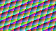

# R09 — before/after pixels from real Vulkan GPU readback
November 7, 2026.

**These are NOT screenshots of a game, DLSS Super Resolution output,
or a completed Original/Compact model inference.** They show the
deterministic synthetic RGB texture fed to the tested Vulkan pipeline,
followed by the real RGBA32F storage image converted to PNG from GPU
readback. The pixel test uses a fixed FP16 learned-head **fixture**,
neural rendering intensity 65%, and FP16-truncated output.

### Reproduction

- CI: https://github.com/niakw/ProsperoEden-Encore/actions/runs/42375782325
- Vulkan test: `tools/graphics/r09_vulkan_io_smoke.cpp`.
- PNG encoder: `tools/graphics/r09_export_evidence.py`.
- Model weights: no NVIDIA proprietary weights are bundled or inferred.
- Source resolution of this evidence: **80 × 45 px**. The separate
  test covers all **1920 × 1080** pixels with the same Vulkan passes;
  it does not save a game screenshot or prove full network inference.
- Passes: normalized texture capture -> known FP16 head composition ->
  Vulkan image publication/readback. The temporal shader is tested
  separately in both cold-start and valid-history modes.

Both images are unretouched byte data from CI's deterministic fixture
and actual Vulkan readback. No generative imaging was used.
